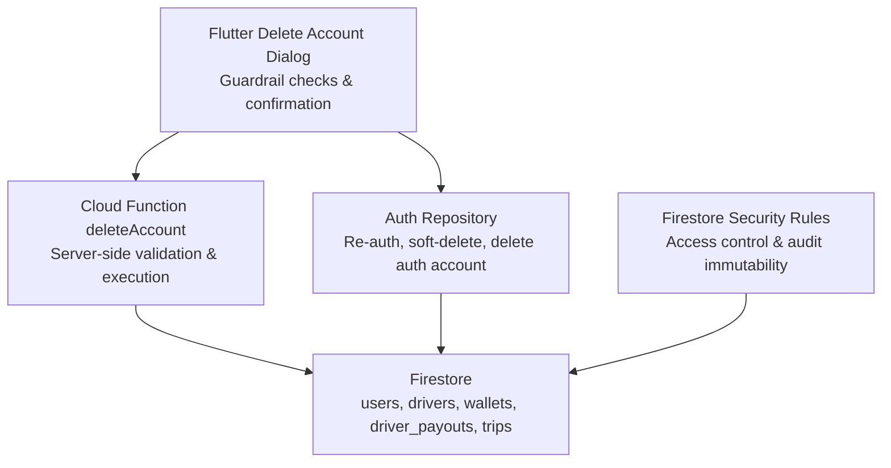
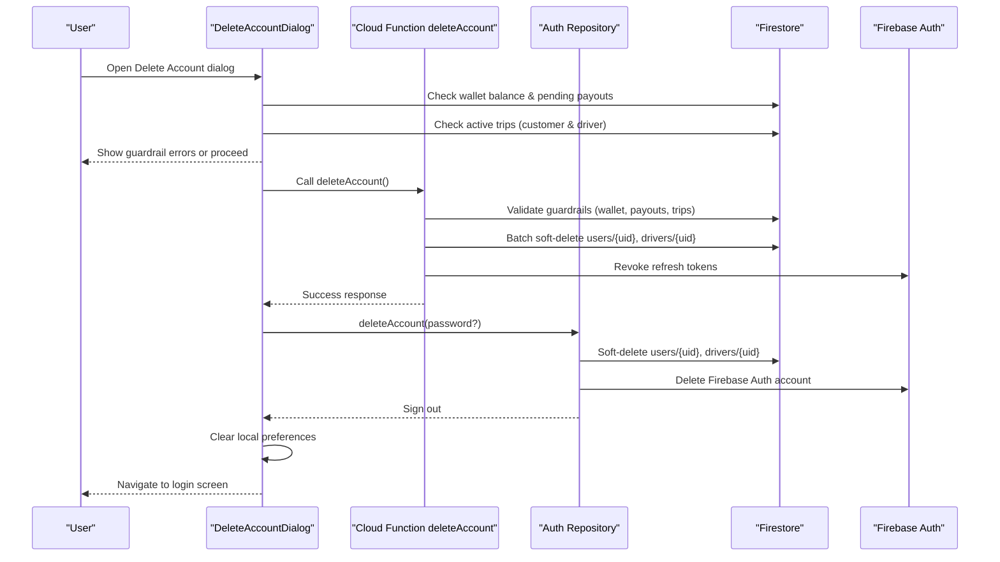
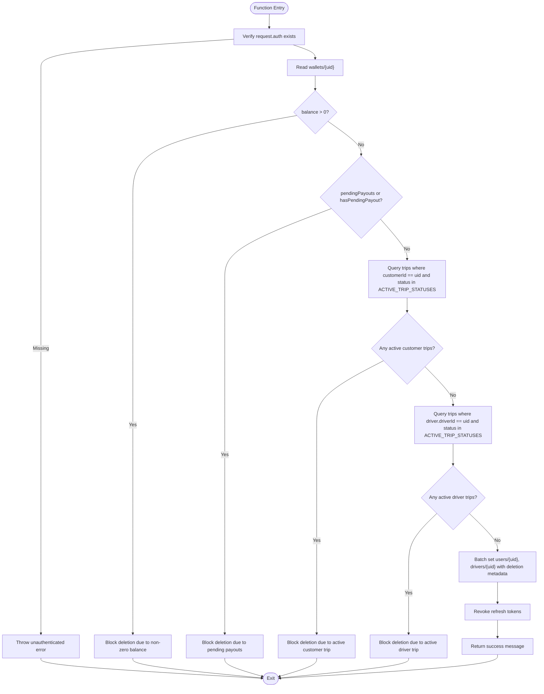
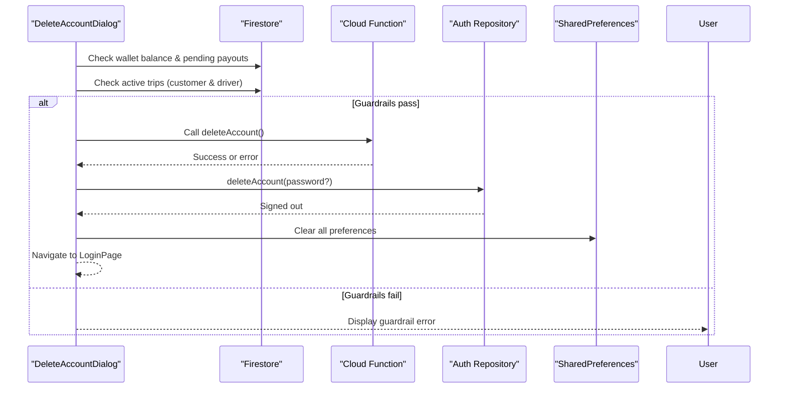
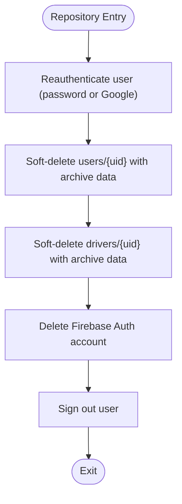
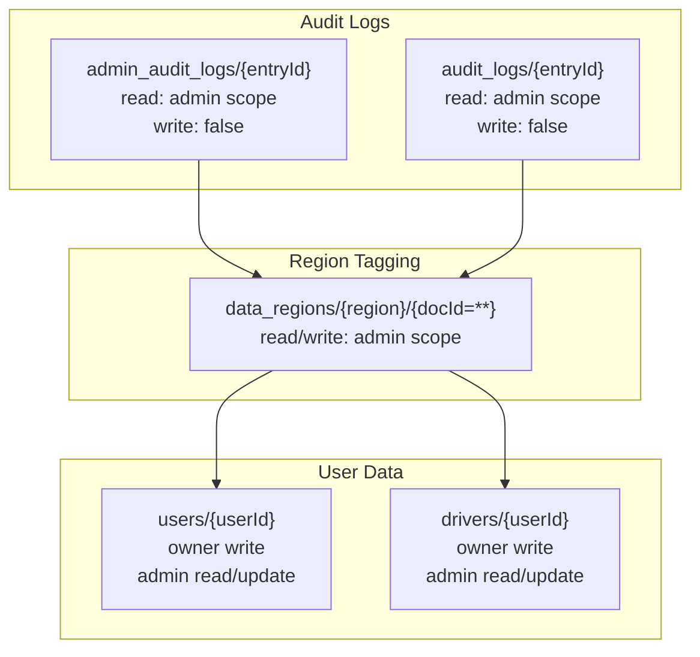
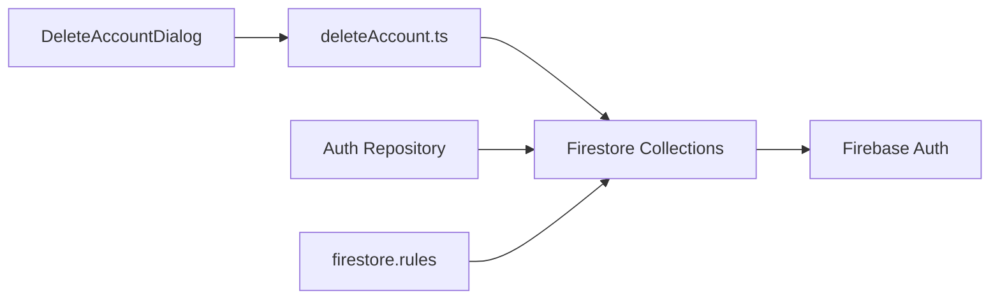

# Account Management

<cite>
**Referenced Files in This Document**
- [deleteAccount.ts](file://functions/src/deleteAccount.ts)
- [delete_account_dialog.dart](file://sese_ride/lib/features/settings/delete_account_dialog.dart)
- [firebase_auth_repository.dart](file://sese_core/lib/auth/firebase_auth_repository.dart)
- [firestore.rules](file://firestore.rules)
</cite>

## Table of Contents
1. [Introduction](#introduction)
2. [Project Structure](#project-structure)
3. [Core Components](#core-components)
4. [Architecture Overview](#architecture-overview)
5. [Detailed Component Analysis](#detailed-component-analysis)
6. [Dependency Analysis](#dependency-analysis)
7. [Performance Considerations](#performance-considerations)
8. [Troubleshooting Guide](#troubleshooting-guide)
9. [Conclusion](#conclusion)

## Introduction
This document explains the account management functionality with a focus on account deletion workflows, data cleanup processes, and GDPR-related compliance measures. It covers:
- Hard guardrails that prevent unsafe deletions (wallet balance, pending payouts, active trips).
- Soft-deletion and 30-day regulatory archival for user and driver records.
- Session revocation to immediately invalidate active sessions.
- Data retention policies and privacy protections enforced by security rules.
- Examples of account lifecycle management from UI to backend.
- Audit logging considerations and guidance for compliance reporting.

## Project Structure
The account deletion feature spans three layers:
- Client UI layer: A Flutter dialog that validates guardrails and triggers deletion.
- Core authentication repository: Performs re-authentication, soft-deletion, and Firebase Auth account deletion.
- Backend Cloud Function: Enforces server-side guardrails, performs batch soft-deletions, and revokes refresh tokens.
- Firestore Security Rules: Restrict access to sensitive collections and enforce audit log immutability.

**Diagram sources**
- [delete_account_dialog.dart:74-237](file://sese_ride/lib/features/settings/delete_account_dialog.dart#L74-L237)
- [deleteAccount.ts:28-139](file://functions/src/deleteAccount.ts#L28-L139)
- [firebase_auth_repository.dart:436-487](file://sese_core/lib/auth/firebase_auth_repository.dart#L436-L487)
- [firestore.rules:182-189](file://firestore.rules#L182-L189)

**Section sources**
- [delete_account_dialog.dart:1-237](file://sese_ride/lib/features/settings/delete_account_dialog.dart#L1-L237)
- [deleteAccount.ts:1-139](file://functions/src/deleteAccount.ts#L1-L139)
- [firebase_auth_repository.dart:430-487](file://sese_core/lib/auth/firebase_auth_repository.dart#L430-L487)
- [firestore.rules:182-189](file://firestore.rules#L182-L189)

## Core Components
- Secure Account Deletion Dialog: Validates financial and operational guardrails before allowing deletion; invokes backend function and client-side deletion flow.
- Cloud Function deleteAccount: Server-side enforcement of guardrails, batch soft-deletion of user and driver documents, and session token revocation.
- Auth Repository deleteAccount: Re-authenticates user, marks accounts as deleted with 30-day purge schedule, and deletes Firebase Auth account.
- Firestore Security Rules: Protect sensitive data, restrict admin-only audit logs, and enforce region-tagged data handling.

Key responsibilities:
- Guardrails: Wallet balance, pending payouts, active customer/driver trips.
- Soft-deletion: Mark accounts as deleted with timestamps and scheduled purge date.
- Session revocation: Invalidate refresh tokens to prevent further authenticated operations.
- Privacy protection: Restrict read/write access to sensitive collections and ensure audit logs are append-only.

**Section sources**
- [delete_account_dialog.dart:74-237](file://sese_ride/lib/features/settings/delete_account_dialog.dart#L74-L237)
- [deleteAccount.ts:28-139](file://functions/src/deleteAccount.ts#L28-L139)
- [firebase_auth_repository.dart:436-487](file://sese_core/lib/auth/firebase_auth_repository.dart#L436-L487)
- [firestore.rules:182-189](file://firestore.rules#L182-L189)

## Architecture Overview
The deletion workflow is orchestrated across client and server layers with strict guardrails and privacy controls.

**Diagram sources**
- [delete_account_dialog.dart:74-237](file://sese_ride/lib/features/settings/delete_account_dialog.dart#L74-L237)
- [deleteAccount.ts:28-139](file://functions/src/deleteAccount.ts#L28-L139)
- [firebase_auth_repository.dart:436-487](file://sese_core/lib/auth/firebase_auth_repository.dart#L436-L487)

## Detailed Component Analysis

### Cloud Function deleteAccount
Responsibilities:
- Authenticate request via Firebase Auth context.
- Enforce hard guardrails: wallet balance, pending payouts, active trips.
- Perform batch soft-deletion of user and driver documents with 30-day archival metadata.
- Revoke refresh tokens to invalidate active sessions.

**Diagram sources**
- [deleteAccount.ts:28-139](file://functions/src/deleteAccount.ts#L28-L139)

**Section sources**
- [deleteAccount.ts:28-139](file://functions/src/deleteAccount.ts#L28-L139)

### Flutter Delete Account Dialog
Responsibilities:
- Pre-check guardrails locally (wallet balance, pending payouts, active trips).
- Require explicit re-authentication (password for email users, Google sign-in for OAuth).
- Invoke backend Cloud Function and fallback to client-side deletion if needed.
- Clear local preferences and navigate back to login.

**Diagram sources**
- [delete_account_dialog.dart:74-237](file://sese_ride/lib/features/settings/delete_account_dialog.dart#L74-L237)

**Section sources**
- [delete_account_dialog.dart:74-237](file://sese_ride/lib/features/settings/delete_account_dialog.dart#L74-L237)

### Auth Repository deleteAccount
Responsibilities:
- Re-authenticate user (email password or Google OAuth).
- Soft-delete user and driver documents with 30-day archival metadata.
- Delete Firebase Auth account and sign out.

**Diagram sources**
- [firebase_auth_repository.dart:436-487](file://sese_core/lib/auth/firebase_auth_repository.dart#L436-L487)

**Section sources**
- [firebase_auth_repository.dart:436-487](file://sese_core/lib/auth/firebase_auth_repository.dart#L436-L487)

### Firestore Security Rules and Privacy Protection
Key aspects:
- Audit logs are immutable and only writable by server functions; readable by admins with appropriate scopes.
- Region-tagged data supports GDPR/PIPL/NDPR compliance routing.
- Sensitive collections (e.g., users, drivers) restrict writes to owners or admins.

**Diagram sources**
- [firestore.rules:182-189](file://firestore.rules#L182-L189)
- [firestore.rules:513-520](file://firestore.rules#L513-L520)
- [firestore.rules:472-477](file://firestore.rules#L472-L477)
- [firestore.rules:369-375](file://firestore.rules#L369-L375)

**Section sources**
- [firestore.rules:182-189](file://firestore.rules#L182-L189)
- [firestore.rules:513-520](file://firestore.rules#L513-L520)
- [firestore.rules:472-477](file://firestore.rules#L472-L477)
- [firestore.rules:369-375](file://firestore.rules#L369-L375)

## Dependency Analysis
The deletion workflow depends on:
- Firestore collections: wallets, driver_payouts, trips, users, drivers.
- Firebase Auth for session management and account deletion.
- Cloud Functions for server-side enforcement.
- Security rules for access control and audit immutability.

**Diagram sources**
- [delete_account_dialog.dart:74-237](file://sese_ride/lib/features/settings/delete_account_dialog.dart#L74-L237)
- [deleteAccount.ts:28-139](file://functions/src/deleteAccount.ts#L28-L139)
- [firebase_auth_repository.dart:436-487](file://sese_core/lib/auth/firebase_auth_repository.dart#L436-L487)
- [firestore.rules:182-189](file://firestore.rules#L182-L189)

**Section sources**
- [delete_account_dialog.dart:74-237](file://sese_ride/lib/features/settings/delete_account_dialog.dart#L74-L237)
- [deleteAccount.ts:28-139](file://functions/src/deleteAccount.ts#L28-L139)
- [firebase_auth_repository.dart:436-487](file://sese_core/lib/auth/firebase_auth_repository.dart#L436-L487)
- [firestore.rules:182-189](file://firestore.rules#L182-L189)

## Performance Considerations
- Minimize redundant queries: The dialog and Cloud Function both check guardrails; consider centralizing logic to avoid duplicate reads.
- Batch operations: Use Firestore batch writes for soft-deletion to reduce round-trips.
- Token revocation: Ensure revokeRefreshTokens is idempotent and handles transient errors gracefully.
- Indexing: Ensure composite indexes exist for trips queries (customerId + status, driver.driverId + status) to optimize performance.

[No sources needed since this section provides general guidance]

## Troubleshooting Guide
Common issues and resolutions:
- Unauthenticated deletion attempts: Ensure the user is logged in and the Cloud Function receives a valid auth context.
- Guardrail failures: Address wallet balance, pending payouts, or active trips before attempting deletion.
- Re-authentication errors: For email users, verify password; for Google users, ensure OAuth flow completes successfully.
- Session not revoked: Check Cloud Function logs for revokeRefreshTokens errors and retry if necessary.
- Audit log access: Verify admin scope claims for reading audit logs; ensure logs are written only by trusted server functions.

**Section sources**
- [deleteAccount.ts:28-34](file://functions/src/deleteAccount.ts#L28-L34)
- [delete_account_dialog.dart:220-236](file://sese_ride/lib/features/settings/delete_account_dialog.dart#L220-L236)
- [firestore.rules:182-189](file://firestore.rules#L182-L189)

## Conclusion
The account management system implements robust safeguards for account deletion, including financial and operational guardrails, soft-deletion with 30-day archival, session revocation, and privacy-preserving security rules. While the current implementation focuses on soft-deletion and does not perform cascading deletions or automated purging, it establishes a strong foundation for GDPR compliance through audit immutability, region-tagged data, and strict access controls. Future enhancements could include automated archival workflows, comprehensive cascading deletions, and enhanced audit logging for compliance reporting.

[No sources needed since this section summarizes without analyzing specific files]