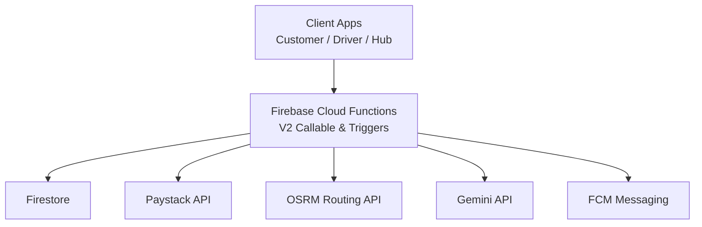
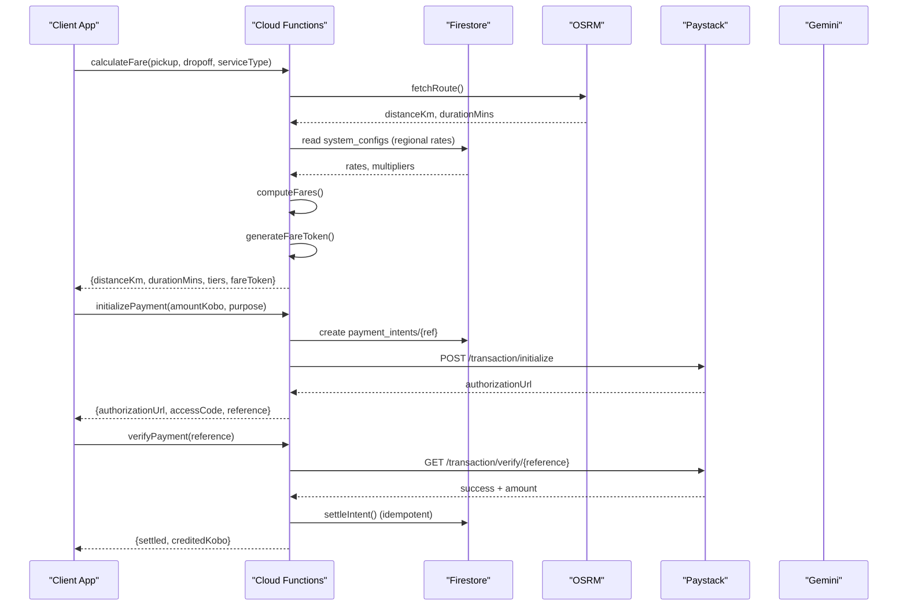
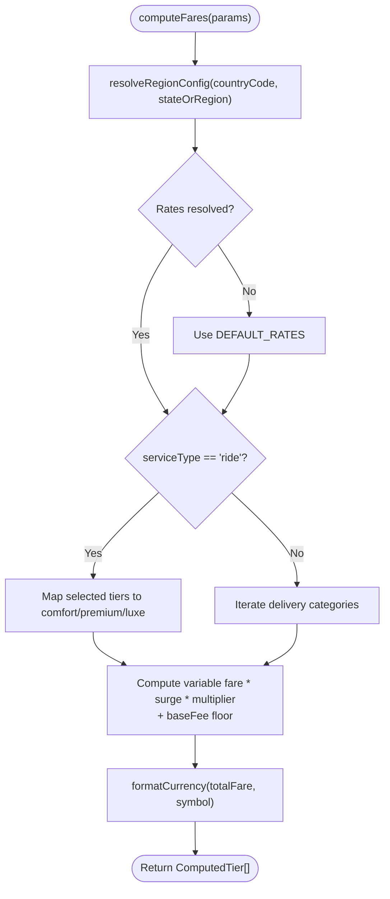
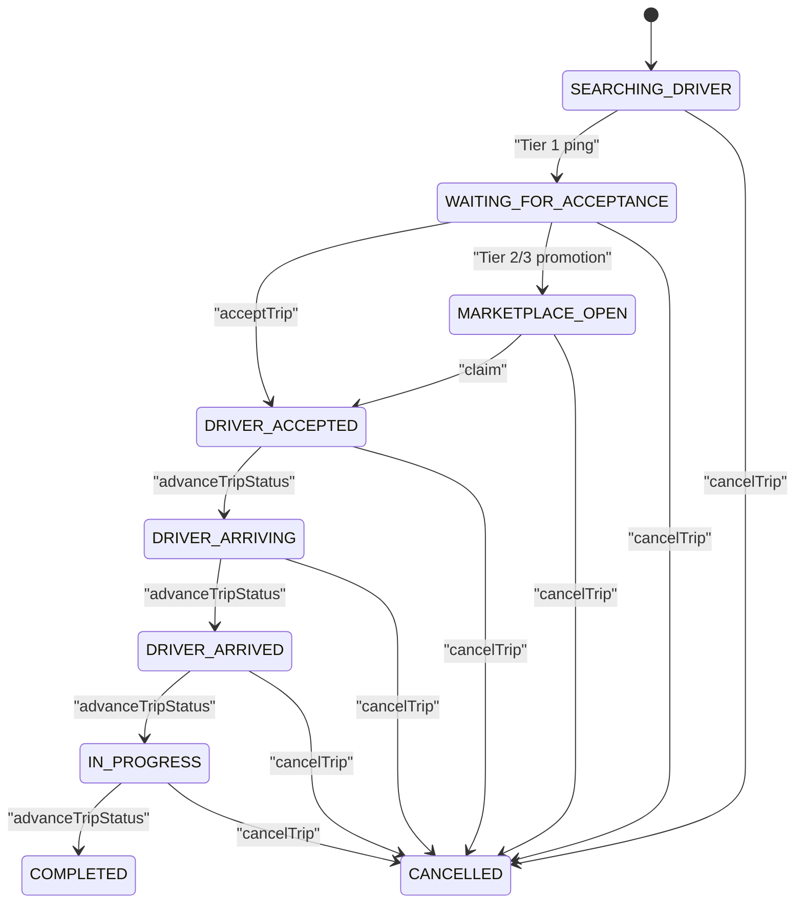
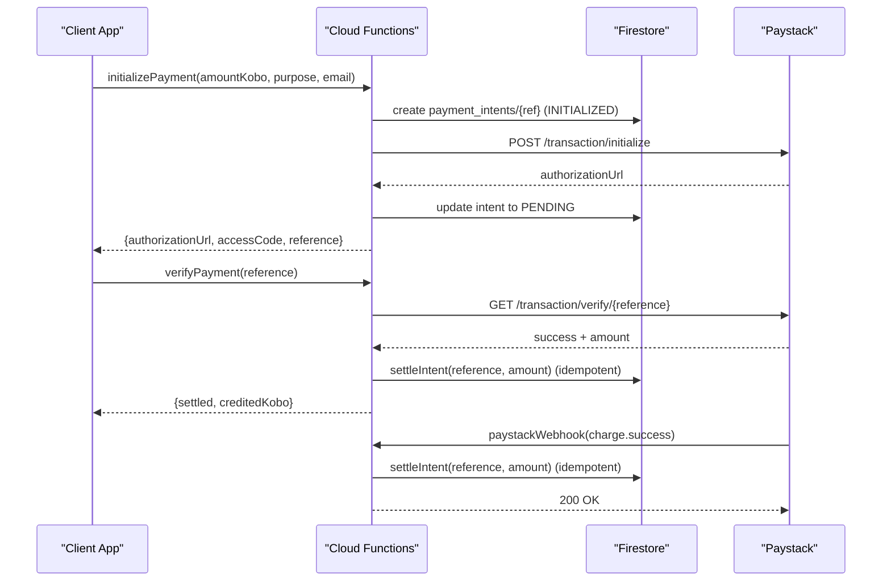
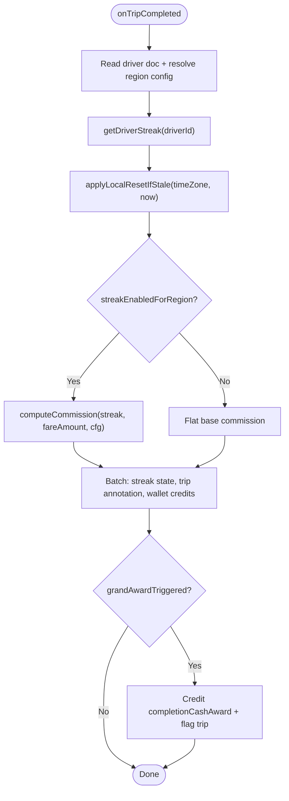
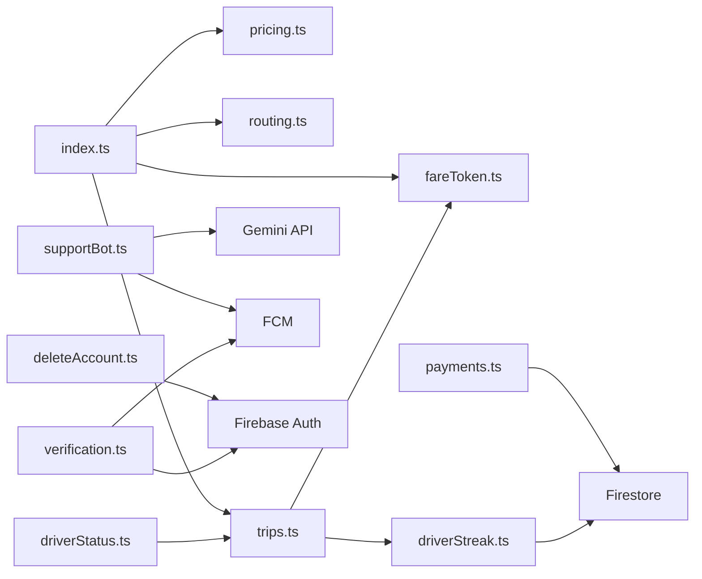

# Backend Services

<cite>
**Referenced Files in This Document**
- [firebase.json](file://firebase.json)
- [package.json](file://functions/package.json)
- [index.ts](file://functions/src/index.ts)
- [pricing.ts](file://functions/src/pricing.ts)
- [routing.ts](file://functions/src/routing.ts)
- [fareToken.ts](file://functions/src/fareToken.ts)
- [trips.ts](file://functions/src/trips.ts)
- [driverStatus.ts](file://functions/src/driverStatus.ts)
- [payments.ts](file://functions/src/payments.ts)
- [supportBot.ts](file://functions/src/supportBot.ts)
- [driverStreak.ts](file://functions/src/driverStreak.ts)
- [deleteAccount.ts](file://functions/src/deleteAccount.ts)
- [verification.ts](file://functions/src/verification.ts)
</cite>

## Table of Contents
1. [Introduction](#introduction)
2. [Project Structure](#project-structure)
3. [Core Components](#core-components)
4. [Architecture Overview](#architecture-overview)
5. [Detailed Component Analysis](#detailed-component-analysis)
6. [Dependency Analysis](#dependency-analysis)
7. [Performance Considerations](#performance-considerations)
8. [Troubleshooting Guide](#troubleshooting-guide)
9. [Conclusion](#conclusion)

## Introduction
This document describes the serverless backend for a ride and delivery platform built with Firebase Cloud Functions. It explains the zero-trust architecture, function organization, critical business logic (pricing engine, trip management, payments, support bot), invocation patterns, error handling, logging, performance optimization, security considerations, rate limiting, and monitoring strategies for production deployments.

The codebase is organized by feature modules under functions/src, compiled to functions/lib, and deployed as a single Firebase Functions codebase configured in firebase.json. The runtime uses Node 22 with TypeScript and modern V2 function signatures.

## Project Structure
The backend is a single Firebase Functions project:
- Entry point initializes Admin SDK and re-exports callable functions and triggers from feature modules.
- Feature modules encapsulate domain logic: pricing, routing, fare tokens, trips, driver status, payments, support bot, streaks, account deletion, and verification.
- Deployment configuration compiles TypeScript before deploy and targets the default codebase.

**Diagram sources**
- [index.ts:1-20](file://functions/src/index.ts#L1-L20)
- [index.ts:21-53](file://functions/src/index.ts#L21-L53)
- [payments.ts:1-26](file://functions/src/payments.ts#L1-L26)
- [routing.ts:1-12](file://functions/src/routing.ts#L1-L12)
- [supportBot.ts:1-19](file://functions/src/supportBot.ts#L1-L19)

**Section sources**
- [firebase.json:1-28](file://firebase.json#L1-L28)
- [package.json:1-24](file://functions/package.json#L1-L24)
- [index.ts:1-53](file://functions/src/index.ts#L1-L53)

## Core Components
- Pricing Engine: Computes fares per vehicle tier using road distance and duration, regional rates, and multipliers; returns signed fare tokens.
- Trip Management System: Server-authoritative state machine for dispatch, matchmaking, acceptance, location updates, and lifecycle transitions.
- Payment Processing: Secure wallet top-up and trip payment flow via Paystack with idempotent settlement and webhook verification.
- Support Bot Integration: AI-powered chat assistant that answers user queries and escalates to human agents when needed.
- Driver Streak & Commission Engine: Dynamic daily commission tiers, cash-back, bonuses, and local-midnight resets.
- Driver Status & Verification: Zero-trust online/offline handshake and admin-driven KYC/vehicle verification flows.
- Account Deletion: Safe, guarded account deletion pipeline with financial and active-trip checks.

**Section sources**
- [pricing.ts:1-237](file://functions/src/pricing.ts#L1-L237)
- [trips.ts:1-800](file://functions/src/trips.ts#L1-L800)
- [payments.ts:1-371](file://functions/src/payments.ts#L1-L371)
- [supportBot.ts:1-256](file://functions/src/supportBot.ts#L1-L256)
- [driverStreak.ts:1-708](file://functions/src/driverStreak.ts#L1-L708)
- [driverStatus.ts:1-220](file://functions/src/driverStatus.ts#L1-L220)
- [verification.ts:1-351](file://functions/src/verification.ts#L1-L351)
- [deleteAccount.ts:1-140](file://functions/src/deleteAccount.ts#L1-L140)

## Architecture Overview
The system follows a zero-trust model: clients never compute or assert authoritative values such as fares, amounts, or availability. All sensitive computations and state transitions occur server-side.

Key principles:
- Authentication required for all callables; request.auth is validated.
- Signed fare tokens prevent client tampering.
- Server-authoritative trip state machine enforces valid transitions.
- Payments are settled only after server-side verification and HMAC signature checks.
- Driver availability is verified against suspension, profile/vehicle approval, and live trip constraints.

**Diagram sources**
- [index.ts:62-198](file://functions/src/index.ts#L62-L198)
- [pricing.ts:166-236](file://functions/src/pricing.ts#L166-L236)
- [routing.ts:40-67](file://functions/src/routing.ts#L40-L67)
- [fareToken.ts:21-58](file://functions/src/fareToken.ts#L21-L58)
- [payments.ts:108-198](file://functions/src/payments.ts#L108-L198)
- [payments.ts:283-326](file://functions/src/payments.ts#L283-L326)

## Detailed Component Analysis

### Pricing Engine
Responsibilities:
- Resolve regional configuration (global → country → state) with fallback defaults.
- Compute fares per vehicle tier including base fee, distance/time rates, surge multipliers, and car-tier multipliers.
- Format currency and return structured tier results.

Invocation pattern:
- Called from calculateFare callable after fetching route distance and duration.
- Returns ComputedTier[] used to build the signed fare token.

Error handling:
- Individual Firestore reads fail gracefully; defaults are used if unreachable.
- Invalid inputs rejected upstream in calculateFare.

Performance:
- Minimal Firestore reads (at most three config docs).
- Pure computation for fare math; no heavy I/O.

**Diagram sources**
- [pricing.ts:65-147](file://functions/src/pricing.ts#L65-L147)
- [pricing.ts:166-236](file://functions/src/pricing.ts#L166-L236)

**Section sources**
- [pricing.ts:1-237](file://functions/src/pricing.ts#L1-L237)

### Fare Token Security
Purpose:
- Provide a tamper-proof, time-bounded token containing the authoritative fare calculation result.

Mechanism:
- HMAC-SHA256 signing over JSON payload with a secret key.
- Base64url-encoded payload plus signature; verification includes timing-safe comparison and expiry check.

Security considerations:
- Secret should be set via environment variables; default insecure value must be replaced in production.
- Tokens expire after a configurable max age.

**Section sources**
- [fareToken.ts:1-59](file://functions/src/fareToken.ts#L1-L59)

### Routing Integration
Purpose:
- Obtain road-network distance and duration between pickup and dropoff coordinates.

Implementation:
- Uses OSRM public demo endpoint by default; can be switched via OSRM_BASE_URL.
- Includes timeout and error handling for network failures.

Fallback behavior:
- If OSRM fails, calculateFare falls back to crow-flies distance estimation with a winding factor and assumed speed.

**Section sources**
- [routing.ts:1-109](file://functions/src/routing.ts#L1-L109)
- [index.ts:144-166](file://functions/src/index.ts#L144-L166)

### Trip Management System
Responsibilities:
- Create trips with validated inputs and signed fare tokens.
- Cascading matchmaking: Tier 1 (nearest exclusive), Tier 2 (next two nearest), Tier 3 (marketplace broadcast).
- Scheduled sweep promotes offers, expires pings, and restarts search.
- Driver actions: accept, decline, update location, advance status.
- Customer actions: cancel.

State machine highlights:
- Live statuses enforced; transitions validated.
- First-wins claim for marketplace via transaction.
- Ping expiration breaks driver streaks and promotes tiers.

Error handling:
- Strong input validation and permission checks.
- Transactional updates ensure consistency.

**Diagram sources**
- [trips.ts:12-26](file://functions/src/trips.ts#L12-L26)
- [trips.ts:55-63](file://functions/src/trips.ts#L55-L63)
- [trips.ts:591-653](file://functions/src/trips.ts#L591-L653)
- [trips.ts:756-796](file://functions/src/trips.ts#L756-L796)

**Section sources**
- [trips.ts:1-800](file://functions/src/trips.ts#L1-L800)

### Driver Status & Availability
Responsibilities:
- Enforce zero-trust online/offline handshake.
- Validate GPS fix, mock detection, accuracy bounds, suspension, profile/vehicle verification, and active trips.
- Maintain authoritative driver_status mirror and drivers.lastLocation.

Security:
- JWT authentication and UID binding.
- Fleet verification guard ensures approved vehicles.

**Section sources**
- [driverStatus.ts:1-220](file://functions/src/driverStatus.ts#L1-L220)

### Payment Processing
Responsibilities:
- Initialize Paystack checkout, create payment intents, verify payments, and settle funds idempotently.
- Webhook handler verifies HMAC signature and settles on charge.success.

Idempotency:
- settleIntent uses transactions to ensure exactly-once crediting.

Security:
- Secret key accessed only server-side.
- Amount/currency validation and mismatch rejection.

**Diagram sources**
- [payments.ts:108-198](file://functions/src/payments.ts#L108-L198)
- [payments.ts:206-272](file://functions/src/payments.ts#L206-L272)
- [payments.ts:283-326](file://functions/src/payments.ts#L283-L326)
- [payments.ts:333-371](file://functions/src/payments.ts#L333-L371)

**Section sources**
- [payments.ts:1-371](file://functions/src/payments.ts#L1-L371)

### Support Bot Integration
Responsibilities:
- Listen for user messages in support chats.
- Call Gemini to generate replies and decide escalation.
- Post AI responses or escalate to human agent with FCM alert.

Escalation:
- Heuristic keywords and model verdict trigger escalation.
- Escalation flips chat status and notifies admin topic.

Reliability:
- Graceful handling of missing API keys and failed calls.

**Section sources**
- [supportBot.ts:1-256](file://functions/src/supportBot.ts#L1-L256)

### Driver Streak & Commission Engine
Responsibilities:
- Compute dynamic daily commission tiers (Level 1 step-down discount, Level 2 cash-back recovery, Level 3 cash bonus).
- Apply break rules and local-midnight resets per driver timezone.
- Persist streak state, annotate trips, credit wallets, and handle grand awards.

Triggers:
- onTripCompleted computes and persists outcomes.
- onTripCancelled applies break rules based on cancellationSource.
- scheduledResetStreaks performs hourly lazy reset sweep.

**Diagram sources**
- [driverStreak.ts:381-524](file://functions/src/driverStreak.ts#L381-L524)
- [driverStreak.ts:535-557](file://functions/src/driverStreak.ts#L535-L557)
- [driverStreak.ts:631-707](file://functions/src/driverStreak.ts#L631-L707)

**Section sources**
- [driverStreak.ts:1-708](file://functions/src/driverStreak.ts#L1-L708)

### Account Deletion Pipeline
Responsibilities:
- Guardrails: reject if wallet balance > 0, pending payouts exist, or active trips exist (as customer or driver).
- Execution: soft-delete with archival timestamp and revoke refresh tokens.

Safety:
- Uses batch writes and revokes tokens even if some steps fail.

**Section sources**
- [deleteAccount.ts:1-140](file://functions/src/deleteAccount.ts#L1-L140)

### Verification Flows
Responsibilities:
- Admin callables approve/reject customer and driver verification.
- Sync custom claims and send FCM notifications.
- Triggers react to direct Firestore updates to keep claims and notifications in sync.

**Section sources**
- [verification.ts:1-351](file://functions/src/verification.ts#L1-L351)

## Dependency Analysis
High-level dependencies:
- index.ts re-exports all callable functions and triggers from feature modules.
- pricing.ts depends on Firestore system_configs and formatCurrency utility.
- routing.ts depends on external OSRM API.
- fareToken.ts provides cryptographic helpers used by index.ts and trips.ts.
- trips.ts orchestrates matchmaking and lifecycle, invoking fareToken verification and driverStreak break utilities.
- driverStatus.ts interacts with users, drivers, and trips collections.
- payments.ts integrates with Paystack and Firestore.
- supportBot.ts integrates with Gemini and FCM.
- driverStreak.ts reacts to trip events and schedules resets.
- deleteAccount.ts and verification.ts interact with Auth, Firestore, and FCM.

**Diagram sources**
- [index.ts:21-53](file://functions/src/index.ts#L21-L53)
- [trips.ts:1-11](file://functions/src/trips.ts#L1-L11)
- [driverStatus.ts:1-4](file://functions/src/driverStatus.ts#L1-L4)
- [payments.ts:1-4](file://functions/src/payments.ts#L1-L4)
- [supportBot.ts:1-3](file://functions/src/supportBot.ts#L1-L3)
- [driverStreak.ts:1-4](file://functions/src/driverStreak.ts#L1-L4)
- [deleteAccount.ts:1-3](file://functions/src/deleteAccount.ts#L1-L3)
- [verification.ts:1-4](file://functions/src/verification.ts#L1-L4)

**Section sources**
- [index.ts:21-53](file://functions/src/index.ts#L21-L53)
- [trips.ts:1-11](file://functions/src/trips.ts#L1-L11)
- [driverStatus.ts:1-4](file://functions/src/driverStatus.ts#L1-L4)
- [payments.ts:1-4](file://functions/src/payments.ts#L1-L4)
- [supportBot.ts:1-3](file://functions/src/supportBot.ts#L1-L3)
- [driverStreak.ts:1-4](file://functions/src/driverStreak.ts#L1-L4)
- [deleteAccount.ts:1-3](file://functions/src/deleteAccount.ts#L1-L3)
- [verification.ts:1-4](file://functions/src/verification.ts#L1-L4)

## Performance Considerations
- Prefer V2 functions with concurrency enabled; consider cpu: "gcf_gen1" if preserving V1 single-concurrency pricing is desired.
- Minimize Firestore reads by batching and caching within function scope where safe.
- Use scheduled sweeps for background work (e.g., sweepTripPings, scheduledResetStreaks) to avoid blocking callables.
- External API calls (OSRM, Paystack, Gemini) should have timeouts and retries at the caller level; circuit-breaker patterns can be added for resilience.
- Avoid top-level initialization of SDK clients; initialize once and reuse within the function context.

[No sources needed since this section provides general guidance]

## Troubleshooting Guide
Common issues and resolutions:
- Unauthenticated errors: Ensure callers pass valid Firebase ID tokens to callables.
- Invalid arguments: Validate coordinates, phone numbers, amounts, and references before calling functions.
- Payment mismatches: Verify amount and currency match the intent; check Paystack verification response.
- Webhook signature failures: Confirm HMAC signature matches raw body and secret key is configured.
- OSRM routing failures: Check network connectivity and OSRM_BASE_URL; fallback logic will estimate distances.
- Gemini unavailability: If API key missing or call fails, bot escalates or posts a fallback message.
- Driver cannot go online: Check suspension flags, profile/vehicle verification, and active trips.

Logging approach:
- Use console.log/warn/error for operational visibility; integrate with Cloud Logging in production.
- For sensitive data, avoid logging payloads; log identifiers and outcomes only.

Monitoring strategies:
- Track function invocations, errors, and latency via Firebase Console and Cloud Monitoring.
- Set up alerts for payment failures, webhook signature mismatches, and high error rates.
- Monitor streak reset sweeps and dispatch promotions for correctness.

**Section sources**
- [payments.ts:333-371](file://functions/src/payments.ts#L333-L371)
- [routing.ts:70-109](file://functions/src/routing.ts#L70-L109)
- [supportBot.ts:81-115](file://functions/src/supportBot.ts#L81-L115)
- [driverStatus.ts:32-57](file://functions/src/driverStatus.ts#L32-L57)

## Conclusion
The backend implements a robust, zero-trust serverless architecture centered around secure callables, event-driven triggers, and strict validation. The pricing engine, trip management system, payment processing, and support bot integration form a cohesive system that prioritizes security, correctness, and scalability. With careful attention to error handling, logging, and monitoring, the system is well-positioned for production deployments.

[No sources needed since this section summarizes without analyzing specific files]