# Cloud Functions Architecture

<cite>
**Referenced Files in This Document**
- [index.ts](file://functions/src/index.ts)
- [package.json](file://functions/package.json)
- [firebase.json](file://firebase.json)
- [trips.ts](file://functions/src/trips.ts)
- [pricing.ts](file://functions/src/pricing.ts)
- [fareToken.ts](file://functions/src/fareToken.ts)
- [routing.ts](file://functions/src/routing.ts)
- [driverStatus.ts](file://functions/src/driverStatus.ts)
- [payments.ts](file://functions/src/payments.ts)
- [supportBot.ts](file://functions/src/supportBot.ts)
- [verification.ts](file://functions/src/verification.ts)
</cite>

## Table of Contents
1. [Introduction](#introduction)
2. [Project Structure](#project-structure)
3. [Core Components](#core-components)
4. [Architecture Overview](#architecture-overview)
5. [Detailed Component Analysis](#detailed-component-analysis)
6. [Dependency Analysis](#dependency-analysis)
7. [Performance Considerations](#performance-considerations)
8. [Troubleshooting Guide](#troubleshooting-guide)
9. [Conclusion](#conclusion)

## Introduction
This document explains the Firebase Cloud Functions architecture for the project, focusing on serverless function organization, entry point structure, module exports, zero-trust security patterns, authentication guards, initialization and error handling, logging approaches, deployment configuration, performance optimization, cold start mitigation, and production monitoring strategies. The functions implement fare calculation, trip dispatch, driver status management, payments, support chat automation, and verification workflows.

## Project Structure
The Cloud Functions codebase is organized by feature modules under `functions/src`, with a single entry point that initializes the Admin SDK and re-exports all callable functions and triggers. TypeScript sources are compiled to `functions/lib` before deployment.

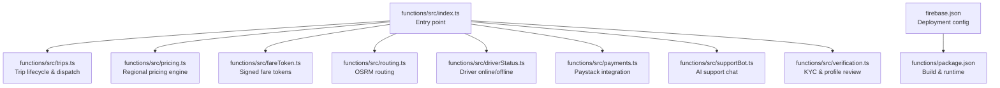

**Diagram sources**
- [index.ts:1-60](file://functions/src/index.ts#L1-L60)
- [firebase.json:11-26](file://firebase.json#L11-L26)
- [package.json:1-24](file://functions/package.json#L1-L24)

**Section sources**
- [index.ts:1-60](file://functions/src/index.ts#L1-L60)
- [firebase.json:11-26](file://firebase.json#L11-L26)
- [package.json:1-24](file://functions/package.json#L1-L24)

## Core Components
- Entry point and initialization: Initializes the Admin SDK early and disables metadata server probing outside Google Cloud to avoid cold-start timeouts. Exports callable functions and Firestore/scheduler triggers from feature modules.
- Trip orchestration: Callable endpoints create trips, accept/decline offers, update location, advance status, and a scheduled sweep promotes tiers and expires pings.
- Pricing engine: Resolves regional rates via a fallback chain (global → country → state), computes fares per tier, and formats currency.
- Fare token signing: HMAC-SHA256 signed tokens bind user identity, coordinates, distance, duration, and computed tiers to prevent client tampering.
- Routing: Fetches road-network distance and duration from OSRM with a timeout and error handling; falls back to crow-fly estimation when unavailable.
- Driver status: Zero-trust handshake validates JWT, GPS quality, suspension, verification, and active trips before updating authoritative online mirrors.
- Payments: Secure Paystack integration with idempotent settlement, amount validation, webhook signature verification, and wallet crediting.
- Support bot: Firestore-triggered AI assistant using Gemini with escalation heuristics and FCM notifications.
- Verification: Admin-driven KYC/profile review with custom claims and push notifications; triggers sync claims and notify users.

**Section sources**
- [index.ts:1-60](file://functions/src/index.ts#L1-L60)
- [trips.ts:12-26](file://functions/src/trips.ts#L12-L26)
- [pricing.ts:60-147](file://functions/src/pricing.ts#L60-L147)
- [fareToken.ts:17-58](file://functions/src/fareToken.ts#L17-L58)
- [routing.ts:1-12](file://functions/src/routing.ts#L1-L12)
- [driverStatus.ts:6-10](file://functions/src/driverStatus.ts#L6-L10)
- [payments.ts:5-26](file://functions/src/payments.ts#L5-L26)
- [supportBot.ts:4-19](file://functions/src/supportBot.ts#L4-L19)
- [verification.ts:19-25](file://functions/src/verification.ts#L19-L25)

## Architecture Overview
The system uses Firebase Functions v2 with callable HTTPS endpoints and Firestore/scheduler triggers. All sensitive logic runs server-side with strict input validation and zero-trust assumptions. External services include OSRM for routing and Paystack for payments.

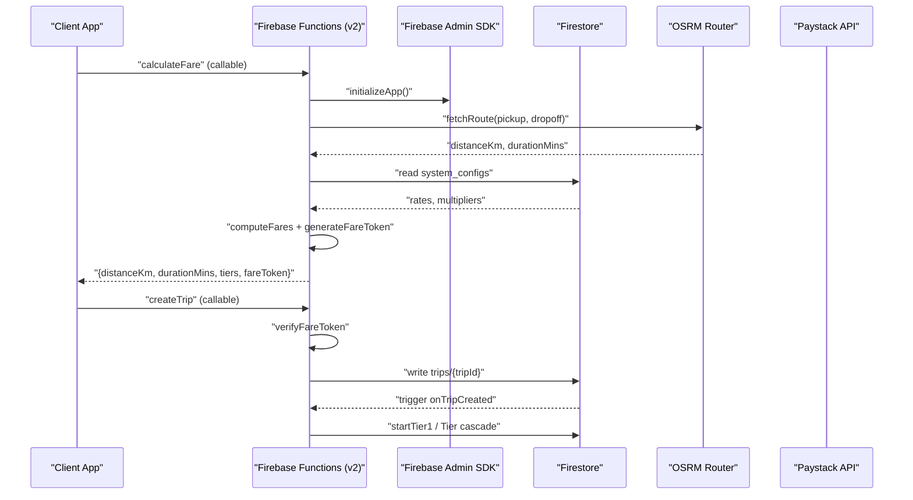

**Diagram sources**
- [index.ts:71-198](file://functions/src/index.ts#L71-L198)
- [routing.ts:40-67](file://functions/src/routing.ts#L40-L67)
- [pricing.ts:166-236](file://functions/src/pricing.ts#L166-L236)
- [fareToken.ts:21-58](file://functions/src/fareToken.ts#L21-L58)
- [trips.ts:125-225](file://functions/src/trips.ts#L125-L225)
- [trips.ts:372-384](file://functions/src/trips.ts#L372-L384)

## Detailed Component Analysis

### Entry Point and Module Exports
- Early Admin SDK initialization avoids uninitialized default app during trigger discovery.
- Metadata server detection disabled unless credentials are explicitly provided to prevent local dev hangs.
- Re-exports callable functions and triggers from feature modules for clean separation of concerns.

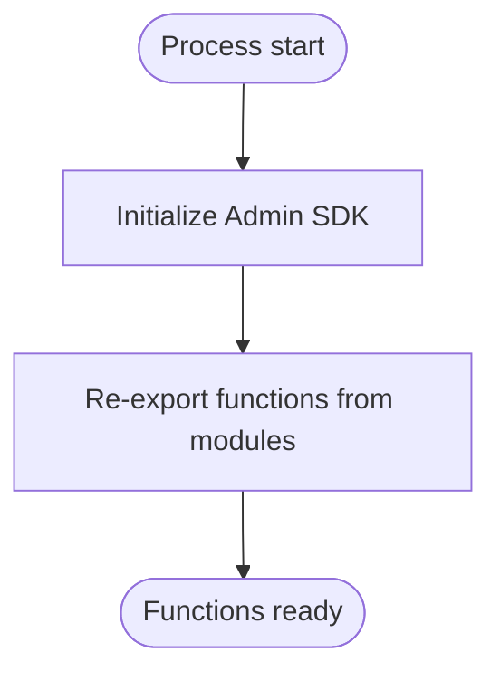

**Diagram sources**
- [index.ts:1-20](file://functions/src/index.ts#L1-L20)
- [index.ts:21-60](file://functions/src/index.ts#L21-L60)

**Section sources**
- [index.ts:1-60](file://functions/src/index.ts#L1-L60)

### Zero-Trust Security Patterns
- Authentication guard: Every callable checks `request.auth`; unauthenticated requests throw `HttpsError`.
- Input validation: Coordinates, phone numbers, service types, and amounts are validated with explicit bounds and type checks.
- Signed tokens: Fare calculations are signed server-side; clients cannot alter fares without invalidating the token.
- Authorization: Driver actions require ownership or ping-target eligibility; marketplace claims use atomic transactions.
- Payment integrity: Amounts and currencies are verified against external provider responses; webhooks verify signatures.

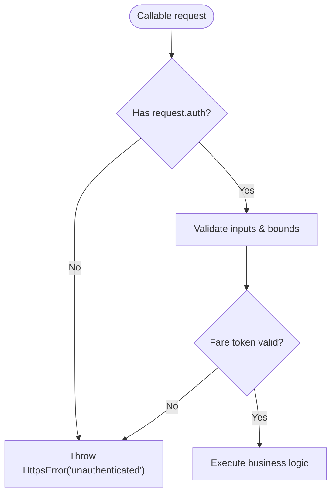

**Diagram sources**
- [index.ts:81-142](file://functions/src/index.ts#L81-L142)
- [trips.ts:129-167](file://functions/src/trips.ts#L129-L167)
- [payments.ts:108-197](file://functions/src/payments.ts#L108-L197)

**Section sources**
- [index.ts:81-142](file://functions/src/index.ts#L81-L142)
- [trips.ts:129-167](file://functions/src/trips.ts#L129-L167)
- [payments.ts:108-197](file://functions/src/payments.ts#L108-L197)

### Trip Lifecycle and Dispatch State Machine
- Server-authoritative state machine controls transitions between statuses.
- Cascading dispatch tiers: Tier 1 exclusive offer, Tier 2 simultaneous offers, Tier 3 marketplace broadcast.
- Scheduled sweep promotes tiers, expires pings, breaks streaks, and restarts searches.

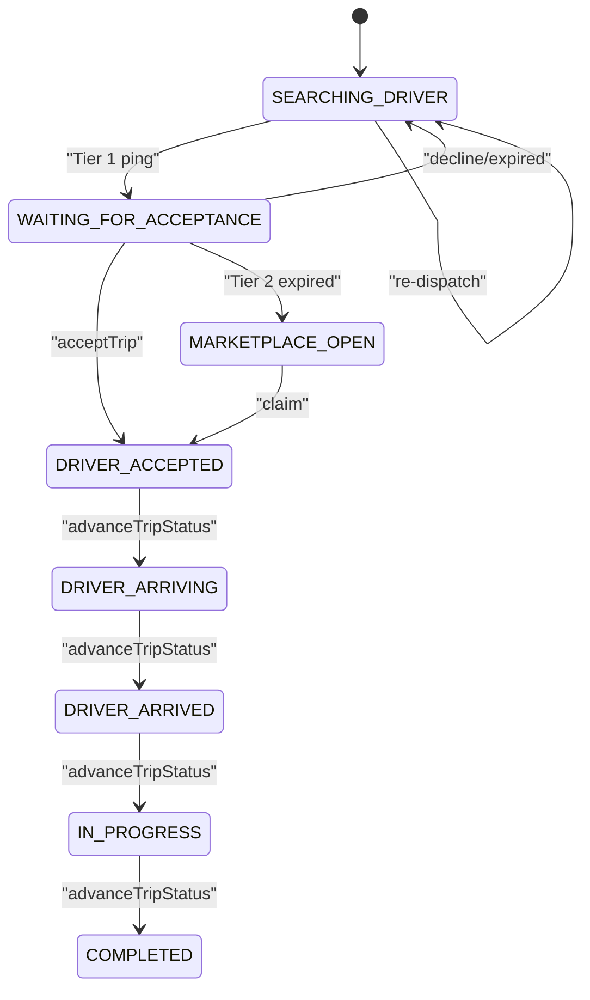

**Diagram sources**
- [trips.ts:12-26](file://functions/src/trips.ts#L12-L26)
- [trips.ts:295-370](file://functions/src/trips.ts#L295-L370)
- [trips.ts:401-512](file://functions/src/trips.ts#L401-L512)

**Section sources**
- [trips.ts:12-26](file://functions/src/trips.ts#L12-L26)
- [trips.ts:295-370](file://functions/src/trips.ts#L295-L370)
- [trips.ts:401-512](file://functions/src/trips.ts#L401-L512)

### Pricing Engine and Regional Configuration
- Resolves effective configuration via fallback chain: global default → country-specific → state-specific.
- Computes fares per vehicle category or car tiers with base fee, distance/time rates, surge multiplier, and tier multipliers.
- Formats currency using configured symbol.

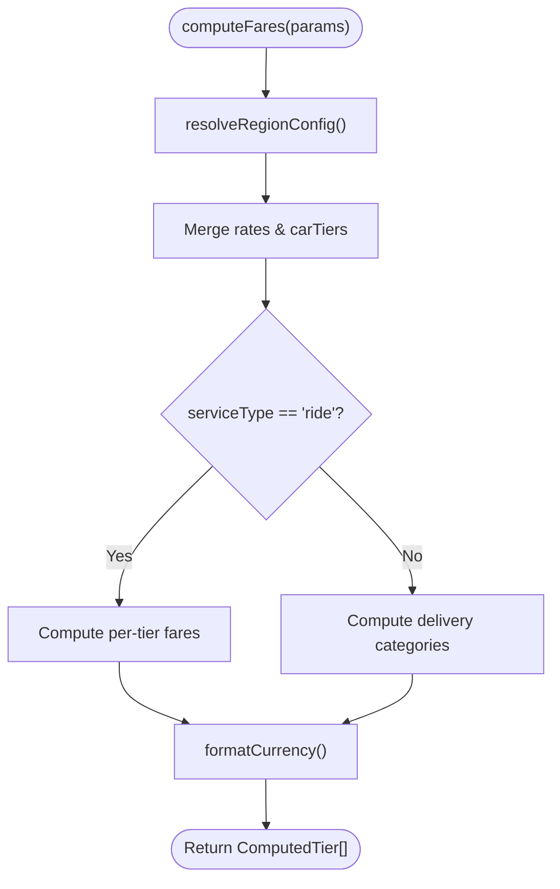

**Diagram sources**
- [pricing.ts:60-147](file://functions/src/pricing.ts#L60-L147)
- [pricing.ts:166-236](file://functions/src/pricing.ts#L166-L236)

**Section sources**
- [pricing.ts:60-147](file://functions/src/pricing.ts#L60-L147)
- [pricing.ts:166-236](file://functions/src/pricing.ts#L166-L236)

### Fare Token Signing and Verification
- Generates HMAC-SHA256 tokens binding payload fields and timestamp.
- Verifies signature and expiration; returns null if tampered or expired.

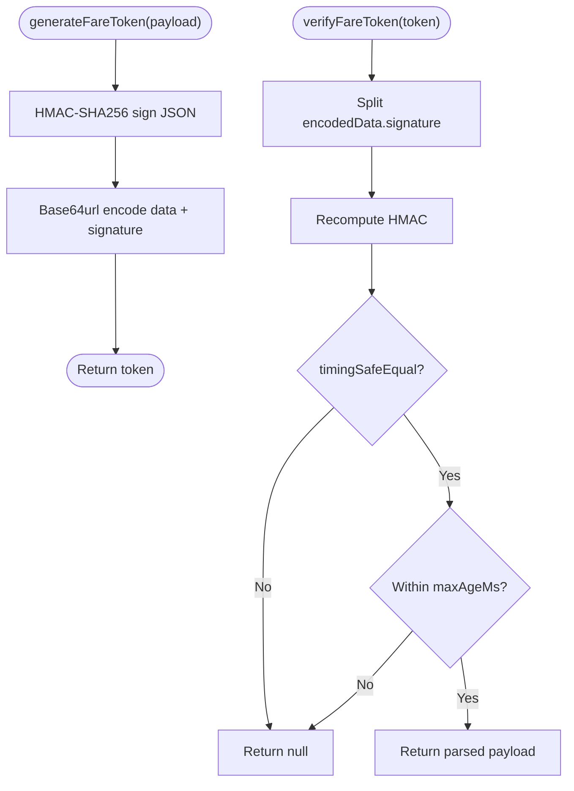

**Diagram sources**
- [fareToken.ts:21-58](file://functions/src/fareToken.ts#L21-L58)

**Section sources**
- [fareToken.ts:1-59](file://functions/src/fareToken.ts#L1-L59)

### Routing Integration and Fallback
- Fetches route via OSRM with timeout and error handling.
- If OSRM fails, calculate approximate crow-fly distance and estimated duration.

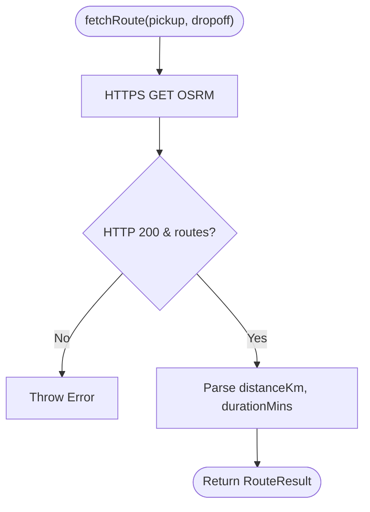

**Diagram sources**
- [routing.ts:40-67](file://functions/src/routing.ts#L40-L67)

**Section sources**
- [routing.ts:1-109](file://functions/src/routing.ts#L1-L109)

### Driver Status Handshake
- Validates JWT, GPS accuracy, mock location flag, suspension, profile/vehicle verification, and active trips.
- Updates authoritative online mirror and driver last seen/location.

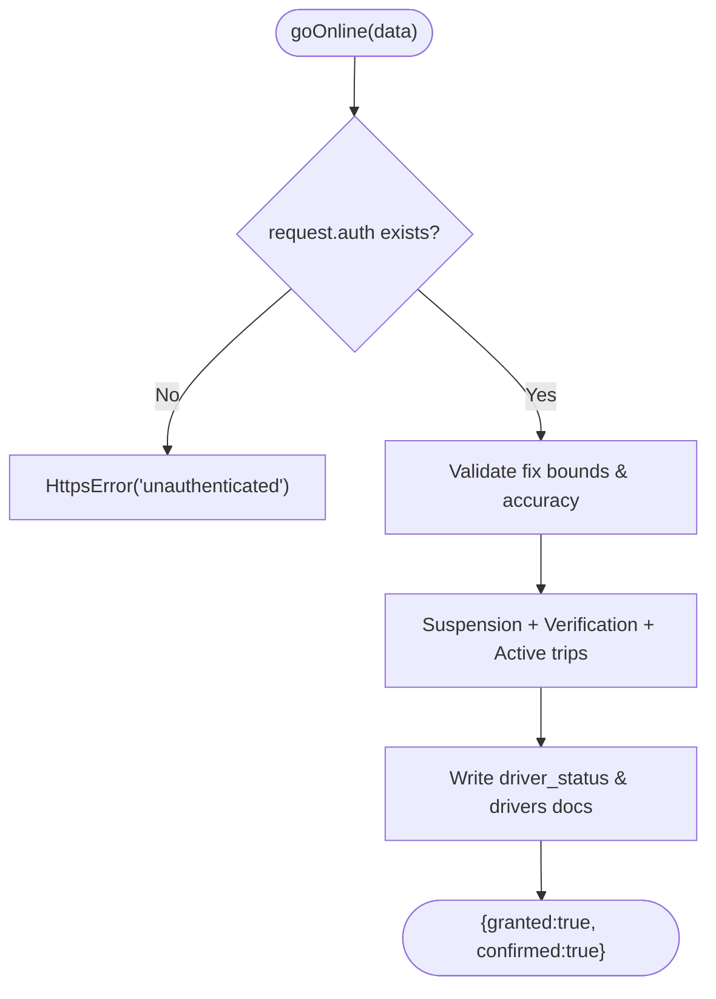

**Diagram sources**
- [driverStatus.ts:32-164](file://functions/src/driverStatus.ts#L32-L164)

**Section sources**
- [driverStatus.ts:1-220](file://functions/src/driverStatus.ts#L1-L220)

### Payments Flow (Paystack)
- Initialize payment intent, validate amount/email, call Paystack, store reference.
- Verify payment server-side, check amount/currency, settle idempotently via transaction.
- Webhook verifies HMAC signature and settles same path.

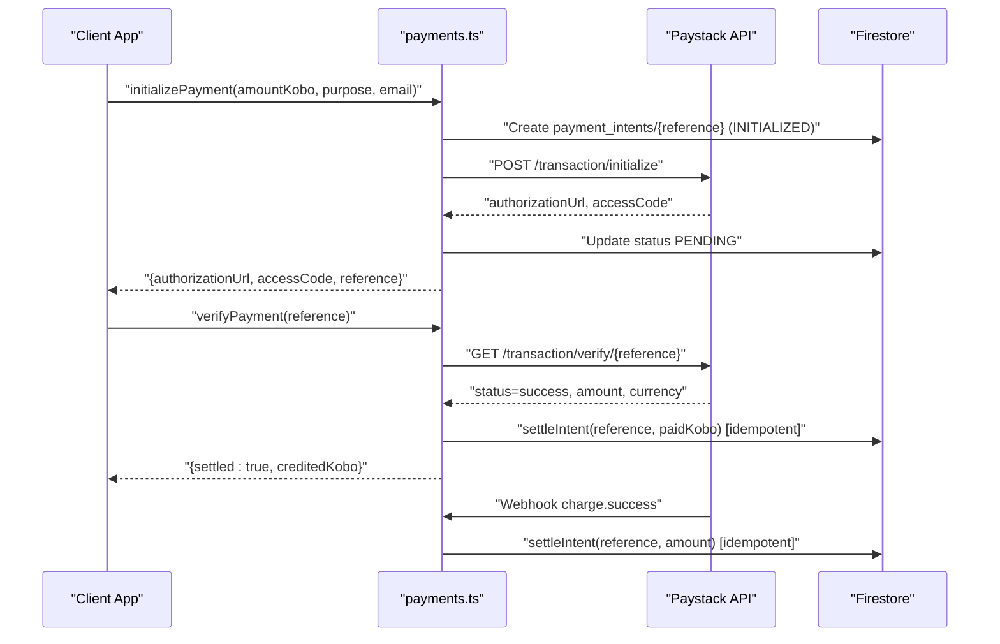

**Diagram sources**
- [payments.ts:108-197](file://functions/src/payments.ts#L108-L197)
- [payments.ts:206-272](file://functions/src/payments.ts#L206-L272)
- [payments.ts:283-326](file://functions/src/payments.ts#L283-L326)
- [payments.ts:333-370](file://functions/src/payments.ts#L333-L370)

**Section sources**
- [payments.ts:1-371](file://functions/src/payments.ts#L1-L371)

### Support Bot (AI Chat)
- Triggered on new user messages in active chats.
- Escalation keywords bypass model calls; otherwise, ask Gemini for reply and human-escalation verdict.
- Posts AI replies or escalates to pending agent with FCM alert.

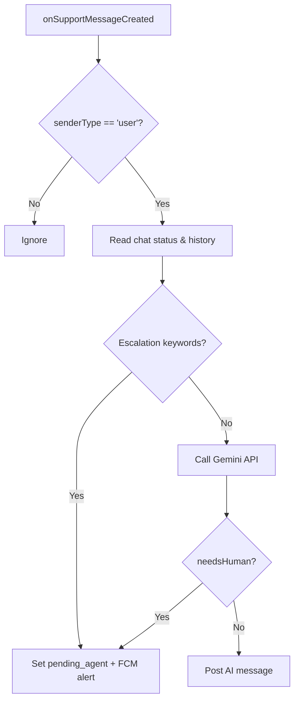

**Diagram sources**
- [supportBot.ts:183-255](file://functions/src/supportBot.ts#L183-L255)

**Section sources**
- [supportBot.ts:1-256](file://functions/src/supportBot.ts#L1-L256)

### Verification Workflows
- Admin callables approve/reject customer and driver verifications, set custom claims, and send FCM notifications.
- Triggers sync custom claims and notify users when verification status changes.

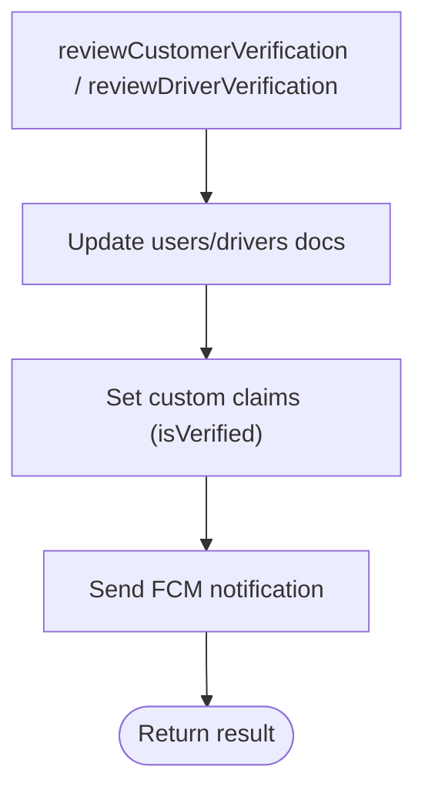

**Diagram sources**
- [verification.ts:26-131](file://functions/src/verification.ts#L26-L131)
- [verification.ts:138-241](file://functions/src/verification.ts#L138-L241)
- [verification.ts:249-350](file://functions/src/verification.ts#L249-L350)

**Section sources**
- [verification.ts:1-351](file://functions/src/verification.ts#L1-L351)

## Dependency Analysis
- Internal dependencies:
  - `index.ts` depends on `trips.ts`, `pricing.ts`, `fareToken.ts`, and other feature modules.
  - `trips.ts` depends on `fareToken.ts` and `driverStreak.ts` (not shown here).
  - `index.ts` uses `routing.ts` and `pricing.ts` for fare calculation.
- External dependencies:
  - `firebase-admin` for Firestore, Auth, Messaging.
  - `firebase-functions` v2 for callable and trigger APIs.
  - OSRM public demo endpoint for routing.
  - Paystack API for payments.

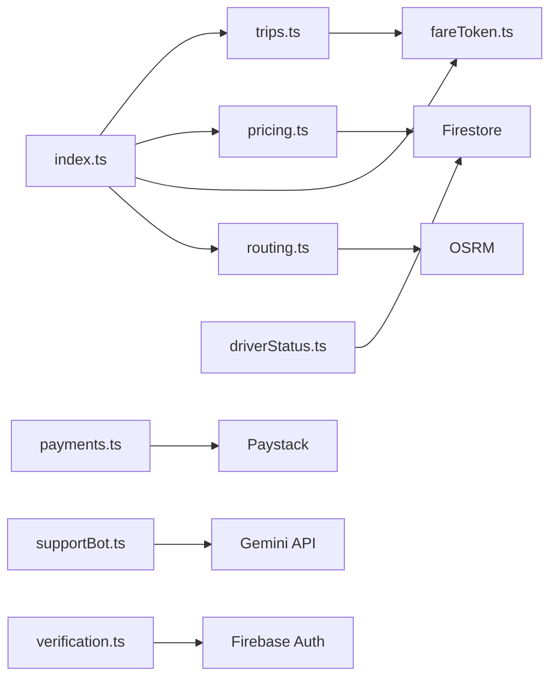

**Diagram sources**
- [index.ts:21-60](file://functions/src/index.ts#L21-L60)
- [trips.ts:1-10](file://functions/src/trips.ts#L1-L10)
- [pricing.ts:1-3](file://functions/src/pricing.ts#L1-L3)
- [fareToken.ts:1-2](file://functions/src/fareToken.ts#L1-L2)
- [routing.ts:13-16](file://functions/src/routing.ts#L13-L16)
- [payments.ts:1-3](file://functions/src/payments.ts#L1-L3)
- [driverStatus.ts:1-2](file://functions/src/driverStatus.ts#L1-L2)
- [supportBot.ts:1-3](file://functions/src/supportBot.ts#L1-L3)
- [verification.ts:1-3](file://functions/src/verification.ts#L1-L3)

**Section sources**
- [index.ts:21-60](file://functions/src/index.ts#L21-L60)
- [trips.ts:1-10](file://functions/src/trips.ts#L1-L10)
- [pricing.ts:1-3](file://functions/src/pricing.ts#L1-L3)
- [fareToken.ts:1-2](file://functions/src/fareToken.ts#L1-L2)
- [routing.ts:13-16](file://functions/src/routing.ts#L13-L16)
- [payments.ts:1-3](file://functions/src/payments.ts#L1-L3)
- [driverStatus.ts:1-2](file://functions/src/driverStatus.ts#L1-L2)
- [supportBot.ts:1-3](file://functions/src/supportBot.ts#L1-L3)
- [verification.ts:1-3](file://functions/src/verification.ts#L1-L3)

## Performance Considerations
- Cold start mitigation:
  - Disable metadata server probing when not running in Google Cloud to avoid ~45s hang during Admin SDK initialization.
  - Keep initialization minimal at module load; defer heavy work inside handlers.
- External service resilience:
  - OSRM fallback to crow-fly distance ensures fare calculation remains available when routing is unreachable.
  - Timeout and error handling on HTTP requests to OSRM and Paystack.
- Database efficiency:
  - Use bounded queries and limits (e.g., candidate driver limit, batch updates).
  - Prefer server timestamps and field increments for atomic counters.
- Idempotency:
  - Payment settlement uses Firestore transactions to ensure exactly-once crediting.
- Logging:
  - Use `console.warn`/`console.error` for non-fatal failures and webhook errors; integrate with Cloud Logging for observability.

[No sources needed since this section provides general guidance]

## Troubleshooting Guide
- Unauthenticated callable calls:
  - Ensure the client passes a valid ID token; check `request.auth` presence.
- Invalid arguments:
  - Validate coordinates, phone numbers, service types, and amounts before calling.
- Payment issues:
  - Confirm Paystack secret is configured; verify references and amounts match; inspect webhook signature validation.
- Routing failures:
  - If OSRM times out or returns no routes, expect fallback estimates; monitor logs for OSRM errors.
- Driver status errors:
  - Check GPS accuracy and mock location flags; ensure profile and vehicle verification are approved; confirm no active trips.
- Verification delays:
  - Custom claims may take time to propagate; retry after refresh.

**Section sources**
- [index.ts:81-142](file://functions/src/index.ts#L81-L142)
- [payments.ts:333-370](file://functions/src/payments.ts#L333-L370)
- [routing.ts:70-108](file://functions/src/routing.ts#L70-L108)
- [driverStatus.ts:32-164](file://functions/src/driverStatus.ts#L32-L164)
- [verification.ts:249-350](file://functions/src/verification.ts#L249-L350)

## Conclusion
The Cloud Functions architecture implements a robust, zero-trust backend with clear separation of concerns across features. It enforces authentication and authorization at every boundary, validates inputs rigorously, and integrates external services with resilient fallbacks. Deployment is configured via Firebase CLI with predeploy build steps. For production, prioritize cold start optimization, external service timeouts, idempotent operations, structured logging, and monitoring dashboards to maintain reliability and performance.

[No sources needed since this section summarizes without analyzing specific files]