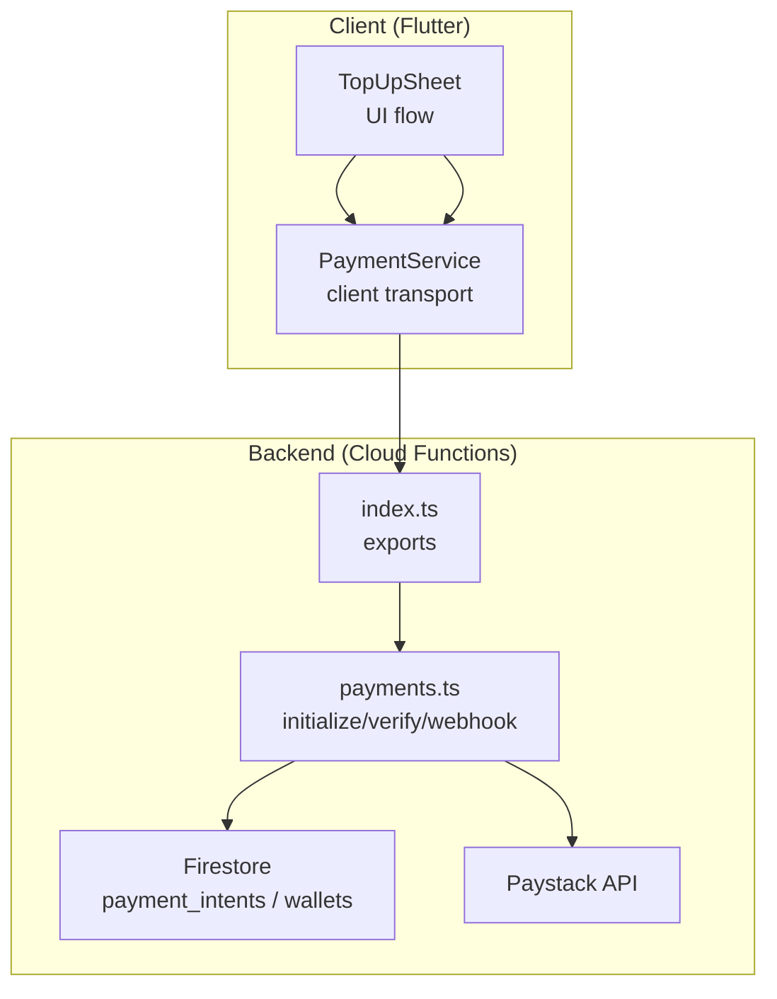
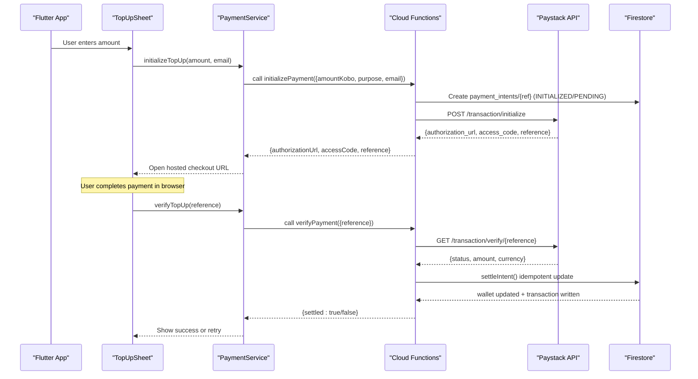
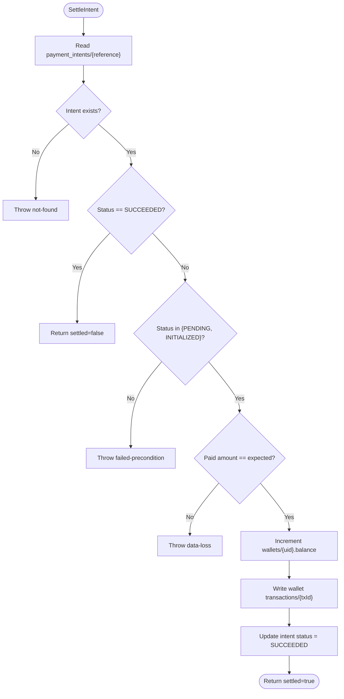
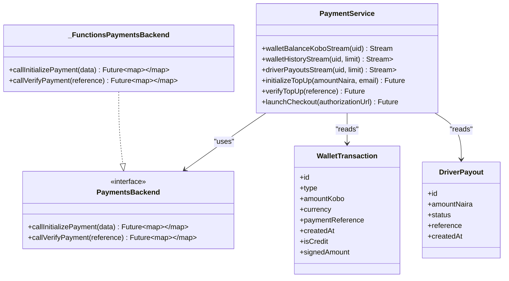
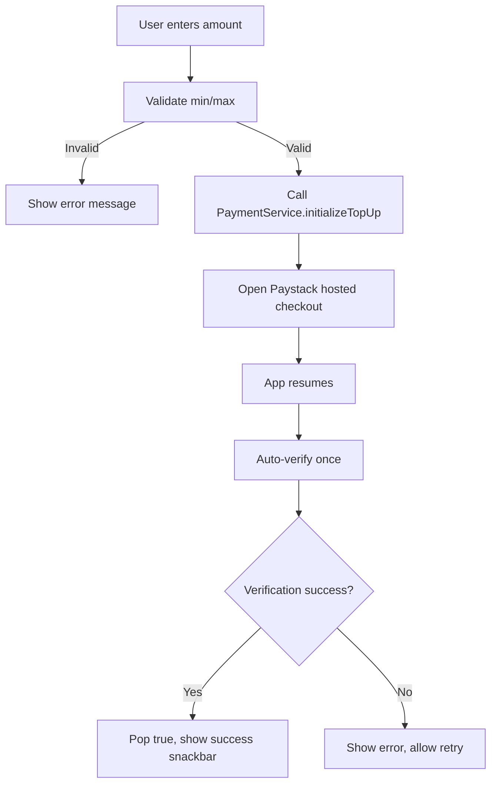
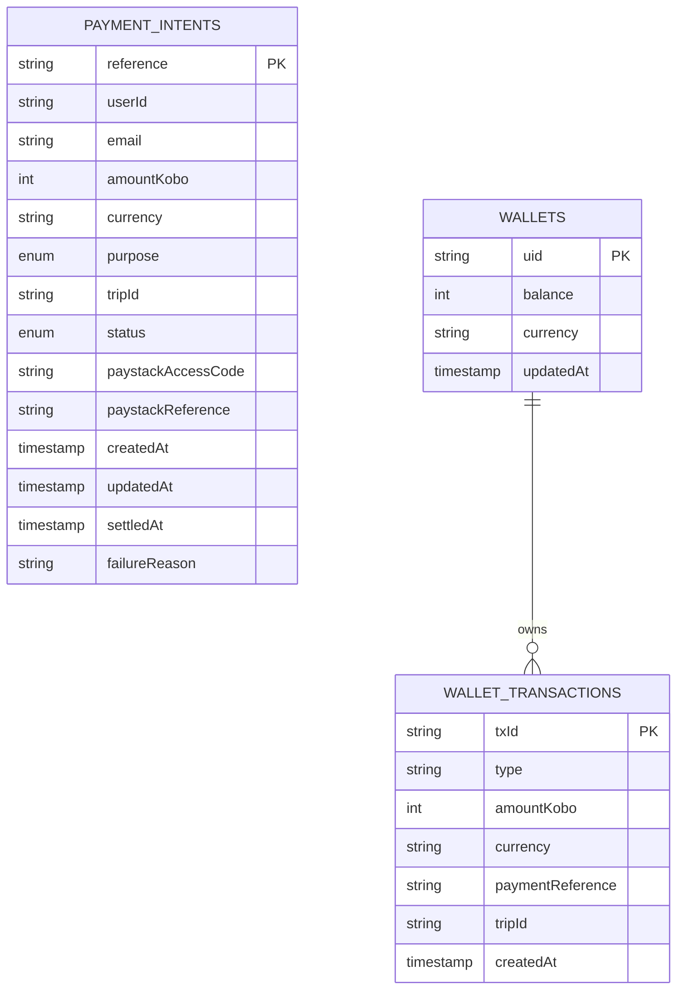
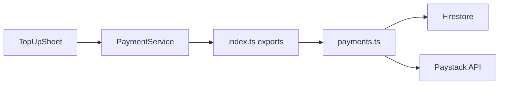

# Payment Processing

<cite>
**Referenced Files in This Document**
- [payments.ts](file://functions/src/payments.ts)
- [index.ts](file://functions/src/index.ts)
- [payment_service.dart](file://sese_ride/lib/features/payments/payment_service.dart)
- [top_up_sheet.dart](file://sese_ride/lib/features/payments/top_up_sheet.dart)
- [firestore.rules](file://firestore.rules)
</cite>

## Table of Contents
1. [Introduction](#introduction)
2. [Project Structure](#project-structure)
3. [Core Components](#core-components)
4. [Architecture Overview](#architecture-overview)
5. [Detailed Component Analysis](#detailed-component-analysis)
6. [Dependency Analysis](#dependency-analysis)
7. [Performance Considerations](#performance-considerations)
8. [Troubleshooting Guide](#troubleshooting-guide)
9. [Conclusion](#conclusion)

## Introduction
This document explains the payment processing system that integrates with Paystack to collect funds and credit user wallets. It covers payment initialization, verification workflows, webhook handling, transaction security, error handling, and data models. The implementation uses Firebase Cloud Functions for server-side logic and a Flutter client service for UI orchestration.

The system enforces a zero-trust model: amounts are never trusted from the client. All monetary operations occur server-side, and settlement is idempotent so concurrent verify calls or webhooks cannot double-credit.

## Project Structure
Payment functionality spans two main areas:
- Backend (Firebase Cloud Functions): payment initialization, verification, webhook handling, and wallet settlement.
- Frontend (Flutter app): top-up UI, checkout launch, and verification flow.

**Diagram sources**
- [index.ts:49-49](file://functions/src/index.ts#L49-L49)
- [payments.ts:108-197](file://functions/src/payments.ts#L108-L197)
- [payment_service.dart:221-237](file://sese_ride/lib/features/payments/payment_service.dart#L221-L237)
- [top_up_sheet.dart:65-100](file://sese_ride/lib/features/payments/top_up_sheet.dart#L65-L100)

**Section sources**
- [index.ts:49-49](file://functions/src/index.ts#L49-L49)
- [payments.ts:1-371](file://functions/src/payments.ts#L1-L371)
- [payment_service.dart:1-433](file://sese_ride/lib/features/payments/payment_service.dart#L1-L433)
- [top_up_sheet.dart:1-285](file://sese_ride/lib/features/payments/top_up_sheet.dart#L1-L285)

## Core Components
- Server-side payment functions:
  - initializePayment: validates caller and amount, creates a payment intent, initializes Paystack, returns authorization URL and reference.
  - verifyPayment: verifies the reference with Paystack, checks currency and amount, then settles the intent idempotently.
  - paystackWebhook: receives charge.success events, verifies HMAC signature, and settles via the same idempotent path.
- Client-side payment service:
  - PaymentService: wraps callable calls, exposes wallet balance/history streams, formats errors for users, and launches checkout.
- UI flow:
  - TopUpSheet: collects amount, opens hosted checkout, auto-verifies on resume, and shows success/error states.

Key behaviors:
- Amounts are stored and validated in kobo (integer-exact).
- Currency is enforced as NGN.
- Settlement updates wallets/{uid} balance and writes a wallet transaction record.
- Idempotency prevents duplicate credits when both verify and webhook settle.

**Section sources**
- [payments.ts:108-197](file://functions/src/payments.ts#L108-L197)
- [payments.ts:206-272](file://functions/src/payments.ts#L206-L272)
- [payments.ts:283-326](file://functions/src/payments.ts#L283-L326)
- [payments.ts:333-370](file://functions/src/payments.ts#L333-L370)
- [payment_service.dart:240-433](file://sese_ride/lib/features/payments/payment_service.dart#L240-L433)
- [top_up_sheet.dart:6-12](file://sese_ride/lib/features/payments/top_up_sheet.dart#L6-L12)

## Architecture Overview
End-to-end payment flow:

**Diagram sources**
- [top_up_sheet.dart:65-100](file://sese_ride/lib/features/payments/top_up_sheet.dart#L65-L100)
- [payment_service.dart:331-403](file://sese_ride/lib/features/payments/payment_service.dart#L331-L403)
- [payments.ts:108-197](file://functions/src/payments.ts#L108-L197)
- [payments.ts:283-326](file://functions/src/payments.ts#L283-L326)

## Detailed Component Analysis

### Server-Side Payment Functions (payments.ts)
Responsibilities:
- Initialize payments and create intents.
- Verify payments against Paystack and enforce amount/currency.
- Settle intents idempotently by updating wallet balance and writing a transaction record.
- Handle webhook events with HMAC signature verification.

Key implementation points:
- Secret management: Paystack secret key is read from environment; missing secret throws a precondition error.
- Amount validation: floor and ceiling enforced in kobo.
- Intent lifecycle: INITIALIZED → PENDING → SUCCEEDED or FAILED.
- Idempotent settlement: transactional guard prevents double-crediting if verify and webhook race.
- Webhook security: HMAC SHA-512 signature verified against raw body using the secret.

**Diagram sources**
- [payments.ts:206-272](file://functions/src/payments.ts#L206-L272)

**Section sources**
- [payments.ts:39-48](file://functions/src/payments.ts#L39-L48)
- [payments.ts:108-197](file://functions/src/payments.ts#L108-L197)
- [payments.ts:206-272](file://functions/src/payments.ts#L206-L272)
- [payments.ts:283-326](file://functions/src/payments.ts#L283-L326)
- [payments.ts:333-370](file://functions/src/payments.ts#L333-L370)

### Client Payment Service (payment_service.dart)
Responsibilities:
- Provide a testable transport seam to Cloud Functions.
- Expose wallet balance and history streams.
- Orchestrate top-up initialization and verification.
- Format user-friendly error messages.

Key implementation points:
- Public Paystack key embedded safely; secret remains server-only.
- Wallet balance unit is kobo; all money movement is server-side.
- Error mapping translates backend codes into safe user messages.
- Checkout launched via external browser; verification triggered after return.

**Diagram sources**
- [payment_service.dart:214-237](file://sese_ride/lib/features/payments/payment_service.dart#L214-L237)
- [payment_service.dart:240-433](file://sese_ride/lib/features/payments/payment_service.dart#L240-L433)

**Section sources**
- [payment_service.dart:6-12](file://sese_ride/lib/features/payments/payment_service.dart#L6-L12)
- [payment_service.dart:214-237](file://sese_ride/lib/features/payments/payment_service.dart#L214-L237)
- [payment_service.dart:240-433](file://sese_ride/lib/features/payments/payment_service.dart#L240-L433)

### Top-Up UI Flow (top_up_sheet.dart)
Responsibilities:
- Collect amount (quick chips or manual input).
- Call PaymentService.initializeTopUp and open Paystack hosted checkout.
- Auto-verify on app resume once per pending checkout.
- Display success or error feedback.

Flow highlights:
- Validates minimum amount before calling backend.
- Stores pending authorization to enable one-time auto-verify on resume.
- Shows clear instructions while checkout is open in the browser.

**Diagram sources**
- [top_up_sheet.dart:65-100](file://sese_ride/lib/features/payments/top_up_sheet.dart#L65-L100)
- [top_up_sheet.dart:103-124](file://sese_ride/lib/features/payments/top_up_sheet.dart#L103-L124)

**Section sources**
- [top_up_sheet.dart:6-12](file://sese_ride/lib/features/payments/top_up_sheet.dart#L6-L12)
- [top_up_sheet.dart:65-100](file://sese_ride/lib/features/payments/top_up_sheet.dart#L65-L100)
- [top_up_sheet.dart:103-124](file://sese_ride/lib/features/payments/top_up_sheet.dart#L103-L124)

### Data Models and Storage
- payment_intents: tracks each payment attempt with fields such as reference, userId, email, amountKobo, currency, purpose, tripId, status, timestamps, and failure reason.
- wallets/{uid}: holds current balance and metadata; balance is incremented atomically during settlement.
- wallets/{uid}/transactions: ledger entries for each credited/debited event, including type, amountKobo, currency, paymentReference, and timestamp.

**Diagram sources**
- [payments.ts:152-167](file://functions/src/payments.ts#L152-L167)
- [payments.ts:241-262](file://functions/src/payments.ts#L241-L262)

**Section sources**
- [payments.ts:152-167](file://functions/src/payments.ts#L152-L167)
- [payments.ts:241-262](file://functions/src/payments.ts#L241-L262)

## Dependency Analysis
- Client depends on Cloud Functions exports for payment callables.
- Cloud Functions depend on Firestore for state persistence and Paystack API for payment initiation and verification.
- Firestore rules protect sensitive resources like card verifications.

**Diagram sources**
- [index.ts:49-49](file://functions/src/index.ts#L49-L49)
- [payment_service.dart:221-237](file://sese_ride/lib/features/payments/payment_service.dart#L221-L237)
- [payments.ts:108-197](file://functions/src/payments.ts#L108-L197)

**Section sources**
- [index.ts:49-49](file://functions/src/index.ts#L49-L49)
- [payment_service.dart:221-237](file://sese_ride/lib/features/payments/payment_service.dart#L221-L237)
- [payments.ts:108-197](file://functions/src/payments.ts#L108-L197)

## Performance Considerations
- Use integer kobo amounts to avoid floating-point rounding issues.
- Prefer server-side settlement to minimize client retries and network chatter.
- Idempotent settlement ensures safe concurrency between verify and webhook paths.
- Stream-based wallet balance/history reduces polling overhead and keeps UI responsive.

[No sources needed since this section provides general guidance]

## Troubleshooting Guide
Common issues and resolutions:
- Unauthenticated requests: ensure the user is signed in before calling payment callables.
- Invalid arguments: validate amount range and required fields (email, purpose, tripId) on the client and rely on server-side enforcement.
- Not found: verify the payment reference exists and belongs to the authenticated user.
- Failed precondition: payment may have already been settled or is no longer payable; prompt user to start a new payment.
- Permission denied: the reference does not belong to the current user.
- Network errors: handle connectivity issues gracefully and allow retry.

Operational tips:
- Confirm Paystack secret is configured in function environment variables.
- Ensure Paystack webhook URL is set in the dashboard and points to the HTTPS endpoint.
- Inspect payment_intents status and failureReason for diagnostics.

**Section sources**
- [payments.ts:108-197](file://functions/src/payments.ts#L108-L197)
- [payments.ts:283-326](file://functions/src/payments.ts#L283-L326)
- [payment_service.dart:416-431](file://sese_ride/lib/features/payments/payment_service.dart#L416-L431)

## Conclusion
The payment system implements a secure, idempotent flow that delegates all monetary operations to server-side functions. It integrates with Paystack’s hosted checkout, enforces strict validation and currency constraints, and maintains an auditable ledger in Firestore. The Flutter client focuses on UX and orchestrates the flow without touching sensitive amounts or secrets.

[No sources needed since this section summarizes without analyzing specific files]