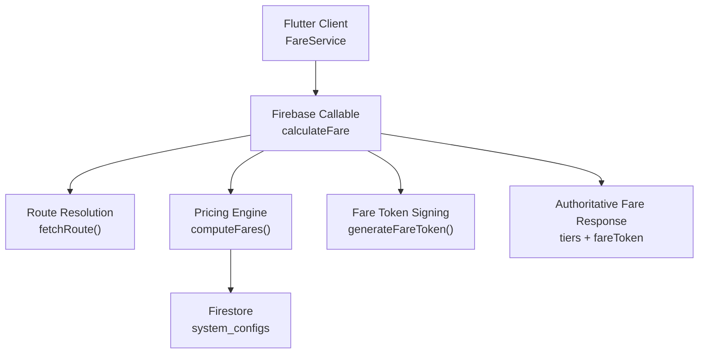
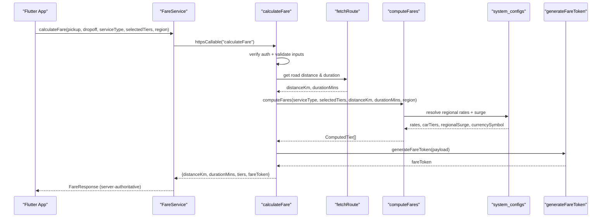
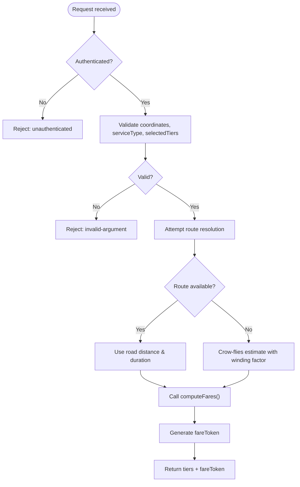
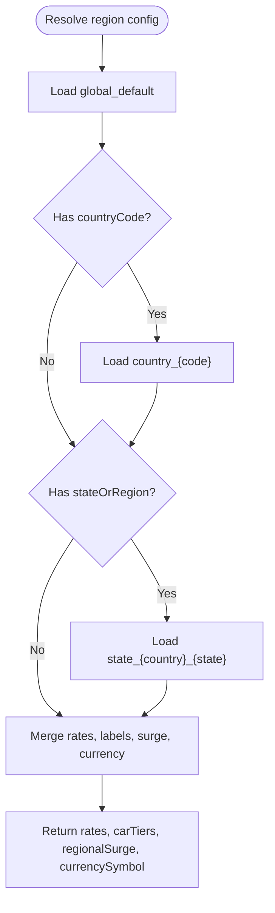
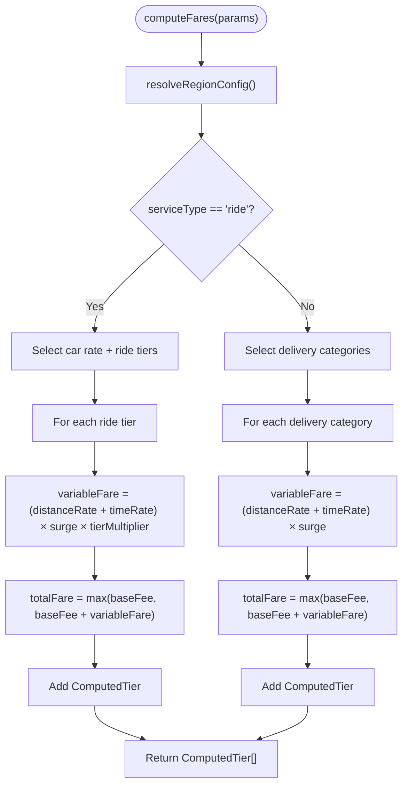
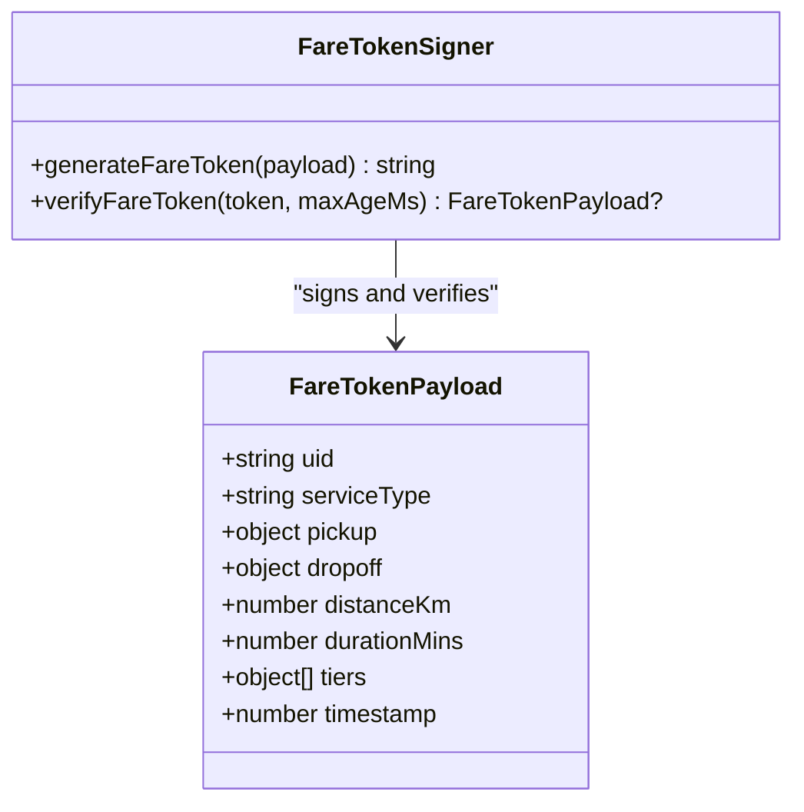
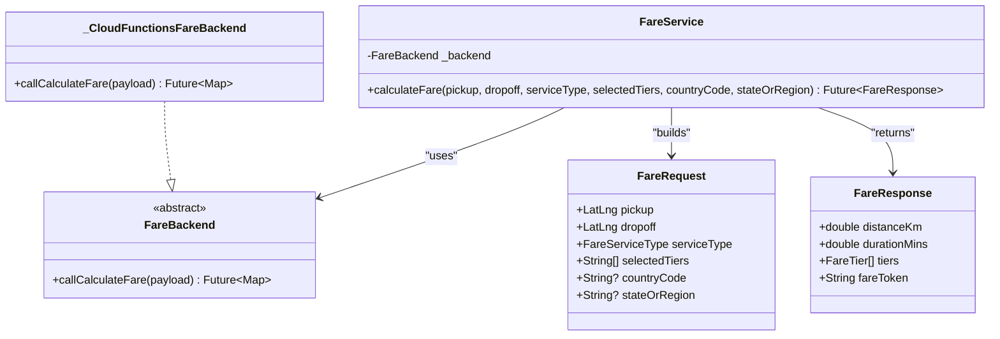
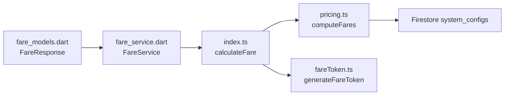

# Fare Calculation Engine

<cite>
**Referenced Files in This Document**
- [pricing.ts](file://functions/src/pricing.ts)
- [index.ts](file://functions/src/index.ts)
- [fareToken.ts](file://functions/src/fareToken.ts)
- [fare_service.dart](file://sese_ride/lib/features/customer/services/fare_service.dart)
- [fare_models.dart](file://sese_ride/lib/features/customer/models/fare_models.dart)
- [dispatch_and_fleet_test.dart](file://sese_ride/test/dispatch_and_fleet_test.dart)
</cite>

## Table of Contents
1. [Introduction](#introduction)
2. [Project Structure](#project-structure)
3. [Core Components](#core-components)
4. [Architecture Overview](#architecture-overview)
5. [Detailed Component Analysis](#detailed-component-analysis)
6. [Dependency Analysis](#dependency-analysis)
7. [Performance Considerations](#performance-considerations)
8. [Troubleshooting Guide](#troubleshooting-guide)
9. [Conclusion](#conclusion)

## Introduction
This document explains the fare calculation engine that powers ride and delivery pricing for the application. The engine is intentionally server-side only: clients never compute fares locally. Instead, they send pickup and dropoff coordinates, service type, and selected vehicle tiers to a secure callable function. The server validates inputs, computes road-network distance and duration, loads regional pricing configuration from Firestore, applies the authoritative fare formula, and returns a signed fare token that prevents client tampering.

The core objective is zero-trust pricing: all sensitive arithmetic happens on the server, using verified authentication, validated inputs, region-aware rates, and cryptographic signing.

## Project Structure
The fare calculation logic spans three main areas:

- Server callable entry point: validates requests, resolves route metrics, calls the pricing engine, and signs the result.
- Pricing engine: resolves regional configuration, selects vehicle categories or ride tiers, and computes fares.
- Client transport: a Flutter service that forwards requests to the server and renders the returned fares without local computation.

**Diagram sources**
- [index.ts:81-198](file://functions/src/index.ts#L81-L198)
- [pricing.ts:60-236](file://functions/src/pricing.ts#L60-L236)
- [fareToken.ts:21-28](file://functions/src/fareToken.ts#L21-L28)
- [fare_service.dart:23-31](file://sese_ride/lib/features/customer/services/fare_service.dart#L23-L31)

**Section sources**
- [index.ts:71-198](file://functions/src/index.ts#L71-L198)
- [pricing.ts:166-236](file://functions/src/pricing.ts#L166-L236)
- [fare_service.dart:7-17](file://sese_ride/lib/features/customer/services/fare_service.dart#L7-L17)

## Core Components
The fare calculation engine consists of:

- Zero-trust callable function: enforces authentication, input validation, routing fallback, and fare token generation.
- Regional configuration resolver: loads global, country, and state overrides from Firestore with safe defaults.
- Fare computation function: implements the authoritative pricing formula for rides and deliveries.
- Fare token signer: produces an HMAC-SHA256-signed payload so clients cannot alter fares.
- Client fare service: a thin wrapper that calls the server and maps errors into user-friendly messages.

Key responsibilities:

| Component | Responsibility | Security / Reliability Aspect |
|---|---|---|
| `calculateFare` callable | Validates request, computes route metrics, calls pricing engine, signs response | Rejects unauthenticated callers; validates coordinates and service types |
| `resolveRegionConfig` | Loads pricing rates, car tier multipliers, regional surge, currency symbol | Falls back to in-memory defaults if Firestore is unavailable |
| `computeFares` | Applies base fee, per-km/time rates, surge, and tier multipliers | Centralizes all pricing math server-side |
| `generateFareToken` | Signs fare payload with HMAC-SHA256 | Prevents client tampering |
| `FareService` | Calls callable and maps errors | Never computes fares locally |

**Section sources**
- [index.ts:81-198](file://functions/src/index.ts#L81-L198)
- [pricing.ts:60-236](file://functions/src/pricing.ts#L60-L236)
- [fareToken.ts:21-58](file://functions/src/fareToken.ts#L21-L58)
- [fare_service.dart:23-107](file://sese_ride/lib/features/customer/services/fare_service.dart#L23-L107)

## Architecture Overview
The zero-trust architecture ensures that every authoritative fare comes from the server:

1. The Flutter client sends pickup, dropoff, service type, selected tiers, and optional region metadata.
2. The callable verifies authentication and validates inputs.
3. The server attempts to fetch real road-network distance and duration; if unavailable, it falls back to an approximate crow-flies estimate with a winding factor and urban speed assumption.
4. The pricing engine loads regional configuration via a fallback chain: global default, country-specific rule, then state-specific override.
5. Fares are computed using the authoritative formula and formatted with the resolved currency symbol.
6. A signed fare token is generated and returned alongside the computed tiers.
7. The client renders the server-provided fares verbatim and passes the token forward during booking confirmation.

**Diagram sources**
- [index.ts:81-198](file://functions/src/index.ts#L81-L198)
- [pricing.ts:60-236](file://functions/src/pricing.ts#L60-L236)
- [fareToken.ts:21-28](file://functions/src/fareToken.ts#L21-L28)
- [fare_service.dart:44-89](file://sese_ride/lib/features/customer/services/fare_service.dart#L44-L89)

## Detailed Component Analysis

### Zero-Trust Callable Function
The callable function is the security boundary for fare computation. It rejects unauthenticated requests, validates coordinates and service types, computes route metrics, delegates pricing to the engine, and signs the final response.

Important behaviors:

- Authentication check: if no authenticated session is present, the request is rejected immediately.
- Input validation: pickup and dropoff must be valid geographic coordinates; service type must be one of the allowed values; selected tiers must be an array of non-empty strings when provided.
- Route resolution: tries a dedicated routing function; if that fails, uses a Haversine-based crow-flies approximation with a road-winding multiplier and estimated urban speed.
- Pricing delegation: calls the pricing engine with service type, selected tiers, distance, duration, and optional region metadata.
- Token signing: wraps the authoritative fare data in an HMAC-SHA256 token before returning it.

**Diagram sources**
- [index.ts:81-198](file://functions/src/index.ts#L81-L198)

**Section sources**
- [index.ts:81-198](file://functions/src/index.ts#L81-L198)

### Regional Configuration Resolver
The regional configuration resolver builds effective pricing rules by merging:

- Global default rates and labels.
- Country-specific overrides.
- State-specific overrides.

It reads from Firestore documents under `system_configs`, using IDs such as `global_default`, `country_{CODE}`, and `state_{COUNTRY}_{STATE}`. If Firestore is unreachable, it continues with in-memory defaults rather than failing the entire fare calculation.

Resolved fields include:

- Per-vehicle pricing rates: base fee, distance rate per kilometer, time rate per minute, and per-vehicle surge multiplier.
- Car tier multipliers and labels: comfort, premium, luxe.
- Regional surge multiplier: applied across all vehicle categories.
- Currency symbol: used for formatted fare display.

**Diagram sources**
- [pricing.ts:60-147](file://functions/src/pricing.ts#L60-L147)

**Section sources**
- [pricing.ts:60-147](file://functions/src/pricing.ts#L60-L147)

### Fare Formula and `computeFares`
The `computeFares` function is the authoritative pricing engine. Its parameters are:

- `serviceType`: `"ride"`, `"send_item"`, or `"receive_item"`.
- `selectedTiers`: optional list of requested vehicle categories or ride tier identifiers.
- `distanceKm`: road-network distance in kilometers.
- `durationMins`: estimated travel time in minutes.
- `countryCode`: optional country code for regional scoping.
- `stateOrRegion`: optional state or region for regional scoping.

The effective fare formula is:

- Base fee floor: each vehicle category has a minimum charge.
- Variable fare: `(distanceRatePerKm × distanceKm + timeRatePerMinute × durationMins) × surgeMultiplier`.
- Surge composition: per-vehicle `surgeMultiplier` multiplied by `regionalSurge`.
- Ride tier multiplier: for rides, the car base rate is adjusted by comfort/premium/luxe multipliers.
- Final total: `baseFee + variableFare`, floored at `baseFee`, rounded to two decimal places.

For rides:

- Default tiers: comfort, premium, luxe.
- Comfort is marked recommended by default.
- Tier names and multipliers come from resolved car tier configuration.

For deliveries:

- Default categories: bicycle, motorcycle, tricycle, car, van, truck.
- Motorcycle is marked recommended by default.
- Each category has its own base fee and per-unit rates.

**Diagram sources**
- [pricing.ts:166-236](file://functions/src/pricing.ts#L166-L236)

**Section sources**
- [pricing.ts:166-236](file://functions/src/pricing.ts#L166-L236)

### Fare Token Signing
The fare token is an HMAC-SHA256 signature over a JSON payload containing the user ID, service type, pickup/dropoff coordinates, distance, duration, computed tiers, and timestamp. This prevents clients from altering the fare amounts after receiving them.

Key properties:

- Payload includes enough context to verify the fare belongs to a specific trip request.
- Signature is appended after a dot separator.
- Verification checks both signature integrity and token age.

**Diagram sources**
- [fareToken.ts:6-15](file://functions/src/fareToken.ts#L6-L15)
- [fareToken.ts:21-58](file://functions/src/fareToken.ts#L21-L58)

**Section sources**
- [fareToken.ts:21-58](file://functions/src/fareToken.ts#L21-L58)

### Client Transport and Models
The Flutter client implements a zero-trust fare service:

- It never computes fares locally.
- It calls the `calculateFare` callable with a structured payload.
- It maps backend errors into user-friendly messages.
- It parses the server response into `FareResponse`, which contains distance, duration, tiers, and the signed fare token.

Supported service types in the client model:

- `ride`
- `sendItem`
- `receiveItem`

Example tier outputs shown in tests demonstrate:

- Rides: comfort, premium, luxe.
- Deliveries: bicycle, motorcycle, tricycle, car, van, truck.

**Diagram sources**
- [fare_service.dart:18-39](file://sese_ride/lib/features/customer/services/fare_service.dart#L18-L39)
- [fare_service.dart:44-89](file://sese_ride/lib/features/customer/services/fare_service.dart#L44-L89)
- [fare_models.dart:11-27](file://sese_ride/lib/features/customer/models/fare_models.dart#L11-L27)
- [fare_models.dart:90-139](file://sese_ride/lib/features/customer/models/fare_models.dart#L90-L139)

**Section sources**
- [fare_service.dart:7-107](file://sese_ride/lib/features/customer/services/fare_service.dart#L7-L107)
- [fare_models.dart:11-153](file://sese_ride/lib/features/customer/models/fare_models.dart#L11-L153)
- [dispatch_and_fleet_test.dart:18-65](file://sese_ride/test/dispatch_and_fleet_test.dart#L18-L65)

## Dependency Analysis
The fare calculation pipeline has clear dependencies:

- The callable depends on routing, pricing, and token signing.
- The pricing engine depends on Firestore for regional configuration but degrades gracefully to defaults.
- The client depends on Firebase Functions for fare computation and error mapping.

**Diagram sources**
- [index.ts:21-24](file://functions/src/index.ts#L21-L24)
- [index.ts:81-198](file://functions/src/index.ts#L81-L198)
- [pricing.ts:60-236](file://functions/src/pricing.ts#L60-L236)
- [fareToken.ts:21-28](file://functions/src/fareToken.ts#L21-L28)
- [fare_service.dart:23-31](file://sese_ride/lib/features/customer/services/fare_service.dart#L23-L31)

**Section sources**
- [index.ts:21-24](file://functions/src/index.ts#L21-L24)
- [index.ts:81-198](file://functions/src/index.ts#L81-L198)
- [pricing.ts:60-236](file://functions/src/pricing.ts#L60-L236)
- [fare_token.ts:21-28](file://functions/src/fareToken.ts#L21-L28)
- [fare_service.dart:23-31](file://sese_ride/lib/features/customer/services/fare_service.dart#L23-L31)

## Performance Considerations
Real-time fare computation should remain fast and resilient:

- Route resolution: prefer accurate road-network routing; fall back quickly to an approximate estimate when external routing is unavailable.
- Firestore reads: the regional resolver reads at most three documents in a defined order and ignores individual read failures, keeping latency bounded.
- In-memory defaults: if Firestore is completely unreachable, the engine still computes fares using built-in defaults instead of failing the request.
- Multi-tier computation: iterate only over requested tiers or default categories; avoid unnecessary calculations.
- Formatting: format currency once per tier using the resolved currency symbol.
- Client-side cost: the Flutter client performs no pricing math, reducing device CPU usage and eliminating client-side tampering vectors.

Recommendations:

- Cache regional configuration where appropriate at the server layer to reduce Firestore reads during high-frequency fare estimation.
- Keep selected tiers minimal: ask the UI to preselect reasonable defaults rather than computing all possible categories unnecessarily.
- Monitor external routing failures and adjust fallback thresholds based on observed network conditions.
- Avoid exposing raw internal tier identifiers to users; use localized names from the server response.

[No sources needed since this section provides general guidance]

## Troubleshooting Guide
Common issues and their likely causes:

| Symptom | Likely Cause | Resolution |
|---|---|---|
| Unauthenticated error | Caller did not sign in or session expired | Re-authenticate the user and retry the fare calculation |
| Invalid argument error | Missing or malformed pickup/dropoff coordinates, invalid service type, or invalid selected tiers | Validate location inputs and ensure service type is one of the supported values |
| No route found | External routing service failed | Check network connectivity; the server will fall back to an approximate estimate |
| Temporary unavailability | Backend temporarily overloaded or down | Retry after a short delay; surface a friendly message to the user |
| Too many requests | Rate limiting or resource exhaustion | Back off and retry later |
| Network error on client | Unable to reach Firebase Functions | Check device network and app permissions |

Error mapping in the client service converts backend codes into user-safe messages, including authentication, invalid arguments, routing failures, temporary unavailability, and resource exhaustion.

**Section sources**
- [index.ts:85-142](file://functions/src/index.ts#L85-L142)
- [fare_service.dart:76-107](file://sese_ride/lib/features/customer/services/fare_service.dart#L76-L107)

## Conclusion
The fare calculation engine is designed around zero-trust principles: clients never compute prices, the server validates all inputs, regional pricing is loaded securely, and the final fare payload is cryptographically signed. The `computeFares` function centralizes the authoritative formula, supports both ride and delivery services, handles multi-tier vehicle options, and applies regional surge multipliers safely. When Firestore is unavailable, the system falls back to sensible defaults, ensuring availability without compromising correctness. For production reliability, focus on robust routing, efficient regional configuration loading, and clear error handling across the callable and client layers.

[No sources needed since this section summarizes without analyzing specific files]