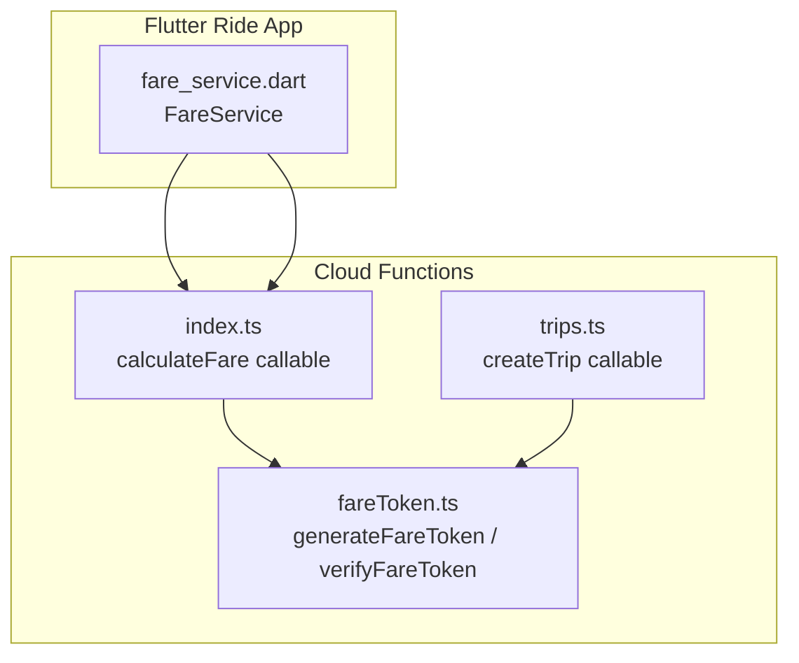
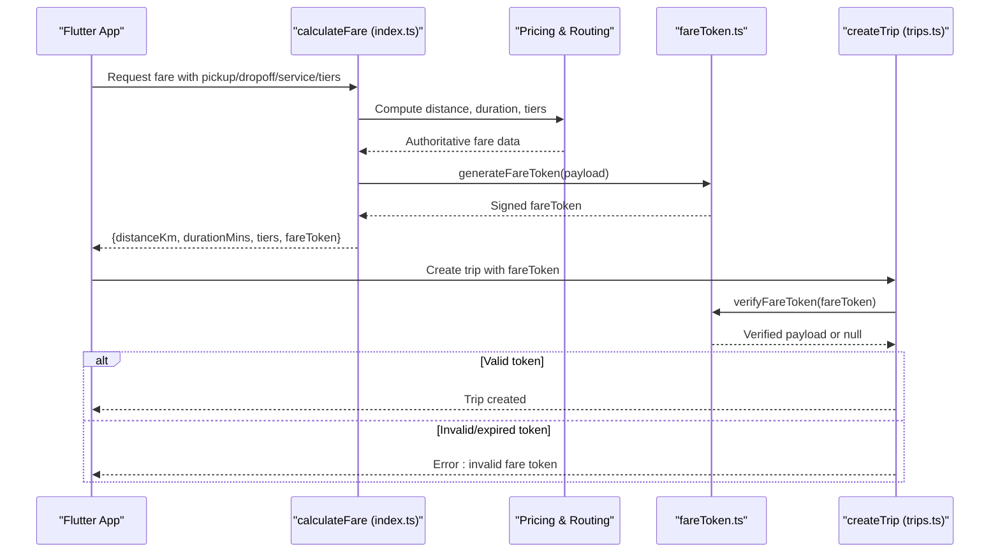
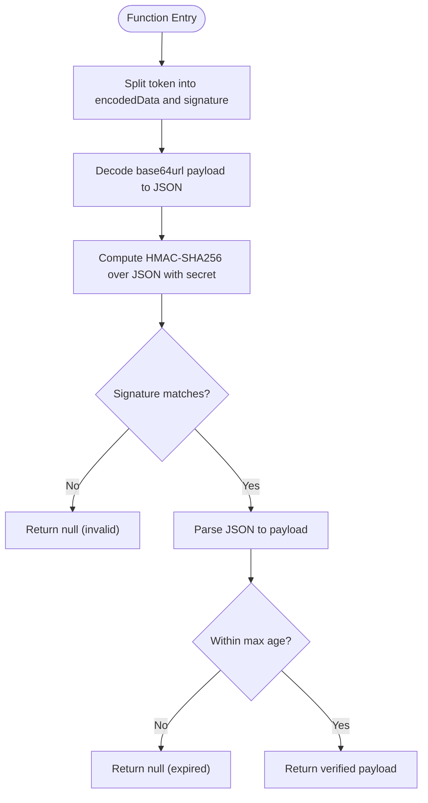
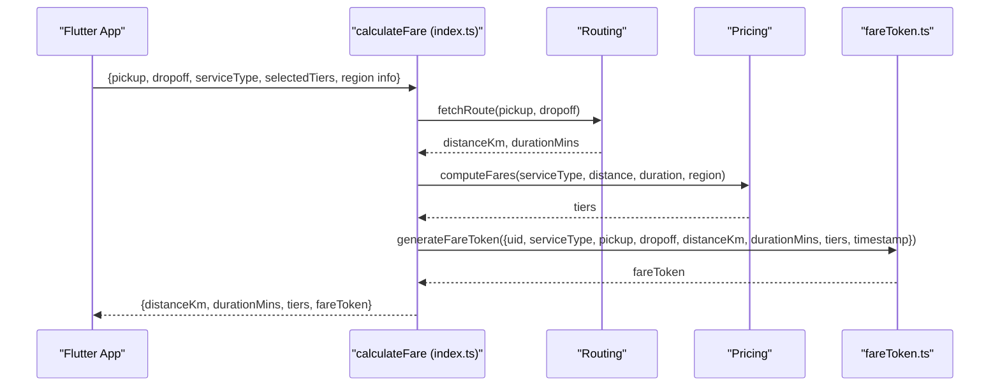
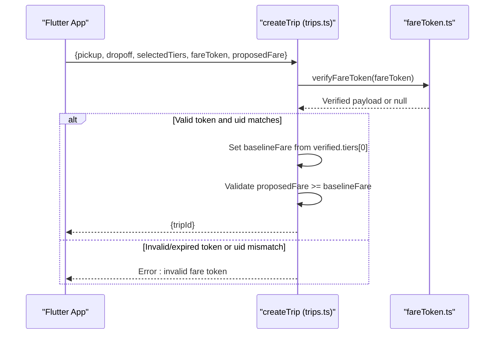
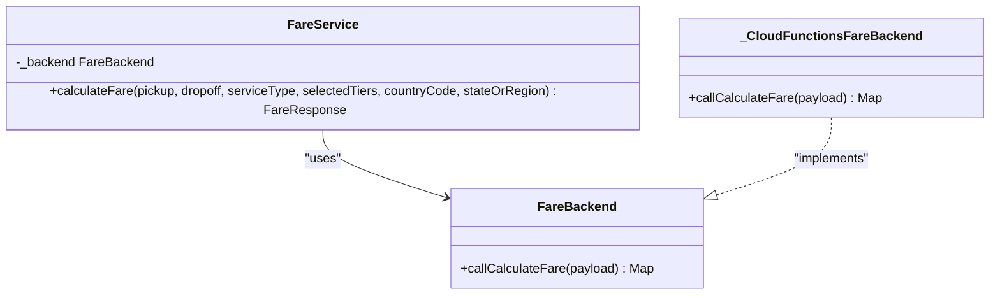
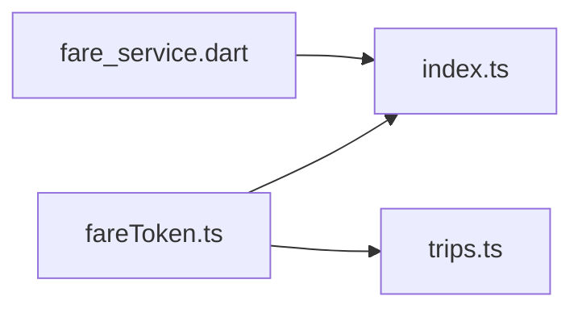

# Fare Token System

<cite>
**Referenced Files in This Document**
- [fareToken.ts](file://functions/src/fareToken.ts)
- [index.ts](file://functions/src/index.ts)
- [trips.ts](file://functions/src/trips.ts)
- [fare_service.dart](file://sese_ride/lib/features/customer/services/fare_service.dart)
</cite>

## Table of Contents
1. [Introduction](#introduction)
2. [Project Structure](#project-structure)
3. [Core Components](#core-components)
4. [Architecture Overview](#architecture-overview)
5. [Detailed Component Analysis](#detailed-component-analysis)
6. [Dependency Analysis](#dependency-analysis)
7. [Performance Considerations](#performance-considerations)
8. [Troubleshooting Guide](#troubleshooting-guide)
9. [Conclusion](#conclusion)

## Introduction
This document explains the fare token generation and verification system that enforces a zero-trust pricing model. The server computes authoritative fares, signs them with a secret key, and returns a tamper-proof token to clients. Clients must present this token when booking; the server verifies it before creating a trip. This prevents clients from modifying fare amounts after server-side calculation.

The system covers:
- Cryptographic signing using HMAC-SHA256
- Token structure containing fare amount, timestamp, route data, and tiered pricing
- Expiration handling for short-lived tokens
- Security measures against manipulation and replay
- Client integration patterns for generating and validating tokens
- Lifecycle management and storage best practices

## Project Structure
The fare token logic is implemented in Cloud Functions (Node.js/TypeScript), while the Flutter ride app integrates with the backend through a service layer.

**Diagram sources**
- [index.ts:81-198](file://functions/src/index.ts#L81-L198)
- [fareToken.ts:21-58](file://functions/src/fareToken.ts#L21-L58)
- [trips.ts:129-225](file://functions/src/trips.ts#L129-L225)
- [fare_service.dart:24-31](file://sese_ride/lib/features/customer/services/fare_service.dart#L24-L31)

**Section sources**
- [index.ts:81-198](file://functions/src/index.ts#L81-L198)
- [fareToken.ts:21-58](file://functions/src/fareToken.ts#L21-L58)
- [trips.ts:129-225](file://functions/src/trips.ts#L129-L225)
- [fare_service.dart:24-31](file://sese_ride/lib/features/customer/services/fare_service.dart#L24-L31)

## Core Components
- **Fare Token Module**: Provides cryptographic signing and verification functions for fare payloads.
- **Calculate Fare Callable**: Server-side endpoint that computes distance, duration, and tiers, then generates a signed token.
- **Create Trip Callable**: Enforces zero-trust by verifying the token before persisting trip data.
- **Client Fare Service**: Flutter service that calls the backend and forwards the returned token into booking requests.

Key responsibilities:
- Generate tamper-proof tokens containing all authoritative fare fields.
- Verify tokens on critical server paths to prevent client-side price manipulation.
- Provide clear error handling for invalid or expired tokens.

**Section sources**
- [fareToken.ts:6-15](file://functions/src/fareToken.ts#L6-L15)
- [fareToken.ts:21-58](file://functions/src/fareToken.ts#L21-L58)
- [index.ts:81-198](file://functions/src/index.ts#L81-L198)
- [trips.ts:129-225](file://functions/src/trips.ts#L129-L225)
- [fare_service.dart:24-31](file://sese_ride/lib/features/customer/services/fare_service.dart#L24-L31)

## Architecture Overview
The zero-trust flow ensures that only server-computed fares are accepted.

**Diagram sources**
- [index.ts:81-198](file://functions/src/index.ts#L81-L198)
- [fareToken.ts:21-58](file://functions/src/fareToken.ts#L21-L58)
- [trips.ts:129-225](file://functions/src/trips.ts#L129-L225)

## Detailed Component Analysis

### Fare Token Cryptography and Payload
The fare token module defines a structured payload and two core functions:
- `generateFareToken`: Serializes the payload to JSON, computes an HMAC-SHA256 signature using a secret, base64url-encodes the JSON, and concatenates the encoded data and signature with a dot separator.
- `verifyFareToken`: Splits the token, decodes the payload, recomputes the HMAC-SHA256 signature, compares signatures safely, parses the payload, and checks expiration based on the embedded timestamp.

Security properties:
- Tamper resistance: Any change to the payload invalidates the signature.
- Timing-safe comparison: Prevents timing side-channel attacks during signature validation.
- Expiration enforcement: Tokens older than the configured maximum age are rejected.

Payload fields:
- User identifier
- Service type
- Pickup and dropoff coordinates
- Distance and duration
- Tiered fare amounts
- Timestamp for expiration

**Diagram sources**
- [fareToken.ts:33-58](file://functions/src/fareToken.ts#L33-L58)

**Section sources**
- [fareToken.ts:6-15](file://functions/src/fareToken.ts#L6-L15)
- [fareToken.ts:21-58](file://functions/src/fareToken.ts#L21-L58)

### Calculate Fare Callable
The calculateFare endpoint performs:
- Authentication check via Firebase Auth context
- Input validation for coordinates, service type, and selected tiers
- Route computation (with fallback to approximate distance if routing fails)
- Server-side pricing evaluation
- Generation of a signed fare token including user ID, route metrics, and tiered fares
- Response returning both displayable fare data and the signed token

**Diagram sources**
- [index.ts:81-198](file://functions/src/index.ts#L81-L198)
- [fareToken.ts:21-28](file://functions/src/fareToken.ts#L21-L28)

**Section sources**
- [index.ts:81-198](file://functions/src/index.ts#L81-L198)

### Create Trip Callable and Zero-Trust Enforcement
The createTrip endpoint enforces zero-trust by:
- Requiring authentication
- Validating phone numbers, coordinates, and selected tiers
- Verifying the provided fare token and ensuring it belongs to the authenticated user
- Using the verified payload to set baseline and proposed fares
- Persisting trip data with verified fields

**Diagram sources**
- [trips.ts:129-225](file://functions/src/trips.ts#L129-L225)
- [fareToken.ts:33-58](file://functions/src/fareToken.ts#L33-L58)

**Section sources**
- [trips.ts:129-225](file://functions/src/trips.ts#L129-L225)

### Client Integration Pattern
The Flutter ride app uses a service layer to call the backend without computing fares locally. It forwards location and tier selection to the server and receives a signed token. The client should pass this token directly into booking requests without modification.

**Diagram sources**
- [fare_service.dart:18-31](file://sese_ride/lib/features/customer/services/fare_service.dart#L18-L31)
- [fare_service.dart:35-89](file://sese_ride/lib/features/customer/services/fare_service.dart#L35-L89)

**Section sources**
- [fare_service.dart:18-31](file://sese_ride/lib/features/customer/services/fare_service.dart#L18-L31)
- [fare_service.dart:35-89](file://sese_ride/lib/features/customer/services/fare_service.dart#L35-L89)

## Dependency Analysis
The fare token system has clear dependencies:
- `index.ts` depends on `fareToken.ts` to sign fares.
- `trips.ts` depends on `fareToken.ts` to verify fares.
- The Flutter `fare_service.dart` depends on the `calculateFare` callable exposed by `index.ts`.

**Diagram sources**
- [index.ts:21-24](file://functions/src/index.ts#L21-L24)
- [trips.ts:1-10](file://functions/src/trips.ts#L1-L10)
- [fare_service.dart:1-6](file://sese_ride/lib/features/customer/services/fare_service.dart#L1-L6)

**Section sources**
- [index.ts:21-24](file://functions/src/index.ts#L21-L24)
- [trips.ts:1-10](file://functions/src/trips.ts#L1-L10)
- [fare_service.dart:1-6](file://sese_ride/lib/features/customer/services/fare_service.dart#L1-L6)

## Performance Considerations
- HMAC-SHA256 signing and verification are lightweight operations suitable for real-time flows.
- Base64url encoding adds minimal overhead compared to network latency.
- Token expiration reduces the risk of replay attacks and limits the window for misuse.
- Avoid caching or reusing tokens across sessions; always request fresh tokens per fare calculation.
- Keep the signing secret secure and rotate it periodically; ensure environment configuration is correct in production.

## Troubleshooting Guide
Common issues and resolutions:
- Invalid token signature: Indicates payload tampering or incorrect secret configuration. Ensure the same secret is used for signing and verification.
- Expired token: The token’s timestamp exceeds the allowed age. Regenerate the token immediately before booking.
- UID mismatch: The token was generated for a different user. Re-calculate fares under the current authenticated session.
- Missing or malformed token: Ensure the client passes the complete token string returned by `calculateFare`.
- Backend errors: Handle unauthenticated, invalid-argument, unavailable, and resource-exhausted responses gracefully in the client.

Operational recommendations:
- Log verification failures at a high level without exposing sensitive details.
- Monitor token rejection rates to detect potential abuse or misconfiguration.
- Validate environment variables for the signing secret and ensure they are not committed to source control.

**Section sources**
- [fareToken.ts:33-58](file://functions/src/fareToken.ts#L33-L58)
- [index.ts:81-198](file://functions/src/index.ts#L81-L198)
- [trips.ts:129-225](file://functions/src/trips.ts#L129-L225)
- [fare_service.dart:76-106](file://sese_ride/lib/features/customer/services/fare_service.dart#L76-L106)

## Conclusion
The fare token system provides a robust zero-trust mechanism for protecting fare calculations. By signing server-computed fares and requiring verification at booking time, it prevents clients from altering prices. The design includes clear payload structure, expiration handling, and safe cryptographic comparisons. Integrating this pattern into the Flutter app ensures consistent behavior and security across platforms. Proper lifecycle management—requesting fresh tokens, storing them securely, and passing them unchanged to the server—completes the protection model.