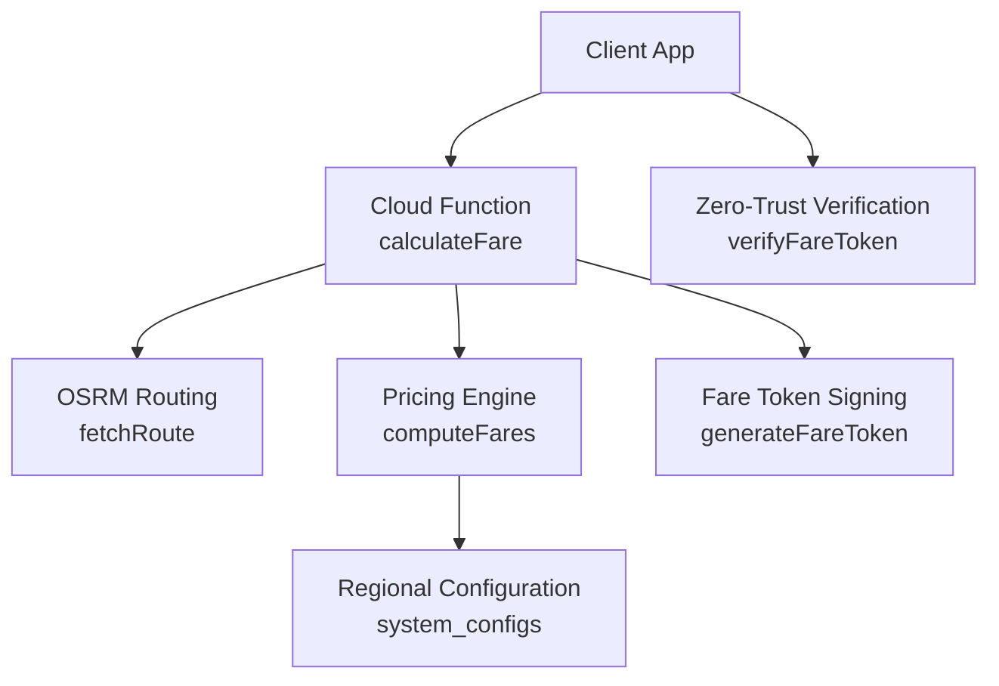
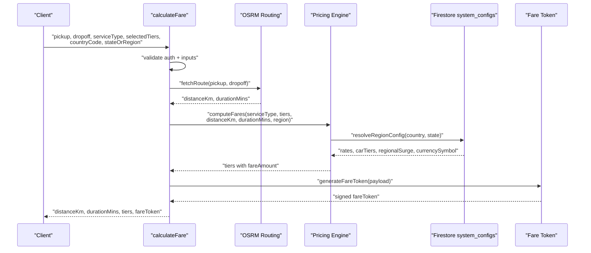
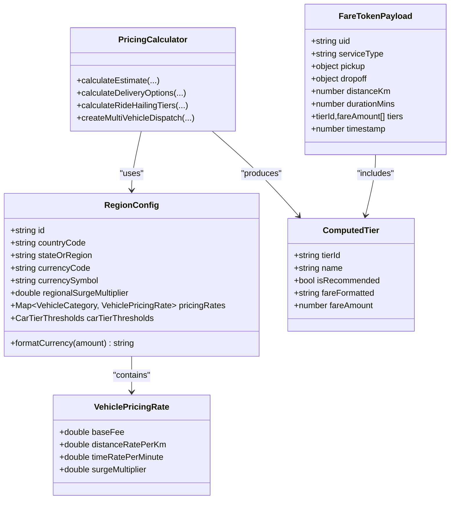
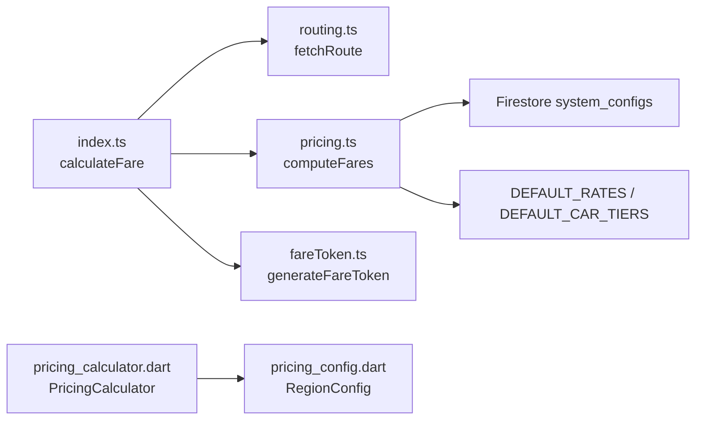

# Pricing Engine

<cite>
**Referenced Files in This Document**
- [index.ts](file://functions/src/index.ts)
- [pricing.ts](file://functions/src/pricing.ts)
- [fareToken.ts](file://functions/src/fareToken.ts)
- [routing.ts](file://functions/src/routing.ts)
- [pricing_calculator.dart](file://sese_core/lib/services/pricing_calculator.dart)
- [pricing_config.dart](file://sese_core/lib/models/pricing_config.dart)
</cite>

## Table of Contents
1. [Introduction](#introduction)
2. [Project Structure](#project-structure)
3. [Core Components](#core-components)
4. [Architecture Overview](#architecture-overview)
5. [Detailed Component Analysis](#detailed-component-analysis)
6. [Dependency Analysis](#dependency-analysis)
7. [Performance Considerations](#performance-considerations)
8. [Troubleshooting Guide](#troubleshooting-guide)
9. [Conclusion](#conclusion)

## Introduction
This document explains the pricing engine that powers zero-trust fare calculation, regional pricing configuration, dynamic surge pricing, and tamper-proof fare tokens. It covers how route distance and duration are obtained, how multi-tier pricing is computed for rides and deliveries, and how cryptographic signing prevents client-side tampering. It also documents external routing integration, fallback behavior, and performance strategies.

The system is designed so that clients never compute authoritative fares themselves. Instead, they send only route endpoints and service parameters to a secure backend function, which returns signed results that can be verified later.

## Project Structure
The pricing engine spans Cloud Functions (server-side), core Flutter models (client-side representation), and an OSRM-based routing module:

- Server entry point exposes a callable endpoint that enforces authentication, validates inputs, computes routes, calculates fares, and signs them.
- Pricing logic resolves region-specific rates and applies surge and tier multipliers.
- Routing fetches road-network distance and duration from OSRM with a local crow-flies fallback.
- Fare token utilities generate and verify HMAC-SHA256-signed payloads.
- Core Dart models define region configuration, vehicle categories, and the same pricing formula used by server logic.

**Diagram sources**
- [index.ts:81-198](file://functions/src/index.ts#L81-L198)
- [routing.ts:40-67](file://functions/src/routing.ts#L40-L67)
- [pricing.ts:166-236](file://functions/src/pricing.ts#L166-L236)
- [fareToken.ts:21-58](file://functions/src/fareToken.ts#L21-L58)

**Section sources**
- [index.ts:62-198](file://functions/src/index.ts#L62-L198)
- [pricing.ts:1-237](file://functions/src/pricing.ts#L1-L237)
- [routing.ts:1-109](file://functions/src/routing.ts#L1-L109)
- [fareToken.ts:1-59](file://functions/src/fareToken.ts#L1-L59)
- [pricing_calculator.dart:1-147](file://sese_core/lib/services/pricing_calculator.dart#L1-L147)
- [pricing_config.dart:1-499](file://sese_core/lib/models/pricing_config.dart#L1-L499)

## Core Components
- Zero-trust callable endpoint: authenticates callers, validates coordinates and service type, obtains route metrics, computes fares, and returns a signed token.
- Regional pricing resolver: merges global defaults, country rules, and state overrides from Firestore into effective rates, currency symbol, and regional surge.
- Multi-tier pricing calculator: computes per-kilometer and per-minute variable fares, applies vehicle surge and car-tier multipliers, and enforces a base fee floor.
- Routing abstraction: calls OSRM for driving distance and duration; includes a crow-flies fallback when OSRM fails.
- Fare token generator and verifier: creates HMAC-SHA256 signatures over JSON payload and verifies signature plus age.

Key responsibilities:
- Security: authentication, input validation, signed outputs.
- Correctness: consistent formulas across server and core models.
- Resilience: fallback routing and safe Firestore fallbacks.
- Configurability: region-scoped rates, labels, and multipliers.

**Section sources**
- [index.ts:81-198](file://functions/src/index.ts#L81-L198)
- [pricing.ts:60-147](file://functions/src/pricing.ts#L60-L147)
- [pricing.ts:166-236](file://functions/src/pricing.ts#L166-L236)
- [routing.ts:40-67](file://functions/src/routing.ts#L40-L67)
- [fareToken.ts:21-58](file://functions/src/fareToken.ts#L21-L58)

## Architecture Overview
The end-to-end flow for fare calculation follows a strict zero-trust model:

**Diagram sources**
- [index.ts:81-198](file://functions/src/index.ts#L81-L198)
- [routing.ts:40-67](file://functions/src/routing.ts#L40-L67)
- [pricing.ts:166-236](file://functions/src/pricing.ts#L166-L236)
- [fareToken.ts:21-58](file://functions/src/fareToken.ts#L21-L58)

## Detailed Component Analysis

### Zero-Trust Callable Endpoint
The callable endpoint enforces authentication and input validation before any pricing computation. It:
- Rejects unauthenticated requests.
- Validates pickup/dropoff coordinates within geographic bounds.
- Validates service type and optional selected tiers/categories.
- Obtains route distance and duration via OSRM, falling back to crow-flies estimation if routing fails.
- Computes fares using the server-side pricing engine.
- Generates a signed fare token containing the authoritative result.

Security properties:
- Only authenticated users receive authoritative fares.
- Inputs are strictly validated to prevent abuse or malformed data.
- The final output includes a signed token that cannot be forged without the secret.

Operational notes:
- The comment references Google Routes API, but the current implementation uses OSRM. If Google Routes is integrated later, it should replace the OSRM call while preserving the same contract.

**Section sources**
- [index.ts:81-198](file://functions/src/index.ts#L81-L198)

### Regional Pricing Configuration
The pricing engine resolves effective regional configuration through a documented fallback chain:
1. Global default.
2. Country-specific rule.
3. State-specific override.

Configuration fields include:
- Currency symbol.
- Regional surge multiplier.
- Per-vehicle pricing rates: base fee, distance rate per kilometer, time rate per minute, and vehicle-specific surge multiplier.
- Car tier thresholds: comfort/premium/luxe multipliers and labels.

Behavior:
- Each config document is fetched in order; later documents override earlier ones where present.
- Missing or unreadable Firestore documents fall back to in-memory defaults.
- Rates are normalized to lowercase keys and merged safely.

Complexity considerations:
- At most three Firestore reads per request.
- Safe numeric parsing and defaulting ensure robustness against malformed data.

**Section sources**
- [pricing.ts:60-147](file://functions/src/pricing.ts#L60-L147)

### Dynamic Surge Pricing and Multi-Tier Logic
Dynamic surge pricing combines:
- Vehicle-level surge multiplier.
- Regional surge multiplier.

For ride services:
- Car tiers map to canonical identifiers: comfort, premium, luxe.
- Tier multipliers apply to variable fare only; base fee remains the minimum floor.
- Recommended tier is comfort unless overridden.

For delivery services:
- All six vehicle categories are considered: bicycle, motorcycle, tricycle, car, van, truck.
- Delivery names are mapped to human-readable labels.
- Recommended category is motorcycle.

Formula summary:
- Distance fare = distanceKm × distanceRatePerKm.
- Time fare = durationMins × timeRatePerMinute.
- Variable fare = (distanceFare + timeFare) × surgeMultiplier × tierMultiplier.
- Total fare = max(baseFee, baseFee + variableFare).
- Final amount is rounded to two decimal places.

Consistency with core models:
- The Dart `PricingCalculator` implements the same formula, ensuring parity between server and client representations.

**Section sources**
- [pricing.ts:149-236](file://functions/src/pricing.ts#L149-L236)
- [pricing_calculator.dart:11-60](file://sese_core/lib/services/pricing_calculator.dart#L11-L60)

### Route Distance Calculation and Duration Estimation
Routing currently uses OSRM:
- Calls `/route/v1/driving/{pickup};{dropoff}` with free-flow durations.
- Returns distance in kilometers and duration in minutes.
- Throws errors on network failures or missing routes.

Fallback mechanism:
- If OSRM fails, the callable computes a crow-flies distance using the Haversine formula.
- Applies a road-winding factor to approximate real road distance.
- Estimates duration based on a typical urban speed.

Production guidance:
- The public OSRM demo is rate-limited and lacks live traffic.
- For production scale, self-host OSRM/Valhalla or add caching.
- The environment variable allows switching the base URL without redeploying callers.

Note on Google Routes:
- The documentation comment mentions Google Routes API, but the implementation uses OSRM. Any future Google Routes integration should preserve the same return contract and error handling.

**Section sources**
- [routing.ts:1-109](file://functions/src/routing.ts#L1-L109)
- [index.ts:144-166](file://functions/src/index.ts#L144-L166)

### Fare Token Generation and Tamper-Proof Verification
Fare tokens provide zero-trust guarantees:
- Payload includes user ID, service type, pickup/dropoff coordinates, distance, duration, tiers with amounts, and timestamp.
- Signature is HMAC-SHA256 over the JSON payload using a secret configured via environment variable.
- Token format is base64url-encoded payload followed by dot-separated hex signature.

Verification process:
- Splits token into encoded data and signature.
- Recomputes HMAC-SHA256 and compares using constant-time comparison.
- Parses JSON payload and checks expiration relative to timestamp.
- Returns null for invalid, malformed, or expired tokens.

Security recommendations:
- Always set a strong `FARE_SIGNING_SECRET` in production.
- Enforce short token lifetimes appropriate to your UX.
- Validate all fields after verification before charging or dispatching.

**Section sources**
- [fareToken.ts:1-59](file://functions/src/fareToken.ts#L1-L59)

### Concrete Examples

#### Example 1: Ride Service with Comfort, Premium, Luxe Tiers
Inputs:
- Service type: ride
- Selected tiers: comfort, premium, luxe
- Distance: 12 km
- Duration: 25 minutes
- Regional surge: 1.2
- Car rate: base fee 600, distance rate 180 per km, time rate 25 per minute
- Tier multipliers: comfort 1.0, premium 1.35, luxe 1.75

Computation:
- Distance fare = 12 × 180 = 2160
- Time fare = 25 × 25 = 625
- Combined variable base = 2160 + 625 = 2785
- Effective surge = 1.2
- Comfort total = 600 + (2785 × 1.2 × 1.0) = 600 + 3342 = 3942
- Premium total = 600 + (2785 × 1.2 × 1.35) = 600 + 4511.7 ≈ 5111.7
- Luxe total = 600 + (2785 × 1.2 × 1.75) = 600 + 5848.5 = 6448.5

Outputs:
- Three tiers with formatted amounts and recommended flag for comfort.

**Section sources**
- [pricing.ts:184-208](file://functions/src/pricing.ts#L184-L208)

#### Example 2: Delivery Service Across Multiple Categories
Inputs:
- Service type: send_item
- Selected categories: motorcycle, car, van
- Distance: 8 km
- Duration: 18 minutes
- Regional surge: 1.0
- Motorcycle rate: base fee 400, distance rate 120 per km, time rate 15 per minute
- Car rate: base fee 600, distance rate 180 per km, time rate 25 per minute
- Van rate: base fee 1200, distance rate 300 per km, time rate 40 per minute

Computation:
- Motorcycle: distance fare = 8 × 120 = 960; time fare = 18 × 15 = 270; variable = (960 + 270) × 1.0 = 1230; total = max(400, 400 + 1230) = 1630
- Car: distance fare = 8 × 180 = 1440; time fare = 18 × 25 = 450; variable = (1440 + 450) × 1.0 = 1890; total = max(600, 600 + 1890) = 2490
- Van: distance fare = 8 × 300 = 2400; time fare = 18 × 40 = 720; variable = (2400 + 720) × 1.0 = 3120; total = max(1200, 1200 + 3120) = 4320

Outputs:
- Three delivery options with human-readable names and recommended flag for motorcycle.

**Section sources**
- [pricing.ts:209-232](file://functions/src/pricing.ts#L209-L232)

#### Example 3: Fallback Routing When OSRM Is Unreachable
Scenario:
- OSRM throws an error due to network failure or no route.

Behavior:
- Compute Haversine distance between pickup and dropoff.
- Apply a 1.35 road-winding factor.
- Estimate duration using ~25 km/h urban speed.
- Proceed with pricing using these approximations.

Result:
- Clients still receive fares and a signed token, albeit with estimated metrics.

**Section sources**
- [index.ts:144-166](file://functions/src/index.ts#L144-L166)

### Class and Data Model Relationships
The pricing domain includes several key classes and interfaces:

**Diagram sources**
- [pricing_config.dart:5-64](file://sese_core/lib/models/pricing_config.dart#L5-L64)
- [pricing_config.dart:251-499](file://sese_core/lib/models/pricing_config.dart#L251-L499)
- [pricing_calculator.dart:7-147](file://sese_core/lib/services/pricing_calculator.dart#L7-L147)
- [pricing.ts:3-16](file://functions/src/pricing.ts#L3-L16)
- [fareToken.ts:6-15](file://functions/src/fareToken.ts#L6-L15)

## Dependency Analysis
The main dependencies and their relationships:

Observations:
- The callable depends on routing, pricing, and token modules.
- Pricing depends on Firestore configuration and in-memory defaults.
- Dart core models mirror server pricing logic for consistency.

Potential coupling risks:
- Tight coupling between callable and routing/pricing/token modules is acceptable given clear boundaries.
- Firestore dependency is encapsulated inside pricing resolver; failures gracefully fall back to defaults.

**Diagram sources**
- [index.ts:21-24](file://functions/src/index.ts#L21-L24)
- [pricing.ts:18-43](file://functions/src/pricing.ts#L18-L43)
- [fareToken.ts:1-59](file://functions/src/fareToken.ts#L1-L59)
- [pricing_calculator.dart:1-147](file://sese_core/lib/services/pricing_calculator.dart#L1-L147)
- [pricing_config.dart:1-499](file://sese_core/lib/models/pricing_config.dart#L1-L499)

**Section sources**
- [index.ts:21-24](file://functions/src/index.ts#L21-L24)
- [pricing.ts:18-43](file://functions/src/pricing.ts#L18-L43)
- [fareToken.ts:1-59](file://functions/src/fareToken.ts#L1-L59)
- [pricing_calculator.dart:1-147](file://sese_core/lib/services/pricing_calculator.dart#L1-L147)
- [pricing_config.dart:1-499](file://sese_core/lib/models/pricing_config.dart#L1-L499)

## Performance Considerations
- Firestore reads: The regional configuration resolver performs at most three reads per request, ordered to allow overrides. This minimizes latency while supporting hierarchical configuration.
- Routing latency: OSRM calls may be slow or rate-limited. A local crow-flies fallback ensures availability under failure conditions.
- Caching opportunities:
  - Cache regional configuration per region for a short TTL to reduce Firestore reads.
  - Cache OSRM responses keyed by coordinate pairs for a short window to mitigate rate limits.
- Rounding and formatting:
  - Fare amounts are rounded to two decimals consistently.
  - Currency formatting is applied once per tier result.
- Token overhead:
  - HMAC-SHA256 is fast; however, avoid excessive re-signing by caching tokens for the same request context.

Recommendations:
- Add Redis or in-process cache for frequently accessed regions.
- Implement retry with exponential backoff for OSRM and Firestore reads.
- Monitor timeouts and error rates for routing and database operations.

[No sources needed since this section provides general guidance]

## Troubleshooting Guide
Common issues and resolutions:

- Unauthenticated access:
  - Symptom: Request rejected with unauthenticated error.
  - Resolution: Ensure the client sends a valid Firebase session token.

- Invalid coordinates:
  - Symptom: Error indicating coordinates outside valid bounds.
  - Resolution: Validate lat/lng ranges and ensure proper numeric types.

- Invalid service type or tiers:
  - Symptom: Error about required service type or invalid selected tiers array.
  - Resolution: Use one of the supported service types and pass an array of non-empty strings.

- OSRM failures:
  - Symptom: Routing timeout or no routes returned.
  - Resolution: Check network connectivity and OSRM availability; rely on fallback estimation.

- Firestore configuration errors:
  - Symptom: Missing or malformed system_configs entries.
  - Resolution: Provide correct document IDs and fields; the resolver falls back to defaults if unavailable.

- Fare token verification failures:
  - Symptom: Null result from verification.
  - Resolution: Confirm secret matches, token not expired, and payload unchanged.

**Section sources**
- [index.ts:81-142](file://functions/src/index.ts#L81-L142)
- [routing.ts:40-67](file://functions/src/routing.ts#L40-L67)
- [pricing.ts:94-147](file://functions/src/pricing.ts#L94-L147)
- [fareToken.ts:33-58](file://functions/src/fareToken.ts#L33-L58)

## Conclusion
The pricing engine implements a robust, zero-trust architecture:
- Authentication and input validation protect the endpoint.
- OSRM-based routing with a reliable fallback ensures continuity.
- Regional configuration enables flexible, scalable pricing policies.
- Dynamic surge and multi-tier logic deliver accurate, configurable fares.
- HMAC-SHA256-signed fare tokens prevent client-side tampering.
- Consistent formulas across server and core models maintain correctness.

For production readiness, consider adding caching, monitoring, and optional Google Routes integration while preserving the existing security and resilience guarantees.

[No sources needed since this section summarizes without analyzing specific files]