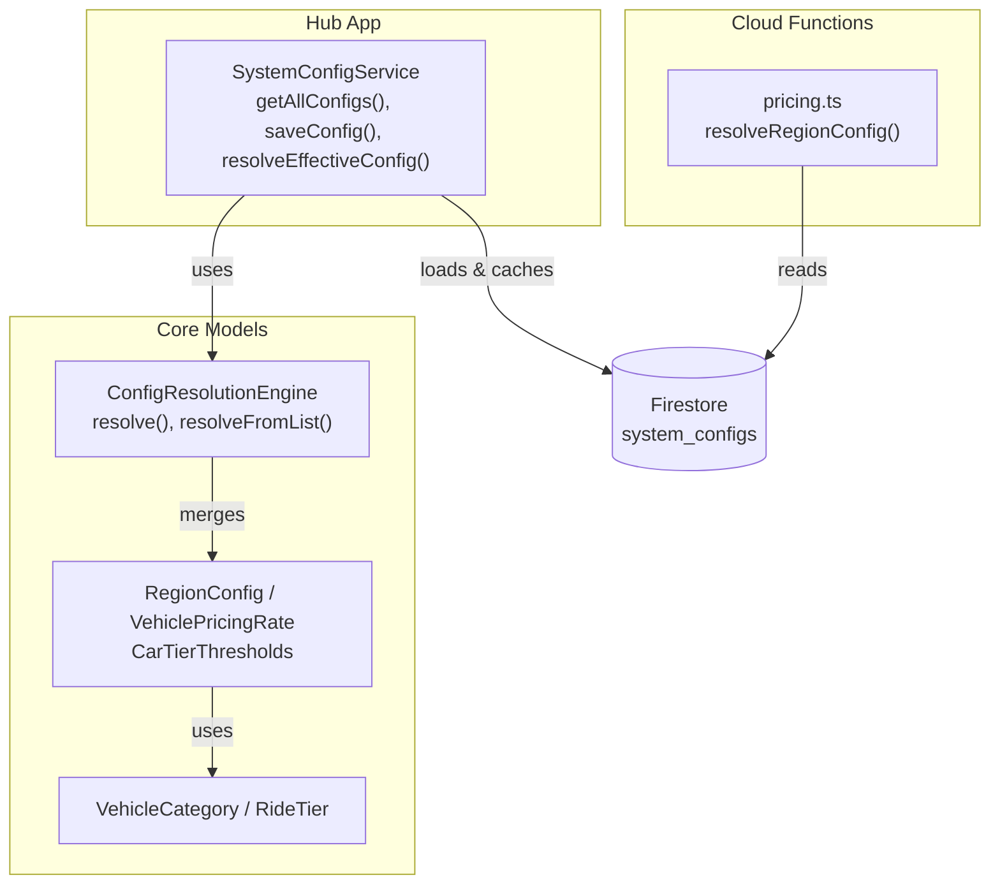
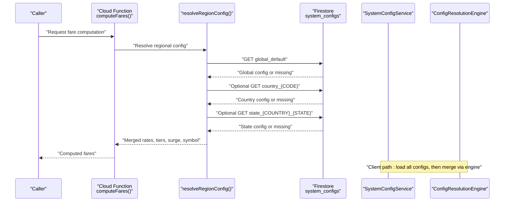
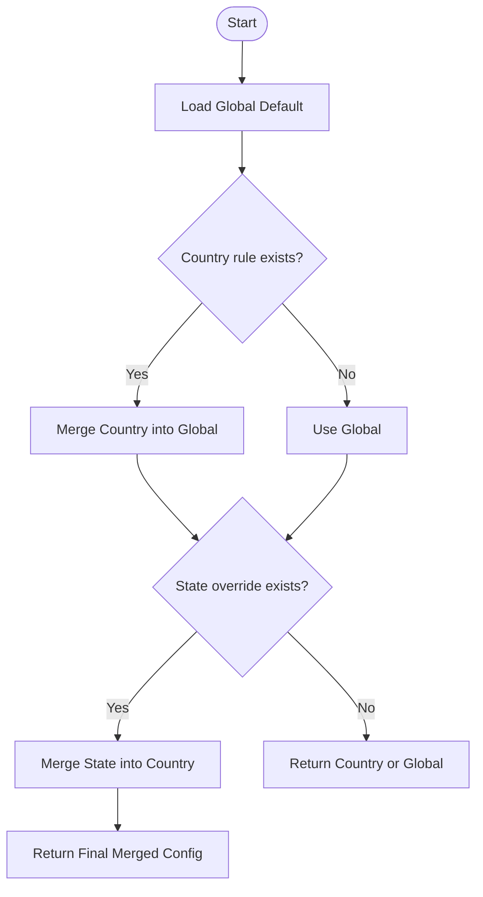
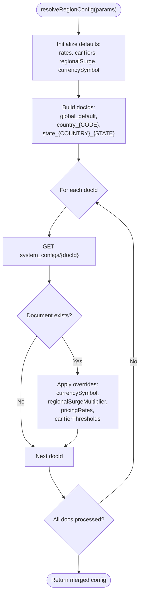
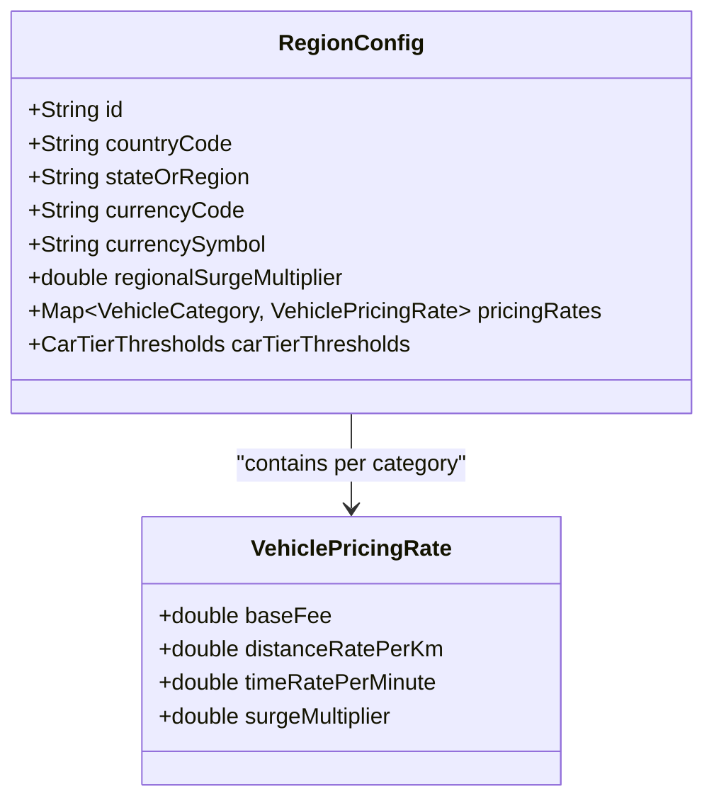
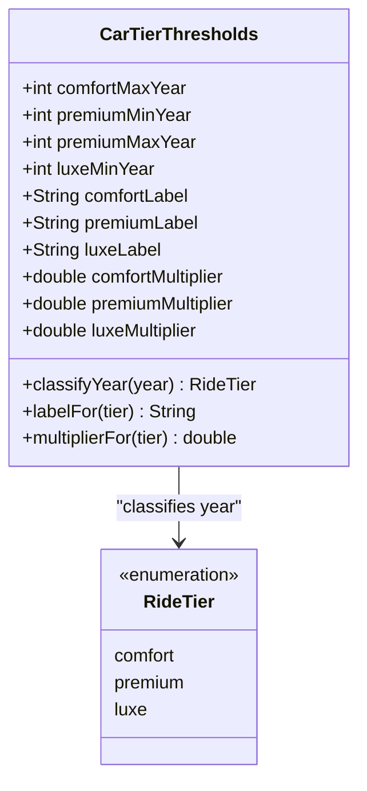
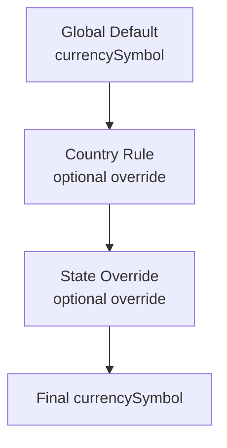
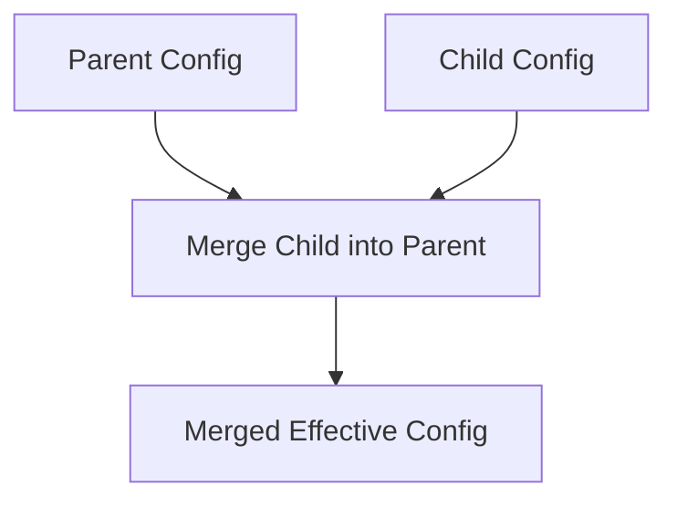
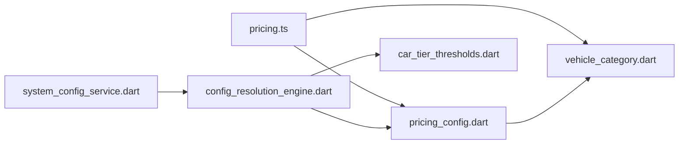

# Regional Pricing Configuration

<cite>
**Referenced Files in This Document**
- [pricing.ts](file://functions/src/pricing.ts)
- [system_config_service.dart](file://sese_hub/lib/features/config/services/system_config_service.dart)
- [config_resolution_engine.dart](file://sese_core/lib/services/config_resolution_engine.dart)
- [pricing_config.dart](file://sese_core/lib/models/pricing_config.dart)
- [car_tier_thresholds.dart](file://sese_core/lib/models/car_tier_thresholds.dart)
- [vehicle_category.dart](file://sese_core/lib/models/vehicle_category.dart)
</cite>

## Table of Contents
1. [Introduction](#introduction)
2. [Project Structure](#project-structure)
3. [Core Components](#core-components)
4. [Architecture Overview](#architecture-overview)
5. [Detailed Component Analysis](#detailed-component-analysis)
6. [Dependency Analysis](#dependency-analysis)
7. [Performance Considerations](#performance-considerations)
8. [Troubleshooting Guide](#troubleshooting-guide)
9. [Conclusion](#conclusion)

## Introduction
This document explains the regional pricing configuration system used across the ride and delivery services. It focuses on the hierarchical fallback chain:

- Global Default
- Country-Specific Rule
- State-Specific Override

It documents how `resolveRegionConfig` reads from the Firestore `system_configs` collection, how pricing rates are structured per vehicle category, how car tier multipliers work dynamically, and how currency symbols and overrides propagate through the hierarchy. It also covers error handling when Firestore is unreachable and caching strategies for performance optimization.

## Project Structure
The regional pricing system spans three layers:

- Cloud Functions backend that resolves region-specific pricing from Firestore.
- Hub application service layer that loads, caches, and merges configurations.
- Core model layer that defines data structures and merging logic.

**Diagram sources**
- [pricing.ts:60-147](file://functions/src/pricing.ts#L60-L147)
- [system_config_service.dart:92-145](file://sese_hub/lib/features/config/services/system_config_service.dart#L92-L145)
- [config_resolution_engine.dart:5-66](file://sese_core/lib/services/config_resolution_engine.dart#L5-L66)
- [pricing_config.dart:251-371](file://sese_core/lib/models/pricing_config.dart#L251-L371)
- [vehicle_category.dart:1-44](file://sese_core/lib/models/vehicle_category.dart#L1-L44)

**Section sources**
- [pricing.ts:18-58](file://functions/src/pricing.ts#L18-L58)
- [system_config_service.dart:1-80](file://sese_hub/lib/features/config/services/system_config_service.dart#L1-L80)
- [config_resolution_engine.dart:5-66](file://sese_core/lib/services/config_resolution_engine.dart#L5-L66)
- [pricing_config.dart:251-371](file://sese_core/lib/models/pricing_config.dart#L251-L371)
- [vehicle_category.dart:1-44](file://sese_core/lib/models/vehicle_category.dart#L1-L44)

## Core Components
- **Cloud Functions pricing resolver**: Implements the server-side fallback chain and computes fares using resolved regional configuration.
- **Hub SystemConfigService**: Loads all `system_configs` documents, caches them locally, and exposes a method to resolve effective configuration by country and optional state.
- **Core ConfigResolutionEngine**: Performs deterministic merging of global, country, and state configurations.
- **Core models**: Define `RegionConfig`, `VehiclePricingRate`, `CarTierThresholds`, and vehicle/ride enums.

Key responsibilities:
- Read and merge configuration from Firestore.
- Apply per-vehicle pricing rates.
- Apply car tier dynamic multipliers.
- Apply regional surge multiplier.
- Format currency with correct symbol.
- Provide robust fallback behavior when remote data is unavailable.

**Section sources**
- [pricing.ts:60-147](file://functions/src/pricing.ts#L60-L147)
- [system_config_service.dart:92-145](file://sese_hub/lib/features/config/services/system_config_service.dart#L92-L145)
- [config_resolution_engine.dart:5-66](file://sese_core/lib/services/config_resolution_engine.dart#L5-L66)
- [pricing_config.dart:251-371](file://sese_core/lib/models/pricing_config.dart#L251-L371)

## Architecture Overview
The system uses a consistent fallback chain at both server and client sides:

- Server side: `resolveRegionConfig` builds a list of document IDs starting with `global_default`, then optionally `country_{CODE}`, then optionally `state_{COUNTRY}_{STATE}`. It fetches them in order so later documents override earlier ones.
- Client side: `SystemConfigService.getAllConfigs()` loads all `system_configs` documents into memory, then `ConfigResolutionEngine.resolveFromList()` selects global, country, and state configs and merges them.

**Diagram sources**
- [pricing.ts:60-147](file://functions/src/pricing.ts#L60-L147)
- [system_config_service.dart:92-145](file://sese_hub/lib/features/config/services/system_config_service.dart#L92-L145)
- [config_resolution_engine.dart:36-66](file://sese_core/lib/services/config_resolution_engine.dart#L36-L66)

## Detailed Component Analysis

### Hierarchical Fallback Chain
The fallback chain ensures predictable precedence:

1. Global Default: Always applied first.
2. Country-Specific Rule: Overrides global fields where present.
3. State-Specific Override: Overrides country and global fields where present.

At each level, only explicitly provided fields override parent values; unspecified fields inherit from the parent.

**Diagram sources**
- [config_resolution_engine.dart:12-34](file://sese_core/lib/services/config_resolution_engine.dart#L12-L34)
- [pricing.ts:86-91](file://functions/src/pricing.ts#L86-L91)

**Section sources**
- [config_resolution_engine.dart:12-34](file://sese_core/lib/services/config_resolution_engine.dart#L12-L34)
- [pricing.ts:86-91](file://functions/src/pricing.ts#L86-L91)

### resolveRegionConfig Function
`resolveRegionConfig` implements the server-side resolution:

- Initializes defaults for rates, car tiers, regional surge, and currency symbol.
- Builds ordered document IDs: `global_default`, optional `country_{CODE}`, optional `state_{COUNTRY}_{STATE}`.
- Iterates through documents and applies overrides:
  - Updates `currencySymbol`.
  - Updates `regionalSurgeMultiplier`.
  - Merges `pricingRates` per vehicle category.
  - Merges `carTierThresholds` including multipliers and labels.
- Catches individual doc fetch failures and continues with already-resolved configuration.
- If Firestore is unreachable, returns in-memory defaults.

**Diagram sources**
- [pricing.ts:60-147](file://functions/src/pricing.ts#L60-L147)

**Section sources**
- [pricing.ts:60-147](file://functions/src/pricing.ts#L60-L147)

### Pricing Rates Structure
Each vehicle category has a pricing rate object with these fields:

- `baseFee`: Minimum charge floor for any trip or delivery.
- `distanceRatePerKm`: Cost per kilometer.
- `timeRatePerMinute`: Cost per minute of travel or waiting.
- `surgeMultiplier`: Optional per-vehicle surge or difficulty multiplier.

These rates are defined globally and can be overridden per country or state. The final effective rate for a category is determined by merging child configs over parent configs.

**Diagram sources**
- [pricing_config.dart:4-64](file://sese_core/lib/models/pricing_config.dart#L4-L64)
- [pricing_config.dart:251-371](file://sese_core/lib/models/pricing_config.dart#L251-L371)

**Section sources**
- [pricing_config.dart:4-64](file://sese_core/lib/models/pricing_config.dart#L4-L64)
- [pricing_config.dart:251-371](file://sese_core/lib/models/pricing_config.dart#L251-L371)

### Car Tier Dynamic Configuration
Car tiers apply multipliers to variable fare components while preserving the base fee as a floor. The dynamic configuration includes:

- `comfortMultiplier`: Multiplier for comfort tier.
- `premiumMultiplier`: Multiplier for premium tier.
- `luxeMultiplier`: Multiplier for luxe tier.
- Labels for display names: `comfortLabel`, `premiumLabel`, `luxeLabel`.

These multipliers can be overridden at country or state levels. Defaults provide baseline multipliers and labels.

**Diagram sources**
- [car_tier_thresholds.dart:10-78](file://sese_core/lib/models/car_tier_thresholds.dart#L10-L78)
- [vehicle_category.dart:46-69](file://sese_core/lib/models/vehicle_category.dart#L46-L69)

**Section sources**
- [car_tier_thresholds.dart:10-78](file://sese_core/lib/models/car_tier_thresholds.dart#L10-L78)
- [vehicle_category.dart:46-69](file://sese_core/lib/models/vehicle_category.dart#L46-L69)

### Currency Symbol Handling
Currency symbol propagation follows the same fallback chain:

- Global default sets a baseline symbol.
- Country rule may override it.
- State override may further override it.

On the server side, `resolveRegionConfig` updates the symbol from each document if present. On the client side, `RegionConfig` stores the symbol and provides formatting helpers.

**Diagram sources**
- [pricing.ts:101-103](file://functions/src/pricing.ts#L101-L103)
- [pricing_config.dart:307-310](file://sese_core/lib/models/pricing_config.dart#L307-L310)

**Section sources**
- [pricing.ts:101-103](file://functions/src/pricing.ts#L101-L103)
- [pricing_config.dart:307-310](file://sese_core/lib/models/pricing_config.dart#L307-L310)

### Examples of Regional Configuration Setup

#### Global Default
- Defines baseline rates for all vehicle categories.
- Sets default currency code and symbol.
- Provides default car tier thresholds and labels.

#### Country-Specific Rule
- Example: Nigeria (`NG`) overrides rates and currency.
- Can set a different `currencyCode` and `currencySymbol`.
- May adjust `regionalSurgeMultiplier`.

#### State-Specific Override
- Example: Lagos (`NG_LAGOS`) overrides car rates and car tier multipliers.
- Can increase `regionalSurgeMultiplier` for high-demand areas.
- Can customize car tier labels and multipliers.

These examples are represented in the hub’s local cache and mirror the expected Firestore structure.

**Section sources**
- [system_config_service.dart:12-80](file://sese_hub/lib/features/config/services/system_config_service.dart#L12-L80)
- [pricing_config.dart:373-420](file://sese_core/lib/models/pricing_config.dart#L373-L420)

### How Overrides Work at Each Level
- Per-vehicle pricing rates: Child config replaces parent config for the same vehicle category.
- Car tier thresholds: Only explicitly set fields override parent values; unspecified fields inherit.
- Regional surge multiplier: Positive value in child overrides parent.
- Currency symbol: Child string value overrides parent.

**Diagram sources**
- [config_resolution_engine.dart:68-165](file://sese_core/lib/services/config_resolution_engine.dart#L68-L165)
- [pricing.ts:111-137](file://functions/src/pricing.ts#L111-L137)

**Section sources**
- [config_resolution_engine.dart:68-165](file://sese_core/lib/services/config_resolution_engine.dart#L68-L165)
- [pricing.ts:111-137](file://functions/src/pricing.ts#L111-L137)

## Dependency Analysis
The following diagram shows key dependencies between modules involved in regional pricing:

**Diagram sources**
- [pricing.ts:1-58](file://functions/src/pricing.ts#L1-L58)
- [system_config_service.dart:1-80](file://sese_hub/lib/features/config/services/system_config_service.dart#L1-L80)
- [config_resolution_engine.dart:1-66](file://sese_core/lib/services/config_resolution_engine.dart#L1-L66)
- [pricing_config.dart:1-64](file://sese_core/lib/models/pricing_config.dart#L1-L64)
- [car_tier_thresholds.dart:1-43](file://sese_core/lib/models/car_tier_thresholds.dart#L1-L43)
- [vehicle_category.dart:1-44](file://sese_core/lib/models/vehicle_category.dart#L1-L44)

**Section sources**
- [pricing.ts:1-58](file://functions/src/pricing.ts#L1-L58)
- [system_config_service.dart:1-80](file://sese_hub/lib/features/config/services/system_config_service.dart#L1-L80)
- [config_resolution_engine.dart:1-66](file://sese_core/lib/services/config_resolution_engine.dart#L1-L66)
- [pricing_config.dart:1-64](file://sese_core/lib/models/pricing_config.dart#L1-L64)
- [car_tier_thresholds.dart:1-43](file://sese_core/lib/models/car_tier_thresholds.dart#L1-L43)
- [vehicle_category.dart:1-44](file://sese_core/lib/models/vehicle_category.dart#L1-L44)

## Performance Considerations
- Firestore reads are limited to at most three documents per request in the server resolver.
- Client-side caching reduces repeated network calls:
  - `SystemConfigService` maintains an in-memory cache of `RegionConfig` objects.
  - On successful read, the cache is updated with remote documents.
  - On failure, the app falls back to cached values.
- Merging logic is linear in the number of configured vehicle categories and car tier fields.
- Avoid unnecessary recomputation by reusing resolved configuration within a session or request scope.

Recommendations:
- Cache resolved configuration at the application layer for short-lived sessions.
- Invalidate cache when admin updates occur or when explicit refresh is requested.
- Monitor Firestore latency and consider retry/backoff strategies for transient errors.

**Section sources**
- [system_config_service.dart:92-117](file://sese_hub/lib/features/config/services/system_config_service.dart#L92-L117)
- [pricing.ts:81-91](file://functions/src/pricing.ts#L81-L91)

## Troubleshooting Guide
Common issues and resolutions:

- Firestore unreachable:
  - Server: `resolveRegionConfig` catches exceptions and returns in-memory defaults.
  - Client: `SystemConfigService.getAllConfigs()` logs a debug message and returns cached values.
- Missing configuration documents:
  - Ensure `global_default` exists.
  - For country-specific rules, use ID format `country_{CODE}` (uppercase).
  - For state overrides, use ID format `state_{COUNTRY}_{STATE}` (state normalized to uppercase with underscores).
- Incorrect field types:
  - `regionalSurgeMultiplier` accepts numbers or numeric strings; invalid values are ignored.
  - `currencySymbol` must be a non-empty string to override.
  - `pricingRates` must be an object keyed by vehicle category name.
- Unexpected overrides:
  - Verify that child configs only specify intended fields; unspecified fields inherit from parents.
  - Check car tier threshold defaults to avoid unintentional resets.

Operational checks:
- Validate document IDs match expected patterns.
- Confirm currency codes and symbols align with target markets.
- Review merged results via logging or admin tools to ensure precedence is correct.

**Section sources**
- [pricing.ts:138-144](file://functions/src/pricing.ts#L138-L144)
- [system_config_service.dart:112-117](file://sese_hub/lib/features/config/services/system_config_service.dart#L112-L117)
- [pricing.ts:101-109](file://functions/src/pricing.ts#L101-L109)
- [pricing.ts:111-137](file://functions/src/pricing.ts#L111-L137)

## Conclusion
The regional pricing configuration system provides a robust, hierarchical mechanism for managing pricing across global, country, and state scopes. It combines server-side resolution with client-side caching and deterministic merging to deliver accurate, localized fares. By understanding the fallback chain, data structures, and override semantics, operators can confidently configure regional pricing, handle edge cases, and maintain performance under varying network conditions.