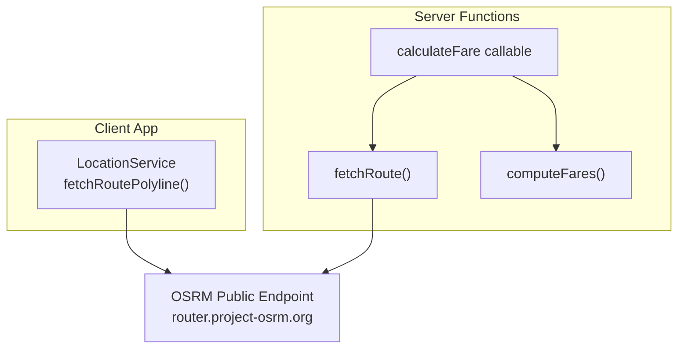
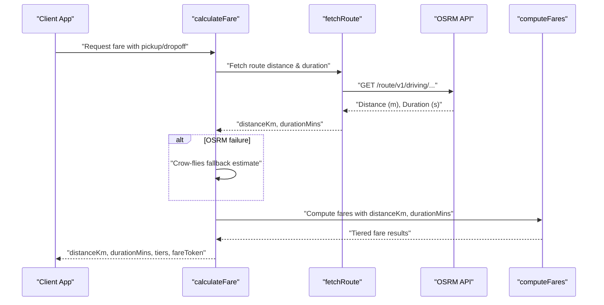
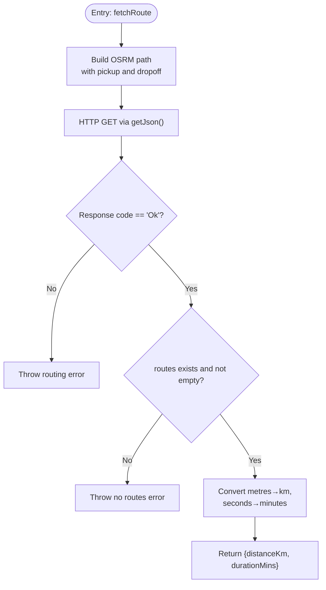
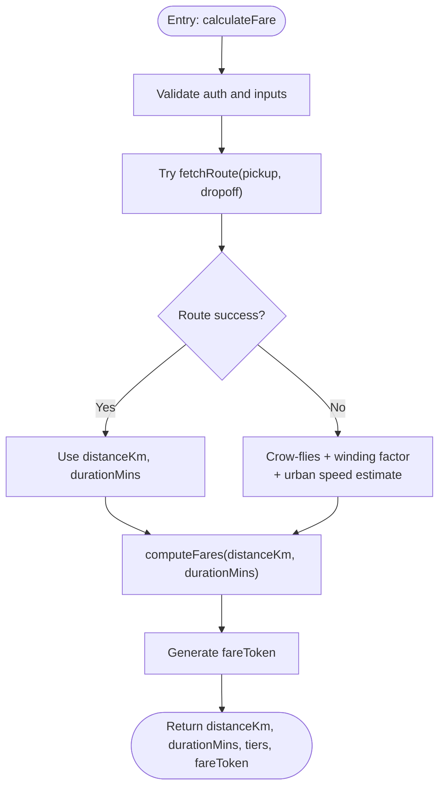
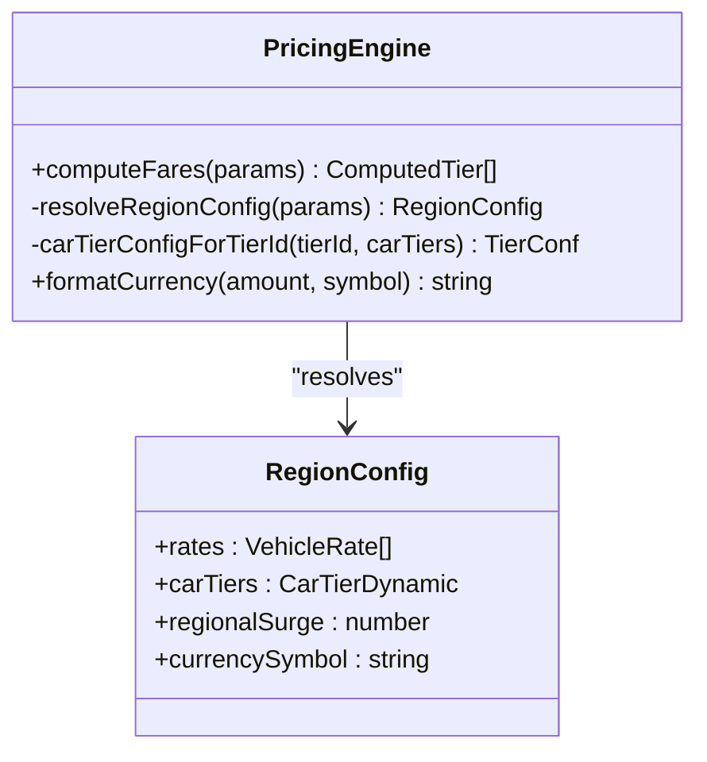
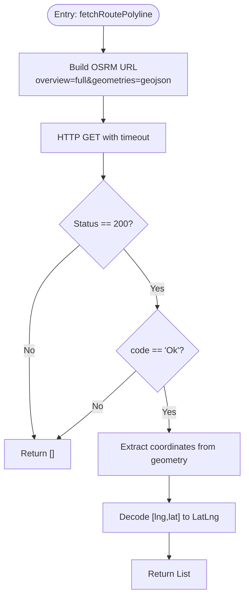
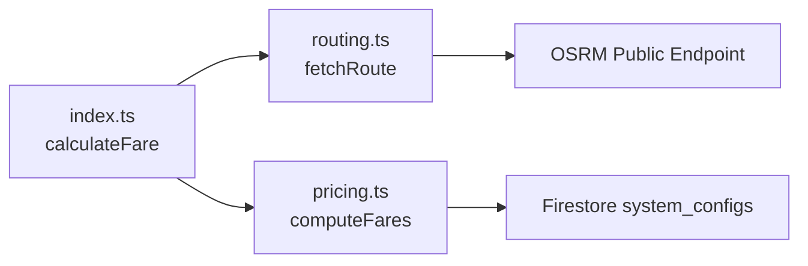

# Routing Integration

<cite>
**Referenced Files in This Document**
- [routing.ts](file://functions/src/routing.ts)
- [index.ts](file://functions/src/index.ts)
- [pricing.ts](file://functions/src/pricing.ts)
- [location_service.dart](file://sese_ride/lib/features/customer/services/location_service.dart)
</cite>

## Table of Contents
1. [Introduction](#introduction)
2. [Project Structure](#project-structure)
3. [Core Components](#core-components)
4. [Architecture Overview](#architecture-overview)
5. [Detailed Component Analysis](#detailed-component-analysis)
6. [Dependency Analysis](#dependency-analysis)
7. [Performance Considerations](#performance-considerations)
8. [Troubleshooting Guide](#troubleshooting-guide)
9. [Conclusion](#conclusion)

## Introduction
This document explains the routing integration used to calculate route distances and durations for fare computation. The system currently uses an OpenStreetMap-based OSRM endpoint to obtain road-network distance and duration between pickup and dropoff coordinates. When the external routing service is unavailable, the server falls back to a crow-flies approximation with a road-winding factor and estimated urban speed. The calculated distance and duration are then passed into the pricing engine to compute fares per vehicle category or ride tier. A client-side utility also fetches route geometry from the same OSRM provider for map visualization.

The documentation covers:
- How route distance and duration are computed
- The function that performs routing and its parameters
- Fallback mechanisms when external APIs fail
- Examples of request/response flows and error handling
- Performance techniques such as caching, batching, and rate limiting
- Integration with the pricing engine and data flow for fare computation

## Project Structure
The routing integration spans two layers:
- Server layer (Cloud Functions): calculates authoritative route metrics and fares
- Client layer (Flutter app): optionally fetches route geometry for display

**Diagram sources**
- [location_service.dart:231-278](file://sese_ride/lib/features/customer/services/location_service.dart#L231-L278)
- [index.ts:81-198](file://functions/src/index.ts#L81-L198)
- [routing.ts:40-67](file://functions/src/routing.ts#L40-L67)
- [pricing.ts:166-236](file://functions/src/pricing.ts#L166-L236)

**Section sources**
- [location_service.dart:231-278](file://sese_ride/lib/features/customer/services/location_service.dart#L231-L278)
- [index.ts:81-198](file://functions/src/index.ts#L81-L198)
- [routing.ts:40-67](file://functions/src/routing.ts#L40-L67)
- [pricing.ts:166-236](file://functions/src/pricing.ts#L166-L236)

## Core Components
- Route fetcher: obtains road-network distance and duration from OSRM
- Fare calculator callable: validates inputs, calls route fetcher, applies fallback if needed, computes fares, and returns signed results
- Pricing engine: resolves regional rates and computes per-tier fares using distance and duration
- Client route geometry helper: fetches route polyline for map rendering

Key responsibilities:
- OSRM integration and response parsing
- Input validation and authentication enforcement
- Fallback estimation when OSRM fails
- Regional pricing resolution and fare computation
- Signed fare token generation for zero-trust integrity

**Section sources**
- [routing.ts:1-109](file://functions/src/routing.ts#L1-L109)
- [index.ts:62-198](file://functions/src/index.ts#L62-L198)
- [pricing.ts:1-237](file://functions/src/pricing.ts#L1-L237)
- [location_service.dart:231-278](file://sese_ride/lib/features/customer/services/location_service.dart#L231-L278)

## Architecture Overview
The fare calculation workflow integrates routing and pricing:

**Diagram sources**
- [index.ts:81-198](file://functions/src/index.ts#L81-L198)
- [routing.ts:40-67](file://functions/src/routing.ts#L40-L67)
- [pricing.ts:166-236](file://functions/src/pricing.ts#L166-L236)

## Detailed Component Analysis

### Route Fetching: fetchRoute
Purpose:
- Call OSRM’s driving profile endpoint
- Parse JSON response
- Convert units to kilometers and minutes
- Throw errors on failures or missing routes

Parameters:
- pickupLat: number
- pickupLng: number
- dropoffLat: number
- dropoffLng: number

Return:
- distanceKm: number
- durationMins: number

Error handling:
- Non-“Ok” status code throws an error with message
- Empty routes array throws an error
- Network timeouts and invalid responses are handled by the HTTP wrapper

**Diagram sources**
- [routing.ts:40-67](file://functions/src/routing.ts#L40-L67)
- [routing.ts:70-108](file://functions/src/routing.ts#L70-L108)

**Section sources**
- [routing.ts:1-109](file://functions/src/routing.ts#L1-L109)

### Fare Calculation Callable: calculateFare
Purpose:
- Enforce authentication and input validation
- Compute road-network distance and duration via fetchRoute
- Apply fallback estimation if routing fails
- Compute fares through the pricing engine
- Generate a signed fare token and return results

Input parameters:
- pickup: { lat: number; lng: number }
- dropoff: { lat: number; lng: number }
- serviceType: "ride" | "send_item" | "receive_item"
- selectedTiers?: string[]
- countryCode?: string
- stateOrRegion?: string

Output fields:
- distanceKm: number
- durationMins: number
- tiers: ComputedTier[]
- fareToken: string

Fallback logic:
- If fetchRoute throws, compute crow-flies distance using Haversine formula
- Apply a road-winding factor (~1.35) to approximate road distance
- Estimate duration based on ~25 km/h urban speed

**Diagram sources**
- [index.ts:81-198](file://functions/src/index.ts#L81-L198)

**Section sources**
- [index.ts:62-198](file://functions/src/index.ts#L62-L198)

### Pricing Engine: computeFares
Purpose:
- Resolve regional configuration (global/country/state)
- Compute fares for requested tiers/categories
- Apply base fee floors, per-km/per-min rates, surge multipliers, and tier multipliers

Inputs:
- serviceType: "ride" | "send_item" | "receive_item"
- selectedTiers?: string[]
- distanceKm: number
- durationMins: number
- countryCode?: string
- stateOrRegion?: string

Outputs:
- Array of ComputedTier objects with fareAmount and formatted currency

Regional configuration:
- Fallback chain: Global Default → Country-Specific → State-Specific
- Firestore reads may fail; defaults are used if unreachable

**Diagram sources**
- [pricing.ts:60-147](file://functions/src/pricing.ts#L60-L147)
- [pricing.ts:166-236](file://functions/src/pricing.ts#L166-L236)

**Section sources**
- [pricing.ts:1-237](file://functions/src/pricing.ts#L1-L237)

### Client Route Geometry: LocationService.fetchRoutePolyline
Purpose:
- Fetch route polyline from OSRM for map visualization
- Decode GeoJSON coordinates into LatLng points
- Provide a custom provider override hook

Behavior:
- Uses OSRM public endpoint with overview=full and geometries=geojson
- Returns empty list on non-200 status, non-“Ok” code, or missing geometry
- Catches exceptions and logs errors

**Diagram sources**
- [location_service.dart:231-278](file://sese_ride/lib/features/customer/services/location_service.dart#L231-L278)

**Section sources**
- [location_service.dart:231-278](file://sese_ride/lib/features/customer/services/location_service.dart#L231-L278)

## Dependency Analysis
The routing integration depends on:
- External OSRM endpoint for route metrics
- Firebase Admin SDK for Firestore access in pricing
- Internal modules for fare token generation and pricing calculations

**Diagram sources**
- [index.ts:21-24](file://functions/src/index.ts#L21-L24)
- [index.ts:81-198](file://functions/src/index.ts#L81-L198)
- [routing.ts:40-67](file://functions/src/routing.ts#L40-L67)
- [pricing.ts:60-147](file://functions/src/pricing.ts#L60-L147)

**Section sources**
- [index.ts:21-24](file://functions/src/index.ts#L21-L24)
- [index.ts:81-198](file://functions/src/index.ts#L81-L198)
- [routing.ts:40-67](file://functions/src/routing.ts#L40-L67)
- [pricing.ts:60-147](file://functions/src/pricing.ts#L60-L147)

## Performance Considerations
Recommended optimizations for production:
- Route caching: cache OSRM responses keyed by normalized coordinate pairs to reduce repeated calls and mitigate rate limits
- Batch processing: aggregate multiple fare requests within short time windows to amortize overhead and reduce Firestore reads
- Rate limiting: implement throttling at the function level to protect against bursts and respect OSRM public endpoint constraints
- Endpoint switching: use environment variable OSRM_BASE_URL to switch to a self-hosted OSRM instance for higher throughput and control
- Response minimization: avoid unnecessary geometry retrieval in server-side routing; only fetch polylines when required by UI
- Concurrency control: limit concurrent OSRM calls to prevent timeouts and ensure stable performance under load

[No sources needed since this section provides general guidance]

## Troubleshooting Guide
Common issues and strategies:
- OSRM unreachable or rate-limited:
  - The server falls back to crow-flies estimation with a road-winding factor and urban speed assumption
  - Monitor logs for “OSRM request timed out” or status code errors
- Invalid or tampered inputs:
  - The callable enforces authentication and validates coordinate bounds and service type
  - Ensure clients send valid numeric coordinates within geographic ranges
- Missing route data:
  - If OSRM returns no routes, the server throws an error; callers should handle gracefully and rely on fallback estimates
- Pricing configuration errors:
  - Firestore reads may fail; defaults are applied if region config cannot be resolved
  - Verify system_configs documents exist for global/country/state scopes

Operational checks:
- Confirm OSRM_BASE_URL is set appropriately for your environment
- Validate that system_configs contains expected pricingRates and carTierThresholds
- Inspect logs for HTTP status codes and OSRM response codes

**Section sources**
- [index.ts:144-166](file://functions/src/index.ts#L144-L166)
- [routing.ts:52-67](file://functions/src/routing.ts#L52-L67)
- [pricing.ts:79-147](file://functions/src/pricing.ts#L79-L147)

## Conclusion
The routing integration leverages OSRM to compute accurate road-network distance and duration for fare calculation. It includes robust fallback logic to maintain service continuity when external providers fail. The pricing engine consumes these metrics to produce authoritative, region-aware fares across vehicle categories and ride tiers. For production readiness, implement caching, batching, and rate limiting, and consider self-hosting OSRM for scalability. The client-side route geometry helper complements the server-side flow by providing visual route polylines for user interfaces.

[No sources needed since this section summarizes without analyzing specific files]