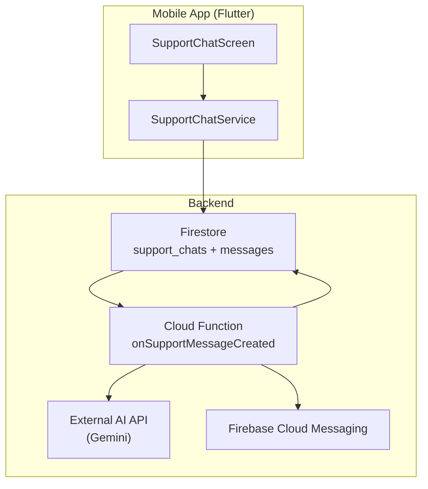
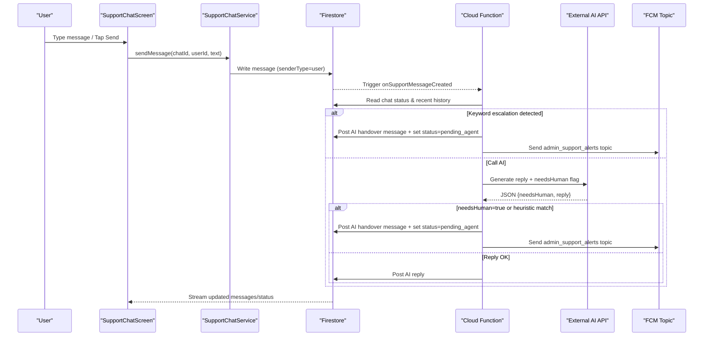
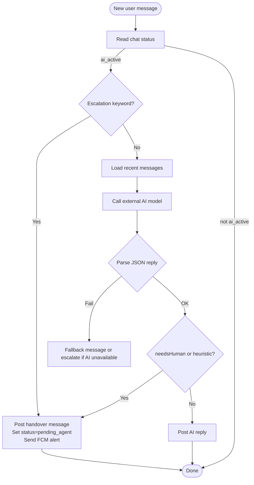
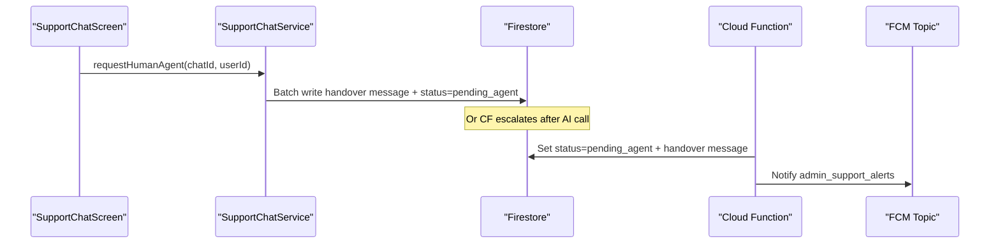
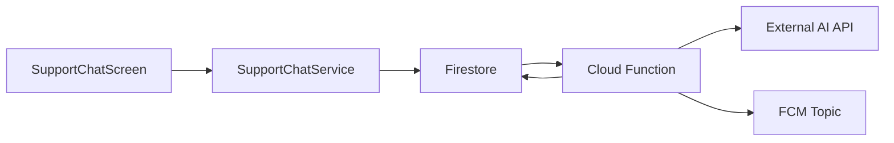

# Support Bot Integration

<cite>
**Referenced Files in This Document**
- [supportBot.ts](file://functions/src/supportBot.ts)
- [support_chat_screen.dart](file://sese_ride/lib/features/support/support_chat_screen.dart)
- [support_chat_service.dart](file://sese_ride/lib/features/support/support_chat_service.dart)
- [firestore.rules](file://firestore.rules)
- [package.json](file://functions/package.json)
</cite>

## Table of Contents
1. [Introduction](#introduction)
2. [Project Structure](#project-structure)
3. [Core Components](#core-components)
4. [Architecture Overview](#architecture-overview)
5. [Detailed Component Analysis](#detailed-component-analysis)
6. [Dependency Analysis](#dependency-analysis)
7. [Performance Considerations](#performance-considerations)
8. [Troubleshooting Guide](#troubleshooting-guide)
9. [Conclusion](#conclusion)

## Introduction
This document explains the AI-powered support bot integration across the mobile app and backend. It covers message processing workflows, natural language understanding via an external AI model, human agent handover mechanisms, conversation state management, escalation protocols, privacy and content filtering considerations, response templating, analytics collection points, and performance optimization for real-time chat interactions.

The system uses a Firestore-backed chat model with two entry points:
- Client-side escalation through the Flutter app.
- Server-side AI handling triggered by Cloud Functions when users send messages while the session is active.

## Project Structure
The support bot spans three main areas:
- Mobile client (Flutter): UI and service layer for opening sessions, sending messages, streaming updates, and escalating to a human.
- Backend (Cloud Functions): Listens for user messages, calls an external AI model, posts AI replies, and escalates when needed.
- Security rules: Enforce who can read/write chat documents and messages.

**Diagram sources**
- [support_chat_screen.dart:1-549](file://sese_ride/lib/features/support/support_chat_screen.dart#L1-L549)
- [support_chat_service.dart:1-351](file://sese_ride/lib/features/support/support_chat_service.dart#L1-L351)
- [supportBot.ts:1-256](file://functions/src/supportBot.ts#L1-L256)

**Section sources**
- [support_chat_screen.dart:1-549](file://sese_ride/lib/features/support/support_chat_screen.dart#L1-L549)
- [support_chat_service.dart:1-351](file://sese_ride/lib/features/support/support_chat_service.dart#L1-L351)
- [supportBot.ts:1-256](file://functions/src/supportBot.ts#L1-L256)

## Core Components
- SupportChatScreen: Flutter UI that opens/resumes sessions, streams messages and status, shows typing indicators, and exposes a “Connect to Human Agent” action during AI handling.
- SupportChatService: Client-side transport for creating or resuming chats, sending messages, streaming messages/status, and triggering escalation.
- onSupportMessageCreated (Cloud Function): Server-side handler that processes user messages, calls the AI model, writes AI responses, and escalates when required.
- Firestore Rules: Define access control for support_chats and messages, ensuring only participants and admins can read/write.

Key responsibilities:
- Conversation lifecycle states: ai_active, pending_agent, agent_connected, resolved.
- Escalation triggers: explicit keywords, model verdict, or client button.
- Real-time UX: streaming updates, typing indicator, sound notification on new non-user messages.

**Section sources**
- [support_chat_screen.dart:1-549](file://sese_ride/lib/features/support/support_chat_screen.dart#L1-L549)
- [support_chat_service.dart:1-351](file://sese_ride/lib/features/support/support_chat_service.dart#L1-L351)
- [supportBot.ts:1-256](file://functions/src/supportBot.ts#L1-L256)
- [firestore.rules:667-703](file://firestore.rules#L667-L703)

## Architecture Overview
End-to-end flow from user message to AI reply or escalation:

**Diagram sources**
- [support_chat_service.dart:240-334](file://sese_ride/lib/features/support/support_chat_service.dart#L240-L334)
- [supportBot.ts:183-255](file://functions/src/supportBot.ts#L183-L255)

## Detailed Component Analysis

### Message Processing Workflow
- The client sends a message by writing to `support_chats/{chatId}/messages`.
- The Cloud Function triggers on new messages where senderType is user and chat status is ai_active.
- The function reads recent context, optionally calls the AI model, and either posts an AI reply or escalates.

**Diagram sources**
- [supportBot.ts:183-255](file://functions/src/supportBot.ts#L183-L255)

**Section sources**
- [supportBot.ts:183-255](file://functions/src/supportBot.ts#L183-L255)

### Natural Language Understanding and Response Templating
- The backend uses an external AI model with a system instruction defining persona, domain knowledge, and escalation policy.
- The model returns strict JSON containing a user-facing reply and a boolean indicating whether a human agent is needed.
- If parsing fails or the model is unavailable, the function posts a fallback prompt or escalates depending on environment configuration.

Key behaviors:
- System instruction enforces concise, polite, plain-language responses and authoritative domain facts.
- Escalation conditions include safety-sensitive topics, explicit human requests, and unresolved issues.
- A fallback message encourages clarification when the model cannot respond.

**Section sources**
- [supportBot.ts:27-43](file://functions/src/supportBot.ts#L27-L43)
- [supportBot.ts:81-115](file://functions/src/supportBot.ts#L81-L115)
- [supportBot.ts:229-253](file://functions/src/supportBot.ts#L229-L253)

### Human Agent Handover Mechanisms
Two paths lead to human involvement:
- Client-side escalation: The user taps “Connect to Human Agent.” The service posts a handover message and sets status to pending_agent atomically.
- Server-side escalation: Keywords or the AI model’s needsHuman flag trigger escalation; the function posts the same handover message, sets status to pending_agent, and sends an FCM alert to the admin_support_alerts topic.

**Diagram sources**
- [support_chat_service.dart:293-334](file://sese_ride/lib/features/support/support_chat_service.dart#L293-L334)
- [supportBot.ts:140-177](file://functions/src/supportBot.ts#L140-L177)

**Section sources**
- [support_chat_service.dart:293-334](file://sese_ride/lib/features/support/support_chat_service.dart#L293-L334)
- [supportBot.ts:140-177](file://functions/src/supportBot.ts#L140-L177)

### Conversation State Management
States and transitions:
- ai_active: AI handles the conversation.
- pending_agent: Escalated; waiting for a hub agent to claim.
- agent_connected: Hub agent is live in the thread.
- resolved: Session closed; input locked.

Client behavior:
- Streams status and renders banners for pending_agent, agent_connected, and resolved.
- Locks input when resolved.
- Shows “Connect to Human Agent” only while ai_active.

Server behavior:
- Only processes user messages when status is ai_active.
- Sets status to pending_agent on escalation.

**Section sources**
- [support_chat_screen.dart:8-12](file://sese_ride/lib/features/support/support_chat_screen.dart#L8-L12)
- [support_chat_screen.dart:153-171](file://sese_ride/lib/features/support/support_chat_screen.dart#L153-L171)
- [support_chat_screen.dart:220-246](file://sese_ride/lib/features/support/support_chat_screen.dart#L220-L246)
- [support_chat_service.dart:88-108](file://sese_ride/lib/features/support/support_chat_service.dart#L88-L108)
- [supportBot.ts:193-200](file://functions/src/supportBot.ts#L193-L200)

### Ticket Creation Processes
- The codebase includes legacy support_tickets and a newer support_chats model.
- The current AI-first flow uses support_chats; legacy tickets remain supported for migration compatibility.
- Firestore rules allow both collections and define participant-based access.

Operational note:
- When migrating or integrating with existing ticketing systems, ensure that new flows use support_chats and that any legacy queues are drained.

**Section sources**
- [support_chat_service.dart:123-127](file://sese_ride/lib/features/support/support_chat_service.dart#L123-L127)
- [firestore.rules:616-665](file://firestore.rules#L616-L665)
- [firestore.rules:667-703](file://firestore.rules#L667-L703)

### Escalation Protocols
Protocols:
- Keyword heuristic: Certain phrases bypass the AI call and immediately escalate.
- Model verdict: The AI may return needsHuman=true; the server enforces escalation.
- Client button: Users can explicitly request a human agent at any time while AI is active.

Safety-first guidance:
- The system instruction instructs the AI to prioritize safety in accidents, injuries, crime, or threats, and to escalate accordingly.

**Section sources**
- [supportBot.ts:45-51](file://functions/src/supportBot.ts#L45-L51)
- [supportBot.ts:56-59](file://functions/src/supportBot.ts#L56-L59)
- [supportBot.ts:205-209](file://functions/src/supportBot.ts#L205-L209)
- [supportBot.ts:248-250](file://functions/src/supportBot.ts#L248-L250)

### Integration Patterns with External AI Services
- The Cloud Function calls an external generative AI API using HTTP fetch.
- Configuration includes model name, URL, temperature, and max output tokens.
- Environment variable holds the API key; missing keys cause escalation or fallback behavior.

Security and reliability:
- API key is not embedded in client code.
- Errors from the AI provider are logged and handled gracefully.

**Section sources**
- [supportBot.ts:23-25](file://functions/src/supportBot.ts#L23-L25)
- [supportBot.ts:81-115](file://functions/src/supportBot.ts#L81-L115)
- [supportBot.ts:236-245](file://functions/src/supportBot.ts#L236-L245)

### Analytics Collection Points
Recommended instrumentation points (implementation not present in the analyzed files):
- Chat opened/resumed per user role.
- Messages sent/received counts.
- Time-to-first-AI-reply latency.
- Escalation reasons (keyword vs model).
- Fallback usage and AI error rates.
- Human agent claim time and resolution time.

These metrics should be emitted to a telemetry/analytics backend without including sensitive message content.

[No sources needed since this section provides general guidance]

### Privacy Considerations and Content Filtering
Privacy:
- Access to chat documents and messages is restricted to participants and authorized staff via Firestore rules.
- Avoid logging full message payloads in analytics; log anonymized events and metadata only.

Content filtering:
- Keyword heuristic provides a fast path to escalate sensitive or high-risk topics.
- The AI system instruction emphasizes safety and directs escalation for critical scenarios.

Data retention:
- Consider implementing retention policies for chat history and audit logs.

**Section sources**
- [firestore.rules:667-703](file://firestore.rules#L667-L703)
- [supportBot.ts:27-43](file://functions/src/supportBot.ts#L27-L43)
- [supportBot.ts:45-51](file://functions/src/supportBot.ts#L45-L51)

### Performance Optimization for Real-Time Chat
Optimizations implemented:
- Streaming listeners for messages and status to keep UI responsive.
- Recent message history limited to a small window before calling the AI model.
- Batched writes for atomic updates to messages and parent chat metadata.

Additional recommendations:
- Cache frequently used templates and FAQs server-side to reduce AI calls for common intents.
- Implement retry/backoff for AI calls and queue retries for transient failures.
- Use connection pooling and timeouts for external API calls.
- Debounce rapid user inputs and prevent duplicate sends.

**Section sources**
- [support_chat_service.dart:202-215](file://sese_ride/lib/features/support/support_chat_service.dart#L202-L215)
- [supportBot.ts:211-224](file://functions/src/supportBot.ts#L211-L224)
- [supportBot.ts:117-138](file://functions/src/supportBot.ts#L117-L138)

## Dependency Analysis
Component relationships:
- SupportChatScreen depends on SupportChatService for all data operations.
- SupportChatService interacts directly with Firestore.
- Cloud Function listens to Firestore changes and orchestrates AI calls and FCM notifications.
- Firestore rules enforce security boundaries for both legacy tickets and modern chats.

**Diagram sources**
- [support_chat_screen.dart:1-549](file://sese_ride/lib/features/support/support_chat_screen.dart#L1-L549)
- [support_chat_service.dart:1-351](file://sese_ride/lib/features/support/support_chat_service.dart#L1-L351)
- [supportBot.ts:1-256](file://functions/src/supportBot.ts#L1-L256)

**Section sources**
- [support_chat_screen.dart:1-549](file://sese_ride/lib/features/support/support_chat_screen.dart#L1-L549)
- [support_chat_service.dart:1-351](file://sese_ride/lib/features/support/support_chat_service.dart#L1-L351)
- [supportBot.ts:1-256](file://functions/src/supportBot.ts#L1-L256)
- [firestore.rules:616-703](file://firestore.rules#L616-L703)

## Performance Considerations
- Keep AI context windows small to reduce latency and cost.
- Prefer deterministic flows (keywords) for urgent escalations.
- Ensure Firestore indexes exist for ordering messages by timestamp.
- Monitor AI provider rate limits and implement backoff strategies.
- Use batched writes to minimize round-trips and maintain consistency.

[No sources needed since this section provides general guidance]

## Troubleshooting Guide
Common issues and resolutions:
- No AI reply appears:
  - Verify GEMINI_API_KEY is configured in the backend environment.
  - Check AI provider HTTP status codes and logs.
  - Confirm chat status is ai_active when expecting AI responses.
- Escalation does not occur:
  - Ensure escalation keywords are present or the model returns needsHuman=true.
  - Validate that the client button is visible only in ai_active state.
- Permission errors:
  - Confirm the user is authenticated and unsuspended.
  - Verify Firestore rules allow the user to create messages and read their own chat.

Operational checks:
- Inspect Firestore documents for status transitions and lastMessage updates.
- Review FCM alerts for admin_support_alerts topic delivery.

**Section sources**
- [supportBot.ts:236-253](file://functions/src/supportBot.ts#L236-L253)
- [support_chat_screen.dart:153-171](file://sese_ride/lib/features/support/support_chat_screen.dart#L153-L171)
- [firestore.rules:667-703](file://firestore.rules#L667-L703)

## Conclusion
The AI-powered support bot integrates a responsive Flutter UI with a secure, event-driven backend. It leverages an external AI model for intelligent replies while providing robust escalation paths to human agents. Firestore rules enforce strict access controls, and the design supports real-time interaction with clear state transitions. For production readiness, add analytics instrumentation, content filtering, and performance safeguards such as caching, retries, and monitoring.

[No sources needed since this section summarizes without analyzing specific files]