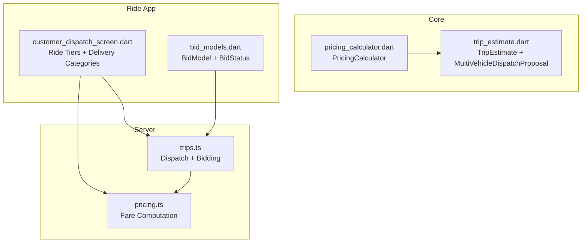
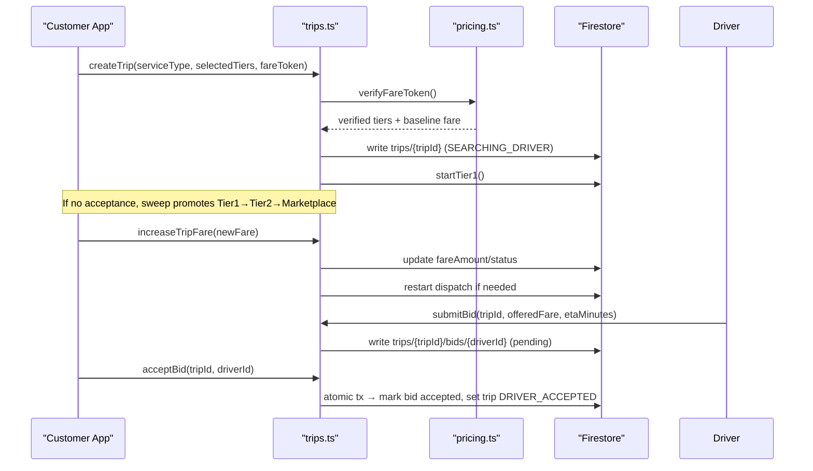
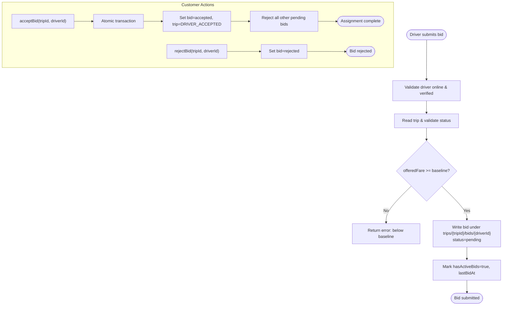
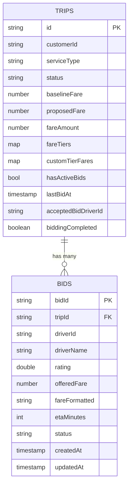
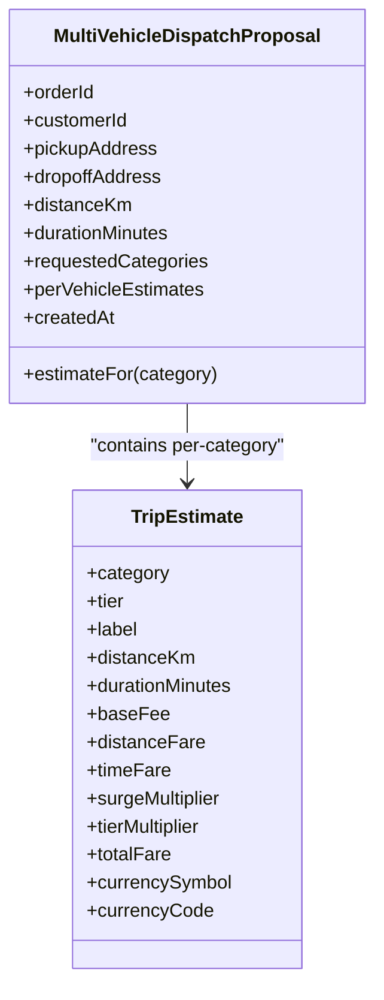
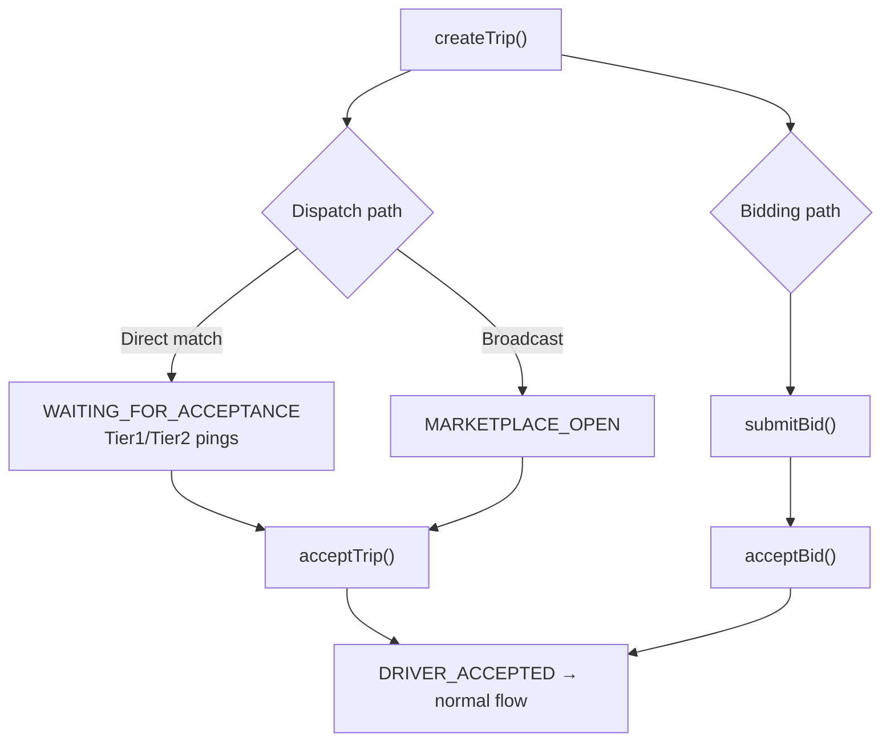
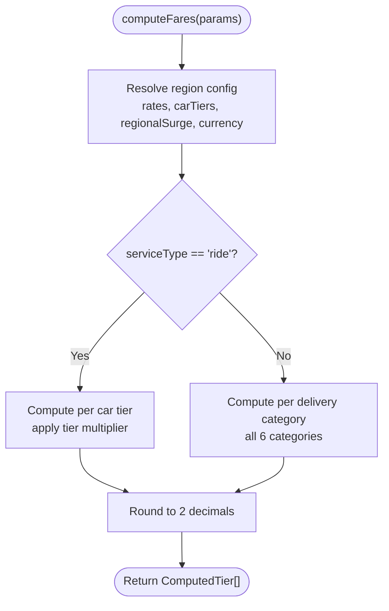
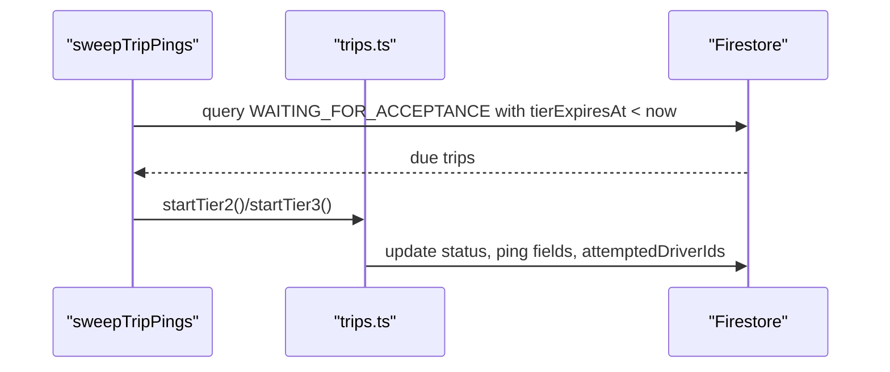
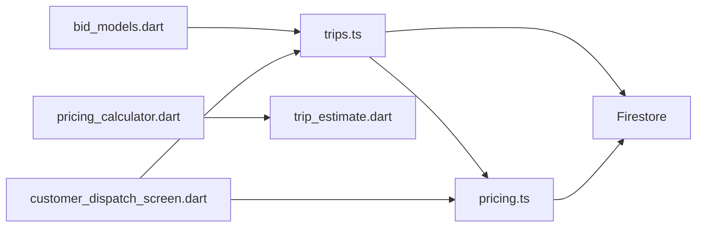

# Bid Management System

<cite>
**Referenced Files in This Document**
- [trips.ts](file://functions/src/trips.ts)
- [pricing.ts](file://functions/src/pricing.ts)
- [trip_estimate.dart](file://sese_core/lib/models/trip_estimate.dart)
- [pricing_calculator.dart](file://sese_core/lib/services/pricing_calculator.dart)
- [bid_models.dart](file://sese_ride/lib/features/trips/models/bid_models.dart)
- [customer_dispatch_screen.dart](file://sese_ride/lib/features/customer/presentation/customer_dispatch_screen.dart)
</cite>

## Table of Contents
1. Introduction
2. Project Structure
3. Core Components
4. Architecture Overview
5. Detailed Component Analysis
6. Dependency Analysis
7. Performance Considerations
8. Troubleshooting Guide
9. Conclusion

## Introduction
This document explains the bid management system that supports delivery services alongside traditional ride-hailing dispatch. It covers how bids are created, accepted, and completed; how bids relate to trips; how delivery-specific features integrate with core dispatch; what additional fields are used for package delivery scenarios; how receiver confirmation is handled; how multi-vehicle coordination works for deliveries; and how bids differ from standard ride bookings. It also includes lifecycle examples, pricing calculations for deliveries, and integration with driver matching algorithms.

## Project Structure
The bid system spans server functions (Cloud Functions), shared core models and pricing logic, and the ride app UI:
- Server-side orchestration and state machine: Cloud Functions for trip lifecycle, bidding, and dispatch promotion.
- Pricing engine: Server-side fare computation and region-aware configuration.
- Shared data models: Trip estimates and multi-vehicle dispatch proposals for delivery.
- Client-side models and UI: Bid models and customer dispatch screen supporting both ride tiers and delivery categories.

**Diagram sources**
- [trips.ts:111-225](file://functions/src/trips.ts#L111-L225)
- [trips.ts:931-1034](file://functions/src/trips.ts#L931-L1034)
- [pricing.ts:166-236](file://functions/src/pricing.ts#L166-L236)
- [trip_estimate.dart:75-122](file://sese_core/lib/models/trip_estimate.dart#L75-L122)
- [pricing_calculator.dart:105-141](file://sese_core/lib/services/pricing_calculator.dart#L105-L141)
- [bid_models.dart:1-55](file://sese_ride/lib/features/trips/models/bid_models.dart#L1-L55)
- [customer_dispatch_screen.dart:156-177](file://sese_ride/lib/features/customer/presentation/customer_dispatch_screen.dart#L156-L177)

**Section sources**
- [trips.ts:111-225](file://functions/src/trips.ts#L111-L225)
- [pricing.ts:166-236](file://functions/src/pricing.ts#L166-L236)
- [trip_estimate.dart:75-122](file://sese_core/lib/models/trip_estimate.dart#L75-L122)
- [pricing_calculator.dart:105-141](file://sese_core/lib/services/pricing_calculator.dart#L105-L141)
- [bid_models.dart:1-55](file://sese_ride/lib/features/trips/models/bid_models.dart#L1-L55)
- [customer_dispatch_screen.dart:156-177](file://sese_ride/lib/features/customer/presentation/customer_dispatch_screen.dart#L156-L177)

## Core Components
- Trip lifecycle and dispatch: The server owns the live state machine, including tiered matchmaking and marketplace broadcasting.
- Bidding subsystem: Drivers submit custom fare bids on open trips; customers accept or reject bids atomically.
- Pricing engine: Computes dynamic fares per vehicle category and car ride tiers, with regional configuration and surge.
- Data models: Trip estimate details and a multi-vehicle dispatch proposal for package delivery.
- Client models and UI: Bid status enum and snapshot model; customer dispatch screen supporting both ride tiers and delivery categories.

Key responsibilities:
- Create trip and initialize baseline/proposed fare.
- Promote dispatch through tiers when drivers ignore or decline offers.
- Accept/decline trips via ping targets or marketplace claim.
- Submit/accept/reject bids with validation and atomic transactions.
- Compute fares for rides and deliveries using region-aware rates.
- Represent multi-vehicle delivery proposals with per-category guarantees.

**Section sources**
- [trips.ts:111-225](file://functions/src/trips.ts#L111-L225)
- [trips.ts:295-370](file://functions/src/trips.ts#L295-L370)
- [trips.ts:591-653](file://functions/src/trips.ts#L591-L653)
- [trips.ts:931-1034](file://functions/src/trips.ts#L931-L1034)
- [trips.ts:1072-1170](file://functions/src/trips.ts#L1072-L1170)
- [pricing.ts:166-236](file://functions/src/pricing.ts#L166-L236)
- [trip_estimate.dart:75-122](file://sese_core/lib/models/trip_estimate.dart#L75-L122)
- [pricing_calculator.dart:105-141](file://sese_core/lib/services/pricing_calculator.dart#L105-L141)
- [bid_models.dart:1-55](file://sese_ride/lib/features/trips/models/bid_models.dart#L1-L55)
- [customer_dispatch_screen.dart:156-177](file://sese_ride/lib/features/customer/presentation/customer_dispatch_screen.dart#L156-L177)

## Architecture Overview
Bids operate within the same trip document as traditional dispatch. A trip can be matched by direct pings (Tier 1/2) or marketplace broadcast (Tier 3). Alternatively, drivers may submit custom fare bids when the trip is open for bidding. When a customer accepts a bid, the trip transitions to an assigned state and continues through the normal driver workflow.

**Diagram sources**
- [trips.ts:111-225](file://functions/src/trips.ts#L111-L225)
- [trips.ts:401-512](file://functions/src/trips.ts#L401-L512)
- [trips.ts:931-1034](file://functions/src/trips.ts#L931-L1034)
- [trips.ts:1072-1170](file://functions/src/trips.ts#L1072-L1170)
- [pricing.ts:166-236](file://functions/src/pricing.ts#L166-L236)

## Detailed Component Analysis

### Bid Lifecycle and Workflow
Bids allow drivers to propose a higher fare than the baseline. Customers can accept one bid and reject others. The system enforces:
- Driver eligibility: online and verified.
- Fare floor: offered fare cannot be below the trip’s baseline.
- Trip state gating: only certain statuses allow bidding.
- Atomic acceptance: ensures single assignment and rejects other pending bids.

**Diagram sources**
- [trips.ts:931-1034](file://functions/src/trips.ts#L931-L1034)
- [trips.ts:1036-1070](file://functions/src/trips.ts#L1036-L1070)
- [trips.ts:1072-1170](file://functions/src/trips.ts#L1072-L1170)

**Section sources**
- [trips.ts:931-1034](file://functions/src/trips.ts#L931-L1034)
- [trips.ts:1036-1070](file://functions/src/trips.ts#L1036-L1070)
- [trips.ts:1072-1170](file://functions/src/trips.ts#L1072-L1170)
- [bid_models.dart:1-55](file://sese_ride/lib/features/trips/models/bid_models.dart#L1-L55)

### Relationship Between Bids and Trips
- A bid is stored as a subcollection under a trip: `trips/{tripId}/bids/{driverId}`.
- Accepted bid updates the parent trip to `DRIVER_ACCEPTED`, sets driver payload, finalizes fare, and clears dispatch pings.
- Other pending bids are marked rejected after acceptance.

**Diagram sources**
- [trips.ts:111-225](file://functions/src/trips.ts#L111-L225)
- [trips.ts:931-1034](file://functions/src/trips.ts#L931-L1034)
- [trips.ts:1072-1170](file://functions/src/trips.ts#L1072-L1170)

**Section sources**
- [trips.ts:111-225](file://functions/src/trips.ts#L111-L225)
- [trips.ts:931-1034](file://functions/src/trips.ts#L931-L1034)
- [trips.ts:1072-1170](file://functions/src/trips.ts#L1072-L1170)

### Delivery-Specific Features and Additional Fields
- Service types include ride and delivery variants (`send_item` / `receive_item`).
- Delivery uses multiple vehicle categories (bicycle, motorcycle, tricycle, car, van, truck).
- Multi-vehicle dispatch proposal carries per-category fare guarantees and metadata for package delivery.

Additional fields relevant to delivery:
- `serviceType`: distinguishes ride vs send/receive item.
- `selectedTiers`: for delivery, these are vehicle categories.
- `fareTiers` and `customTierFares`: store computed tiers and optional overrides.
- `distanceKm` / `durationMins`: used in fare calculation for both rides and deliveries.
- `perVehicleEstimates` (in proposal): maps each requested category to its guaranteed estimate.

**Section sources**
- [trips.ts:111-225](file://functions/src/trips.ts#L111-L225)
- [pricing.ts:166-236](file://functions/src/pricing.ts#L166-L236)
- [trip_estimate.dart:75-122](file://sese_core/lib/models/trip_estimate.dart#L75-L122)
- [pricing_calculator.dart:105-141](file://sese_core/lib/services/pricing_calculator.dart#L105-L141)

### Receiver Confirmation Process
The current implementation does not define a dedicated “receiver confirmed” endpoint or field. Completion flows follow the standard trip lifecycle:
- Driver advances through arrival and progress states.
- Trip completion is recorded by advancing to `COMPLETED`.

If a delivery requires explicit receiver confirmation, it should be modeled as a new trip status transition and associated client/server actions.

**Section sources**
- [trips.ts:756-796](file://functions/src/trips.ts#L756-L796)

### Multi-Vehicle Coordination for Deliveries
- The pricing engine computes estimates for all eligible delivery categories.
- The `MultiVehicleDispatchProposal` aggregates per-category estimates, enabling the system to present distinct price guarantees for different vehicle types.
- The customer dispatch UI supports selecting multiple delivery categories alongside ride tiers.

**Diagram sources**
- [trip_estimate.dart:75-122](file://sese_core/lib/models/trip_estimate.dart#L75-L122)
- [pricing_calculator.dart:105-141](file://sese_core/lib/services/pricing_calculator.dart#L105-L141)

**Section sources**
- [trip_estimate.dart:75-122](file://sese_core/lib/models/trip_estimate.dart#L75-L122)
- [pricing_calculator.dart:105-141](file://sese_core/lib/services/pricing_calculator.dart#L105-L141)
- [customer_dispatch_screen.dart:156-177](file://sese_ride/lib/features/customer/presentation/customer_dispatch_screen.dart#L156-L177)

### How Bids Differ From Standard Ride Bookings
- Standard ride booking relies on server-driven dispatch: nearest exclusive ping (Tier 1), then two drivers (Tier 2), then marketplace broadcast (Tier 3).
- Bidding allows drivers to propose a higher fare; customers choose among bids.
- Both paths converge to the same trip lifecycle once a driver is assigned.

**Diagram sources**
- [trips.ts:295-370](file://functions/src/trips.ts#L295-L370)
- [trips.ts:591-653](file://functions/src/trips.ts#L591-L653)
- [trips.ts:931-1034](file://functions/src/trips.ts#L931-L1034)
- [trips.ts:1072-1170](file://functions/src/trips.ts#L1072-L1170)

**Section sources**
- [trips.ts:295-370](file://functions/src/trips.ts#L295-L370)
- [trips.ts:591-653](file://functions/src/trips.ts#L591-L653)
- [trips.ts:931-1034](file://functions/src/trips.ts#L931-L1034)
- [trips.ts:1072-1170](file://functions/src/trips.ts#L1072-L1170)

### Pricing Calculations for Deliveries
- Server-side pricing resolves regional configuration (global/country/state) and applies base fee, distance/time rates, surge multiplier, and optional tier multiplier for rides.
- For deliveries, all six vehicle categories are considered, with recommended default selection and formatting.
- The client-side calculator mirrors this logic and provides a multi-vehicle dispatch proposal with per-category estimates.

**Diagram sources**
- [pricing.ts:166-236](file://functions/src/pricing.ts#L166-L236)
- [pricing_calculator.dart:11-60](file://sese_core/lib/services/pricing_calculator.dart#L11-L60)

**Section sources**
- [pricing.ts:166-236](file://functions/src/pricing.ts#L166-L236)
- [pricing_calculator.dart:11-60](file://sese_core/lib/services/pricing_calculator.dart#L11-L60)

### Integration With Driver Matching Algorithms
- Dispatch uses a cascading tier strategy:
  - Tier 1: exclusive ping to nearest driver.
  - Tier 2: simultaneous ping to next two nearest drivers.
  - Tier 3: marketplace broadcast to all nearby drivers.
- A scheduled sweep promotes expired pings and re-dispatches long-waiting searches.
- Bidding integrates with the same trip document; accepting a bid transitions the trip to `DRIVER_ACCEPTED`, bypassing further dispatch.

**Diagram sources**
- [trips.ts:401-512](file://functions/src/trips.ts#L401-L512)
- [trips.ts:295-370](file://functions/src/trips.ts#L295-L370)

**Section sources**
- [trips.ts:401-512](file://functions/src/trips.ts#L401-L512)
- [trips.ts:295-370](file://functions/src/trips.ts#L295-L370)

## Dependency Analysis
- `trips.ts` depends on `pricing.ts` indirectly via fare token verification and uses Firestore extensively for state persistence.
- `pricing.ts` reads region configuration from Firestore and computes fares for both rides and deliveries.
- `trip_estimate.dart` and `pricing_calculator.dart` provide shared models and deterministic pricing logic used across server and client contexts.
- `bid_models.dart` defines client-side bid state and snapshot structures consumed by the ride app UI.
- `customer_dispatch_screen.dart` coordinates user selection of ride tiers and delivery categories, bridging UI intent to backend calls.

**Diagram sources**
- [trips.ts:111-225](file://functions/src/trips.ts#L111-L225)
- [pricing.ts:166-236](file://functions/src/pricing.ts#L166-L236)
- [trip_estimate.dart:75-122](file://sese_core/lib/models/trip_estimate.dart#L75-L122)
- [pricing_calculator.dart:105-141](file://sese_core/lib/services/pricing_calculator.dart#L105-L141)
- [bid_models.dart:1-55](file://sese_ride/lib/features/trips/models/bid_models.dart#L1-L55)
- [customer_dispatch_screen.dart:156-177](file://sese_ride/lib/features/customer/presentation/customer_dispatch_screen.dart#L156-L177)

**Section sources**
- [trips.ts:111-225](file://functions/src/trips.ts#L111-L225)
- [pricing.ts:166-236](file://functions/src/pricing.ts#L166-L236)
- [trip_estimate.dart:75-122](file://sese_core/lib/models/trip_estimate.dart#L75-L122)
- [pricing_calculator.dart:105-141](file://sese_core/lib/services/pricing_calculator.dart#L105-L141)
- [bid_models.dart:1-55](file://sese_ride/lib/features/trips/models/bid_models.dart#L1-L55)
- [customer_dispatch_screen.dart:156-177](file://sese_ride/lib/features/customer/presentation/customer_dispatch_screen.dart#L156-L177)

## Performance Considerations
- Use atomic transactions for bid acceptance to prevent race conditions and ensure consistent trip state.
- Leverage the scheduled sweep to keep dispatch alive without requiring active client sessions.
- Limit candidate driver queries and cap results to reduce Firestore read costs during matchmaking.
- Cache or precompute region configuration where possible to minimize repeated reads.
- Keep bid payloads minimal and avoid unnecessary writes; batch updates where feasible.

[No sources needed since this section provides general guidance]

## Troubleshooting Guide
Common issues and resolutions:
- Driver cannot submit bid: ensure driver is online and verified; check trip status allows bidding.
- Offered fare rejected: must be at least the trip’s baseline fare.
- Bid already accepted: another driver was assigned; other pending bids are auto-rejected.
- Trip needs attention: after multiple driver cancellations, the trip enters a state prompting the customer to increase fare; use the increase fare endpoint to restart dispatch.

Relevant endpoints and behaviors:
- `submitBid`: validates driver and trip, enforces baseline fare, writes bid, marks trip active for bidding.
- `rejectBid`: marks a specific bid rejected.
- `acceptBid`: atomic transaction marking bid accepted, setting trip to `DRIVER_ACCEPTED`, and rejecting other bids.
- `increaseTripFare`: updates fare and restarts dispatch if needed.

**Section sources**
- [trips.ts:931-1034](file://functions/src/trips.ts#L931-L1034)
- [trips.ts:1036-1070](file://functions/src/trips.ts#L1036-L1070)
- [trips.ts:1072-1170](file://functions/src/trips.ts#L1072-L1170)
- [trips.ts:1172-1224](file://functions/src/trips.ts#L1172-L1224)

## Conclusion
The bid management system extends the existing ride-hailing dispatch by allowing drivers to propose higher fares on open trips while preserving the robust, server-authoritative trip lifecycle. Delivery services integrate seamlessly through multi-category pricing and a multi-vehicle dispatch proposal, ensuring transparent, per-category fare guarantees. Bids and standard dispatch converge on the same trip state machine, simplifying operations and enabling flexible pricing strategies for both passengers and package delivery.

[No sources needed since this section summarizes without analyzing specific files]