# Dispatch State Machine

<cite>
**Referenced Files in This Document**
- [trips.ts](file://functions/src/trips.ts)
- [trip_models.dart](file://sese_ride/lib/features/trips/models/trip_models.dart)
- [driver_streak_service.dart](file://sese_ride/lib/features/driver/services/driver_streak_service.dart)
</cite>

## Table of Contents
1. [Introduction](#introduction)
2. [Project Structure](#project-structure)
3. [Core Components](#core-components)
4. [Architecture Overview](#architecture-overview)
5. [Detailed Component Analysis](#detailed-component-analysis)
6. [Dependency Analysis](#dependency-analysis)
7. [Performance Considerations](#performance-considerations)
8. [Troubleshooting Guide](#troubleshooting-guide)
9. [Conclusion](#conclusion)

## Introduction
This document explains the server-authoritative trip dispatch state machine that drives ride and delivery requests from creation through completion or cancellation. It covers:

- The complete lifecycle of a trip, including all valid states and transitions.
- The cascading tiered dispatch system: Tier 1 exclusive offer, Tier 2 simultaneous offers, and Tier 3 marketplace broadcast.
- Timeouts, promotion rules, and how the `sweepTripPings` cron keeps dispatch alive when clients are offline.
- Concurrency guarantees, error handling patterns, and consistency mechanisms.
- Driver reassignment logic after cancellations and the fallback path to customer action.

The implementation is centered in the backend Cloud Functions for Firestore and HTTPS callables, while the Flutter client models mirror the wire status values for rendering and UI behavior.

## Project Structure
The dispatch state machine lives primarily in the backend functions module, with matching domain models on the Flutter side.

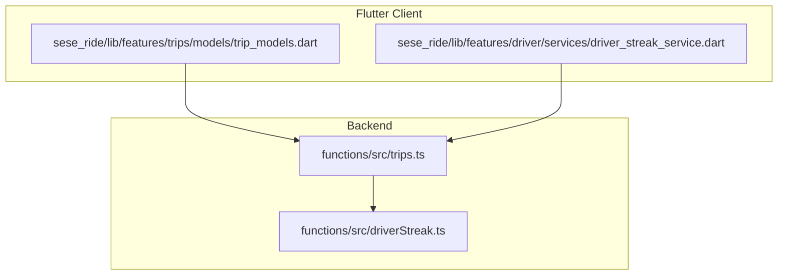

**Diagram sources**
- [trips.ts:12-26](file://functions/src/trips.ts#L12-L26)
- [trip_models.dart:1-10](file://sese_ride/lib/features/trips/models/trip_models.dart#L1-L10)
- [driver_streak_service.dart:204-219](file://sese_ride/lib/features/driver/services/driver_streak_service.dart#L204-L219)

**Section sources**
- [trips.ts:12-26](file://functions/src/trips.ts#L12-L26)
- [trip_models.dart:1-10](file://sese_ride/lib/features/trips/models/trip_models.dart#L1-L10)

## Core Components
The dispatch state machine is implemented as a set of server-side operations that own every state transition. Clients only observe snapshots and invoke callables to request changes.

Key responsibilities:

- **createTrip**: Validates inputs, verifies fare tokens, and creates a trip document in `SEARCHING_DRIVER`.
- **onTripCreated**: Immediately starts Tier 1 dispatch when a new trip document appears.
- **startTier1/startTier2/startTier3**: Implement the cascading matchmaking tiers.
- **acceptTrip/declineTrip**: Handle driver acceptance and decline with eligibility checks and atomic updates.
- **updateDriverLocation**: Records live driver position and mirrors it to driver ranking data.
- **advanceTripStatus**: Enforces the post-acceptance driver progression chain.
- **cancelTrip**: Handles customer and driver cancellations, including reassignment attempts.
- **sweepTripPings**: A scheduled job that promotes tiers, expires pings, restarts searches, and nudges idle marketplace trips.

The Flutter `TripStatus` enum mirrors the wire status strings so the UI can render the correct state without owning the transition logic.

**Section sources**
- [trips.ts:125-225](file://functions/src/trips.ts#L125-L225)
- [trips.ts:295-384](file://functions/src/trips.ts#L295-L384)
- [trips.ts:591-796](file://functions/src/trips.ts#L591-L796)
- [trips.ts:800-927](file://functions/src/trips.ts#L800-L927)
- [trips.ts:401-512](file://functions/src/trips.ts#L401-L512)
- [trip_models.dart:11-53](file://sese_ride/lib/features/trips/models/trip_models.dart#L11-L53)

## Architecture Overview
The dispatch system is server-authoritative. The client flow is:

1. Customer calls `createTrip`, which mints a trip document in `SEARCHING_DRIVER`.
2. `onTripCreated` triggers Tier 1 dispatch.
3. Drivers accept or decline; customers cancel.
4. After acceptance, the driver advances through arrival and progress states.
5. Completion or cancellation terminates the trip.

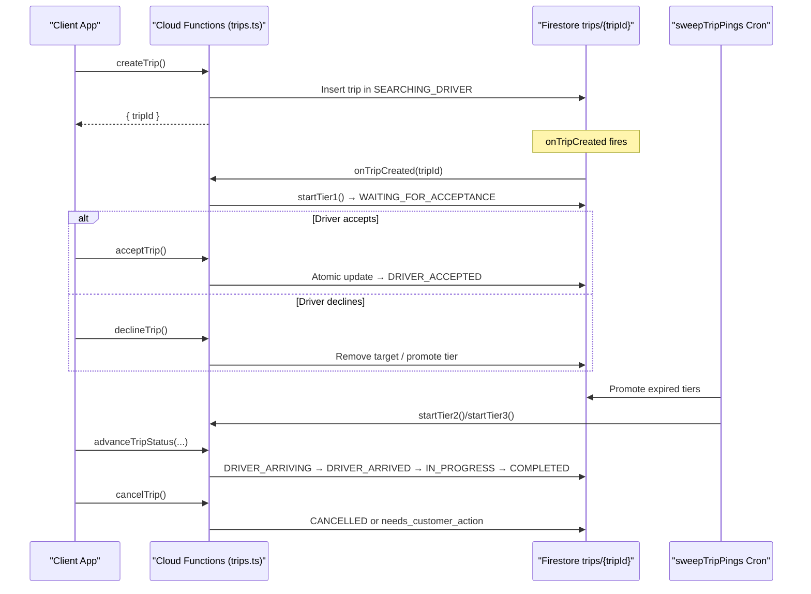

**Diagram sources**
- [trips.ts:125-225](file://functions/src/trips.ts#L125-L225)
- [trips.ts:295-384](file://functions/src/trips.ts#L295-L384)
- [trips.ts:591-796](file://functions/src/trips.ts#L591-L796)
- [trips.ts:800-927](file://functions/src/trips.ts#L800-L927)
- [trips.ts:401-512](file://functions/src/trips.ts#L401-L512)

## Detailed Component Analysis

### Trip Lifecycle and Valid States
The trip lifecycle includes both active and terminal states. The wire values match the Firestore `status` field exactly.

Valid states:

- `SEARCHING_DRIVER`: Broadcast is live; matchmaking is looking for nearby drivers.
- `WAITING_FOR_ACCEPTANCE`: A driver was pinged; awaiting accept/decline before timeout.
- `MARKETPLACE_OPEN`: Tier 3 broadcast visible in nearby driver feeds; first tap claims atomically.
- `DRIVER_ACCEPTED`: Driver accepted; sheet and live tracking are shown.
- `DRIVER_ARRIVING`: Driver is en route to pickup.
- `DRIVER_ARRIVED`: Driver tapped “Arrived”; no-show wait timer is running.
- `IN_PROGRESS`: Passenger picked up or parcel collected; trip underway.
- `COMPLETED`: Terminal completed and settled.
- `CANCELLED`: Terminal cancelled by customer, driver, or system.
- `needs_customer_action`: Auto-reassignment exhausted; customer must raise fare or bid.
- `bidding`: Marketplace-style bidding is active.

The Flutter model maps these wire values into an enum for UI rendering.

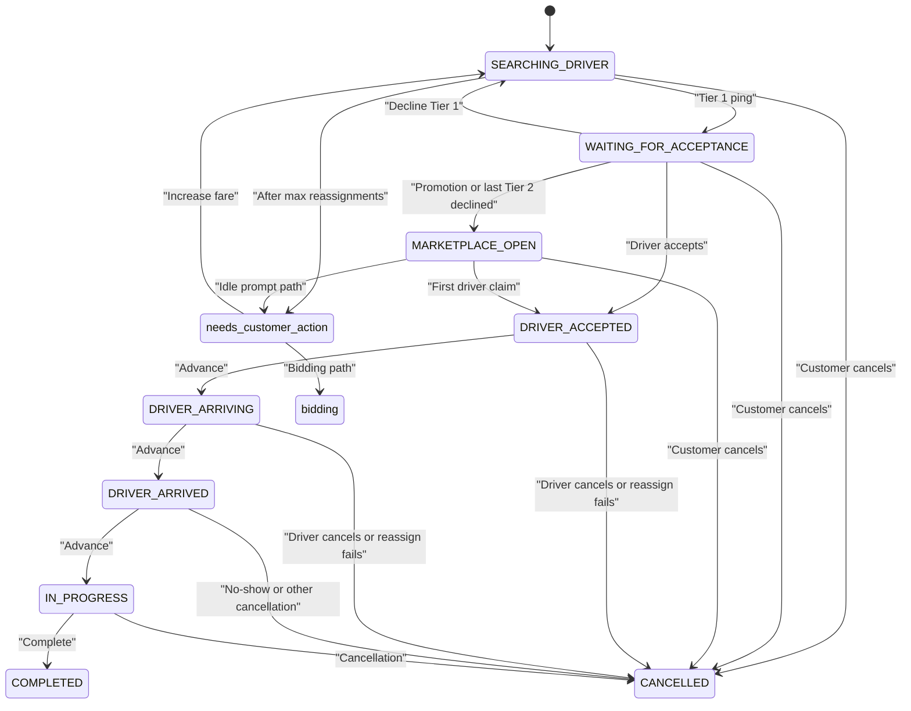

**Diagram sources**
- [trip_models.dart:11-53](file://sese_ride/lib/features/trips/models/trip_models.dart#L11-L53)
- [trips.ts:44-63](file://functions/src/trips.ts#L44-L63)
- [trips.ts:756-796](file://functions/src/trips.ts#L756-L796)
- [trips.ts:800-927](file://functions/src/trips.ts#L800-L927)

**Section sources**
- [trip_models.dart:11-53](file://sese_ride/lib/features/trips/models/trip_models.dart#L11-L53)
- [trips.ts:44-63](file://functions/src/trips.ts#L44-L63)

### Cascading Tier System
The dispatch uses three tiers with explicit timeouts and promotion logic:

- **Tier 1**: Exclusive offer to the single nearest online driver within the dispatch radius. Timeout is stored as `tierExpiresAt`. If ignored until expiry, the sweep promotes to Tier 2.
- **Tier 2**: Simultaneous offer to the next two nearest eligible drivers. Each driver has a ping timeout (`pingExpiresAt`). If all targets decline or expire, the sweep promotes to Tier 3.
- **Tier 3**: Broadcast to all nearby online drivers in the marketplace feed. First driver to claim wins atomically.

Time constants:

- `PING_TIMEOUT_MS`: Per-ping expiration used for immediate accept/decline validation.
- `TIER1_TIMEOUT_MS`: Tier 1 deadline; sweep promotes to Tier 2 after this time.
- `TIER2_TIMEOUT_MS`: Tier 2 deadline; sweep promotes to Tier 3 after this time.
- `DISPATCH_RADIUS_KM`: Maximum distance considered for candidate drivers.
- `DISPATCH_CANDIDATE_LIMIT`: Candidate pool size for nearest-driver queries.

Promotion rules:

- Tier 1 → Tier 2 when `tierExpiresAt` passes.
- Tier 2 → Tier 3 when `tierExpiresAt` passes or all Tier 2 targets are removed.
- Legacy pings without tier fields are expired back to `SEARCHING_DRIVER`.

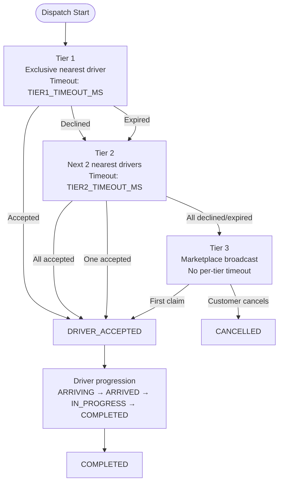

**Diagram sources**
- [trips.ts:28-42](file://functions/src/trips.ts#L28-L42)
- [trips.ts:295-370](file://functions/src/trips.ts#L295-L370)
- [trips.ts:401-439](file://functions/src/trips.ts#L401-L439)

**Section sources**
- [trips.ts:28-42](file://functions/src/trips.ts#L28-L42)
- [trips.ts:295-370](file://functions/src/trips.ts#L295-L370)
- [trips.ts:401-439](file://functions/src/trips.ts#L401-L439)

### Server-Authoritative State Transitions
Every meaningful state change is enforced by backend callables:

- **Acceptance**: `acceptTrip` validates caller eligibility, ensures the trip is still available, and performs an atomic transaction to set `DRIVER_ACCEPTED`. For Tier 3, any online driver may claim; the transaction aborts losers.
- **Decline**: `declineTrip` breaks the driver’s streak, removes the decliner from the ping group, and either continues Tier 2 or jumps to Tier 3.
- **Progression**: `advanceTripStatus` enforces the allowed sequence: `DRIVER_ACCEPTED → DRIVER_ARRIVING → DRIVER_ARRIVED → IN_PROGRESS → COMPLETED`.
- **Cancellation**: `cancelTrip` handles customer and driver cancellations, computes cancellation reasons, and runs the reassignment loop.

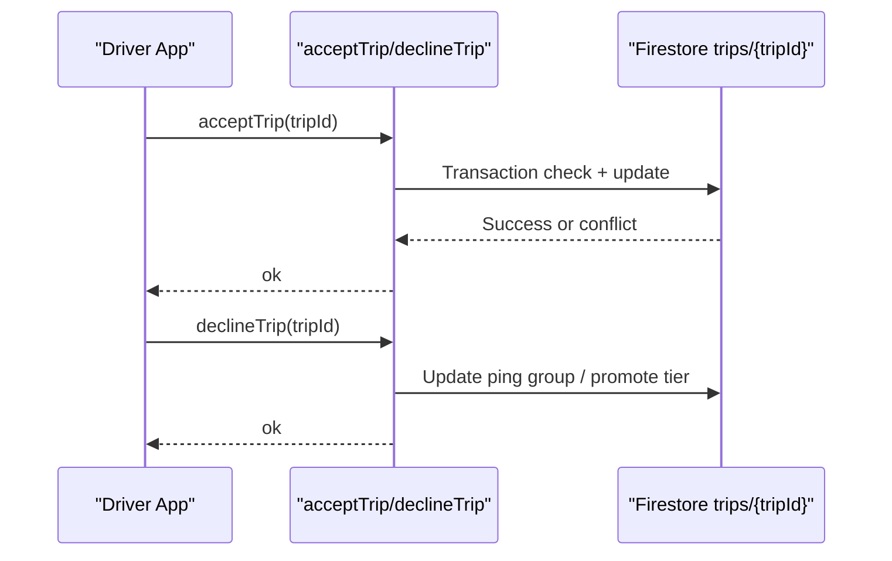

**Diagram sources**
- [trips.ts:591-653](file://functions/src/trips.ts#L591-L653)
- [trips.ts:662-714](file://functions/src/trips.ts#L662-L714)

**Section sources**
- [trips.ts:591-653](file://functions/src/trips.ts#L591-L653)
- [trips.ts:662-714](file://functions/src/trips.ts#L662-L714)
- [trips.ts:756-796](file://functions/src/trips.ts#L756-L796)

### Concurrent Operations and Data Consistency
Concurrency is handled using Firestore transactions and strict preconditions:

- **Atomic first-wins claim**: `acceptTrip` uses a transaction to ensure only one driver becomes assigned. If another driver already claimed the trip, the transaction rejects the second attempt.
- **Eligibility checks**: Before accepting, the callable checks whether the caller is a valid ping target (Tier 1 or Tier 2) or an online driver claiming a marketplace trip.
- **Ping expiration**: Both `acceptTrip` and `requirePingedDriver` reject expired pings with a deadline-exceeded error.
- **Permission checks**: Callables verify authentication and ownership where required.

These mechanisms prevent double assignment and stale-state mutations even under high concurrency.

**Section sources**
- [trips.ts:591-653](file://functions/src/trips.ts#L591-L653)
- [trips.ts:522-552](file://functions/src/trips.ts#L522-L552)

### Error Handling Patterns
Errors are returned via structured HTTP errors with clear codes:

- `unauthenticated`: Caller is not signed in.
- `invalid-argument`: Missing or invalid parameters.
- `not-found`: Trip or bid not found.
- `permission-denied`: Caller is not the owner or authorized actor.
- `failed-precondition`: Invalid state transition or eligibility failure.
- `deadline-exceeded`: Ping expired before accept/decline.

Examples:

- Accepting a non-pinged driver throws `failed-precondition`.
- Accepting an expired ping throws `deadline-exceeded`.
- Cancelling a closed trip throws `failed-precondition`.
- Updating location for a non-assigned driver throws `permission-denied`.

**Section sources**
- [trips.ts:591-653](file://functions/src/trips.ts#L591-L653)
- [trips.ts:662-714](file://functions/src/trips.ts#L662-L714)
- [trips.ts:717-754](file://functions/src/trips.ts#L717-L754)
- [trips.ts:800-927](file://functions/src/trips.ts#L800-L927)

### Role of `sweepTripPings`
`sweepTripPings` runs every minute and maintains dispatch progress independently of client activity:

1. **Promote Tier 1**: When `tierExpiresAt` passes, break the streak for the ignored driver and promote to Tier 2.
2. **Promote Tier 2**: When `tierExpiresAt` passes, break streaks for ignored Tier 2 targets and promote to Tier 3.
3. **Expire legacy pings**: For older documents without tier fields, expire pings and return to `SEARCHING_DRIVER`.
4. **Re-dispatch long-waiting searches**: Restart Tier 1 for trips stuck in `SEARCHING_DRIVER` beyond the reping interval.
5. **Idle marketplace prompt**: After 30 minutes in `MARKETPLACE_OPEN`, mark the trip as needing a price prompt and send a notification.

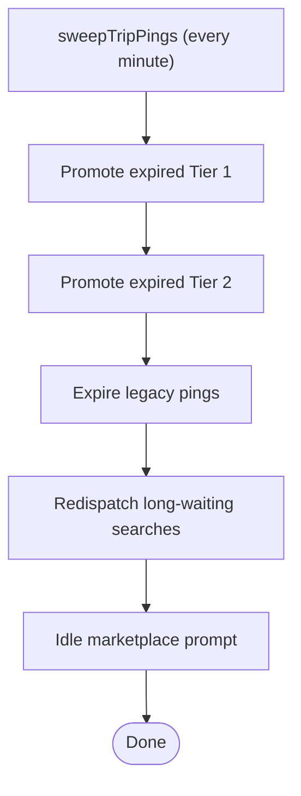

**Diagram sources**
- [trips.ts:401-512](file://functions/src/trips.ts#L401-L512)

**Section sources**
- [trips.ts:401-512](file://functions/src/trips.ts#L401-L512)

### Driver Reassignment Loop and Final Outcomes
When a driver cancels during `DRIVER_ACCEPTED` or `DRIVER_ARRIVING`, the system attempts automatic reassignment up to three times:

- Each attempt clears the driver, records history, increments `reassignmentCount`, and restarts Tier 1 dispatch.
- If no eligible driver is found, it falls back to Tier 3.
- After three attempts, the trip moves to `needs_customer_action`, prompting the customer to increase fare or enter bidding.
- Other cancellation paths (e.g., driver no-show after waiting) terminate directly to `CANCELLED`.

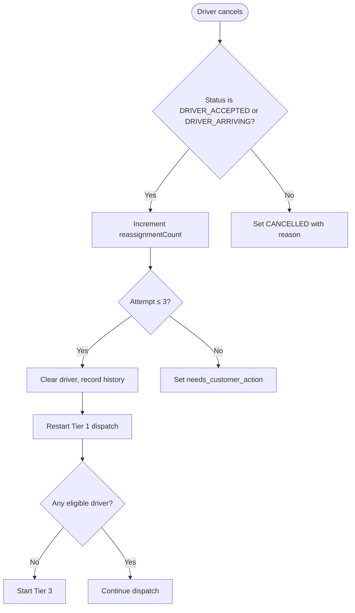

**Diagram sources**
- [trips.ts:800-927](file://functions/src/trips.ts#L800-L927)

**Section sources**
- [trips.ts:800-927](file://functions/src/trips.ts#L800-L927)

### Example State Transition Flows

#### Successful Tier 1 Acceptance
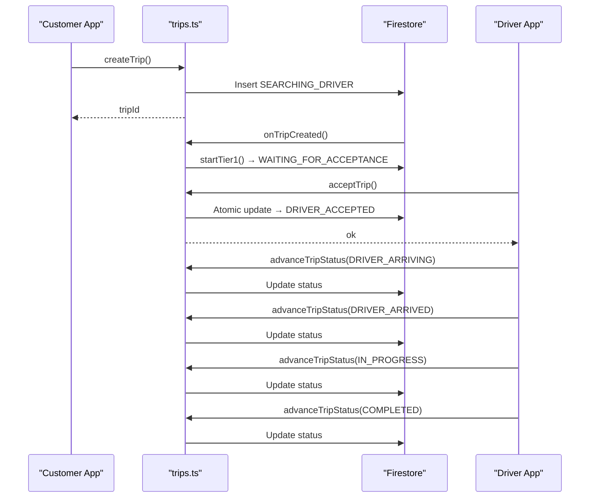

**Diagram sources**
- [trips.ts:125-225](file://functions/src/trips.ts#L125-L225)
- [trips.ts:295-384](file://functions/src/trips.ts#L295-L384)
- [trips.ts:591-653](file://functions/src/trips.ts#L591-L653)
- [trips.ts:756-796](file://functions/src/trips.ts#L756-L796)

#### Tier 2 Decline to Marketplace
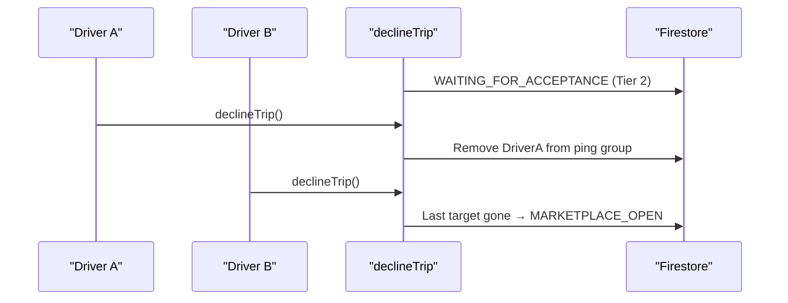

**Diagram sources**
- [trips.ts:662-714](file://functions/src/trips.ts#L662-L714)
- [trips.ts:356-370](file://functions/src/trips.ts#L356-L370)

#### Customer Cancellation During Active Trip
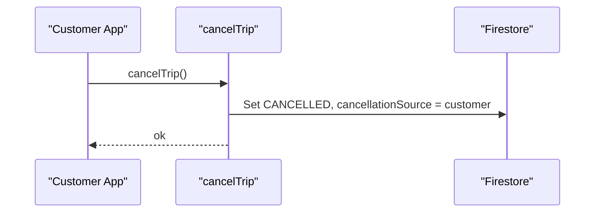

**Diagram sources**
- [trips.ts:800-833](file://functions/src/trips.ts#L800-L833)

## Dependency Analysis
The dispatch state machine depends on several backend services and client modules:

- **Fare token verification**: Ensures fares are computed server-side and cannot be tampered with.
- **Driver streak service**: Breaks streaks on declines and certain cancellations.
- **Driver location and ranking**: Uses driver location updates to rank nearest candidates.
- **Flutter models**: Mirror wire statuses for UI rendering and user-facing messages.

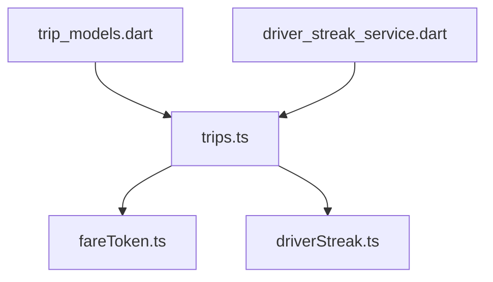

**Diagram sources**
- [trips.ts:1-10](file://functions/src/trips.ts#L1-L10)
- [trip_models.dart:1-10](file://sese_ride/lib/features/trips/models/trip_models.dart#L1-L10)
- [driver_streak_service.dart:204-219](file://sese_ride/lib/features/driver/services/driver_streak_service.dart#L204-L219)

**Section sources**
- [trips.ts:1-10](file://functions/src/trips.ts#L1-L10)
- [trip_models.dart:1-10](file://sese_ride/lib/features/trips/models/trip_models.dart#L1-L10)
- [driver_streak_service.dart:204-219](file://sese_ride/lib/features/driver/services/driver_streak_service.dart#L204-L219)

## Performance Considerations
- **Batched sweep operations**: The cron processes up to 25 documents per query to avoid overwhelming the database.
- **Nearest-driver ranking**: Queries are limited to a candidate pool and filtered by dispatch radius to reduce computation.
- **Atomic transactions**: Prevent retries and conflicts during critical transitions like acceptance.
- **Best-effort side effects**: Streak breaking and notifications are wrapped in try/catch blocks to keep dispatch robust even if secondary services fail.

[No sources needed since this section provides general guidance]

## Troubleshooting Guide
Common issues and their likely causes:

- **Driver cannot accept trip**:
  - Cause: Not a ping target or ping expired.
  - Action: Verify `WAITING_FOR_ACCEPTANCE` and current `dispatchTier`; check `pingExpiresAt`.

- **Trip remains in `SEARCHING_DRIVER`**:
  - Cause: No eligible drivers within radius or sweep delay.
  - Action: Check driver online status and location; confirm sweep is running.

- **Double assignment prevented**:
  - Cause: Another driver claimed first.
  - Action: Review transaction rejection and `driver` field.

- **Cancellation blocked**:
  - Cause: Trip already closed or caller not authorized.
  - Action: Confirm `LIVE_STATUSES` and ownership.

- **Idle marketplace not prompting**:
  - Cause: Trip created recently or `idlePromptSent` already true.
  - Action: Check `createdAt` and `idlePromptSent`.

**Section sources**
- [trips.ts:522-552](file://functions/src/trips.ts#L522-L552)
- [trips.ts:401-512](file://functions/src/trips.ts#L401-L512)
- [trips.ts:800-927](file://functions/src/trips.ts#L800-L927)

## Conclusion
The trip dispatch state machine is a robust, server-authoritative system that manages the full lifecycle of a ride or delivery request. It uses a cascading tier strategy to balance exclusivity and coverage, enforces strict state transitions, and relies on scheduled sweeps to maintain progress even when clients are offline. Concurrency is protected by atomic transactions and preconditions, while error handling ensures predictable failures. The Flutter client models provide a faithful view of the server state without owning transition logic, keeping the system consistent and maintainable.

[No sources needed since this section summarizes without analyzing specific files]