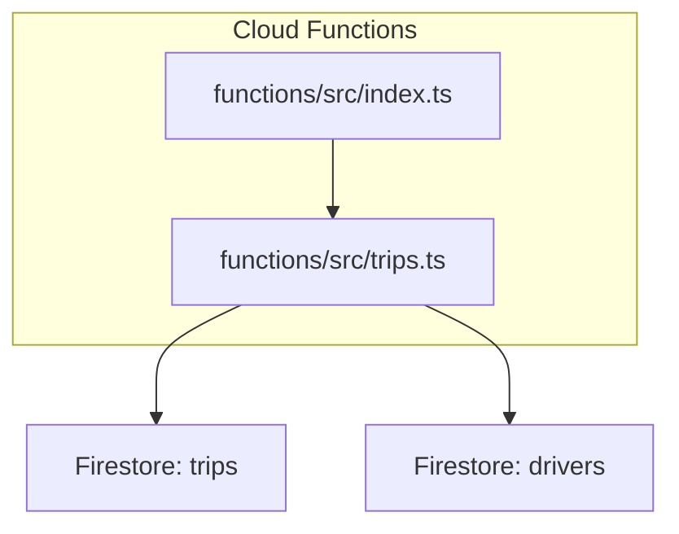
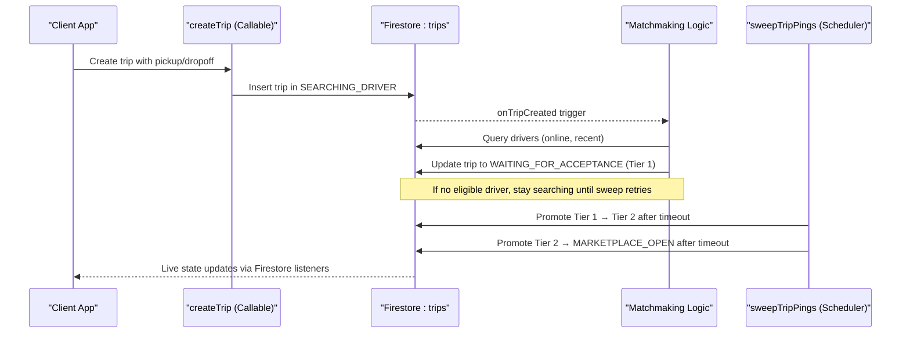
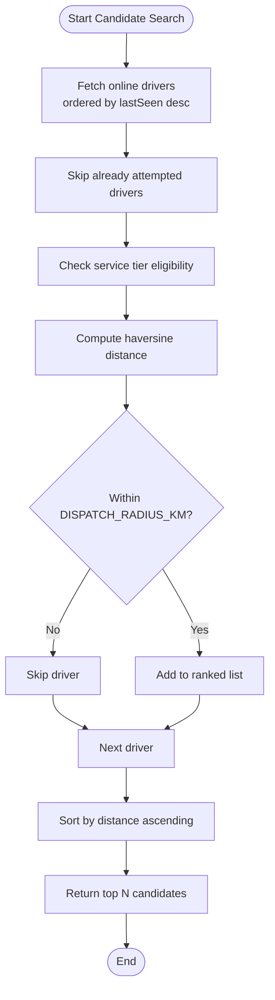
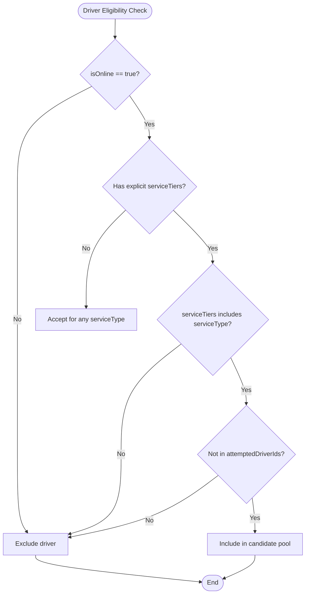
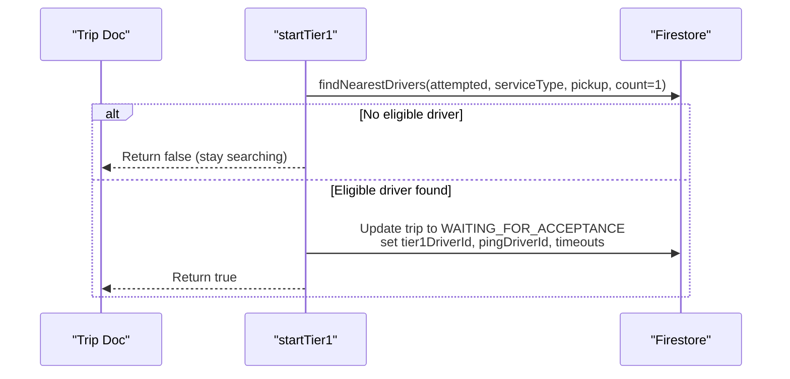
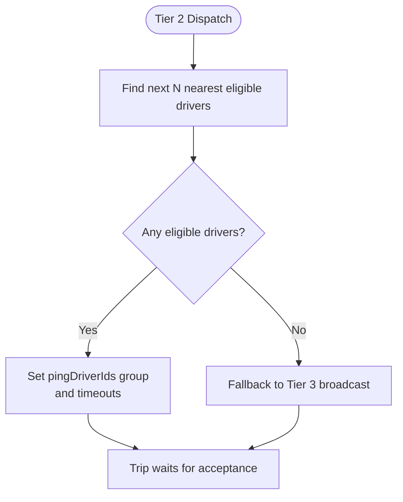
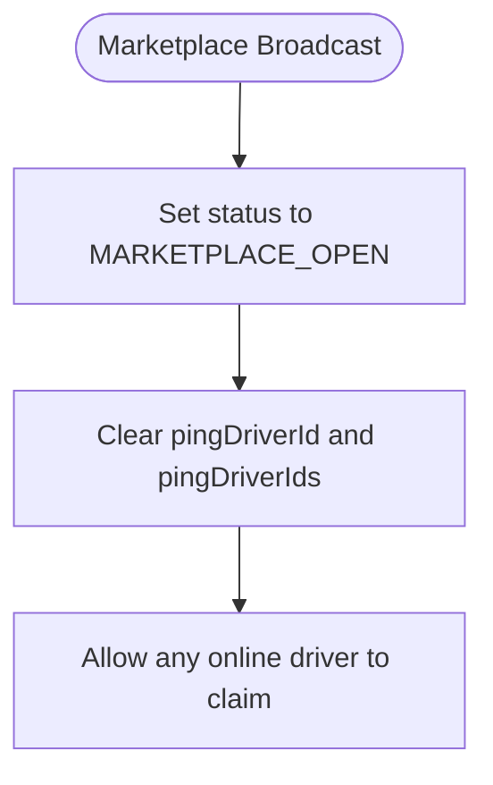
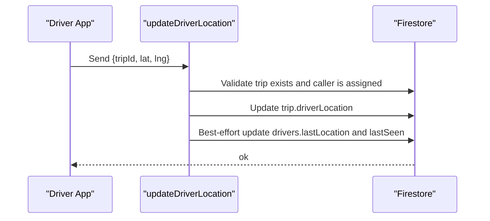
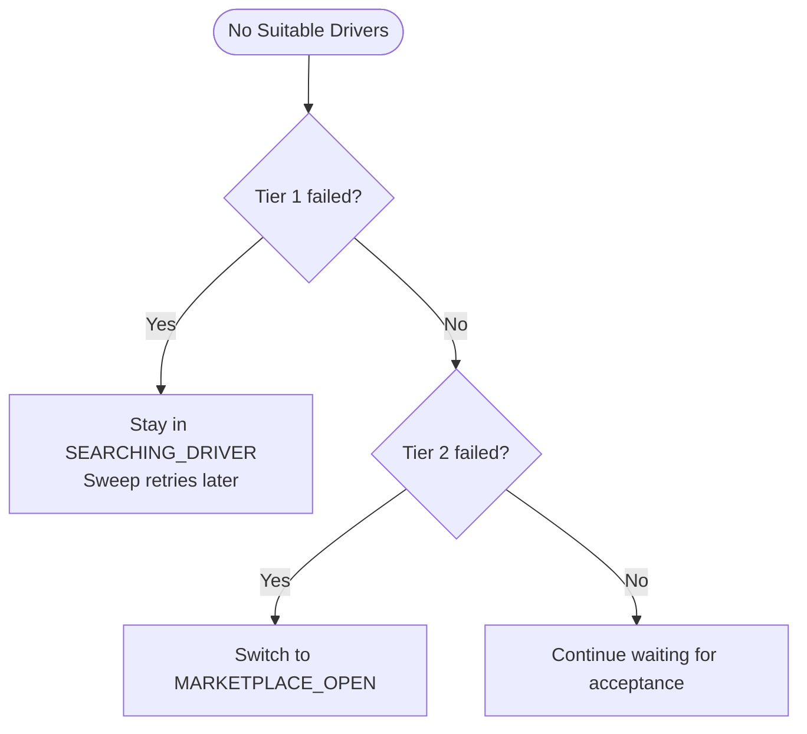
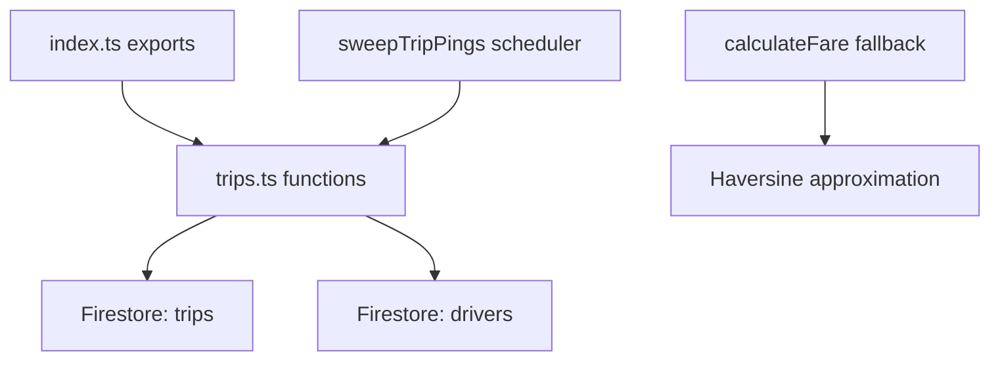

# Driver Matching Algorithms

<cite>
**Referenced Files in This Document**
- [trips.ts](file://functions/src/trips.ts)
- [index.ts](file://functions/src/index.ts)
</cite>

## Table of Contents
1. [Introduction](#introduction)
2. [Project Structure](#project-structure)
3. [Core Components](#core-components)
4. [Architecture Overview](#architecture-overview)
5. [Detailed Component Analysis](#detailed-component-analysis)
6. [Dependency Analysis](#dependency-analysis)
7. [Performance Considerations](#performance-considerations)
8. [Troubleshooting Guide](#troubleshooting-guide)
9. [Conclusion](#conclusion)

## Introduction
This document explains the driver matching algorithms used by the trip dispatch system. It covers how the backend finds nearby drivers, filters them by service tier and online status, ranks them by proximity using a haversine distance calculation, and applies a tiered matching strategy:
- Tier 1: exclusive offer to the single nearest eligible driver.
- Tier 2: simultaneous offers to multiple nearby drivers.
- Tier 3: marketplace broadcasting to all nearby online drivers.

It also documents driver location tracking through lastSeen timestamps, how stale or missing locations are handled, geographic constraints such as coverage radius and coordinate validation, and fallback mechanisms when no suitable drivers are found.

## Project Structure
The dispatch logic is implemented in Cloud Functions under `functions/src`. The primary file for trip lifecycle and matchmaking is `trips.ts`, while `index.ts` wires up callable endpoints and re-exports dispatch functions.

**Diagram sources**
- [index.ts:26-39](file://functions/src/index.ts#L26-L39)
- [trips.ts:12-26](file://functions/src/trips.ts#L12-L26)

**Section sources**
- [index.ts:26-39](file://functions/src/index.ts#L26-L39)
- [trips.ts:12-26](file://functions/src/trips.ts#L12-L26)

## Core Components
- Haversine distance function computes great-circle distance between two coordinates in kilometers.
- Candidate discovery queries online drivers ordered by recency (`lastSeen`) and filters by service tier eligibility.
- Ranking sorts candidates by computed haversine distance within a maximum coverage radius.
- Tiered dispatch controller transitions trips through exclusive, multi-driver, and marketplace phases.
- Scheduled sweep promotes tiers, expires pings, and restarts dispatch for long-waiting searches.
- Driver location heartbeat updates both trip-level and driver-level location fields to keep ranking fresh.

Key responsibilities:
- Distance computation: [haversineKm:66-79](file://functions/src/trips.ts#L66-L79)
- Candidate search and filtering: [findNearestDrivers:252-287](file://functions/src/trips.ts#L252-L287)
- Tiered dispatch: [startTier1:295-322](file://functions/src/trips.ts#L295-L322), [startTier2:324-354](file://functions/src/trips.ts#L324-L354), [startTier3:356-370](file://functions/src/trips.ts#L356-L370)
- Dispatch entry point: [onTripCreated:372-384](file://functions/src/trips.ts#L372-L384)
- Promotion and fallback loop: [sweepTripPings:401-512](file://functions/src/trips.ts#L401-L512)
- Location tracking: [updateDriverLocation:716-754](file://functions/src/trips.ts#L716-L754)

**Section sources**
- [trips.ts:66-79](file://functions/src/trips.ts#L66-L79)
- [trips.ts:252-287](file://functions/src/trips.ts#L252-L287)
- [trips.ts:295-370](file://functions/src/trips.ts#L295-L370)
- [trips.ts:372-384](file://functions/src/trips.ts#L372-L384)
- [trips.ts:401-512](file://functions/src/trips.ts#L401-L512)
- [trips.ts:716-754](file://functions/src/trips.ts#L716-L754)

## Architecture Overview
The dispatch system is a server-authoritative state machine that owns the full flow from trip creation to driver acceptance. Clients create trips; the backend performs matchmaking and manages ping timeouts and promotions. Drivers accept or decline offers; the backend enforces eligibility and advances trip state.

**Diagram sources**
- [trips.ts:129-225](file://functions/src/trips.ts#L129-L225)
- [trips.ts:372-384](file://functions/src/trips.ts#L372-L384)
- [trips.ts:401-512](file://functions/src/trips.ts#L401-L512)

## Detailed Component Analysis

### Nearest Driver Calculation Using Haversine Distance
The system calculates straight-line distances between the pickup location and each driver’s last known location using the haversine formula. Distances are expressed in kilometers and compared against a coverage radius to filter candidates.

- Formula implementation: [haversineKm:66-79](file://functions/src/trips.ts#L66-L79)
- Usage during candidate ranking: [findNearestDrivers:276-283](file://functions/src/trips.ts#L276-L283)

Important behaviors:
- Drivers without valid coordinates receive an infinite distance and are effectively excluded unless they fall within the coverage radius.
- Only drivers whose computed distance is less than or equal to the configured coverage radius are included in ranked results.

**Diagram sources**
- [trips.ts:252-287](file://functions/src/trips.ts#L252-L287)
- [trips.ts:66-79](file://functions/src/trips.ts#L66-L79)

**Section sources**
- [trips.ts:66-79](file://functions/src/trips.ts#L66-L79)
- [trips.ts:252-287](file://functions/src/trips.ts#L252-L287)

### Driver Eligibility Filtering: Service Tiers and Online Status
Eligibility is determined by:
- Online status: only drivers where `isOnline` is true are considered.
- Service tier allow-list: if a driver doc has a non-empty `serviceTiers` list, it must include the requested service type (e.g., "ride") to be eligible.
- Attempted driver exclusion: drivers previously attempted for this trip are skipped.

These rules ensure that drivers are matched according to their declared capabilities and avoid repeated attempts for the same trip.

Relevant code paths:
- Online query and ordering by recency: [findNearestDrivers:258-263](file://functions/src/trips.ts#L258-L263)
- Service tier filtering: [findNearestDrivers:269-275](file://functions/src/trips.ts#L269-L275)
- Attempted driver skip: [findNearestDrivers:266-267](file://functions/src/trips.ts#L266-L267)

**Diagram sources**
- [trips.ts:258-275](file://functions/src/trips.ts#L258-L275)

**Section sources**
- [trips.ts:258-275](file://functions/src/trips.ts#L258-L275)

### Ranking Algorithm Prioritizing Proximity
After filtering, candidates are sorted by increasing haversine distance. The result is sliced to return the top N candidates required by the current dispatch tier.

- Sorting and slicing: [findNearestDrivers:285-287](file://functions/src/trips.ts#L285-L287)
- Coverage radius constraint: [findNearestDrivers:281-283](file://functions/src/trips.ts#L281-L283)

This ensures the nearest eligible drivers are prioritized for offers.

**Section sources**
- [trips.ts:281-287](file://functions/src/trips.ts#L281-L287)

### Tiered Matching Strategy

#### Tier 1: Exclusive Matching to the Single Nearest Driver
- Triggered immediately when a trip is created in `SEARCHING_DRIVER`.
- Finds the single nearest eligible driver.
- Sets trip status to `WAITING_FOR_ACCEPTANCE` with a single `pingDriverId` and a short timeout.
- If no eligible driver is found, the trip remains searching and will be retried by the scheduled sweep.

Implementation references:
- Entry point: [onTripCreated:372-384](file://functions/src/trips.ts#L372-L384)
- Tier 1 logic: [startTier1:295-322](file://functions/src/trips.ts#L295-L322)

**Diagram sources**
- [trips.ts:295-322](file://functions/src/trips.ts#L295-L322)
- [trips.ts:372-384](file://functions/src/trips.ts#L372-L384)

**Section sources**
- [trips.ts:295-322](file://functions/src/trips.ts#L295-L322)
- [trips.ts:372-384](file://functions/src/trips.ts#L372-L384)

#### Tier 2: Simultaneous Matching to Multiple Drivers
- Activated after Tier 1 timeout or immediate escalation upon Tier 1 decline.
- Targets the next N nearest eligible drivers simultaneously (default N = 2).
- Updates trip state with a group of `pingDriverIds` and a shared ping timeout.
- If no eligible drivers are available, it falls back to Tier 3 broadcast.

Implementation references:
- Tier 2 logic: [startTier2:324-354](file://functions/src/trips.ts#L324-L354)
- Immediate promotion on Tier 1 decline: [declineTrip:662-714](file://functions/src/trips.ts#L662-L714)

**Diagram sources**
- [trips.ts:324-354](file://functions/src/trips.ts#L324-L354)
- [trips.ts:662-714](file://functions/src/trips.ts#L662-L714)

**Section sources**
- [trips.ts:324-354](file://functions/src/trips.ts#L324-L354)
- [trips.ts:662-714](file://functions/src/trips.ts#L662-L714)

#### Tier 3: Marketplace Broadcasting
- Used when Tier 2 fails to find eligible drivers or after all Tier 2 ping targets decline.
- Sets trip status to `MARKETPLACE_OPEN`, allowing any nearby online driver to claim the trip.
- Removes ping timeouts and clears targeted ping lists.

Implementation references:
- Tier 3 logic: [startTier3:356-370](file://functions/src/trips.ts#L356-L370)
- Fallback from Tier 2: [startTier2:336-339](file://functions/src/trips.ts#L336-L339)

**Diagram sources**
- [trips.ts:356-370](file://functions/src/trips.ts#L356-L370)

**Section sources**
- [trips.ts:356-370](file://functions/src/trips.ts#L356-L370)

### Driver Location Tracking and lastSeen Timestamps
Driver location tracking serves two purposes:
- Live trip tracking: the assigned driver’s location is mirrored onto the trip document for real-time customer display.
- Dispatch ranking: the driver’s last known location is updated on the driver document so nearest-driver calculations remain fresh.

Key behaviors:
- Heartbeat endpoint validates caller ownership and live trip status before updating.
- On success, it writes `driverLocation` on the trip and best-effort updates `lastLocation` and `lastSeen` on the driver document.
- If writing to the driver document fails, ranking still proceeds using the last known fix.

Implementation references:
- Location update endpoint: [updateDriverLocation:716-754](file://functions/src/trips.ts#L716-L754)

**Diagram sources**
- [trips.ts:716-754](file://functions/src/trips.ts#L716-L754)

**Section sources**
- [trips.ts:716-754](file://functions/src/trips.ts#L716-L754)

### Handling Drivers Without Recent Location Updates
- Candidates without valid coordinates receive an infinite distance and are filtered out by the coverage radius check.
- The driver query orders by `lastSeen` descending, so more recently active drivers appear first.
- If the driver location write fails, the system continues with the last known location rather than failing the entire dispatch.

References:
- Infinite distance fallback: [findNearestDrivers:276-280](file://functions/src/trips.ts#L276-L280)
- Recency ordering: [findNearestDrivers:258-263](file://functions/src/trips.ts#L258-L263)
- Best-effort driver doc update: [updateDriverLocation:740-752](file://functions/src/trips.ts#L740-L752)

**Section sources**
- [trips.ts:258-263](file://functions/src/trips.ts#L258-L263)
- [trips.ts:276-280](file://functions/src/trips.ts#L276-L280)
- [trips.ts:740-752](file://functions/src/trips.ts#L740-L752)

### Geographic Constraints and Coordinate Validation
- Coordinates are validated to ensure they are finite numbers within standard latitude/longitude bounds.
- A maximum coverage radius limits candidate inclusion to nearby drivers.
- These checks prevent invalid or tampered inputs from affecting dispatch.

References:
- Coordinate validation helper: [isCoord:85-91](file://functions/src/trips.ts#L85-L91)
- Coverage radius constant: [DISPATCH_RADIUS_KM:41-42](file://functions/src/trips.ts#L41-L42)
- Radius-based filtering: [findNearestDrivers:281-283](file://functions/src/trips.ts#L281-L283)

**Section sources**
- [trips.ts:41-42](file://functions/src/trips.ts#L41-L42)
- [trips.ts:85-91](file://functions/src/trips.ts#L85-L91)
- [trips.ts:281-283](file://functions/src/trips.ts#L281-L283)

### Fallback Mechanisms When No Suitable Drivers Are Found
- If Tier 1 cannot find an eligible driver, the trip remains in `SEARCHING_DRIVER` and is retried periodically by the scheduled sweep.
- If Tier 2 cannot find eligible drivers, it immediately falls back to Tier 3 marketplace broadcasting.
- The sweep also handles legacy pings without tier fields by expiring them and restarting dispatch.

References:
- Tier 1 no-match behavior: [startTier1:307-307](file://functions/src/trips.ts#L307-L307)
- Tier 2 fallback to Tier 3: [startTier2:336-339](file://functions/src/trips.ts#L336-L339)
- Sweep retry and legacy handling: [sweepTripPings:401-512](file://functions/src/trips.ts#L401-L512)

**Diagram sources**
- [trips.ts:307-307](file://functions/src/trips.ts#L307-L307)
- [trips.ts:336-339](file://functions/src/trips.ts#L336-L339)
- [trips.ts:401-512](file://functions/src/trips.ts#L401-L512)

**Section sources**
- [trips.ts:307-307](file://functions/src/trips.ts#L307-L307)
- [trips.ts:336-339](file://functions/src/trips.ts#L336-L339)
- [trips.ts:401-512](file://functions/src/trips.ts#L401-L512)

## Dependency Analysis
Dispatch depends on:
- Firestore collections: `trips` and `drivers`.
- Callable endpoints: `createTrip`, `acceptTrip`, `declineTrip`, `updateDriverLocation`, `advanceTripStatus`.
- Scheduled job: `sweepTripPings` for promotions and fallbacks.
- External routing fallback path in fare calculation uses a haversine approximation when the external routing engine is unavailable.

**Diagram sources**
- [index.ts:26-39](file://functions/src/index.ts#L26-L39)
- [trips.ts:401-512](file://functions/src/trips.ts#L401-L512)
- [index.ts:144-166](file://functions/src/index.ts#L144-L166)

**Section sources**
- [index.ts:26-39](file://functions/src/index.ts#L26-L39)
- [trips.ts:401-512](file://functions/src/trips.ts#L401-L512)
- [index.ts:144-166](file://functions/src/index.ts#L144-L166)

## Performance Considerations
- Candidate limit: The driver query caps the number of scanned candidates to reduce Firestore read costs and CPU usage.
- Recency ordering: Ordering by `lastSeen` helps prioritize active drivers and reduces churn in large fleets.
- Coverage radius: Filtering by a fixed radius avoids unnecessary distance computations for distant drivers.
- Batch operations: The sweep processes batches of trips at a time to avoid overwhelming the database.
- Best-effort updates: Writing driver location metadata is best-effort to avoid blocking critical trip tracking.

Recommendations:
- Keep `DISPATCH_CANDIDATE_LIMIT` tuned to fleet size and expected concurrency.
- Ensure indexes exist for `isOnline` and `lastSeen` to optimize queries.
- Monitor sweep latency and adjust batch sizes if needed.

[No sources needed since this section provides general guidance]

## Troubleshooting Guide
Common issues and diagnostics:
- No drivers found:
  - Verify drivers are online and have recent `lastSeen` timestamps.
  - Confirm drivers’ `serviceTiers` include the requested service type.
  - Check that pickup coordinates are valid and within the coverage radius.
- Stale driver locations:
  - Ensure drivers send periodic location heartbeats.
  - Inspect whether driver document updates succeed; failures are non-fatal but may degrade ranking freshness.
- Tier promotions not occurring:
  - Review `tierExpiresAt` and `pingExpiresAt` fields.
  - Confirm the scheduled sweep is running and processing due trips.
- Declines causing unexpected state:
  - Tier 1 declines restart search and immediately promote to Tier 2.
  - Tier 2 declines remove the decliner from the ping group; if none remain, the trip moves to marketplace.

Operational references:
- Eligibility and ping target checks: [isPingTarget:522-530](file://functions/src/trips.ts#L522-L530), [requirePingedDriver:532-552](file://functions/src/trips.ts#L532-L552)
- Decline handling and promotions: [declineTrip:662-714](file://functions/src/trips.ts#L662-L714)
- Sweep promotions and fallbacks: [sweepTripPings:401-512](file://functions/src/trips.ts#L401-L512)

**Section sources**
- [trips.ts:522-552](file://functions/src/trips.ts#L522-L552)
- [trips.ts:662-714](file://functions/src/trips.ts#L662-L714)
- [trips.ts:401-512](file://functions/src/trips.ts#L401-L512)

## Conclusion
The dispatch system implements a robust, tiered matching strategy grounded in precise geographic calculations and strict eligibility rules. By combining haversine-based proximity ranking with service tier filtering and recency-aware driver selection, it balances efficiency and fairness. The cascading tiers ensure rapid assignment when possible and graceful degradation to marketplace broadcasting when necessary. Scheduled sweeps maintain dispatch continuity even when clients disconnect, while location tracking keeps both live tracking and ranking accurate. Proper tuning of candidate limits, coverage radius, and index configuration can further improve performance and reliability.

[No sources needed since this section summarizes without analyzing specific files]