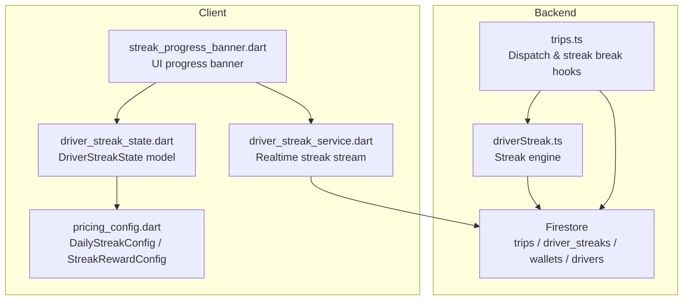
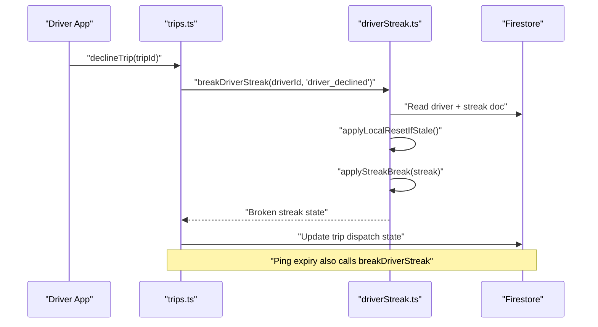
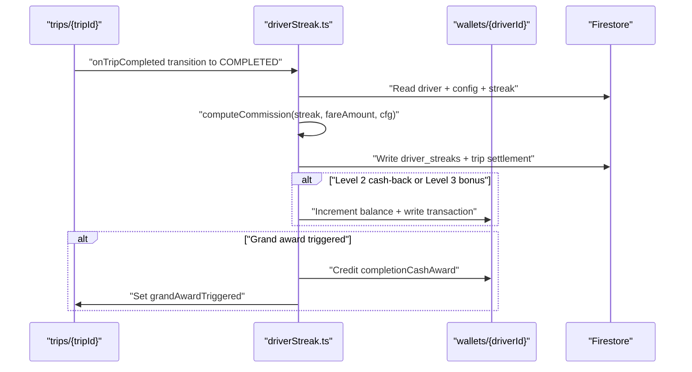
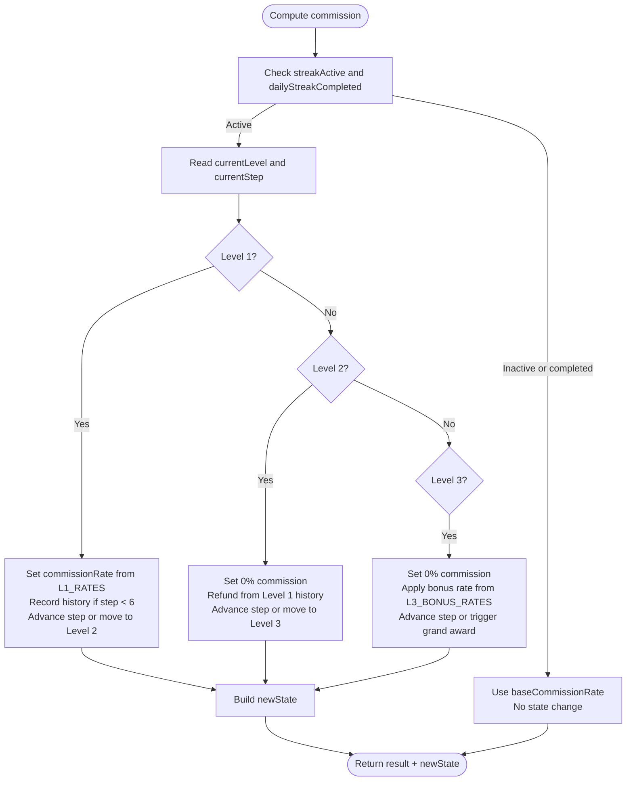
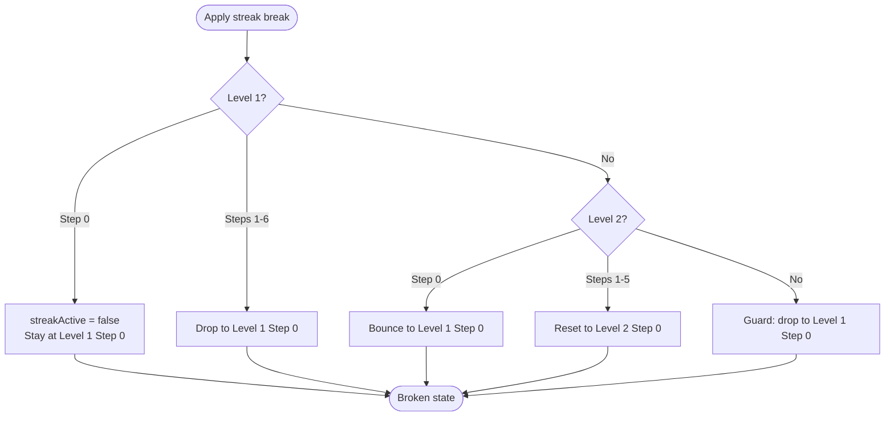
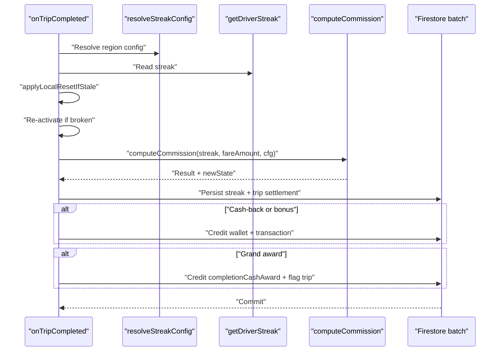
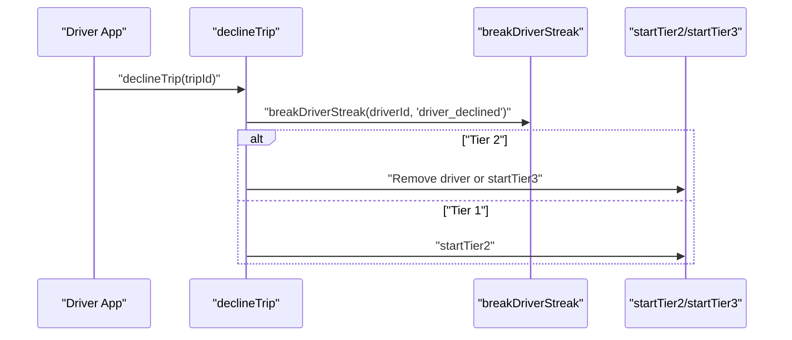
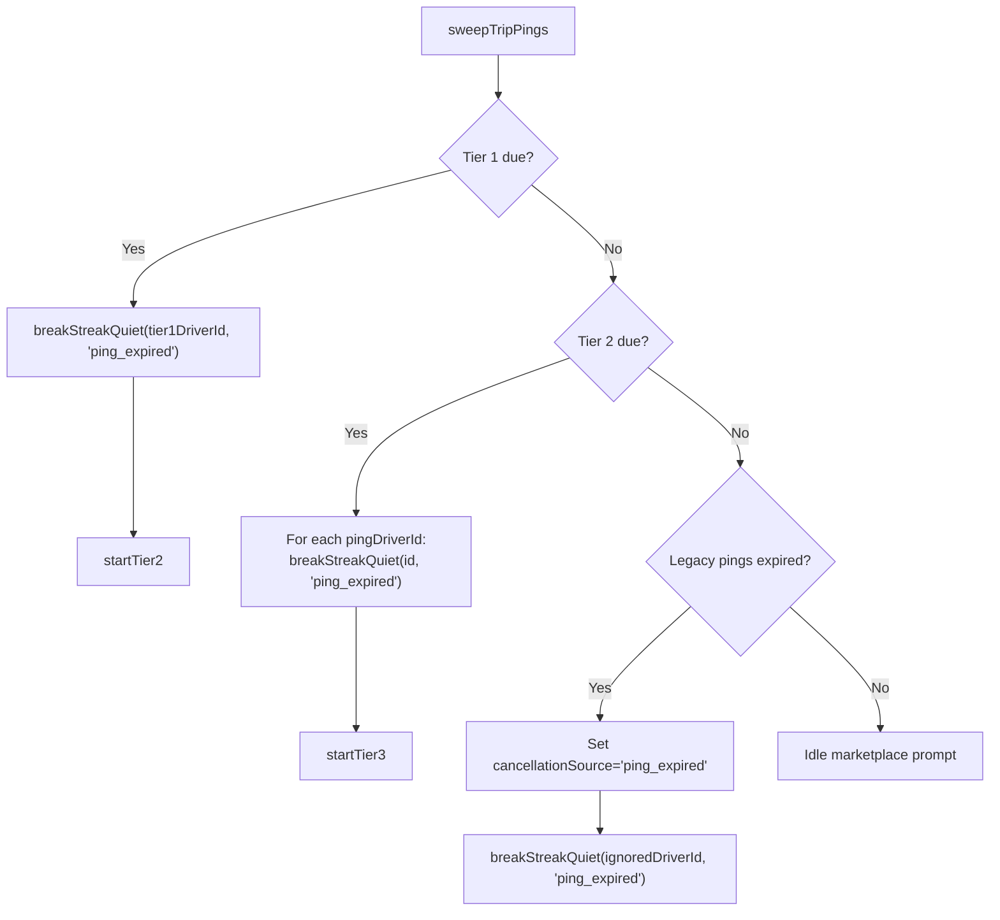
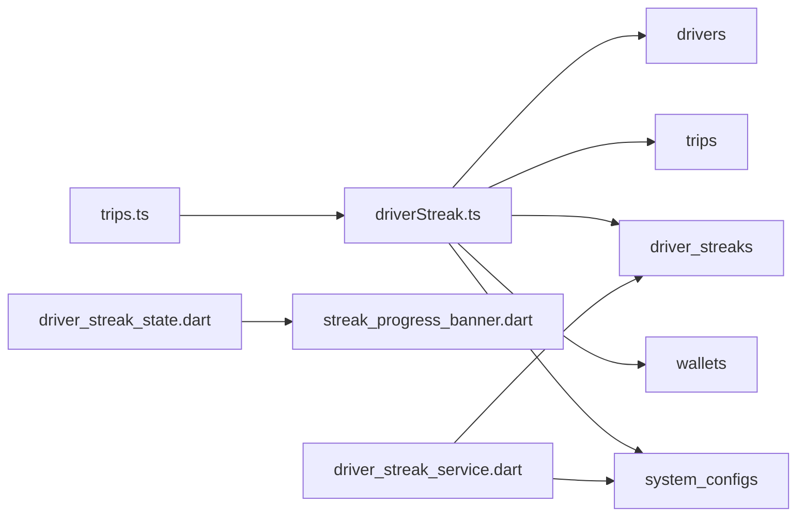

# Driver Streak Tracking

<cite>
**Referenced Files in This Document**
- [driverStreak.ts](file://functions/src/driverStreak.ts)
- [trips.ts](file://functions/src/trips.ts)
- [driver_streak_state.dart](file://sese_core/lib/models/driver_streak_state.dart)
- [pricing_config.dart](file://sese_core/lib/models/pricing_config.dart)
- [streak_progress_banner.dart](file://sese_ride/lib/features/driver/presentation/widgets/streak_progress_banner.dart)
- [driver_streak_service.dart](file://sese_ride/lib/features/driver/services/driver_streak_service.dart)
</cite>

## Table of Contents
1. [Introduction](#introduction)
2. [Project Structure](#project-structure)
3. [Core Components](#core-components)
4. [Architecture Overview](#architecture-overview)
5. [Detailed Component Analysis](#detailed-component-analysis)
6. [Dependency Analysis](#dependency-analysis)
7. [Performance Considerations](#performance-considerations)
8. [Troubleshooting Guide](#troubleshooting-guide)
9. [Conclusion](#conclusion)

## Introduction
This document explains the driver streak tracking system that rewards consistent availability and responsiveness. The system tracks a daily, timezone-aware streak with three progression levels:

- Level 1: Step-down commission discount from 15% down to 0%.
- Level 2: 0% commission with cash-back refunds for previously paid Level 1 commissions.
- Level 3: 0% commission with a percentage-based cash bonus on trip fares, culminating in a grand award.

The streak is maintained by backend Firestore triggers and scheduled jobs, while the Flutter apps consume the current streak state through real-time streams. Streak breaks occur when drivers decline trips or ignore pings until expiration; streak protection applies for customer cancellations and qualifying no-show scenarios.

## Project Structure
The streak system spans server-side Cloud Functions and client-side Flutter models and UI components:

- Backend logic lives in `functions/src`, primarily in `driverStreak.ts` (streak engine) and `trips.ts` (dispatch integration).
- Client data models live in `sese_core/lib/models`, including `driver_streak_state.dart` and `pricing_config.dart`.
- Driver app UI and streaming logic live in `sese_ride/lib/features/driver`, including the streak banner and streak service.

**Diagram sources**
- [driverStreak.ts:1-708](file://functions/src/driverStreak.ts#L1-L708)
- [trips.ts:1-1225](file://functions/src/trips.ts#L1-L1225)
- [driver_streak_state.dart:1-217](file://sese_core/lib/models/driver_streak_state.dart#L1-L217)
- [pricing_config.dart:66-249](file://sese_core/lib/models/pricing_config.dart#L66-L249)
- [driver_streak_service.dart:79-202](file://sese_ride/lib/features/driver/services/driver_streak_service.dart#L79-L202)
- [streak_progress_banner.dart:1-49](file://sese_ride/lib/features/driver/presentation/widgets/streak_progress_banner.dart#L1-L49)

**Section sources**
- [driverStreak.ts:1-708](file://functions/src/driverStreak.ts#L1-L708)
- [trips.ts:1-1225](file://functions/src/trips.ts#L1-L1225)
- [driver_streak_state.dart:1-217](file://sese_core/lib/models/driver_streak_state.dart#L1-L217)
- [pricing_config.dart:66-249](file://sese_core/lib/models/pricing_config.dart#L66-L249)
- [driver_streak_service.dart:79-202](file://sese_ride/lib/features/driver/services/driver_streak_service.dart#L79-L202)
- [streak_progress_banner.dart:1-49](file://sese_ride/lib/features/driver/presentation/widgets/streak_progress_banner.dart#L1-L49)

## Core Components
- **Streak engine**: Computes commission, cash-back, cash bonus, and streak transitions per completed trip. It also provides shared streak-break logic and local-midnight reset helpers.
- **Dispatch integration**: Decline and ping-expiration paths call into the streak engine to break streaks during dispatch lifecycle events.
- **Client model**: Describes the persisted streak snapshot, level/step semantics, and human-readable labels.
- **Region configuration**: Controls whether streak mechanics are enabled, base commission rate, no-show wait threshold, and grand award amount.
- **Driver app streaming and UI**: Streams the current streak state and renders progress, milestone hints, and no-show protection timer.

Key responsibilities:
- Compute commission and reward amounts based on current level and step.
- Persist updated streak state and settlement annotations.
- Credit wallet balances for Level 2 cash-back and Level 3 bonuses.
- Break streaks on driver declines and ignored pings.
- Reset streaks at local midnight per driver timezone.

**Section sources**
- [driverStreak.ts:239-335](file://functions/src/driverStreak.ts#L239-L335)
- [driverStreak.ts:337-373](file://functions/src/driverStreak.ts#L337-L373)
- [driverStreak.ts:375-524](file://functions/src/driverStreak.ts#L375-L524)
- [driverStreak.ts:526-557](file://functions/src/driverStreak.ts#L526-L557)
- [driverStreak.ts:623-707](file://functions/src/driverStreak.ts#L623-L707)
- [driver_streak_state.dart:7-18](file://sese_core/lib/models/driver_streak_state.dart#L7-L18)
- [driver_streak_state.dart:20-60](file://sese_core/lib/models/driver_streak_state.dart#L20-L60)
- [driver_streak_state.dart:122-171](file://sese_core/lib/models/driver_streak_state.dart#L122-L171)
- [pricing_config.dart:151-249](file://sese_core/lib/models/pricing_config.dart#L151-L249)
- [driver_streak_service.dart:79-102](file://sese_ride/lib/features/driver/services/driver_streak_service.dart#L79-L102)
- [streak_progress_banner.dart:1-49](file://sese_ride/lib/features/driver/presentation/widgets/streak_progress_banner.dart#L1-L49)

## Architecture Overview
The streak system is event-driven:

- Trip completion triggers commission computation and streak advancement.
- Trip cancellation or explicit decline triggers streak breaks depending on cancellation source.
- A scheduled job resets stale streaks at local midnight.
- The driver app subscribes to the streak document and displays progress.

**Diagram sources**
- [trips.ts:655-714](file://functions/src/trips.ts#L655-L714)
- [driverStreak.ts:526-557](file://functions/src/driverStreak.ts#L526-L557)

**Diagram sources**
- [driverStreak.ts:375-524](file://functions/src/driverStreak.ts#L375-L524)

## Detailed Component Analysis

### Streak Engine (`driverStreak.ts`)
The streak engine implements:

- Commission calculation across three levels.
- Streak break rules.
- Trip-completed trigger that persists state and credits wallets.
- Shared streak-break writer used by dispatch flows.
- Local-midnight reset scheduler.

#### Commission Calculation Algorithm
The algorithm computes:

- Commission rate and amount.
- Cash-back amount for Level 2.
- Cash bonus amount for Level 3.
- Grand award trigger when Level 3 reaches its final step.
- New streak state for persistence.

**Diagram sources**
- [driverStreak.ts:239-335](file://functions/src/driverStreak.ts#L239-L335)

#### Streak Break Rules
When a streak breaks:

- Level 1 Step 0 becomes off-streak (flat base rate).
- Level 1 Steps 1–6 drop back to Level 1 Step 0.
- Level 2 Step 0 drops back to Level 1 Step 0.
- Level 2 Steps 1–5 reset to Level 2 Step 0.
- Level 3 is guarded to drop back to Level 1 Step 0.

**Diagram sources**
- [driverStreak.ts:337-373](file://functions/src/driverStreak.ts#L337-L373)

#### Trip Completion Trigger
On trip completion:

- Reads driver region and resolves streak configuration.
- Applies lazy local-midnight reset.
- Re-activates streak if it was broken and streaks are enabled.
- Computes commission and updates streak state.
- Annotates trip settlement fields.
- Credits wallet for cash-back and bonuses.
- Triggers grand award payout and flags trip for celebration UI.

**Diagram sources**
- [driverStreak.ts:375-524](file://functions/src/driverStreak.ts#L375-L524)

#### Shared Streak Break Writer
The shared writer is used by dispatch flows to break streaks without duplicating reset logic:

- Resolves driver timezone.
- Reads streak and applies local reset.
- Skips break if streak already completed today.
- Applies break rules and persists new state.

**Section sources**
- [driverStreak.ts:526-557](file://functions/src/driverStreak.ts#L526-L557)

#### Midnight Reset Scheduler
The scheduler runs hourly and resets every driver whose stored local date differs from today:

- Pages through `driver_streaks` documents.
- Caches driver timezones within a run.
- Resets level, step, history, and completion flag.
- Preserves `streakActive` and `baseCommissionRate`.

**Section sources**
- [driverStreak.ts:623-707](file://functions/src/driverStreak.ts#L623-L707)

### Dispatch Integration (`trips.ts`)
The dispatch system integrates streak breaks in two main scenarios:

- Explicit driver decline.
- Ping expiration when a driver ignores an offer.

#### Decline Flow
When a driver declines:

- Calls `breakDriverStreak` with reason `"driver_declined"`.
- For Tier 2, removes the driver from the ping group or promotes to marketplace broadcast.
- For Tier 1, returns to searching and immediately starts Tier 2.

**Diagram sources**
- [trips.ts:655-714](file://functions/src/trips.ts#L655-L714)
- [driverStreak.ts:526-557](file://functions/src/driverStreak.ts#L526-L557)

#### Ping Expiration Flow
The sweep job promotes waiting offers and expires ignored pings:

- Tier 1 expired ping → streak break, then promote to Tier 2.
- Tier 2 expired pings → streak break for each ignored driver, then promote to marketplace.
- Legacy pings without tier fields → set cancellation source and streak break.

**Diagram sources**
- [trips.ts:394-512](file://functions/src/trips.ts#L394-L512)
- [driverStreak.ts:526-557](file://functions/src/driverStreak.ts#L526-L557)

#### Cancellation Source Handling
Cancellation affects streak behavior:

- Customer cancellation: streak protected.
- Driver no-show after waiting threshold: streak protected.
- Driver cancels before arrival: streak breaks.
- Other cancellation sources: streak breaks.

**Section sources**
- [trips.ts:800-927](file://functions/src/trips.ts#L800-L927)
- [driverStreak.ts:559-621](file://functions/src/driverStreak.ts#L559-L621)

### Client Model (`driver_streak_state.dart`)
The client model represents the persisted streak snapshot:

- Tracks active status, current level, current step, and Level 1 paid history.
- Provides helper methods for display labels and progress calculations.
- Supports copy operations and serialization.

Key behaviors:

- Human-readable label shows standard rate, streak rate, refund pending, or bonus percentage.
- Level 2 refund is computed from Level 1 history in reverse order.
- Level 3 bonus rate is selected by step index.
- Progress helpers compute total steps and remaining steps.

**Section sources**
- [driver_streak_state.dart:7-18](file://sese_core/lib/models/driver_streak_state.dart#L7-L18)
- [driver_streak_state.dart:20-60](file://sese_core/lib/models/driver_streak_state.dart#L20-L60)
- [driver_streak_state.dart:73-118](file://sese_core/lib/models/driver_streak_state.dart#L73-L118)
- [driver_streak_state.dart:122-171](file://sese_core/lib/models/driver_streak_state.dart#L122-L171)
- [driver_streak_state.dart:173-216](file://sese_core/lib/models/driver_streak_state.dart#L173-L216)

### Region Configuration (`pricing_config.dart`)
Configuration controls:

- Whether streak mechanics are enabled.
- Base commission rate when streak is inactive.
- No-show wait threshold.
- Grand award amount.
- Disabled countries and states.

The model supports mapping to and from Firestore maps and includes region-scoped defaults.

**Section sources**
- [pricing_config.dart:66-149](file://sese_core/lib/models/pricing_config.dart#L66-L149)
- [pricing_config.dart:151-249](file://sese_core/lib/models/pricing_config.dart#L151-L249)

### Driver App Streaming and UI
The driver app:

- Streams the current streak document via `driver_streak_service.dart`.
- Renders streak progress using `streak_progress_banner.dart`.
- Shows no-show protection timer when the driver has arrived.

Streaming behavior:

- Returns default inactive-safe state when Firestore is unavailable.
- Ends listen gracefully on permission-denied errors.
- Subscribes to `system_configs/global_default` for streak configuration.

UI behavior:

- Displays current level, step dots, next-milestone reward.
- Uses configured wait threshold minutes for no-show protection.

**Section sources**
- [driver_streak_service.dart:79-102](file://sese_ride/lib/features/driver/services/driver_streak_service.dart#L79-L102)
- [driver_streak_service.dart:185-202](file://sese_ride/lib/features/driver/services/driver_streak_service.dart#L185-L202)
- [streak_progress_banner.dart:1-49](file://sese_ride/lib/features/driver/presentation/widgets/streak_progress_banner.dart#L1-L49)

## Dependency Analysis
The streak system has clear boundaries:

- `trips.ts` depends on `driverStreak.ts` for streak breaks.
- `driverStreak.ts` reads and writes Firestore collections: `drivers`, `trips`, `driver_streaks`, `wallets`, and `system_configs`.
- Client models depend on Firestore schema but do not mutate streak state.
- Driver app UI depends on the streak model and streaming service.

**Diagram sources**
- [trips.ts:1-1225](file://functions/src/trips.ts#L1-L1225)
- [driverStreak.ts:1-708](file://functions/src/driverStreak.ts#L1-L708)
- [driver_streak_state.dart:1-217](file://sese_core/lib/models/driver_streak_state.dart#L1-L217)
- [driver_streak_service.dart:79-202](file://sese_ride/lib/features/driver/services/driver_streak_service.dart#L79-L202)
- [streak_progress_banner.dart:1-49](file://sese_ride/lib/features/driver/presentation/widgets/streak_progress_banner.dart#L1-L49)

**Section sources**
- [trips.ts:1-1225](file://functions/src/trips.ts#L1-L1225)
- [driverStreak.ts:1-708](file://functions/src/driverStreak.ts#L1-L708)
- [driver_streak_state.dart:1-217](file://sese_core/lib/models/driver_streak_state.dart#L1-L217)
- [driver_streak_service.dart:79-202](file://sese_ride/lib/features/driver/services/driver_streak_service.dart#L79-L202)
- [streak_progress_banner.dart:1-49](file://sese_ride/lib/features/driver/presentation/widgets/streak_progress_banner.dart#L1-L49)

## Performance Considerations
- **Lazy local-midnight reset**: Streaks are reset only when needed, reducing unnecessary writes.
- **Batched Firestore writes**: Trip completion uses a single batch for streak state, trip settlement, wallet credits, and optional grand award.
- **Scheduled reset pagination**: The midnight reset processes drivers in pages of 500 to avoid large transactions.
- **Timezone caching**: The scheduler caches driver timezones within a run to reduce repeated reads.
- **Graceful error handling**: Streak breaks in dispatch are wrapped in quiet handlers so dispatch continues even if streak persistence fails.

[No sources needed since this section provides general guidance]

## Troubleshooting Guide
Common issues and diagnostics:

- **Streak does not advance on trip completion**:
  - Verify trip status transitioned to `COMPLETED`.
  - Confirm fare amount is greater than zero.
  - Check that streak is enabled for the driver's region.
  - Inspect `settlement` fields written to the trip document.

- **Streak breaks unexpectedly**:
  - Check for explicit driver declines.
  - Check for ping expirations in the sweep job.
  - Review cancellation source for cancellations.

- **Streak not resetting at midnight**:
  - Ensure `scheduledResetStreaks` is running.
  - Verify driver timezone resolution.
  - Confirm `resetDateLocal` differs from today in the driver's timezone.

- **Wallet credits missing**:
  - Confirm Level 2 or Level 3 conditions were met.
  - Check wallet transaction records for streak-related types.
  - Validate grand award configuration.

Operational references:

- Streak break logging and quiet failure handling.
- Trip completion logging with commission, cash-back, bonus, and grand award details.
- Scheduled reset sweep logs showing number of drivers reset.

**Section sources**
- [driverStreak.ts:516-523](file://functions/src/driverStreak.ts#L516-L523)
- [driverStreak.ts:551-556](file://functions/src/driverStreak.ts#L551-L556)
- [driverStreak.ts:702-705](file://functions/src/driverStreak.ts#L702-L705)
- [trips.ts:386-392](file://functions/src/trips.ts#L386-L392)
- [trips.ts:673-678](file://functions/src/trips.ts#L673-L678)

## Conclusion
The driver streak tracking system combines server-side streak computation, dispatch integration, and client-side visualization to reward consistent driver behavior. It advances through three levels of incentives, protects drivers from unfair penalties, and resets daily in the driver's local timezone. The design emphasizes reliability through lazy resets, batched writes, graceful error handling, and clear separation between dispatch logic and streak mechanics.

[No sources needed since this section summarizes without analyzing specific files]