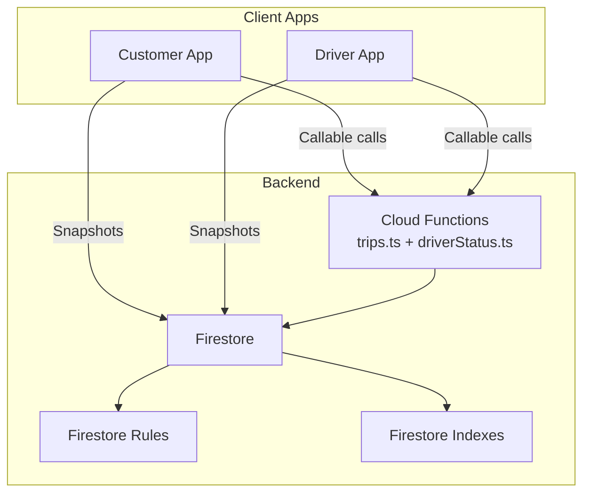
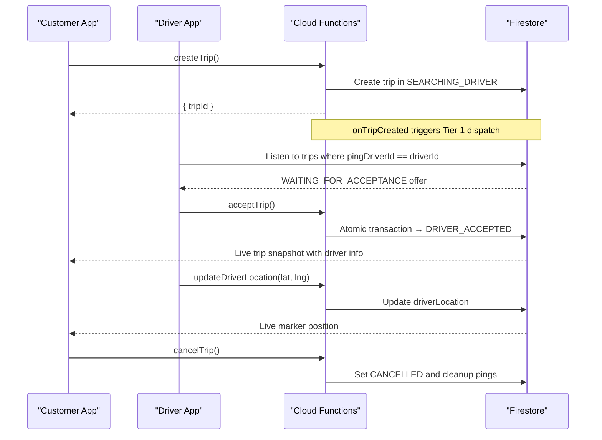
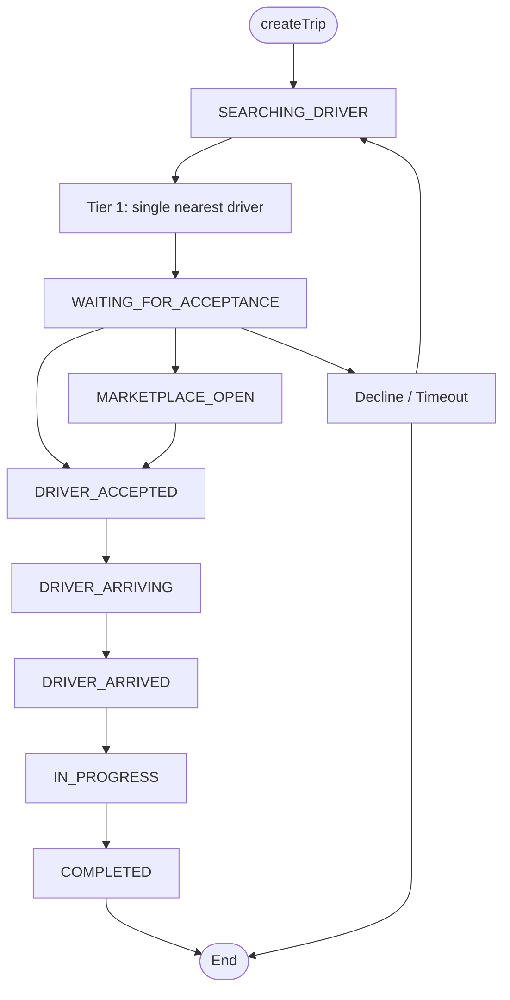
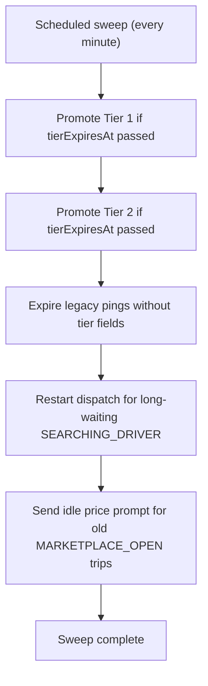
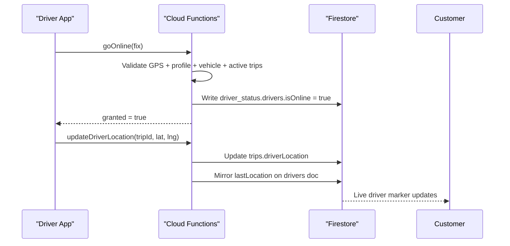
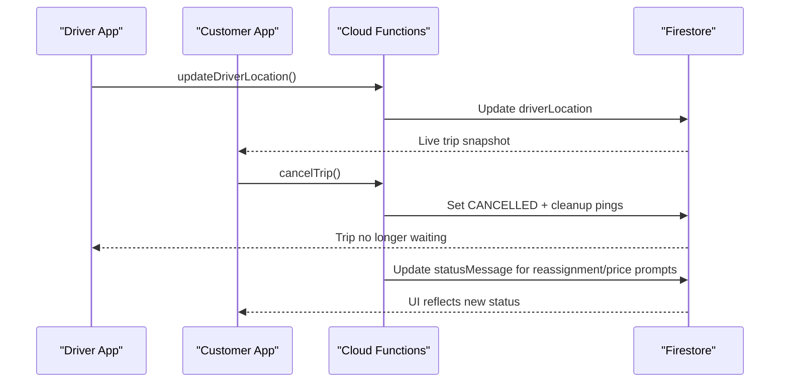
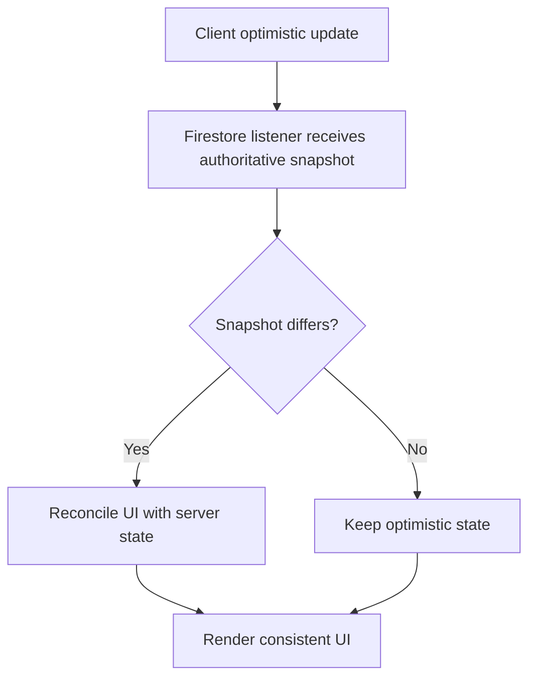
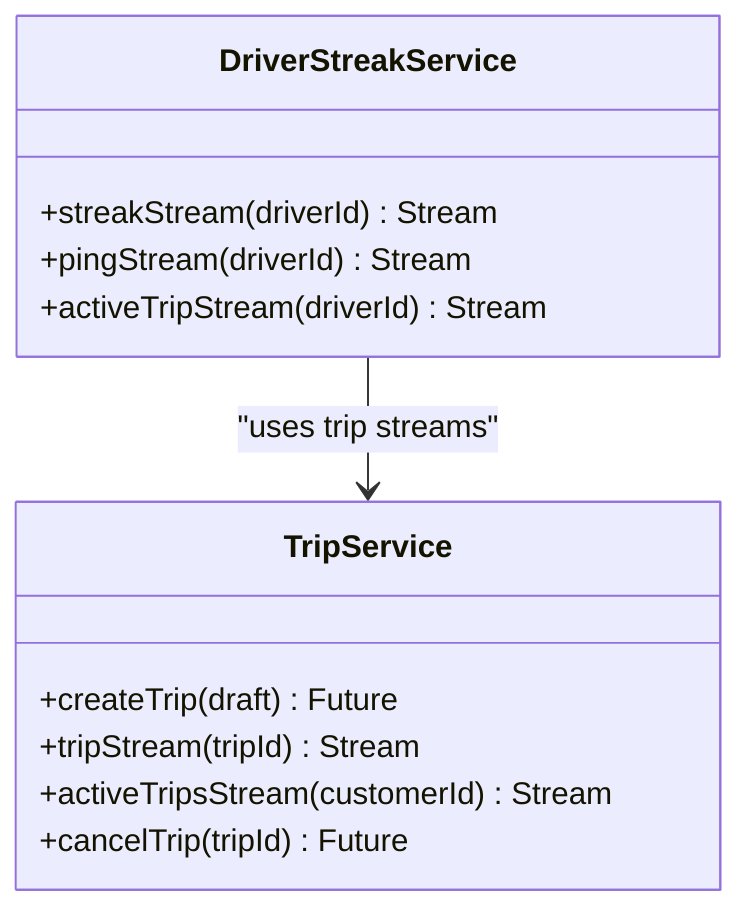
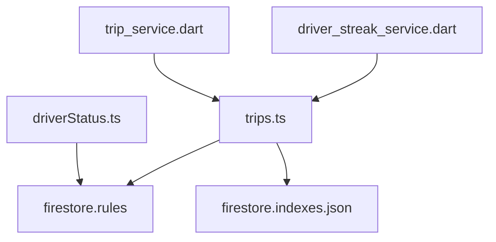

# Real-Time Coordination

<cite>
**Referenced Files in This Document**   
- [trips.ts](file://functions/src/trips.ts)
- [driverStatus.ts](file://functions/src/driverStatus.ts)
- [firestore.rules](file://firestore.rules)
- [firestore.indexes.json](file://firestore.indexes.json)
- [driver_streak_service.dart](file://sese_ride/lib/features/driver/services/driver_streak_service.dart)
- [trip_service.dart](file://sese_ride/lib/features/trips/services/trip_service.dart)
</cite>

## Table of Contents
1. [Introduction](#introduction)
2. [Project Structure](#project-structure)
3. [Core Components](#core-components)
4. [Architecture Overview](#architecture-overview)
5. [Detailed Component Analysis](#detailed-component-analysis)
6. [Dependency Analysis](#dependency-analysis)
7. [Performance Considerations](#performance-considerations)
8. [Troubleshooting Guide](#troubleshooting-guide)
9. [Conclusion](#conclusion)

## Introduction
This document explains how the system coordinates real-time trips between drivers, customers, and the backend. The core idea is simple: clients do not own trip state. Instead, they call server functions to perform actions, and Firestore listeners keep every client synchronized with the authoritative trip snapshot.

Key mechanisms include:
- A server-authoritative trip lifecycle that starts in `SEARCHING_DRIVER` and moves through acceptance, arrival, progress, completion, or cancellation.
- A tiered dispatch pipeline that pings one driver, then two drivers, then broadcasts to nearby drivers.
- Ping expiration using `pingExpiresAt`, with a scheduled sweep promoting offers and cleaning up ignored pings.
- Driver GPS heartbeats updating `driverLocation` so customers can track the driver live.
- Bidirectional communication patterns for driver accept/decline/location updates and customer cancellation/fare increases.
- Conflict resolution via Cloud Functions transactions, Firestore rules, and server timestamps.

## Project Structure
The real-time coordination logic lives primarily in Cloud Functions and is enforced by Firestore security rules. Flutter code provides streams for listening to live trip data and calling server functions.

**Diagram sources**
- [trips.ts:12-26](file://functions/src/trips.ts#L12-L26)
- [driverStatus.ts:6-10](file://functions/src/driverStatus.ts#L6-L10)
- [firestore.rules:315-366](file://firestore.rules#L315-L366)
- [firestore.indexes.json:31-31](file://firestore.indexes.json#L31-L31)

**Section sources**
- [trips.ts:12-26](file://functions/src/trips.ts#L12-L26)
- [driverStatus.ts:6-10](file://functions/src/driverStatus.ts#L6-L10)
- [firestore.rules:315-366](file://firestore.rules#L315-L366)

## Core Components
- **Trip lifecycle controller**: Creates trips, runs matchmaking, handles accept/decline, location updates, status advancement, cancellation, bidding, and fare increases.
- **Driver availability controller**: Validates and records driver online/offline state with GPS sanity checks.
- **Security layer**: Firestore rules restrict who can read/write trip documents and related collections.
- **Indexing layer**: Composite indexes support efficient queries such as ping expiration sweeps.
- **Client streaming layer**: Flutter services expose streams for active trips, driver pings, streak state, and trip snapshots.

**Section sources**
- [trips.ts:12-26](file://functions/src/trips.ts#L12-L26)
- [driverStatus.ts:6-10](file://functions/src/driverStatus.ts#L6-L10)
- [firestore.rules:315-366](file://firestore.rules#L315-L366)
- [driver_streak_service.dart:89-183](file://sese_ride/lib/features/driver/services/driver_streak_service.dart#L89-L183)
- [trip_service.dart:20-38](file://sese_ride/lib/features/trips/services/trip_service.dart#L20-L38)

## Architecture Overview
The system uses a server-driven state machine. Clients subscribe to Firestore documents and call Cloud Functions for mutations.

**Diagram sources**
- [trips.ts:129-224](file://functions/src/trips.ts#L129-L224)
- [trips.ts:372-383](file://functions/src/trips.ts#L372-L383)
- [trips.ts:591-653](file://functions/src/trips.ts#L591-L653)
- [trips.ts:716-754](file://functions/src/trips.ts#L716-L754)
- [trips.ts:800-833](file://functions/src/trips.ts#L800-L833)

## Detailed Component Analysis

### Trip Lifecycle and Server-Authoritative State Machine
The trip lifecycle is defined by explicit statuses and transitions. Creation starts in `SEARCHING_DRIVER`. The backend owns all transitions; direct client writes to trip documents are denied except for creation under strict conditions.

Important behaviors:
- Creation validates phone numbers, coordinates, service type, selected tiers, and fare token.
- Matchmaking begins immediately after creation.
- Acceptance is atomic and prevents double assignment.
- Location updates are allowed only for the assigned driver during live statuses.
- Status advancement follows an ordered chain.
- Cancellation sets `cancellationSource` and cleans up ping fields.

**Diagram sources**
- [trips.ts:12-26](file://functions/src/trips.ts#L12-L26)
- [trips.ts:129-224](file://functions/src/trips.ts#L129-L224)
- [trips.ts:591-653](file://functions/src/trips.ts#L591-L653)
- [trips.ts:756-796](file://functions/src/trips.ts#L756-L796)
- [firestore.rules:315-366](file://firestore.rules#L315-L366)

**Section sources**
- [trips.ts:12-26](file://functions/src/trips.ts#L12-L26)
- [trips.ts:129-224](file://functions/src/trips.ts#L129-L224)
- [trips.ts:591-653](file://functions/src/trips.ts#L591-L653)
- [trips.ts:756-796](file://functions/src/trips.ts#L756-L796)
- [firestore.rules:315-366](file://firestore.rules#L315-L366)

### Ping/Timeout Mechanism and Automatic Cleanup
Dispatch uses a cascading tier model:
- Tier 1: exclusive ping to the nearest driver.
- Tier 2: simultaneous ping to the next two drivers.
- Tier 3: marketplace broadcast to nearby online drivers.

Each ping has:
- `pingDriverId` for Tier 1.
- `pingDriverIds` for Tier 2.
- `pingExpiresAt` deadline.
- `tierExpiresAt` for promotion deadlines.

A scheduled sweep runs every minute to:
- Promote Tier 1 to Tier 2 when the tier deadline passes.
- Promote Tier 2 to marketplace broadcast when its deadline passes.
- Expire legacy pings without tier fields.
- Restart dispatch for long-waiting searches.
- Send idle price prompts for marketplace trips older than 30 minutes.

**Diagram sources**
- [trips.ts:28-42](file://functions/src/trips.ts#L28-L42)
- [trips.ts:295-370](file://functions/src/trips.ts#L295-L370)
- [trips.ts:401-512](file://functions/src/trips.ts#L401-L512)
- [firestore.indexes.json:31-31](file://firestore.indexes.json#L31-L31)

**Section sources**
- [trips.ts:28-42](file://functions/src/trips.ts#L28-L42)
- [trips.ts:295-370](file://functions/src/trips.ts#L295-L370)
- [trips.ts:401-512](file://functions/src/trips.ts#L401-L512)
- [firestore.indexes.json:31-31](file://firestore.indexes.json#L31-L31)

### Driver Availability and GPS Heartbeats
Drivers go online through a zero-trust handshake:
- Client sends a signed GPS fix.
- Backend validates mock/spoof flags, accuracy, coordinate bounds, suspension state, profile/vehicle verification, and active trips.
- Backend writes authoritative `isOnline`, `lastSeen`, and `lastLocation` fields.

During a live trip, drivers send GPS heartbeats:
- Only the assigned driver can update `driverLocation`.
- Updates are allowed only while the trip is in a live status.
- The backend mirrors the latest location onto the driver document for ranking purposes.

**Diagram sources**
- [driverStatus.ts:32-164](file://functions/src/driverStatus.ts#L32-L164)
- [trips.ts:716-754](file://functions/src/trips.ts#L716-L754)

**Section sources**
- [driverStatus.ts:32-164](file://functions/src/driverStatus.ts#L32-L164)
- [trips.ts:716-754](file://functions/src/trips.ts#L716-L754)

### Bidirectional Communication Patterns
The system supports several bidirectional flows:

- **Driver GPS heartbeats updating trip locations**:
  - Driver calls `updateDriverLocation`.
  - Backend updates `driverLocation` and mirrors it to the driver document.
  - Customer app listens to the trip snapshot and renders the live marker.

- **Customer cancellation requests**:
  - Customer calls `cancelTrip`.
  - Backend verifies ownership and live status.
  - Backend sets `status = CANCELLED`, clears ping fields, and records `cancellationSource`.

- **Real-time status broadcasts**:
  - All clients listen to trip snapshots.
  - Backend updates `statusMessage` and other fields to inform customers about reassignment attempts, idle prompts, and price increases.

**Diagram sources**
- [trips.ts:716-754](file://functions/src/trips.ts#L716-L754)
- [trips.ts:800-927](file://functions/src/trips.ts#L800-L927)
- [trips.ts:1172-1224](file://functions/src/trips.ts#L1172-L1224)

**Section sources**
- [trips.ts:716-754](file://functions/src/trips.ts#L716-L754)
- [trips.ts:800-927](file://functions/src/trips.ts#L800-L927)
- [trips.ts:1172-1224](file://functions/src/trips.ts#L1172-L1224)

### Conflict Resolution, Optimistic Updates, and Consistency
Conflict resolution is handled at multiple layers:

- **Firestore rules**:
  - Trip reads allow customers, ping targets, accepted drivers, agents, and marketplace browsing.
  - Direct trip updates/deletes are denied; only Cloud Functions write trip state.
  - Driver bids are restricted to the owning driver and readable by the trip owner.

- **Transactions**:
  - `acceptTrip` uses a transaction to ensure first-wins claim semantics.
  - `acceptBid` atomically accepts a bid, rejects others, and assigns the driver.

- **Server timestamps**:
  - `createdAt`, `updatedAt`, `arrivedAt`, and other time fields use server timestamps for consistency.

- **Optimistic updates**:
  - Clients may optimistically update local UI state before receiving Firestore snapshots.
  - The server remains the source of truth; any conflict is resolved by the authoritative snapshot.

[No sources needed since this diagram shows conceptual reconciliation workflow]

**Section sources**
- [firestore.rules:315-366](file://firestore.rules#L315-L366)
- [trips.ts:591-653](file://functions/src/trips.ts#L591-L653)
- [trips.ts:1072-1170](file://functions/src/trips.ts#L1072-L1170)

### Real-Time Event Handling Examples
- **Driver ping stream**:
  - The driver app listens to trips where `pingDriverId` equals the driver ID.
  - It filters for `WAITING_FOR_ACCEPTANCE` and presents the offer.

- **Active trip stream**:
  - The driver app listens to trips where `driver.driverId` equals the driver ID.
  - It filters for live trips and displays the current trip.

- **Trip snapshot stream**:
  - The customer app listens to a specific trip document.
  - It reacts to status changes, driver location updates, and status messages.

**Diagram sources**
- [driver_streak_service.dart:89-183](file://sese_ride/lib/features/driver/services/driver_streak_service.dart#L89-L183)
- [trip_service.dart:20-38](file://sese_ride/lib/features/trips/services/trip_service.dart#L20-L38)

**Section sources**
- [driver_streak_service.dart:89-183](file://sese_ride/lib/features/driver/services/driver_streak_service.dart#L89-L183)
- [trip_service.dart:20-38](file://sese_ride/lib/features/trips/services/trip_service.dart#L20-L38)

## Dependency Analysis
The real-time coordination depends on these relationships:

- Cloud Functions depend on Firestore for state persistence and on Firebase Auth for identity.
- Firestore rules enforce access control for trips, drivers, users, and related collections.
- Firestore indexes support efficient queries for ping expiration and dispatch sweeps.
- Flutter services depend on Cloud Functions for mutations and Firestore for live streams.

**Diagram sources**
- [trips.ts:12-26](file://functions/src/trips.ts#L12-L26)
- [driverStatus.ts:6-10](file://functions/src/driverStatus.ts#L6-L10)
- [firestore.rules:315-366](file://firestore.rules#L315-L366)
- [firestore.indexes.json:31-31](file://firestore.indexes.json#L31-L31)
- [driver_streak_service.dart:89-183](file://sese_ride/lib/features/driver/services/driver_streak_service.dart#L89-L183)
- [trip_service.dart:20-38](file://sese_ride/lib/features/trips/services/trip_service.dart#L20-L38)

**Section sources**
- [trips.ts:12-26](file://functions/src/trips.ts#L12-L26)
- [driverStatus.ts:6-10](file://functions/src/driverStatus.ts#L6-L10)
- [firestore.rules:315-366](file://firestore.rules#L315-L366)
- [firestore.indexes.json:31-31](file://firestore.indexes.json#L31-L31)
- [driver_streak_service.dart:89-183](file://sese_ride/lib/features/driver/services/driver_streak_service.dart#L89-L183)
- [trip_service.dart:20-38](file://sese_ride/lib/features/trips/services/trip_service.dart#L20-L38)

## Performance Considerations
- **Query efficiency**: Use composite indexes for ping expiration sweeps and driver ranking queries.
- **Listener scope**: Subscribe only to relevant documents (single trip or filtered driver pings) to reduce bandwidth.
- **Heartbeat rate**: Throttle GPS heartbeats to balance accuracy and battery usage.
- **Transaction cost**: Reserve transactions for critical operations like accept/claim to avoid unnecessary contention.
- **Server timestamps**: Prefer server timestamps over client timestamps for consistent ordering and aging logic.
- **Idle handling**: Use status messages and notifications sparingly to avoid overwhelming clients.

[No sources needed since this section provides general guidance]

## Troubleshooting Guide
Common issues and recovery patterns:

- **Ping expired**:
  - Symptom: Driver cannot accept because `pingExpiresAt` is in the past.
  - Cause: Driver did not respond within the timeout window.
  - Recovery: Dispatch promotes to the next tier or restarts search.

- **Not your trip**:
  - Symptom: Permission-denied error when updating location or advancing status.
  - Cause: Caller is not the assigned driver.
  - Recovery: Ensure the correct driver session is active.

- **Mock location detected**:
  - Symptom: Go-online request rejected due to spoofed GPS.
  - Cause: Client sent `isMocked = true` or invalid accuracy.
  - Recovery: Disable mock locations and retry with valid GPS.

- **Trip already closed**:
  - Symptom: Cancellation fails because trip is not in a live status.
  - Cause: Trip completed or was already cancelled.
  - Recovery: Refresh trip snapshot and handle terminal state.

- **Double assignment prevented**:
  - Symptom: Another driver claimed the trip first.
  - Cause: Concurrent accept attempts.
  - Recovery: Transaction ensures first-wins; other clients reconcile with authoritative snapshot.

**Section sources**
- [trips.ts:532-552](file://functions/src/trips.ts#L532-L552)
- [trips.ts:716-754](file://functions/src/trips.ts#L716-L754)
- [trips.ts:800-927](file://functions/src/trips.ts#L800-L927)
- [driverStatus.ts:32-164](file://functions/src/driverStatus.ts#L32-L164)

## Conclusion
Real-time coordination in this system is built around a server-authoritative trip lifecycle, secure Firestore rules, and efficient client-side streaming. Drivers and customers interact through well-defined callable endpoints, while Firestore listeners keep all participants synchronized. Ping timeouts, automatic cleanup, and transactional claims ensure robust behavior under concurrency. For best results, applications should minimize direct writes, rely on server timestamps, and handle conflicts by reconciling with authoritative snapshots.

[No sources needed since this section summarizes without analyzing specific files]