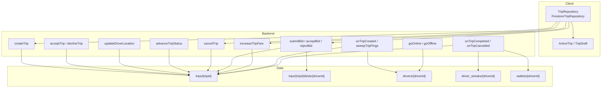
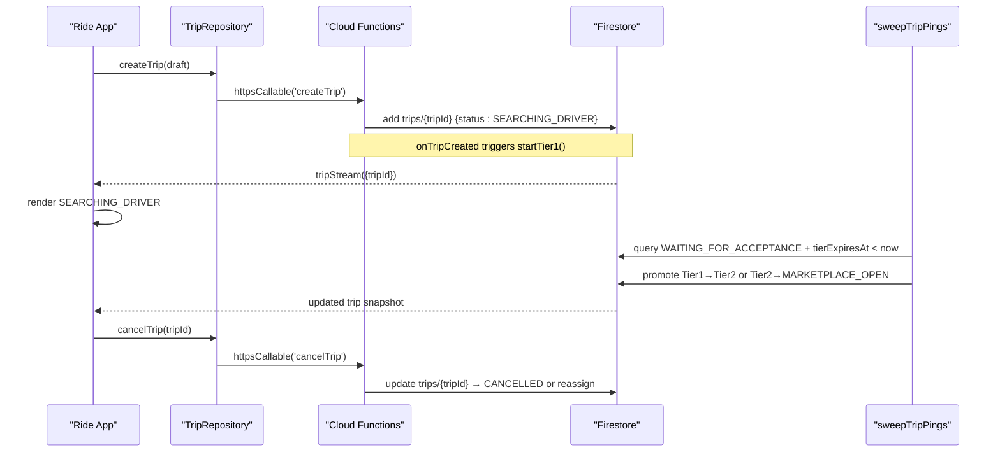
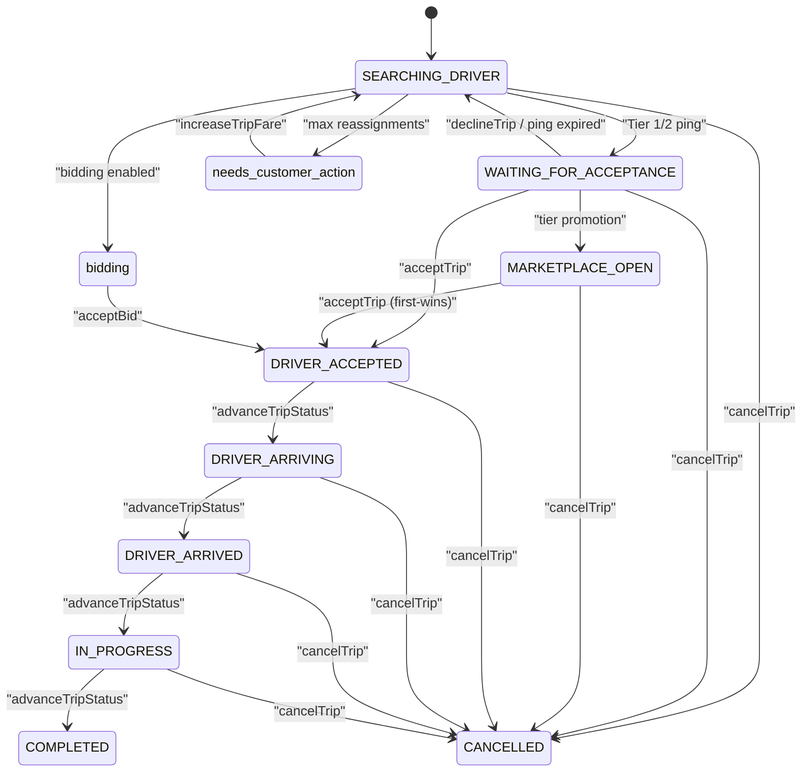
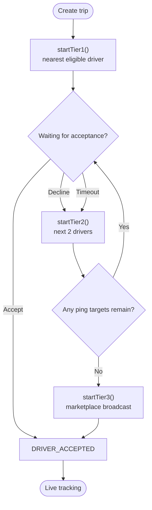
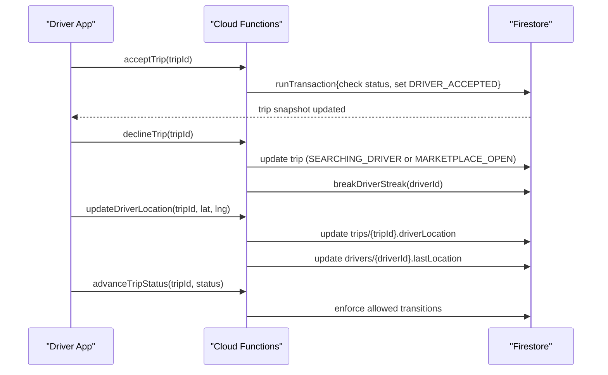
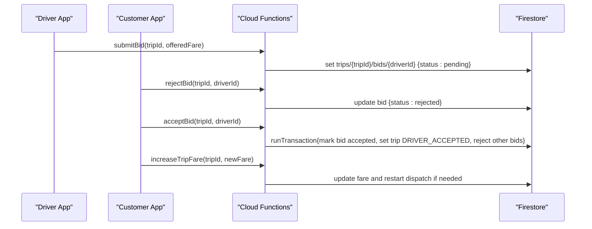
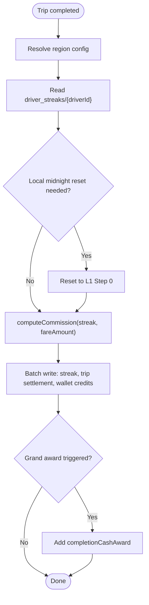
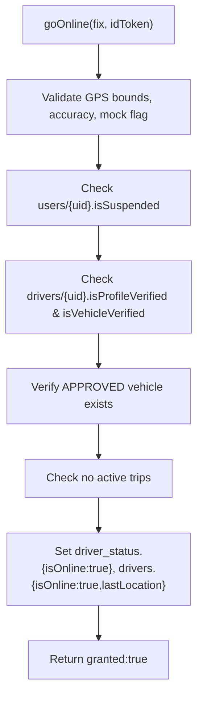
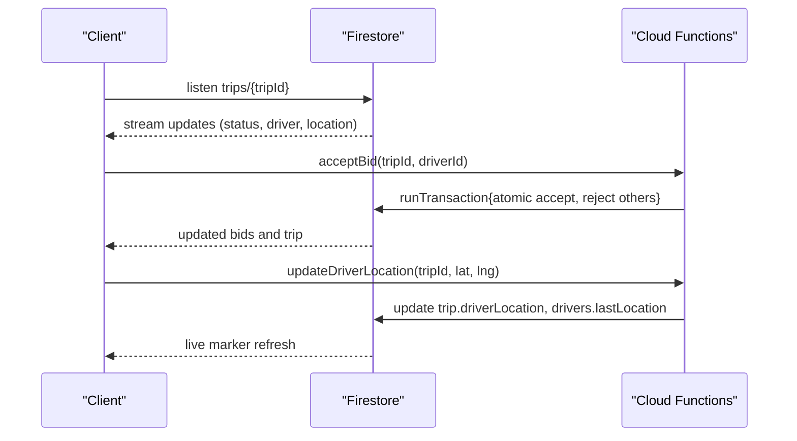
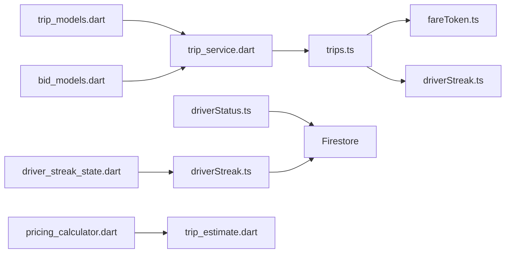

# Trip Management System

<cite>
**Referenced Files in This Document**
- [trips.ts](file://functions/src/trips.ts)
- [driverStatus.ts](file://functions/src/driverStatus.ts)
- [driverStreak.ts](file://functions/src/driverStreak.ts)
- [trip_models.dart](file://sese_ride/lib/features/trips/models/trip_models.dart)
- [trip_service.dart](file://sese_ride/lib/features/trips/services/trip_service.dart)
- [bid_models.dart](file://sese_ride/lib/features/trips/models/bid_models.dart)
- [pricing_calculator.dart](file://sese_core/lib/services/pricing_calculator.dart)
- [trip_estimate.dart](file://sese_core/lib/models/trip_estimate.dart)
- [driver_streak_state.dart](file://sese_core/lib/models/driver_streak_state.dart)
</cite>

## Table of Contents
1. [Introduction](#introduction)
2. [Project Structure](#project-structure)
3. [Core Components](#core-components)
4. [Architecture Overview](#architecture-overview)
5. [Detailed Component Analysis](#detailed-component-analysis)
6. [Dependency Analysis](#dependency-analysis)
7. [Performance Considerations](#performance-considerations)
8. [Troubleshooting Guide](#troubleshooting-guide)
9. [Conclusion](#conclusion)

## Introduction
This document explains the trip management system that powers ride and delivery dispatch, driver-customer matching, real-time coordination, bid management for delivery services, driver streak tracking, and online/offline status management. The backend is server-authoritative: clients create trips and perform actions through secure callable functions, while Firestore listeners keep UIs live. Dispatch uses a tiered cascade (exclusive ping, small group ping, marketplace broadcast), with scheduled promotion and expiration logic ensuring progress even when apps are closed. Driver streaks apply dynamic commission tiers, cashback, and bonuses, with local-midnight resets per driver timezone.

## Project Structure
The system spans three main layers:
- Cloud Functions backend: state machine, matchmaking, bidding, streak engine, and driver availability.
- Ride app client: repository layer calling Cloud Functions and listening to Firestore streams.
- Core models: shared domain types for trips, estimates, and streak state.

**Diagram sources**
- [trips.ts:129-225](file://functions/src/trips.ts#L129-L225)
- [trips.ts:373-512](file://functions/src/trips.ts#L373-L512)
- [trips.ts:591-796](file://functions/src/trips.ts#L591-L796)
- [trips.ts:800-927](file://functions/src/trips.ts#L800-L927)
- [trips.ts:932-1225](file://functions/src/trips.ts#L932-L1225)
- [driverStatus.ts:32-164](file://functions/src/driverStatus.ts#L32-L164)
- [driverStatus.ts:170-219](file://functions/src/driverStatus.ts#L170-L219)
- [driverStreak.ts:381-524](file://functions/src/driverStreak.ts#L381-L524)
- [driverStreak.ts:571-621](file://functions/src/driverStreak.ts#L571-L621)
- [trip_service.dart:66-122](file://sese_ride/lib/features/trips/services/trip_service.dart#L66-L122)
- [trip_models.dart:11-49](file://sese_ride/lib/features/trips/models/trip_models.dart#L11-L49)

**Section sources**
- [trips.ts:12-53](file://functions/src/trips.ts#L12-L53)
- [trip_models.dart:11-49](file://sese_ride/lib/features/trips/models/trip_models.dart#L11-L49)
- [trip_service.dart:20-64](file://sese_ride/lib/features/trips/services/trip_service.dart#L20-L64)

## Core Components
- Dispatch state machine: Server-owned lifecycle from SEARCHING_DRIVER through COMPLETED/CANCELLED, with WAITING_FOR_ACCEPTANCE and MARKETPLACE_OPEN phases.
- Cascading matchmaking: Tier 1 exclusive ping, Tier 2 simultaneous ping to two drivers, Tier 3 marketplace broadcast; promoted by a cron.
- Driver-customer matching: Nearest online drivers within radius, filtered by service tier eligibility and attempted history.
- Real-time coordination: Client listens to trip snapshots and bids; driver location updates mirror to driver docs for ranking.
- Bid management: Drivers submit fares; customers accept/reject bids atomically; fare increases can restart dispatch.
- Streak engine: Three-level gamification affecting commission rates, cashbacks, and bonuses; local-midnight reset per driver timezone.
- Online/offline status: Zero-trust handshake validating GPS, verification, suspension, and active trips before toggling availability.

**Section sources**
- [trips.ts:12-53](file://functions/src/trips.ts#L12-L53)
- [trips.ts:252-370](file://functions/src/trips.ts#L252-L370)
- [trips.ts:591-796](file://functions/src/trips.ts#L591-L796)
- [trips.ts:932-1225](file://functions/src/trips.ts#L932-L1225)
- [driverStreak.ts:42-48](file://functions/src/driverStreak.ts#L42-L48)
- [driverStreak.ts:239-335](file://functions/src/driverStreak.ts#L239-L335)
- [driverStatus.ts:32-164](file://functions/src/driverStatus.ts#L32-L164)

## Architecture Overview
The dispatch flow is driven by Firestore events and scheduled tasks. Clients call server functions to create or act on trips; the backend owns all transitions and writes authoritative state.

**Diagram sources**
- [trips.ts:129-225](file://functions/src/trips.ts#L129-L225)
- [trips.ts:373-512](file://functions/src/trips.ts#L373-L512)
- [trips.ts:800-927](file://functions/src/trips.ts#L800-L927)
- [trip_service.dart:66-122](file://sese_ride/lib/features/trips/services/trip_service.dart#L66-L122)

## Detailed Component Analysis

### Dispatch State Machine and Lifecycle
The trip lifecycle states map directly to wire values stored in Firestore. Terminal states are COMPLETED and CANCELLED; intermediate states include SEARCHING_DRIVER, WAITING_FOR_ACCEPTANCE, MARKETPLACE_OPEN, DRIVER_ACCEPTED, DRIVER_ARRIVING, DRIVER_ARRIVED, IN_PROGRESS, needs_customer_action, and bidding.

**Diagram sources**
- [trip_models.dart:11-49](file://sese_ride/lib/features/trips/models/trip_models.dart#L11-L49)
- [trips.ts:756-796](file://functions/src/trips.ts#L756-L796)
- [trips.ts:800-927](file://functions/src/trips.ts#L800-L927)
- [trips.ts:932-1225](file://functions/src/trips.ts#L932-L1225)

**Section sources**
- [trip_models.dart:11-49](file://sese_ride/lib/features/trips/models/trip_models.dart#L11-L49)
- [trips.ts:756-796](file://functions/src/trips.ts#L756-L796)

### Cascading Matchmaking Algorithm
Dispatch uses a tiered approach:
- Tier 1: Exclusive ping to nearest eligible online driver for 15 seconds.
- Tier 2: Simultaneous ping to next two nearest drivers for 15 seconds.
- Tier 3: Marketplace broadcast open to all nearby online drivers.

A scheduled sweep promotes offers at deadlines, expires ignored pings (breaking streaks), and re-dispatches long-waiting searches. Distance ranking uses haversine distance against each driver’s lastLocation, capped by a coverage radius and candidate limit.

**Diagram sources**
- [trips.ts:295-370](file://functions/src/trips.ts#L295-L370)
- [trips.ts:401-512](file://functions/src/trips.ts#L401-L512)

**Section sources**
- [trips.ts:252-370](file://functions/src/trips.ts#L252-L370)
- [trips.ts:401-512](file://functions/src/trips.ts#L401-L512)

### Driver Actions and Real-Time Coordination
Drivers interact via:
- acceptTrip: Atomic first-wins claim inside a transaction; enforces ping target eligibility or marketplace availability.
- declineTrip: Breaks streak immediately; advances dispatch to next tier or marketplace.
- updateDriverLocation: Updates trip driverLocation and mirrors lastLocation for ranking.
- advanceTripStatus: Enforces allowed transitions (DRIVER_ACCEPTED → DRIVER_ARRIVING → DRIVER_ARRIVED → IN_PROGRESS → COMPLETED).

**Diagram sources**
- [trips.ts:591-796](file://functions/src/trips.ts#L591-L796)
- [driverStreak.ts:535-557](file://functions/src/driverStreak.ts#L535-L557)

**Section sources**
- [trips.ts:591-796](file://functions/src/trips.ts#L591-L796)

### Bid Management for Delivery Services
Drivers may submit custom fares on open trips. Customers can reject or accept bids atomically. Accepting one bid rejects others and transitions the trip to DRIVER_ACCEPTED with the accepted fare. Customers can increase the fare to restart dispatch if stuck in needs_customer_action.

**Diagram sources**
- [trips.ts:932-1225](file://functions/src/trips.ts#L932-L1225)
- [trip_service.dart:135-200](file://sese_ride/lib/features/trips/services/trip_service.dart#L135-L200)

**Section sources**
- [trips.ts:932-1225](file://functions/src/trips.ts#L932-L1225)
- [trip_service.dart:135-200](file://sese_ride/lib/features/trips/services/trip_service.dart#L135-L200)

### Driver Streak Tracking and Commission Engine
The streak engine applies dynamic commission tiers:
- Level 1: Step-down commission discount (15% → 0%).
- Level 2: 0% fee + cashback of previously paid L1 commissions in reverse order.
- Level 3: 0% fee + cash bonus % of current trip fare.

Break rules drop back levels based on declines or cancellations. Local-midnight resets occur per driver timezone, enforced both lazily on events and hourly via a cron. Completion credits wallet balances and annotates trip settlement fields.

**Diagram sources**
- [driverStreak.ts:239-335](file://functions/src/driverStreak.ts#L239-L335)
- [driverStreak.ts:381-524](file://functions/src/driverStreak.ts#L381-L524)
- [driverStreak.ts:535-557](file://functions/src/driverStreak.ts#L535-L557)
- [driverStreak.ts:631-707](file://functions/src/driverStreak.ts#L631-L707)

**Section sources**
- [driverStreak.ts:42-48](file://functions/src/driverStreak.ts#L42-L48)
- [driverStreak.ts:239-335](file://functions/src/driverStreak.ts#L239-L335)
- [driverStreak.ts:381-524](file://functions/src/driverStreak.ts#L381-L524)
- [driverStreak.ts:535-557](file://functions/src/driverStreak.ts#L535-L557)
- [driverStreak.ts:631-707](file://functions/src/driverStreak.ts#L631-L707)

### Online/Offline Status Management
The zero-trust handshake validates:
- JWT authentication and driver identity.
- No mock locations and acceptable GPS accuracy.
- Suspension checks and profile/vehicle verification gates.
- Active trip conflicts (cannot go online/offline during live trips).

On success, it sets authoritative online mirrors in driver_status and drivers collections.

**Diagram sources**
- [driverStatus.ts:32-164](file://functions/src/driverStatus.ts#L32-L164)

**Section sources**
- [driverStatus.ts:32-164](file://functions/src/driverStatus.ts#L32-L164)
- [driverStatus.ts:170-219](file://functions/src/driverStatus.ts#L170-L219)

### Real-Time Updates, Conflict Resolution, and Consistency Guarantees
- Real-time updates: Clients subscribe to trip snapshots and bid streams; driver location updates propagate to trip and driver documents.
- Conflict resolution: First-wins acceptance via transactions; marketplace claims abort for losers; bid acceptance rejects other pending bids atomically.
- Consistency guarantees: Server timestamps, atomic transactions, and batch writes ensure durable state changes; streak computations use local-midnight resets to avoid cross-day anomalies.

**Diagram sources**
- [trip_service.dart:102-122](file://sese_ride/lib/features/trips/services/trip_service.dart#L102-L122)
- [trip_service.dart:190-200](file://sese_ride/lib/features/trips/services/trip_service.dart#L190-L200)
- [trips.ts:591-796](file://functions/src/trips.ts#L591-L796)
- [trips.ts:932-1225](file://functions/src/trips.ts#L932-L1225)

**Section sources**
- [trip_service.dart:102-122](file://sese_ride/lib/features/trips/services/trip_service.dart#L102-L122)
- [trip_service.dart:190-200](file://sese_ride/lib/features/trips/services/trip_service.dart#L190-L200)
- [trips.ts:591-796](file://functions/src/trips.ts#L591-L796)
- [trips.ts:932-1225](file://functions/src/trips.ts#L932-L1225)

## Dependency Analysis
Key dependencies:
- trips.ts depends on fareToken verification and driverStreak utilities.
- driverStatus.ts orchestrates verification and fleet checks before toggling availability.
- driverStreak.ts computes commission and manages streak state, invoked by trip completion/cancellation flows.
- Client trip_service.dart calls Cloud Functions and streams Firestore data.
- Core models define trip lifecycle, multi-vehicle dispatch proposals, and streak state.

**Diagram sources**
- [trips.ts:1-10](file://functions/src/trips.ts#L1-L10)
- [driverStatus.ts:1-5](file://functions/src/driverStatus.ts#L1-L5)
- [driverStreak.ts:1-4](file://functions/src/driverStreak.ts#L1-L4)
- [trip_service.dart:1-6](file://sese_ride/lib/features/trips/services/trip_service.dart#L1-L6)
- [trip_models.dart:1-6](file://sese_ride/lib/features/trips/models/trip_models.dart#L1-L6)
- [bid_models.dart:1-10](file://sese_ride/lib/features/trips/models/bid_models.dart#L1-L10)
- [pricing_calculator.dart:105-146](file://sese_core/lib/services/pricing_calculator.dart#L105-L146)
- [trip_estimate.dart:1-10](file://sese_core/lib/models/trip_estimate.dart#L1-L10)
- [driver_streak_state.dart:1-6](file://sese_core/lib/models/driver_streak_state.dart#L1-L6)

**Section sources**
- [trips.ts:1-10](file://functions/src/trips.ts#L1-L10)
- [driverStatus.ts:1-5](file://functions/src/driverStatus.ts#L1-L5)
- [driverStreak.ts:1-4](file://functions/src/driverStreak.ts#L1-L4)
- [trip_service.dart:1-6](file://sese_ride/lib/features/trips/services/trip_service.dart#L1-L6)
- [trip_models.dart:1-6](file://sese_ride/lib/features/trips/models/trip_models.dart#L1-L6)
- [bid_models.dart:1-10](file://sese_ride/lib/features/trips/models/bid_models.dart#L1-L10)
- [pricing_calculator.dart:105-146](file://sese_core/lib/services/pricing_calculator.dart#L105-L146)
- [trip_estimate.dart:1-10](file://sese_core/lib/models/trip_estimate.dart#L1-L10)
- [driver_streak_state.dart:1-6](file://sese_core/lib/models/driver_streak_state.dart#L1-L6)

## Performance Considerations
- Use server-side queries with limits (e.g., DISPATCH_CANDIDATE_LIMIT) to bound driver scans.
- Prefer single-field queries where possible; filter terminal states client-side to avoid composite index requirements.
- Mirror driver location updates to drivers.lastLocation for efficient nearest-driver ranking.
- Batch writes for streak settlement and wallet credits to reduce round trips.
- Schedule promotions and resets to keep dispatch alive without client presence.

[No sources needed since this section provides general guidance]

## Troubleshooting Guide
Common issues and resolutions:
- Unauthenticated errors: Ensure user is signed in before calling trip or bid functions.
- Invalid arguments: Verify coordinates, phone formats, fare amounts, and selected tiers.
- Not found: Confirm tripId exists and has not been cancelled.
- Failed precondition: Check trip status allows the action (e.g., only live trips accept location updates).
- Permission denied: Ensure caller matches trip owner or assigned driver.
- Deadline exceeded: Ping expired; wait for promotion or re-dispatch.

Operational tips:
- Monitor sweepTripPings logs for tier promotions and streak breaks.
- Inspect driver streak state for unexpected drops due to declines or cancellations.
- Validate driver verification flags and vehicle approvals before going online.

**Section sources**
- [trip_service.dart:202-216](file://sese_ride/lib/features/trips/services/trip_service.dart#L202-L216)
- [trips.ts:129-225](file://functions/src/trips.ts#L129-L225)
- [trips.ts:591-796](file://functions/src/trips.ts#L591-L796)
- [driverStatus.ts:32-164](file://functions/src/driverStatus.ts#L32-L164)

## Conclusion
The trip management system centralizes dispatch logic in server functions, ensuring robust, consistent state transitions and real-time coordination. Cascading matchmaking, atomic acceptance, and scheduled promotions maintain progress under varying conditions. Bid management enables flexible pricing for delivery services, while the streak engine gamifies driver earnings with transparent commission rules. Online/offline handshakes enforce safety and compliance. Together, these components deliver a reliable, scalable platform for ride and delivery operations.

[No sources needed since this section summarizes without analyzing specific files]