# Verification System

<cite>
**Referenced Files in This Document**
- [verification.ts](file://functions/src/verification.ts)
- [index.ts](file://functions/src/index.ts)
- [driver_verification.dart](file://sese_core/lib/models/driver_verification.dart)
- [vehicle_verification_model.dart](file://sese_core/lib/models/vehicle_verification_model.dart)
- [firestore.rules](file://firestore.rules)
- [storage.rules](file://storage.rules)
- [driverStatus.ts](file://functions/src/driverStatus.ts)
- [trips.ts](file://functions/src/trips.ts)
</cite>

## Table of Contents
1. [Introduction](#introduction)
2. [Project Structure](#project-structure)
3. [Core Components](#core-components)
4. [Architecture Overview](#architecture-overview)
5. [Detailed Component Analysis](#detailed-component-analysis)
6. [Dependency Analysis](#dependency-analysis)
7. [Performance Considerations](#performance-considerations)
8. [Troubleshooting Guide](#troubleshooting-guide)
9. [Conclusion](#conclusion)

## Introduction
This document explains the end-to-end verification system for customers and drivers, including:
- Customer KYC workflow and status transitions
- Driver onboarding and profile verification workflow
- Vehicle and pre-online selfie/plate verification
- Admin approval mechanisms via callable functions and Firestore triggers
- Notification delivery using Firebase Cloud Messaging (FCM)
- Security controls for sensitive documents and audit trails
- Compliance considerations embedded in storage and database rules

The system uses a combination of client-side models, server-side Cloud Functions, Firestore security rules, and Storage rules to enforce state transitions, access control, and auditability.

## Project Structure
Verification spans multiple layers:
- Client models define shared constants and data structures for verification states and records
- Cloud Functions expose callable APIs for admin approvals and background triggers for synchronization
- Firestore rules restrict who can read/write verification-related documents
- Storage rules protect uploaded documents with strict type and size constraints
- Runtime checks gate driver online status and ride requests based on verification outcomes

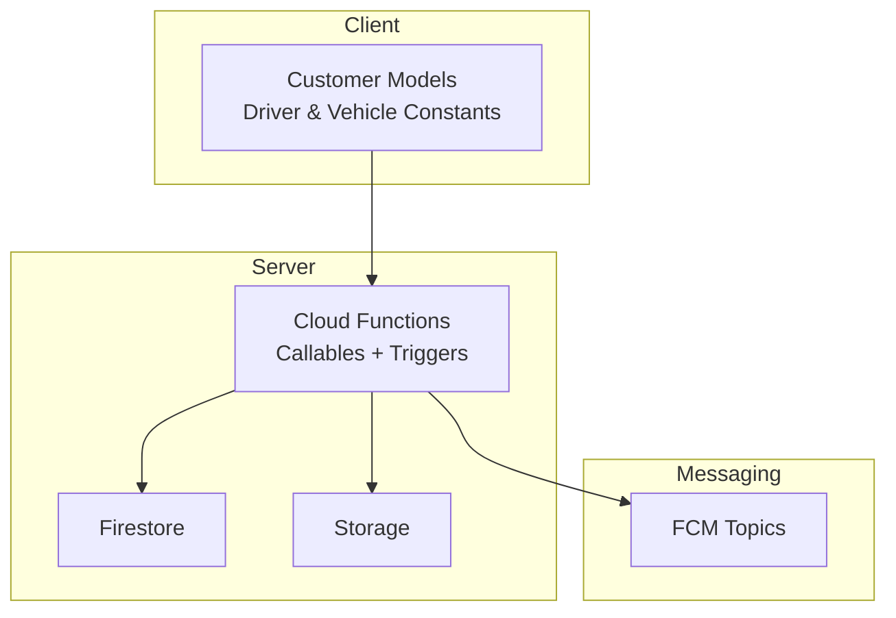

**Diagram sources**
- [driver_verification.dart:1-69](file://sese_core/lib/models/driver_verification.dart#L1-L69)
- [vehicle_verification_model.dart:1-68](file://sese_core/lib/models/vehicle_verification_model.dart#L1-L68)
- [verification.ts:1-351](file://functions/src/verification.ts#L1-L351)
- [firestore.rules:368-477](file://firestore.rules#L368-L477)
- [storage.rules:16-36](file://storage.rules#L16-L36)

**Section sources**
- [driver_verification.dart:1-69](file://sese_core/lib/models/driver_verification.dart#L1-L69)
- [vehicle_verification_model.dart:1-68](file://sese_core/lib/models/vehicle_verification_model.dart#L1-L68)
- [verification.ts:1-351](file://functions/src/verification.ts#L1-L351)
- [firestore.rules:368-477](file://firestore.rules#L368-L477)
- [storage.rules:16-36](file://storage.rules#L16-L36)

## Core Components
- Customer verification model and lifecycle constants
- Driver verification model and lifecycle constants
- Vehicle verification record model
- Callable review endpoints for admins
- Background triggers for claim sync and notifications
- Firestore and Storage security rules
- Online gating logic for drivers

Key responsibilities:
- Define canonical statuses and fields for customer and driver verification
- Provide secure admin callables to approve/reject submissions
- Synchronize custom claims and send notifications on status changes
- Enforce least-privilege access to sensitive documents
- Gate operational features (e.g., going online) behind verification requirements

**Section sources**
- [driver_verification.dart:1-69](file://sese_core/lib/models/driver_verification.dart#L1-L69)
- [vehicle_verification_model.dart:1-68](file://sese_core/lib/models/vehicle_verification_model.dart#L1-L68)
- [verification.ts:1-351](file://functions/src/verification.ts#L1-L351)
- [firestore.rules:368-477](file://firestore.rules#L368-L477)
- [storage.rules:16-36](file://storage.rules#L16-L36)

## Architecture Overview
The verification architecture combines:
- Client-side models that standardize verification states and fields
- Server-side callables invoked by Hub staff to approve or reject submissions
- Firestore document update triggers that synchronize auth claims and notify users
- Strict Firestore and Storage rules to protect sensitive data
- Operational gates that prevent unverified drivers from going online

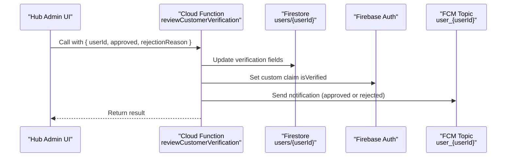

**Diagram sources**
- [verification.ts:26-130](file://functions/src/verification.ts#L26-L130)

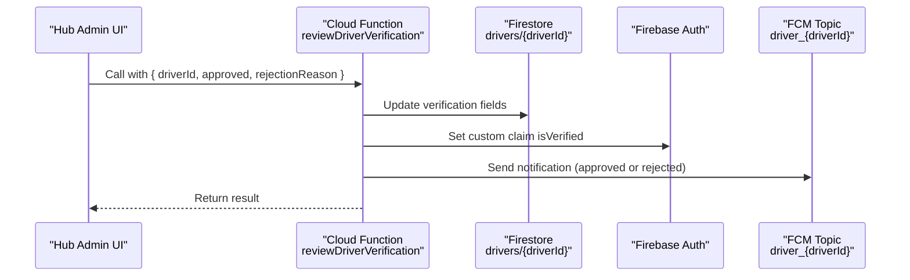

**Diagram sources**
- [verification.ts:138-241](file://functions/src/verification.ts#L138-L241)

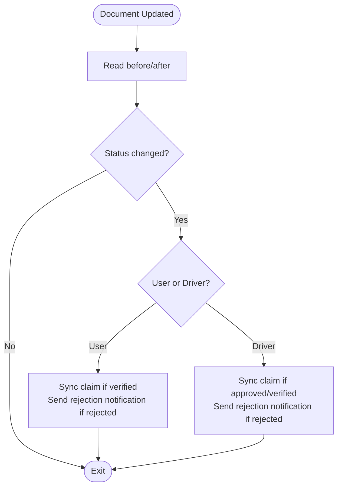

**Diagram sources**
- [verification.ts:249-350](file://functions/src/verification.ts#L249-L350)

## Detailed Component Analysis

### Customer Verification Workflow
Lifecycle states:
- unverified: default; invites submission
- pending_review: full KYC form submitted; awaiting Hub approval
- verified: Hub approved; ride requests carry verified flag; sensitive fields locked
- rejected: Hub rejected; reason stored for display and re-submission

Admin action:
- Callable `reviewCustomerVerification` updates user document fields, sets custom claim `isVerified`, and sends an FCM notification.

Data fields updated:
- `customerVerificationStatus`, `verificationStatus`, `isVerifiedCustomer`, `kycRejectionReason`, `verificationReviewedAt`

Notification behavior:
- Approved: topic `user_{userId}` with approval message
- Rejected: topic `user_{userId}` with generic body and payload containing reason

Security:
- Firestore rules allow owner writes and Hub admin reads/updates
- Storage rules restrict uploads to authenticated owners and admins

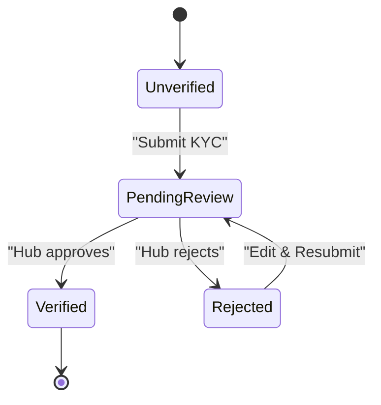

**Diagram sources**
- [driver_verification.dart:26-69](file://sese_core/lib/models/driver_verification.dart#L26-L69)
- [verification.ts:26-130](file://functions/src/verification.ts#L26-L130)
- [firestore.rules:471-485](file://firestore.rules#L471-L485)
- [storage.rules:16-36](file://storage.rules#L16-L36)

**Section sources**
- [driver_verification.dart:26-69](file://sese_core/lib/models/driver_verification.dart#L26-L69)
- [verification.ts:26-130](file://functions/src/verification.ts#L26-L130)
- [firestore.rules:471-485](file://firestore.rules#L471-L485)
- [storage.rules:16-36](file://storage.rules#L16-L36)

### Driver Verification Workflow
Lifecycle states:
- pending_onboarding: account created; personal info not yet submitted
- pending: Step 2 submitted; awaiting Hub document audit
- approved: Hub approved profile; profile verified flag set
- rejected: Hub rejected; reason stored

Admin action:
- Callable `reviewDriverVerification` updates driver document fields, sets custom claim `isVerified`, and sends an FCM notification.

Data fields updated:
- `verificationStatus`, `isProfileVerified`, `isActive`, `profileRejectionReason`, `profileApprovedAt` or `rejectedAt`

Operational gating:
- Drivers cannot go online unless both profile and vehicle are verified; enforced by server-side checks

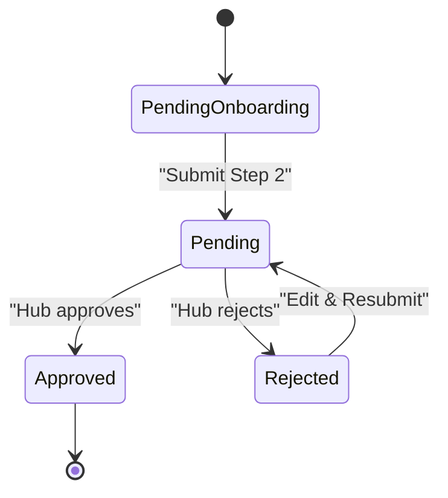

**Diagram sources**
- [driver_verification.dart:1-24](file://sese_core/lib/models/driver_verification.dart#L1-L24)
- [verification.ts:138-241](file://functions/src/verification.ts#L138-L241)
- [driverStatus.ts:70-120](file://functions/src/driverStatus.ts#L70-L120)

**Section sources**
- [driver_verification.dart:1-24](file://sese_core/lib/models/driver_verification.dart#L1-L24)
- [verification.ts:138-241](file://functions/src/verification.ts#L138-L241)
- [driverStatus.ts:70-120](file://functions/src/driverStatus.ts#L70-L120)

### Vehicle and Pre-Online Selfie/Plate Verification
Vehicle verification records capture:
- Driver and vehicle identifiers
- Photo URL and capture mode (camera-only)
- Status (pending, verified, rejected)
- Optional license plate detection and audit notes
- Capture timestamp

Rules:
- Firestore rule enforces camera-only captures and pending initial status
- Only owner can create; only admins/staff can read; immutable after creation

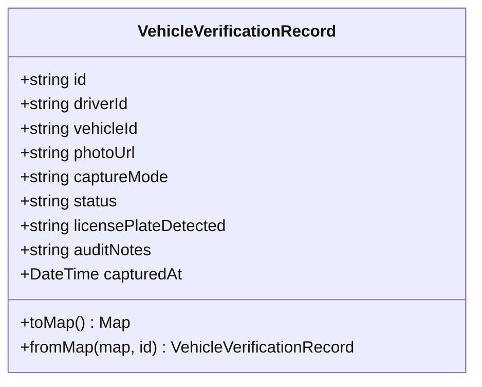

**Diagram sources**
- [vehicle_verification_model.dart:1-68](file://sese_core/lib/models/vehicle_verification_model.dart#L1-L68)
- [firestore.rules:538-547](file://firestore.rules#L538-L547)

**Section sources**
- [vehicle_verification_model.dart:1-68](file://sese_core/lib/models/vehicle_verification_model.dart#L1-L68)
- [firestore.rules:538-547](file://firestore.rules#L538-L547)

### Admin Approval Mechanisms
Two primary callable endpoints:
- `reviewCustomerVerification`: Approves or rejects customer KYC
- `reviewDriverVerification`: Approves or rejects driver profile documents

Both:
- Require authentication
- Validate required IDs
- Update Firestore documents with appropriate fields
- Set custom claim `isVerified` on the user’s Auth token
- Send FCM notifications to role-specific topics

Background triggers:
- `onUserVerificationUpdated`: Syncs claims and notifies when user verification status changes
- `onDriverVerificationUpdated`: Syncs claims and notifies when driver verification status changes

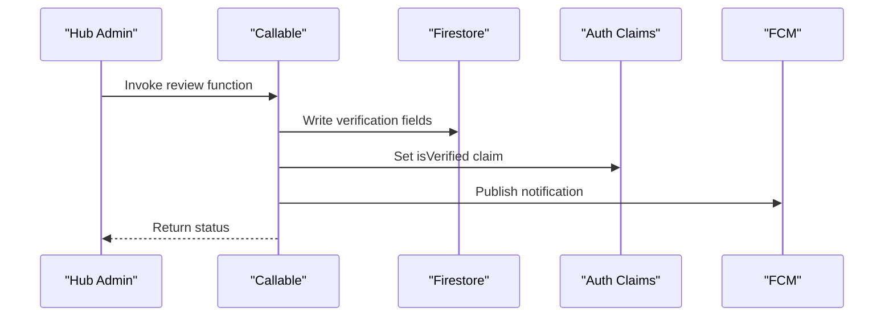

**Diagram sources**
- [verification.ts:26-130](file://functions/src/verification.ts#L26-L130)
- [verification.ts:138-241](file://functions/src/verification.ts#L138-L241)
- [verification.ts:249-350](file://functions/src/verification.ts#L249-L350)

**Section sources**
- [verification.ts:26-130](file://functions/src/verification.ts#L26-L130)
- [verification.ts:138-241](file://functions/src/verification.ts#L138-L241)
- [verification.ts:249-350](file://functions/src/verification.ts#L249-L350)

### Document Upload Handling and Automated Checks
Upload paths:
- Customer verification documents: `/verification_documents/{userId}/...`
- Driver onboarding documents: `/driver_onboarding/{userId}/...`
- Legacy customer verification path: `/customer_verification/{userId}/...`
- Vehicle inspection documents: `/vehicles/{userId}/...` and `/vehicle_documents/{userId}/...`
- Live-camera verification snapshots: `/verifications/{userId}/...`
- General driver documents: `/drivers/{userId}/...`

Automated checks:
- Content type restricted to images (jpeg/jpg/png/webp) or PDFs
- Size limits enforced (typically under 10 MB; avatars under 5 MB)
- Owner-only write access; admin read access

Audit trail:
- Immutable camera verification records in Firestore with capture metadata
- Audit logs collections protected for admin read-only access

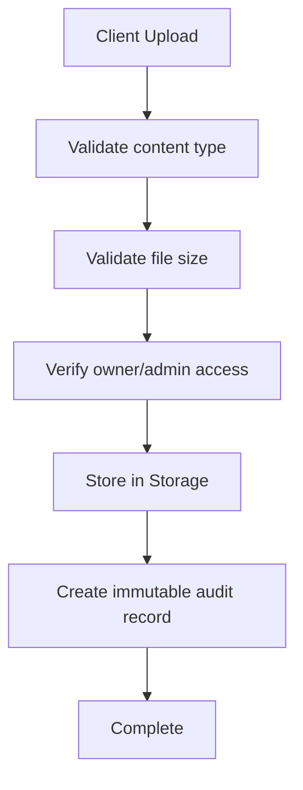

**Diagram sources**
- [storage.rules:16-36](file://storage.rules#L16-L36)
- [storage.rules:57-91](file://storage.rules#L57-L91)
- [firestore.rules:538-547](file://firestore.rules#L538-L547)

**Section sources**
- [storage.rules:16-36](file://storage.rules#L16-L36)
- [storage.rules:57-91](file://storage.rules#L57-L91)
- [firestore.rules:538-547](file://firestore.rules#L538-L547)

### Notification Systems
- Approved notifications sent to role-specific topics (`user_{userId}`, `driver_{driverId}`)
- Rejection notifications include a generic title/body with payload carrying the reason
- Background triggers ensure notifications even for direct Firestore updates

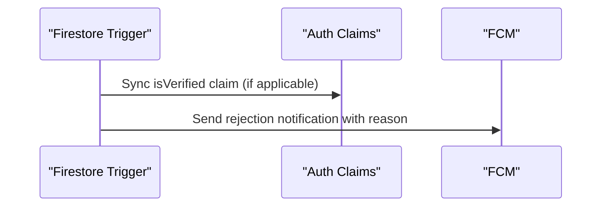

**Diagram sources**
- [verification.ts:249-350](file://functions/src/verification.ts#L249-L350)

**Section sources**
- [verification.ts:249-350](file://functions/src/verification.ts#L249-L350)

### Compliance Requirements
- Data region tagging and compliance routing hints exist in rules
- Audit log collections are append-only and readable by authorized admins
- KYC submissions and documents have explicit read/write restrictions
- Region-tagged data collections require admin scope for access

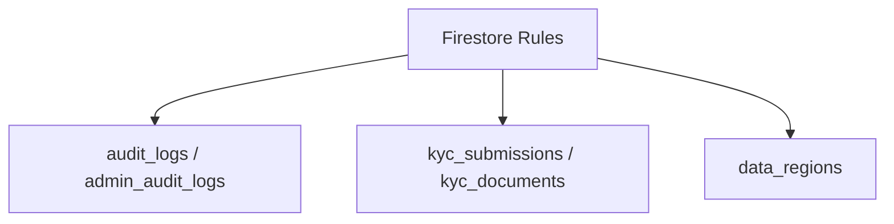

**Diagram sources**
- [firestore.rules:182-189](file://firestore.rules#L182-L189)
- [firestore.rules:714-735](file://firestore.rules#L714-L735)
- [firestore.rules:513-520](file://firestore.rules#L513-L520)

**Section sources**
- [firestore.rules:182-189](file://firestore.rules#L182-L189)
- [firestore.rules:714-735](file://firestore.rules#L714-L735)
- [firestore.rules:513-520](file://firestore.rules#L513-L520)

## Dependency Analysis
- Client models depend on shared constants for verification states and field names
- Cloud Functions depend on Firestore and Auth SDKs to update documents and claims
- Triggers depend on Firestore document changes to maintain consistency
- Firestore and Storage rules enforce access boundaries across all verification flows

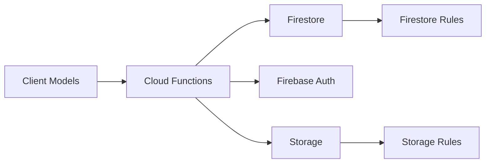

**Diagram sources**
- [driver_verification.dart:1-69](file://sese_core/lib/models/driver_verification.dart#L1-L69)
- [verification.ts:1-351](file://functions/src/verification.ts#L1-L351)
- [firestore.rules:368-477](file://firestore.rules#L368-L477)
- [storage.rules:16-36](file://storage.rules#L16-L36)

**Section sources**
- [driver_verification.dart:1-69](file://sese_core/lib/models/driver_verification.dart#L1-L69)
- [verification.ts:1-351](file://functions/src/verification.ts#L1-L351)
- [firestore.rules:368-477](file://firestore.rules#L368-L477)
- [storage.rules:16-36](file://storage.rules#L16-L36)

## Performance Considerations
- Use callable functions for administrative actions to centralize validation and reduce client complexity
- Leverage background triggers to keep auth claims synchronized without client coordination
- Keep upload payloads within Storage size limits to avoid retries and failures
- Minimize redundant writes by merging updates where possible
- Avoid excessive polling; rely on real-time listeners for status changes

[No sources needed since this section provides general guidance]

## Troubleshooting Guide
Common issues and resolutions:
- Unauthenticated callable calls: Ensure callers are signed in; check request.auth presence
- Missing IDs: Validate required parameters (userId, driverId) before invoking callables
- Not found errors: Confirm the target document exists before updating
- Claim sync failures: Review trigger logs for Auth SDK errors; retry may be necessary
- FCM send failures: Inspect topic naming and device subscriptions; handle warnings gracefully
- Upload rejections: Verify content type and file size against Storage rules
- Direct Firestore updates bypassing callables: Triggers will still sync claims and send notifications, but prefer callables for consistent workflows

**Section sources**
- [verification.ts:26-130](file://functions/src/verification.ts#L26-L130)
- [verification.ts:138-241](file://functions/src/verification.ts#L138-L241)
- [verification.ts:249-350](file://functions/src/verification.ts#L249-L350)
- [storage.rules:16-36](file://storage.rules#L16-L36)

## Conclusion
The verification system provides a robust, secure, and auditable pipeline for customer and driver verification. It leverages:
- Clear state models and lifecycle definitions
- Secure admin callables for approvals and rejections
- Background triggers for claim synchronization and notifications
- Strict Firestore and Storage rules to protect sensitive data
- Operational gates ensuring only verified drivers can operate

This design supports compliance requirements, maintains data integrity, and delivers timely feedback to users through notifications.

[No sources needed since this section summarizes without analyzing specific files]