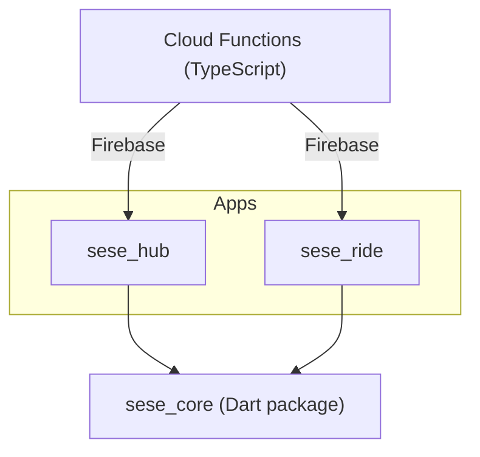
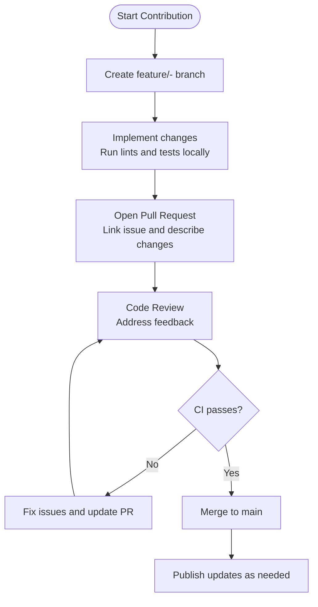
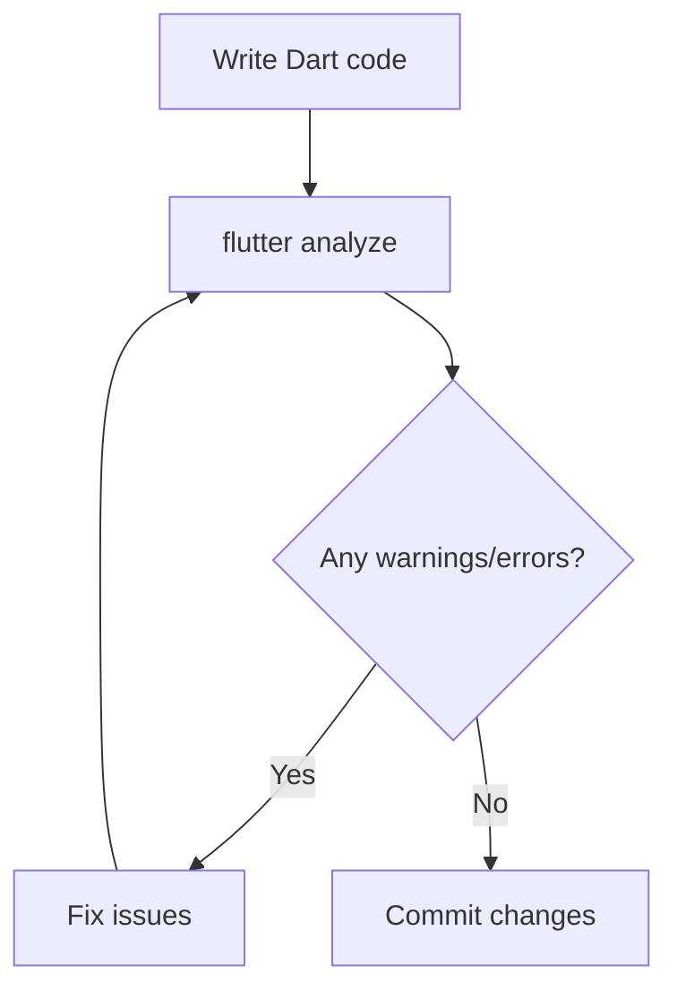
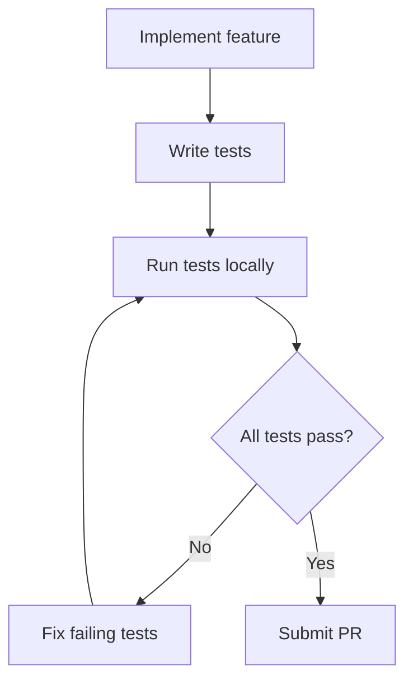
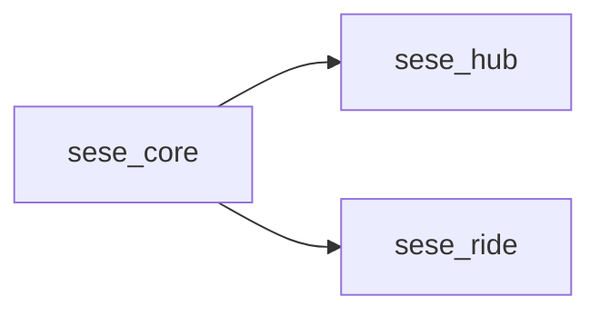

# Contributing Guidelines

<cite>
**Referenced Files in This Document**
- [sese_core/pubspec.yaml](file://sese_core/pubspec.yaml)
- [sese_hub/pubspec.yaml](file://sese_hub/pubspec.yaml)
- [sese_ride/pubspec.yaml](file://sese_ride/pubspec.yaml)
- [sese_core/analysis_options.yaml](file://sese_core/analysis_options.yaml)
- [sese_hub/analysis_options.yaml](file://sese_hub/analysis_options.yaml)
- [sese_ride/analysis_options.yaml](file://sese_ride/analysis_options.yaml)
- [functions/package.json](file://functions/package.json)
- [functions/tsconfig.json](file://functions/tsconfig.json)
- [functions/src/index.ts](file://functions/src/index.ts)
</cite>

## Table of Contents
1. [Introduction](#introduction)
2. [Project Structure](#project-structure)
3. [Core Components](#core-components)
4. [Architecture Overview](#architecture-overview)
5. [Detailed Component Analysis](#detailed-component-analysis)
6. [Dependency Analysis](#dependency-analysis)
7. [Performance Considerations](#performance-considerations)
8. [Troubleshooting Guide](#troubleshooting-guide)
9. [Conclusion](#conclusion)

## Introduction
This document defines the contributing guidelines for this monorepo, covering development workflow, code style, pull request processes, testing requirements, branch management, and code review procedures. It also provides coding standards for Dart/Flutter and TypeScript, commit message conventions, and quality assurance practices to ensure consistency and reliability across the shared core library and applications.

## Project Structure
The repository is a Flutter-based monorepo with:
- A shared Dart package (sese_core) providing models, repositories, and widgets used by both apps.
- Two Flutter applications (sese_hub and sese_ride) that depend on the shared core via local path references.
- Cloud Functions written in TypeScript under functions/.

**Diagram sources**
- [sese_hub/pubspec.yaml:10-14](file://sese_hub/pubspec.yaml#L10-L14)
- [sese_ride/pubspec.yaml:10-14](file://sese_ride/pubspec.yaml#L10-L14)
- [sese_core/pubspec.yaml:1-6](file://sese_core/pubspec.yaml#L1-L6)
- [functions/package.json:1-20](file://functions/package.json#L1-L20)

**Section sources**
- [sese_core/pubspec.yaml:1-33](file://sese_core/pubspec.yaml#L1-L33)
- [sese_hub/pubspec.yaml:1-29](file://sese_hub/pubspec.yaml#L1-L29)
- [sese_ride/pubspec.yaml:1-38](file://sese_ride/pubspec.yaml#L1-L38)
- [functions/package.json:1-20](file://functions/package.json#L1-L20)

## Core Components
- Shared Dart package (sese_core): Provides reusable models, repositories, and UI components consumed by both apps.
- App packages (sese_hub, sese_ride): Feature-rich Flutter applications that depend on the shared core.
- Cloud Functions (TypeScript): Backend logic deployed to Firebase.

Key responsibilities:
- sese_core: Centralize shared domain logic and UI primitives to avoid duplication and ensure consistent behavior across apps.
- sese_hub: Management application for hub operations.
- sese_ride: Customer and driver application for ride services.
- functions: Serverless endpoints interacting with Firebase services.

**Section sources**
- [sese_core/pubspec.yaml:1-33](file://sese_core/pubspec.yaml#L1-L33)
- [sese_hub/pubspec.yaml:1-29](file://sese_hub/pubspec.yaml#L1-L29)
- [sese_ride/pubspec.yaml:1-38](file://sese_ride/pubspec.yaml#L1-L38)
- [functions/src/index.ts:1-20](file://functions/src/index.ts#L1-L20)

## Architecture Overview
Contributors should follow these workflows when adding features or modifying existing functionality.

[No sources needed since this diagram shows conceptual workflow, not actual code structure]

## Detailed Component Analysis

### Development Workflow
- Local setup
  - Ensure Dart SDK and Flutter are installed.
  - Install dependencies per package using pub get for each app and package.
  - For Cloud Functions, install Node.js and run npm install inside functions/.
- Running and debugging
  - Run apps from their respective directories.
  - Use Flutter DevTools for performance profiling and debugging.
  - Test Cloud Functions locally using the Firebase Emulator Suite if applicable.

**Section sources**
- [sese_core/pubspec.yaml:5-7](file://sese_core/pubspec.yaml#L5-L7)
- [sese_hub/pubspec.yaml:7-9](file://sese_hub/pubspec.yaml#L7-L9)
- [sese_ride/pubspec.yaml:7-9](file://sese_ride/pubspec.yaml#L7-L9)
- [functions/package.json:1-20](file://functions/package.json#L1-L20)

### Code Style Guidelines

#### Dart/Flutter
- Linting
  - All packages include flutter_lints and configure analyzer exclusions for generated/platform folders.
  - Run flutter analyze before committing.
- Formatting
  - Follow standard Dart formatting; use IDE integration to auto-format on save.
- Package configuration
  - Keep environment constraints aligned across packages to avoid dependency conflicts.

**Diagram sources**
- [sese_core/analysis_options.yaml:1-15](file://sese_core/analysis_options.yaml#L1-L15)
- [sese_hub/analysis_options.yaml:1-39](file://sese_hub/analysis_options.yaml#L1-L39)
- [sese_ride/analysis_options.yaml:1-39](file://sese_ride/analysis_options.yaml#L1-L39)

**Section sources**
- [sese_core/analysis_options.yaml:1-15](file://sese_core/analysis_options.yaml#L1-L15)
- [sese_hub/analysis_options.yaml:1-39](file://sese_hub/analysis_options.yaml#L1-L39)
- [sese_ride/analysis_options.yaml:1-39](file://sese_ride/analysis_options.yaml#L1-L39)

#### TypeScript (Cloud Functions)
- Tooling
  - Use tsconfig.json for compilation settings within functions/.
  - Run linting and type checks before committing.
- Standards
  - Follow consistent naming, modularization, and error handling patterns.
  - Avoid side effects in modules; keep functions pure where possible.

**Section sources**
- [functions/tsconfig.json:1-20](file://functions/tsconfig.json#L1-L20)
- [functions/src/index.ts:1-20](file://functions/src/index.ts#L1-L20)

### Commit Message Conventions
- Format: type(scope): short description
  - Types: feat, fix, chore, docs, refactor, test, perf
  - Scope: package or module name (e.g., core, hub, ride, functions)
- Examples
  - feat(core): add vehicle approval model
  - fix(hub): resolve navigation crash on back press
  - chore(ride): update dependencies
  - test(core): add unit tests for auth repository

[No sources needed since this section provides general guidance]

### Testing Requirements
- Dart/Flutter
  - Write unit and widget tests for new features and bug fixes.
  - Place tests alongside source files or in dedicated test directories.
  - Ensure all tests pass before submitting a PR.
- Cloud Functions
  - Add unit tests for function handlers and utilities.
  - Validate behavior against expected inputs and outputs.

[No sources needed since this diagram shows conceptual workflow, not actual code structure]

**Section sources**
- [sese_core/pubspec.yaml:22-25](file://sese_core/pubspec.yaml#L22-L25)
- [sese_hub/pubspec.yaml:22-25](file://sese_hub/pubspec.yaml#L22-L25)
- [sese_ride/pubspec.yaml:31-34](file://sese_ride/pubspec.yaml#L31-L34)

### Monorepo Contribution Process
- Adding a new feature
  - Decide whether the feature belongs in sese_core (shared) or an app-specific package.
  - If shared, implement in sese_core and expose stable APIs.
  - Update consumers (sese_hub, sese_ride) to use the new API.
- Modifying existing functionality
  - Prefer additive changes to maintain backward compatibility.
  - Deprecate old APIs gradually with clear migration notes.
- Maintaining backward compatibility in shared core
  - Avoid breaking changes to public APIs in sese_core.
  - Provide deprecation warnings and migration guides when necessary.
  - Coordinate version bumps and release notes.

**Section sources**
- [sese_core/pubspec.yaml:1-33](file://sese_core/pubspec.yaml#L1-L33)
- [sese_hub/pubspec.yaml:10-14](file://sese_hub/pubspec.yaml#L10-L14)
- [sese_ride/pubspec.yaml:10-14](file://sese_ride/pubspec.yaml#L10-L14)

### Branch Management Strategies
- Main branch
  - Maintain a stable main branch protected from direct pushes.
- Feature branches
  - Create feature/<ticket>-<short-desc> branches for work items.
- Hotfix branches
  - Use hotfix/<ticket>-<short-desc> for urgent fixes.
- Naming conventions
  - Keep branch names descriptive and concise.
- Merging
  - Squash or rebase merges based on team preference; ensure clean history.

[No sources needed since this section provides general guidance]

### Pull Request Processes
- Before opening a PR
  - Ensure all lints pass and tests succeed.
  - Include a clear description of changes, motivation, and any breaking changes.
- Review process
  - At least one maintainer must approve the PR.
  - Address all review comments and update the PR accordingly.
- CI checks
  - Automated checks must pass before merging.

[No sources needed since this section provides general guidance]

### Code Review Procedures
- Focus areas
  - Correctness, readability, performance, security, and maintainability.
- Checklist
  - Does the change adhere to coding standards?
  - Are there adequate tests?
  - Is backward compatibility preserved where required?
- Feedback
  - Provide constructive feedback and actionable suggestions.

[No sources needed since this section provides general guidance]

### Quality Assurance Requirements
- Static analysis
  - Run flutter analyze and address all warnings/errors.
- Testing coverage
  - Aim for meaningful coverage for critical paths.
- Documentation
  - Update READMEs and inline documentation for public APIs.
- Security
  - Validate user inputs and handle errors gracefully.
  - Avoid secrets in code; use environment variables or secure storage.

**Section sources**
- [sese_core/analysis_options.yaml:1-15](file://sese_core/analysis_options.yaml#L1-L15)
- [sese_hub/analysis_options.yaml:1-39](file://sese_hub/analysis_options.yaml#L1-L39)
- [sese_ride/analysis_options.yaml:1-39](file://sese_ride/analysis_options.yaml#L1-L39)

## Dependency Analysis
The apps depend on the shared core package via local path references. This ensures consistent behavior and reduces duplication.

**Diagram sources**
- [sese_hub/pubspec.yaml:10-14](file://sese_hub/pubspec.yaml#L10-L14)
- [sese_ride/pubspec.yaml:10-14](file://sese_ride/pubspec.yaml#L10-L14)

**Section sources**
- [sese_hub/pubspec.yaml:10-14](file://sese_hub/pubspec.yaml#L10-L14)
- [sese_ride/pubspec.yaml:10-14](file://sese_ride/pubspec.yaml#L10-L14)

## Performance Considerations
- Minimize heavy computations on the UI thread; offload to background isolates or services.
- Cache frequently accessed data appropriately and invalidate caches when data changes.
- Profile memory usage and reduce unnecessary allocations in hot paths.
- Optimize network requests with batching and caching strategies.

[No sources needed since this section provides general guidance]

## Troubleshooting Guide
- Linting failures
  - Run flutter analyze and fix reported issues.
  - Check analysis_options.yaml for project-specific rules.
- Test failures
  - Inspect failing tests and update mocks or fixtures as needed.
  - Ensure environment variables and configurations are set correctly for tests.
- Dependency conflicts
  - Align SDK versions across packages to prevent resolution issues.
  - Pin compatible versions for shared dependencies.

**Section sources**
- [sese_core/analysis_options.yaml:1-15](file://sese_core/analysis_options.yaml#L1-L15)
- [sese_hub/analysis_options.yaml:1-39](file://sese_hub/analysis_options.yaml#L1-L39)
- [sese_ride/analysis_options.yaml:1-39](file://sese_ride/analysis_options.yaml#L1-L39)
- [sese_core/pubspec.yaml:5-7](file://sese_core/pubspec.yaml#L5-L7)
- [sese_hub/pubspec.yaml:7-9](file://sese_hub/pubspec.yaml#L7-L9)
- [sese_ride/pubspec.yaml:7-9](file://sese_ride/pubspec.yaml#L7-L9)

## Conclusion
By following these contributing guidelines—adhering to code style, writing tests, maintaining backward compatibility, and engaging in structured code reviews—you help ensure the stability and quality of the shared core library and the applications built upon it. Consistent workflows and clear communication will streamline collaboration and accelerate delivery.

[No sources needed since this section summarizes without analyzing specific files]