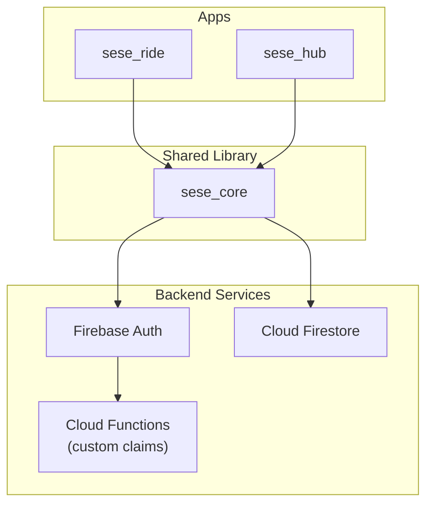
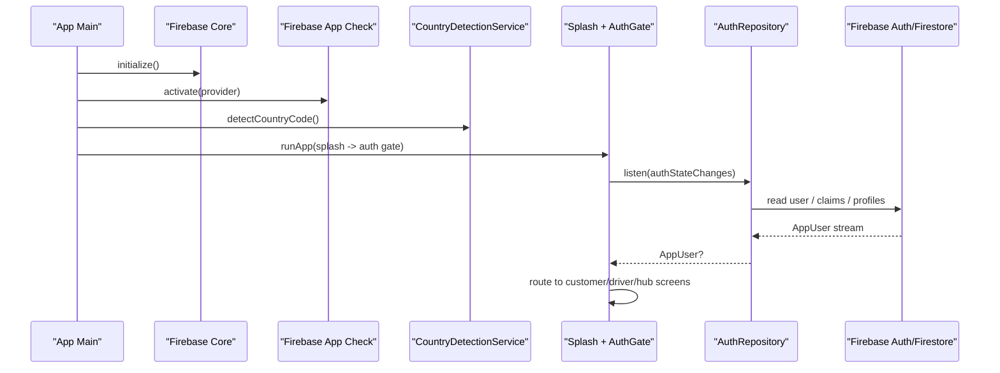
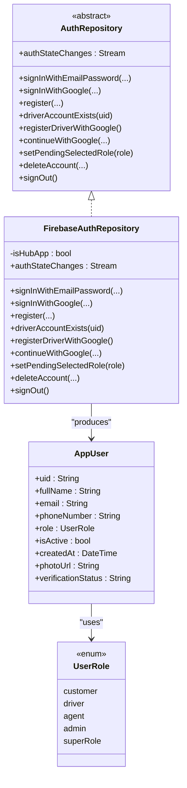
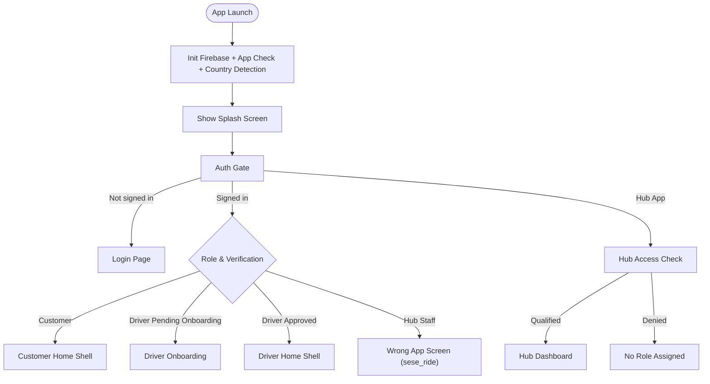
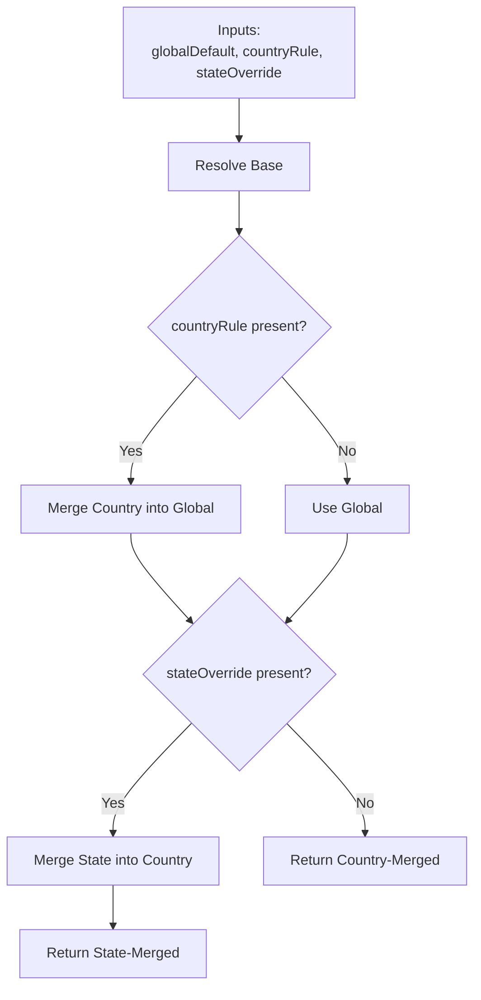
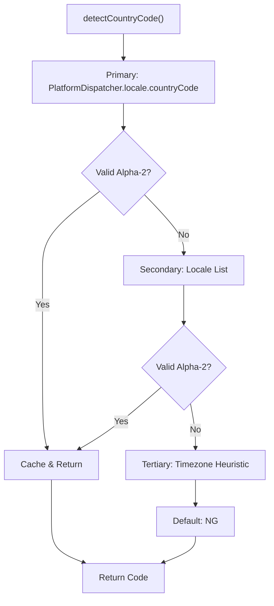
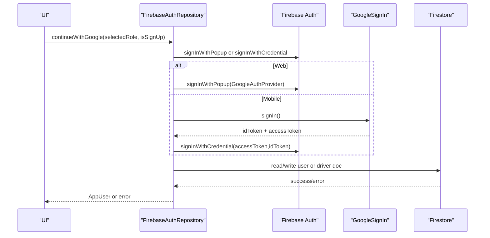
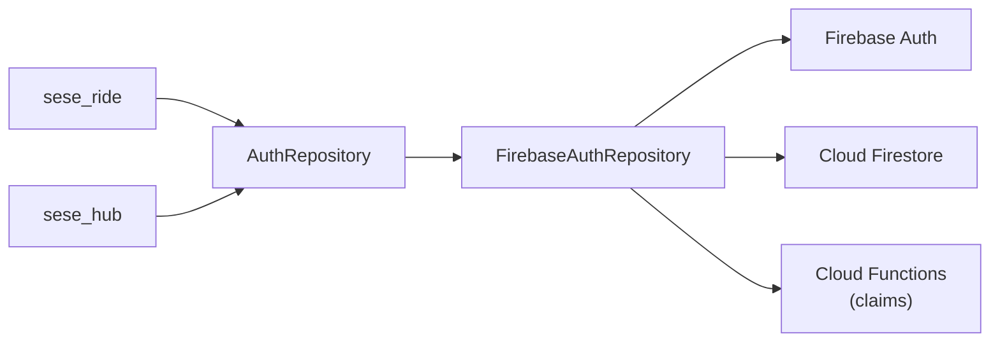

# Component Interactions and Dependencies

<cite>
**Referenced Files in This Document**
- [sese_core/lib/sese_core.dart](file://sese_core/lib/sese_core.dart)
- [sese_core/lib/auth/auth_repository.dart](file://sese_core/lib/auth/auth_repository.dart)
- [sese_core/lib/auth/firebase_auth_repository.dart](file://sese_core/lib/auth/firebase_auth_repository.dart)
- [sese_core/lib/models/user_model.dart](file://sese_core/lib/models/user_model.dart)
- [sese_core/lib/models/user_role.dart](file://sese_core/lib/models/user_role.dart)
- [sese_core/lib/services/config_resolution_engine.dart](file://sese_core/lib/services/config_resolution_engine.dart)
- [sese_core/lib/services/country_detection_service.dart](file://sese_core/lib/services/country_detection_service.dart)
- [sese_ride/lib/main.dart](file://sese_ride/lib/main.dart)
- [sese_hub/lib/main.dart](file://sese_hub/lib/main.dart)
</cite>

## Table of Contents
1. [Introduction](#introduction)
2. [Project Structure](#project-structure)
3. [Core Components](#core-components)
4. [Architecture Overview](#architecture-overview)
5. [Detailed Component Analysis](#detailed-component-analysis)
6. [Dependency Analysis](#dependency-analysis)
7. [Performance Considerations](#performance-considerations)
8. [Troubleshooting Guide](#troubleshooting-guide)
9. [Conclusion](#conclusion)

## Introduction
This document explains how the SeSe App ecosystem is structured and how its three main applications interact with backend services and each other:
- sese_ride: Customer and Driver mobile application
- sese_hub: Staff operations dashboard
- sese_core: Shared library providing authentication, models, configuration resolution, utilities, and UI widgets

The documentation covers:
- Service layer abstraction via AuthRepository
- API call patterns to Firebase (Auth, Firestore, App Check)
- Error handling strategies
- Initialization sequences for each app
- Dependency injection patterns
- Configuration management
- Data flow diagrams between components and external services
- Coupling strategies, interface contracts, and extension points
- Testing strategies and mocking approaches

## Project Structure
At a high level:
- Each Flutter app initializes Firebase and App Check, then boots a role-based auth gate that routes users to the correct shell or dashboard.
- Both apps depend on sese_core for shared abstractions, models, and services.
- Backend integration is primarily through Firebase Authentication, Cloud Firestore, and Cloud Functions (via custom claims).

**Diagram sources**
- [sese_ride/lib/main.dart:13-40](file://sese_ride/lib/main.dart#L13-L40)
- [sese_hub/lib/main.dart:13-37](file://sese_hub/lib/main.dart#L13-L37)
- [sese_core/lib/auth/firebase_auth_repository.dart:11-19](file://sese_core/lib/auth/firebase_auth_repository.dart#L11-L19)

**Section sources**
- [sese_ride/lib/main.dart:13-40](file://sese_ride/lib/main.dart#L13-L40)
- [sese_hub/lib/main.dart:13-37](file://sese_hub/lib/main.dart#L13-L37)
- [sese_core/lib/sese_core.dart:1-34](file://sese_core/lib/sese_core.dart#L1-L34)

## Core Components
- AuthRepository: Abstract contract used by both apps for authentication flows and user state.
- FirebaseAuthRepository: Production implementation backed by Firebase Auth and Firestore; resolves roles from multiple sources.
- AppUser and UserRole: Shared domain model and role enumeration across apps.
- ConfigResolutionEngine: Merges global, country, and state configuration layers.
- CountryDetectionService: Detects device country code and dialing prefix at startup.

Key responsibilities:
- Centralize authentication logic and user state streaming.
- Provide consistent role resolution and routing decisions.
- Offer reusable configuration and utility services.

**Section sources**
- [sese_core/lib/auth/auth_repository.dart:4-81](file://sese_core/lib/auth/auth_repository.dart#L4-L81)
- [sese_core/lib/auth/firebase_auth_repository.dart:11-19](file://sese_core/lib/auth/firebase_auth_repository.dart#L11-L19)
- [sese_core/lib/models/user_model.dart:4-38](file://sese_core/lib/models/user_model.dart#L4-L38)
- [sese_core/lib/models/user_role.dart:1-55](file://sese_core/lib/models/user_role.dart#L1-L55)
- [sese_core/lib/services/config_resolution_engine.dart:5-34](file://sese_core/lib/services/config_resolution_engine.dart#L5-L34)
- [sese_core/lib/services/country_detection_service.dart:3-11](file://sese_core/lib/services/country_detection_service.dart#L3-L11)

## Architecture Overview
The apps follow a similar initialization pattern:
1. Initialize Flutter binding and Firebase.
2. Activate Firebase App Check (debug vs release providers).
3. Prime CountryDetectionService.
4. Run the app with a splash screen and an auth gate.
5. The auth gate listens to AuthRepository.authStateChanges and routes based on user role and verification status.

**Diagram sources**
- [sese_ride/lib/main.dart:13-40](file://sese_ride/lib/main.dart#L13-L40)
- [sese_hub/lib/main.dart:13-37](file://sese_hub/lib/main.dart#L13-L37)
- [sese_core/lib/auth/firebase_auth_repository.dart:81-95](file://sese_core/lib/auth/firebase_auth_repository.dart#L81-L95)

## Detailed Component Analysis

### Authentication Abstraction and Implementation
- AuthRepository defines the contract for sign-in, registration, Google flows, account deletion, and sign-out. It exposes a live stream of the current user.
- FirebaseAuthRepository implements the contract using Firebase Auth and Firestore. It resolves roles from:
  - Owner bootstrap email
  - Firebase ID-token custom claims (set by Cloud Functions)
  - admin_users collection (hub staff)
  - drivers/{uid}
  - users/{uid}
  - Default fallback to customer if no profile exists

**Diagram sources**
- [sese_core/lib/auth/auth_repository.dart:4-81](file://sese_core/lib/auth/auth_repository.dart#L4-L81)
- [sese_core/lib/auth/firebase_auth_repository.dart:20-54](file://sese_core/lib/auth/firebase_auth_repository.dart#L20-L54)
- [sese_core/lib/models/user_model.dart:4-38](file://sese_core/lib/models/user_model.dart#L4-L38)
- [sese_core/lib/models/user_role.dart:1-55](file://sese_core/lib/models/user_role.dart#L1-L55)

**Section sources**
- [sese_core/lib/auth/auth_repository.dart:4-81](file://sese_core/lib/auth/auth_repository.dart#L4-L81)
- [sese_core/lib/auth/firebase_auth_repository.dart:11-19](file://sese_core/lib/auth/firebase_auth_repository.dart#L11-L19)
- [sese_core/lib/auth/firebase_auth_repository.dart:81-95](file://sese_core/lib/auth/firebase_auth_repository.dart#L81-L95)
- [sese_core/lib/auth/firebase_auth_repository.dart:519-671](file://sese_core/lib/auth/firebase_auth_repository.dart#L519-L671)
- [sese_core/lib/models/user_model.dart:4-38](file://sese_core/lib/models/user_model.dart#L4-L38)
- [sese_core/lib/models/user_role.dart:1-55](file://sese_core/lib/models/user_role.dart#L1-L55)

### Role-Based Routing Gates
- sese_ride:
  - Shows a splash screen, then an auth gate.
  - If not authenticated, shows login.
  - For drivers pending onboarding, routes to onboarding screen.
  - Otherwise routes to customer or driver shells based on role.
  - Displays a “Wrong App” screen for hub staff accounts.
- sese_hub:
  - Zero-trust gate: requires hub_staff qualification check after login.
  - Qualified users see the dashboard with permissions; otherwise sign out and show access denied.

**Diagram sources**
- [sese_ride/lib/main.dart:43-145](file://sese_ride/lib/main.dart#L43-L145)
- [sese_hub/lib/main.dart:87-196](file://sese_hub/lib/main.dart#L87-L196)

**Section sources**
- [sese_ride/lib/main.dart:43-145](file://sese_ride/lib/main.dart#L43-L145)
- [sese_hub/lib/main.dart:87-196](file://sese_hub/lib/main.dart#L87-L196)

### Configuration Management
- ConfigResolutionEngine merges configuration hierarchically:
  - Global default
  - Country-specific rule
  - State-specific override
- It merges pricing rates, car tier thresholds, streak rewards, and daily streak settings with well-defined semantics (e.g., AND for enabling streaks, union for disabled lists).

**Diagram sources**
- [sese_core/lib/services/config_resolution_engine.dart:5-34](file://sese_core/lib/services/config_resolution_engine.dart#L5-L34)
- [sese_core/lib/services/config_resolution_engine.dart:68-165](file://sese_core/lib/services/config_resolution_engine.dart#L68-L165)

**Section sources**
- [sese_core/lib/services/config_resolution_engine.dart:5-34](file://sese_core/lib/services/config_resolution_engine.dart#L5-L34)
- [sese_core/lib/services/config_resolution_engine.dart:68-165](file://sese_core/lib/services/config_resolution_engine.dart#L68-L165)

### Country Detection Utility
- CountryDetectionService detects ISO country code using:
  - Primary: platform locale country code
  - Secondary: system locales list
  - Tertiary: timezone heuristics
  - Default: Nigeria (NG)
- Provides synchronous getter for cached value and manual override/reset methods.

**Diagram sources**
- [sese_core/lib/services/country_detection_service.dart:20-63](file://sese_core/lib/services/country_detection_service.dart#L20-L63)
- [sese_core/lib/services/country_detection_service.dart:85-112](file://sese_core/lib/services/country_detection_service.dart#L85-L112)

**Section sources**
- [sese_core/lib/services/country_detection_service.dart:3-11](file://sese_core/lib/services/country_detection_service.dart#L3-L11)
- [sese_core/lib/services/country_detection_service.dart:20-63](file://sese_core/lib/services/country_detection_service.dart#L20-L63)

### External Service Integrations and Failure Scenarios
- Firebase App Check:
  - Enforced on Firestore; without activation, reads fail with PERMISSION_DENIED.
  - Debug builds use debug providers; release builds use Play Integrity/DeviceCheck.
- Google Sign-In:
  - Web uses popup; mobile uses GoogleSignIn with idToken/accessToken exchange.
  - Missing idToken triggers a specific error with guidance.
- Account Deletion:
  - Requires re-authentication (password or Google flow).
  - Performs soft-delete archival in Firestore before deleting Firebase Auth account.

**Diagram sources**
- [sese_core/lib/auth/firebase_auth_repository.dart:326-361](file://sese_core/lib/auth/firebase_auth_repository.dart#L326-L361)
- [sese_core/lib/auth/firebase_auth_repository.dart:191-321](file://sese_core/lib/auth/firebase_auth_repository.dart#L191-L321)

**Section sources**
- [sese_ride/lib/main.dart:17-34](file://sese_ride/lib/main.dart#L17-L34)
- [sese_hub/lib/main.dart:17-32](file://sese_hub/lib/main.dart#L17-L32)
- [sese_core/lib/auth/firebase_auth_repository.dart:326-361](file://sese_core/lib/auth/firebase_auth_repository.dart#L326-L361)
- [sese_core/lib/auth/firebase_auth_repository.dart:425-487](file://sese_core/lib/auth/firebase_auth_repository.dart#L425-L487)

## Dependency Analysis
- Coupling strategy:
  - Apps depend only on the abstract AuthRepository, decoupled from Firebase specifics.
  - FirebaseAuthRepository encapsulates all backend interactions and role resolution logic.
- Interface contracts:
  - AuthRepository defines stable APIs for auth flows and user state.
  - AppUser and UserRole provide shared domain types.
- Extension points:
  - New auth providers can be added within FirebaseAuthRepository while keeping the same interface.
  - ConfigResolutionEngine supports adding new config layers or fields via merge rules.
  - CountryDetectionService allows overriding detection logic or defaults.

**Diagram sources**
- [sese_core/lib/auth/auth_repository.dart:4-81](file://sese_core/lib/auth/auth_repository.dart#L4-L81)
- [sese_core/lib/auth/firebase_auth_repository.dart:11-19](file://sese_core/lib/auth/firebase_auth_repository.dart#L11-L19)

**Section sources**
- [sese_core/lib/auth/auth_repository.dart:4-81](file://sese_core/lib/auth/auth_repository.dart#L4-L81)
- [sese_core/lib/auth/firebase_auth_repository.dart:11-19](file://sese_core/lib/auth/firebase_auth_repository.dart#L11-L19)

## Performance Considerations
- Minimize redundant Firestore reads:
  - Role resolution caches results per user session via streams.
  - Hub access checks are memoized per email during a session.
- Avoid blocking the UI:
  - Splash screens and loading indicators are shown while waiting for auth state and access checks.
- Efficient configuration merging:
  - ConfigResolutionEngine performs targeted merges and avoids unnecessary recomputation.

[No sources needed since this section provides general guidance]

## Troubleshooting Guide
Common issues and resolutions:
- PERMISSION_DENIED on Firestore:
  - Ensure Firebase App Check is activated with appropriate providers for the environment.
- Google Sign-In failures:
  - Verify SHA-1/SHA-256 in Firebase console and ensure google-services.json is fresh.
  - On Android devices without Google Play Services, Google Sign-In may not work.
- Driver sign-in blocked:
  - Drivers must have a drivers/{uid} document; missing documents trigger a specific error and require registration.
- Hub staff access denied:
  - Users must exist in admin_users or have custom claims set by Cloud Functions; otherwise they are signed out.

**Section sources**
- [sese_ride/lib/main.dart:17-34](file://sese_ride/lib/main.dart#L17-L34)
- [sese_hub/lib/main.dart:17-32](file://sese_hub/lib/main.dart#L17-L32)
- [sese_core/lib/auth/firebase_auth_repository.dart:326-361](file://sese_core/lib/auth/firebase_auth_repository.dart#L326-L361)
- [sese_core/lib/auth/firebase_auth_repository.dart:207-223](file://sese_core/lib/auth/firebase_auth_repository.dart#L207-L223)
- [sese_hub/lib/main.dart:163-191](file://sese_hub/lib/main.dart#L163-L191)

## Conclusion
The SeSe App ecosystem leverages a clear separation of concerns:
- Apps handle UI and routing.
- sese_core provides a stable service abstraction and shared models.
- Backend integrations are centralized in FirebaseAuthRepository, which enforces robust role resolution and error handling.
This design enables scalable extension points, predictable behavior across platforms, and maintainable testing strategies through dependency injection and interface contracts.

[No sources needed since this section summarizes without analyzing specific files]