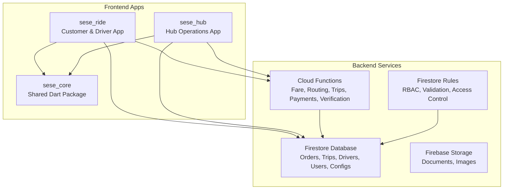
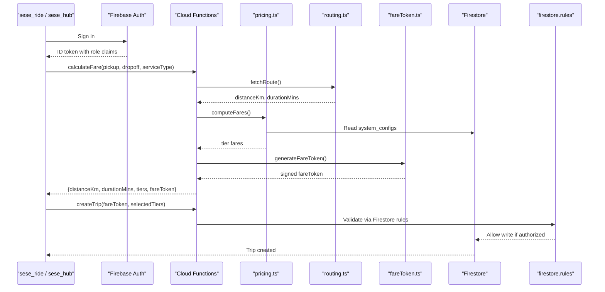
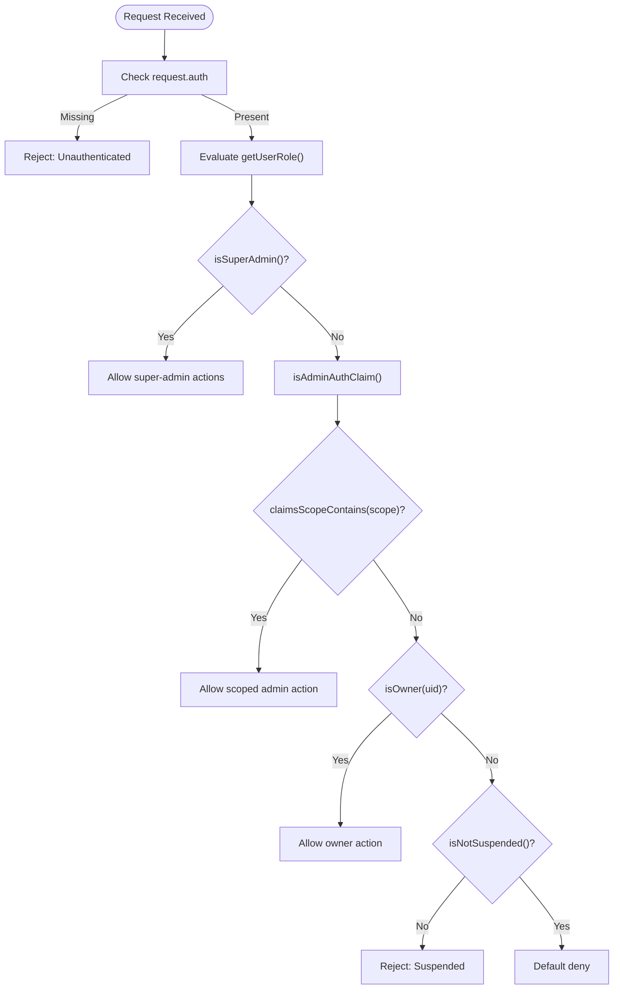
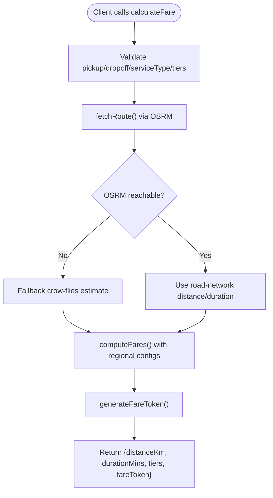
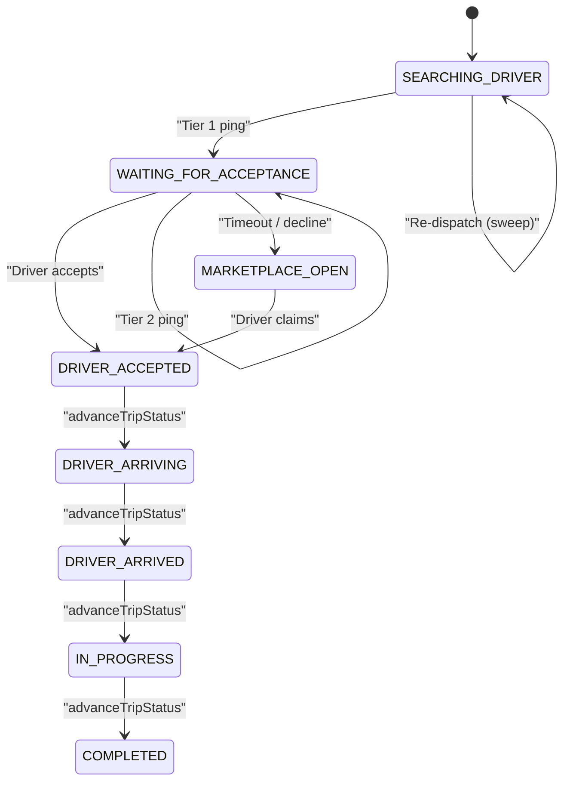
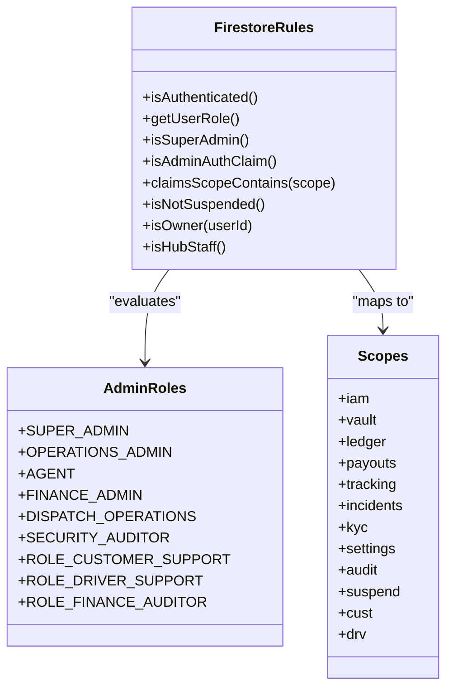
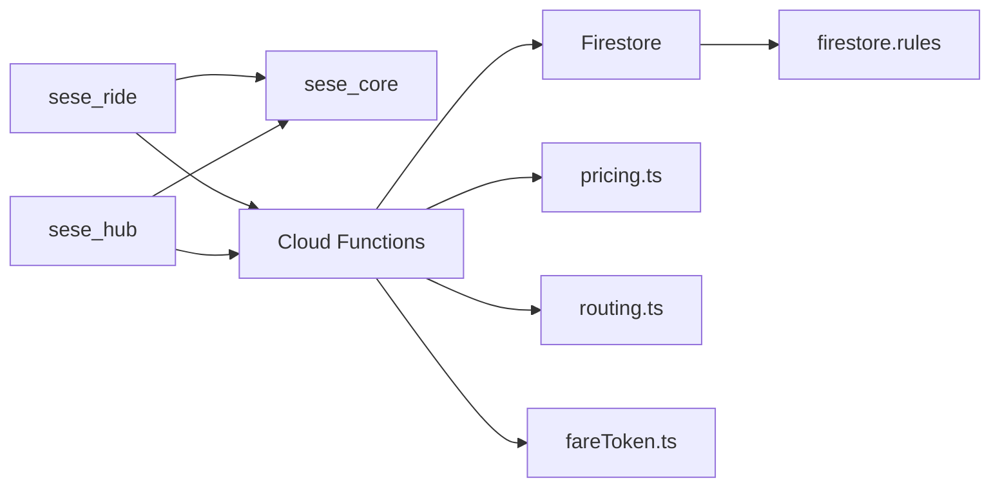

# Core Architecture

<cite>
**Referenced Files in This Document**
- [firebase.json](file://firebase.json)
- [firestore.rules](file://firestore.rules)
- [functions/src/index.ts](file://functions/src/index.ts)
- [functions/src/pricing.ts](file://functions/src/pricing.ts)
- [functions/src/routing.ts](file://functions/src/routing.ts)
- [functions/src/fareToken.ts](file://functions/src/fareToken.ts)
- [functions/src/trips.ts](file://functions/src/trips.ts)
- [sese_core/lib/sese_core.dart](file://sese_core/lib/sese_core.dart)
- [sese_hub/lib/main.dart](file://sese_hub/lib/main.dart)
- [sese_ride/lib/main.dart](file://sese_ride/lib/main.dart)
</cite>

## Table of Contents
1. [Introduction](#introduction)
2. [Project Structure](#project-structure)
3. [Core Components](#core-components)
4. [Architecture Overview](#architecture-overview)
5. [Detailed Component Analysis](#detailed-component-analysis)
6. [Dependency Analysis](#dependency-analysis)
7. [Performance Considerations](#performance-considerations)
8. [Troubleshooting Guide](#troubleshooting-guide)
9. [Conclusion](#conclusion)

## Introduction
This document describes the SeSe App core architecture for a real-time ride and delivery platform built as a Flutter monorepo with Firebase backend services. The system centers on three main applications:

- `sese_ride`: Customer and driver-facing mobile app for booking, dispatch, live tracking, payments, and support.
- `sese_hub`: Hub operations application for fleet verification, admin workflows, payouts, KYC, support queues, and system configuration.
- `sese_core`: Shared Dart package providing authentication, models, services, theme, and cross-app utilities.

The backend is implemented through Cloud Functions (TypeScript), Firestore security rules, and Firestore/Storage indexes. Real-time dispatch uses event-driven Firestore listeners, server-authoritative state machines, and scheduled sweeps to keep operations alive even when clients are offline. Security follows a zero-trust model: client inputs are validated, fare calculation is server-side, and sensitive transitions are enforced by callable functions and Firestore rules.

## Project Structure
The repository is organized as a monorepo with clear separation between frontend apps, shared code, and backend logic:

**Diagram sources**
- [firebase.json:1-27](file://firebase.json#L1-L27)
- [functions/src/index.ts:1-53](file://functions/src/index.ts#L1-L53)
- [firestore.rules:1-10](file://firestore.rules#L1-L10)

Key structural observations:

- `firebase.json` configures Firestore location, rules path, storage rules path, and Cloud Functions build pipeline.
- `functions/src/index.ts` initializes Firebase Admin SDK, exports callable functions, and wires trip lifecycle, pricing, routing, payments, verification, and support bot triggers.
- `sese_core`, `sese_hub`, and `sese_ride` are Flutter/Dart modules; `sese_core` provides shared auth, models, services, and UI primitives consumed by both apps.

**Section sources**
- [firebase.json:1-27](file://firebase.json#L1-L27)
- [functions/src/index.ts:1-53](file://functions/src/index.ts#L1-L53)
- [firestore.rules:1-10](file://firestore.rules#L1-L10)
- [sese_core/lib/sese_core.dart](file://sese_core/lib/sese_core.dart)
- [sese_hub/lib/main.dart](file://sese_hub/lib/main.dart)
- [sese_ride/lib/main.dart](file://sese_ride/lib/main.dart)

## Core Components
The core components span frontend apps, shared library, and backend services:

- **sese_core**: Shared Dart package exposing authentication helpers, configuration, models, services, theme, and widgets used across `sese_ride` and `sese_hub`. It centralizes cross-cutting concerns like auth state, dynamic config resolution, and common data structures.
- **sese_ride**: Main customer/driver experience. Handles ride creation, fare selection, dispatch listening, live trip tracking, payment flows, support chat, and driver operational features.
- **sese_hub**: Hub operations console. Manages driver/fleet verification, admin roles, payouts, KYC submissions, support tickets, system settings, and audit logs.
- **Cloud Functions**: Server-side logic including fare calculation, route fetching, trip lifecycle management, driver status, streaks, payments, verification workflows, and support automation.
- **Firestore Rules**: Fine-grained access control enforcing RBAC, suspension checks, owner-only writes, immutable audit records, and server-authoritative transitions.

**Section sources**
- [sese_core/lib/sese_core.dart](file://sese_core/lib/sese_core.dart)
- [sese_hub/lib/main.dart](file://sese_hub/lib/main.dart)
- [sese_ride/lib/main.dart](file://sese_ride/lib/main.dart)
- [functions/src/index.ts:1-53](file://functions/src/index.ts#L1-L53)
- [firestore.rules:1-10](file://firestore.rules#L1-L10)

## Architecture Overview
The SeSe App follows an event-driven, zero-trust architecture where:

- Clients authenticate via Firebase Auth and receive ID tokens carrying role claims.
- Firestore rules enforce authorization at the database layer using custom helpers (`isAuthenticated`, `getUserRole`, `isSuperAdmin`, `isAdminAuthClaim`, `claimsScopeContains`).
- Sensitive business logic runs in Cloud Functions callables that validate inputs, perform server-side calculations, and mutate state atomically.
- Real-time dispatch is driven by Firestore listeners and scheduled cron jobs that promote offers through cascading tiers.
- Fare calculation is centralized and tamper-proof via signed tokens.

**Diagram sources**
- [functions/src/index.ts:71-198](file://functions/src/index.ts#L71-L198)
- [functions/src/routing.ts:40-67](file://functions/src/routing.ts#L40-L67)
- [functions/src/pricing.ts:166-236](file://functions/src/pricing.ts#L166-L236)
- [functions/src/fareToken.ts:21-58](file://functions/src/fareToken.ts#L21-L58)
- [firestore.rules:6-140](file://firestore.rules#L6-L140)

## Detailed Component Analysis

### Zero-Trust Authentication and Authorization
Zero-trust design ensures that no client input is trusted without validation. The system enforces this through:

- **Authentication**: All callable functions check `request.auth`; unauthenticated requests are rejected.
- **Authorization**: Firestore rules use helper functions to evaluate roles and scopes:
  - `isAuthenticated()`
  - `getUserRole()`
  - `isSuperAdmin()`
  - `isAdminAuthClaim()`
  - `claimsScopeContains(scopeCode)`
- **RBAC**: Roles include `SUPER_ADMIN`, `OPERATIONS_ADMIN`, `AGENT`, plus scoped admin roles mapped via compact scope codes (`iam`, `vault`, `ledger`, `payouts`, `tracking`, `incidents`, `kyc`, `settings`, `audit`, `suspend`, `cust`, `drv`).
- **Suspension Gate**: `isNotSuspended()` reads live user documents to block suspended accounts.
- **Owner Checks**: `isOwner(userId)` restricts writes to resource owners.
- **Hub Staff Bridge**: `isHubStaff()` allows hub staff provisioned in `admin_users/{email}` to access verification-desk collections even without custom claims.

**Diagram sources**
- [firestore.rules:6-140](file://firestore.rules#L6-L140)

**Section sources**
- [firestore.rules:6-140](file://firestore.rules#L6-L140)

### Server-Side Fare Calculation
Fare calculation is intentionally server-side to prevent client tampering:

- `calculateFare` callable validates coordinates, service type, and selected tiers.
- Route distance and duration are fetched from OSRM or fallback to crow-flies approximation.
- Regional pricing is resolved via `system_configs` with a fallback chain: Global → Country → State.
- A signed HMAC-SHA256 `fareToken` is generated and returned to the client.
- Booking creation verifies the token before creating a trip.

**Diagram sources**
- [functions/src/index.ts:81-198](file://functions/src/index.ts#L81-L198)
- [functions/src/routing.ts:40-67](file://functions/src/routing.ts#L40-L67)
- [functions/src/pricing.ts:65-147](file://functions/src/pricing.ts#L65-L147)
- [functions/src/fareToken.ts:21-58](file://functions/src/fareToken.ts#L21-L58)

**Section sources**
- [functions/src/index.ts:81-198](file://functions/src/index.ts#L81-L198)
- [functions/src/routing.ts:1-109](file://functions/src/routing.ts#L1-L109)
- [functions/src/pricing.ts:1-237](file://functions/src/pricing.ts#L1-L237)
- [functions/src/fareToken.ts:1-59](file://functions/src/fareToken.ts#L1-L59)

### Real-Time Dispatch and Event-Driven Architecture
Dispatch is implemented as a server-authoritative state machine with cascading tiers:

- **Tier 1**: Exclusive offer to nearest online driver (15s).
- **Tier 2**: Simultaneous offer to next two nearest drivers (15s).
- **Tier 3**: Broadcast to all nearby online drivers (marketplace).
- Scheduled sweep promotes offers when deadlines pass and restarts dispatch for long-waiting searches.
- Firestore listeners in apps react to trip state changes for real-time UI updates.

**Diagram sources**
- [functions/src/trips.ts:12-63](file://functions/src/trips.ts#L12-L63)
- [functions/src/trips.ts:295-370](file://functions/src/trips.ts#L295-L370)
- [functions/src/trips.ts:401-512](file://functions/src/trips.ts#L401-L512)

**Section sources**
- [functions/src/trips.ts:12-63](file://functions/src/trips.ts#L12-L63)
- [functions/src/trips.ts:295-370](file://functions/src/trips.ts#L295-L370)
- [functions/src/trips.ts:401-512](file://functions/src/trips.ts#L401-L512)

### Role-Based Access Control Implementation
RBAC is enforced through Firestore rules and custom claims:

- **Roles**: `SUPER_ADMIN`, `OPERATIONS_ADMIN`, `AGENT`, plus scoped admin roles.
- **Scopes**: Compact codes map to verbose permissions (`manageAdminInvites`, `processPayouts`, `liveDriverTracking`, etc.).
- **Access Patterns**:
  - Admin IAM and audit logs require `isAdminAuthClaim()`.
  - Payout approvals require `processPayouts` scope.
  - System settings require `manageSystemSettings` scope.
  - Support tickets/chats allow participants and admins with relevant scopes.
  - Driver and user documents allow owner read/write and admin read/update.

**Diagram sources**
- [firestore.rules:10-157](file://firestore.rules#L10-L157)

**Section sources**
- [firestore.rules:10-157](file://firestore.rules#L10-L157)

### Data Validation and Error Handling
Validation and error handling follow consistent patterns:

- **Callable Functions**: Use `HttpsError` with typed payloads for structured errors (`unauthenticated`, `invalid-argument`, `not-found`, `permission-denied`, `failed-precondition`, `deadline-exceeded`).
- **Input Validation**: Coordinate bounds, phone number formats, required fields, and enum values are validated before processing.
- **Atomic Transactions**: Trip acceptance uses Firestore transactions to prevent double assignment.
- **Immutable Records**: Audit logs, chat messages, and verification submissions are append-only or owner-writable.
- **Fallback Logic**: Routing falls back to crow-flies estimation; pricing falls back to in-memory defaults if Firestore is unreachable.

**Section sources**
- [functions/src/index.ts:81-198](file://functions/src/index.ts#L81-L198)
- [functions/src/trips.ts:129-225](file://functions/src/trips.ts#L129-L225)
- [functions/src/trips.ts:591-653](file://functions/src/trips.ts#L591-L653)
- [functions/src/routing.ts:40-67](file://functions/src/routing.ts#L40-L67)
- [functions/src/pricing.ts:142-147](file://functions/src/pricing.ts#L142-L147)

## Dependency Analysis
The system has clear dependency boundaries:

- Frontend apps depend on `sese_core` for shared functionality.
- Cloud Functions depend on Firebase Admin SDK, Firestore, and external routing services.
- Firestore rules define access policies for all collections.
- Pricing depends on `system_configs` for regional overrides.
- Routing depends on OSRM public demo or configurable base URL.

**Diagram sources**
- [firebase.json:1-27](file://firebase.json#L1-L27)
- [functions/src/index.ts:1-53](file://functions/src/index.ts#L1-L53)
- [functions/src/pricing.ts:1-237](file://functions/src/pricing.ts#L1-L237)
- [functions/src/routing.ts:1-109](file://functions/src/routing.ts#L1-L109)
- [functions/src/fareToken.ts:1-59](file://functions/src/fareToken.ts#L1-L59)
- [firestore.rules:1-10](file://firestore.rules#L1-L10)

**Section sources**
- [firebase.json:1-27](file://firebase.json#L1-L27)
- [functions/src/index.ts:1-53](file://functions/src/index.ts#L1-L53)

## Performance Considerations
Several performance and scalability considerations are evident:

- **Real-Time Dispatch**: Scheduled sweep runs every minute to promote offers and restart dispatch, ensuring resilience when clients are offline.
- **Cascading Tiers**: Tiered dispatch reduces latency by targeting nearest drivers first before broadcasting.
- **Regional Pricing Cache**: `resolveRegionConfig` reads up to three `system_configs` documents in order, minimizing Firestore reads while allowing overrides.
- **Routing Fallback**: OSRM failures fall back to crow-flies estimation to avoid blocking fare calculation.
- **Indexing**: Firestore indexes are configured via `firestore.indexes.json` for efficient queries on trips, drivers, and orders.
- **Function Isolation**: Cloud Functions initialize Admin SDK once per worker to avoid repeated initialization overhead.

Recommendations for scaling:

- Self-host OSRM or add caching layers to reduce external API dependencies.
- Implement circuit breakers for external services (routing, payments).
- Use Firestore composite indexes strategically to optimize query performance.
- Monitor function cold starts and scale out based on dispatch volume.
- Add retry logic with exponential backoff for transient failures.

[No sources needed since this section provides general guidance]

## Troubleshooting Guide
Common issues and debugging approaches:

- **Unauthenticated Requests**: Ensure Firebase Auth is properly initialized and ID tokens are attached to callable requests.
- **Invalid Coordinates**: Validate latitude/longitude ranges and ensure proper formatting.
- **Fare Token Mismatch**: Verify that `fareToken` is generated server-side and not tampered with.
- **Dispatch Not Starting**: Check Firestore rules for trip creation permissions and verify `onTripCreated` trigger is deployed.
- **Driver Not Receiving Offers**: Confirm driver is online, within dispatch radius, and eligible for service tiers.
- **RBAC Denials**: Review custom claims and scope mappings in Firestore rules.
- **Routing Failures**: Check OSRM availability and configure `OSRM_BASE_URL` for production endpoints.

**Section sources**
- [functions/src/index.ts:81-198](file://functions/src/index.ts#L81-L198)
- [functions/src/trips.ts:129-225](file://functions/src/trips.ts#L129-L225)
- [functions/src/routing.ts:40-67](file://functions/src/routing.ts#L40-L67)
- [firestore.rules:6-140](file://firestore.rules#L6-L140)

## Conclusion
The SeSe App architecture implements a robust, secure, and scalable real-time dispatch system. Key strengths include:

- Zero-trust design with server-side fare calculation and signed tokens.
- Event-driven architecture using Firestore listeners and scheduled sweeps.
- Fine-grained RBAC via Firestore rules and custom claims.
- Clear separation of concerns across frontend apps, shared library, and backend services.
- Resilient dispatch logic with cascading tiers and fallback mechanisms.

Future improvements should focus on external service resilience, indexing optimization, and monitoring to support growing real-time dispatch operations.

[No sources needed since this section summarizes without analyzing specific files]