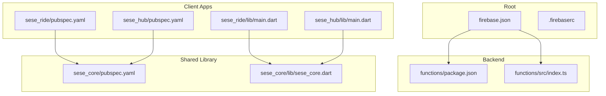
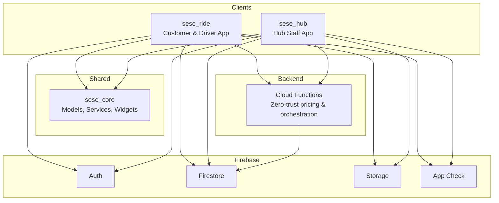
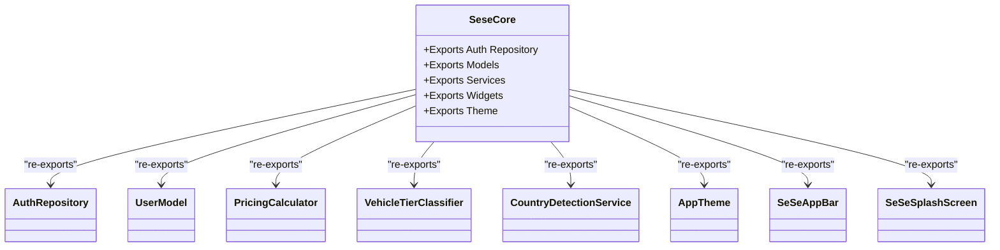
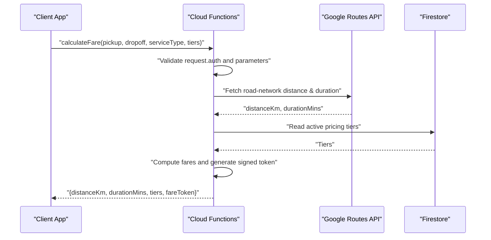
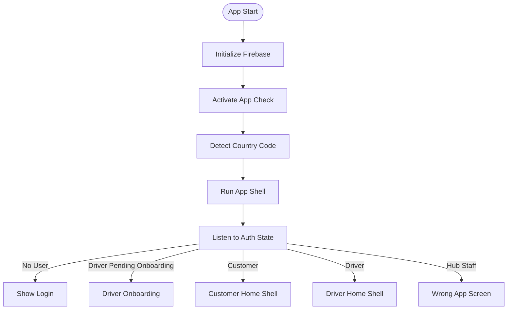
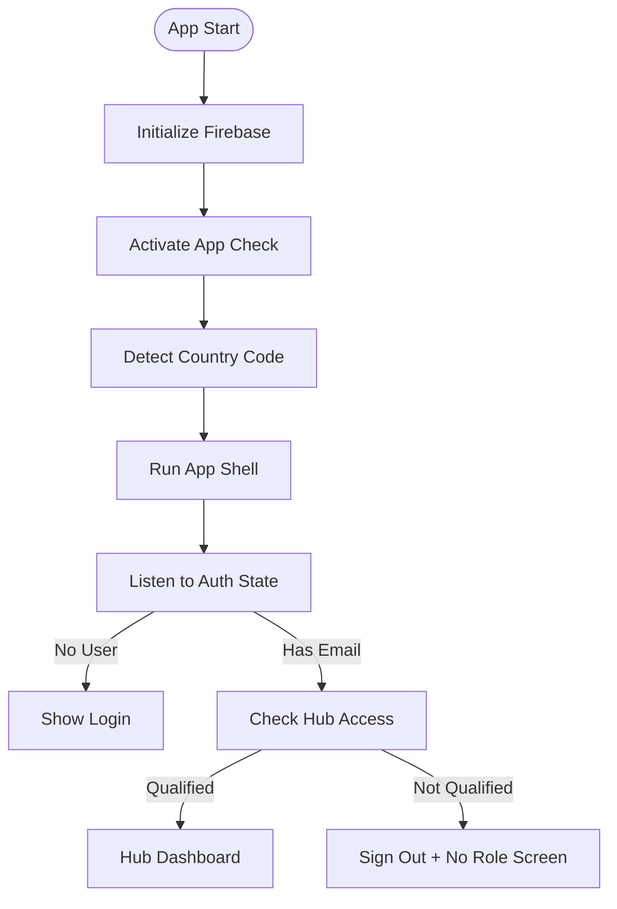
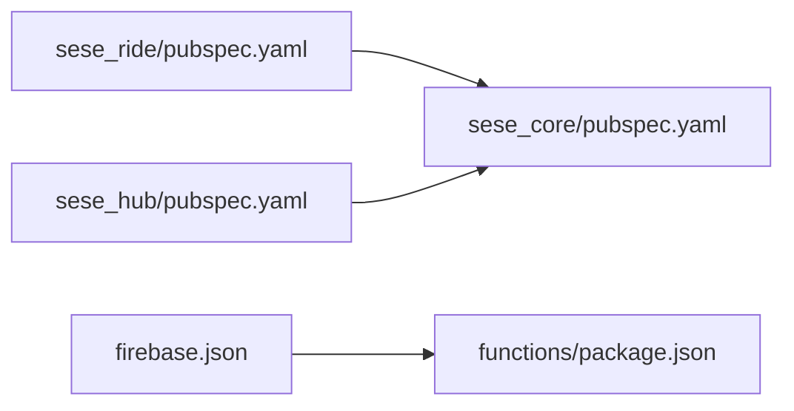

# Monorepo Structure and Organization

<cite>
**Referenced Files in This Document**
- [firebase.json](file://firebase.json)
- [.firebaserc](file://.firebaserc)
- [functions/package.json](file://functions/package.json)
- [functions/src/index.ts](file://functions/src/index.ts)
- [sese_core/pubspec.yaml](file://sese_core/pubspec.yaml)
- [sese_core/lib/sese_core.dart](file://sese_core/lib/sese_core.dart)
- [sese_ride/pubspec.yaml](file://sese_ride/pubspec.yaml)
- [sese_ride/lib/main.dart](file://sese_ride/lib/main.dart)
- [sese_hub/pubspec.yaml](file://sese_hub/pubspec.yaml)
- [sese_hub/lib/main.dart](file://sese_hub/lib/main.dart)
</cite>

## Table of Contents
1. [Introduction](#introduction)
2. [Project Structure](#project-structure)
3. [Core Components](#core-components)
4. [Architecture Overview](#architecture-overview)
5. [Detailed Component Analysis](#detailed-component-analysis)
6. [Dependency Analysis](#dependency-analysis)
7. [Performance Considerations](#performance-considerations)
8. [Troubleshooting Guide](#troubleshooting-guide)
9. [Conclusion](#conclusion)

## Introduction
This document explains the monorepo structure and organization of the SeSe App. It covers why a monorepo is used, how the four main components are organized and related, the shared library pattern implemented by sese_core, dependency management across packages, build configuration strategies, Firebase coordination, and practical workflows for developers working within this repository.

The monorepo approach centralizes code, enforces consistent dependencies, simplifies cross-package changes, and streamlines deployment of both client applications and backend functions from one source tree.

## Project Structure
At the root of the repository, you will find:
- functions: Cloud Functions implementation (Node.js/TypeScript).
- sese_core: Shared Dart/Flutter library containing models, services, widgets, and theme utilities.
- sese_ride: Flutter application for customers and drivers.
- sese_hub: Flutter application for hub staff operations.
- firebase.json and .firebaserc: Root-level Firebase configuration coordinating Firestore, Storage, and Cloud Functions.

**Diagram sources**
- [firebase.json:1-28](file://firebase.json#L1-L28)
- [.firebaserc:1-6](file://.firebaserc#L1-L6)
- [functions/package.json:1-24](file://functions/package.json#L1-L24)
- [functions/src/index.ts:1-199](file://functions/src/index.ts#L1-L199)
- [sese_core/pubspec.yaml:1-33](file://sese_core/pubspec.yaml#L1-L33)
- [sese_core/lib/sese_core.dart:1-42](file://sese_core/lib/sese_core.dart#L1-L42)
- [sese_ride/pubspec.yaml:1-38](file://sese_ride/pubspec.yaml#L1-L38)
- [sese_ride/lib/main.dart:1-184](file://sese_ride/lib/main.dart#L1-L184)
- [sese_hub/pubspec.yaml:1-29](file://sese_hub/pubspec.yaml#L1-L29)
- [sese_hub/lib/main.dart:1-235](file://sese_hub/lib/main.dart#L1-L235)

**Section sources**
- [firebase.json:1-28](file://firebase.json#L1-L28)
- [.firebaserc:1-6](file://.firebaserc#L1-L6)
- [functions/package.json:1-24](file://functions/package.json#L1-L24)
- [sese_core/pubspec.yaml:1-33](file://sese_core/pubspec.yaml#L1-L33)
- [sese_ride/pubspec.yaml:1-38](file://sese_ride/pubspec.yaml#L1-L38)
- [sese_hub/pubspec.yaml:1-29](file://sese_hub/pubspec.yaml#L1-L29)

## Core Components
- functions: Serverless Cloud Functions written in TypeScript. The package defines scripts to build, watch, serve locally with emulators, and deploy only the functions codebase.
- sese_core: A Flutter/Dart shared library exposing models, repositories, services, widgets, and theme utilities. Both client apps depend on it via a local path dependency.
- sese_ride: Customer and driver-facing Flutter app. It initializes Firebase, activates App Check, detects country/dial code, and routes users based on role.
- sese_hub: Hub staff Flutter app. It initializes Firebase, activates App Check, performs hub access checks, and gates dashboard access based on permissions.

Key responsibilities:
- Backend logic and zero-trust fare calculation live in functions.
- Shared domain models, UI primitives, and reusable services live in sese_core.
- Platform-specific apps consume shared logic and present user flows.

**Section sources**
- [functions/package.json:1-24](file://functions/package.json#L1-L24)
- [sese_core/lib/sese_core.dart:1-42](file://sese_core/lib/sese_core.dart#L1-L42)
- [sese_ride/lib/main.dart:1-184](file://sese_ride/lib/main.dart#L1-L184)
- [sese_hub/lib/main.dart:1-235](file://sese_hub/lib/main.dart#L1-L235)

## Architecture Overview
The system follows a layered architecture:
- Client apps (sese_ride, sese_hub) use Flutter and depend on the shared library (sese_core).
- Backend Cloud Functions provide server-side business logic and enforce zero-trust pricing and data operations.
- Firebase coordinates authentication, Firestore, Storage, and App Check across all components.

**Diagram sources**
- [sese_ride/lib/main.dart:1-184](file://sese_ride/lib/main.dart#L1-L184)
- [sese_hub/lib/main.dart:1-235](file://sese_hub/lib/main.dart#L1-L235)
- [functions/src/index.ts:1-199](file://functions/src/index.ts#L1-L199)
- [firebase.json:1-28](file://firebase.json#L1-L28)

## Detailed Component Analysis

### Shared Library Pattern in sese_core
Purpose:
- Centralize domain models, repositories, services, UI widgets, and theme utilities to avoid duplication between apps.
- Provide stable APIs for auth, pricing, vehicle classification, country detection, and common UI components.

Structure highlights:
- Exposes a single barrel file that re-exports modules under auth, config, models, services, theme, and widgets.
- Includes audio assets and linting configuration.

**Diagram sources**
- [sese_core/lib/sese_core.dart:1-42](file://sese_core/lib/sese_core.dart#L1-L42)

Practical usage:
- Import the shared library in both apps to reuse models, services, and widgets.
- Keep app-specific features in each app’s lib/features directory while relying on core for shared behavior.

**Section sources**
- [sese_core/pubspec.yaml:1-33](file://sese_core/pubspec.yaml#L1-L33)
- [sese_core/lib/sese_core.dart:1-42](file://sese_core/lib/sese_core.dart#L1-L42)

### Cloud Functions: Zero-Trust Pricing and Orchestration
Responsibilities:
- Initialize Firebase Admin SDK safely to avoid metadata server probes during development.
- Export callable functions for trip lifecycle, driver status, streaks, payments, support bot, verification, and fare calculation.
- Enforce zero-trust fare computation by validating inputs, fetching route distance/duration, applying server-side pricing tiers, and generating signed fare tokens.

**Diagram sources**
- [functions/src/index.ts:1-199](file://functions/src/index.ts#L1-L199)

Build and deployment:
- The functions package uses TypeScript and provides npm scripts for building, watching, serving locally with emulators, and deploying only the functions codebase.
- The root firebase.json configures the functions codebase, ignores irrelevant files, and runs a predeploy build step.

**Section sources**
- [functions/package.json:1-24](file://functions/package.json#L1-L24)
- [functions/src/index.ts:1-199](file://functions/src/index.ts#L1-L199)
- [firebase.json:1-28](file://firebase.json#L1-L28)

### Client Apps: Initialization, Security, and Routing

#### sese_ride (Customer & Driver App)
Initialization flow:
- Initializes Flutter bindings and Firebase with platform-specific options.
- Activates Firebase App Check using debug providers in debug builds and integrity providers in release builds.
- Detects the user’s country/dial code at startup and caches it for input fields.
- Boots the app shell and applies theme settings.

Routing gate:
- Listens to auth state and routes to login, driver onboarding, or role-based shells (customer or driver).
- Prevents hub staff from accessing the ride app and shows a clear message.

**Diagram sources**
- [sese_ride/lib/main.dart:1-184](file://sese_ride/lib/main.dart#L1-L184)

**Section sources**
- [sese_ride/lib/main.dart:1-184](file://sese_ride/lib/main.dart#L1-L184)

#### sese_hub (Hub Staff App)
Initialization flow:
- Initializes Firebase and activates App Check similarly to the ride app.
- Primes country detection for phone and regional configuration fields.
- Boots the app shell and applies theme settings.

Access control:
- Implements a zero-trust gate that verifies hub staff eligibility before granting dashboard access.
- Caches access checks per email and signs out unauthorized users with a generic denial screen.

**Diagram sources**
- [sese_hub/lib/main.dart:1-235](file://sese_hub/lib/main.dart#L1-L235)

**Section sources**
- [sese_hub/lib/main.dart:1-235](file://sese_hub/lib/main.dart#L1-L235)

## Dependency Analysis
Package relationships:
- Both client apps depend on the shared library via local path dependencies.
- The backend functions package is independent of the Dart packages and is managed by Node/npm.
- Firebase configuration at the root coordinates Firestore, Storage, and Functions.

**Diagram sources**
- [sese_ride/pubspec.yaml:1-38](file://sese_ride/pubspec.yaml#L1-L38)
- [sese_hub/pubspec.yaml:1-29](file://sese_hub/pubspec.yaml#L1-L29)
- [firebase.json:1-28](file://firebase.json#L1-L28)
- [functions/package.json:1-24](file://functions/package.json#L1-L24)

**Section sources**
- [sese_ride/pubspec.yaml:1-38](file://sese_ride/pubspec.yaml#L1-L38)
- [sese_hub/pubspec.yaml:1-29](file://sese_hub/pubspec.yaml#L1-L29)
- [firebase.json:1-28](file://firebase.json#L1-L28)
- [functions/package.json:1-24](file://functions/package.json#L1-L24)

## Performance Considerations
- Use the shared library to reduce duplication and keep app bundles lean by avoiding duplicated logic.
- Leverage Firebase App Check to protect backend resources and reduce abuse; ensure correct provider selection per environment.
- Prefer server-side calculations (e.g., fare computation) to minimize client-side processing and improve security.
- Cache frequently accessed data where appropriate (e.g., country detection results) to reduce network calls.

[No sources needed since this section provides general guidance]

## Troubleshooting Guide
Common issues and resolutions:
- Firestore permission denied due to missing App Check: Ensure App Check is activated in both apps with the correct provider per environment.
- Functions initialization timeout during local development: The functions entry point avoids metadata server probing unless credentials are explicitly set.
- Wrong app access: Hub staff opening the ride app should see a dedicated screen prompting sign-out and directing them to the hub app.

Operational tips:
- Verify firebase.json points to the correct functions source and ignore patterns.
- Confirm .firebaserc maps the default project alias to the intended Firebase project.
- When adding new callable functions, export them from the index and ensure parameter validation aligns with zero-trust principles.

**Section sources**
- [sese_ride/lib/main.dart:1-184](file://sese_ride/lib/main.dart#L1-L184)
- [sese_hub/lib/main.dart:1-235](file://sese_hub/lib/main.dart#L1-L235)
- [functions/src/index.ts:1-199](file://functions/src/index.ts#L1-L199)
- [firebase.json:1-28](file://firebase.json#L1-L28)
- [.firebaserc:1-6](file://.firebaserc#L1-L6)

## Conclusion
This monorepo organizes the SeSe App into clear boundaries: shared logic in sese_core, platform apps in sese_ride and sese_hub, and server-side logic in functions. Firebase configuration at the root coordinates services across components. The shared library pattern reduces duplication, improves consistency, and accelerates feature development. By following the documented workflows and leveraging the provided configurations, teams can collaborate effectively, maintain secure zero-trust practices, and scale the product with confidence.

[No sources needed since this section summarizes without analyzing specific files]