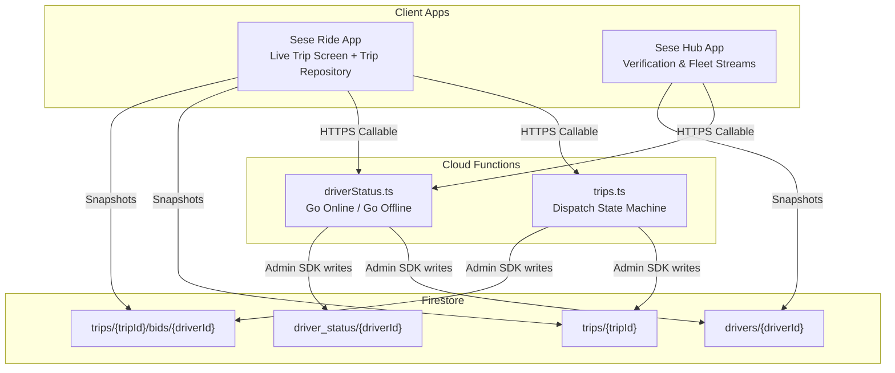
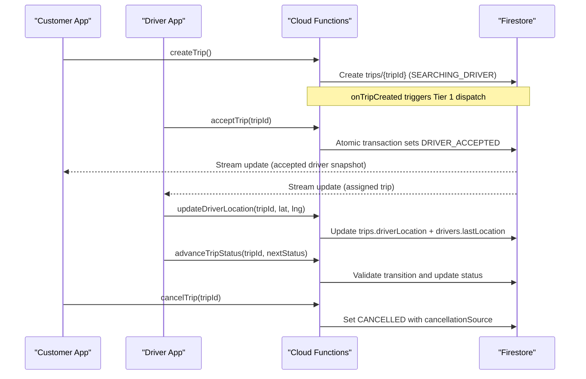
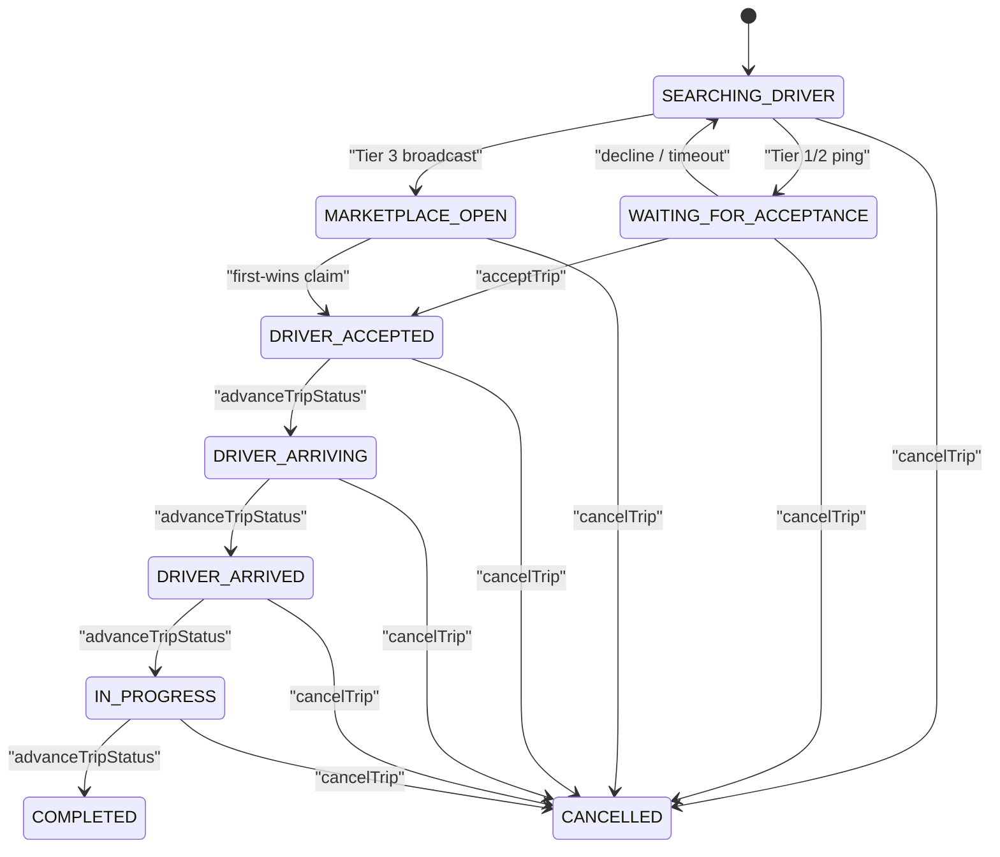
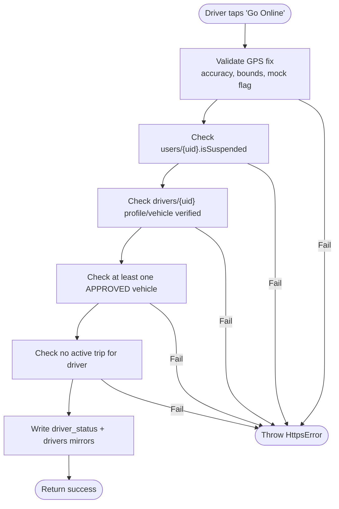
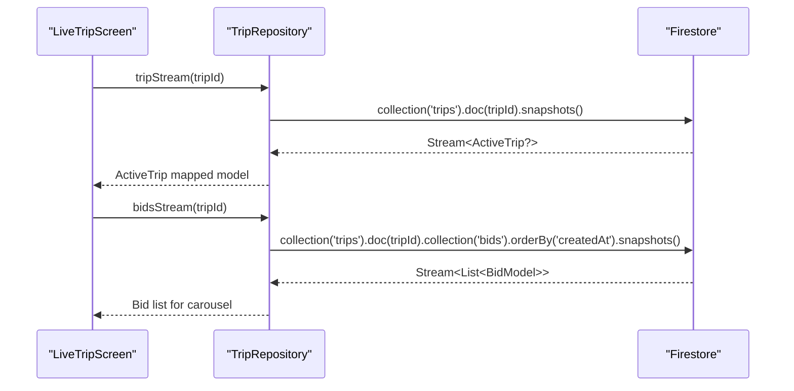
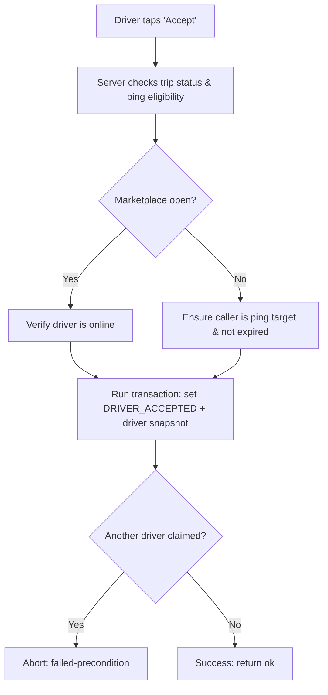
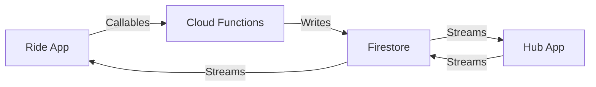
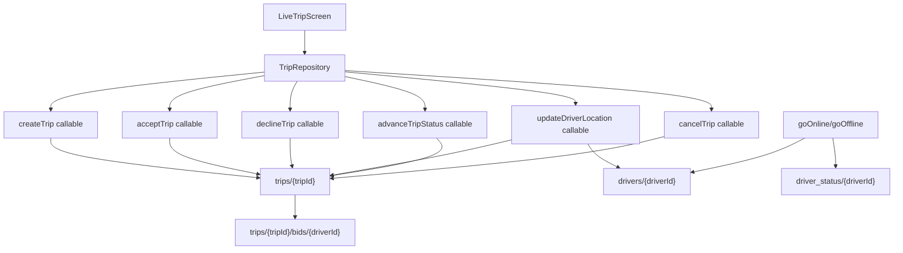

# Real-Time Data Flow Patterns

<cite>
**Referenced Files in This Document**
- [functions/src/trips.ts](file://functions/src/trips.ts)
- [functions/src/driverStatus.ts](file://functions/src/driverStatus.ts)
- [sese_ride/lib/features/trips/services/trip_service.dart](file://sese_ride/lib/features/trips/services/trip_service.dart)
- [sese_ride/lib/features/trips/presentation/live_trip_screen.dart](file://sese_ride/lib/features/trips/presentation/live_trip_screen.dart)
- [sese_ride/lib/features/trips/models/trip_models.dart](file://sese_ride/lib/features/trips/models/trip_models.dart)
- [sese_hub/lib/features/verification/presentation/driver_profile_approvals_tab.dart](file://sese_hub/lib/features/verification/presentation/driver_profile_approvals_tab.dart)
- [firestore.rules](file://firestore.rules)
- [firestore.indexes.json](file://firestore.indexes.json)
</cite>

## Table of Contents
1. [Introduction](#introduction)
2. [Project Structure](#project-structure)
3. [Core Components](#core-components)
4. [Architecture Overview](#architecture-overview)
5. [Detailed Component Analysis](#detailed-component-analysis)
6. [Dependency Analysis](#dependency-analysis)
7. [Performance Considerations](#performance-considerations)
8. [Troubleshooting Guide](#troubleshooting-guide)
9. [Conclusion](#conclusion)

## Introduction
This document explains the real-time data flow patterns in SeSe App, focusing on event-driven architecture using Firestore listeners and Cloud Functions for live trip updates, driver status changes, and dispatch coordination. It documents the server-authoritative state machine for trip lifecycle management, including state transitions, event handling, and consistency guarantees. It also covers client-server synchronization, conflict resolution via transactions, offline considerations, performance optimization through indexing, and scalability strategies for thousands of concurrent real-time connections.

## Project Structure
The real-time system spans three main areas:
- Client apps (Flutter): UI components subscribe to Firestore streams and call Cloud Functions for mutations.
- Cloud Functions (Node.js/TypeScript): Server-side orchestration for dispatch, driver availability, and trip state transitions.
- Firestore: Central source of truth with security rules and indexes enabling efficient live queries.

**Diagram sources**
- [sese_ride/lib/features/trips/presentation/live_trip_screen.dart:30-88](file://sese_ride/lib/features/trips/presentation/live_trip_screen.dart#L30-L88)
- [sese_ride/lib/features/trips/services/trip_service.dart:66-122](file://sese_ride/lib/features/trips/services/trip_service.dart#L66-L122)
- [functions/src/trips.ts:129-225](file://functions/src/trips.ts#L129-L225)
- [functions/src/driverStatus.ts:32-164](file://functions/src/driverStatus.ts#L32-L164)

**Section sources**
- [sese_ride/lib/features/trips/presentation/live_trip_screen.dart:14-88](file://sese_ride/lib/features/trips/presentation/live_trip_screen.dart#L14-L88)
- [sese_ride/lib/features/trips/services/trip_service.dart:20-122](file://sese_ride/lib/features/trips/services/trip_service.dart#L20-L122)
- [functions/src/trips.ts:12-26](file://functions/src/trips.ts#L12-L26)
- [functions/src/driverStatus.ts:6-10](file://functions/src/driverStatus.ts#L6-L10)

## Core Components
- Trip Dispatch State Machine: Server-owned lifecycle from SEARCHING_DRIVER through DRIVER_ACCEPTED, DRIVER_ARRIVING, DRIVER_ARRIVED, IN_PROGRESS, COMPLETED, or CANCELLED. Includes cascading tiers (Tier 1 exclusive ping, Tier 2 group ping, Tier 3 marketplace broadcast), ping timeouts, and re-dispatch logic.
- Driver Availability Handshake: Zero-trust goOnline/goOffline functions that validate GPS, suspension, verification, and active trips before updating authoritative mirrors.
- Client Repositories and UI: TripRepository exposes createTrip, tripStream, activeTripsStream, bidsStream, and mutation callables; LiveTripScreen renders snapshots and user actions.
- Security Rules and Indexes: Firestore rules enforce who can read/write and ensure trip writes go through Cloud Functions; indexes optimize live queries for drivers, trips, and location-based matching.

**Section sources**
- [functions/src/trips.ts:12-63](file://functions/src/trips.ts#L12-L63)
- [functions/src/driverStatus.ts:6-30](file://functions/src/driverStatus.ts#L6-L30)
- [sese_ride/lib/features/trips/services/trip_service.dart:20-64](file://sese_ride/lib/features/trips/services/trip_service.dart#L20-L64)
- [sese_ride/lib/features/trips/presentation/live_trip_screen.dart:14-88](file://sese_ride/lib/features/trips/presentation/live_trip_screen.dart#L14-L88)
- [firestore.rules:315-366](file://firestore.rules#L315-L366)
- [firestore.indexes.json:1-82](file://firestore.indexes.json#L1-L82)

## Architecture Overview
The system follows an event-driven pattern:
- Clients initiate actions via HTTPS callables (createTrip, acceptTrip, declineTrip, updateDriverLocation, advanceTripStatus, cancelTrip, goOnline, goOffline).
- Cloud Functions perform validation, enforce business rules, and write to Firestore using the Admin SDK.
- Clients subscribe to Firestore streams to receive live updates without polling.
- Scheduled sweeps promote dispatch tiers and handle expired pings, ensuring dispatch continues even if clients are offline.

**Diagram sources**
- [functions/src/trips.ts:129-225](file://functions/src/trips.ts#L129-L225)
- [functions/src/trips.ts:591-653](file://functions/src/trips.ts#L591-L653)
- [functions/src/trips.ts:716-754](file://functions/src/trips.ts#L716-L754)
- [functions/src/trips.ts:763-796](file://functions/src/trips.ts#L763-L796)
- [sese_ride/lib/features/trips/services/trip_service.dart:73-131](file://sese_ride/lib/features/trips/services/trip_service.dart#L73-L131)

## Detailed Component Analysis

### Trip Lifecycle State Machine
The trip lifecycle is a server-authoritative state machine with explicit transitions:
- SEARCHING_DRIVER → WAITING_FOR_ACCEPTANCE (Tier 1/2 ping)
- WAITING_FOR_ACCEPTANCE → DRIVER_ACCEPTED (acceptTrip)
- MARKETPLACE_OPEN → DRIVER_ACCEPTED (first-wins claim)
- DRIVER_ACCEPTED → DRIVER_ARRIVING → DRIVER_ARRIVED → IN_PROGRESS → COMPLETED
- Any live state → CANCELLED (customer or driver cancellation)

**Diagram sources**
- [functions/src/trips.ts:44-63](file://functions/src/trips.ts#L44-L63)
- [functions/src/trips.ts:295-370](file://functions/src/trips.ts#L295-L370)
- [functions/src/trips.ts:591-653](file://functions/src/trips.ts#L591-L653)
- [functions/src/trips.ts:756-796](file://functions/src/trips.ts#L756-L796)

Key implementation details:
- Cascading dispatch tiers with deadlines and promotions via scheduled sweep.
- Ping expiration breaks streaks and promotes to next tier or marketplace.
- Acceptance uses a transaction to prevent double assignment.
- Driver advances status along allowed transitions only.

**Section sources**
- [functions/src/trips.ts:28-42](file://functions/src/trips.ts#L28-L42)
- [functions/src/trips.ts:394-512](file://functions/src/trips.ts#L394-L512)
- [functions/src/trips.ts:514-553](file://functions/src/trips.ts#L514-L553)
- [functions/src/trips.ts:591-653](file://functions/src/trips.ts#L591-L653)
- [functions/src/trips.ts:662-714](file://functions/src/trips.ts#L662-L714)
- [functions/src/trips.ts:756-796](file://functions/src/trips.ts#L756-L796)

### Driver Status Changes and Availability
Driver availability is enforced by zero-trust Cloud Functions:
- goOnline validates JWT, GPS accuracy, mock locations, suspension, profile/vehicle verification, and active trips before writing authoritative mirrors.
- goOffline refuses while in a live trip and updates mirrors accordingly.
- The driver app calls these functions; clients never self-assert online status.

**Diagram sources**
- [functions/src/driverStatus.ts:32-164](file://functions/src/driverStatus.ts#L32-L164)
- [functions/src/driverStatus.ts:170-219](file://functions/src/driverStatus.ts#L170-L219)

**Section sources**
- [functions/src/driverStatus.ts:6-30](file://functions/src/driverStatus.ts#L6-L30)
- [functions/src/driverStatus.ts:32-164](file://functions/src/driverStatus.ts#L32-L164)
- [functions/src/driverStatus.ts:170-219](file://functions/src/driverStatus.ts#L170-L219)

### Client-Side Real-Time Synchronization
Clients use Firestore streams to observe trip and bid states:
- tripStream returns a single trip snapshot stream.
- activeTripsStream returns all non-terminal trips for a customer.
- bidsStream returns ordered bid snapshots under trips/{tripId}/bids.
- LiveTripScreen renders status banners, maps, and driver sheets based on snapshots.

**Diagram sources**
- [sese_ride/lib/features/trips/services/trip_service.dart:101-122](file://sese_ride/lib/features/trips/services/trip_service.dart#L101-L122)
- [sese_ride/lib/features/trips/services/trip_service.dart:189-200](file://sese_ride/lib/features/trips/services/trip_service.dart#L189-L200)
- [sese_ride/lib/features/trips/presentation/live_trip_screen.dart:30-88](file://sese_ride/lib/features/trips/presentation/live_trip_screen.dart#L30-L88)

**Section sources**
- [sese_ride/lib/features/trips/services/trip_service.dart:66-122](file://sese_ride/lib/features/trips/services/trip_service.dart#L66-L122)
- [sese_ride/lib/features/trips/services/trip_service.dart:189-200](file://sese_ride/lib/features/trips/services/trip_service.dart#L189-L200)
- [sese_ride/lib/features/trips/presentation/live_trip_screen.dart:30-88](file://sese_ride/lib/features/trips/presentation/live_trip_screen.dart#L30-L88)

### Dispatch Coordination and Conflict Resolution
Dispatch coordination relies on server-side logic and atomic transactions:
- acceptTrip enforces eligibility (ping target or marketplace open) and performs an atomic first-wins claim.
- declineTrip breaks streaks and immediately promotes dispatch when appropriate.
- updateDriverLocation updates trip and driver location mirrors.
- advanceTripStatus enforces allowed transitions and timestamps critical events.

**Diagram sources**
- [functions/src/trips.ts:591-653](file://functions/src/trips.ts#L591-L653)
- [functions/src/trips.ts:662-714](file://functions/src/trips.ts#L662-L714)
- [functions/src/trips.ts:716-754](file://functions/src/trips.ts#L716-L754)
- [functions/src/trips.ts:763-796](file://functions/src/trips.ts#L763-L796)

**Section sources**
- [functions/src/trips.ts:514-553](file://functions/src/trips.ts#L514-L553)
- [functions/src/trips.ts:591-653](file://functions/src/trips.ts#L591-L653)
- [functions/src/trips.ts:662-714](file://functions/src/trips.ts#L662-L714)
- [functions/src/trips.ts:716-754](file://functions/src/trips.ts#L716-L754)
- [functions/src/trips.ts:763-796](file://functions/src/trips.ts#L763-L796)

### Consistency Guarantees and Offline Support
- Consistency: All trip mutations go through Cloud Functions; Firestore rules deny direct client writes to trips. Transactions prevent double assignment. Server timestamps ensure ordering.
- Offline support: Clients rely on Firestore snapshots; dispatch continues via scheduled sweeps even if the customer’s app is closed. Driver location updates mirror to drivers doc for ranking.
- Conflict resolution: First-wins acceptance via transactions; ping expiration resets search or promotes tiers; decline immediately advances dispatch.

**Section sources**
- [firestore.rules:315-342](file://firestore.rules#L315-L342)
- [functions/src/trips.ts:394-512](file://functions/src/trips.ts#L394-L512)
- [functions/src/trips.ts:591-653](file://functions/src/trips.ts#L591-L653)

### Real-Time Synchronization Between Clients and Server
- Client-to-server: HTTPS callables for mutations (createTrip, acceptTrip, declineTrip, updateDriverLocation, advanceTripStatus, cancelTrip, goOnline, goOffline).
- Server-to-client: Firestore streams push updates to UI components.
- Hub app: Uses multiple streams to aggregate verification and fleet data, recomputing can-go-online flags.

**Diagram sources**
- [sese_hub/lib/features/verification/presentation/driver_profile_approvals_tab.dart:86-117](file://sese_hub/lib/features/verification/presentation/driver_profile_approvals_tab.dart#L86-L117)
- [sese_ride/lib/features/trips/services/trip_service.dart:73-131](file://sese_ride/lib/features/trips/services/trip_service.dart#L73-L131)
- [functions/src/trips.ts:129-225](file://functions/src/trips.ts#L129-L225)

**Section sources**
- [sese_hub/lib/features/verification/presentation/driver_profile_approvals_tab.dart:86-117](file://sese_hub/lib/features/verification/presentation/driver_profile_approvals_tab.dart#L86-L117)
- [sese_ride/lib/features/trips/services/trip_service.dart:73-131](file://sese_ride/lib/features/trips/services/trip_service.dart#L73-L131)

## Dependency Analysis
- Client dependencies:
  - LiveTripScreen depends on TripRepository for streams and callables.
  - TripRepository depends on FirebaseFunctions and FirebaseFirestore.
- Server dependencies:
  - trips.ts depends on firebase-admin, firestore listeners, scheduler, fareToken, and driverStreak modules.
  - driverStatus.ts depends on firebase-admin and https callables.
- Data dependencies:
  - trips/{tripId} is central; bids subcollection holds per-driver bids.
  - drivers/{driverId} stores lastLocation and isOnline mirrors.
  - driver_status/{driverId} stores authoritative availability.

**Diagram sources**
- [sese_ride/lib/features/trips/presentation/live_trip_screen.dart:30-88](file://sese_ride/lib/features/trips/presentation/live_trip_screen.dart#L30-L88)
- [sese_ride/lib/features/trips/services/trip_service.dart:73-131](file://sese_ride/lib/features/trips/services/trip_service.dart#L73-L131)
- [functions/src/trips.ts:129-225](file://functions/src/trips.ts#L129-L225)
- [functions/src/driverStatus.ts:32-164](file://functions/src/driverStatus.ts#L32-L164)

**Section sources**
- [sese_ride/lib/features/trips/presentation/live_trip_screen.dart:30-88](file://sese_ride/lib/features/trips/presentation/live_trip_screen.dart#L30-L88)
- [sese_ride/lib/features/trips/services/trip_service.dart:73-131](file://sese_ride/lib/features/trips/services/trip_service.dart#L73-L131)
- [functions/src/trips.ts:129-225](file://functions/src/trips.ts#L129-L225)
- [functions/src/driverStatus.ts:32-164](file://functions/src/driverStatus.ts#L32-L164)

## Performance Considerations
- Indexing strategy:
  - drivers.isOnline + drivers.lastSeen + __name__ for nearest driver selection.
  - trips.status + trips.dispatchTier + trips.tierExpiresAt + __name__ for tier promotions.
  - trips.status + trips.pingExpiresAt + __name__ for legacy ping expiration.
  - active_trips.driverId + trips.status for querying assigned trips.
  - driver_locations geohash + isOnline + updatedAt for location queries.
- Query optimization:
  - Use single-field where clauses where possible (e.g., customerId) and filter terminal states client-side.
  - Limit result sets (e.g., DISPATCH_CANDIDATE_LIMIT) to reduce memory and bandwidth.
- Real-time efficiency:
  - Mirror driverLocation onto drivers.doc to avoid repeated joins during ranking.
  - Use serverTimestamp for consistent ordering and time-based decisions.

**Section sources**
- [firestore.indexes.json:1-82](file://firestore.indexes.json#L1-L82)
- [functions/src/trips.ts:246-287](file://functions/src/trips.ts#L246-L287)
- [sese_ride/lib/features/trips/services/trip_service.dart:109-122](file://sese_ride/lib/features/trips/services/trip_service.dart#L109-L122)

## Troubleshooting Guide
Common issues and resolutions:
- Unauthenticated errors: Ensure the user is signed in before calling callables.
- Invalid argument errors: Validate pickup/dropoff coordinates, phone numbers, and fare tokens.
- Not found errors: Trip may have been cancelled or removed; refresh streams.
- Failed precondition errors: Trip already closed, driver not ping target, or invalid transition.
- Network errors: Wrap callable calls with user-friendly messages and retry logic.

Operational tips:
- Monitor scheduled sweep logs for tier promotions and ping expirations.
- Verify driver verification flags and approved vehicles before allowing goOnline.
- Use Firestore rules to audit access and ensure trip writes go through Cloud Functions.

**Section sources**
- [sese_ride/lib/features/trips/services/trip_service.dart:202-215](file://sese_ride/lib/features/trips/services/trip_service.dart#L202-L215)
- [functions/src/trips.ts:129-225](file://functions/src/trips.ts#L129-L225)
- [functions/src/trips.ts:591-653](file://functions/src/trips.ts#L591-L653)
- [functions/src/driverStatus.ts:32-164](file://functions/src/driverStatus.ts#L32-L164)

## Conclusion
SeSe App’s real-time architecture combines Firestore listeners with Cloud Functions to deliver robust, scalable, and secure live trip updates and dispatch coordination. The server-authoritative state machine ensures consistency and prevents conflicts, while scheduled sweeps maintain dispatch continuity. Proper indexing and query design enable efficient real-time operations at scale. Clients remain simple renderers of server-driven state, improving reliability and maintainability.