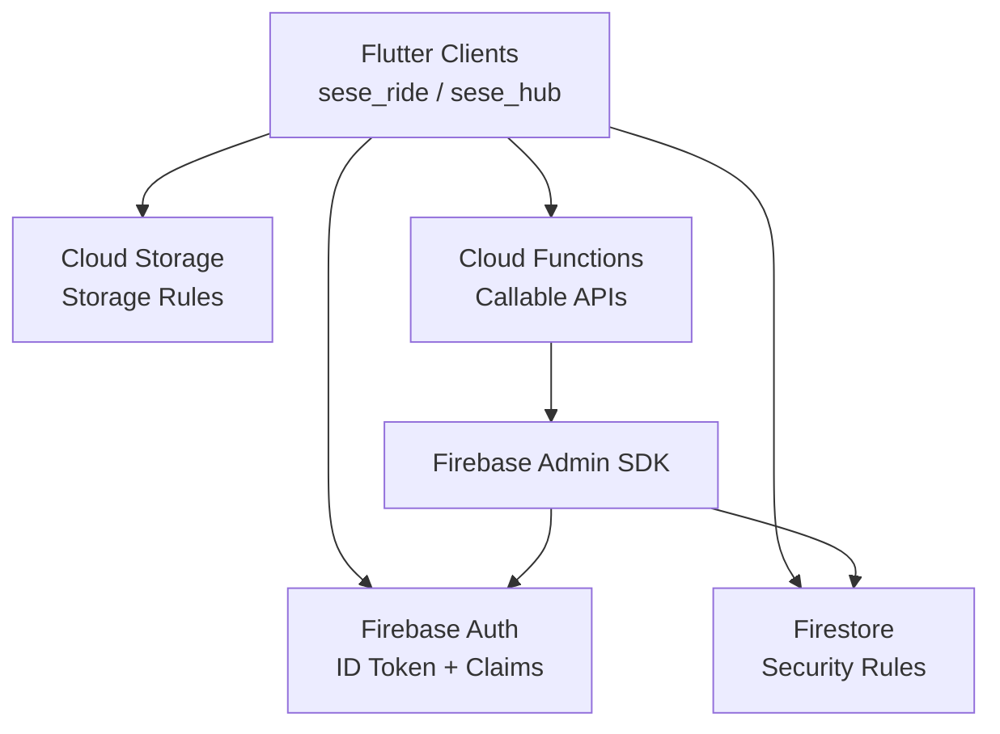
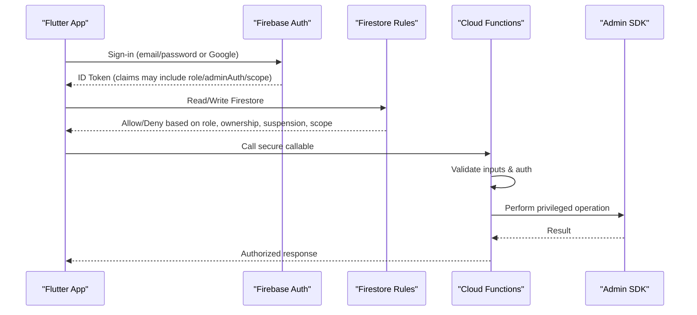
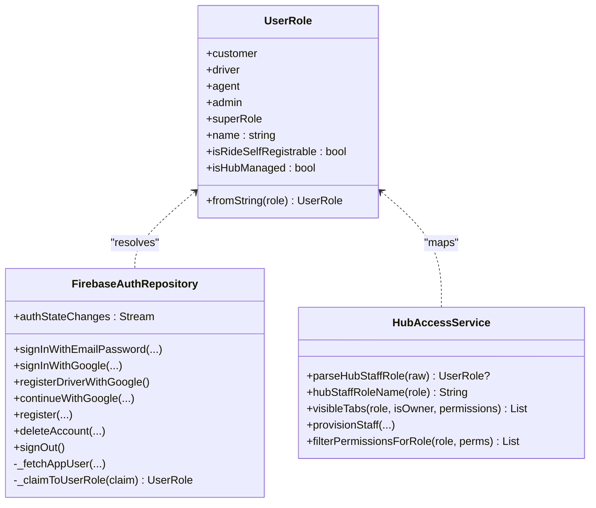
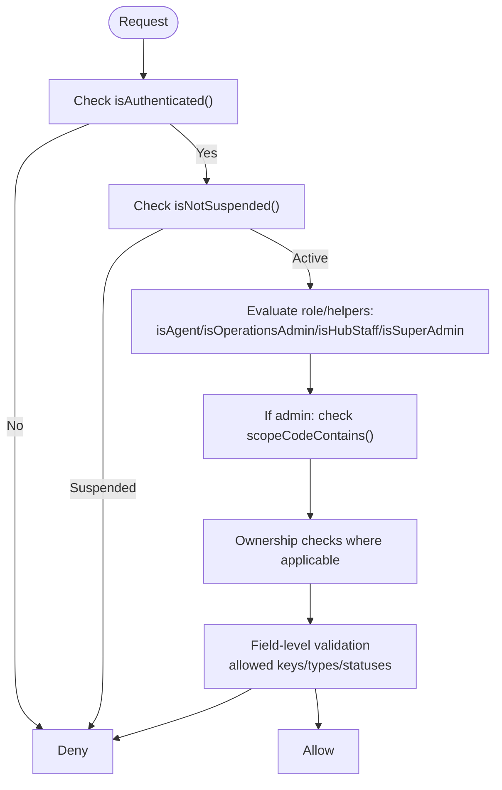
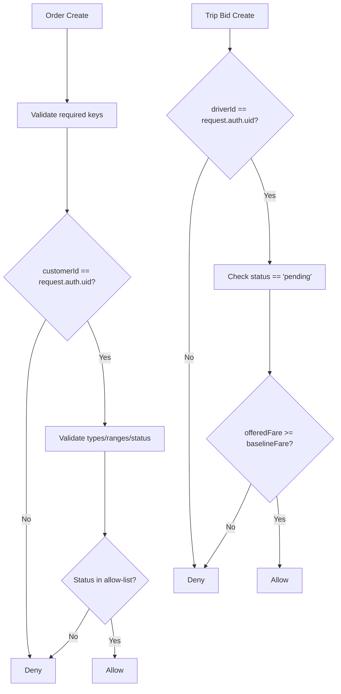
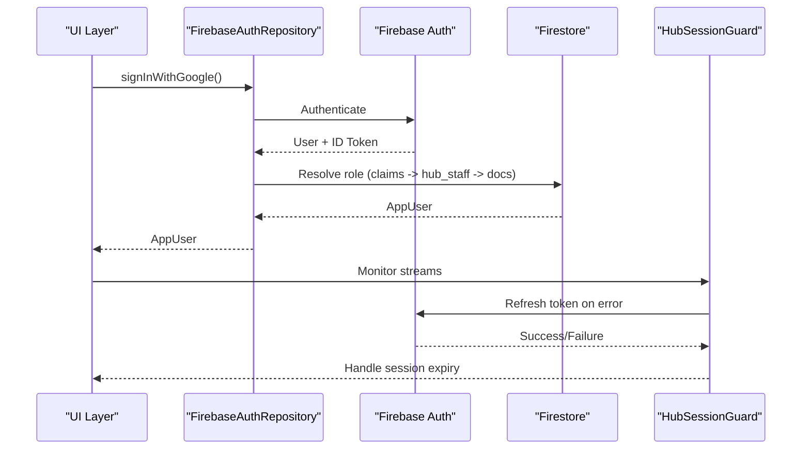
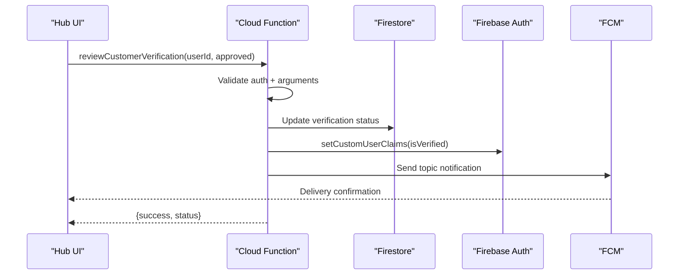
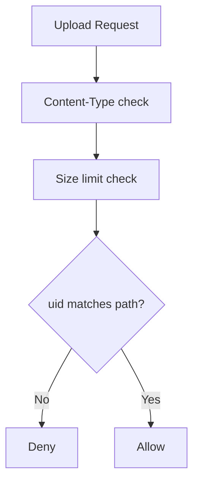
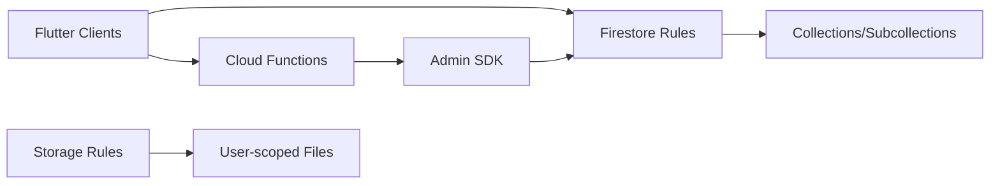

# Security and Authorization Framework

<cite>
**Referenced Files in This Document**
- [firestore.rules](file://firestore.rules)
- [storage.rules](file://storage.rules)
- [functions/src/index.ts](file://functions/src/index.ts)
- [functions/src/verification.ts](file://functions/src/verification.ts)
- [sese_core/lib/models/user_role.dart](file://sese_core/lib/models/user_role.dart)
- [sese_core/lib/auth/firebase_auth_repository.dart](file://sese_core/lib/auth/firebase_auth_repository.dart)
- [sese_hub/lib/features/staff/services/hub_access_service.dart](file://sese_hub/lib/features/staff/services/hub_access_service.dart)
- [sese_hub/lib/features/auth/hub_session_guard.dart](file://sese_hub/lib/features/auth/hub_session_guard.dart)
</cite>

## Table of Contents
1. [Introduction](#introduction)
2. [Project Structure](#project-structure)
3. [Core Components](#core-components)
4. [Architecture Overview](#architecture-overview)
5. [Detailed Component Analysis](#detailed-component-analysis)
6. [Dependency Analysis](#dependency-analysis)
7. [Performance Considerations](#performance-considerations)
8. [Troubleshooting Guide](#troubleshooting-guide)
9. [Conclusion](#conclusion)

## Introduction
This document explains the security and authorization framework for the application, focusing on:
- Role-based access control (RBAC) across customers, drivers, hub staff, and administrative roles.
- Firestore security rules for collection-level and field-level permissions.
- Authentication flow, session management, and token validation.
- Secure server-side callable patterns, input validation, and data protection strategies.
- Concrete rule patterns, permission checks, and anti-patterns to avoid.

The system uses Firebase Authentication for identity, Firestore Security Rules as the primary enforcement layer, Cloud Functions for privileged operations, and Flutter repositories for client-side role resolution and UI gating.

## Project Structure
Security-related code is distributed across:
- Firestore and Storage rules at the project root.
- Cloud Functions implementing secure callables and verification workflows.
- Shared core library defining user roles and authentication repository behavior.
- Hub app logic for staff qualification, module permissions, and session guards.

**Diagram sources**
- [firestore.rules:1-10](file://firestore.rules#L1-L10)
- [storage.rules:1-10](file://storage.rules#L1-L10)
- [functions/src/index.ts:1-25](file://functions/src/index.ts#L1-L25)
- [functions/src/verification.ts:1-10](file://functions/src/verification.ts#L1-L10)

**Section sources**
- [firestore.rules:1-10](file://firestore.rules#L1-L10)
- [storage.rules:1-10](file://storage.rules#L1-L10)
- [functions/src/index.ts:1-25](file://functions/src/index.ts#L1-L25)
- [functions/src/verification.ts:1-10](file://functions/src/verification.ts#L1-L10)

## Core Components
- User roles: customer, driver, agent, admin, superRole.
- RBAC via Firestore custom claims (`role`, `adminAuth`, `scope`) and Firestore documents (`users`, `drivers`, `hub_staff`).
- Firestore Security Rules enforcing ownership, role, suspension state, and scope-based admin access.
- Cloud Functions providing zero-trust callables with input validation and signed outputs.
- Client-side role resolution and session guard handling token refresh and error classification.

**Section sources**
- [sese_core/lib/models/user_role.dart:1-55](file://sese_core/lib/models/user_role.dart#L1-L55)
- [firestore.rules:116-157](file://firestore.rules#L116-L157)
- [functions/src/index.ts:71-199](file://functions/src/index.ts#L71-L199)
- [sese_core/lib/auth/firebase_auth_repository.dart:13-19](file://sese_core/lib/auth/firebase_auth_repository.dart#L13-L19)

## Architecture Overview
The authorization model combines multiple layers:
- Identity: Firebase Auth ID tokens carry user identity and optional custom claims.
- Data access: Firestore Security Rules evaluate request context, including auth, resource data, and cross-document reads.
- Privileged operations: Cloud Functions use the Admin SDK to bypass client rules while enforcing business logic.
- Client gating: Flutter repositories resolve roles from Firestore and claims; UI surfaces are gated accordingly.

**Diagram sources**
- [functions/src/index.ts:81-199](file://functions/src/index.ts#L81-L199)
- [firestore.rules:6-14](file://firestore.rules#L6-L14)
- [sese_core/lib/auth/firebase_auth_repository.dart:519-556](file://sese_core/lib/auth/firebase_auth_repository.dart#L519-L556)

## Detailed Component Analysis

### Role-Based Access Control (RBAC) Model
Roles and their intended usage:
- Customer: Self-registered rider who creates orders and interacts with marketplace flows.
- Driver: Self-registered or registered driver subject to onboarding and approval.
- Hub Staff: Provisioned support/admin users in the hub app with scoped permissions.
- Administrative Roles: Super Admin, Operations Admin, Finance Admin, Dispatch Operations, Security Auditor, Support roles. These are enforced through custom claims and scopes.

Key implementation points:
- Shared enum defines canonical roles and helpers for self-registration and hub-managed roles.
- Firestore rules define helper functions for authentication, owner checks, suspension checks, hub staff detection, and claim-based admin checks.
- Custom claims provide compact RBAC with a wildcard scope for Super Admin.

**Diagram sources**
- [sese_core/lib/models/user_role.dart:1-55](file://sese_core/lib/models/user_role.dart#L1-L55)
- [sese_core/lib/auth/firebase_auth_repository.dart:519-705](file://sese_core/lib/auth/firebase_auth_repository.dart#L519-L705)
- [sese_hub/lib/features/staff/services/hub_access_service.dart:85-178](file://sese_hub/lib/features/staff/services/hub_access_service.dart#L85-L178)

**Section sources**
- [sese_core/lib/models/user_role.dart:1-55](file://sese_core/lib/models/user_role.dart#L1-L55)
- [firestore.rules:116-157](file://firestore.rules#L116-L157)
- [sese_core/lib/auth/firebase_auth_repository.dart:13-19](file://sese_core/lib/auth/firebase_auth_repository.dart#L13-L19)
- [sese_hub/lib/features/staff/services/hub_access_service.dart:85-178](file://sese_hub/lib/features/staff/services/hub_access_service.dart#L85-L178)

### Firestore Security Rules: Collection-Level Permissions
Representative collections and their access patterns:
- Orders: Agents read/write under conditions; customers create orders; receivers consent; assigned drivers read active orders; market-open statuses are browsable by authenticated drivers.
- Trips: Customers and pinged/accepted drivers read live trip snapshots; only server writes update trip state; driver bids are restricted to own pending bid and baseline fare constraints.
- Drivers: Owner read/write; hub admins/staff read/update all; deletion reserved for Super Admin.
- Users: Owner read/write; hub admins/staff read/update; reviews readable by authenticated users; creation requires unsuspended status.
- Hub Staff: Primary owner provisions and updates roles; role values constrained to allow-list; assignment attribution enforced.
- System/Financial Vault: Super Admin-only read/write; runtime config vault read by admin claims, write disabled for clients.

**Diagram sources**
- [firestore.rules:6-14](file://firestore.rules#L6-L14)
- [firestore.rules:98-114](file://firestore.rules#L98-L114)
- [firestore.rules:116-157](file://firestore.rules#L116-L157)
- [firestore.rules:237-295](file://firestore.rules#L237-L295)
- [firestore.rules:315-366](file://firestore.rules#L315-L366)
- [firestore.rules:368-477](file://firestore.rules#L368-L477)
- [firestore.rules:487-503](file://firestore.rules#L487-L503)
- [firestore.rules:549-602](file://firestore.rules#L549-L602)

**Section sources**
- [firestore.rules:237-295](file://firestore.rules#L237-L295)
- [firestore.rules:315-366](file://firestore.rules#L315-L366)
- [firestore.rules:368-477](file://firestore.rules#L368-L477)
- [firestore.rules:487-503](file://firestore.rules#L487-L503)
- [firestore.rules:549-602](file://firestore.rules#L549-L602)

### Firestore Security Rules: Field-Level Security and Conditional Access
Examples of field-level and conditional patterns:
- Order creation validates required fields, enforces customerId equals caller uid, restricts allowed keys, validates idempotency key length, phone format, address presence, payment plan map, boolean flags, and status allow-list.
- Trip bid creation enforces driverId equals caller uid, status must be pending, offeredFare must be numeric and not below baseline fare fetched from the parent trip document.
- Driver vehicle registration allows owner to create vehicles with initial PENDING/ACTIVE states; updates limited to specific lifecycle transitions and flags; deletion disabled.
- Support tickets/messages enforce participant checks and immutable chat history; bot/admin writes are server-only.

**Diagram sources**
- [firestore.rules:61-83](file://firestore.rules#L61-L83)
- [firestore.rules:348-365](file://firestore.rules#L348-L365)
- [firestore.rules:397-413](file://firestore.rules#L397-L413)
- [firestore.rules:621-665](file://firestore.rules#L621-L665)

**Section sources**
- [firestore.rules:61-83](file://firestore.rules#L61-L83)
- [firestore.rules:348-365](file://firestore.rules#L348-L365)
- [firestore.rules:397-413](file://firestore.rules#L397-L413)
- [firestore.rules:621-665](file://firestore.rules#L621-L665)

### Authentication Flow, Session Management, and Token Validation
Client-side authentication and role resolution:
- The repository supports email/password and Google sign-in flows.
- Role resolution order prioritizes owner email bootstrap, then ID-token custom claims, then hub staff records (in hub app), then driver/customer documents, defaulting to customer.
- Driver sign-in without an existing driver document throws a specific error; driver registration creates a driver profile with onboarding state.
- Account deletion performs re-authentication, soft-deletes profiles, schedules purge, deletes the Auth account, and signs out.

Token validation and session guard:
- Hub session guard handles token refresh failures and classifies errors indicating expired sessions (unauthenticated or permission denied).
- Firestore rules rely on `request.auth` and custom claims; if claims are stale or missing, requests may be denied until refreshed.

**Diagram sources**
- [sese_core/lib/auth/firebase_auth_repository.dart:97-122](file://sese_core/lib/auth/firebase_auth_repository.dart#L97-L122)
- [sese_core/lib/auth/firebase_auth_repository.dart:519-671](file://sese_core/lib/auth/firebase_auth_repository.dart#L519-L671)
- [sese_core/lib/auth/firebase_auth_repository.dart:426-487](file://sese_core/lib/auth/firebase_auth_repository.dart#L426-L487)
- [sese_hub/lib/features/auth/hub_session_guard.dart:29-62](file://sese_hub/lib/features/auth/hub_session_guard.dart#L29-L62)

**Section sources**
- [sese_core/lib/auth/firebase_auth_repository.dart:97-122](file://sese_core/lib/auth/firebase_auth_repository.dart#L97-L122)
- [sese_core/lib/auth/firebase_auth_repository.dart:519-671](file://sese_core/lib/auth/firebase_auth_repository.dart#L519-L671)
- [sese_core/lib/auth/firebase_auth_repository.dart:426-487](file://sese_core/lib/auth/firebase_auth_repository.dart#L426-L487)
- [sese_hub/lib/features/auth/hub_session_guard.dart:29-62](file://sese_hub/lib/features/auth/hub_session_guard.dart#L29-L62)

### Cloud Functions: Zero-Trust Callables and Input Validation
Secure callable patterns:
- All callables verify `request.auth`; unauthenticated callers receive explicit errors.
- Inputs are validated for type, bounds, and allowed values before any external API calls or database writes.
- Outputs include cryptographic tokens (e.g., fare tokens) to prevent client tampering.

Verification workflow:
- Hub admins approve/reject KYC and driver onboarding via callables.
- Verification changes update Firestore documents and set custom claims (`isVerified`) using Admin SDK.
- Triggers synchronize claims and send FCM notifications when verification status changes.

**Diagram sources**
- [functions/src/index.ts:81-199](file://functions/src/index.ts#L81-L199)
- [functions/src/verification.ts:26-131](file://functions/src/verification.ts#L26-L131)
- [functions/src/verification.ts:138-241](file://functions/src/verification.ts#L138-L241)
- [functions/src/verification.ts:249-351](file://functions/src/verification.ts#L249-L351)

**Section sources**
- [functions/src/index.ts:81-199](file://functions/src/index.ts#L81-L199)
- [functions/src/verification.ts:26-131](file://functions/src/verification.ts#L26-L131)
- [functions/src/verification.ts:138-241](file://functions/src/verification.ts#L138-L241)
- [functions/src/verification.ts:249-351](file://functions/src/verification.ts#L249-L351)

### Storage Security Rules: File Uploads and Access
Storage rules protect sensitive files:
- Verification documents, driver onboarding assets, profile photos, vehicle inspection images, and live-camera verification snapshots are scoped per user.
- Allowed content types and size limits are enforced.
- Admins can read verification and onboarding documents; general uploads require authentication and ownership.

**Diagram sources**
- [storage.rules:5-14](file://storage.rules#L5-L14)
- [storage.rules:19-36](file://storage.rules#L19-L36)
- [storage.rules:48-55](file://storage.rules#L48-L55)
- [storage.rules:61-72](file://storage.rules#L61-L72)
- [storage.rules:77-83](file://storage.rules#L77-L83)

**Section sources**
- [storage.rules:5-14](file://storage.rules#L5-L14)
- [storage.rules:19-36](file://storage.rules#L19-L36)
- [storage.rules:48-55](file://storage.rules#L48-L55)
- [storage.rules:61-72](file://storage.rules#L61-L72)
- [storage.rules:77-83](file://storage.rules#L77-L83)

### Permission Checking in Client Code
- Shared role enum provides canonical names and helpers for self-registration and hub-managed roles.
- Hub access service parses hub staff roles, maps them to internal enums, computes visible tabs based on role and permissions, and filters sensitive permissions (e.g., staff management) for non-Super roles.
- Repository resolves roles from claims and Firestore, ensuring consistent UI routing and feature gating.

**Section sources**
- [sese_core/lib/models/user_role.dart:1-55](file://sese_core/lib/models/user_role.dart#L1-L55)
- [sese_hub/lib/features/staff/services/hub_access_service.dart:85-178](file://sese_hub/lib/features/staff/services/hub_access_service.dart#L85-L178)
- [sese_core/lib/auth/firebase_auth_repository.dart:519-705](file://sese_core/lib/auth/firebase_auth_repository.dart#L519-L705)

## Dependency Analysis
The security architecture depends on:
- Firestore Security Rules evaluating identity, ownership, suspension, and scope.
- Cloud Functions performing privileged operations with Admin SDK.
- Client repositories resolving roles and gating UI features.
- Storage rules protecting file uploads.

**Diagram sources**
- [firestore.rules:116-157](file://firestore.rules#L116-L157)
- [functions/src/index.ts:1-25](file://functions/src/index.ts#L1-L25)
- [storage.rules:1-10](file://storage.rules#L1-L10)

**Section sources**
- [firestore.rules:116-157](file://firestore.rules#L116-L157)
- [functions/src/index.ts:1-25](file://functions/src/index.ts#L1-L25)
- [storage.rules:1-10](file://storage.rules#L1-L10)

## Performance Considerations
- Minimize cross-document reads in rules; prefer scoping by uid and using indexes.
- Use compact custom claims for frequently checked roles/scopes to reduce rule complexity.
- Avoid heavy computations in rules; delegate complex logic to Cloud Functions.
- Cache role resolution on the client after successful login to reduce repeated Firestore reads.

[No sources needed since this section provides general guidance]

## Troubleshooting Guide
Common issues and resolutions:
- Unauthenticated or stale token errors: Ensure token refresh is handled; classify UNAUTHENTICATED and PERMISSION_DENIED errors to trigger sign-out or re-login.
- Permission denied due to missing claims: Verify that custom claims are minted and refreshed; ensure hub staff records exist for accounts without claims.
- Suspension blocks access: Check `users/{uid}.isSuspended`; unsuspend or route to appropriate messaging.
- Invalid argument errors in callables: Validate inputs thoroughly; return structured HttpsError codes and messages.

**Section sources**
- [sese_hub/lib/features/auth/hub_session_guard.dart:29-62](file://sese_hub/lib/features/auth/hub_session_guard.dart#L29-L62)
- [functions/src/index.ts:81-199](file://functions/src/index.ts#L81-L199)
- [firestore.rules:106-114](file://firestore.rules#L106-L114)

## Conclusion
The security and authorization framework combines robust Firestore Security Rules, Cloud Functions with zero-trust callables, and disciplined client-side role resolution. RBAC is enforced through custom claims and scoped permissions, while storage rules protect sensitive files. The system emphasizes least privilege, input validation, and clear separation between client-facing logic and server-authoritative operations. Following these patterns helps prevent common vulnerabilities such as privilege escalation, unauthorized data access, and client-side tampering.

[No sources needed since this section summarizes without analyzing specific files]