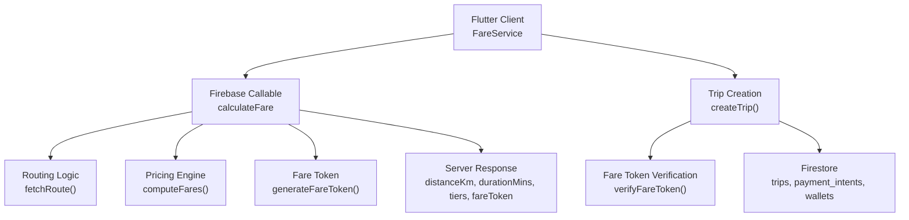
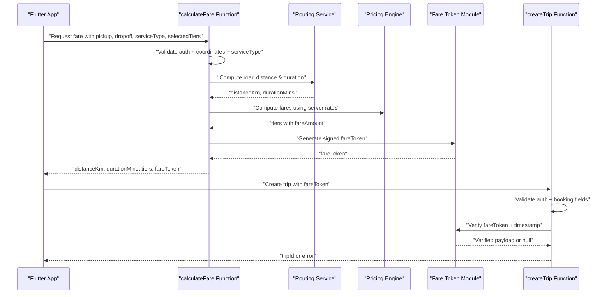
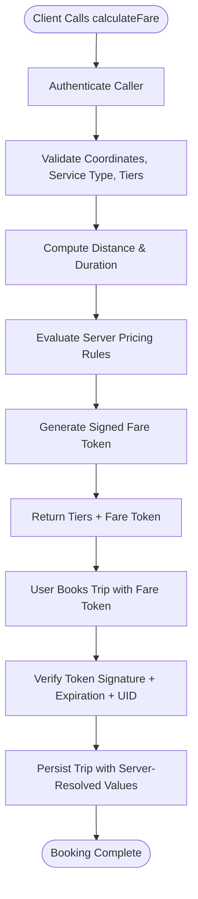
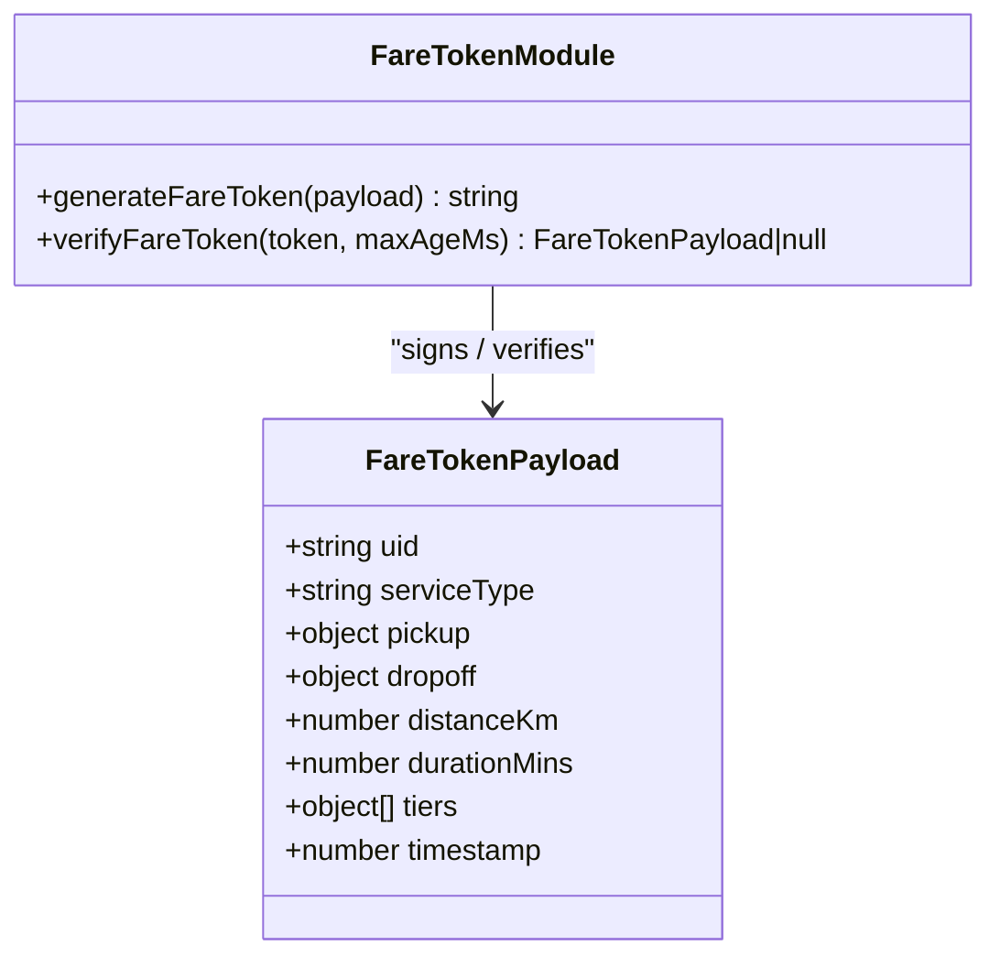
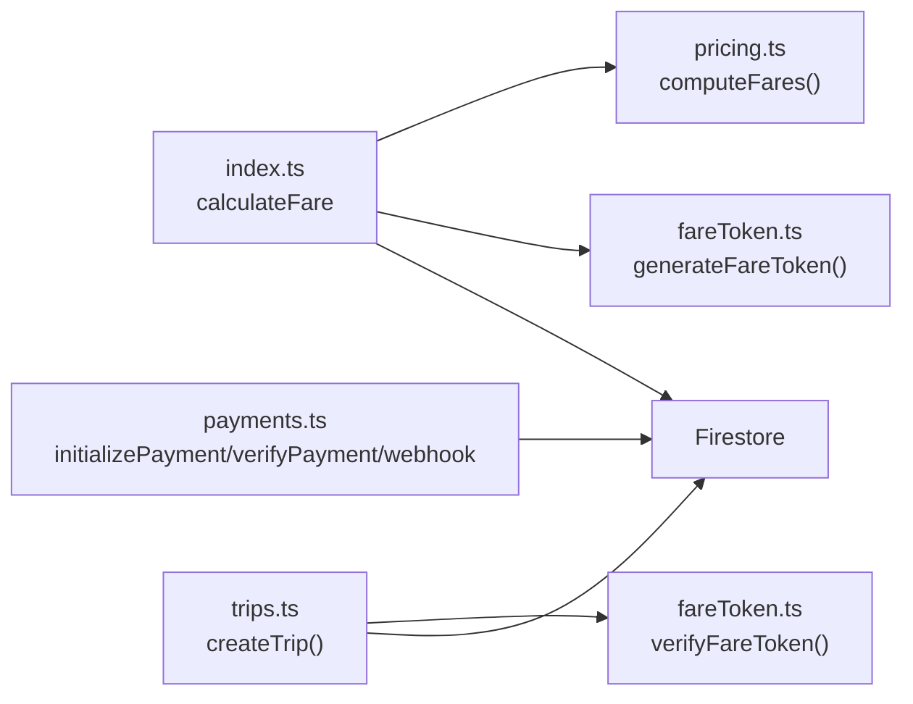

# Zero-Trust Architecture Implementation

<cite>
**Referenced Files in This Document**
- [functions/src/index.ts](file://functions/src/index.ts)
- [functions/src/pricing.ts](file://functions/src/pricing.ts)
- [functions/src/fareToken.ts](file://functions/src/fareToken.ts)
- [functions/src/trips.ts](file://functions/src/trips.ts)
- [functions/src/payments.ts](file://functions/src/payments.ts)
- [sese_ride/lib/features/customer/services/fare_service.dart](file://sese_ride/lib/features/customer/services/fare_service.dart)
</cite>

## Table of Contents
1. [Introduction](#introduction)
2. [Project Structure](#project-structure)
3. [Core Components](#core-components)
4. [Architecture Overview](#architecture-overview)
5. [Detailed Component Analysis](#detailed-component-analysis)
6. [Dependency Analysis](#dependency-analysis)
7. [Performance Considerations](#performance-considerations)
8. [Troubleshooting Guide](#troubleshooting-guide)
9. [Conclusion](#conclusion)

## Introduction
This document explains the zero-trust architecture implemented in SeSe App for critical pricing and booking operations. The core principle is simple: clients never compute or assert authoritative prices. Instead, the server computes fares, signs them with a cryptographic token, and later verifies that token before creating a trip. This prevents client tampering, replay attacks, and unauthorized price changes.

The implementation spans:
- A callable function that authenticates users, validates inputs, computes road-network distance and duration, evaluates server-side pricing rules, and returns signed fare tokens.
- A fare token system that binds user identity, route data, service type, selected tiers, and computed fares to a short-lived HMAC-SHA256 signature.
- Trip creation logic that rejects bookings without a valid, non-expired fare token whose user ID matches the authenticated caller.
- Payment flows that enforce amount validation, idempotent settlement, and webhook signature verification.

## Project Structure
The zero-trust pricing and booking flow is primarily implemented in Cloud Functions (Node.js/TypeScript), with a Flutter client that delegates all fare computation to the backend.

**Diagram sources**
- [functions/src/index.ts:81-198](file://functions/src/index.ts#L81-L198)
- [functions/src/pricing.ts:166-236](file://functions/src/pricing.ts#L166-L236)
- [functions/src/fareToken.ts:21-58](file://functions/src/fareToken.ts#L21-L58)
- [functions/src/trips.ts:129-225](file://functions/src/trips.ts#L129-L225)
- [sese_ride/lib/features/customer/services/fare_service.dart:7-31](file://sese_ride/lib/features/customer/services/fare_service.dart#L7-L31)

**Section sources**
- [functions/src/index.ts:1-24](file://functions/src/index.ts#L1-L24)
- [functions/src/index.ts:81-198](file://functions/src/index.ts#L81-L198)
- [functions/src/pricing.ts:1-237](file://functions/src/pricing.ts#L1-L237)
- [functions/src/fareToken.ts:1-59](file://functions/src/fareToken.ts#L1-L59)
- [functions/src/trips.ts:111-225](file://functions/src/trips.ts#L111-L225)
- [sese_ride/lib/features/customer/services/fare_service.dart:1-108](file://sese_ride/lib/features/customer/services/fare_service.dart#L1-L108)

## Core Components
- **Callable Fare Calculator**: Authenticates the caller, validates coordinates and service type, computes distance and duration, evaluates regional pricing, and returns a signed fare token.
- **Pricing Engine**: Resolves region-specific rates from configuration, applies base fees, per-kilometer and per-minute rates, surge multipliers, and vehicle-tier multipliers.
- **Fare Token System**: Generates an HMAC-SHA256-signed token binding the full fare payload; verifies signatures and expiration.
- **Trip Creation Gatekeeper**: Verifies the fare token, enforces that the proposed fare cannot be lower than the baseline, and persists only server-resolved values into the live trip document.
- **Payment Security Boundary**: Validates amounts, currency, ownership, and webhook signatures; settles funds idempotently.

**Section sources**
- [functions/src/index.ts:81-198](file://functions/src/index.ts#L81-L198)
- [functions/src/pricing.ts:65-147](file://functions/src/pricing.ts#L65-L147)
- [functions/src/pricing.ts:166-236](file://functions/src/pricing.ts#L166-L236)
- [functions/src/fareToken.ts:21-58](file://functions/src/fareToken.ts#L21-L58)
- [functions/src/trips.ts:129-225](file://functions/src/trips.ts#L129-L225)
- [functions/src/payments.ts:5-25](file://functions/src/payments.ts#L5-L25)

## Architecture Overview
The zero-trust model treats every client input as untrusted. Critical calculations run on the server, and any downstream operation must prove it received an authoritative result through a signed token.

**Diagram sources**
- [functions/src/index.ts:81-198](file://functions/src/index.ts#L81-L198)
- [functions/src/fareToken.ts:21-58](file://functions/src/fareToken.ts#L21-L58)
- [functions/src/trips.ts:129-225](file://functions/src/trips.ts#L129-L225)

## Detailed Component Analysis

### Why Critical Calculations Must Run Server-Side
Client-side pricing can be bypassed by modifying network payloads, intercepting responses, or running custom code. In SeSe App, this risk is eliminated by:
- Requiring authentication before returning any authoritative fare.
- Computing distance and duration server-side rather than trusting client-reported values.
- Evaluating pricing rules against server-managed configuration.
- Signing the complete fare payload so any change invalidates the token.
- Rejecting trip creation unless the fare token is valid, non-expired, and bound to the authenticated user.

These controls ensure that even if a malicious actor modifies the UI or intercepts traffic, they cannot alter the final charged amount without a valid server-generated token.

**Section sources**
- [functions/src/index.ts:81-198](file://functions/src/index.ts#L81-L198)
- [functions/src/trips.ts:160-174](file://functions/src/trips.ts#L160-L174)
- [sese_ride/lib/features/customer/services/fare_service.dart:7-17](file://sese_ride/lib/features/customer/services/fare_service.dart#L7-L17)

### Complete Flow: Client Request to Server Validation and Response
1. **Client Request**: The Flutter `FareService` calls the `calculateFare` callable with pickup/dropoff coordinates, service type, and selected tiers. It does not compute fares locally.
2. **Authentication Guard**: The callable rejects unauthenticated requests.
3. **Input Validation**: Coordinates are validated for type and geographic bounds; service type is restricted to allowed values; tier arrays are validated.
4. **Distance and Duration**: The routing layer computes road-network distance and duration, with a fallback approximation if the external routing service fails.
5. **Pricing Evaluation**: The pricing engine resolves regional rates and computes fares for each requested tier or delivery category.
6. **Token Generation**: The server generates a signed fare token containing the user ID, service type, locations, distance, duration, and tier fares.
7. **Response**: The client receives displayable tier information plus the signed token.
8. **Booking**: When the user books, the app sends the same fare token. The server verifies it and creates the trip only if valid.

**Diagram sources**
- [functions/src/index.ts:81-198](file://functions/src/index.ts#L81-L198)
- [functions/src/pricing.ts:166-236](file://functions/src/pricing.ts#L166-L236)
- [functions/src/fareToken.ts:21-58](file://functions/src/fareToken.ts#L21-L58)
- [functions/src/trips.ts:129-225](file://functions/src/trips.ts#L129-L225)

**Section sources**
- [sese_ride/lib/features/customer/services/fare_service.dart:7-31](file://sese_ride/lib/features/customer/services/fare_service.dart#L7-L31)
- [functions/src/index.ts:81-198](file://functions/src/index.ts#L81-L198)
- [functions/src/trips.ts:129-225](file://functions/src/trips.ts#L129-L225)

### Fare Token System: Generation, Validation, and Expiration
The fare token is a compact, signed representation of the authoritative fare calculation. Its structure includes:
- User identifier
- Service type
- Pickup and dropoff coordinates
- Computed distance and duration
- Selected tiers with their server-computed fare amounts
- Timestamp indicating when the token was generated

Generation:
- The server serializes the payload and computes an HMAC-SHA256 signature using a signing secret.
- The encoded payload and signature are combined into a single token string.

Validation:
- The token is split into its encoded data and signature parts.
- The server recomputes the HMAC over the payload and compares it using a timing-safe comparison.
- The payload is parsed and checked for expiration based on the embedded timestamp.
- If any step fails, the token is rejected.

Expiration:
- Tokens have a maximum age measured in milliseconds.
- Expired tokens are rejected during trip creation, preventing replay of old pricing snapshots.

**Diagram sources**
- [functions/src/fareToken.ts:6-15](file://functions/src/fareToken.ts#L6-L15)
- [functions/src/fareToken.ts:21-58](file://functions/src/fareToken.ts#L21-L58)

**Section sources**
- [functions/src/fareToken.ts:1-59](file://functions/src/fareToken.ts#L1-L59)
- [functions/src/index.ts:180-190](file://functions/src/index.ts#L180-L190)
- [functions/src/trips.ts:160-167](file://functions/src/trips.ts#L160-L167)

### Security Boundaries Between Client and Server
| Boundary | Client Responsibility | Server Responsibility |
|---|---|---|
| Authentication | Maintain session and attach credentials | Verify JWT via Firebase Auth context |
| Location Input | Provide pickup and dropoff coordinates | Validate coordinate types and geographic bounds |
| Service Selection | Select service type and tiers | Restrict allowed values and normalize tier IDs |
| Pricing | Display server-provided tiers | Compute fares using server-side rates and formulas |
| Booking | Submit fare token and booking details | Verify token signature, expiration, and user binding |
| Payments | Initiate checkout through hosted flow | Validate amounts, currency, ownership, and webhook signatures |

**Section sources**
- [functions/src/index.ts:81-142](file://functions/src/index.ts#L81-L142)
- [functions/src/trips.ts:129-174](file://functions/src/trips.ts#L129-L174)
- [functions/src/payments.ts:5-25](file://functions/src/payments.ts#L5-L25)

### Data Validation Strategies
- **Coordinate Validation**: Latitude and longitude are checked for numeric type, finite value, and valid geographic range.
- **Service Type Validation**: Only allowed service types are accepted.
- **Tier Array Validation**: Selected tiers must be a non-empty array of non-empty strings.
- **Phone Number Validation**: Trip creation requires normalized Nigerian phone numbers.
- **Payment Amount Validation**: Minimum and maximum kobo amounts are enforced.
- **Currency Validation**: Payments must use the expected currency.
- **Ownership Validation**: Payment verification checks that the intent belongs to the authenticated user.

**Section sources**
- [functions/src/index.ts:95-142](file://functions/src/index.ts#L95-L142)
- [functions/src/trips.ts:136-158](file://functions/src/trips.ts#L136-L158)
- [functions/src/payments.ts:117-150](file://functions/src/payments.ts#L117-L150)
- [functions/src/payments.ts:292-325](file://functions/src/payments.ts#L292-L325)

### Trust Verification Processes
- **Fare Token Signature Verification**: Uses HMAC-SHA256 with a timing-safe comparison to prevent tampering.
- **Fare Token Expiration Check**: Rejects tokens older than the configured maximum age.
- **User Binding Verification**: Ensures the token’s user ID matches the authenticated caller.
- **Baseline Fare Enforcement**: The proposed fare cannot be lower than the baseline fare derived from the verified token.
- **Payment Intent Ownership**: Payment verification ensures the reference belongs to the requesting user.
- **Webhook Signature Verification**: Paystack webhooks are verified using HMAC before settlement.

**Section sources**
- [functions/src/fareToken.ts:33-58](file://functions/src/fareToken.ts#L33-L58)
- [functions/src/trips.ts:160-174](file://functions/src/trips.ts#L160-L174)
- [functions/src/payments.ts:292-325](file://functions/src/payments.ts#L292-L325)
- [functions/src/payments.ts:333-369](file://functions/src/payments.ts#L333-L369)

### How the Pricing Engine Prevents Manipulation
The pricing engine:
- Resolves effective regional configuration through a fallback chain: global default, country-specific rule, state-specific override.
- Applies base fees, per-kilometer rates, per-minute rates, and surge multipliers.
- For ride services, applies tier multipliers to variable fare while keeping the base fee as a floor.
- Rounds totals to two decimal places and formats currency using server-side symbols.
- Returns structured tier results that the client renders verbatim.

Because the client never computes these values, any attempt to modify displayed prices has no effect on the authoritative fare stored in the trip document.

**Section sources**
- [functions/src/pricing.ts:65-147](file://functions/src/pricing.ts#L65-L147)
- [functions/src/pricing.ts:166-236](file://functions/src/pricing.ts#L166-L236)
- [functions/src/index.ts:168-190](file://functions/src/index.ts#L168-L190)

### Error Handling for Invalid Tokens
When a fare token is invalid, expired, malformed, or bound to another user, trip creation fails early with a clear error. Common failure paths include:
- Missing or empty token
- Malformed token structure
- Signature mismatch
- Expired timestamp
- User ID mismatch

The client should prompt the user to recalculate the fare and retry booking.

**Section sources**
- [functions/src/fareToken.ts:33-58](file://functions/src/fareToken.ts#L33-L58)
- [functions/src/trips.ts:160-167](file://functions/src/trips.ts#L160-L167)

### Performance Considerations for Server-Side Calculations
- **Routing Fallback**: If the external routing service is unavailable, the server falls back to an approximate crow-flies distance with a winding factor and estimated urban speed.
- **Regional Configuration Resolution**: The pricing engine reads configuration documents in order and merges overrides, falling back to defaults if Firestore is unreachable.
- **Minimal Client Workload**: The Flutter client delegates all heavy computation to the server, reducing device CPU usage and battery drain.
- **Idempotent Settlement**: Payment settlement uses transactions to avoid duplicate credits.
- **Capped Dispatch Queries**: Driver ranking and dispatch queries limit candidate counts and radius to reduce Firestore load.

**Section sources**
- [functions/src/index.ts:144-166](file://functions/src/index.ts#L144-L166)
- [functions/src/pricing.ts:79-147](file://functions/src/pricing.ts#L79-L147)
- [functions/src/payments.ts:206-272](file://functions/src/payments.ts#L206-L272)
- [functions/src/trips.ts:252-287](file://functions/src/trips.ts#L252-L287)

### Common Attack Vectors and Zero-Trust Mitigations
| Attack Vector | Risk | Mitigation |
|---|---|---|
| Client-side price modification | User pays less than calculated fare | All pricing runs server-side; client displays only server-provided tiers |
| Tampered fare token | Attacker alters fare amounts | HMAC-SHA256 signature verification with timing-safe comparison |
| Replay attack | Old token reused after rate changes | Token expiration check prevents stale pricing |
| Wrong-user booking | Token used by different user | Token user ID must match authenticated caller |
| Underpriced proposal | Client proposes lower fare | Proposed fare cannot be below baseline fare from verified token |
| Fake payment confirmation | Client claims payment succeeded | Server verifies payment with provider and checks amount/currency |
| Webhook spoofing | Attacker sends fake settlement events | Webhook signature verification before processing |
| Unauthenticated access | Unauthorized fare or booking operations | Firebase Auth context required for callable functions |

**Section sources**
- [functions/src/index.ts:81-198](file://functions/src/index.ts#L81-L198)
- [functions/src/fareToken.ts:21-58](file://functions/src/fareToken.ts#L21-L58)
- [functions/src/trips.ts:160-174](file://functions/src/trips.ts#L160-L174)
- [functions/src/payments.ts:292-369](file://functions/src/payments.ts#L292-L369)

## Dependency Analysis
The zero-trust pricing and booking flow depends on several modules working together.

**Diagram sources**
- [functions/src/index.ts:21-24](file://functions/src/index.ts#L21-L24)
- [functions/src/index.ts:81-198](file://functions/src/index.ts#L81-L198)
- [functions/src/trips.ts:9-10](file://functions/src/trips.ts#L9-L10)
- [functions/src/trips.ts:129-225](file://functions/src/trips.ts#L129-L225)
- [functions/src/payments.ts:1-4](file://functions/src/payments.ts#L1-L4)

**Section sources**
- [functions/src/index.ts:21-24](file://functions/src/index.ts#L21-L24)
- [functions/src/index.ts:81-198](file://functions/src/index.ts#L81-L198)
- [functions/src/trips.ts:9-10](file://functions/src/trips.ts#L9-L10)
- [functions/src/trips.ts:129-225](file://functions/src/trips.ts#L129-L225)
- [functions/src/payments.ts:1-4](file://functions/src/payments.ts#L1-L4)

## Performance Considerations
- Prefer calling `calculateFare` once per route selection and reuse the returned fare token for booking.
- Avoid recalculating fares repeatedly during rapid UI interactions; debounce user input where appropriate.
- Monitor external routing service availability; the server fallback ensures continuity but may produce less accurate estimates.
- Cache regional configuration at the server level if needed, though the current fallback chain is designed to be efficient.
- Use idempotent payment verification; repeated calls return settled status without double-crediting.

[No sources needed since this section provides general guidance]

## Troubleshooting Guide
Common issues and how to diagnose them:

- **Unauthenticated Fare Calculation**: Occurs when the client lacks a valid Firebase session. Ensure the user is signed in before calling `calculateFare`.
- **Invalid Coordinates**: Occurs when latitude or longitude is missing, non-numeric, or outside valid bounds. Validate location inputs on the client and server.
- **Invalid Service Type or Tiers**: Occurs when unsupported service types or malformed tier arrays are sent. Restrict selections to allowed values.
- **Fare Token Verification Failed**: Occurs when the token is missing, malformed, expired, tampered, or bound to another user. Recalculate the fare and retry booking.
- **Proposed Fare Below Baseline**: Occurs when the client tries to book with a lower fare than the server-computed baseline. Enforce minimum fare at the client and reject on the server.
- **Payment Reference Not Found or Not Owned**: Occurs when verifying a payment reference that does not exist or belongs to another user. Ensure the correct reference is passed and the request is authenticated.
- **Paystack Webhook Signature Invalid**: Occurs when the webhook signature does not match the body. Verify the signing secret and raw body handling.

**Section sources**
- [functions/src/index.ts:81-142](file://functions/src/index.ts#L81-L142)
- [functions/src/fareToken.ts:33-58](file://functions/src/fareToken.ts#L33-L58)
- [functions/src/trips.ts:160-174](file://functions/src/trips.ts#L160-L174)
- [functions/src/payments.ts:292-369](file://functions/src/payments.ts#L292-L369)

## Conclusion
SeSe App’s zero-trust architecture ensures that critical pricing and booking operations are protected from client tampering. By computing fares server-side, signing them with a time-limited HMAC token, and verifying that token before creating trips, the system eliminates the most common manipulation vectors. Additional security boundaries around payments, input validation, and webhook verification further strengthen trust. This design makes it significantly harder for attackers to alter prices, replay old quotes, or forge payment confirmations, while still providing a responsive and user-friendly experience.

[No sources needed since this section summarizes without analyzing specific files]