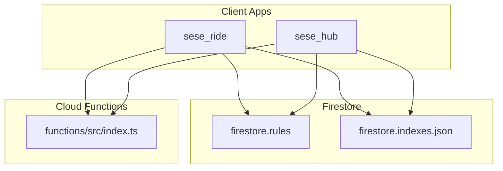
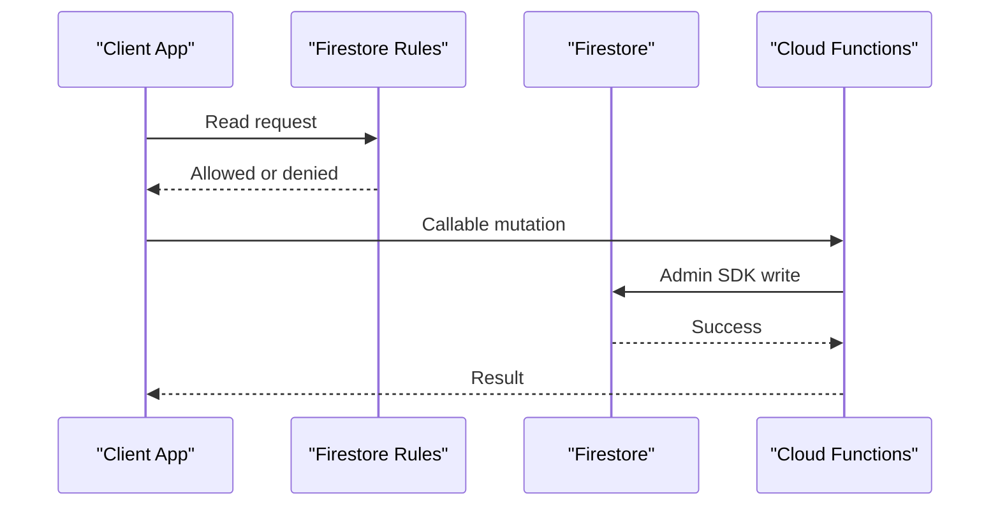
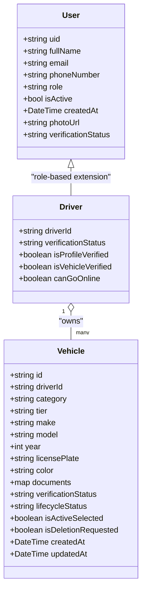
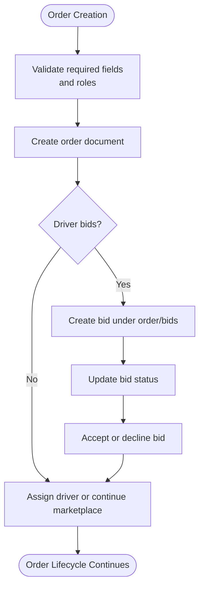
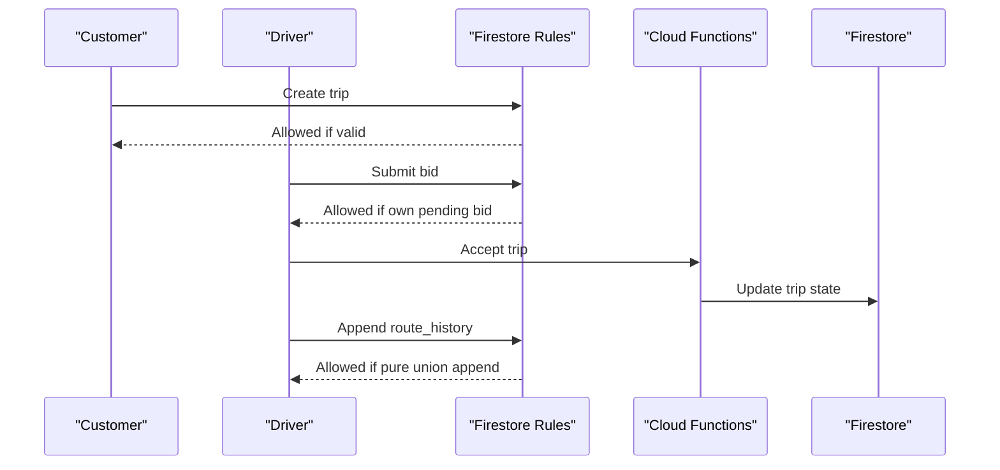
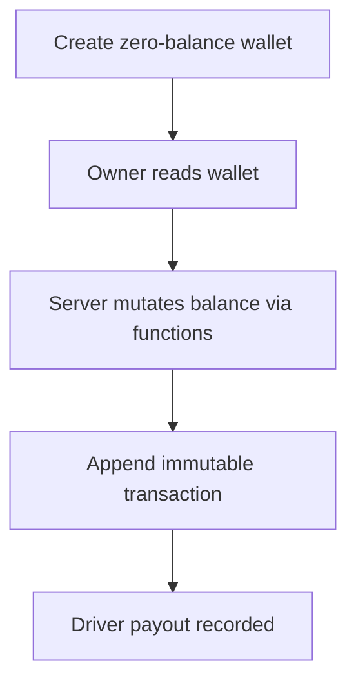
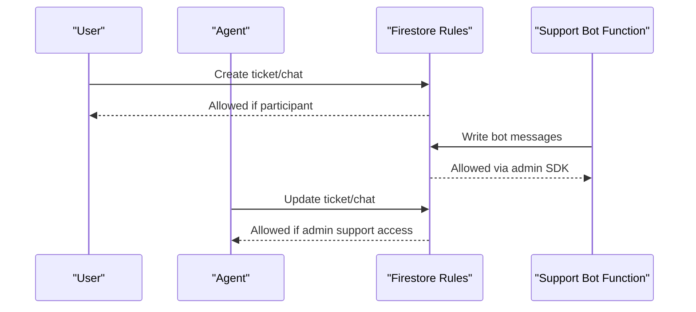
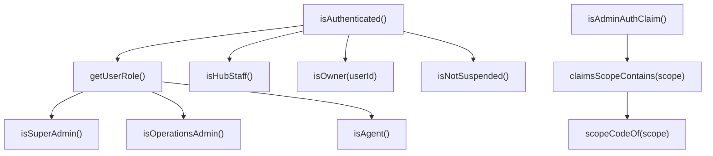

# Database Design

<cite>
**Referenced Files in This Document**   
- [firestore.rules](file://firestore.rules)
- [firestore.indexes.json](file://firestore.indexes.json)
- [functions/src/index.ts](file://functions/src/index.ts)
- [sese_core/lib/models/user_model.dart](file://sese_core/lib/models/user_model.dart)
- [sese_core/lib/models/vehicle_model.dart](file://sese_core/lib/models/vehicle_model.dart)
- [sese_core/lib/models/driver_verification.dart](file://sese_core/lib/models/driver_verification.dart)
</cite>

## Table of Contents
1. [Introduction](#introduction)
2. [Project Structure](#project-structure)
3. [Core Components](#core-components)
4. [Architecture Overview](#architecture-overview)
5. [Detailed Component Analysis](#detailed-component-analysis)
6. [Dependency Analysis](#dependency-analysis)
7. [Performance Considerations](#performance-considerations)
8. [Troubleshooting Guide](#troubleshooting-guide)
9. [Conclusion](#conclusion)

## Introduction
This document describes the Firestore database design for the application, including collection structure, document relationships, field definitions, data types, security rules, indexing strategy, lifecycle and archival policies, schema evolution guidance, and privacy/compliance considerations. The design is centered around a zero-trust architecture: clients may read or create only narrowly scoped documents, while authoritative state transitions are performed by Cloud Functions using the Firebase Admin SDK.

The most important collections visible in the rules and indexes include users, drivers, orders, trips, active_trips, delivery_jobs, wallets, payment_intents, driver_payouts, support tickets and chats, KYC submissions and documents, insurance policies and claims, fleet operator assets and contracts, campaigns, gamification progress, leaderboards, system configuration, audit logs, and region-scoped data.

## Project Structure
At the database layer, the repository exposes:
- Security rules defining role-based access control and validation constraints.
- Index declarations optimizing common queries across high-volume collections.
- Cloud Functions that act as the authoritative write path for sensitive state.
- Shared Flutter models describing user and vehicle documents consumed by the apps.

**Diagram sources**
- [firestore.rules:1-20](file://firestore.rules#L1-L20)
- [firestore.indexes.json:1-25](file://firestore.indexes.json#L1-L25)
- [functions/src/index.ts:1-25](file://functions/src/index.ts#L1-L25)

**Section sources**
- [firestore.rules:1-120](file://firestore.rules#L1-L120)
- [firestore.indexes.json:1-120](file://firestore.indexes.json#L1-L120)
- [functions/src/index.ts:1-60](file://functions/src/index.ts#L1-L60)

## Core Components
The core data model revolves around these primary entities:

- Users and Drivers
  - `users/{userId}` stores profile, role, verification status, suspension state, and reviews.
  - `drivers/{driverId}` mirrors driver-specific onboarding and operational state; it also owns nested subcollections such as vehicles, preferences, public profile, accessibility settings, compliance records, and telemetry.

- Orders and Trips
  - `orders/{orderId}` represents customer or agent-placed orders with bidding, assignment, and status flow.
  - `trips/{tripId}` captures live trip state, driver bids, receipts, and settlement-related metadata.
  - `active_trips/{tripId}` holds offline GPS breadcrumbs and in-app messages for an ongoing trip.

- Delivery Jobs
  - `delivery_jobs/{jobId}` supports item delivery flows with masked PII until acceptance and server-authoritative status transitions.

- Wallet, Payments, and Payouts
  - `wallets/{walletId}` and `wallet_transactions/{txId}` represent user wallets and immutable transaction ledgers.
  - `payment_intents/{reference}` tracks gateway intents created and settled server-side.
  - `driver_payouts/{payoutId}` records driver earnings payouts.

- Support, Safety, and Operations
  - `support_tickets/{ticketId}`, `support_chats/{chatId}`, and their message subcollections manage AI-first and human handover support.
  - `emergency_incidents/{alertId}` and `road_incidents/{incidentId}` handle safety events.
  - `settings/{settingId}` and `system_settings/{docId}` store operational configuration.

- KYC, Insurance, and Compliance
  - `kyc_submissions/{submissionId}`, `kyc_documents/{docId}` manage identity verification.
  - `driver_insurance_policies/{policyId}`, `customer_git_policies/{policyId}`, `insurance_claims/{claimId}` manage embedded insurance.

- Fleet Operator and Asset Management
  - `fleet_operators/{operatorId}`, `fleet_assets/{assetId}`, `fleet_contracts/{contractId}`, `wallet_vault/{vaultId}`, and `remittance_records/{recordId}` manage fleet operations and escrow-like accounting.

- System Configuration, Audit, and Governance
  - `system_configs/{configId}`, `system_config/{docId}`, `runtime_config_vault/{domain}`, `admin_audit_logs/{entryId}`, `audit_logs/{entryId}`, `data_regions/{region}/{docId=**}` provide configuration, secrets, audit trails, and regional data routing.

**Section sources**
- [firestore.rules:166-235](file://firestore.rules#L166-L235)
- [firestore.rules:237-366](file://firestore.rules#L237-L366)
- [firestore.rules:368-485](file://firestore.rules#L368-L485)
- [firestore.rules:487-520](file://firestore.rules#L487-L520)
- [firestore.rules:522-606](file://firestore.rules#L522-L606)
- [firestore.rules:608-720](file://firestore.rules#L608-L720)
- [firestore.rules:722-800](file://firestore.rules#L722-L800)
- [firestore.rules:800-945](file://firestore.rules#L800-L945)
- [firestore.rules:947-1032](file://firestore.rules#L947-L1032)
- [firestore.rules:1034-1117](file://firestore.rules#L1034-L1117)
- [firestore.rules:1119-1226](file://firestore.rules#L1119-L1226)
- [firestore.rules:1228-1325](file://firestore.rules#L1228-L1325)
- [firestore.rules:1327-1414](file://firestore.rules#L1327-L1414)
- [firestore.rules:1416-1518](file://firestore.rules#L1416-L1518)
- [firestore.rules:1526-1597](file://firestore.rules#L1526-L1597)

## Architecture Overview
The database architecture follows a strict separation between client-facing reads and server-authoritative writes:

- Clients authenticate via Firebase Auth and use Firestore to read data they are allowed to see.
- Sensitive mutations (fare calculation, trip lifecycle, wallet balances, payout processing, streak advancement, KYC approvals, insurance binding, etc.) go through Cloud Functions.
- Firestore Security Rules enforce RBAC, data validation, ownership checks, and immutability guarantees.
- Indexes optimize frequent queries over high-cardinality collections like drivers, trips, locations, metrics, and audit logs.

**Diagram sources**
- [firestore.rules:1-20](file://firestore.rules#L1-L20)
- [functions/src/index.ts:71-199](file://functions/src/index.ts#L71-L199)

**Section sources**
- [firestore.rules:1-120](file://firestore.rules#L1-L120)
- [functions/src/index.ts:1-60](file://functions/src/index.ts#L1-L60)

## Detailed Component Analysis

### Users and Drivers
- `users/{userId}`
  - Fields include uid, fullName, email, phoneNumber, role, isActive, createdAt, photoUrl, and verificationStatus.
  - Reviews are stored under `users/{userId}/reviews/{reviewId}`.
  - Access: owner read/write; agents/admins can read/update; deletion reserved for super admins.

- `drivers/{driverId}`
  - Driver onboarding and operational state mirror.
  - Subcollections:
    - `vehicles/{vehicleId}`: per-driver vehicle registry with verification and lifecycle states.
    - `preferences/{prefDoc}`: driver preference settings.
    - `profile/{docId}`: public profile data readable by authenticated users.
    - Telemetry and break state are server-managed or owner-scoped.
  - Access: owner read/write; hub staff and admins can read/update; deletion reserved for super admins.

**Diagram sources**
- [sese_core/lib/models/user_model.dart:4-57](file://sese_core/lib/models/user_model.dart#L4-L57)
- [sese_core/lib/models/vehicle_model.dart:3-70](file://sese_core/lib/models/vehicle_model.dart#L3-L70)
- [sese_core/lib/models/driver_verification.dart:1-24](file://sese_core/lib/models/driver_verification.dart#L1-L24)

**Section sources**
- [firestore.rules:368-485](file://firestore.rules#L368-L485)
- [sese_core/lib/models/user_model.dart:4-109](file://sese_core/lib/models/user_model.dart#L4-L109)
- [sese_core/lib/models/vehicle_model.dart:3-164](file://sese_core/lib/models/vehicle_model.dart#L3-L164)
- [sese_core/lib/models/driver_verification.dart:1-69](file://sese_core/lib/models/driver_verification.dart#L1-L69)

### Orders and Bids
- `orders/{orderId}`
  - Represents ride or delivery orders with fields such as customerId, receiverId, pickupAddress, dropoffAddress, paymentPlan, status, createdAt, and bidding metadata.
  - Supports hybrid dispatch tiers and targeted driver lists.
  - Access: agents and relevant participants can read; creation validated for customers or agents; updates constrained by role and affected keys.

- `orders/{orderId}/bids/{bidId}`
  - Per-driver bid documents keyed by driverId.
  - Access: agents and owners can read/create/update; order customer can read incoming bids; deletion reserved for super admins.

**Diagram sources**
- [firestore.rules:61-83](file://firestore.rules#L61-L83)
- [firestore.rules:237-295](file://firestore.rules#L237-L295)

**Section sources**
- [firestore.rules:61-83](file://firestore.rules#L61-L83)
- [firestore.rules:237-295](file://firestore.rules#L237-L295)

### Trips and Active Trips
- `trips/{tripId}`
  - Live trip state with driver offers, baseline fare, and status transitions.
  - Driver bids are stored under `trips/{tripId}/bids/{driverId}`.
  - Receipts are stored under `trips/{tripId}/receipts/{receiptId}` after settlement.

- `active_trips/{tripId}`
  - Offline GPS breadcrumb array appended by the assigned driver.
  - In-app messages under `active_trips/{tripId}/messages/{messageId}` auto-expire via Cloud Functions.

**Diagram sources**
- [firestore.rules:315-366](file://firestore.rules#L315-L366)
- [firestore.rules:849-878](file://firestore.rules#L849-L878)

**Section sources**
- [firestore.rules:315-366](file://firestore.rules#L315-L366)
- [firestore.rules:849-878](file://firestore.rules#L849-L878)

### Delivery Jobs
- `delivery_jobs/{jobId}`
  - Customer-created jobs with masked PII until acceptance.
  - Server-only status transitions; drivers can read pending jobs and stream state.

**Section sources**
- [firestore.rules:1034-1065](file://firestore.rules#L1034-L1065)

### Wallets, Payments, and Payouts
- `wallets/{walletId}`
  - Owner-read; creation restricted to zero-balance documents; balance mutations server-only.
  - Transactions under `wallets/{walletId}/transactions/{txId}` are immutable and server-written.

- `wallet_transactions/{txId}`
  - Append-only ledger; users can read transfers involving them.

- `payment_intents/{reference}`
  - Gateway intents minted and settled server-side; payer reads own intent.

- `driver_payouts/{payoutId}`
  - Driver-readable; server-only writes.

**Diagram sources**
- [firestore.rules:1147-1210](file://firestore.rules#L1147-L1210)
- [firestore.rules:1212-1226](file://firestore.rules#L1212-L1226)

**Section sources**
- [firestore.rules:1147-1210](file://firestore.rules#L1147-L1210)
- [firestore.rules:1212-1226](file://firestore.rules#L1212-L1226)

### Support Tickets and Chats
- `support_tickets/{ticketId}`
  - Users create tickets in QUEUED or bot_active states; participants read their own tickets.
  - Messages under `support_tickets/{ticketId}/messages/{messageId}` are immutable chat history.

- `support_chats/{chatId}`
  - AI-first support with human handover; participants read/write messages; admin support access controlled by scopes.

**Diagram sources**
- [firestore.rules:616-712](file://firestore.rules#L616-L712)

**Section sources**
- [firestore.rules:616-712](file://firestore.rules#L616-L712)

### KYC, Insurance, and Compliance
- `kyc_submissions/{submissionId}`
  - Users create submissions; operations admins update status and review metadata.

- `kyc_documents/{docId}`
  - Operations admins read/create/update; deletion reserved for super admins.

- `driver_insurance_policies/{policyId}`, `customer_git_policies/{policyId}`, `insurance_claims/{claimId}`
  - Server-authoritative policy creation and claim submission; owner and admin read access.

**Section sources**
- [firestore.rules:714-735](file://firestore.rules#L714-L735)
- [firestore.rules:1526-1575](file://firestore.rules#L1526-L1575)

### Fleet Operator and Asset Management
- `fleet_operators/{operatorId}`
  - Verification registry written only by backend callable; operators and super admins read.

- `fleet_assets/{assetId}`, `fleet_contracts/{contractId}`
  - Operators manage assets and contracts; financial fields are server-owned.

- `wallet_vault/{vaultId}`, `remittance_records/{recordId}`
  - Driver/operator escrow entries and immutable audit trail; server-only writes.

**Section sources**
- [firestore.rules:1259-1325](file://firestore.rules#L1259-L1325)

### System Configuration, Audit, and Governance
- `system_configs/{configId}`, `system_config/{docId}`
  - Public config docs readable by authenticated users; secret configs restricted to admins.

- `runtime_config_vault/{domain}`, `runtime_config_events/{eventId}`
  - Encrypted credentials and event logs; admin-only read; writes disabled from clients.

- `admin_audit_logs/{entryId}`, `audit_logs/{entryId}`
  - Immutable append-only ledgers; admin-only read; writes disabled from clients.

- `data_regions/{region}/{docId=**}`
  - Region-tagged data; writes must carry valid data_region tag; admin-only access.

**Section sources**
- [firestore.rules:522-606](file://firestore.rules#L522-L606)
- [firestore.rules:987-1032](file://firestore.rules#L987-L1032)
- [firestore.rules:513-520](file://firestore.rules#L513-L520)

## Dependency Analysis
Security rules define role helpers and scope mapping:
- Authentication and role helpers: isAuthenticated, getUserRole, isSuperAdmin, isOperationsAdmin, isAgent, isHubStaff, isOwner, isNotSuspended.
- Compact custom claims RBAC: isAdminAuthClaim, claimsScopeContains, scopeCodeOf.
- Data validation helpers: isValidCustomerOrderCreate, hasValidPhoneNumber, isZeroBalanceWalletCreate, isPublicSystemConfig.

These helpers centralize permission logic and ensure consistent enforcement across collections.

**Diagram sources**
- [firestore.rules:6-157](file://firestore.rules#L6-L157)

**Section sources**
- [firestore.rules:6-157](file://firestore.rules#L6-L157)

## Performance Considerations
Indexing strategy focuses on high-frequency query patterns:
- Drivers: online status, last seen, and ordering by name for search and presence.
- Trips: status-based filtering with ping expiration and dispatch tier windows.
- Active trips: driverId and status for real-time dashboards.
- Audit logs: timestamp descending with adminEmail or parameterModified for auditing UIs.
- Completed trips: riderId and createdAt for trip history.
- Driver locations: geospatial and online filters with timestamps.
- Driver metrics and events: driverId and day/timestamp for analytics.
- Emergency incidents: status and created_at for SOS queues.
- Failed payouts DLQ: campaignId, status, nextRetryAt for retry scheduling.
- Orders: phone, driverName, orderId for lookup and reporting.

Recommendations:
- Prefer composite indexes aligned with query predicates and sort orders.
- Use sparse indexes where fields are optional.
- Avoid unnecessary compound indexes to reduce write overhead.
- Monitor index usage and remove unused indexes.

**Section sources**
- [firestore.indexes.json:1-800](file://firestore.indexes.json#L1-L800)

## Troubleshooting Guide
Common issues and resolutions:
- Unauthenticated requests: Ensure the client is signed in before reading/writing.
- Suspension gate: Check `users/{uid}.isSuspended`; suspended accounts are blocked from many operations.
- Invalid order creation: Verify required fields and allowed statuses for orders.
- Bid tampering: Only the owning driver can create/update their own bid; customers can read incoming bids.
- Route history mutation: Only append via arrayUnion; any other field change is rejected.
- Wallet balance forgery: Creation must be zero-balance; all balance changes occur server-side.
- Secret exposure: Do not attempt to read secret configs; they are restricted to admins.

**Section sources**
- [firestore.rules:61-83](file://firestore.rules#L61-L83)
- [firestore.rules:106-114](file://firestore.rules#L106-L114)
- [firestore.rules:315-366](file://firestore.rules#L315-L366)
- [firestore.rules:849-878](file://firestore.rules#L849-L878)
- [firestore.rules:1147-1210](file://firestore.rules#L1147-L1210)
- [firestore.rules:987-1032](file://firestore.rules#L987-L1032)

## Conclusion
The Firestore schema enforces a robust, zero-trust data model with clear boundaries between client-facing reads and server-authoritative writes. Security rules implement comprehensive RBAC, validation, and immutability guarantees. Indexes are tuned for performance-critical queries across drivers, trips, locations, metrics, and audit logs. Lifecycle management is centralized in Cloud Functions, ensuring consistency and security for sensitive operations such as fares, settlements, payouts, KYC approvals, and insurance bindings. Privacy and compliance are addressed through region-tagged data, restricted secrets, and audit trails.