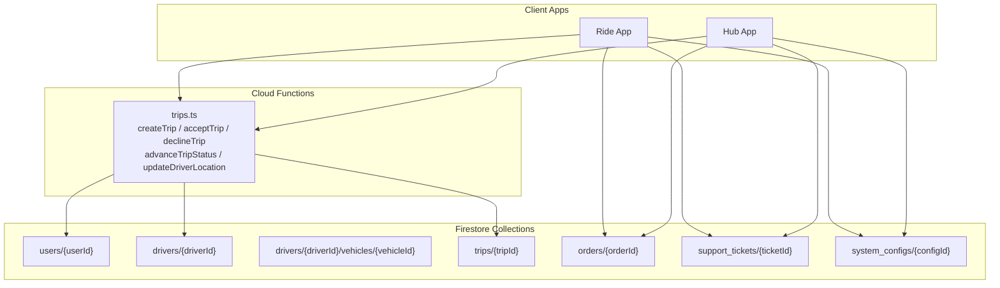
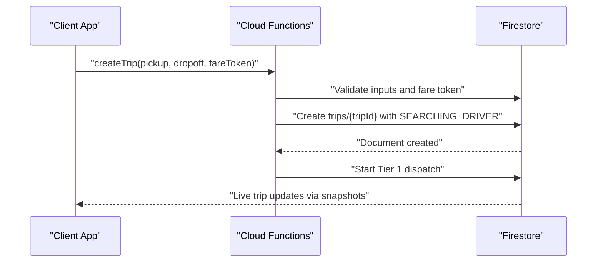
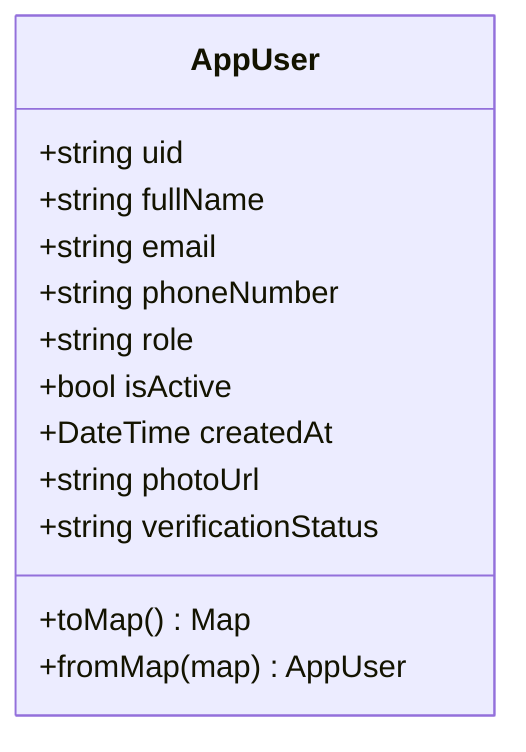
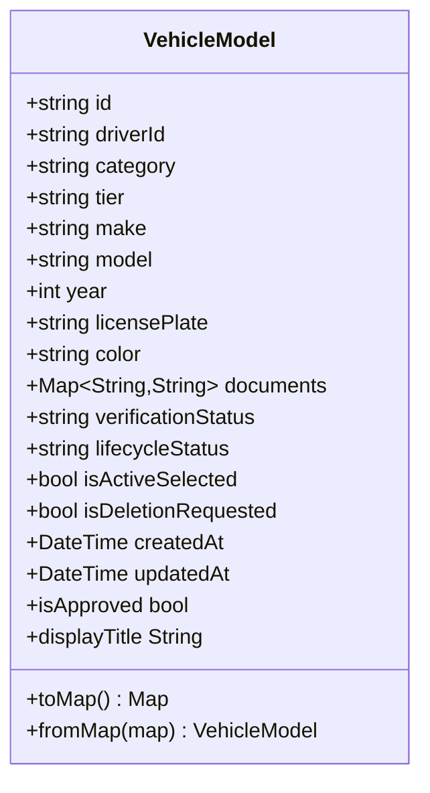
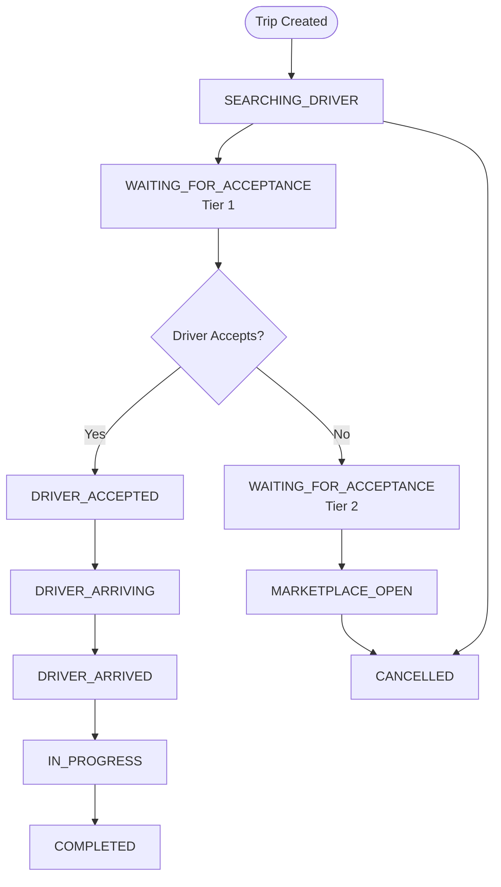
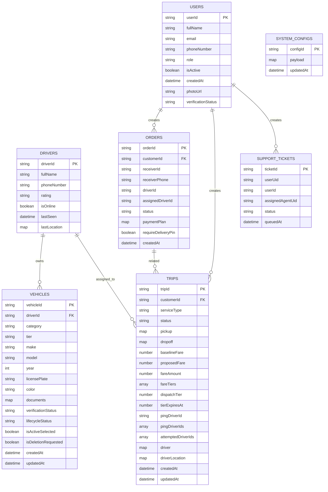
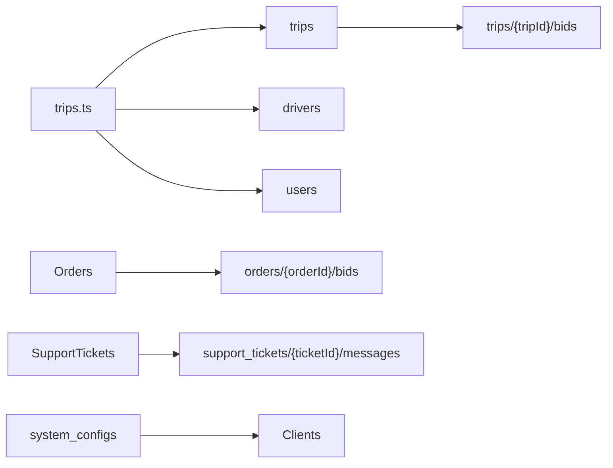

# Firestore Schema

<cite>
**Referenced Files in This Document**   
- [firestore.indexes.json](file://firestore.indexes.json)
- [firestore.rules](file://firestore.rules)
- [functions/src/trips.ts](file://functions/src/trips.ts)
- [sese_core/lib/models/user_model.dart](file://sese_core/lib/models/user_model.dart)
- [sese_core/lib/models/vehicle_model.dart](file://sese_core/lib/models/vehicle_model.dart)
- [sese_core/lib/models/trip_estimate.dart](file://sese_core/lib/models/trip_estimate.dart)
</cite>

## Table of Contents
1. [Introduction](#introduction)
2. [Project Structure](#project-structure)
3. [Core Components](#core-components)
4. [Architecture Overview](#architecture-overview)
5. [Detailed Component Analysis](#detailed-component-analysis)
6. [Dependency Analysis](#dependency-analysis)
7. [Performance Considerations](#performance-considerations)
8. [Troubleshooting Guide](#troubleshooting-guide)
9. [Conclusion](#conclusion)

## Introduction
This document describes the Firestore data model used by the application. It focuses on the core collections and subcollections that represent users, drivers, trips, orders, support tickets, and system configurations. It explains how documents are organized hierarchically, what fields they contain, which types are used, and what validation rules apply through Firestore Security Rules and Cloud Functions. It also covers indexing strategies, data lifecycle patterns, archival considerations, and regional compliance constraints visible in the schema.

The schema is primarily defined by:
- Firestore Security Rules, which enforce access control, field validation, and business-state transitions.
- Firestore Index definitions, which reveal query shapes and frequently filtered/sorted fields.
- Cloud Functions for Firebase, which implement server-authoritative state machines and write paths.
- Client-side Dart models, which define canonical field names and serialization behavior.

## Project Structure
At a high level, the relevant parts of the repository are:
- `firestore.rules`: Access control, validation, and business-rule enforcement for all collections.
- `firestore.indexes.json`: Composite indexes for collection-group queries across many collections.
- `functions/src/trips.ts`: Server-side trip dispatch state machine, driver matching, and live trip mutations.
- `sese_core/lib/models/*`: Dart models that mirror Firestore documents for users, vehicles, and trip estimates.

**Diagram sources**
- [firestore.rules:237-366](file://firestore.rules#L237-L366)
- [firestore.rules:368-470](file://firestore.rules#L368-L470)
- [firestore.rules:616-703](file://firestore.rules#L616-L703)
- [firestore.rules:531-536](file://firestore.rules#L531-L536)
- [functions/src/trips.ts:129-225](file://functions/src/trips.ts#L129-L225)

**Section sources**
- [firestore.rules:1-120](file://firestore.rules#L1-L120)
- [firestore.indexes.json:1-120](file://firestore.indexes.json#L1-L120)

## Core Components
The primary data entities are:

| Entity | Collection or Path | Purpose | Key Relationships |
|---|---|---|---|
| User | `users/{userId}` | Canonical authenticated user profile with role, verification status, and basic identity fields. | Referenced by orders, trips, support tickets, wallets, and feature-specific profiles. |
| Driver | `drivers/{driverId}` | Driver profile, availability, location, and onboarding state. | Parent to `vehicles`, `telemetry`, `preferences`, and public profile; referenced by trips and metrics. |
| Vehicle | `drivers/{driverId}/vehicles/{vehicleId}` | Driver’s registered vehicle with category, tier, documents, and approval/lifecycle state. | Owned by a driver; read by trip dispatch snapshot logic. |
| Trip | `trips/{tripId}` | Live ride/delivery dispatch state machine with customer, driver, fare, and location data. | Contains nested `bids/{driverId}`; related to `active_trips` breadcrumbs and receipts. |
| Order | `orders/{orderId}` | Delivery order with customer, receiver, driver assignment, bidding, and delivery state. | Contains nested `bids/{bidId}`; may reference driver and customer identities. |
| Support Ticket | `support_tickets/{ticketId}` | Customer/driver support ticket with queueing and agent assignment. | Contains nested `messages/{messageId}` chat history. |
| System Configuration | `system_configs/{configId}` | Publicly readable configuration values consumed by clients. | Admin-only writes; read by authenticated apps. |

These entities are enforced by security rules and indexed for common query patterns.

**Section sources**
- [firestore.rules:471-485](file://firestore.rules#L471-L485)
- [firestore.rules:368-470](file://firestore.rules#L368-L470)
- [firestore.rules:237-366](file://firestore.rules#L237-L366)
- [firestore.rules:616-703](file://firestore.rules#L616-L703)
- [firestore.rules:531-536](file://firestore.rules#L531-L536)
- [firestore.indexes.json:1-120](file://firestore.indexes.json#L1-L120)

## Architecture Overview
The data architecture follows a hybrid pattern:
- Clients create initial documents where allowed (for example, customers creating orders or tickets).
- Critical state transitions are performed exclusively by Cloud Functions using the Admin SDK, bypassing client-write restrictions.
- Firestore Security Rules provide zero-trust validation at the database boundary.
- Indexes are declared for collection-group queries that scan across many documents, such as filtering trips by status or orders by creation time.

**Diagram sources**
- [functions/src/trips.ts:129-225](file://functions/src/trips.ts#L129-L225)
- [functions/src/trips.ts:373-383](file://functions/src/trips.ts#L373-L383)
- [firestore.rules:315-366](file://firestore.rules#L315-L366)

**Section sources**
- [functions/src/trips.ts:12-26](file://functions/src/trips.ts#L12-L26)
- [firestore.rules:315-366](file://firestore.rules#L315-L366)

## Detailed Component Analysis

### Users Collection
The `users` collection stores the canonical user profile. The Dart model defines fields such as `uid`, `fullName`, `email`, `phoneNumber`, `role`, `isActive`, `createdAt`, `photoUrl`, and `verificationStatus`. The model serializes phone numbers into both normalized and E.164-like forms when present.

Key characteristics:
- Primary key: `userId` document ID.
- Role-based routing: driver accounts carry an onboarding-related `verificationStatus`.
- Auditability: reviews can be attached under `users/{userId}/reviews/{reviewId}`.

Validation and access:
- Owner can read/write their own user document.
- Agents and admins can read/update all users.
- Reviews are readable by authenticated users; only super admins can delete them.

**Diagram sources**
- [sese_core/lib/models/user_model.dart:5-30](file://sese_core/lib/models/user_model.dart#L5-L30)
- [sese_core/lib/models/user_model.dart:40-71](file://sese_core/lib/models/user_model.dart#L40-L71)

**Section sources**
- [sese_core/lib/models/user_model.dart:1-109](file://sese_core/lib/models/user_model.dart#L1-L109)
- [firestore.rules:471-485](file://firestore.rules#L471-L485)

### Drivers Collection
The `drivers` collection represents driver profiles and operational state. It is closely tied to:
- Vehicle registration under `drivers/{driverId}/vehicles`.
- Telemetry trail under `drivers/{driverId}/telemetry`.
- Preferences under `drivers/{driverId}/preferences`.
- Public profile under `drivers/{driverId}/profile`.

Key characteristics:
- Driver owns their driver document.
- Hub staff and agents can read and update driver records.
- Super admin can delete driver records.
- Driver break state and telemetry are owner-scoped.
- Public profile reads are open to authenticated users and agents.

Indexing signals from the index file include online status, last seen timestamps, and name-based ordering, indicating frequent queries for driver discovery and availability.

**Section sources**
- [firestore.rules:368-470](file://firestore.rules#L368-L470)
- [firestore.indexes.json:1-21](file://firestore.indexes.json#L1-L21)

### Vehicles Subcollection
Vehicles are stored under `/drivers/{driverId}/vehicles/{vehicleId}`. The Dart model defines:
- Identifier and owner reference (`id`, `driverId`).
- Category and optional ride tier.
- Make, model, year, license plate, color.
- Documents map for attachment references.
- Verification and lifecycle statuses.
- Active selection flag and deletion request flag.
- Timestamps for creation and update.

Business rules:
- Drivers can create vehicles with initial pending verification and active lifecycle.
- Drivers can update selected vehicle and request deletion, but cannot self-approve.
- Operations admins, hub staff, and super admins can manage verification and lifecycle transitions.
- Deletion is soft via flags rather than hard deletes.

**Diagram sources**
- [sese_core/lib/models/vehicle_model.dart:5-40](file://sese_core/lib/models/vehicle_model.dart#L5-L40)
- [sese_core/lib/models/vehicle_model.dart:51-112](file://sese_core/lib/models/vehicle_model.dart#L51-L112)

**Section sources**
- [sese_core/lib/models/vehicle_model.dart:1-164](file://sese_core/lib/models/vehicle_model.dart#L1-L164)
- [firestore.rules:389-413](file://firestore.rules#L389-L413)

### Trips Collection
The `trips` collection implements a server-authoritative dispatch state machine. A trip starts in `SEARCHING_DRIVER`, then moves through pinged acceptance states, marketplace broadcast, driver acceptance, arrival, progress, completion, or cancellation.

Important fields and relationships:
- `customerId`: trip owner.
- `serviceType`: ride or delivery.
- `status`: current dispatch or trip state.
- `pickup` and `dropoff`: coordinates, address, and phone metadata.
- `baselineFare`, `proposedFare`, `fareAmount`, `customTierFares`, `fareTiers`: dynamic pricing derived from a verified fare token.
- `dispatchTier`, `tierExpiresAt`, `pingDriverId`, `pingDriverIds`, `attemptedDriverIds`: cascading dispatch logic.
- `driver`: embedded driver snapshot including name, rating, phone, and vehicle details.
- `driverLocation`: live GPS breadcrumb during active trips.
- Nested `bids/{driverId}`: per-driver bid documents for offers and counter-offers.

Access and validation:
- Customers and assigned drivers can read live trip data.
- Direct client writes to trips are denied except for specific create conditions; most mutations go through Cloud Functions.
- Driver bids are writable only by the owning driver in pending state and must meet baseline fare constraints.

**Diagram sources**
- [functions/src/trips.ts:44-63](file://functions/src/trips.ts#L44-L63)
- [functions/src/trips.ts:295-370](file://functions/src/trips.ts#L295-L370)
- [functions/src/trips.ts:591-653](file://functions/src/trips.ts#L591-L653)
- [firestore.rules:315-366](file://firestore.rules#L315-L366)

**Section sources**
- [functions/src/trips.ts:129-225](file://functions/src/trips.ts#L129-L225)
- [functions/src/trips.ts:252-370](file://functions/src/trips.ts#L252-L370)
- [functions/src/trips.ts:591-796](file://functions/src/trips.ts#L591-L796)
- [firestore.rules:315-366](file://firestore.rules#L315-L366)

### Orders Collection
The `orders` collection represents delivery orders with customer, receiver, driver assignment, and bidding state. It supports:
- Customer-created orders with idempotency keys and required addresses.
- Receiver consent flow before searching begins.
- Driver assignment and delivery pin verification.
- Per-order bids under `orders/{orderId}/bids/{bidId}`.

Access and validation:
- Agents and relevant parties (customer, receiver, assigned driver, targeted drivers) can read orders.
- Creation is restricted to agents or valid customer requests.
- Updates are constrained by role and allowed field diffs.
- Bids allow driver participation and customer visibility.

Indexing indicates frequent queries by status, customer phone, driver name, order ID, OTP verification, tracking code, and selected vehicle categories.

**Section sources**
- [firestore.rules:237-295](file://firestore.rules#L237-L295)
- [firestore.indexes.json:744-1083](file://firestore.indexes.json#L744-L1083)

### Support Tickets Collection
Support tickets live under `support_tickets/{ticketId}` and include:
- `userUid` and `userId` for participant identification.
- `assignedAgentUid` for agent assignment.
- `status` supporting AI chat and legacy dispatch queue states.
- Nested `messages/{messageId}` for immutable chat history.

Access and validation:
- Participants (user or assigned agent) and support agents can read tickets.
- Users can create tickets in queued or bot-active states.
- Messages require participant or agent authorization and immutable append-only semantics.

Indexing shows queries by assigned agent, status, and queue timestamp.

**Section sources**
- [firestore.rules:616-703](file://firestore.rules#L616-L703)
- [firestore.indexes.json:1477-1513](file://firestore.indexes.json#L1477-L1513)

### System Configurations Collection
System configurations are stored under `system_configs/{configId}`. They are publicly readable by authenticated clients and writable only by super admins. This collection provides runtime configuration values consumed by applications without requiring login for read access in some cases.

Additionally, there is a top-level `system/runtime_configs` document that is publicly readable but never writable from clients.

**Section sources**
- [firestore.rules:522-536](file://firestore.rules#L522-L536)

### Data Model Relationships
The following diagram summarizes primary relationships between core collections:

**Diagram sources**
- [sese_core/lib/models/user_model.dart:5-30](file://sese_core/lib/models/user_model.dart#L5-L30)
- [sese_core/lib/models/vehicle_model.dart:5-40](file://sese_core/lib/models/vehicle_model.dart#L5-L40)
- [functions/src/trips.ts:180-222](file://functions/src/trips.ts#L180-L222)
- [firestore.rules:237-366](file://firestore.rules#L237-L366)
- [firestore.rules:616-703](file://firestore.rules#L616-L703)
- [firestore.rules:531-536](file://firestore.rules#L531-L536)

## Dependency Analysis
The main dependencies between components are:

- Cloud Functions depend on `trips`, `drivers`, and `users` to validate and mutate state.
- Trip dispatch depends on driver availability and location data.
- Vehicle information is embedded into trip driver snapshots for display.
- Orders and trips share similar dispatch and bidding concepts but serve different service types.
- Support tickets depend on user identity and agent assignment.
- System configurations are consumed by clients independently of transactional flows.

**Diagram sources**
- [functions/src/trips.ts:129-225](file://functions/src/trips.ts#L129-L225)
- [firestore.rules:237-366](file://firestore.rules#L237-L366)
- [firestore.rules:616-703](file://firestore.rules#L616-L703)
- [firestore.rules:531-536](file://firestore.rules#L531-L536)

**Section sources**
- [functions/src/trips.ts:252-370](file://functions/src/trips.ts#L252-L370)
- [firestore.rules:237-366](file://firestore.rules#L237-L366)

## Performance Considerations
Indexing strategy is evident from `firestore.indexes.json`. Common patterns include:
- Filtering by status and sorting by creation time for orders and trips.
- Querying by driver identifiers and timestamps for driver locations and metrics.
- Sorting by region, campaign scope, and lifecycle dates for campaigns and insurance policies.
- Aggregating support tickets by agent assignment and queue time.

Recommendations based on observed indexes:
- Prefer queries that match indexed fields exactly or within ranges.
- Use collection-group queries only when necessary, as they scan across multiple documents.
- Keep frequently filtered fields consistent with declared indexes to avoid expensive composite index growth.
- Avoid unindexed ad-hoc filters on large collections like `orders`, `trips`, and `driver_locations`.

**Section sources**
- [firestore.indexes.json:1-120](file://firestore.indexes.json#L1-L120)
- [firestore.indexes.json:744-1083](file://firestore.indexes.json#L744-L1083)
- [firestore.indexes.json:1477-1551](file://firestore.indexes.json#L1477-L1551)

## Troubleshooting Guide
Common issues and their likely causes:

| Symptom | Likely Cause | Resolution |
|---|---|---|
| Trip creation fails with invalid argument | Missing or malformed pickup/dropoff coordinates or phone numbers | Validate inputs before calling `createTrip`; ensure coordinates are finite and phones match expected format. |
| Fare verification error | Invalid or tampered fare token | Re-calculate fare server-side and sign the token before submission. |
| Driver cannot accept trip | Not a ping target or ping expired | Ensure driver is in the correct tier and responds before `pingExpiresAt`. |
| Bid rejected for below baseline fare | Offered fare less than trip baseline | Enforce minimum offered fare against `baselineFare`. |
| Order update blocked | Unauthorized role or disallowed field changes | Restrict updates to allowed roles and permitted field diffs. |
| Support message not written | Sender not a participant or missing required fields | Verify sender identity and required message shape. |

**Section sources**
- [functions/src/trips.ts:129-225](file://functions/src/trips.ts#L129-L225)
- [functions/src/trips.ts:591-653](file://functions/src/trips.ts#L591-L653)
- [firestore.rules:315-366](file://firestore.rules#L315-L366)
- [firestore.rules:616-703](file://firestore.rules#L616-L703)

## Conclusion
The Firestore schema is designed around secure, server-authoritative workflows with strong client-side validation and clear hierarchical organization. Users, drivers, vehicles, trips, orders, support tickets, and system configurations form a cohesive data model that supports ride and delivery operations, driver onboarding, support workflows, and dynamic configuration. Indexes reflect real query patterns, while security rules enforce business rules, role-based access, and compliance boundaries. For future evolution, maintain consistency between client models, server functions, and Firestore rules to preserve data integrity and performance.