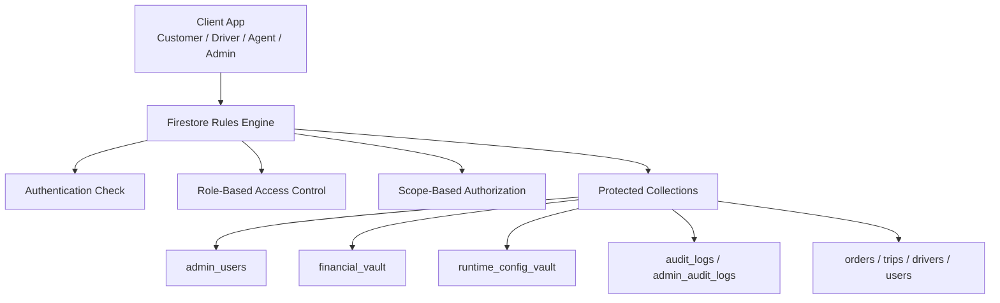
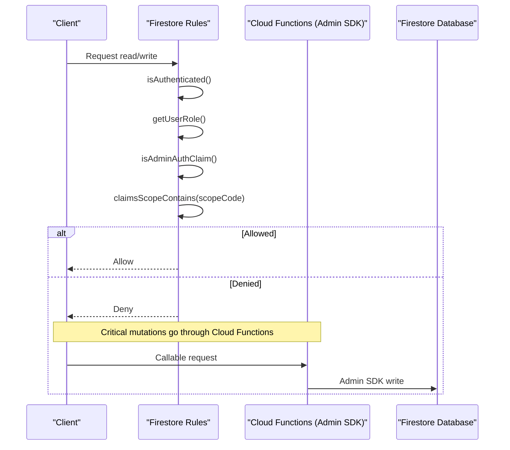
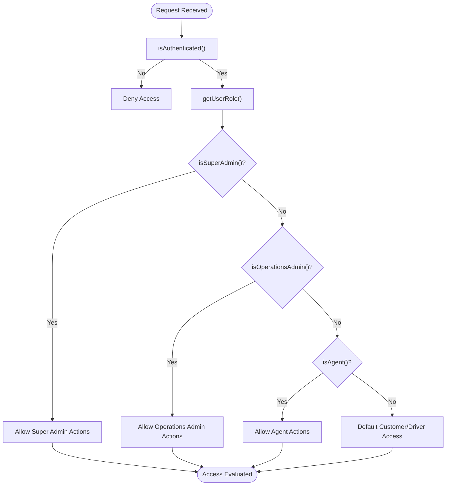
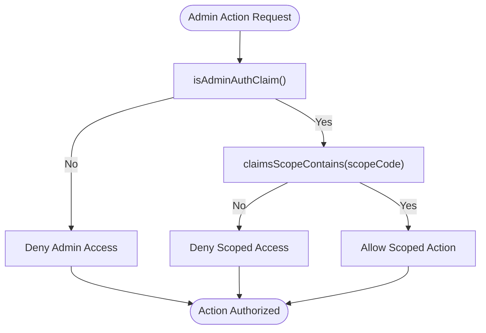
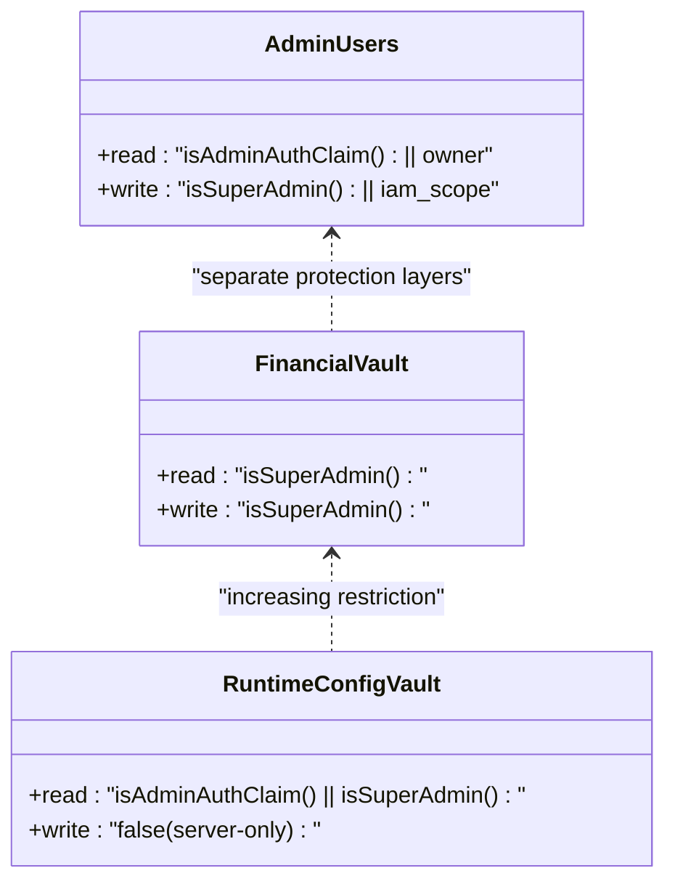
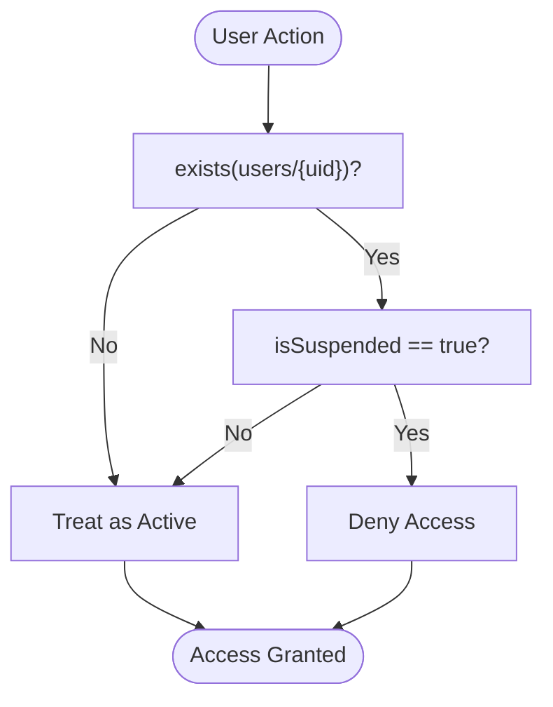
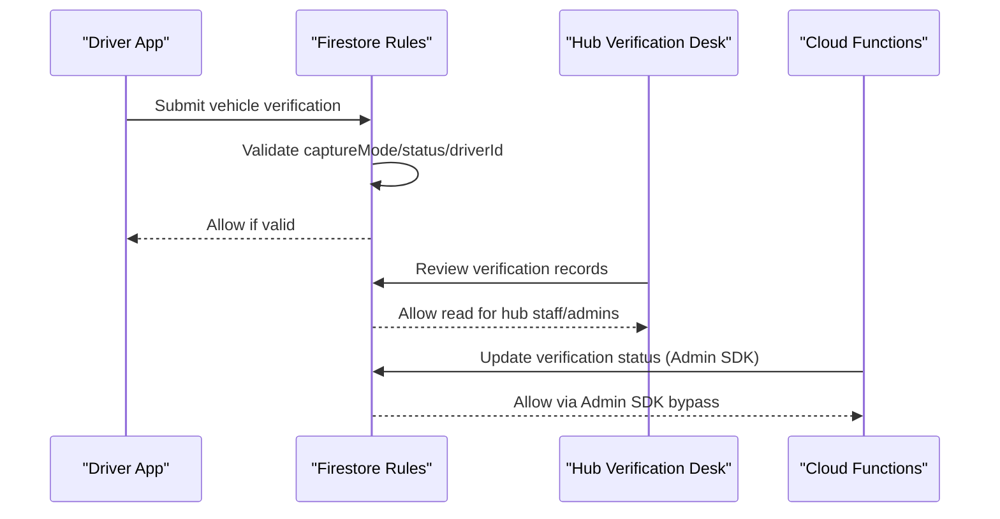
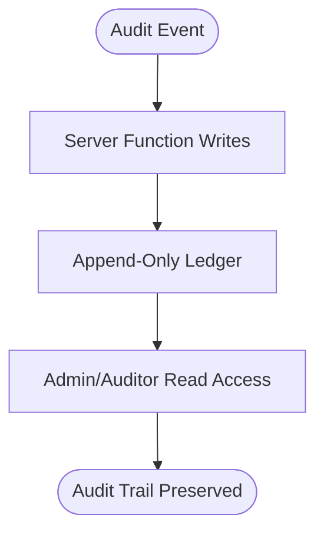
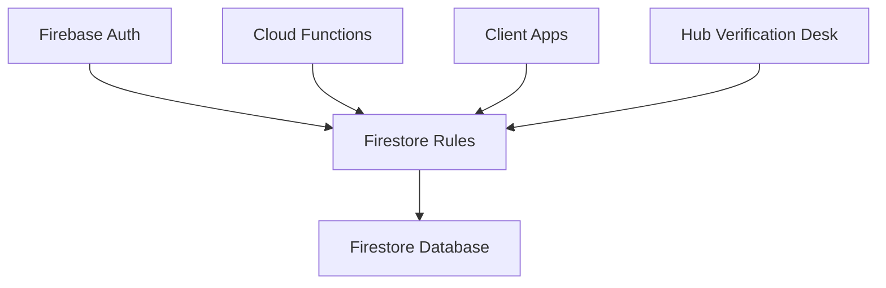

# Security Rules

<cite>
**Referenced Files in This Document**
- [firestore.rules](file://firestore.rules)
- [firebase_auth_repository.dart](file://sese_core/lib/auth/firebase_auth_repository.dart)
- [vehicle_verification_model.dart](file://sese_core/lib/models/vehicle_verification_model.dart)
- [driver_fleet_service.dart](file://sese_ride/lib/features/driver/services/driver_fleet_service.dart)
- [vehicle_approvals_screen.dart](file://sese_hub/lib/features/verification/presentation/vehicle_approvals_screen.dart)
</cite>

## Table of Contents
1. [Introduction](#introduction)
2. [Project Structure](#project-structure)
3. [Core Components](#core-components)
4. [Architecture Overview](#architecture-overview)
5. [Detailed Component Analysis](#detailed-component-analysis)
6. [Dependency Analysis](#dependency-analysis)
7. [Performance Considerations](#performance-considerations)
8. [Troubleshooting Guide](#troubleshooting-guide)
9. [Conclusion](#conclusion)

## Introduction
This document explains the Firestore security rules implementation for the project, focusing on role-based access control (RBAC), custom claims, scope-based authorization, data protection strategies, suspension handling, verification workflows, audit logging, and zero-trust principles. The rules define a layered security model where:

- Authentication is required before any sensitive operation.
- Roles are derived from Firebase custom claims.
- Administrative operations require both an admin claim and a scoped permission.
- Sensitive collections are restricted to super administrators or server-side functions.
- Client writes are minimized; most state transitions go through Cloud Functions using the Admin SDK.

The goal is to make the security model understandable for both technical and non-technical readers while providing precise references to the rule definitions.

## Project Structure
At the center of this security model is the Firestore rules file. It defines:

- Global helper functions for authentication and authorization.
- Role checks for customer, driver, agent, operations_admin, and super_admin.
- Scope-based authorization using compact scope codes.
- Collection-level access rules for business-critical data.
- Deny-all fallback for unmatched paths.

**Diagram sources**
- [firestore.rules:6-43](file://firestore.rules#L6-L43)
- [firestore.rules:116-157](file://firestore.rules#L116-L157)
- [firestore.rules:166-189](file://firestore.rules#L166-L189)
- [firestore.rules:549-606](file://firestore.rules#L549-L606)

**Section sources**
- [firestore.rules:1-800](file://firestore.rules#L1-L800)
- [firestore.rules:801-1600](file://firestore.rules#L801-L1600)

## Core Components
The core components of the security model include:

- **Authentication helpers**: `isAuthenticated()`, `getUserRole()`, `isSuperAdmin()`, `isOperationsAdmin()`, `isAgent()`.
- **Bootstrap owner backstop**: `isOwnerEmail()` allows the primary owner to act as super admin before custom claims are minted.
- **Hub staff bridge**: `isHubStaff()` grants verification-desk access based on provisioned staff records.
- **Suspension gate**: `isNotSuspended()` enforces real-time suspension status.
- **Custom claims RBAC**: `isAdminAuthClaim()` and `claimsScopeContains(scopeCode)` implement compact scope-based authorization.
- **Scope code mapping**: `scopeCodeOf()` maps verbose scopes to compact codes kept in sync with backend constants.

These helpers are reused across collection rules to enforce consistent access policies.

**Section sources**
- [firestore.rules:6-43](file://firestore.rules#L6-L43)
- [firestore.rules:51-55](file://firestore.rules#L51-L55)
- [firestore.rules:110-114](file://firestore.rules#L110-L114)
- [firestore.rules:116-157](file://firestore.rules#L116-L157)

## Architecture Overview
The security architecture follows a zero-trust approach:

- Clients are never trusted to mutate critical state directly.
- Most writes are denied at the rule level and performed by Cloud Functions using the Admin SDK.
- Read access is granted based on ownership, role, or scope.
- Sensitive data is isolated into vaults and restricted to super admins or authorized admins.
- Audit logs are append-only and readable only by auditors with appropriate scopes.

**Diagram sources**
- [firestore.rules:6-43](file://firestore.rules#L6-L43)
- [firestore.rules:116-157](file://firestore.rules#L116-L157)
- [firestore.rules:166-189](file://firestore.rules#L166-L189)

## Detailed Component Analysis

### Role-Based Access Control (RBAC)
The RBAC system uses Firebase custom claims to determine user roles:

- **customer**: Default role when no elevated role is present.
- **driver**: Explicit driver role.
- **agent**: Support or dispatch operations role.
- **operations_admin**: Operations management role.
- **super_admin**: Highest privilege role, including bootstrap owner email.

The rules define helper functions that check these roles and combine them with authentication and suspension status.

**Diagram sources**
- [firestore.rules:6-43](file://firestore.rules#L6-L43)

**Section sources**
- [firestore.rules:6-43](file://firestore.rules#L6-L43)
- [firebase_auth_repository.dart:685-705](file://sese_core/lib/auth/firebase_auth_repository.dart#L685-L705)

### Custom Claims and Scope-Based Authorization
Administrative access requires both an admin claim and a specific scope:

- `isAdminAuthClaim()` checks for admin-authenticated users with elevated roles.
- `claimsScopeContains(scopeCode)` verifies that the user has the required scope.
- `scopeCodeOf()` maps verbose scopes to compact codes like `iam`, `vault`, `ledger`, `payouts`, `tracking`, `incidents`, `kyc`, `settings`, `audit`, `suspend`, `cust`, `drv`.

This design ensures that even if a user has an admin role, they cannot perform actions outside their assigned scope unless they are a super admin with wildcard scope.

**Diagram sources**
- [firestore.rules:116-157](file://firestore.rules#L116-L157)

**Section sources**
- [firestore.rules:116-157](file://firestore.rules#L116-L157)

### Data Protection Strategies for Sensitive Collections
Sensitive collections are protected using strict access controls:

- **admin_users**: Readable by admin-authenticated users or the document owner; writable only by super admins or users with IAM scope.
- **financial_vault**: Restricted to super admins for both read and write.
- **runtime_config_vault**: Readable by admin-authenticated users or super admins; writable only through TOTP-gated Cloud Function callables.

These protections ensure that sensitive configuration, financial data, and administrative records are not accessible to regular users.

**Diagram sources**
- [firestore.rules:166-189](file://firestore.rules#L166-L189)
- [firestore.rules:549-606](file://firestore.rules#L549-L606)

**Section sources**
- [firestore.rules:166-189](file://firestore.rules#L166-L189)
- [firestore.rules:549-606](file://firestore.rules#L549-L606)

### Suspension Mechanism
The suspension mechanism uses a real-time check against the user's profile document:

- `isNotSuspended()` denies access if the user exists and has `isSuspended == true`.
- Users without a profile document (provisioning/guest) are treated as active.
- Many operations require `isNotSuspended()` to prevent suspended users from performing actions.

This ensures that suspension status is enforced at the database level, not just in the client UI.

**Diagram sources**
- [firestore.rules:110-114](file://firestore.rules#L110-L114)

**Section sources**
- [firestore.rules:110-114](file://firestore.rules#L110-L114)

### Verification Workflows
Verification workflows include:

- **Vehicle verification**: Drivers submit live camera snapshots with strict field validation (`captureMode == 'camera_only'`, `status == 'pending'`).
- **KYC submissions**: Users create submissions in pending state; admins review and update status.
- **Fleet operator verification**: Operators are verified through server-side functions, not direct client writes.

These workflows ensure that verification data is tamper-resistant and auditable.

**Diagram sources**
- [firestore.rules:538-547](file://firestore.rules#L538-L547)
- [firestore.rules:714-735](file://firestore.rules#L714-L735)

**Section sources**
- [firestore.rules:538-547](file://firestore.rules#L538-L547)
- [firestore.rules:714-735](file://firestore.rules#L714-L735)
- [vehicle_verification_model.dart:1-40](file://sese_core/lib/models/vehicle_verification_model.dart#L1-L40)
- [driver_fleet_service.dart:288-323](file://sese_ride/lib/features/driver/services/driver_fleet_service.dart#L288-L323)
- [vehicle_approvals_screen.dart:564-606](file://sese_hub/lib/features/verification/presentation/vehicle_approvals_screen.dart#L564-L606)

### Audit Logging Patterns
Audit logging follows an append-only pattern:

- **audit_logs** and **admin_audit_logs**: Readable by admin-authenticated users with audit scope; writable only by server functions.
- **referral_audit_logs**: Append-only ledger for expired referral commissions.
- **liability_audit**: Readable by operators, drivers, and auditors with audit scope.

This ensures that audit trails cannot be tampered with by clients.

**Diagram sources**
- [firestore.rules:182-189](file://firestore.rules#L182-L189)
- [firestore.rules:969-972](file://firestore.rules#L969-L972)
- [firestore.rules:947-955](file://firestore.rules#L947-L955)

**Section sources**
- [firestore.rules:182-189](file://firestore.rules#L182-L189)
- [firestore.rules:969-972](file://firestore.rules#L969-L972)
- [firestore.rules:947-955](file://firestore.rules#L947-L955)

### Zero-Trust Architecture Principles
Zero-trust principles applied to data access include:

- **Default deny**: Unmatched paths are denied.
- **Least privilege**: Users can only access data they own or are explicitly permitted to view.
- **Server-authoritative writes**: Critical state changes go through Cloud Functions.
- **Immutable audit trails**: Audit logs cannot be modified by clients.
- **Scope-based permissions**: Even admins need specific scopes for sensitive operations.

These principles ensure that trust is never assumed and all access is validated at the database layer.

**Section sources**
- [firestore.rules:1599-1604](file://firestore.rules#L1599-L1604)

## Dependency Analysis
The security rules depend on several external components:

- **Firebase Authentication**: Provides user identity and custom claims.
- **Cloud Functions**: Perform server-side operations using the Admin SDK.
- **Client Applications**: Interact with Firestore through secure APIs.
- **Hub Verification Desk**: Reviews and approves verification requests.

**Diagram sources**
- [firestore.rules:6-43](file://firestore.rules#L6-L43)
- [firestore.rules:116-157](file://firestore.rules#L116-L157)

**Section sources**
- [firestore.rules:6-43](file://firestore.rules#L6-L43)
- [firestore.rules:116-157](file://firestore.rules#L116-L157)

## Performance Considerations
- **Rule evaluation cost**: Complex nested conditions and `get()` calls can impact performance. Use efficient queries and minimize cross-document reads.
- **Index usage**: Ensure proper indexes for frequently queried fields to avoid rule evaluation overhead.
- **Batch operations**: Group related writes to reduce rule evaluation次数.
- **Cache strategies**: Use client-side caching for read-heavy data like system configurations.

[No sources needed since this section provides general guidance]

## Troubleshooting Guide
Common issues and resolutions:

- **Authentication failures**: Verify that the user is signed in and has valid tokens.
- **Permission denied**: Check role claims and scope assignments.
- **Suspension errors**: Confirm that the user is not suspended in the database.
- **Verification submission failures**: Ensure required fields match rule constraints.
- **Audit log access denied**: Verify admin-auth claim and audit scope.

**Section sources**
- [firestore.rules:6-43](file://firestore.rules#L6-L43)
- [firestore.rules:110-114](file://firestore.rules#L110-L114)
- [firestore.rules:538-547](file://firestore.rules#L538-L547)

## Conclusion
The Firestore security rules implement a robust, zero-trust security model with strong RBAC, scope-based authorization, and data protection strategies. By enforcing authentication, validating roles and scopes, restricting sensitive collections, and leveraging server-side functions for critical operations, the system ensures that data integrity and confidentiality are maintained. The suspension mechanism, verification workflows, and audit logging patterns further enhance security and compliance.

[No sources needed since this section summarizes without analyzing specific files]