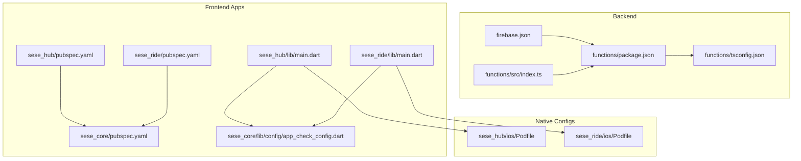
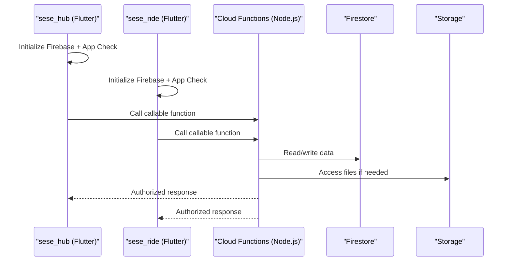
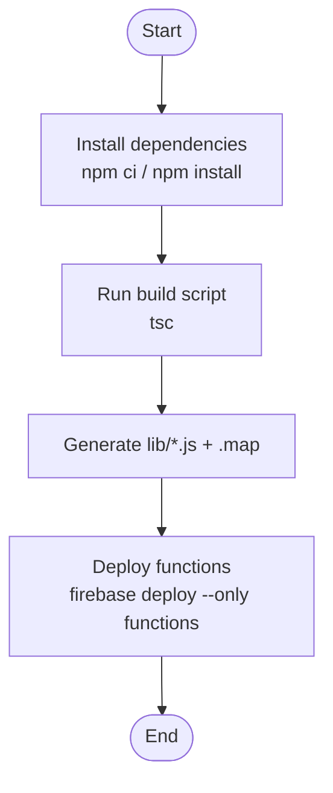
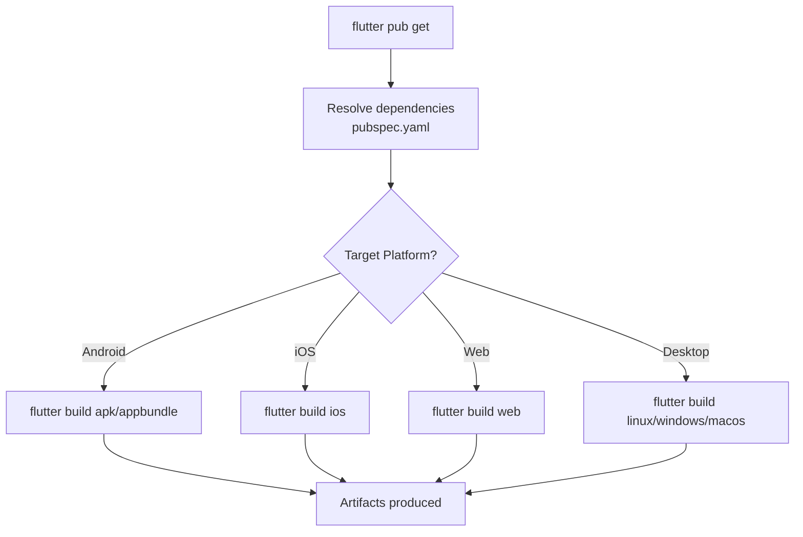
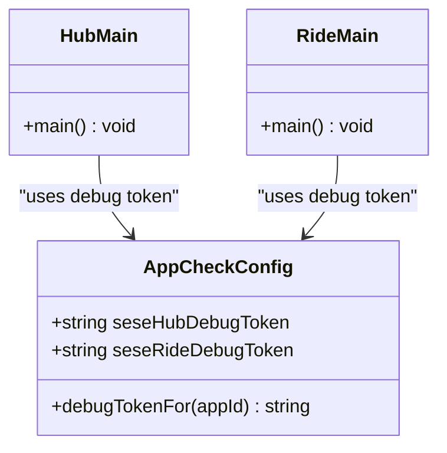
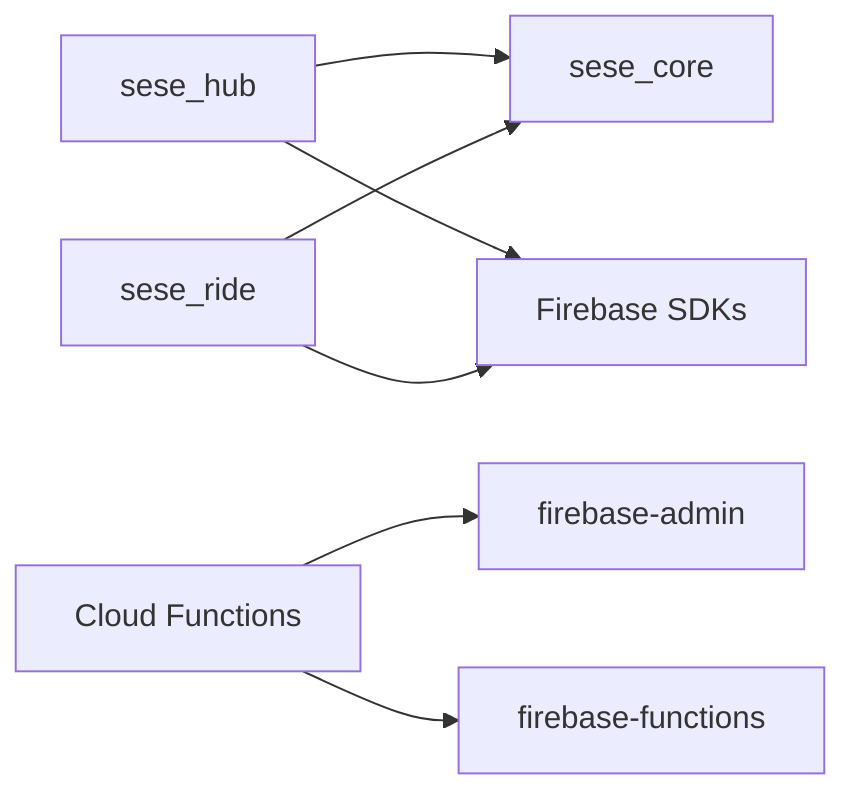

# Build and Release Management

<cite>
**Referenced Files in This Document**
- [firebase.json](file://firebase.json)
- [functions/package.json](file://functions/package.json)
- [functions/tsconfig.json](file://functions/tsconfig.json)
- [functions/src/index.ts](file://functions/src/index.ts)
- [sese_hub/pubspec.yaml](file://sese_hub/pubspec.yaml)
- [sese_ride/pubspec.yaml](file://sese_ride/pubspec.yaml)
- [sese_core/pubspec.yaml](file://sese_core/pubspec.yaml)
- [sese_hub/lib/main.dart](file://sese_hub/lib/main.dart)
- [sese_ride/lib/main.dart](file://sese_ride/lib/main.dart)
- [sese_core/lib/config/app_check_config.dart](file://sese_core/lib/config/app_check_config.dart)
- [sese_hub/ios/Podfile](file://sese_hub/ios/Podfile)
- [sese_ride/ios/Podfile](file://sese_ride/ios/Podfile)
</cite>

## Table of Contents
1. [Introduction](#introduction)
2. [Project Structure](#project-structure)
3. [Core Components](#core-components)
4. [Architecture Overview](#architecture-overview)
5. [Detailed Component Analysis](#detailed-component-analysis)
6. [Dependency Analysis](#dependency-analysis)
7. [Performance Considerations](#performance-considerations)
8. [Troubleshooting Guide](#troubleshooting-guide)
9. [Conclusion](#conclusion)

## Introduction
This document describes the complete build and release management for a monorepo containing:
- A Firebase backend with Cloud Functions (TypeScript)
- Two Flutter applications (Hub and Ride) targeting Android, iOS, Web, and Desktop
- A shared Dart package (sese_core) used by both apps

It covers Firebase CLI configuration, Cloud Functions compilation, Flutter builds across platforms, environment-specific configurations, dependency management, automated testing integration, and step-by-step guides for local development, staging, and production releases to app stores and Firebase hosting.

## Project Structure
The repository is organized as a monorepo with clear separation between backend and frontend:
- functions: TypeScript Cloud Functions compiled to JavaScript under lib
- sese_hub: Flutter application for hub operations
- sese_ride: Flutter application for customers and drivers
- sese_core: Shared Dart package providing models, services, and widgets

**Diagram sources**
- [firebase.json:1-28](file://firebase.json#L1-L28)
- [functions/package.json:1-24](file://functions/package.json#L1-L24)
- [functions/tsconfig.json:1-17](file://functions/tsconfig.json#L1-L17)
- [functions/src/index.ts:1-199](file://functions/src/index.ts#L1-L199)
- [sese_hub/pubspec.yaml:1-29](file://sese_hub/pubspec.yaml#L1-L29)
- [sese_ride/pubspec.yaml:1-38](file://sese_ride/pubspec.yaml#L1-L38)
- [sese_core/pubspec.yaml:1-33](file://sese_core/pubspec.yaml#L1-L33)
- [sese_hub/lib/main.dart:1-235](file://sese_hub/lib/main.dart#L1-L235)
- [sese_ride/lib/main.dart:1-184](file://sese_ride/lib/main.dart#L1-L184)
- [sese_core/lib/config/app_check_config.dart:1-38](file://sese_core/lib/config/app_check_config.dart#L1-L38)
- [sese_hub/ios/Podfile:1-44](file://sese_hub/ios/Podfile#L1-L44)
- [sese_ride/ios/Podfile:1-44](file://sese_ride/ios/Podfile#L1-L44)

**Section sources**
- [firebase.json:1-28](file://firebase.json#L1-L28)
- [functions/package.json:1-24](file://functions/package.json#L1-L24)
- [functions/tsconfig.json:1-17](file://functions/tsconfig.json#L1-L17)
- [functions/src/index.ts:1-199](file://functions/src/index.ts#L1-L199)
- [sese_hub/pubspec.yaml:1-29](file://sese_hub/pubspec.yaml#L1-L29)
- [sese_ride/pubspec.yaml:1-38](file://sese_ride/pubspec.yaml#L1-L38)
- [sese_core/pubspec.yaml:1-33](file://sese_core/pubspec.yaml#L1-L33)
- [sese_hub/lib/main.dart:1-235](file://sese_hub/lib/main.dart#L1-L235)
- [sese_ride/lib/main.dart:1-184](file://sese_ride/lib/main.dart#L1-L184)
- [sese_core/lib/config/app_check_config.dart:1-38](file://sese_core/lib/config/app_check_config.dart#L1-L38)
- [sese_hub/ios/Podfile:1-44](file://sese_hub/ios/Podfile#L1-L44)
- [sese_ride/ios/Podfile:1-44](file://sese_ride/ios/Podfile#L1-L44)

## Core Components
- Firebase project configuration defines Firestore, Storage, and Functions codebase settings, including predeploy build steps.
- Cloud Functions are written in TypeScript and compiled to CommonJS output under functions/lib.
- Flutter apps declare dependencies on Firebase SDKs and share common logic via sese_core.
- App Check is configured per app with debug tokens pinned centrally.

Key responsibilities:
- firebase.json: orchestrates Firestore rules/indexes, Storage rules, and Functions deployment pipeline
- functions/package.json: Node engine, scripts (build/watch/serve/deploy), and runtime dependencies
- functions/tsconfig.json: TypeScript compilation options and output directory
- Flutter pubspec files: versioning, SDK constraints, and dependencies
- main.dart entry points: initialize Firebase, activate App Check, and bootstrap UI
- AppCheckConfig: centralizes debug tokens for local development

**Section sources**
- [firebase.json:1-28](file://firebase.json#L1-L28)
- [functions/package.json:1-24](file://functions/package.json#L1-L24)
- [functions/tsconfig.json:1-17](file://functions/tsconfig.json#L1-L17)
- [sese_hub/pubspec.yaml:1-29](file://sese_hub/pubspec.yaml#L1-L29)
- [sese_ride/pubspec.yaml:1-38](file://sese_ride/pubspec.yaml#L1-L38)
- [sese_core/pubspec.yaml:1-33](file://sese_core/pubspec.yaml#L1-L33)
- [sese_hub/lib/main.dart:1-235](file://sese_hub/lib/main.dart#L1-L235)
- [sese_ride/lib/main.dart:1-184](file://sese_ride/lib/main.dart#L1-L184)
- [sese_core/lib/config/app_check_config.dart:1-38](file://sese_core/lib/config/app_check_config.dart#L1-L38)

## Architecture Overview
The system integrates client apps with serverless backend services:
- Flutter apps initialize Firebase and enforce App Check at startup
- Apps call Cloud Functions for authoritative computations and state transitions
- Firestore and Storage provide data persistence and file storage
- Firebase CLI manages deployments for functions, rules, and indexes

**Diagram sources**
- [sese_hub/lib/main.dart:13-38](file://sese_hub/lib/main.dart#L13-L38)
- [sese_ride/lib/main.dart:13-40](file://sese_ride/lib/main.dart#L13-L40)
- [functions/src/index.ts:1-199](file://functions/src/index.ts#L1-L199)
- [firebase.json:1-28](file://firebase.json#L1-L28)

## Detailed Component Analysis

### Firebase CLI Configuration
- Firestore database location and rules/indexes are defined in the root configuration.
- Storage rules are referenced from the same configuration.
- Functions codebase is declared with source path, ignore patterns, and a predeploy script that runs the TypeScript build.

Operational implications:
- Deploying functions triggers npm build before upload
- Rules and indexes can be deployed independently using targeted flags

**Section sources**
- [firebase.json:1-28](file://firebase.json#L1-L28)

### Cloud Functions Build Process (TypeScript)
- The functions package specifies Node engine version and uses TypeScript to compile to CommonJS.
- Scripts include build, watch, serve (with emulators), and deploy.
- tsconfig sets strict mode, target ES2017, and outputs to lib with source maps.

Build flow:
- Predeploy runs npm build which invokes tsc
- Compiled JS under lib is packaged and deployed

**Diagram sources**
- [functions/package.json:1-24](file://functions/package.json#L1-L24)
- [functions/tsconfig.json:1-17](file://functions/tsconfig.json#L1-L17)
- [firebase.json:11-26](file://firebase.json#L11-L26)

**Section sources**
- [functions/package.json:1-24](file://functions/package.json#L1-L24)
- [functions/tsconfig.json:1-17](file://functions/tsconfig.json#L1-L17)
- [firebase.json:11-26](file://firebase.json#L11-L26)

### Flutter App Builds (Android, iOS, Web, Desktop)
- Both apps depend on the shared sese_core package via path references.
- Each app declares Firebase SDKs and platform-specific features.
- iOS Podfiles disable CocoaPods analytics to improve build latency.

Build targets:
- Android: flutter build apk / appbundle
- iOS: flutter build ios
- Web: flutter build web
- Desktop: flutter build linux/windows/macos

Environment considerations:
- Debug vs release modes affect App Check providers
- Country detection service initializes at startup

**Diagram sources**
- [sese_hub/pubspec.yaml:1-29](file://sese_hub/pubspec.yaml#L1-L29)
- [sese_ride/pubspec.yaml:1-38](file://sese_ride/pubspec.yaml#L1-L38)
- [sese_core/pubspec.yaml:1-33](file://sese_core/pubspec.yaml#L1-L33)
- [sese_hub/ios/Podfile:1-44](file://sese_hub/ios/Podfile#L1-L44)
- [sese_ride/ios/Podfile:1-44](file://sese_ride/ios/Podfile#L1-L44)

**Section sources**
- [sese_hub/pubspec.yaml:1-29](file://sese_hub/pubspec.yaml#L1-L29)
- [sese_ride/pubspec.yaml:1-38](file://sese_ride/pubspec.yaml#L1-L38)
- [sese_core/pubspec.yaml:1-33](file://sese_core/pubspec.yaml#L1-L33)
- [sese_hub/ios/Podfile:1-44](file://sese_hub/ios/Podfile#L1-L44)
- [sese_ride/ios/Podfile:1-44](file://sese_ride/ios/Podfile#L1-L44)

### Environment-Specific Configurations
- App Check debug tokens are centralized in a single Dart module and referenced by both apps during debug builds.
- Release builds use native attestation providers (Play Integrity on Android, Device Check on Apple).
- Both apps initialize Firebase with platform-specific options and then activate App Check accordingly.

**Diagram sources**
- [sese_core/lib/config/app_check_config.dart:1-38](file://sese_core/lib/config/app_check_config.dart#L1-L38)
- [sese_hub/lib/main.dart:13-38](file://sese_hub/lib/main.dart#L13-L38)
- [sese_ride/lib/main.dart:13-40](file://sese_ride/lib/main.dart#L13-L40)

**Section sources**
- [sese_core/lib/config/app_check_config.dart:1-38](file://sese_core/lib/config/app_check_config.dart#L1-L38)
- [sese_hub/lib/main.dart:13-38](file://sese_hub/lib/main.dart#L13-L38)
- [sese_ride/lib/main.dart:13-40](file://sese_ride/lib/main.dart#L13-L40)

### Dependency Management Strategies
- Monorepo structure uses path dependencies for shared code (sese_core).
- Flutter apps pin Firebase SDK versions and add platform-specific packages.
- Backend uses a dedicated Node package with explicit engines and devDependencies for TypeScript.

Recommendations:
- Keep shared logic in sese_core to avoid duplication
- Align Firebase SDK versions across apps to reduce compatibility issues
- Use lockfiles (pubspec.lock, package-lock.json) to ensure reproducible builds

**Section sources**
- [sese_hub/pubspec.yaml:1-29](file://sese_hub/pubspec.yaml#L1-L29)
- [sese_ride/pubspec.yaml:1-38](file://sese_ride/pubspec.yaml#L1-L38)
- [sese_core/pubspec.yaml:1-33](file://sese_core/pubspec.yaml#L1-L33)
- [functions/package.json:1-24](file://functions/package.json#L1-L24)

### Automated Testing Integration
- Flutter tests exist under each app’s test directory and can be executed via flutter test.
- Backend functions do not show a dedicated test runner in package.json; consider adding unit tests for callable endpoints and business logic.

Suggested CI steps:
- Run flutter test for both apps
- Lint checks with flutter analyze
- TypeScript type-check for functions (tsc --noEmit)

**Section sources**
- [sese_hub/lib/main.dart:1-235](file://sese_hub/lib/main.dart#L1-L235)
- [sese_ride/lib/main.dart:1-184](file://sese_ride/lib/main.dart#L1-L184)
- [functions/package.json:1-24](file://functions/package.json#L1-L24)

## Dependency Analysis

**Diagram sources**
- [sese_hub/pubspec.yaml:1-29](file://sese_hub/pubspec.yaml#L1-L29)
- [sese_ride/pubspec.yaml:1-38](file://sese_ride/pubspec.yaml#L1-L38)
- [sese_core/pubspec.yaml:1-33](file://sese_core/pubspec.yaml#L1-L33)
- [functions/package.json:1-24](file://functions/package.json#L1-L24)

**Section sources**
- [sese_hub/pubspec.yaml:1-29](file://sese_hub/pubspec.yaml#L1-L29)
- [sese_ride/pubspec.yaml:1-38](file://sese_ride/pubspec.yaml#L1-L38)
- [sese_core/pubspec.yaml:1-33](file://sese_core/pubspec.yaml#L1-L33)
- [functions/package.json:1-24](file://functions/package.json#L1-L24)

## Performance Considerations
- Disable CocoaPods analytics to reduce build latency on iOS builds.
- Use profile/release builds for performance validation and smaller artifacts.
- Ensure Cloud Functions predeploy builds are cached in CI to speed up deployments.
- Leverage Flutter’s tree-shaking and optimized assets for faster app loads.

[No sources needed since this section provides general guidance]

## Troubleshooting Guide
Common issues and resolutions:
- App Check PERMISSION_DENIED errors:
  - Ensure App Check is activated in both apps’ main entry points
  - Verify debug tokens are registered in the Firebase console for local development
- Functions initialization timeout:
  - The functions entry point avoids metadata server probing when credentials are not present, preventing long hangs during trigger discovery
- iOS build slowness:
  - CocoaPods analytics disabled in Podfiles improves build times
- Firestore rule or index mismatches:
  - Validate rules syntax and deploy only rules/indexes when necessary

Actionable checks:
- Confirm Firebase initialization and App Check activation in app main files
- Validate functions build locally with npm run build
- Use targeted Firebase CLI commands for rules and indexes

**Section sources**
- [sese_hub/lib/main.dart:13-38](file://sese_hub/lib/main.dart#L13-L38)
- [sese_ride/lib/main.dart:13-40](file://sese_ride/lib/main.dart#L13-L40)
- [functions/src/index.ts:1-19](file://functions/src/index.ts#L1-L19)
- [sese_hub/ios/Podfile:1-44](file://sese_hub/ios/Podfile#L1-L44)
- [sese_ride/ios/Podfile:1-44](file://sese_ride/ios/Podfile#L1-L44)

## Conclusion
This monorepo follows a clean separation of concerns with a shared core package, two Flutter applications, and a TypeScript-based Cloud Functions backend. The Firebase CLI configuration ties together Firestore, Storage, and Functions deployment. Flutter apps initialize Firebase and enforce App Check consistently across platforms. By following the outlined build and release procedures, teams can confidently manage local development, staging, and production releases while maintaining security and performance.

[No sources needed since this section summarizes without analyzing specific files]