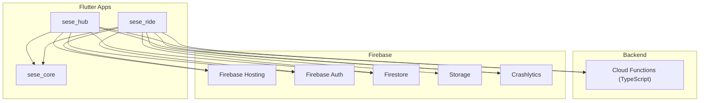
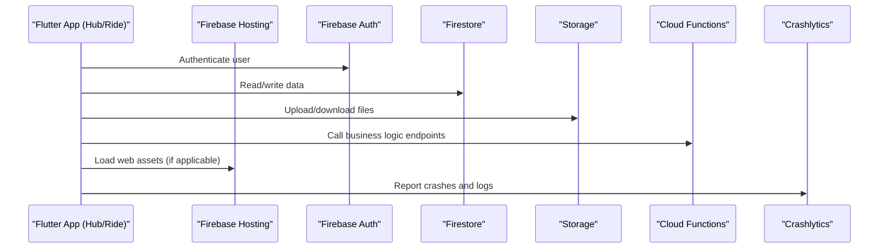
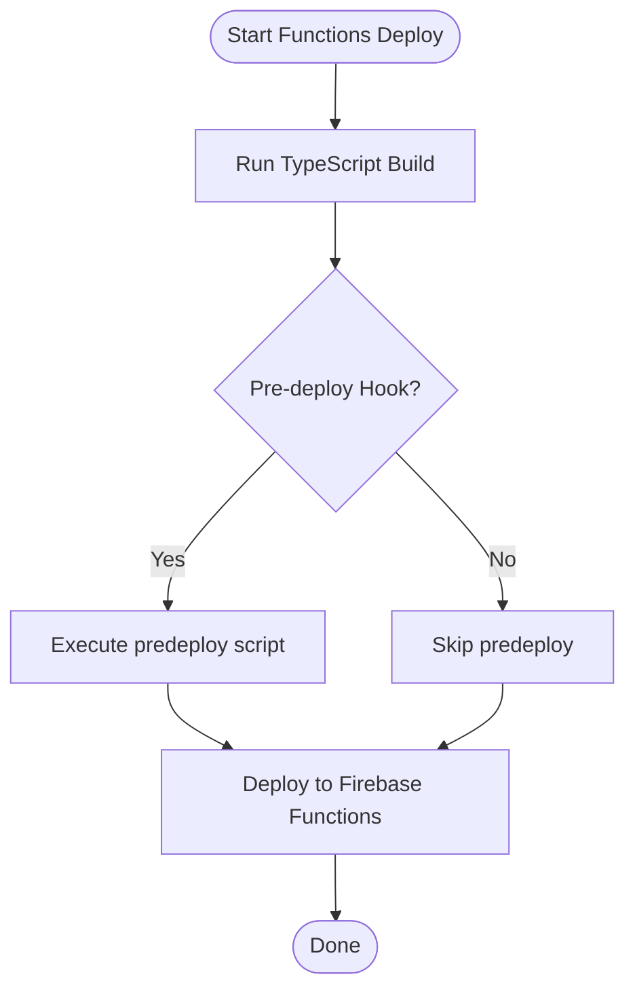
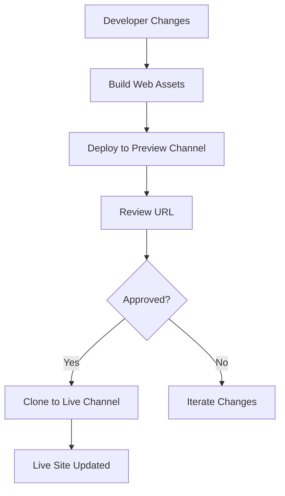
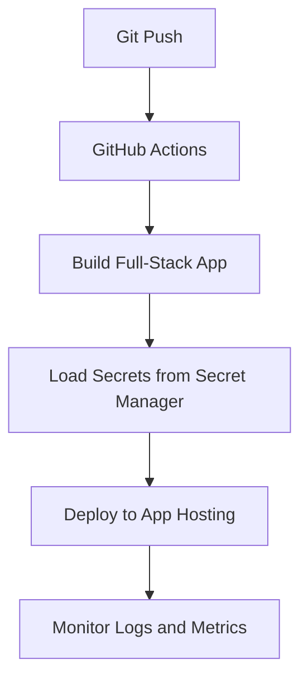
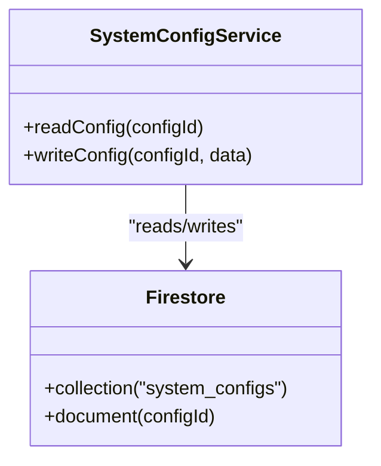
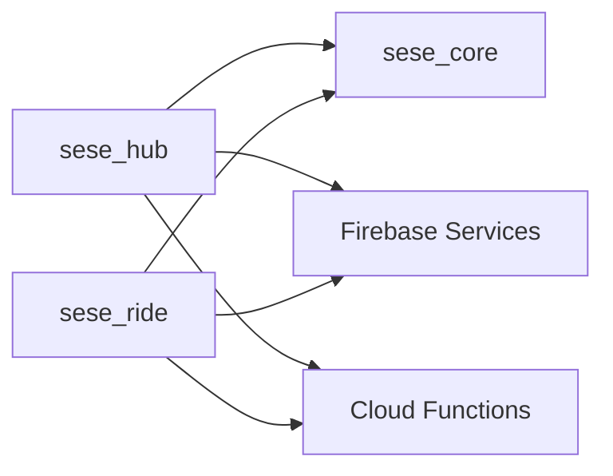

# Deployment and Operations

<cite>
**Referenced Files in This Document**
- [firebase.json](file://firebase.json)
- [functions/package.json](file://functions/package.json)
- [sese_hub/firebase.json](file://sese_hub/firebase.json)
- [sese_ride/firebase.json](file://sese_ride/firebase.json)
- [sese_hub/pubspec.yaml](file://sese_hub/pubspec.yaml)
- [sese_ride/pubspec.yaml](file://sese_ride/pubspec.yaml)
- [sese_core/pubspec.yaml](file://sese_core/pubspec.yaml)
- [system_config_service.dart](file://sese_hub/lib/features/config/services/system_config_service.dart)
- [configuration.md (App Hosting)](file://.agents/skills/firebase-app-hosting-basics/references/configuration.md)
- [SKILL.md (App Hosting)](file://.agents/skills/firebase-app-hosting-basics/SKILL.md)
- [configuration.md (Hosting)](file://.agents/skills/firebase-hosting-basics/references/configuration.md)
- [deploying.md (Hosting)](file://.agents/skills/firebase-hosting-basics/references/deploying.md)
- [SKILL.md (Hosting)](file://.agents/skills/firebase-hosting-basics/SKILL.md)
- [android_setup.md (Crashlytics)](file://.agents/skills/firebase-crashlytics/references/android_setup.md)
- [ios_setup.md (Crashlytics)](file://.agents/skills/firebase-crashlytics/references/ios_setup.md)
- [SKILL.md (Crashlytics)](file://.agents/skills/firebase-crashlytics/SKILL.md)
</cite>

## Table of Contents
1. [Introduction](#introduction)
2. [Project Structure](#project-structure)
3. [Core Components](#core-components)
4. [Architecture Overview](#architecture-overview)
5. [Detailed Component Analysis](#detailed-component-analysis)
6. [Dependency Analysis](#dependency-analysis)
7. [Performance Considerations](#performance-considerations)
8. [Troubleshooting Guide](#troubleshooting-guide)
9. [Conclusion](#conclusion)

## Introduction
This document provides comprehensive deployment and operations guidance for the SeSe application, covering:
- Build processes for Flutter apps and Cloud Functions
- Release management across development, staging, and production
- CI/CD pipeline setup using Firebase CLI and GitHub Actions
- App Store deployment procedures for Android and iOS
- Firebase Hosting configuration and preview channels
- Environment management strategies and secret handling
- Monitoring and alerting with Crashlytics
- Log analysis, performance profiling, and troubleshooting

## Project Structure
The repository is a multi-module project:
- Flutter apps: sese_hub (management), sese_ride (customer/driver)
- Shared library: sese_core
- Backend: Cloud Functions (TypeScript)
- Firebase resources: Firestore rules, Storage rules, indexes, and hosting configuration

**Diagram sources**
- [firebase.json:1-28](file://firebase.json#L1-L28)
- [sese_hub/pubspec.yaml:10-20](file://sese_hub/pubspec.yaml#L10-L20)
- [sese_ride/pubspec.yaml:10-30](file://sese_ride/pubspec.yaml#L10-L30)
- [sese_core/pubspec.yaml:9-20](file://sese_core/pubspec.yaml#L9-L20)

**Section sources**
- [firebase.json:1-28](file://firebase.json#L1-L28)
- [sese_hub/pubspec.yaml:1-29](file://sese_hub/pubspec.yaml#L1-L29)
- [sese_ride/pubspec.yaml:1-38](file://sese_ride/pubspec.yaml#L1-L38)
- [sese_core/pubspec.yaml:1-33](file://sese_core/pubspec.yaml#L1-L33)

## Core Components
- Cloud Functions (TypeScript): Business logic for pricing, routing, payments, trips, verification, support bot, driver streak/status, fare tokens, and account deletion. Built via TypeScript compiler and deployed through Firebase CLI.
- Flutter Apps:
  - sese_hub: Management app with Firebase Auth, Firestore, App Check, Google Sign-In.
  - sese_ride: Customer/driver app with additional dependencies like storage, geolocation, HTTP, cloud functions, maps, and shared preferences.
- Shared Library: sese_core provides common models, repositories, and widgets used by both apps.
- Firebase Resources: Firestore rules, Storage rules, indexes, and hosting configuration.

Key build and deploy scripts:
- Functions build script compiles TypeScript to JavaScript before deployment.
- Flutter apps depend on Firebase packages and are configured per platform via generated Firebase options.

**Section sources**
- [functions/package.json:5-10](file://functions/package.json#L5-L10)
- [functions/package.json:14-18](file://functions/package.json#L14-L18)
- [sese_hub/pubspec.yaml:10-20](file://sese_hub/pubspec.yaml#L10-L20)
- [sese_ride/pubspec.yaml:10-30](file://sese_ride/pubspec.yaml#L10-L30)
- [sese_core/pubspec.yaml:9-20](file://sese_core/pubspec.yaml#L9-L20)

## Architecture Overview
The system integrates Flutter clients with Firebase services and Cloud Functions:
- Clients authenticate via Firebase Auth and interact with Firestore and Storage.
- Sensitive or server-side logic runs in Cloud Functions.
- Web assets can be served via Firebase Hosting; preview channels enable safe testing.
- Crashlytics collects crash data from mobile apps.

**Diagram sources**
- [firebase.json:1-28](file://firebase.json#L1-L28)
- [sese_hub/pubspec.yaml:10-20](file://sese_hub/pubspec.yaml#L10-L20)
- [sese_ride/pubspec.yaml:10-30](file://sese_ride/pubspec.yaml#L10-L30)

## Detailed Component Analysis

### Cloud Functions Build and Deploy Pipeline
- Build process: TypeScript compilation via npm script.
- Pre-deploy hook: Ensures compiled output exists before deploying.
- Engine constraints: Node.js version pinned for consistency.

**Diagram sources**
- [functions/package.json:5-10](file://functions/package.json#L5-L10)
- [firebase.json:11-25](file://firebase.json#L11-L25)

**Section sources**
- [functions/package.json:5-10](file://functions/package.json#L5-L10)
- [functions/package.json:11-13](file://functions/package.json#L11-L13)
- [firebase.json:11-25](file://firebase.json#L11-L25)

### Firebase Hosting Configuration and Preview Channels
- Hosting configuration supports public directory, ignore patterns, redirects, rewrites, headers, clean URLs, and trailing slash behavior.
- Preview channels allow temporary URLs for testing changes before promoting to live.

**Diagram sources**
- [configuration.md (Hosting):1-116](file://.agents/skills/firebase-hosting-basics/references/configuration.md#L1-L116)
- [deploying.md (Hosting):1-49](file://.agents/skills/firebase-hosting-basics/references/deploying.md#L1-L49)

**Section sources**
- [configuration.md (Hosting):1-116](file://.agents/skills/firebase-hosting-basics/references/configuration.md#L1-L116)
- [deploying.md (Hosting):1-49](file://.agents/skills/firebase-hosting-basics/references/deploying.md#L1-L49)

### App Hosting (Full-Stack SSR) and Secrets
- App Hosting uses apphosting.yaml for resource allocation and environment variables.
- Secrets are managed via Cloud Secret Manager and referenced in apphosting.yaml.
- Automated deployments can be set up via GitHub integration.

**Diagram sources**
- [SKILL.md (App Hosting):35-72](file://.agents/skills/firebase-app-hosting-basics/SKILL.md#L35-L72)
- [configuration.md (App Hosting):1-60](file://.agents/skills/firebase-app-hosting-basics/references/configuration.md#L1-L60)

**Section sources**
- [SKILL.md (App Hosting):35-72](file://.agents/skills/firebase-app-hosting-basics/SKILL.md#L35-L72)
- [configuration.md (App Hosting):1-60](file://.agents/skills/firebase-app-hosting-basics/references/configuration.md#L1-L60)

### Environment Management and Configuration Strategy
- Per-app Firebase configuration is generated into platform-specific files and Dart options.
- Dynamic runtime configuration is managed via Firestore under system_configs, with read access for authenticated users and write access restricted to super admins.

**Diagram sources**
- [system_config_service.dart:1-9](file://sese_hub/lib/features/config/services/system_config_service.dart#L1-L9)

**Section sources**
- [sese_hub/firebase.json:1-1](file://sese_hub/firebase.json#L1-L1)
- [sese_ride/firebase.json:1-1](file://sese_ride/firebase.json#L1-L1)
- [system_config_service.dart:1-9](file://sese_hub/lib/features/config/services/system_config_service.dart#L1-L9)

### Secret Handling Across Environments
- Use Firebase App Hosting secrets for sensitive keys during build and runtime.
- For Flutter apps, avoid committing secrets; use generated Firebase options and environment-specific configurations.
- For Cloud Functions, rely on Firebase Function environment variables and secure parameterized configuration where applicable.

Best practices:
- Never hardcode secrets in code or configs.
- Rotate secrets regularly and audit access.
- Use separate Firebase projects for dev/stage/prod when possible.

**Section sources**
- [configuration.md (App Hosting):48-59](file://.agents/skills/firebase-app-hosting-basics/references/configuration.md#L48-L59)
- [sese_hub/firebase.json:1-1](file://sese_hub/firebase.json#L1-L1)
- [sese_ride/firebase.json:1-1](file://sese_ride/firebase.json#L1-L1)

### CI/CD Pipeline Setup
Recommended steps:
- Install and configure Firebase CLI in CI runners.
- Authenticate using service account credentials stored securely in CI secret store.
- Build Flutter apps and Cloud Functions.
- Deploy only necessary components (e.g., --only hosting, --only functions).
- Use preview channels for feature branches and promote to live after approval.

Example workflow outline:
- On push to main: build and deploy to live.
- On pull request: build and deploy to preview channel.

**Section sources**
- [SKILL.md (Hosting):46-57](file://.agents/skills/firebase-hosting-basics/SKILL.md#L46-L57)
- [deploying.md (Hosting):14-49](file://.agents/skills/firebase-hosting-basics/references/deploying.md#L14-L49)

### App Store Deployment Procedures
Android:
- Generate signed APK/AAB using Gradle release builds.
- Ensure Crashlytics NDK symbols are uploaded if native code is present.
- Publish via Google Play Console.

iOS:
- Archive and distribute via Xcode or Fastlane.
- Verify Crashlytics run script phase and symbol upload.
- Publish via TestFlight/App Store Connect.

Verification:
- Force test crashes to ensure Crashlytics reports are received.
- Remove test crash triggers post-verification.

**Section sources**
- [android_setup.md (Crashlytics):78-153](file://.agents/skills/firebase-crashlytics/references/android_setup.md#L78-L153)
- [ios_setup.md (Crashlytics):49-116](file://.agents/skills/firebase-crashlytics/references/ios_setup.md#L49-L116)
- [SKILL.md (Crashlytics):1-45](file://.agents/skills/firebase-crashlytics/SKILL.md#L1-L45)

### Monitoring and Alerting Setup
- Enable Crashlytics in both Android and iOS apps to collect crash data.
- Configure custom keys, logs, and user identifiers to enrich reports.
- Use Firebase console dashboards to monitor crash trends and triage issues.

Operational tips:
- Set up alerts for spikes in crash rates.
- Correlate crashes with recent releases and environment changes.
- Integrate with issue tracking systems for automated ticket creation.

**Section sources**
- [SKILL.md (Crashlytics):29-45](file://.agents/skills/firebase-crashlytics/SKILL.md#L29-L45)
- [android_setup.md (Crashlytics):110-153](file://.agents/skills/firebase-crashlytics/references/android_setup.md#L110-L153)
- [ios_setup.md (Crashlytics):61-116](file://.agents/skills/firebase-crashlytics/references/ios_setup.md#L61-L116)

### Log Analysis and Performance Profiling
- Cloud Functions: Use Firebase console logs and structured logging to analyze function invocations and errors.
- Flutter apps: Leverage Crashlytics logs and custom events to understand user flows and failures.
- Hosting: Inspect CDN cache hits and response times; optimize static assets and caching headers.

Profiling recommendations:
- Profile network calls and Firestore queries for latency hotspots.
- Optimize images and assets served via Hosting.
- Use performance budgets and track regressions in CI.

[No sources needed since this section provides general guidance]

### Troubleshooting Procedures
Common issues and resolutions:
- Build failures: Validate Node.js version and TypeScript compilation steps for functions.
- Hosting misroutes: Confirm firebase.json hosting configuration and SPA rewrites.
- Auth/permissions: Ensure Firestore rules and App Check settings match intended access.
- Crashlytics not reporting: Verify SDK initialization and symbol uploads; remove test crash code after verification.

Diagnostic checklist:
- Confirm Firebase project IDs and app IDs match platform configurations.
- Validate environment variables and secrets availability at build/runtime.
- Review error logs in Firebase console and local emulator outputs.

**Section sources**
- [firebase.json:1-28](file://firebase.json#L1-L28)
- [sese_hub/firebase.json:1-1](file://sese_hub/firebase.json#L1-L1)
- [sese_ride/firebase.json:1-1](file://sese_ride/firebase.json#L1-L1)
- [android_setup.md (Crashlytics):110-153](file://.agents/skills/firebase-crashlytics/references/android_setup.md#L110-L153)
- [ios_setup.md (Crashlytics):61-116](file://.agents/skills/firebase-crashlytics/references/ios_setup.md#L61-L116)

## Dependency Analysis
Inter-module dependencies:
- Both Flutter apps depend on sese_core for shared functionality.
- Apps integrate Firebase Auth, Firestore, Storage, and Cloud Functions.
- Cloud Functions are built and deployed independently but consumed by client apps.

**Diagram sources**
- [sese_hub/pubspec.yaml:10-20](file://sese_hub/pubspec.yaml#L10-L20)
- [sese_ride/pubspec.yaml:10-30](file://sese_ride/pubspec.yaml#L10-L30)
- [sese_core/pubspec.yaml:9-20](file://sese_core/pubspec.yaml#L9-L20)
- [firebase.json:1-28](file://firebase.json#L1-L28)

**Section sources**
- [sese_hub/pubspec.yaml:10-20](file://sese_hub/pubspec.yaml#L10-L20)
- [sese_ride/pubspec.yaml:10-30](file://sese_ride/pubspec.yaml#L10-L30)
- [sese_core/pubspec.yaml:9-20](file://sese_core/pubspec.yaml#L9-L20)
- [firebase.json:1-28](file://firebase.json#L1-L28)

## Performance Considerations
- Cloud Functions:
  - Right-size memory and concurrency; consider V2 parameters and scaling policies.
  - Minimize cold starts by keeping dependencies lean and optimizing startup time.
- Hosting:
  - Enable compression and caching headers for static assets.
  - Use CDN effectively; prefer minimal payload sizes.
- Flutter apps:
  - Reduce initial bundle size; lazy-load features.
  - Optimize image assets and network requests.

[No sources needed since this section provides general guidance]

## Troubleshooting Guide
- Functions build/deploy:
  - Ensure TypeScript build succeeds and predeploy hooks run correctly.
  - Validate Node.js engine version matches requirements.
- Hosting:
  - Confirm public directory and rewrite rules for SPAs.
  - Use preview channels to validate changes before promotion.
- Crashlytics:
  - Verify SDK initialization and symbol uploads.
  - Remove test crash code after validation.

Operational best practices:
- Maintain separate environments for dev/stage/prod.
- Automate builds and deploys in CI/CD.
- Monitor crash rates and set alerts for anomalies.

**Section sources**
- [functions/package.json:5-10](file://functions/package.json#L5-L10)
- [firebase.json:11-25](file://firebase.json#L11-L25)
- [configuration.md (Hosting):1-116](file://.agents/skills/firebase-hosting-basics/references/configuration.md#L1-L116)
- [deploying.md (Hosting):14-49](file://.agents/skills/firebase-hosting-basics/references/deploying.md#L14-L49)
- [android_setup.md (Crashlytics):110-153](file://.agents/skills/firebase-crashlytics/references/android_setup.md#L110-L153)
- [ios_setup.md (Crashlytics):61-116](file://.agents/skills/firebase-crashlytics/references/ios_setup.md#L61-L116)

## Conclusion
This guide outlines robust deployment and operations practices for the SeSe application:
- Standardize builds for Flutter apps and Cloud Functions.
- Implement CI/CD pipelines with preview channels and controlled promotions.
- Manage environments and secrets securely across platforms.
- Enable monitoring with Crashlytics and establish alerting for production stability.
- Follow troubleshooting checklists to resolve issues efficiently and maintain high reliability.

[No sources needed since this section summarizes without analyzing specific files]