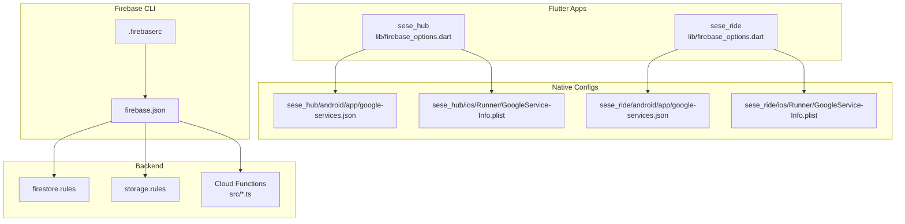
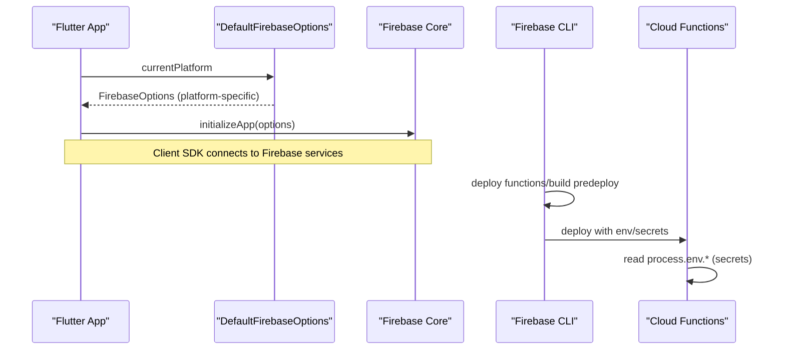
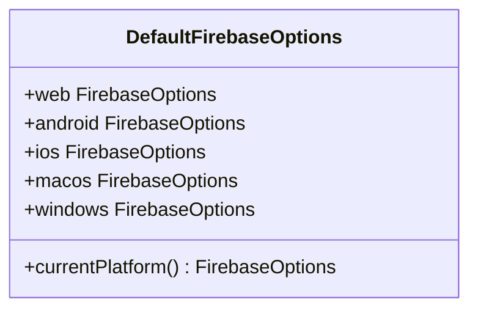
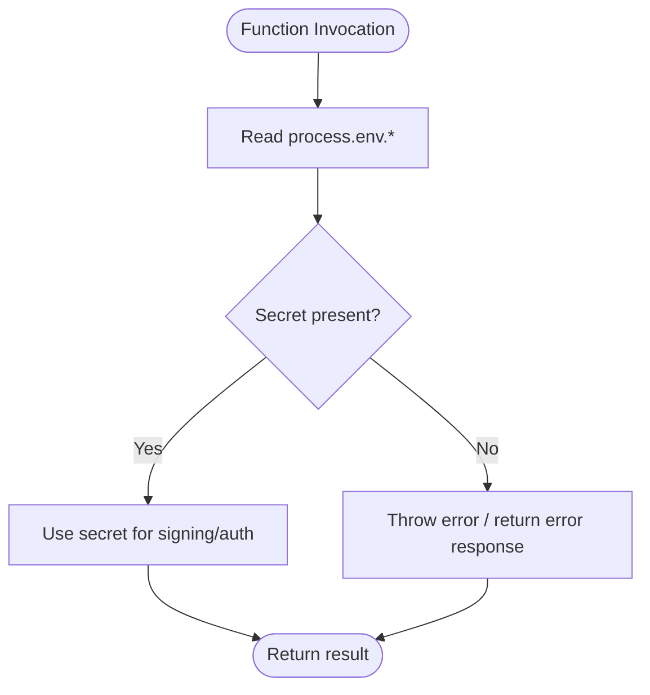
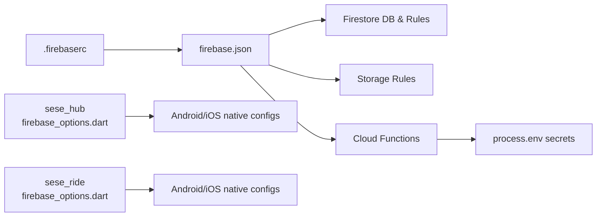

# Environment Configuration and Secret Management

<cite>
**Referenced Files in This Document**
- [firebase.json](file://firebase.json)
- [.firebaserc](file://.firebaserc)
- [sese_hub/lib/firebase_options.dart](file://sese_hub/lib/firebase_options.dart)
- [sese_ride/lib/firebase_options.dart](file://sese_ride/lib/firebase_options.dart)
- [sese_hub/android/app/google-services.json](file://sese_hub/android/app/google-services.json)
- [sese_ride/android/app/google-services.json](file://sese_ride/android/app/google-services.json)
- [sese_hub/ios/Runner/GoogleService-Info.plist](file://sese_hub/ios/Runner/GoogleService-Info.plist)
- [sese_ride/ios/Runner/GoogleService-Info.plist](file://sese_ride/ios/Runner/GoogleService-Info.plist)
- [functions/src/payments.ts](file://functions/src/payments.ts)
- [functions/src/fareToken.ts](file://functions/src/fareToken.ts)
- [firestore.rules](file://firestore.rules)
- [storage.rules](file://storage.rules)
</cite>

## Table of Contents
1. [Introduction](#introduction)
2. [Project Structure](#project-structure)
3. [Core Components](#core-components)
4. [Architecture Overview](#architecture-overview)
5. [Detailed Component Analysis](#detailed-component-analysis)
6. [Dependency Analysis](#dependency-analysis)
7. [Performance Considerations](#performance-considerations)
8. [Troubleshooting Guide](#troubleshooting-guide)
9. [Conclusion](#conclusion)

## Introduction
This document explains how to configure and manage environment-specific settings and secrets for multi-environment deployments (development, staging, production) using Firebase project configurations in this repository. It covers:
- How Flutter apps initialize Firebase via generated options files per platform
- Where native client configuration lives on Android and iOS
- How the Firebase CLI configures Firestore, Storage, and Cloud Functions
- How Cloud Functions read secrets at runtime
- Secure patterns for API keys, service accounts, and sensitive data
- Guidance for managing database locations, storage buckets, and function endpoints across environments

## Project Structure
The repository contains two Flutter applications (sese_hub and sese_ride), a shared core library, and a Cloud Functions codebase. Each app has its own Firebase client configuration and options file. The root Firebase CLI configuration defines Firestore location, rules, indexes, Storage rules, and Functions deployment settings.

**Diagram sources**
- [sese_hub/lib/firebase_options.dart:1-96](file://sese_hub/lib/firebase_options.dart#L1-L96)
- [sese_ride/lib/firebase_options.dart:1-96](file://sese_ride/lib/firebase_options.dart#L1-L96)
- [sese_hub/android/app/google-services.json:1-91](file://sese_hub/android/app/google-services.json#L1-L91)
- [sese_ride/android/app/google-services.json:1-91](file://sese_ride/android/app/google-services.json#L1-L91)
- [sese_hub/ios/Runner/GoogleService-Info.plist:1-38](file://sese_hub/ios/Runner/GoogleService-Info.plist#L1-L38)
- [sese_ride/ios/Runner/GoogleService-Info.plist:1-38](file://sese_ride/ios/Runner/GoogleService-Info.plist#L1-L38)
- [firebase.json:1-27](file://firebase.json#L1-L27)
- [.firebaserc:1-6](file://.firebaserc#L1-L6)
- [firestore.rules:116-614](file://firestore.rules#L116-L614)
- [storage.rules:1-26](file://storage.rules#L1-L26)

**Section sources**
- [firebase.json:1-27](file://firebase.json#L1-L27)
- [.firebaserc:1-6](file://.firebaserc#L1-L6)
- [sese_hub/lib/firebase_options.dart:1-96](file://sese_hub/lib/firebase_options.dart#L1-L96)
- [sese_ride/lib/firebase_options.dart:1-96](file://sese_ride/lib/firebase_options.dart#L1-L96)

## Core Components
- Generated Dart options: Each Flutter app provides a DefaultFirebaseOptions class that selects platform-specific FirebaseOptions at runtime.
- Native client configs: Android uses google-services.json; iOS/macOS use GoogleService-Info.plist.
- Firebase CLI: firebase.json declares Firestore location/rules/indexes, Storage rules, and Functions source/predeploy steps. .firebaserc maps the default project alias to a Firebase project ID.
- Cloud Functions secrets: Functions read secrets from process.env, with explicit handling when values are missing.

Key responsibilities:
- App initialization: Use DefaultFirebaseOptions.currentPlatform to initialize Firebase in each app.
- Platform selection: Options are selected by platform (web, android, ios, macos, windows).
- Backend configuration: Firestore database and location, Storage rules, and Functions build/deploy hooks.

**Section sources**
- [sese_hub/lib/firebase_options.dart:17-41](file://sese_hub/lib/firebase_options.dart#L17-L41)
- [sese_ride/lib/firebase_options.dart:17-41](file://sese_ride/lib/firebase_options.dart#L17-L41)
- [firebase.json:1-27](file://firebase.json#L1-L27)
- [.firebaserc:1-6](file://.firebaserc#L1-L6)

## Architecture Overview
The runtime flow initializes Firebase using platform-specific options derived from generated Dart code and native configuration files. Cloud Functions access secrets via environment variables provided by the Firebase Functions runtime.

**Diagram sources**
- [sese_hub/lib/firebase_options.dart:17-41](file://sese_hub/lib/firebase_options.dart#L17-L41)
- [sese_ride/lib/firebase_options.dart:17-41](file://sese_ride/lib/firebase_options.dart#L17-L41)
- [firebase.json:11-26](file://firebase.json#L11-L26)
- [functions/src/payments.ts:22-47](file://functions/src/payments.ts#L22-L47)

## Detailed Component Analysis

### Flutter Firebase Options (Per App)
- Purpose: Provide platform-specific FirebaseOptions used to initialize Firebase at app start.
- Behavior: Selects web, android, ios, macos, or windows options based on runtime detection. Linux is unsupported by default.
- Security note: These files contain public-facing identifiers (API keys, app IDs, bucket names). They are not secrets but must be kept consistent with native configs.

**Diagram sources**
- [sese_hub/lib/firebase_options.dart:17-95](file://sese_hub/lib/firebase_options.dart#L17-L95)
- [sese_ride/lib/firebase_options.dart:17-95](file://sese_ride/lib/firebase_options.dart#L17-L95)

**Section sources**
- [sese_hub/lib/firebase_options.dart:17-95](file://sese_hub/lib/firebase_options.dart#L17-L95)
- [sese_ride/lib/firebase_options.dart:17-95](file://sese_ride/lib/firebase_options.dart#L17-L95)

### Native Client Configuration (Android and iOS)
- Android: google-services.json includes project info, client IDs, OAuth clients, API keys, and service mappings.
- iOS/macOS: GoogleService-Info.plist includes CLIENT_ID, API_KEY, PROJECT_ID, STORAGE_BUCKET, DATABASE_URL, and bundle identifiers.

Operational guidance:
- Keep these files aligned with the corresponding DefaultFirebaseOptions entries.
- Do not commit secrets into version control; ensure CI/CD injects correct files per environment.

**Section sources**
- [sese_hub/android/app/google-services.json:1-91](file://sese_hub/android/app/google-services.json#L1-L91)
- [sese_ride/android/app/google-services.json:1-91](file://sese_ride/android/app/google-services.json#L1-L91)
- [sese_hub/ios/Runner/GoogleService-Info.plist:1-38](file://sese_hub/ios/Runner/GoogleService-Info.plist#L1-L38)
- [sese_ride/ios/Runner/GoogleService-Info.plist:1-38](file://sese_ride/ios/Runner/GoogleService-Info.plist#L1-L38)

### Firebase CLI Configuration (Firestore, Storage, Functions)
- firestore.database and firestore.location define the target database and region.
- firestore.rules and firestore.indexes point to rule and index definitions.
- storage.rules points to Storage security rules.
- functions[].source and functions[].predeploy define the Functions codebase and build step.
- .firebaserc maps the default project alias to a specific Firebase project ID.

Environment strategy:
- For multiple environments, maintain separate firebase.json variants or use Firebase projects and aliases to switch targets during deploy.
- Ensure Firestore location matches the intended environment’s region.

**Section sources**
- [firebase.json:1-27](file://firebase.json#L1-L27)
- [.firebaserc:1-6](file://.firebaserc#L1-L6)

### Cloud Functions Secrets and Environment Variables
- Secrets are accessed via process.env.
- payments.ts reads PAYSTACK_SECRET_KEY and validates presence before use.
- fareToken.ts reads FARE_SIGNING_SECRET with a fallback value; replace the fallback with a proper secret in production.

**Diagram sources**
- [functions/src/payments.ts:22-47](file://functions/src/payments.ts#L22-L47)
- [functions/src/fareToken.ts:3-4](file://functions/src/fareToken.ts#L3-L4)

**Section sources**
- [functions/src/payments.ts:22-47](file://functions/src/payments.ts#L22-L47)
- [functions/src/fareToken.ts:3-4](file://functions/src/fareToken.ts#L3-L4)

### Firestore Rules and Data Vault Patterns
- Firestore rules enforce authentication and role-based access.
- A “runtime_config_vault” pattern exists for storing encrypted credentials and write-only hints, readable only by authorized admins and written exclusively through secure Cloud Function callables.

Security implications:
- Never allow direct client writes to vault collections.
- Validate and authorize all admin operations server-side.

**Section sources**
- [firestore.rules:116-140](file://firestore.rules#L116-L140)
- [firestore.rules:595-606](file://firestore.rules#L595-L606)

### Storage Rules and Upload Controls
- Storage rules restrict uploads to authenticated users and limit allowed content types and sizes.
- Verification documents are scoped per user ID, with admin read access.

Best practices:
- Enforce strict content type checks and size limits.
- Restrict paths to user-scoped directories.

**Section sources**
- [storage.rules:1-26](file://storage.rules#L1-L26)

## Dependency Analysis
The following diagram shows how configuration flows from CLI to apps and backend services.

**Diagram sources**
- [.firebaserc:1-6](file://.firebaserc#L1-L6)
- [firebase.json:1-27](file://firebase.json#L1-L27)
- [sese_hub/lib/firebase_options.dart:17-95](file://sese_hub/lib/firebase_options.dart#L17-L95)
- [sese_ride/lib/firebase_options.dart:17-95](file://sese_ride/lib/firebase_options.dart#L17-L95)
- [functions/src/payments.ts:22-47](file://functions/src/payments.ts#L22-L47)

**Section sources**
- [.firebaserc:1-6](file://.firebaserc#L1-L6)
- [firebase.json:1-27](file://firebase.json#L1-L27)
- [sese_hub/lib/firebase_options.dart:17-95](file://sese_hub/lib/firebase_options.dart#L17-L95)
- [sese_ride/lib/firebase_options.dart:17-95](file://sese_ride/lib/firebase_options.dart#L17-L95)
- [functions/src/payments.ts:22-47](file://functions/src/payments.ts#L22-L47)

## Performance Considerations
- Keep Firebase client options minimal and avoid unnecessary reinitialization.
- Prefer single initialization per app lifecycle using DefaultFirebaseOptions.currentPlatform.
- In Cloud Functions, cache secret-derived objects if appropriate, but never cache raw secrets longer than necessary.
- Align Firestore location with app regions to reduce latency.

[No sources needed since this section provides general guidance]

## Troubleshooting Guide
Common issues and resolutions:
- Mismatched API keys or app IDs between Dart options and native configs:
  - Verify consistency between DefaultFirebaseOptions and google-services.json / GoogleService-Info.plist.
- Linux desktop support:
  - DefaultFirebaseOptions throws an UnsupportedError for Linux; regenerate options or add Linux support via FlutterFire CLI.
- Missing Cloud Function secrets:
  - Ensure PAYSTACK_SECRET_KEY and other required env vars are set in the Functions environment.
  - Replace any hardcoded fallbacks (e.g., fare token secret) with secure values.
- Firestore location mismatch:
  - Confirm firestore.location in firebase.json matches the intended environment.
- Storage upload failures:
  - Check content type and size constraints enforced by storage.rules.

**Section sources**
- [sese_hub/lib/firebase_options.dart:31-39](file://sese_hub/lib/firebase_options.dart#L31-L39)
- [sese_ride/lib/firebase_options.dart:31-39](file://sese_ride/lib/firebase_options.dart#L31-L39)
- [functions/src/payments.ts:39-47](file://functions/src/payments.ts#L39-L47)
- [functions/src/fareToken.ts:3-4](file://functions/src/fareToken.ts#L3-L4)
- [firebase.json:2-6](file://firebase.json#L2-L6)
- [storage.rules:12-26](file://storage.rules#L12-L26)

## Conclusion
To operate securely across development, staging, and production:
- Maintain separate Firebase projects per environment and switch targets via .firebaserc or CLI flags.
- Keep DefaultFirebaseOptions synchronized with native client configuration files.
- Store sensitive values exclusively in Cloud Functions environment variables or a secrets manager; never hardcode them.
- Enforce least-privilege access via Firestore and Storage rules, and route privileged writes through Cloud Functions.
- Regularly rotate secrets and audit rules to prevent drift and exposure.

[No sources needed since this section summarizes without analyzing specific files]