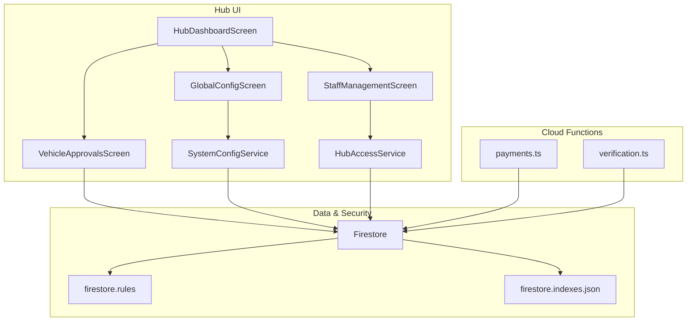
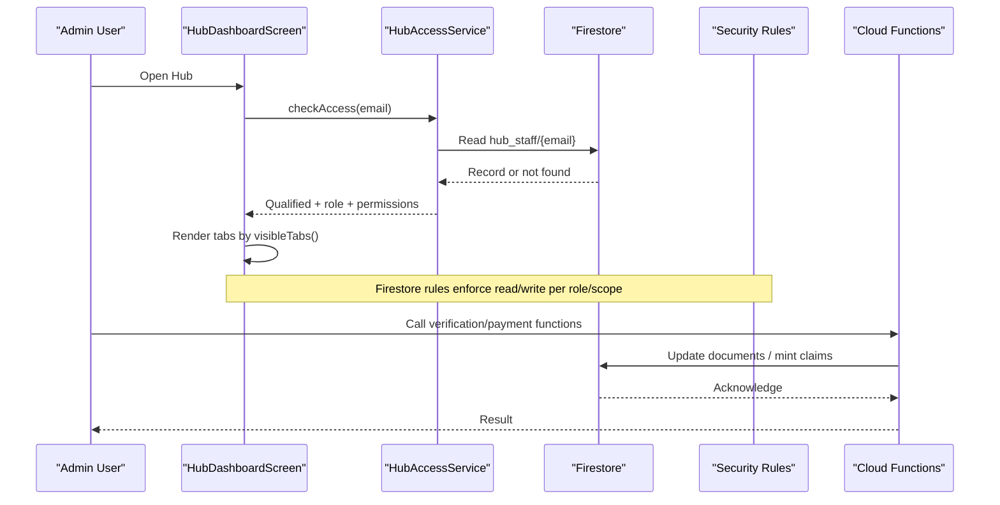
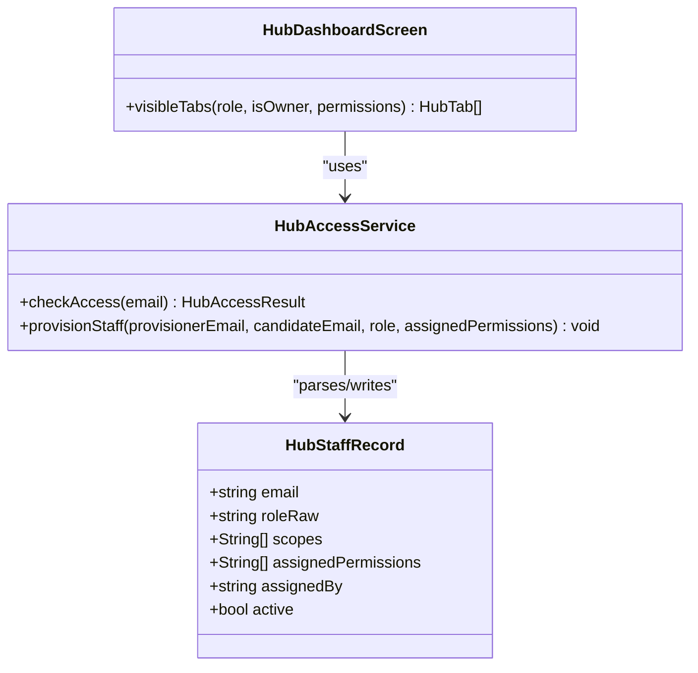
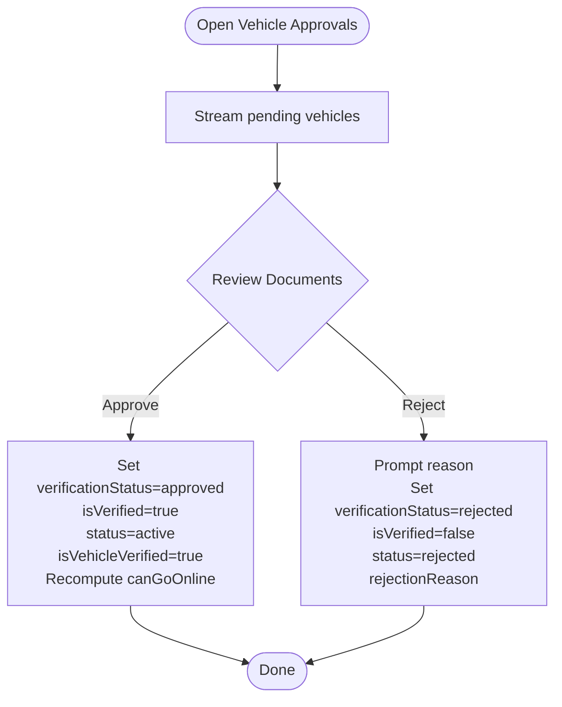
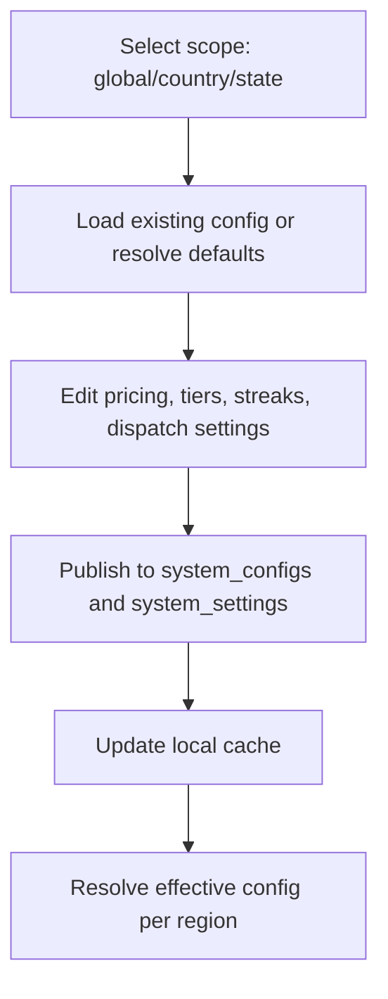
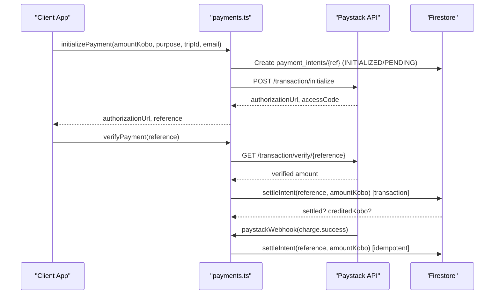
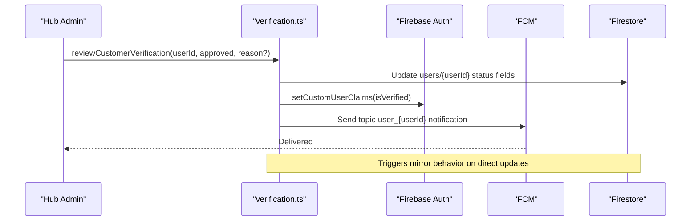
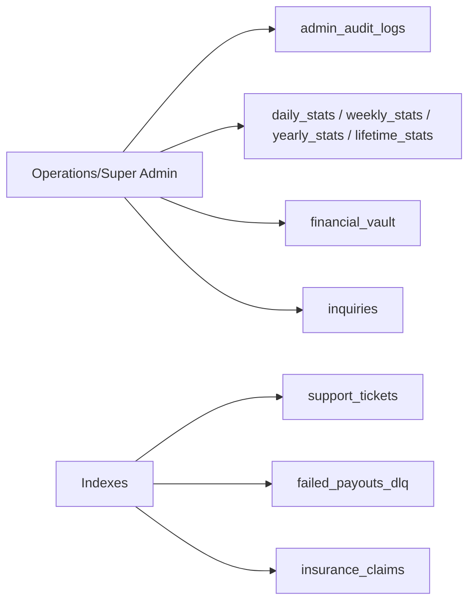
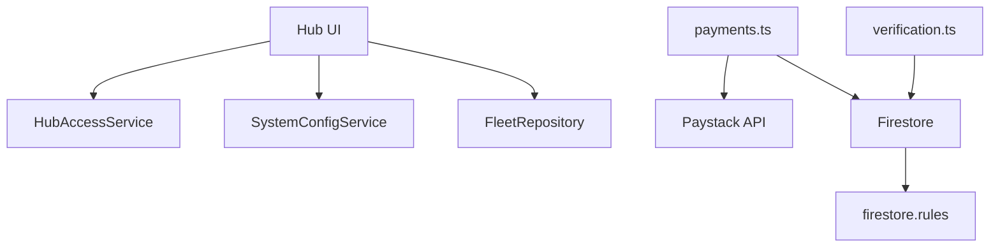

# Administrative Features

<cite>
**Referenced Files in This Document**
- [hub_access_service.dart](file://sese_hub/lib/features/staff/services/hub_access_service.dart)
- [staff_management_screen.dart](file://sese_hub/lib/features/staff/presentation/staff_management_screen.dart)
- [hub_dashboard_screen.dart](file://sese_hub/lib/features/dashboard/presentation/hub_dashboard_screen.dart)
- [vehicle_approvals_screen.dart](file://sese_hub/lib/features/verification/presentation/vehicle_approvals_screen.dart)
- [global_config_screen.dart](file://sese_hub/lib/features/config/presentation/global_config_screen.dart)
- [system_config_service.dart](file://sese_hub/lib/features/config/services/system_config_service.dart)
- [payments.ts](file://functions/src/payments.ts)
- [verification.ts](file://functions/src/verification.ts)
- [firestore.rules](file://firestore.rules)
- [firestore.indexes.json](file://firestore.indexes.json)
</cite>

## Table of Contents
1. [Introduction](#introduction)
2. [Project Structure](#project-structure)
3. [Core Components](#core-components)
4. [Architecture Overview](#architecture-overview)
5. [Detailed Component Analysis](#detailed-component-analysis)
6. [Dependency Analysis](#dependency-analysis)
7. [Performance Considerations](#performance-considerations)
8. [Troubleshooting Guide](#troubleshooting-guide)
9. [Conclusion](#conclusion)

## Introduction
This document describes the administrative hub that powers staff access control, user verification approvals, system configuration management, operational monitoring, financial operations, and audit controls. It explains how permissions are enforced, how approval workflows operate end-to-end, how dynamic configuration is published, and how payments and payouts are settled securely. It also outlines where audit logging and reporting data lives and how external integrations (payment provider and messaging) participate in these workflows.

## Project Structure
The administrative features span three main areas:
- Hub UI (Flutter): Staff dashboard, fleet verification desk, dynamic configuration editor, and staff management.
- Cloud Functions (TypeScript): Payment settlement, verification review callables, and Firestore triggers for claims and notifications.
- Security Rules and Indexes: Fine-grained Firestore rules for admin, audit, financial vaults, and indexes for support tickets, failed payouts, and insurance claims.

**Diagram sources**
- [hub_dashboard_screen.dart:10-92](file://sese_hub/lib/features/dashboard/presentation/hub_dashboard_screen.dart#L10-L92)
- [vehicle_approvals_screen.dart:10-259](file://sese_hub/lib/features/verification/presentation/vehicle_approvals_screen.dart#L10-L259)
- [global_config_screen.dart:5-15](file://sese_hub/lib/features/config/presentation/global_config_screen.dart#L5-L15)
- [system_config_service.dart:8-18](file://sese_hub/lib/features/config/services/system_config_service.dart#L8-L18)
- [hub_access_service.dart:214-284](file://sese_hub/lib/features/staff/services/hub_access_service.dart#L214-L284)
- [payments.ts:108-197](file://functions/src/payments.ts#L108-L197)
- [verification.ts:26-131](file://functions/src/verification.ts#L26-L131)
- [firestore.rules:116-185](file://firestore.rules#L116-L185)
- [firestore.indexes.json:1495-1542](file://firestore.indexes.json#L1495-L1542)

**Section sources**
- [hub_dashboard_screen.dart:10-92](file://sese_hub/lib/features/dashboard/presentation/hub_dashboard_screen.dart#L10-L92)
- [firestore.rules:116-185](file://firestore.rules#L116-L185)

## Core Components
- Staff Access Control and RBAC: A zero-trust gate checks a permanent owner email or an active `hub_staff` record to qualify users and compute effective module permissions. The dashboard renders tabs based on role and assigned permissions.
- Fleet Verification Desk: Unified queue for vehicle registrations, driver profile approvals, customer approvals, and pre-online camera audit logs. Approvals update canonical status fields and legacy aliases to keep older clients consistent.
- Dynamic Configuration Management: Admin UI publishes region-scoped pricing, car tier thresholds, streak rewards, and daily streak settings into `system_configs`, with fallback caching and resolution logic.
- Financial Operations: Server-side payment initialization, verification, and webhook settlement; idempotent wallet crediting and transaction recording.
- Audit and Reporting Data: Admin audit logs, system stats, financial vault, and time series under Super/Admin-only paths; indexes for support tickets, failed payouts, and insurance claims.

**Section sources**
- [hub_access_service.dart:6-41](file://sese_hub/lib/features/staff/services/hub_access_service.dart#L6-L41)
- [hub_dashboard_screen.dart:10-92](file://sese_hub/lib/features/dashboard/presentation/hub_dashboard_screen.dart#L10-L92)
- [vehicle_approvals_screen.dart:41-144](file://sese_hub/lib/features/verification/presentation/vehicle_approvals_screen.dart#L41-L144)
- [global_config_screen.dart:121-315](file://sese_hub/lib/features/config/presentation/global_config_screen.dart#L121-L315)
- [system_config_service.dart:92-181](file://sese_hub/lib/features/config/services/system_config_service.dart#L92-L181)
- [payments.ts:108-197](file://functions/src/payments.ts#L108-L197)
- [firestore.rules:549-593](file://firestore.rules#L549-L593)

## Architecture Overview
Administrative flows combine client-side permission gating, server-side rule enforcement, and Cloud Functions for sensitive operations.

**Diagram sources**
- [hub_dashboard_screen.dart:51-92](file://sese_hub/lib/features/dashboard/presentation/hub_dashboard_screen.dart#L51-L92)
- [hub_access_service.dart:214-284](file://sese_hub/lib/features/staff/services/hub_access_service.dart#L214-L284)
- [firestore.rules:116-185](file://firestore.rules#L116-L185)
- [verification.ts:26-131](file://functions/src/verification.ts#L26-L131)
- [payments.ts:108-197](file://functions/src/payments.ts#L108-L197)

## Detailed Component Analysis

### Staff Access Control and Dashboard Navigation
- Owner bootstrap: A hardcoded primary owner email grants permanent full access without requiring a `hub_staff` document.
- Staff records: Stored at `hub_staff/{email}` with role (`Super`/`Admin`/`Agent`) and `assignedPermissions`. Non-Super roles cannot be granted `staff_manage`.
- Tab visibility: The dashboard computes visible tabs from role, owner flag, and permissions. Profile tab is always present.
- Security rules: Only the primary owner can create/update/delete `hub_staff`; other reads are restricted.

**Diagram sources**
- [hub_access_service.dart:120-167](file://sese_hub/lib/features/staff/services/hub_access_service.dart#L120-L167)
- [hub_access_service.dart:214-284](file://sese_hub/lib/features/staff/services/hub_access_service.dart#L214-L284)
- [hub_dashboard_screen.dart:51-92](file://sese_hub/lib/features/dashboard/presentation/hub_dashboard_screen.dart#L51-L92)

**Section sources**
- [hub_access_service.dart:6-41](file://sese_hub/lib/features/staff/services/hub_access_service.dart#L6-L41)
- [hub_access_service.dart:120-167](file://sese_hub/lib/features/staff/services/hub_access_service.dart#L120-L167)
- [hub_access_service.dart:214-284](file://sese_hub/lib/features/staff/services/hub_access_service.dart#L214-L284)
- [staff_management_screen.dart:41-47](file://sese_hub/lib/features/staff/presentation/staff_management_screen.dart#L41-L47)
- [firestore.rules:487-498](file://firestore.rules#L487-L498)

### Fleet Verification and Security Pipeline
- Pending vehicles stream: Displays pending registrations, cross-checks license plate vs. uploaded license, shows category-specific documents, and supports approve/reject actions.
- Approval flow: Sets canonical verification status and legacy aliases, marks driver-level flags, and recomputes `canGoOnline`.
- Rejection flow: Requires a reason, persists it, and updates legacy fields.
- Pre-online audit logs: Streams recent camera verification records for inspection.

**Diagram sources**
- [vehicle_approvals_screen.dart:41-144](file://sese_hub/lib/features/verification/presentation/vehicle_approvals_screen.dart#L41-L144)
- [vehicle_approvals_screen.dart:261-414](file://sese_hub/lib/features/verification/presentation/vehicle_approvals_screen.dart#L261-L414)
- [vehicle_approvals_screen.dart:564-643](file://sese_hub/lib/features/verification/presentation/vehicle_approvals_screen.dart#L564-L643)

**Section sources**
- [vehicle_approvals_screen.dart:41-144](file://sese_hub/lib/features/verification/presentation/vehicle_approvals_screen.dart#L41-L144)
- [vehicle_approvals_screen.dart:261-414](file://sese_hub/lib/features/verification/presentation/vehicle_approvals_screen.dart#L261-L414)
- [vehicle_approvals_screen.dart:564-643](file://sese_hub/lib/features/verification/presentation/vehicle_approvals_screen.dart#L564-L643)

### Dynamic System Configuration Management
- Scope selection: Global default, country, or state overrides.
- Pricing engine: Per-vehicle base fee, distance/time rates, surge multiplier.
- Car tiering: Year-based thresholds and multipliers.
- Streak rewards and daily streak settings: Tiers, grand awards, commission rate, no-show wait, disabled regions.
- Persistence: Writes to `system_configs/{configId}` and `system_settings/dispatch` for max visible bids; includes local cache fallback.

**Diagram sources**
- [global_config_screen.dart:121-315](file://sese_hub/lib/features/config/presentation/global_config_screen.dart#L121-L315)
- [system_config_service.dart:92-181](file://sese_hub/lib/features/config/services/system_config_service.dart#L92-L181)

**Section sources**
- [global_config_screen.dart:121-315](file://sese_hub/lib/features/config/presentation/global_config_screen.dart#L121-L315)
- [system_config_service.dart:92-181](file://sese_hub/lib/features/config/services/system_config_service.dart#L92-L181)

### Financial Operations and Payouts
- Payment lifecycle: Initialize intent, host checkout, verify amount, settle once via transaction, record wallet credit and transaction.
- Webhook settlement: HMAC signature verification, idempotent settlement, safe error handling.
- Data model: `payment_intents`, `wallets`, `wallets/{uid}/transactions`.
- Payouts and DLQ: Indexes exist for `failed_payouts_dlq` to support retry and reporting.

**Diagram sources**
- [payments.ts:108-197](file://functions/src/payments.ts#L108-L197)
- [payments.ts:206-271](file://functions/src/payments.ts#L206-L271)
- [payments.ts:283-326](file://functions/src/payments.ts#L283-L326)
- [payments.ts:333-371](file://functions/src/payments.ts#L333-L371)
- [firestore.indexes.json:626-662](file://firestore.indexes.json#L626-L662)

**Section sources**
- [payments.ts:108-197](file://functions/src/payments.ts#L108-L197)
- [payments.ts:206-271](file://functions/src/payments.ts#L206-L271)
- [payments.ts:283-326](file://functions/src/payments.ts#L283-L326)
- [payments.ts:333-371](file://functions/src/payments.ts#L333-L371)
- [firestore.indexes.json:626-662](file://firestore.indexes.json#L626-L662)

### User Verification Workflows and Notifications
- Customer verification: Callable sets KYC status, custom claim, and sends FCM notification; trigger syncs claims and notifies on rejection.
- Driver verification: Callable sets profile verification, custom claim, and sends FCM notification; trigger mirrors behavior on direct updates.

**Diagram sources**
- [verification.ts:26-131](file://functions/src/verification.ts#L26-L131)
- [verification.ts:138-241](file://functions/src/verification.ts#L138-L241)
- [verification.ts:249-351](file://functions/src/verification.ts#L249-L351)

**Section sources**
- [verification.ts:26-131](file://functions/src/verification.ts#L26-L131)
- [verification.ts:138-241](file://functions/src/verification.ts#L138-L241)
- [verification.ts:249-351](file://functions/src/verification.ts#L249-L351)

### Audit Logging, Reporting, and Operational Monitoring
- Admin audit logs: Readable only with admin auth claims and appropriate scope; writes are append-only via functions.
- System stats and financial vault: Restricted to Super Admin; includes daily/weekly/yearly/lifetime stats and archives.
- Support and inquiries: Operations admins can read/create/update inquiries; delete reserved for Super Admin.
- Indexes: Optimized queries for support tickets, failed payouts, and insurance claims.

**Diagram sources**
- [firestore.rules:116-185](file://firestore.rules#L116-L185)
- [firestore.rules:549-593](file://firestore.rules#L549-L593)
- [firestore.rules:608-614](file://firestore.rules#L608-L614)
- [firestore.indexes.json:1495-1542](file://firestore.indexes.json#L1495-L1542)
- [firestore.indexes.json:626-662](file://firestore.indexes.json#L626-L662)

**Section sources**
- [firestore.rules:116-185](file://firestore.rules#L116-L185)
- [firestore.rules:549-593](file://firestore.rules#L549-L593)
- [firestore.rules:608-614](file://firestore.rules#L608-L614)
- [firestore.indexes.json:626-662](file://firestore.indexes.json#L626-L662)
- [firestore.indexes.json:1495-1542](file://firestore.indexes.json#L1495-L1542)

## Dependency Analysis
- Hub UI depends on:
  - HubAccessService for qualification and tab rendering.
  - FleetRepository (via VehicleApprovalsScreen) for pending queues.
  - SystemConfigService for reading/publishing configurations.
- Cloud Functions depend on:
  - Firebase Admin SDK for Firestore, Auth, Messaging.
  - External Paystack API for payment initialization and verification.
- Security Rules govern:
  - IAM registry, audit logs, system configs, financial vaults, inquiries, and runtime config vaults.

**Diagram sources**
- [hub_dashboard_screen.dart:51-92](file://sese_hub/lib/features/dashboard/presentation/hub_dashboard_screen.dart#L51-L92)
- [system_config_service.dart:92-181](file://sese_hub/lib/features/config/services/system_config_service.dart#L92-L181)
- [payments.ts:108-197](file://functions/src/payments.ts#L108-L197)
- [verification.ts:26-131](file://functions/src/verification.ts#L26-L131)
- [firestore.rules:116-185](file://firestore.rules#L116-L185)

**Section sources**
- [hub_dashboard_screen.dart:51-92](file://sese_hub/lib/features/dashboard/presentation/hub_dashboard_screen.dart#L51-L92)
- [system_config_service.dart:92-181](file://sese_hub/lib/features/config/services/system_config_service.dart#L92-L181)
- [payments.ts:108-197](file://functions/src/payments.ts#L108-L197)
- [verification.ts:26-131](file://functions/src/verification.ts#L26-L131)
- [firestore.rules:116-185](file://firestore.rules#L116-L185)

## Performance Considerations
- Use streams for real-time queues (pending vehicles, audit logs) to minimize polling overhead.
- Prefer server-side settlement and idempotency guards to avoid duplicate credits and reduce reconciliation costs.
- Leverage Firestore indexes for support tickets, failed payouts, and insurance claims to optimize query performance.
- Cache configuration locally with fallback to ensure UI responsiveness when network is unavailable.

[No sources needed since this section provides general guidance]

## Troubleshooting Guide
- Hub access denied: Ensure the signed-in email exists in `hub_staff` with an active role or is the primary owner. Check token refresh before opening streams to avoid UNAUTHENTICATED loops.
- Payment failures: Validate minimum/maximum amounts, currency, and email; inspect intent status and failure reasons; confirm Paystack secret configuration and webhook signature verification.
- Configuration save errors: Confirm Super Admin write permissions and that the target document ID matches the selected scope; check local cache consistency.
- Verification workflow issues: Verify callable inputs (userId/driverId), check custom claim updates, and review FCM delivery logs.

**Section sources**
- [hub_access_service.dart:214-284](file://sese_hub/lib/features/staff/services/hub_access_service.dart#L214-L284)
- [payments.ts:108-197](file://functions/src/payments.ts#L108-L197)
- [payments.ts:333-371](file://functions/src/payments.ts#L333-L371)
- [global_config_screen.dart:217-315](file://sese_hub/lib/features/config/presentation/global_config_screen.dart#L217-L315)
- [verification.ts:26-131](file://functions/src/verification.ts#L26-L131)

## Conclusion
The administrative hub provides a secure, permission-gated interface for fleet verification, dynamic configuration publishing, staff management, and operational oversight. Backend functions enforce financial integrity and user verification outcomes, while security rules and indexes protect sensitive data and enable efficient reporting. Together, these components deliver a robust platform for staff workflows, compliance, and analytics.

[No sources needed since this section summarizes without analyzing specific files]