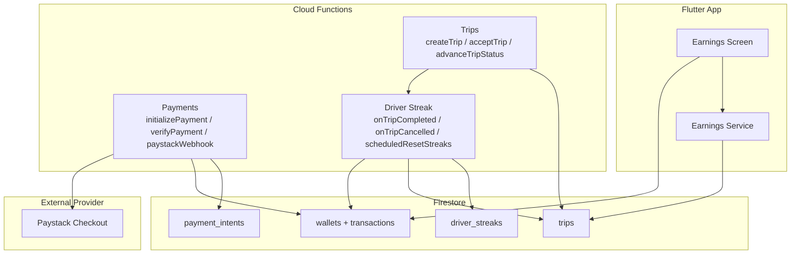
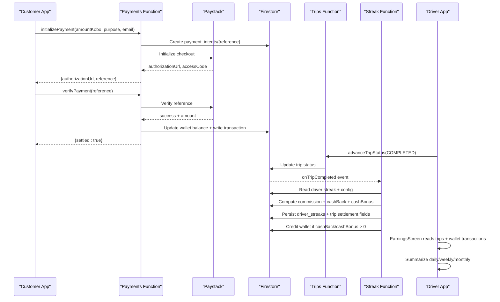
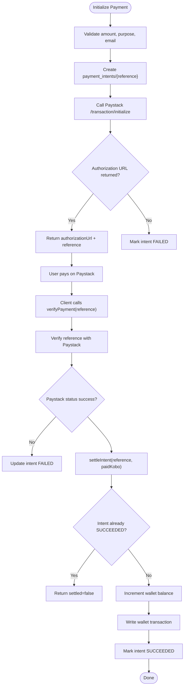
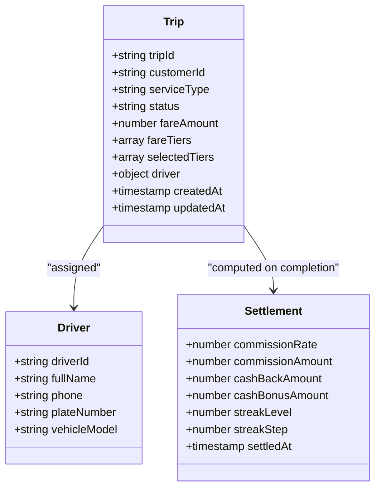
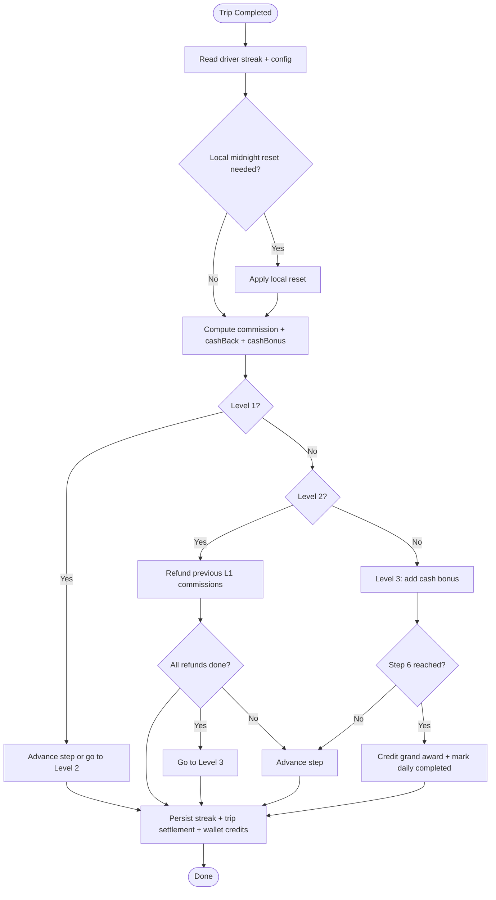
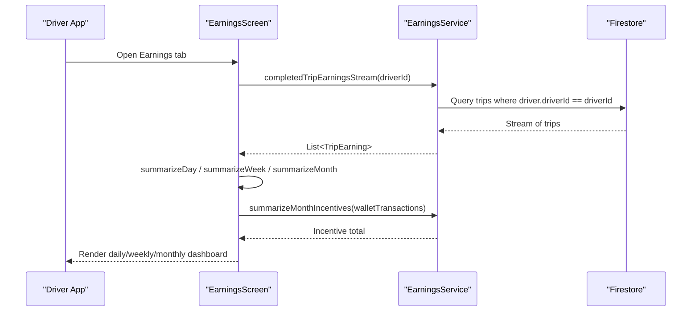
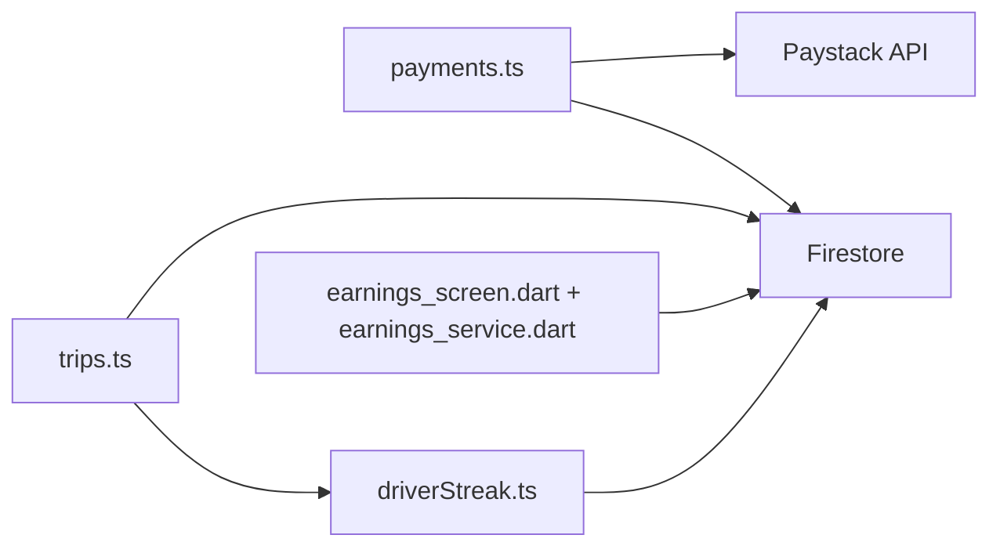

# Financial Reporting & Analytics

<cite>
**Referenced Files in This Document**   
- [payments.ts](file://functions/src/payments.ts)
- [trips.ts](file://functions/src/trips.ts)
- [driverStreak.ts](file://functions/src/driverStreak.ts)
- [earnings_service.dart](file://sese_ride/lib/features/wallet/earnings_service.dart)
- [earnings_screen.dart](file://sese_ride/lib/features/wallet/earnings_screen.dart)
</cite>

## Table of Contents
1. [Introduction](#introduction)
2. [Project Structure](#project-structure)
3. [Core Components](#core-components)
4. [Architecture Overview](#architecture-overview)
5. [Detailed Component Analysis](#detailed-component-analysis)
6. [Dependency Analysis](#dependency-analysis)
7. [Performance Considerations](#performance-considerations)
8. [Troubleshooting Guide](#troubleshooting-guide)
9. [Conclusion](#conclusion)
10. [Appendices](#appendices)

## Introduction
This document explains the financial reporting and analytics capabilities implemented in the project. It covers:
- Revenue tracking through completed trips, platform commissions, and driver incentives.
- Payout calculations via a streak-based commission engine that adjusts fees and credits drivers with cash-back or bonuses.
- Transaction history for wallet top-ups, trip payments, and incentive credits.
- Driver earnings dashboards showing daily, weekly, and monthly summaries.
- Report generation patterns using Firestore streams and client-side aggregation.
- Audit trails embedded in payment intents, trip settlement fields, and wallet transactions.
- Compliance considerations around amount validation, currency checks, idempotent settlement, and webhook signature verification.
- Integration points with an external payment provider and guidance for accounting system exports.

The implementation is split between backend Cloud Functions (payment settlement, dispatch, and streak-driven commissioning) and the Flutter ride app (earnings dashboards and transaction views).

## Project Structure
Financial data flows across three main layers:
- Backend functions handle secure payment collection, trip lifecycle, and streak-based commission computation.
- Firestore stores payment intents, wallets, transactions, trips, and streak state.
- The Flutter app surfaces earnings reports and transaction histories to drivers.

**Diagram sources**
- [payments.ts:108-197](file://functions/src/payments.ts#L108-L197)
- [payments.ts:283-326](file://functions/src/payments.ts#L283-L326)
- [payments.ts:333-370](file://functions/src/payments.ts#L333-L370)
- [trips.ts:129-225](file://functions/src/trips.ts#L129-L225)
- [trips.ts:591-653](file://functions/src/trips.ts#L591-L653)
- [driverStreak.ts:381-524](file://functions/src/driverStreak.ts#L381-L524)
- [earnings_screen.dart:47-97](file://sese_ride/lib/features/wallet/earnings_screen.dart#L47-L97)
- [earnings_service.dart:80-101](file://sese_ride/lib/features/wallet/earnings_service.dart#L80-L101)

**Section sources**
- [payments.ts:1-371](file://functions/src/payments.ts#L1-L371)
- [trips.ts:129-225](file://functions/src/trips.ts#L129-L225)
- [driverStreak.ts:381-524](file://functions/src/driverStreak.ts#L381-L524)
- [earnings_screen.dart:47-97](file://sese_ride/lib/features/wallet/earnings_screen.dart#L47-L97)
- [earnings_service.dart:80-101](file://sese_ride/lib/features/wallet/earnings_service.dart#L80-L101)

## Core Components
- Payment settlement: Securely initializes and verifies Paystack payments, updates wallet balances, and records immutable transaction entries.
- Trip lifecycle: Creates trips, assigns drivers, advances status, and provides settlement context for commission calculation.
- Streak commission engine: Computes dynamic commission rates, applies cash-back refunds, grants bonuses, and persists streak state per driver timezone.
- Earnings dashboard: Streams completed trips and wallet transactions to compute daily, weekly, and monthly summaries for drivers.

Key responsibilities:
- Revenue tracking: Fare amounts from completed trips; platform commission derived from settled commission rate.
- Payout calculations: Cash-back and bonus credits added to driver wallets during streak progression.
- Transaction history: Wallet transactions record top-ups, trip payments, streak cash-back, streak bonuses, and grand awards.
- Reports: Client-side aggregation over completed trips and wallet incentives.

**Section sources**
- [payments.ts:108-197](file://functions/src/payments.ts#L108-L197)
- [payments.ts:206-272](file://functions/src/payments.ts#L206-L272)
- [payments.ts:283-326](file://functions/src/payments.ts#L283-L326)
- [payments.ts:333-370](file://functions/src/payments.ts#L333-L370)
- [trips.ts:129-225](file://functions/src/trips.ts#L129-L225)
- [driverStreak.ts:239-335](file://functions/src/driverStreak.ts#L239-L335)
- [driverStreak.ts:381-524](file://functions/src/driverStreak.ts#L381-L524)
- [earnings_service.dart:6-42](file://sese_ride/lib/features/wallet/earnings_service.dart#L6-L42)
- [earnings_service.dart:80-101](file://sese_ride/lib/features/wallet/earnings_service.dart#L80-L101)
- [earnings_screen.dart:47-97](file://sese_ride/lib/features/wallet/earnings_screen.dart#L47-L97)

## Architecture Overview
The financial architecture combines server-authoritative payment settlement, trip state management, and streak-driven commission logic. The Flutter app consumes these results to render earnings reports.

**Diagram sources**
- [payments.ts:108-197](file://functions/src/payments.ts#L108-L197)
- [payments.ts:283-326](file://functions/src/payments.ts#L283-L326)
- [trips.ts:764-796](file://functions/src/trips.ts#L764-L796)
- [driverStreak.ts:381-524](file://functions/src/driverStreak.ts#L381-L524)
- [earnings_screen.dart:47-97](file://sese_ride/lib/features/wallet/earnings_screen.dart#L47-L97)

## Detailed Component Analysis

### Payment Settlement and Transaction History
The payment flow ensures zero-trust amount handling, idempotent settlement, and comprehensive auditability:
- `initializePayment` validates caller identity, amount bounds, purpose, and email, then creates a `payment_intents` document and initializes Paystack.
- `verifyPayment` verifies the reference server-side, checks currency and amount, and settles the intent by updating the driver/customer wallet and writing a transaction record.
- `paystackWebhook` handles asynchronous settlement from Paystack with HMAC signature verification and idempotent settlement.

**Diagram sources**
- [payments.ts:108-197](file://functions/src/payments.ts#L108-L197)
- [payments.ts:206-272](file://functions/src/payments.ts#L206-L272)
- [payments.ts:283-326](file://functions/src/payments.ts#L283-L326)

Audit trail fields include:
- Payment intent status transitions (`INITIALIZED`, `PENDING`, `SUCCEEDED`, `FAILED`).
- Amount and currency validation.
- Timestamps for creation, update, and settlement.
- Wallet transaction records with type, amount, currency, payment reference, and optional tripId.

Compliance notes:
- Minimum and maximum payment limits enforced server-side.
- Currency must match expected NGN.
- Webhook signature verified before processing.
- Idempotency prevents double crediting.

**Section sources**
- [payments.ts:108-197](file://functions/src/payments.ts#L108-L197)
- [payments.ts:206-272](file://functions/src/payments.ts#L206-L272)
- [payments.ts:283-326](file://functions/src/payments.ts#L283-L326)
- [payments.ts:333-370](file://functions/src/payments.ts#L333-L370)

### Trip Lifecycle and Settlement Context
Trip creation captures fare tokens, selected tiers, baseline/proposed fares, and driver assignment metadata. Advancing trip status to COMPLETED triggers streak commission computation.

Key aspects:
- Zero-trust fare token verification ensures client cannot tamper with fare amounts.
- Driver acceptance and location updates are validated against trip ownership and live statuses.
- Trip completion writes settlement context used by streak engine.

**Diagram sources**
- [trips.ts:129-225](file://functions/src/trips.ts#L129-L225)
- [trips.ts:591-653](file://functions/src/trips.ts#L591-L653)
- [driverStreak.ts:456-466](file://functions/src/driverStreak.ts#L456-L466)

**Section sources**
- [trips.ts:129-225](file://functions/src/trips.ts#L129-L225)
- [trips.ts:591-653](file://functions/src/trips.ts#L591-L653)
- [trips.ts:764-796](file://functions/src/trips.ts#L764-L796)

### Streak-Based Commission Engine
The streak engine computes dynamic commission tiers, applies cash-back refunds, and grants bonuses based on driver performance within a local day.

Core mechanics:
- Level 1 reduces commission stepwise; reaching Step 6 advances to Level 2.
- Level 2 refunds prior Level 1 commissions in reverse order; completing all refunds advances to Level 3.
- Level 3 adds cash bonuses proportional to fare; completing Step 6 triggers a grand award.
- Break rules reset or drop back levels depending on current level and step.
- Local midnight resets ensure fairness across timezones.

**Diagram sources**
- [driverStreak.ts:239-335](file://functions/src/driverStreak.ts#L239-L335)
- [driverStreak.ts:381-524](file://functions/src/driverStreak.ts#L381-L524)
- [driverStreak.ts:535-557](file://functions/src/driverStreak.ts#L535-L557)

Revenue impact:
- Platform revenue per trip = fare × commissionRate.
- Driver net earnings = fare − commissionAmount + cashBackAmount + cashBonusAmount + grandAwardAmount.
- Streak state and settlement fields provide auditability for compliance and reconciliation.

**Section sources**
- [driverStreak.ts:239-335](file://functions/src/driverStreak.ts#L239-L335)
- [driverStreak.ts:381-524](file://functions/src/driverStreak.ts#L381-L524)
- [driverStreak.ts:535-557](file://functions/src/driverStreak.ts#L535-L557)

### Driver Earnings Dashboards
The driver-facing earnings dashboard streams completed trips and wallet transactions to compute summaries:
- Daily view: today’s gross fare income, commission paid, net profit, and trip breakdowns.
- Weekly view: Mon–Sun bar chart of gross fares with aggregated commission and net totals.
- Monthly view: total gross revenue, total platform commissions, referral/incentive earnings, and final net earnings.

Data sources:
- Completed trips streamed from Firestore filtered by driver ID and status.
- Wallet transactions streamed for incentive credits.

**Diagram sources**
- [earnings_screen.dart:47-97](file://sese_ride/lib/features/wallet/earnings_screen.dart#L47-L97)
- [earnings_service.dart:80-101](file://sese_ride/lib/features/wallet/earnings_service.dart#L80-L101)
- [earnings_service.dart:112-166](file://sese_ride/lib/features/wallet/earnings_service.dart#L112-L166)
- [earnings_service.dart:168-182](file://sese_ride/lib/features/wallet/earnings_service.dart#L168-L182)

Report generation examples:
- Daily report: filter completed trips by calendar day, sum gross and commission, compute net, list trips.
- Weekly report: compute Monday–Sunday buckets, aggregate totals, display bar chart.
- Monthly report: aggregate gross and commission across month, add incentive credits, compute final net.

Export formats:
- Current implementation renders dashboards in-app; no explicit CSV/JSON/PDF export is present in the referenced files.
- To support accounting integration, consider exporting:
  - Completed trip settlements (tripId, fareAmount, commissionRate, commissionAmount, cashBackAmount, cashBonusAmount, settledAt).
  - Wallet transactions (type, amount, currency, paymentReference, tripId, createdAt).
  - Driver streak snapshots (streakLevel, streakStep, resetDateLocal).

**Section sources**
- [earnings_screen.dart:47-97](file://sese_ride/lib/features/wallet/earnings_screen.dart#L47-L97)
- [earnings_screen.dart:132-197](file://sese_ride/lib/features/wallet/earnings_screen.dart#L132-L197)
- [earnings_screen.dart:238-321](file://sese_ride/lib/features/wallet/earnings_screen.dart#L238-L321)
- [earnings_screen.dart:372-418](file://sese_ride/lib/features/wallet/earnings_screen.dart#L372-L418)
- [earnings_service.dart:80-101](file://sese_ride/lib/features/wallet/earnings_service.dart#L80-L101)
- [earnings_service.dart:112-166](file://sese_ride/lib/features/wallet/earnings_service.dart#L112-L166)
- [earnings_service.dart:168-182](file://sese_ride/lib/features/wallet/earnings_service.dart#L168-L182)

## Dependency Analysis
Components interact through Firestore events and callable functions:
- Payments depend on Paystack API and Firestore for intents and wallets.
- Trips depend on fare token verification and driver state; they trigger streak computation upon completion.
- Streak depends on driver configuration, timezone resolution, and streak state persistence.
- Earnings dashboard depends on Firestore streams for trips and wallet transactions.

**Diagram sources**
- [payments.ts:108-197](file://functions/src/payments.ts#L108-L197)
- [trips.ts:129-225](file://functions/src/trips.ts#L129-L225)
- [driverStreak.ts:381-524](file://functions/src/driverStreak.ts#L381-L524)
- [earnings_screen.dart:47-97](file://sese_ride/lib/features/wallet/earnings_screen.dart#L47-L97)

Coupling and cohesion:
- Payments module is cohesive around secure settlement and auditability.
- Trips module encapsulates dispatch and lifecycle, delegating financial adjustments to streak.
- Streak module centralizes commission logic and payout mechanics.
- Earnings dashboard is decoupled from settlement logic, relying on Firestore streams.

Potential circular dependencies:
- None observed among the analyzed modules; streak does not call trips directly but reacts to Firestore events.

External dependencies:
- Paystack API for payment initialization, verification, and webhooks.
- Firestore for real-time data and scheduled functions.

**Section sources**
- [payments.ts:108-197](file://functions/src/payments.ts#L108-L197)
- [trips.ts:129-225](file://functions/src/trips.ts#L129-L225)
- [driverStreak.ts:381-524](file://functions/src/driverStreak.ts#L381-L524)
- [earnings_screen.dart:47-97](file://sese_ride/lib/features/wallet/earnings_screen.dart#L47-L97)

## Performance Considerations
- Payment settlement uses Firestore transactions to ensure idempotency and atomic wallet updates.
- Streak computation batches writes for streak state, trip settlement fields, and wallet credits.
- Scheduled streak resets process drivers in pages of 500 to avoid large batch timeouts.
- Earnings dashboard streams limited recent trips and wallet transactions to reduce payload size.

Optimization opportunities:
- Add composite indexes for frequent queries (e.g., trips by driverId and status).
- Pre-aggregate daily/weekly/monthly metrics in a separate analytics collection for faster dashboard loads.
- Cache driver timezone and config resolution to reduce repeated reads.

[No sources needed since this section provides general guidance]

## Troubleshooting Guide
Common issues and resolutions:
- Payment not settling:
  - Verify Paystack secret configuration and webhook signature.
  - Check intent status transitions and failure reasons.
  - Ensure amount and currency match expectations.
- Streak not updating:
  - Confirm trip transitioned to COMPLETED and driverId exists.
  - Validate driver timezone and region configuration.
  - Check streak break triggers (decline, ping expiry, cancellation source).
- Dashboard shows missing data:
  - Ensure completed trips are streamed and filtered correctly.
  - Verify wallet transactions include incentive types.
  - Limit parameters may truncate results; adjust limit as needed.

**Section sources**
- [payments.ts:333-370](file://functions/src/payments.ts#L333-L370)
- [driverStreak.ts:535-557](file://functions/src/driverStreak.ts#L535-L557)
- [earnings_service.dart:80-101](file://sese_ride/lib/features/wallet/earnings_service.dart#L80-L101)

## Conclusion
The financial reporting and analytics system integrates secure payment settlement, trip lifecycle management, and streak-driven commission computation to deliver accurate revenue tracking and driver payouts. The Flutter earnings dashboard provides clear daily, weekly, and monthly insights. Audit trails are embedded throughout payment intents, trip settlement fields, and wallet transactions, supporting compliance and reconciliation. For accounting integrations, consider exporting structured settlement and transaction data while maintaining the existing security and idempotency guarantees.

[No sources needed since this section summarizes without analyzing specific files]

## Appendices

### Example Report Generation Workflows
- Daily report:
  - Stream completed trips for the driver.
  - Filter by calendar day.
  - Sum gross fares and commissions; compute net; list trips.
- Weekly report:
  - Compute Monday–Sunday buckets.
  - Aggregate totals and display bar chart.
- Monthly report:
  - Aggregate gross and commission across month.
  - Add incentive credits from wallet transactions.
  - Compute final net earnings.

**Section sources**
- [earnings_service.dart:112-166](file://sese_ride/lib/features/wallet/earnings_service.dart#L112-L166)
- [earnings_screen.dart:132-197](file://sese_ride/lib/features/wallet/earnings_screen.dart#L132-L197)
- [earnings_screen.dart:238-321](file://sese_ride/lib/features/wallet/earnings_screen.dart#L238-L321)
- [earnings_screen.dart:372-418](file://sese_ride/lib/features/wallet/earnings_screen.dart#L372-L418)

### Compliance and Audit Notes
- Amount validation and currency checks prevent mismatches.
- Webhook signature verification secures asynchronous settlements.
- Idempotent settlement avoids duplicate credits.
- Streak breaks and resets are logged with reasons and timestamps.
- Settlement fields on trips provide traceable commission details.

**Section sources**
- [payments.ts:108-197](file://functions/src/payments.ts#L108-L197)
- [payments.ts:333-370](file://functions/src/payments.ts#L333-L370)
- [driverStreak.ts:535-557](file://functions/src/driverStreak.ts#L535-L557)
- [driverStreak.ts:456-466](file://functions/src/driverStreak.ts#L456-L466)