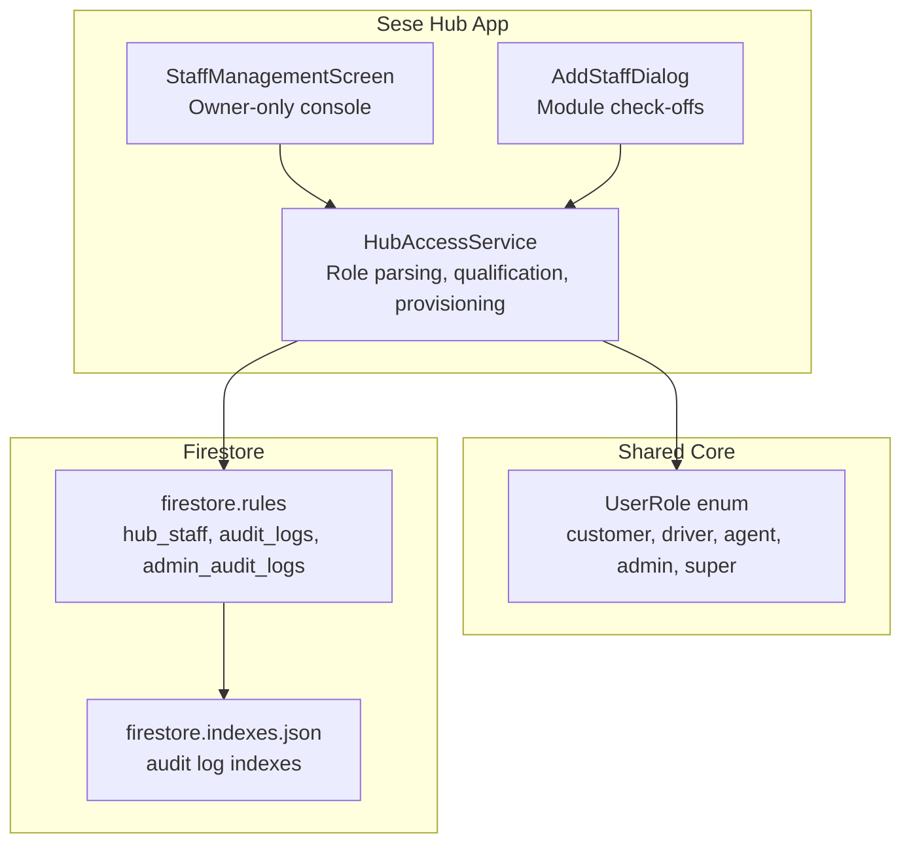
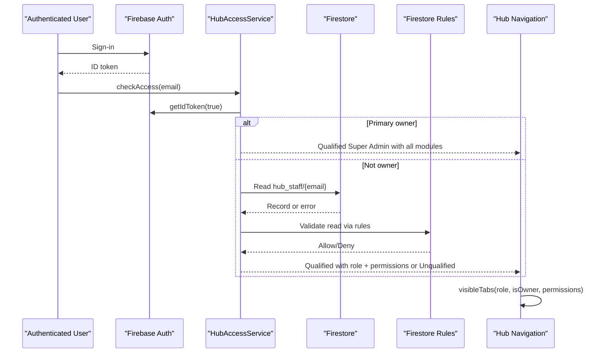
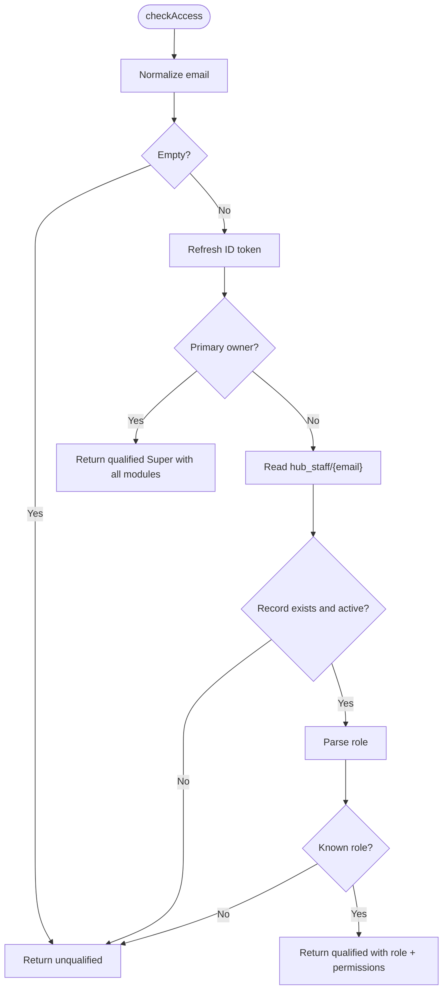
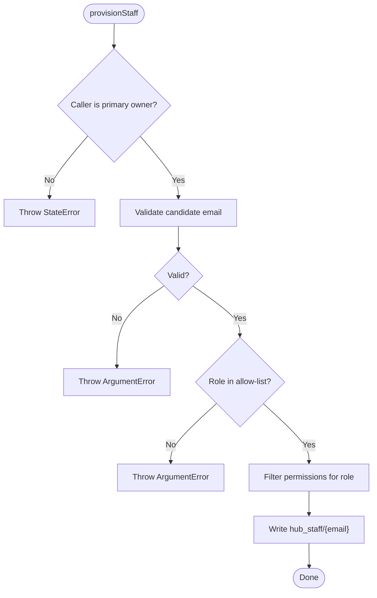
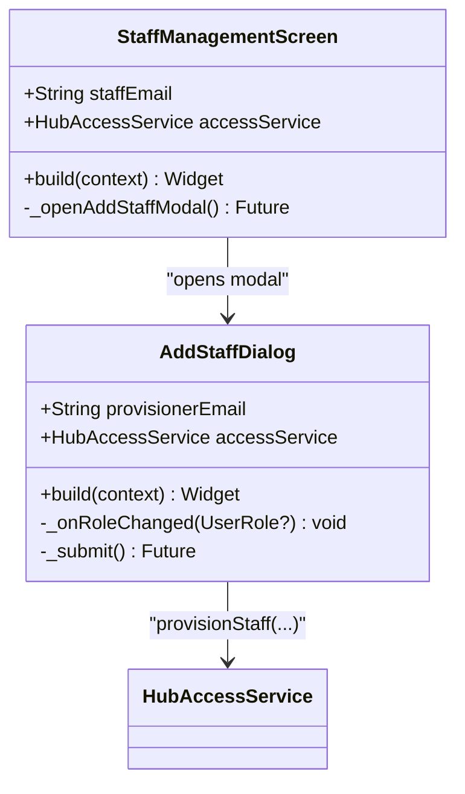
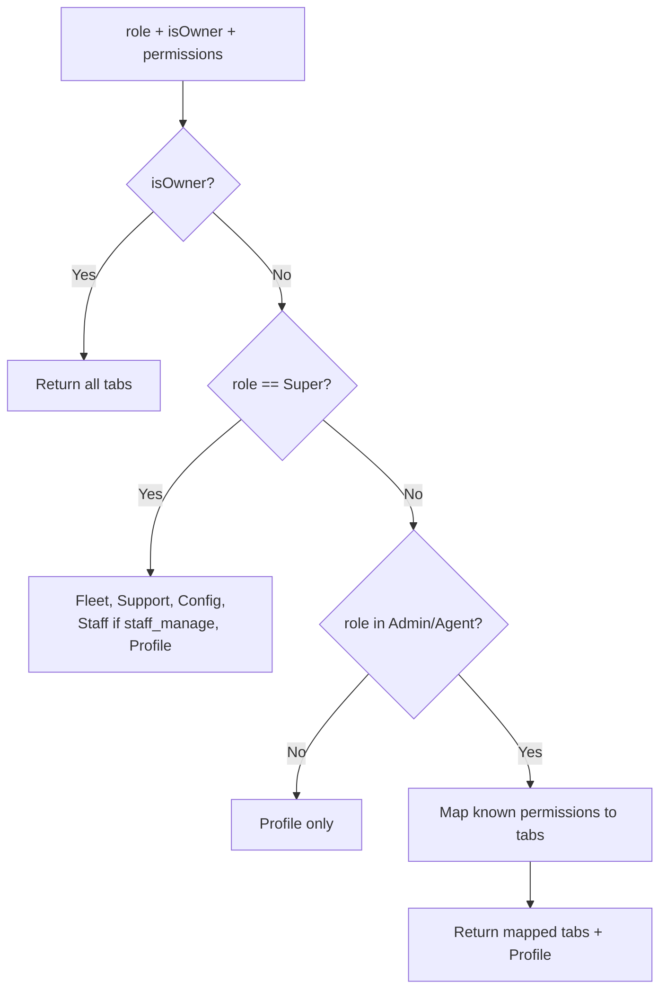
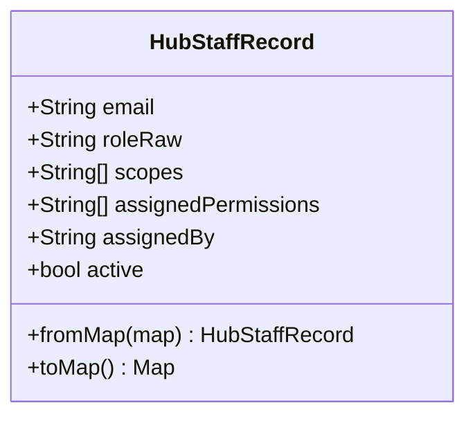
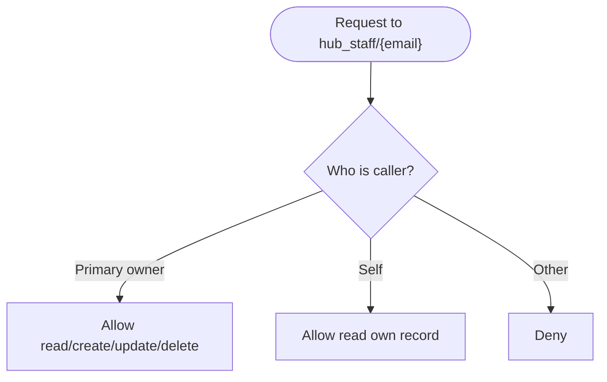
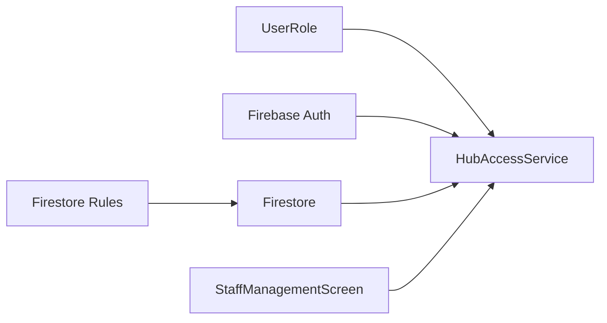

# Staff Access Control & Audit

<cite>
**Referenced Files in This Document**   
- [hub_access_service.dart](file://sese_hub/lib/features/staff/services/hub_access_service.dart)
- [staff_management_screen.dart](file://sese_hub/lib/features/staff/presentation/staff_management_screen.dart)
- [user_role.dart](file://sese_core/lib/models/user_role.dart)
- [firestore.rules](file://firestore.rules)
- [hub_access_test.dart](file://sese_hub/test/hub_access_test.dart)
- [firestore.indexes.json](file://firestore.indexes.json)
</cite>

## Table of Contents
1. [Introduction](#introduction)
2. [Project Structure](#project-structure)
3. [Core Components](#core-components)
4. [Architecture Overview](#architecture-overview)
5. [Detailed Component Analysis](#detailed-component-analysis)
6. [Dependency Analysis](#dependency-analysis)
7. [Performance Considerations](#performance-considerations)
8. [Troubleshooting Guide](#troubleshooting-guide)
9. [Security Best Practices and Compliance](#security-best-practices-and-compliance)
10. [Conclusion](#conclusion)

## Introduction
This document explains the staff access control and audit logging systems used by the Sese Hub application. It covers role-based permissions, staff account provisioning, permission inheritance, module-level access configuration, and how audit trails are governed at the database layer. The goal is to help developers, operators, and auditors understand who can do what, how privileges are granted and enforced, and how access decisions are recorded and reviewed.

The system combines:
- A client-side zero-trust gate that decides whether a user qualifies for Sese Hub access.
- Firestore security rules that enforce ownership, role allow-lists, and immutable audit collections.
- A primary-owner-only staff provisioning flow with explicit module permissions.
- A unified tab rendering model driven by assigned permissions rather than separate agent views.

## Project Structure
Staff access control lives primarily in the Sese Hub Flutter app, with server-side enforcement in Firestore security rules. Shared role definitions live in the shared core package.

**Diagram sources**
- [hub_access_service.dart:1-334](file://sese_hub/lib/features/staff/services/hub_access_service.dart#L1-L334)
- [staff_management_screen.dart:1-403](file://sese_hub/lib/features/staff/presentation/staff_management_screen.dart#L1-L403)
- [user_role.dart:1-55](file://sese_core/lib/models/user_role.dart#L1-L55)
- [firestore.rules:487-498](file://firestore.rules#L487-L498)
- [firestore.rules:182-189](file://firestore.rules#L182-L189)
- [firestore.indexes.json:84-120](file://firestore.indexes.json#L84-L120)

**Section sources**
- [hub_access_service.dart:1-334](file://sese_hub/lib/features/staff/services/hub_access_service.dart#L1-L334)
- [staff_management_screen.dart:1-403](file://sese_hub/lib/features/staff/presentation/staff_management_screen.dart#L1-L403)
- [user_role.dart:1-55](file://sese_core/lib/models/user_role.dart#L1-L55)
- [firestore.rules:487-498](file://firestore.rules#L487-L498)
- [firestore.rules:182-189](file://firestore.rules#L182-L189)
- [firestore.indexes.json:84-120](file://firestore.indexes.json#L84-L120)

## Core Components
- Role model: A shared `UserRole` enum defines customer, driver, agent, admin, and super roles. Hub-managed roles are agent, admin, and super.
- Hub access service: Implements owner detection, staff record parsing, silent access qualification, and staff provisioning.
- Staff management UI: Owner-only screen listing provisioned staff and opening an “Add Staff” dialog.
- Permission model: Module permissions such as fleet verification, dynamic config, staff management, and support chat drive visible tabs.
- Firestore rules: Enforce hub staff write authority, role allow-lists, and immutable audit logs.

Key responsibilities:
- `HubAccessService`: Zero-trust qualification, owner bootstrap, staff record normalization, and provisioning.
- `visibleTabs`: Maps role + permissions to allowed navigation tabs.
- `filterPermissionsForRole`: Prevents privilege escalation by stripping sensitive modules from non-Super roles.
- Firestore rules: Restrict `hub_staff` writes to the primary owner and keep audit collections append-only.

**Section sources**
- [user_role.dart:1-55](file://sese_core/lib/models/user_role.dart#L1-L55)
- [hub_access_service.dart:17-41](file://sese_hub/lib/features/staff/services/hub_access_service.dart#L17-L41)
- [hub_access_service.dart:57-83](file://sese_hub/lib/features/staff/services/hub_access_service.dart#L57-L83)
- [hub_access_service.dart:120-167](file://sese_hub/lib/features/staff/services/hub_access_service.dart#L120-L167)
- [hub_access_service.dart:214-333](file://sese_hub/lib/features/staff/services/hub_access_service.dart#L214-L333)
- [firestore.rules:487-498](file://firestore.rules#L487-L498)

## Architecture Overview
The access control architecture follows a layered approach:
- Client-side gate: Validates identity and checks a staff record before granting Hub access.
- Server-side gate: Firestore rules validate ownership, role values, and mutation authority.
- UI-driven permissions: Tabs and features are shown based on the effective permission set.

**Diagram sources**
- [hub_access_service.dart:233-284](file://sese_hub/lib/features/staff/services/hub_access_service.dart#L233-L284)
- [hub_access_service.dart:57-83](file://sese_hub/lib/features/staff/services/hub_access_service.dart#L57-L83)
- [firestore.rules:487-498](file://firestore.rules#L487-L498)

## Detailed Component Analysis

### HubAccessService: Qualification and Provisioning
Responsibilities:
- Determine if the current user is the primary owner.
- Parse and normalize `hub_staff` records.
- Provide a fail-closed access check that refreshes tokens before reading.
- Provision staff only when called by the primary owner.

Important behaviors:
- Owner bootstrap grants full module access without requiring a document.
- Unknown or inactive staff records result in unqualified access.
- Provisioning validates email format, role allow-list, and strips forbidden permissions.

**Diagram sources**
- [hub_access_service.dart:233-284](file://sese_hub/lib/features/staff/services/hub_access_service.dart#L233-L284)

Provisioning flow:
- Only the primary owner may call provisioning.
- Candidate email must be valid.
- Role must be Agent, Admin, or Super.
- Permissions are filtered so non-Super roles cannot receive staff management.

**Diagram sources**
- [hub_access_service.dart:294-332](file://sese_hub/lib/features/staff/services/hub_access_service.dart#L294-L332)

**Section sources**
- [hub_access_service.dart:1-334](file://sese_hub/lib/features/staff/services/hub_access_service.dart#L1-L334)

### Staff Management UI: Owner-Only Console
Responsibilities:
- Display provisioned staff records.
- Open the “Add Staff” modal only for the primary owner.
- Ensure a fresh ID token before opening streams.

Security notes:
- The screen is mounted only for the primary owner through the navigation shell’s permission logic.
- Server-side rules reject non-owner writes even if the UI were bypassed.

**Diagram sources**
- [staff_management_screen.dart:11-29](file://sese_hub/lib/features/staff/presentation/staff_management_screen.dart#L11-L29)
- [staff_management_screen.dart:209-280](file://sese_hub/lib/features/staff/presentation/staff_management_screen.dart#L209-L280)

**Section sources**
- [staff_management_screen.dart:1-403](file://sese_hub/lib/features/staff/presentation/staff_management_screen.dart#L1-L403)

### Permission Model and Tab Rendering
Module permissions:
- Fleet & Security
- Dynamic Config
- Staff Management
- Support Inbox

Tab mapping:
- Owner: All tabs.
- Super role: All module tabs; Staff tab requires explicit `staff_manage`.
- Other staff: Only explicitly granted module tabs plus Profile.

Permission filtering:
- Non-Super roles cannot receive `staff_manage`, preventing privilege escalation.

**Diagram sources**
- [hub_access_service.dart:57-83](file://sese_hub/lib/features/staff/services/hub_access_service.dart#L57-L83)
- [hub_access_service.dart:36-41](file://sese_hub/lib/features/staff/services/hub_access_service.dart#L36-L41)

**Section sources**
- [hub_access_service.dart:17-41](file://sese_hub/lib/features/staff/services/hub_access_service.dart#L17-L41)
- [hub_access_service.dart:57-83](file://sese_hub/lib/features/staff/services/hub_access_service.dart#L57-L83)

### Data Model: Hub Staff Record
Fields:
- Email
- Raw role string
- Scopes (legacy, retained read-only)
- Assigned permissions (authoritative module list)
- Assigned by (provisioner)
- Active flag

Normalization:
- Role parsing is case-insensitive and fails closed for unknown values.
- Active false means unqualified.

**Diagram sources**
- [hub_access_service.dart:120-167](file://sese_hub/lib/features/staff/services/hub_access_service.dart#L120-L167)

**Section sources**
- [hub_access_service.dart:120-167](file://sese_hub/lib/features/staff/services/hub_access_service.dart#L120-L167)

### Firestore Rules: Ownership, Roles, and Audit Collections
Key rule areas:
- `hub_staff/{staffEmail}`:
  - Read: Primary owner or self-read.
  - Create/Update: Primary owner only, with role allow-list and `assignedBy` validation.
  - Delete: Primary owner only.
- Audit collections:
  - `admin_audit_logs` and `audit_logs`: Readable by admins with the appropriate scope; writes are disabled for clients.

**Diagram sources**
- [firestore.rules:487-498](file://firestore.rules#L487-L498)

Audit access:
- Reading audit logs requires admin claims and the view-audit scope.
- Writing audit logs is denied to clients; entries are appended by trusted server flows.

**Section sources**
- [firestore.rules:182-189](file://firestore.rules#L182-L189)
- [firestore.rules:487-498](file://firestore.rules#L487-L498)

## Dependency Analysis
- `HubAccessService` depends on:
  - Firebase Auth for identity and token refresh.
  - Cloud Firestore for reading/writing `hub_staff`.
  - Shared `UserRole` enum for consistent role handling.
- `StaffManagementScreen` depends on:
  - `HubAccessService` for provisioning.
  - Firestore streams for listing staff.
- Firestore rules depend on:
  - Identity claims and email checks.
  - Role allow-lists and ownership constraints.
  - Audit collection policies.

**Diagram sources**
- [hub_access_service.dart:1-5](file://sese_hub/lib/features/staff/services/hub_access_service.dart#L1-L5)
- [staff_management_screen.dart:1-5](file://sese_hub/lib/features/staff/presentation/staff_management_screen.dart#L1-L5)
- [firestore.rules:487-498](file://firestore.rules#L487-L498)

**Section sources**
- [hub_access_service.dart:1-334](file://sese_hub/lib/features/staff/services/hub_access_service.dart#L1-L334)
- [staff_management_screen.dart:1-403](file://sese_hub/lib/features/staff/presentation/staff_management_screen.dart#L1-L403)
- [firestore.rules:487-498](file://firestore.rules#L487-L498)

## Performance Considerations
- Token refresh before staff queries reduces authentication errors and retry loops.
- Stream-based staff listing provides real-time updates but should be guarded by proper authorization to avoid unnecessary data exposure.
- Permission filtering happens early to minimize UI work and prevent rendering unauthorized tabs.

[No sources needed since this section provides general guidance]

## Troubleshooting Guide
Common issues and resolutions:
- Unqualified access despite being signed in:
  - Verify the user has an active `hub_staff` record with a known role.
  - Confirm the record is not marked inactive.
- Provisioning failures:
  - Ensure the caller is the primary owner.
  - Validate candidate email format and role selection.
  - Check that permissions include only allowed modules for the selected role.
- UI shows no tabs:
  - Review `visibleTabs` inputs: role, owner status, and assigned permissions.
  - Confirm that the user is not restricted to Profile-only due to missing module grants.

Operational checks:
- Use tests to validate role parsing, owner detection, and permission filtering.
- Inspect Firestore rules for unintended broad reads or writes.

**Section sources**
- [hub_access_test.dart:6-31](file://sese_hub/test/hub_access_test.dart#L6-L31)
- [hub_access_test.dart:102-165](file://sese_hub/test/hub_access_test.dart#L102-L165)

## Security Best Practices and Compliance
Privilege escalation prevention:
- Only the primary owner can provision staff.
- Non-Super roles cannot receive the staff management permission.
- Firestore rules enforce role allow-lists and ownership constraints.

Zero-trust design:
- Client-side checks are necessary but not sufficient; server-side rules provide final enforcement.
- Audit collections are immutable from clients.

Compliance auditing requirements:
- Audit log reads require admin claims and the appropriate scope.
- Indexes exist for efficient querying of audit logs by timestamp and admin email.

Recommended practices:
- Limit the number of Super-role holders.
- Regularly review staff records and their assigned permissions.
- Monitor audit logs for unusual administrative actions.
- Keep Firestore rules synchronized with role and permission definitions.

**Section sources**
- [firestore.rules:182-189](file://firestore.rules#L182-L189)
- [firestore.indexes.json:84-120](file://firestore.indexes.json#L84-L120)

## Conclusion
The Sese Hub staff access control system combines a strict client-side gate with robust server-side rules to ensure that only authorized users gain access and that privileges are minimal and explicit. The primary owner exclusively provisions staff, module permissions are carefully filtered, and audit collections remain immutable from clients. Together, these controls reduce the risk of privilege escalation, support compliance auditing, and provide a clear operational model for managing staff accounts and reviewing access activity.

[No sources needed since this section summarizes without analyzing specific files]