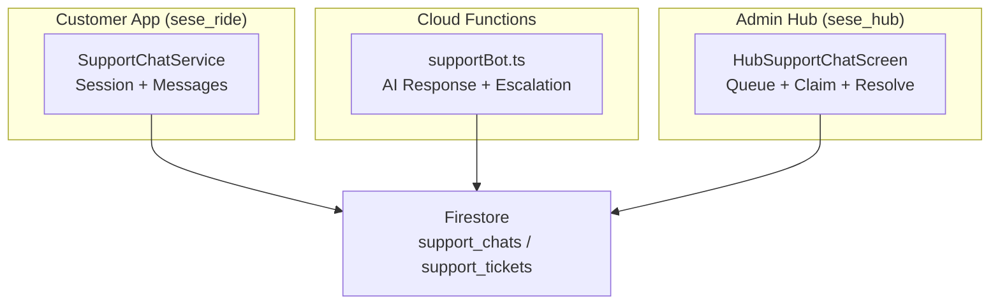
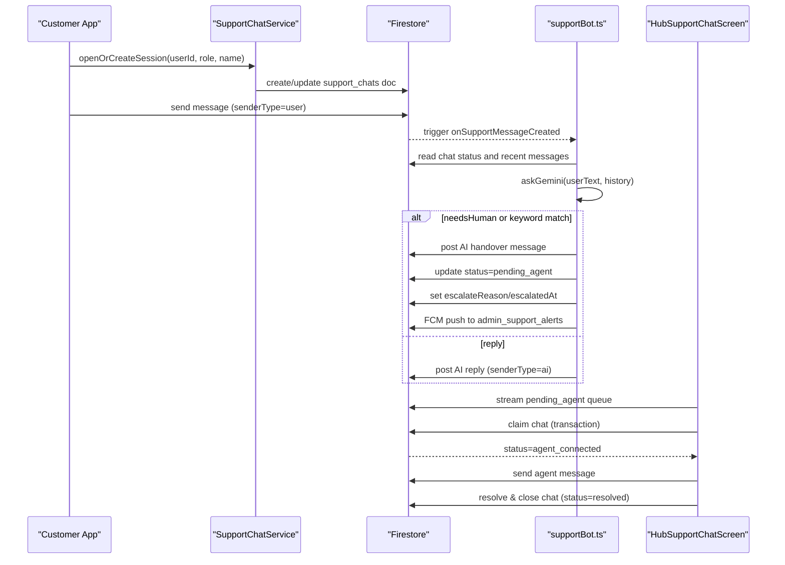
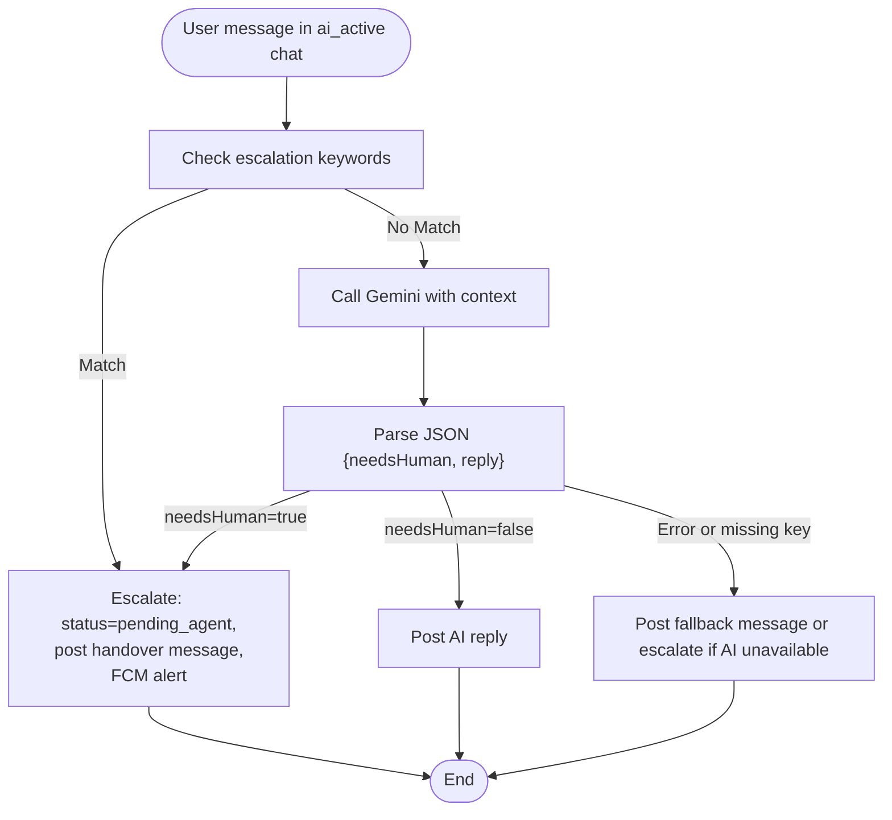
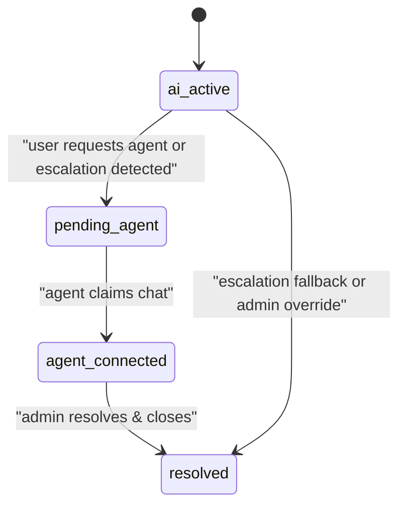
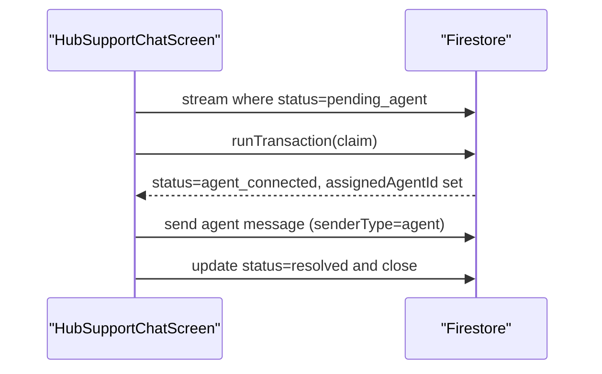
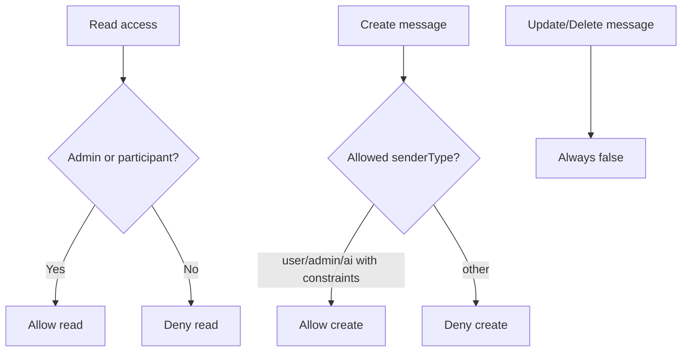
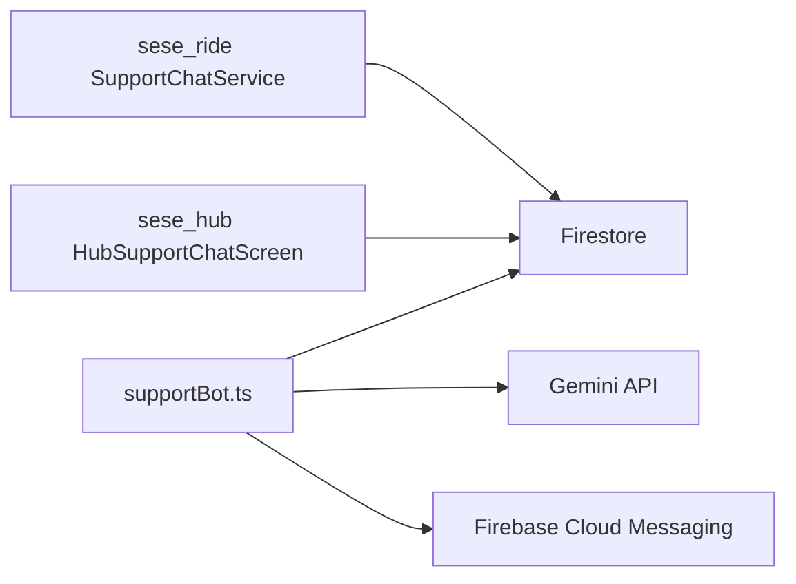

# Support System Administration

<cite>
**Referenced Files in This Document**
- [supportBot.ts](file://functions/src/supportBot.ts)
- [support_chat_service.dart](file://sese_ride/lib/features/support/support_chat_service.dart)
- [hub_support_chat_screen.dart](file://sese_hub/lib/features/support/hub_support_chat_screen.dart)
- [firestore.rules](file://firestore.rules)
</cite>

## Table of Contents
1. [Introduction](#introduction)
2. [Project Structure](#project-structure)
3. [Core Components](#core-components)
4. [Architecture Overview](#architecture-overview)
5. [Detailed Component Analysis](#detailed-component-analysis)
6. [Dependency Analysis](#dependency-analysis)
7. [Performance Considerations](#performance-considerations)
8. [Troubleshooting Guide](#troubleshooting-guide)
9. [Conclusion](#conclusion)

## Introduction
This document explains the support system administration features for SeSe Ride, focusing on:
- AI chatbot configuration and conversation flow
- Ticket and chat lifecycle management
- Agent handover and escalation protocols
- Admin queue operations and session closure
- Security rules governing support data
- Guidance for monitoring, performance tracking, and quality assurance

The system uses a cloud function to power an AI assistant that can respond to user messages or escalate conversations to human agents. The customer app manages chat sessions and escalations, while the admin hub provides a live queue, agent claim workflow, and session resolution.

## Project Structure
Support-related code is split across three main areas:
- Cloud Functions: AI chatbot logic and escalation automation
- Customer App (`sese_ride`): Chat session creation, messaging, and escalation triggers
- Admin Hub (`sese_hub`): Live queue, agent claim, message sending, and session resolution
- Firestore Rules: Access control and data integrity for tickets and chats

**Diagram sources**
- [support_chat_service.dart:123-196](file://sese_ride/lib/features/support/support_chat_service.dart#L123-L196)
- [supportBot.ts:183-254](file://functions/src/supportBot.ts#L183-L254)
- [hub_support_chat_screen.dart:100-145](file://sese_hub/lib/features/support/hub_support_chat_screen.dart#L100-L145)

**Section sources**
- [support_chat_service.dart:123-196](file://sese_ride/lib/features/support/support_chat_service.dart#L123-L196)
- [supportBot.ts:183-254](file://functions/src/supportBot.ts#L183-L254)
- [hub_support_chat_screen.dart:100-145](file://sese_hub/lib/features/support/hub_support_chat_screen.dart#L100-L145)

## Core Components
- AI Chatbot (Cloud Function): Listens for user messages in active AI sessions, calls Gemini to generate replies, and escalates when needed. It posts AI messages and updates chat metadata atomically.
- Customer Chat Service: Manages opening/resuming sessions, streaming messages and status, sending user messages, and triggering escalation to a human agent.
- Admin Hub UI: Streams pending and active chats, supports first-come-first-served claiming via transactions, allows agents to send messages, and resolves/closes sessions.
- Firestore Rules: Enforce participant-based access, restrict state transitions to authorized actors, and protect immutable message history.

Key responsibilities:
- Conversation flow customization: Controlled by the bot’s system instruction and escalation keywords.
- Escalation protocol: Keyword detection, model verdict, or client request flips the session to `pending_agent`.
- Agent assignment: First-come-first-served claim using a transaction; no complex algorithm is implemented.
- Session closure: Admin marks sessions as resolved, locking inputs.

**Section sources**
- [supportBot.ts:27-54](file://functions/src/supportBot.ts#L27-L54)
- [supportBot.ts:183-254](file://functions/src/supportBot.ts#L183-L254)
- [support_chat_service.dart:88-118](file://sese_ride/lib/features/support/support_chat_service.dart#L88-L118)
- [support_chat_service.dart:147-196](file://sese_ride/lib/features/support/support_chat_service.dart#L147-L196)
- [support_chat_service.dart:240-334](file://sese_ride/lib/features/support/support_chat_service.dart#L240-L334)
- [hub_support_chat_screen.dart:151-211](file://sese_hub/lib/features/support/hub_support_chat_screen.dart#L151-L211)
- [hub_support_chat_screen.dart:272-337](file://sese_hub/lib/features/support/hub_support_chat_screen.dart#L272-L337)
- [firestore.rules:616-703](file://firestore.rules#L616-L703)

## Architecture Overview
The support system follows an AI-first flow with seamless handover to human agents.

**Diagram sources**
- [support_chat_service.dart:147-196](file://sese_ride/lib/features/support/support_chat_service.dart#L147-L196)
- [supportBot.ts:183-254](file://functions/src/supportBot.ts#L183-L254)
- [hub_support_chat_screen.dart:151-211](file://sese_hub/lib/features/support/hub_support_chat_screen.dart#L151-L211)
- [hub_support_chat_screen.dart:272-337](file://sese_hub/lib/features/support/hub_support_chat_screen.dart#L272-L337)

## Detailed Component Analysis

### AI Chatbot Configuration and Conversation Flow
- System instruction defines persona, knowledge scope, and escalation policy.
- Escalation keywords provide fast-path routing to human agents without calling the model.
- Model call returns strict JSON indicating whether human assistance is required and the reply text.
- On escalation, the bot posts a handover message, updates the chat status to `pending_agent`, records escalation metadata, and sends an FCM notification to admins.

**Diagram sources**
- [supportBot.ts:27-54](file://functions/src/supportBot.ts#L27-L54)
- [supportBot.ts:56-79](file://functions/src/supportBot.ts#L56-L79)
- [supportBot.ts:81-115](file://functions/src/supportBot.ts#L81-L115)
- [supportBot.ts:140-177](file://functions/src/supportBot.ts#L140-L177)
- [supportBot.ts:183-254](file://functions/src/supportBot.ts#L183-L254)

**Section sources**
- [supportBot.ts:27-54](file://functions/src/supportBot.ts#L27-L54)
- [supportBot.ts:56-79](file://functions/src/supportBot.ts#L56-L79)
- [supportBot.ts:81-115](file://functions/src/supportBot.ts#L81-L115)
- [supportBot.ts:140-177](file://functions/src/supportBot.ts#L140-L177)
- [supportBot.ts:183-254](file://functions/src/supportBot.ts#L183-L254)

### Ticket and Chat Lifecycle Management
- Sessions are created or resumed for the current user, with statuses:
  - `ai_active`: AI handles the conversation
  - `pending_agent`: Waiting for human agent
  - `agent_connected`: Human agent is live-chatting
  - `resolved`: Closed and locked
- Customer service methods:
  - Open or resume session
  - Stream messages and status
  - Send user messages
  - Request human agent (client-side escalation trigger)

**Diagram sources**
- [support_chat_service.dart:88-118](file://sese_ride/lib/features/support/support_chat_service.dart#L88-L118)
- [support_chat_service.dart:147-196](file://sese_ride/lib/features/support/support_chat_service.dart#L147-L196)
- [support_chat_service.dart:240-334](file://sese_ride/lib/features/support/support_chat_service.dart#L240-L334)

**Section sources**
- [support_chat_service.dart:88-118](file://sese_ride/lib/features/support/support_chat_service.dart#L88-L118)
- [support_chat_service.dart:147-196](file://sese_ride/lib/features/support/support_chat_service.dart#L147-L196)
- [support_chat_service.dart:240-334](file://sese_ride/lib/features/support/support_chat_service.dart#L240-L334)

### Agent Handover Processes and Admin Queue Operations
- Pending queue: Admin hub streams chats with `status == pending_agent`.
- Claiming: Uses a Firestore transaction to ensure only one agent claims a pending chat, sets `assignedAgentId`, changes status to `agent_connected`, and posts a greeting message.
- Messaging: Agents can send messages with `senderType = 'agent'`.
- Resolution: Admin marks the session as `resolved`, posting a closing message and locking input.

**Diagram sources**
- [hub_support_chat_screen.dart:100-145](file://sese_hub/lib/features/support/hub_support_chat_screen.dart#L100-L145)
- [hub_support_chat_screen.dart:151-211](file://sese_hub/lib/features/support/hub_support_chat_screen.dart#L151-L211)
- [hub_support_chat_screen.dart:233-270](file://sese_hub/lib/features/support/hub_support_chat_screen.dart#L233-L270)
- [hub_support_chat_screen.dart:272-337](file://sese_hub/lib/features/support/hub_support_chat_screen.dart#L272-L337)

**Section sources**
- [hub_support_chat_screen.dart:100-145](file://sese_hub/lib/features/support/hub_support_chat_screen.dart#L100-L145)
- [hub_support_chat_screen.dart:151-211](file://sese_hub/lib/features/support/hub_support_chat_screen.dart#L151-L211)
- [hub_support_chat_screen.dart:233-270](file://sese_hub/lib/features/support/hub_support_chat_screen.dart#L233-L270)
- [hub_support_chat_screen.dart:272-337](file://sese_hub/lib/features/support/hub_support_chat_screen.dart#L272-L337)

### Security and Data Integrity
- Support tickets and chats have dedicated rule sets:
  - Participants can read/write their own messages.
  - Admins with specific scopes can manage tickets/chats.
  - Immutable message history prevents updates/deletes.
  - Only server-side writes (Admin SDK) can change critical fields like status and assignment.

**Diagram sources**
- [firestore.rules:616-703](file://firestore.rules#L616-L703)

**Section sources**
- [firestore.rules:616-703](file://firestore.rules#L616-L703)

## Dependency Analysis
- Customer App depends on Firestore for session and message operations.
- Cloud Function depends on Firestore and external Gemini API; it also uses Firebase Cloud Messaging for admin alerts.
- Admin Hub depends on Firestore streams and transactions for queue management and session control.

**Diagram sources**
- [support_chat_service.dart:123-196](file://sese_ride/lib/features/support/support_chat_service.dart#L123-L196)
- [supportBot.ts:1-25](file://functions/src/supportBot.ts#L1-L25)
- [supportBot.ts:165-177](file://functions/src/supportBot.ts#L165-L177)
- [hub_support_chat_screen.dart:100-145](file://sese_hub/lib/features/support/hub_support_chat_screen.dart#L100-L145)

**Section sources**
- [support_chat_service.dart:123-196](file://sese_ride/lib/features/support/support_chat_service.dart#L123-L196)
- [supportBot.ts:1-25](file://functions/src/supportBot.ts#L1-L25)
- [supportBot.ts:165-177](file://functions/src/supportBot.ts#L165-L177)
- [hub_support_chat_screen.dart:100-145](file://sese_hub/lib/features/support/hub_support_chat_screen.dart#L100-L145)

## Performance Considerations
- Batched writes: Both customer and admin sides use batched writes to atomically update messages and parent chat documents, reducing round-trips and ensuring consistency.
- Streaming: Real-time streams for messages and status minimize polling overhead.
- Context window: The bot reads recent messages to build conversation context; limiting history reduces latency and cost.
- Escalation keywords: Fast-path checks avoid unnecessary model calls for common escalation intents.

[No sources needed since this section provides general guidance]

## Troubleshooting Guide
Common issues and resolutions:
- AI unavailability: If the Gemini API key is missing or the call fails, the bot posts a fallback message or escalates based on environment configuration.
- Escalation failures: Client-side escalation attempts throw structured exceptions with user-friendly messages; verify network connectivity and permissions.
- Claim conflicts: Transaction ensures only one agent claims a pending chat; errors indicate another agent already claimed it.
- Permission errors: Firestore rules enforce participant-only access; ensure users/auth tokens are valid and roles are correct.

Operational tips:
- Monitor pending queue count in the admin hub to gauge workload.
- Use escalation reasons recorded in chat metadata to analyze why handovers occur.
- Validate that FCM topic subscriptions exist for admin devices to receive escalation notifications.

**Section sources**
- [supportBot.ts:236-254](file://functions/src/supportBot.ts#L236-L254)
- [support_chat_service.dart:240-334](file://sese_ride/lib/features/support/support_chat_service.dart#L240-L334)
- [hub_support_chat_screen.dart:151-211](file://sese_hub/lib/features/support/hub_support_chat_screen.dart#L151-L211)
- [firestore.rules:616-703](file://firestore.rules#L616-L703)

## Conclusion
The support system combines an AI-first chatbot with robust human handover and admin operations. The cloud function configures conversation behavior and escalation, the customer app manages sessions and triggers, and the admin hub provides real-time queue management and session control. Firestore rules secure data and enforce state transitions. For ongoing administration, focus on tuning the bot’s system instruction and escalation keywords, monitoring queue metrics, and reviewing escalation reasons to improve response quality and reduce unnecessary handovers.

[No sources needed since this section summarizes without analyzing specific files]