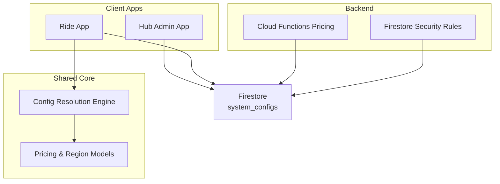
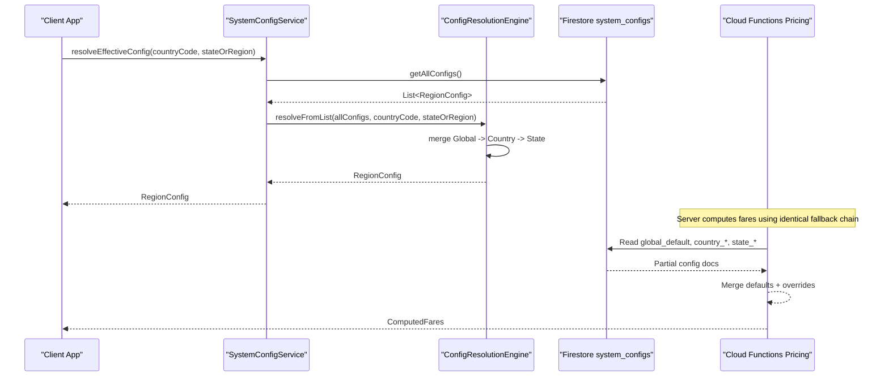
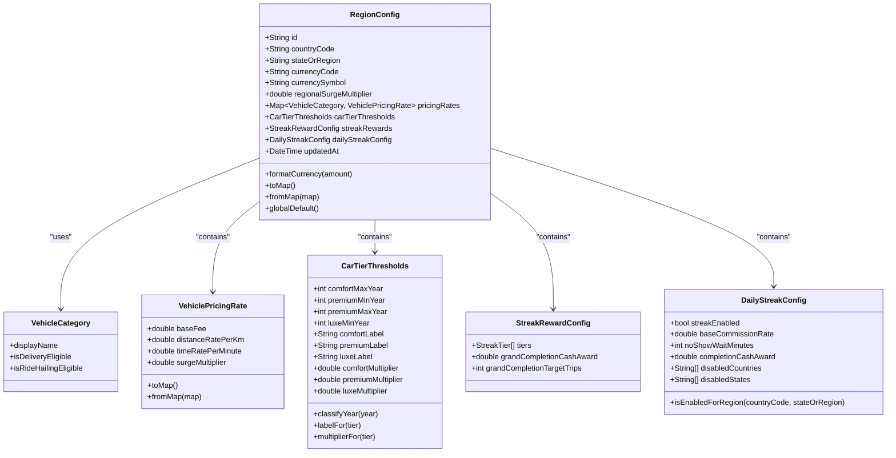
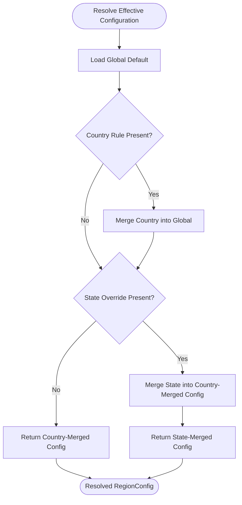
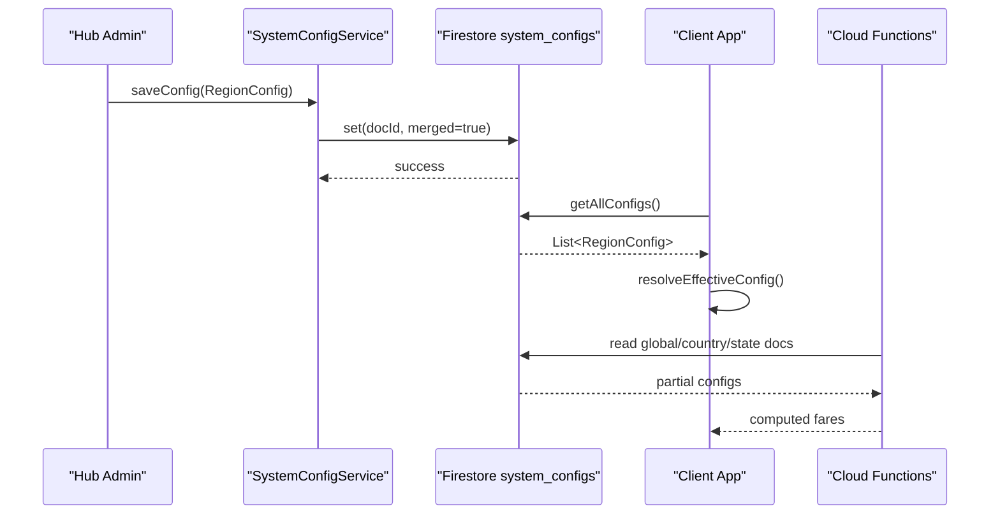
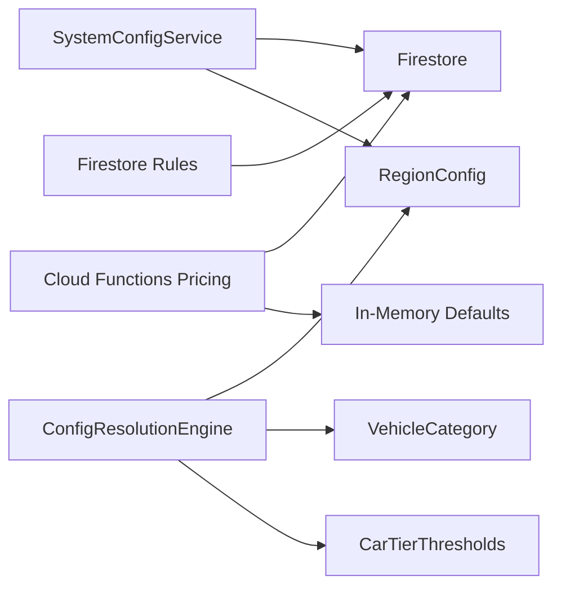

# System Configuration

<cite>
**Referenced Files in This Document**
- [pricing_config.dart](file://sese_core/lib/models/pricing_config.dart)
- [config_resolution_engine.dart](file://sese_core/lib/services/config_resolution_engine.dart)
- [vehicle_category.dart](file://sese_core/lib/models/vehicle_category.dart)
- [car_tier_thresholds.dart](file://sese_core/lib/models/car_tier_thresholds.dart)
- [pricing.ts](file://functions/src/pricing.ts)
- [system_config_service.dart](file://sese_hub/lib/features/config/services/system_config_service.dart)
- [firestore.rules](file://firestore.rules)
- [dynamic_system_config_test.dart](file://sese_core/test/dynamic_system_config_test.dart)
</cite>

## Table of Contents
1. [Introduction](#introduction)
2. [Project Structure](#project-structure)
3. [Core Components](#core-components)
4. [Architecture Overview](#architecture-overview)
5. [Detailed Component Analysis](#detailed-component-analysis)
6. [Dependency Analysis](#dependency-analysis)
7. [Performance Considerations](#performance-considerations)
8. [Troubleshooting Guide](#troubleshooting-guide)
9. [Conclusion](#conclusion)
10. [Appendices](#appendices)

## Introduction
This document explains the system configuration management used across the application for dynamic pricing, regional settings, vehicle categories and tiers, streak-based driver rewards, and related system parameters. It covers:

- The configuration schema stored under `system_configs` in Firestore.
- The three-tier fallback resolution chain: Global Default → Country-Specific Rule → State-Specific Override.
- Validation rules enforced by models and server-side functions.
- Deployment strategies including client-side caching, server-side fallback defaults, and security rules.
- Practical examples for updating pricing tiers, managing vehicle categories, and configuring service regions.
- Versioning considerations, rollback approaches, and environment-specific behavior.

The goal is to help both technical and non-technical readers understand how configuration changes propagate from the Hub admin interface through Firestore into pricing calculations and feature behavior.

## Project Structure
Configuration-related code is primarily located in:

- `sese_core`: Core data models and resolution logic shared by apps and services.
- `functions`: Cloud Functions that compute fares using the same fallback semantics as the client.
- `sese_hub`: Admin-facing service layer for reading and writing dynamic configuration documents.

**Diagram sources**
- [system_config_service.dart:5-145](file://sese_hub/lib/features/config/services/system_config_service.dart#L5-L145)
- [config_resolution_engine.dart:5-66](file://sese_core/lib/services/config_resolution_engine.dart#L5-L66)
- [pricing.ts:60-147](file://functions/src/pricing.ts#L60-L147)
- [firestore.rules:531-536](file://firestore.rules#L531-L536)

**Section sources**
- [system_config_service.dart:1-181](file://sese_hub/lib/features/config/services/system_config_service.dart#L1-L181)
- [config_resolution_engine.dart:1-218](file://sese_core/lib/services/config_resolution_engine.dart#L1-L218)
- [pricing.ts:1-237](file://functions/src/pricing.ts#L1-L237)
- [firestore.rules:531-536](file://firestore.rules#L531-L536)

## Core Components
The configuration system revolves around these core components:

- **VehicleCategory**: Enumerates supported vehicle types and eligibility for ride or delivery services.
- **VehiclePricingRate**: Defines base fee, distance rate, time rate, and surge multiplier per vehicle category.
- **CarTierThresholds**: Configures year-based passenger car tier classification and multipliers.
- **StreakRewardConfig**: Legacy milestone reward configuration.
- **DailyStreakConfig**: New daily commission tiering configuration with region enable/disable controls.
- **RegionConfig**: Top-level configuration document representing global, country, or state scope.
- **ConfigResolutionEngine**: Merges and resolves effective configuration across the fallback hierarchy.
- **SystemConfigService**: Admin service for reading/writing `system_configs` with local cache fallback.
- **Cloud Functions Pricing**: Server-side implementation mirroring the client fallback chain for fare computation.

**Section sources**
- [vehicle_category.dart:1-142](file://sese_core/lib/models/vehicle_category.dart#L1-L142)
- [pricing_config.dart:4-64](file://sese_core/lib/models/pricing_config.dart#L4-L64)
- [car_tier_thresholds.dart:1-137](file://sese_core/lib/models/car_tier_thresholds.dart#L1-L137)
- [pricing_config.dart:66-249](file://sese_core/lib/models/pricing_config.dart#L66-L249)
- [pricing_config.dart:251-499](file://sese_core/lib/models/pricing_config.dart#L251-L499)
- [config_resolution_engine.dart:5-218](file://sese_core/lib/services/config_resolution_engine.dart#L5-L218)
- [system_config_service.dart:1-181](file://sese_hub/lib/features/config/services/system_config_service.dart#L1-L181)
- [pricing.ts:1-237](file://functions/src/pricing.ts#L1-L237)

## Architecture Overview
The configuration architecture uses a consistent fallback chain on both client and server:

1. Start with the global default configuration.
2. Apply country-specific overrides if present.
3. Apply state-specific overrides if present.
4. Merge fields per model semantics (e.g., per-category pricing rates, threshold labels/multipliers, streak enable/disable).

**Diagram sources**
- [system_config_service.dart:92-145](file://sese_hub/lib/features/config/services/system_config_service.dart#L92-L145)
- [config_resolution_engine.dart:36-66](file://sese_core/lib/services/config_resolution_engine.dart#L36-L66)
- [pricing.ts:60-147](file://functions/src/pricing.ts#L60-L147)

## Detailed Component Analysis

### Dynamic Pricing Configuration Schema
Dynamic pricing is defined per vehicle category inside each `RegionConfig`. Each category includes:

- Base fee (minimum charge floor).
- Distance rate per kilometer.
- Time rate per minute.
- Optional surge multiplier.

The schema also supports currency code/symbol, regional surge multiplier, car tier thresholds, streak rewards, and daily streak configuration. Missing categories fall back to defaults derived from the currency context.

**Diagram sources**
- [vehicle_category.dart:1-142](file://sese_core/lib/models/vehicle_category.dart#L1-L142)
- [pricing_config.dart:4-64](file://sese_core/lib/models/pricing_config.dart#L4-L64)
- [car_tier_thresholds.dart:1-137](file://sese_core/lib/models/car_tier_thresholds.dart#L1-L137)
- [pricing_config.dart:66-249](file://sese_core/lib/models/pricing_config.dart#L66-L249)
- [pricing_config.dart:251-499](file://sese_core/lib/models/pricing_config.dart#L251-L499)

**Section sources**
- [pricing_config.dart:4-64](file://sese_core/lib/models/pricing_config.dart#L4-L64)
- [pricing_config.dart:251-499](file://sese_core/lib/models/pricing_config.dart#L251-L499)
- [vehicle_category.dart:1-142](file://sese_core/lib/models/vehicle_category.dart#L1-L142)
- [car_tier_thresholds.dart:1-137](file://sese_core/lib/models/car_tier_thresholds.dart#L1-L137)

### Regional Settings and Fallback Resolution
The system resolves effective configuration using a deterministic cascade:

- Global default provides baseline values.
- Country rule can override selected fields.
- State override can further refine settings.

Merging rules include:

- Per-category pricing rates are overridden individually.
- Car tier thresholds use sentinel defaults so unspecified child fields inherit parent values.
- Streak rewards preserve parent values when child uses model defaults.
- Daily streak enable/disable cascades down; disable lists union across levels.

**Diagram sources**
- [config_resolution_engine.dart:12-34](file://sese_core/lib/services/config_resolution_engine.dart#L12-L34)
- [config_resolution_engine.dart:68-165](file://sese_core/lib/services/config_resolution_engine.dart#L68-L165)

**Section sources**
- [config_resolution_engine.dart:5-218](file://sese_core/lib/services/config_resolution_engine.dart#L5-L218)

### Feature Flags and System Parameters
Feature flags and system parameters are represented by:

- `streakEnabled` in `DailyStreakConfig`, which enables or disables the daily commission tiering system globally or per region.
- `disabledCountries` and `disabledStates` lists that explicitly disable streak mechanics at country/state boundaries.
- `regionalSurgeMultiplier` applied across all vehicles in a region.
- Dispatch-related parameters such as `max_visible_bids` managed via `system_settings/dispatch`.

These flags allow operators to control feature availability without redeploying code.

**Section sources**
- [pricing_config.dart:151-249](file://sese_core/lib/models/pricing_config.dart#L151-L249)
- [system_config_service.dart:147-180](file://sese_hub/lib/features/config/services/system_config_service.dart#L147-L180)

### Validation Rules
Validation is implemented through:

- Model constructors and factory methods that provide safe defaults when fields are missing.
- Type coercion and null safety in parsing maps from Firestore.
- Semantic checks such as currency scaling for USD defaults.
- Server-side normalization and fallback in Cloud Functions.

Key validation behaviors:

- Missing pricing rates fall back to defaults based on vehicle category and currency.
- Missing car tier thresholds use sentinel constants to avoid accidental inheritance of child defaults.
- Daily streak disable lists are normalized and unioned across hierarchy levels.
- Cloud Functions normalize doc IDs and handle partial failures gracefully.

**Section sources**
- [pricing_config.dart:34-64](file://sese_core/lib/models/pricing_config.dart#L34-L64)
- [pricing_config.dart:333-468](file://sese_core/lib/models/pricing_config.dart#L333-L468)
- [config_resolution_engine.dart:68-165](file://sese_core/lib/services/config_resolution_engine.dart#L68-L165)
- [pricing.ts:18-58](file://functions/src/pricing.ts#L18-L58)
- [pricing.ts:86-147](file://functions/src/pricing.ts#L86-L147)

### Deployment Strategies
Deployment strategy combines client-side caching, server-side defaults, and secure access:

- Hub admin writes configurations to Firestore via `SystemConfigService`.
- Client apps read configurations and resolve effective settings using `ConfigResolutionEngine`.
- Cloud Functions compute fares using the same fallback chain, ensuring consistency between client and server.
- Firestore security rules restrict reads to authenticated users and writes to super admins.

**Diagram sources**
- [system_config_service.dart:119-145](file://sese_hub/lib/features/config/services/system_config_service.dart#L119-L145)
- [firestore.rules:531-536](file://firestore.rules#L531-L536)
- [pricing.ts:60-147](file://functions/src/pricing.ts#L60-L147)

**Section sources**
- [system_config_service.dart:1-181](file://sese_hub/lib/features/config/services/system_config_service.dart#L1-L181)
- [firestore.rules:531-536](file://firestore.rules#L531-L536)
- [pricing.ts:60-147](file://functions/src/pricing.ts#L60-L147)

### Examples

#### Updating Pricing Tiers
To update pricing tiers:

1. Create or update a `RegionConfig` document with the desired `pricingRates` map keyed by vehicle category names.
2. Use `SystemConfigService.saveConfig` to persist the change.
3. Clients will resolve the new rates through `ConfigResolutionEngine.resolveFromList`.

Example paths:

- Update motorcycle base fee for Nigeria:
  - [system_config_service.dart:14-55](file://sese_hub/lib/features/config/services/system_config_service.dart#L14-L55)
- Resolve effective pricing for a region:
  - [config_resolution_engine.dart:36-66](file://sese_core/lib/services/config_resolution_engine.dart#L36-L66)

**Section sources**
- [system_config_service.dart:14-55](file://sese_hub/lib/features/config/services/system_config_service.dart#L14-L55)
- [config_resolution_engine.dart:36-66](file://sese_core/lib/services/config_resolution_engine.dart#L36-L66)

#### Managing Vehicle Categories
Vehicle categories determine eligibility and display names:

- Delivery supports bicycle, motorcycle, tricycle, car, van, truck.
- Ride-hailing supports only car.

When adding or modifying categories:

- Ensure `VehicleCategory` enum matches Firestore pricing keys.
- Provide default pricing rates for new categories in `RegionConfig.globalDefault` or per-region overrides.

Example paths:

- Category definitions and eligibility:
  - [vehicle_category.dart:1-44](file://sese_core/lib/models/vehicle_category.dart#L1-L44)
- Default pricing mapping:
  - [pricing_config.dart:373-420](file://sese_core/lib/models/pricing_config.dart#L373-L420)

**Section sources**
- [vehicle_category.dart:1-44](file://sese_core/lib/models/vehicle_category.dart#L1-L44)
- [pricing_config.dart:373-420](file://sese_core/lib/models/pricing_config.dart#L373-L420)

#### Configuring Service Regions
To configure service regions:

1. Define a country rule document with ID `country_{CODE}`.
2. Optionally define a state override document with ID `state_{CODE}_{STATE}`.
3. Set `currencyCode`, `currencySymbol`, and `regionalSurgeMultiplier`.
4. Override specific vehicle pricing rates as needed.

Example paths:

- Country rule example:
  - [system_config_service.dart:14-55](file://sese_hub/lib/features/config/services/system_config_service.dart#L14-L55)
- State override example:
  - [system_config_service.dart:56-79](file://sese_hub/lib/features/config/services/system_config_service.dart#L56-L79)

**Section sources**
- [system_config_service.dart:14-79](file://sese_hub/lib/features/config/services/system_config_service.dart#L14-L79)

### Configuration Versioning and Rollback
The current implementation does not maintain explicit version numbers or immutable snapshots per configuration change. However, rollback capabilities can be achieved through:

- Keeping previous `RegionConfig` documents as separate historical IDs (e.g., `v1_country_NG`, `v2_country_NG`).
- Using `updatedAt` timestamps to identify the latest active configuration.
- Restoring a prior document by replacing the active document ID with the historical one.

Operational recommendations:

- Always increment or tag versions when publishing major pricing changes.
- Maintain audit logs of configuration changes in a separate collection.
- Use Firestore transactions or batch writes to atomically swap active configuration IDs during rollouts.

**Section sources**
- [pricing_config.dart:287-331](file://sese_core/lib/models/pricing_config.dart#L287-L331)
- [system_config_service.dart:119-132](file://sese_hub/lib/features/config/services/system_config_service.dart#L119-L132)

### Environment-Specific Settings Management
Environment-specific behavior is handled by:

- Local cache in `SystemConfigService` for development/stub mode.
- Firestore-backed persistence for production.
- Cloud Functions fallback to in-memory defaults when Firestore is unreachable.

This ensures resilient operation across environments while maintaining consistent configuration semantics.

**Section sources**
- [system_config_service.dart:11-80](file://sese_hub/lib/features/config/services/system_config_service.dart#L11-L80)
- [pricing.ts:138-147](file://functions/src/pricing.ts#L138-L147)

## Dependency Analysis
The configuration system has clear dependencies:

- `SystemConfigService` depends on Firestore and `RegionConfig` models.
- `ConfigResolutionEngine` depends on `RegionConfig`, `VehicleCategory`, and `CarTierThresholds`.
- Cloud Functions pricing depends on Firestore and mirrors client-side merging logic.
- Firestore security rules enforce authentication and role-based access.

**Diagram sources**
- [system_config_service.dart:1-181](file://sese_hub/lib/features/config/services/system_config_service.dart#L1-L181)
- [config_resolution_engine.dart:1-218](file://sese_core/lib/services/config_resolution_engine.dart#L1-L218)
- [pricing.ts:1-237](file://functions/src/pricing.ts#L1-L237)
- [firestore.rules:531-536](file://firestore.rules#L531-L536)

**Section sources**
- [system_config_service.dart:1-181](file://sese_hub/lib/features/config/services/system_config_service.dart#L1-L181)
- [config_resolution_engine.dart:1-218](file://sese_core/lib/services/config_resolution_engine.dart#L1-L218)
- [pricing.ts:1-237](file://functions/src/pricing.ts#L1-L237)
- [firestore.rules:531-536](file://firestore.rules#L531-L536)

## Performance Considerations
- Firestore reads are minimized by fetching only relevant documents (`global_default`, `country_*`, `state_*`) in Cloud Functions.
- Client-side caching reduces repeated network calls in Hub admin operations.
- Merging logic avoids unnecessary recomputation by using sentinel defaults and field-level overrides.
- Currency scaling is applied once during default rate generation.

Recommendations:

- Cache resolved `RegionConfig` in app memory for short-lived sessions.
- Use pagination or selective queries if the number of regions grows significantly.
- Monitor Firestore read costs and consider batching configuration updates.

[No sources needed since this section provides general guidance]

## Troubleshooting Guide
Common issues and resolutions:

- **Unexpected pricing values**: Verify that the correct country/state document exists and that the vehicle category key matches the enum name.
- **Streak not applying**: Check `dailyStreakConfig.streakEnabled` and ensure the region is not in `disabledCountries` or `disabledStates`.
- **Missing currency symbol**: Confirm `currencySymbol` is set in the active configuration document.
- **Fallback to defaults**: If Firestore is unavailable, clients and functions fall back to in-memory defaults; verify connectivity and permissions.

Debugging steps:

- Inspect `SystemConfigService.getAllConfigs` output to confirm cached and remote documents.
- Validate `ConfigResolutionEngine.resolveFromList` inputs and resulting merged configuration.
- Review Firestore security rules to ensure the user has appropriate read/write permissions.

**Section sources**
- [system_config_service.dart:92-132](file://sese_hub/lib/features/config/services/system_config_service.dart#L92-L132)
- [config_resolution_engine.dart:36-66](file://sese_core/lib/services/config_resolution_engine.dart#L36-L66)
- [firestore.rules:531-536](file://firestore.rules#L531-L536)

## Conclusion
The system configuration management provides a robust, scalable approach to dynamic pricing, regional settings, and feature flags. By combining well-defined models, a deterministic fallback resolution engine, secure Firestore storage, and consistent server-side logic, the platform ensures reliable configuration propagation across environments. Operators can safely update pricing tiers, manage vehicle categories, and configure service regions while leveraging built-in validation, caching, and security controls. For advanced versioning and rollback, teams should adopt explicit version tagging and audit logging practices alongside the existing timestamp-based metadata.

[No sources needed since this section summarizes without analyzing specific files]

## Appendices

### Firestore Security Rules for Configuration
Access to `system_configs` is restricted:

- Reads allowed for authenticated, unsuspended users.
- Writes allowed only for super admins.

**Section sources**
- [firestore.rules:531-536](file://firestore.rules#L531-L536)

### Test Coverage Highlights
Tests validate:

- Custom car tier thresholds.
- Three-tier fallback hierarchy resolution.
- Country and state override behavior.

**Section sources**
- [dynamic_system_config_test.dart:70-148](file://sese_core/test/dynamic_system_config_test.dart#L70-L148)