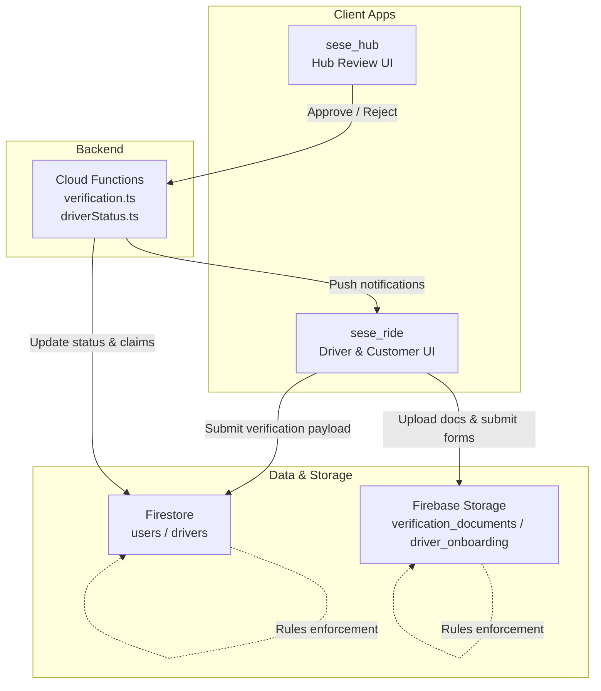
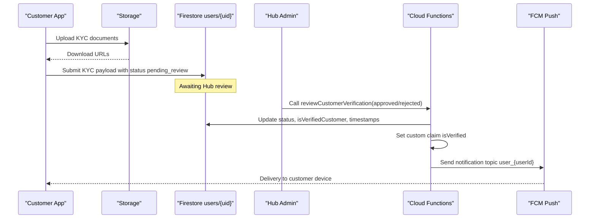
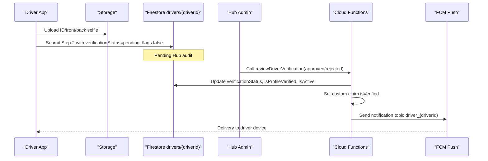
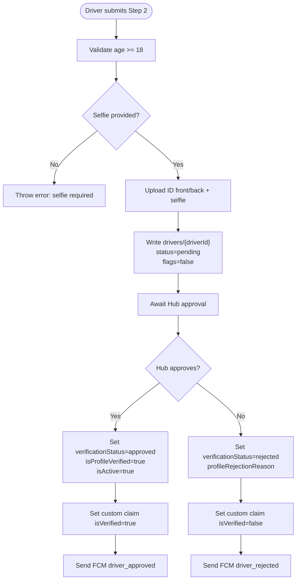
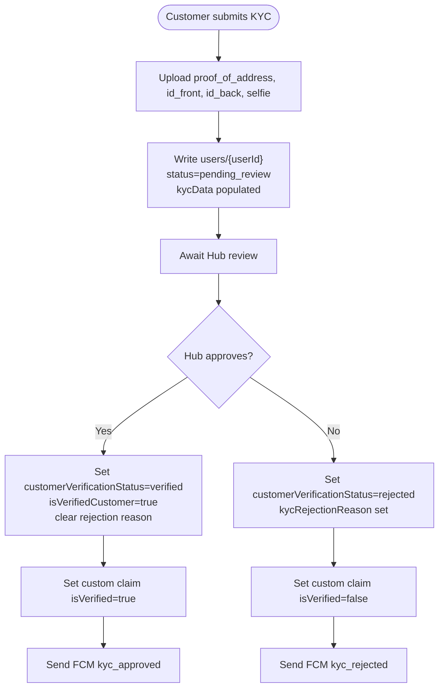
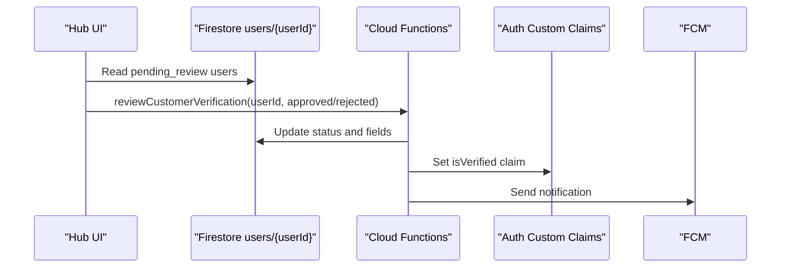
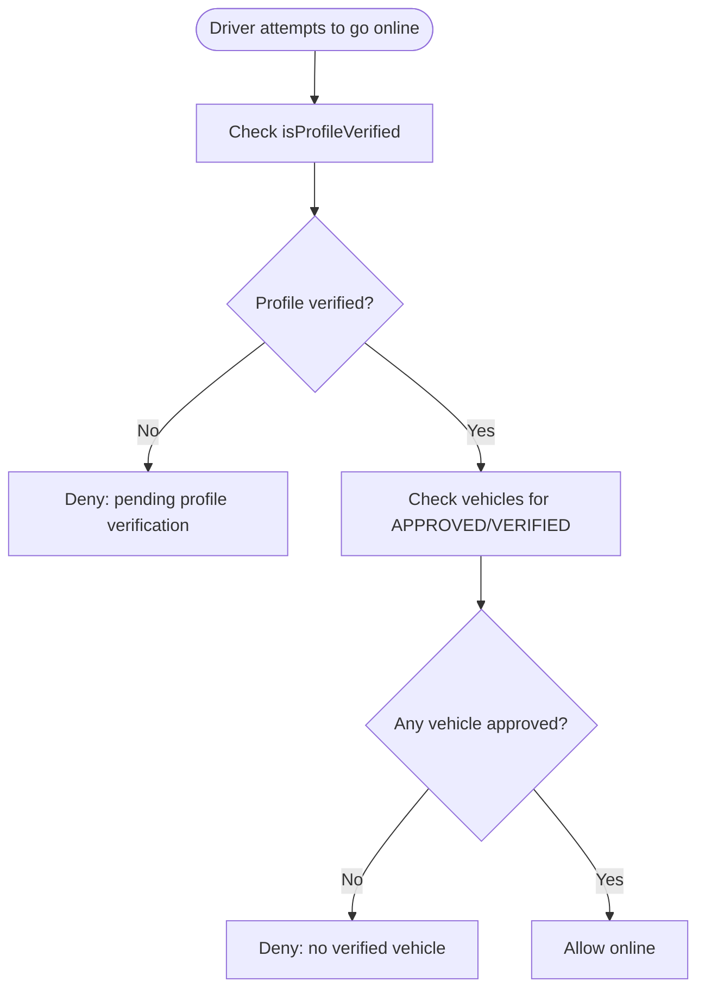
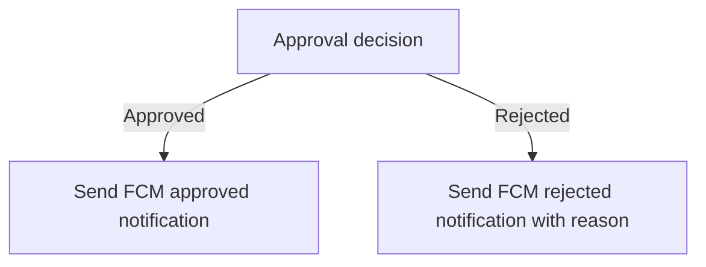
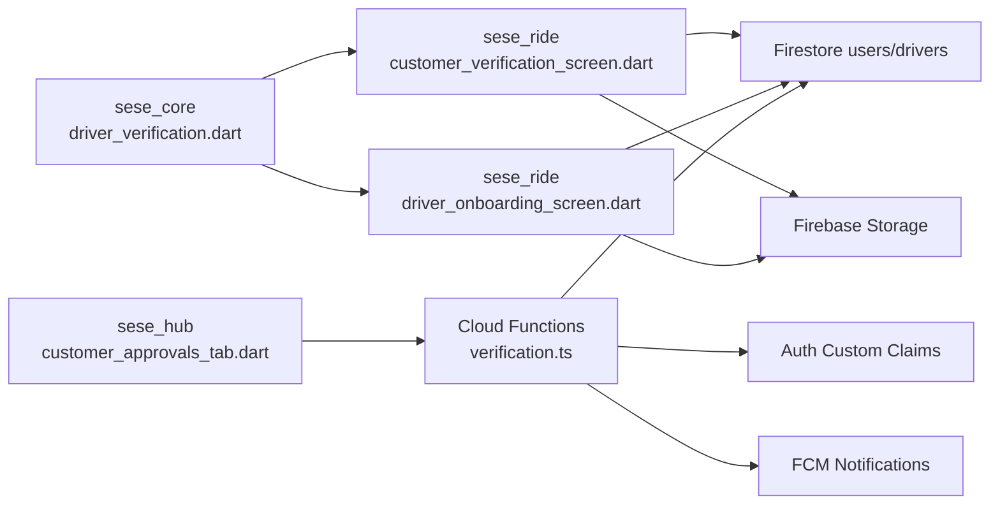

# User Verification Management

<cite>
**Referenced Files in This Document**
- [verification.ts](file://functions/src/verification.ts)
- [driverStatus.ts](file://functions/src/driverStatus.ts)
- [firestore.rules](file://firestore.rules)
- [storage.rules](file://storage.rules)
- [driver_verification.dart](file://sese_core/lib/models/driver_verification.dart)
- [customer_verification_screen.dart](file://sese_ride/lib/features/customer/presentation/customer_verification_screen.dart)
- [driver_onboarding_screen.dart](file://sese_ride/lib/features/driver/presentation/driver_onboarding_screen.dart)
- [customer_approvals_tab.dart](file://sese_hub/lib/features/verification/presentation/customer_approvals_tab.dart)
</cite>

## Table of Contents
1. [Introduction](#introduction)
2. [Project Structure](#project-structure)
3. [Core Components](#core-components)
4. [Architecture Overview](#architecture-overview)
5. [Detailed Component Analysis](#detailed-component-analysis)
6. [Dependency Analysis](#dependency-analysis)
7. [Performance Considerations](#performance-considerations)
8. [Troubleshooting Guide](#troubleshooting-guide)
9. [Conclusion](#conclusion)

## Introduction
This document explains the user verification management system across drivers and customers. It covers:
- Driver onboarding and profile verification workflow
- Customer KYC submission, upload, and review workflow
- Approval and rejection mechanisms
- Status tracking and automated checks
- Manual review interfaces in the Hub
- Notification delivery via push messaging
- Security controls for sensitive documents and access

The system uses Firestore for state, Firebase Storage for documents, Cloud Functions for server-side logic and notifications, and Flutter apps for driver, customer, and Hub review interfaces.

## Project Structure
Verification spans multiple layers:
- Client apps (sese_ride): collect and upload verification data
- Backend (Cloud Functions): enforce rules, update claims, send notifications
- Security (Firestore Rules + Storage Rules): restrict read/write to owners and admins
- Hub app (sese_hub): manual review queue and approval actions
- Shared constants (sese_core): canonical status values and field names

**Diagram sources**
- [verification.ts:26-130](file://functions/src/verification.ts#L26-L130)
- [verification.ts:138-240](file://functions/src/verification.ts#L138-L240)
- [driverStatus.ts:70-121](file://functions/src/driverStatus.ts#L70-L121)
- [firestore.rules:368-477](file://firestore.rules#L368-L477)
- [storage.rules:16-36](file://storage.rules#L16-L36)

**Section sources**
- [verification.ts:26-130](file://functions/src/verification.ts#L26-L130)
- [verification.ts:138-240](file://functions/src/verification.ts#L138-L240)
- [driverStatus.ts:70-121](file://functions/src/driverStatus.ts#L70-L121)
- [firestore.rules:368-477](file://firestore.rules#L368-L477)
- [storage.rules:16-36](file://storage.rules#L16-L36)

## Core Components
- Driver verification lifecycle and fields are defined centrally for consistency across apps.
- Customer KYC service uploads documents and writes a pending-review payload.
- Driver onboarding service validates inputs, uploads ID/selfie, and sets initial verification flags.
- Cloud Functions expose callable endpoints for Hub approvals and rejections, updating Firestore and Auth custom claims, and sending FCM notifications.
- Firestore and Storage rules enforce owner-only writes and admin reads.

Key responsibilities:
- sese_core: canonical statuses and field names
- sese_ride: client-side submission and storage upload
- functions: server-side review callables and guard checks
- firestore.rules/storage.rules: security boundaries
- sese_hub: manual review UI

**Section sources**
- [driver_verification.dart:1-69](file://sese_core/lib/models/driver_verification.dart#L1-L69)
- [customer_verification_screen.dart:594-702](file://sese_ride/lib/features/customer/presentation/customer_verification_screen.dart#L594-L702)
- [driver_onboarding_screen.dart:1020-1136](file://sese_ride/lib/features/driver/presentation/driver_onboarding_screen.dart#L1020-L1136)
- [verification.ts:26-130](file://functions/src/verification.ts#L26-L130)
- [verification.ts:138-240](file://functions/src/verification.ts#L138-L240)
- [firestore.rules:368-477](file://firestore.rules#L368-L477)
- [storage.rules:16-36](file://storage.rules#L16-L36)

## Architecture Overview
End-to-end flows for both roles:

**Diagram sources**
- [customer_verification_screen.dart:630-702](file://sese_ride/lib/features/customer/presentation/customer_verification_screen.dart#L630-L702)
- [verification.ts:26-130](file://functions/src/verification.ts#L26-L130)

**Diagram sources**
- [driver_onboarding_screen.dart:1020-1136](file://sese_ride/lib/features/driver/presentation/driver_onboarding_screen.dart#L1020-L1136)
- [verification.ts:138-240](file://functions/src/verification.ts#L138-L240)

## Detailed Component Analysis

### Driver Verification Workflow
Lifecycle states and fields:
- States: pending_onboarding, pending, approved, rejected
- Fields: verificationStatus, isProfileVerified, isVehicleVerified, canGoOnline

Submission flow:
- Driver submits Step 2 with personal info, ID images, and selfie
- System uploads files under driver-specific paths
- Firestore driver document is updated with pending status and all verification flags set to false
- Driver cannot go online until both profile and vehicle are verified

**Diagram sources**
- [driver_onboarding_screen.dart:1020-1136](file://sese_ride/lib/features/driver/presentation/driver_onboarding_screen.dart#L1020-L1136)
- [verification.ts:138-240](file://functions/src/verification.ts#L138-L240)

Security and access:
- Drivers write only their own documents; Hub staff/admins can read/update
- Storage allows authenticated owner writes and admin reads

**Section sources**
- [driver_verification.dart:1-24](file://sese_core/lib/models/driver_verification.dart#L1-L24)
- [driver_onboarding_screen.dart:1020-1136](file://sese_ride/lib/features/driver/presentation/driver_onboarding_screen.dart#L1020-L1136)
- [firestore.rules:368-377](file://firestore.rules#L368-L377)
- [storage.rules:28-36](file://storage.rules#L28-L36)

### Customer KYC Workflow
Lifecycle states and fields:
- States: unverified, pending_review, verified, rejected
- Fields: customerVerificationStatus, isVerifiedCustomer, kycRejectionReason, kycData

Submission flow:
- Customer uploads proof-of-address, ID front/back, and selfie
- System writes a nested KYC payload and sets status to pending_review
- Hub reviews and either approves or rejects

**Diagram sources**
- [customer_verification_screen.dart:630-702](file://sese_ride/lib/features/customer/presentation/customer_verification_screen.dart#L630-L702)
- [verification.ts:26-130](file://functions/src/verification.ts#L26-L130)

Security and access:
- Users write only their own verification documents; admins can read
- Storage enforces allowed content types and size limits

**Section sources**
- [driver_verification.dart:26-69](file://sese_core/lib/models/driver_verification.dart#L26-L69)
- [customer_verification_screen.dart:594-702](file://sese_ride/lib/features/customer/presentation/customer_verification_screen.dart#L594-L702)
- [firestore.rules:471-477](file://firestore.rules#L471-L477)
- [storage.rules:16-26](file://storage.rules#L16-L26)

### Hub Manual Review Interfaces
- Customer approvals tab lists users with pending_review status and displays full KYC payload including personal info, employment, government ID, and document links.
- Approving updates status to verified and sets isVerifiedCustomer true; rejecting prompts for a structured reason and stores it as kycRejectionReason.

**Diagram sources**
- [customer_approvals_tab.dart:1-35](file://sese_hub/lib/features/verification/presentation/customer_approvals_tab.dart#L1-L35)
- [verification.ts:26-130](file://functions/src/verification.ts#L26-L130)

**Section sources**
- [customer_approvals_tab.dart:1-35](file://sese_hub/lib/features/verification/presentation/customer_approvals_tab.dart#L1-L35)
- [verification.ts:26-130](file://functions/src/verification.ts#L26-L130)

### Automated Checks Integration
- Driver online gate: before allowing a driver to go online, the backend verifies that both profile and vehicle are approved. If not, it returns a precondition error.
- Fleet verification guard ensures at least one vehicle has an APPROVED or VERIFIED status.

**Diagram sources**
- [driverStatus.ts:70-121](file://functions/src/driverStatus.ts#L70-L121)

**Section sources**
- [driverStatus.ts:70-121](file://functions/src/driverStatus.ts#L70-L121)

### Notification Systems
- On approval: sends a success notification to the user’s topic (user_{userId} or driver_{driverId}) with type kyc_approved or driver_approved.
- On rejection: sends a generic update notification with type kyc_rejected or driver_rejected; the detailed reason is available in the document field for in-app display.

**Diagram sources**
- [verification.ts:66-83](file://functions/src/verification.ts#L66-L83)
- [verification.ts:109-128](file://functions/src/verification.ts#L109-L128)
- [verification.ts:178-195](file://functions/src/verification.ts#L178-L195)
- [verification.ts:220-238](file://functions/src/verification.ts#L220-L238)

**Section sources**
- [verification.ts:66-83](file://functions/src/verification.ts#L66-L83)
- [verification.ts:109-128](file://functions/src/verification.ts#L109-L128)
- [verification.ts:178-195](file://functions/src/verification.ts#L178-L195)
- [verification.ts:220-238](file://functions/src/verification.ts#L220-L238)

### Data Models and Status Tracking
Shared constants ensure consistent status strings and field names across apps:
- DriverVerification: pending_onboarding, pending, approved, rejected; fields verificationStatus, isProfileVerified, isVehicleVerified, canGoOnline
- CustomerVerification: unverified, pending_review, verified, rejected; fields customerVerificationStatus, isVerifiedCustomer, kycRejectionReason, kycData

These constants are used by client services and Hub UI to render correct states and control UI behavior (e.g., blocking submissions when pending or verified).

**Section sources**
- [driver_verification.dart:1-69](file://sese_core/lib/models/driver_verification.dart#L1-L69)

## Dependency Analysis

**Diagram sources**
- [driver_verification.dart:1-69](file://sese_core/lib/models/driver_verification.dart#L1-L69)
- [customer_verification_screen.dart:594-702](file://sese_ride/lib/features/customer/presentation/customer_verification_screen.dart#L594-L702)
- [driver_onboarding_screen.dart:1020-1136](file://sese_ride/lib/features/driver/presentation/driver_onboarding_screen.dart#L1020-L1136)
- [customer_approvals_tab.dart:1-35](file://sese_hub/lib/features/verification/presentation/customer_approvals_tab.dart#L1-L35)
- [verification.ts:26-130](file://functions/src/verification.ts#L26-L130)
- [verification.ts:138-240](file://functions/src/verification.ts#L138-L240)

**Section sources**
- [driver_verification.dart:1-69](file://sese_core/lib/models/driver_verification.dart#L1-L69)
- [customer_verification_screen.dart:594-702](file://sese_ride/lib/features/customer/presentation/customer_verification_screen.dart#L594-L702)
- [driver_onboarding_screen.dart:1020-1136](file://sese_ride/lib/features/driver/presentation/driver_onboarding_screen.dart#L1020-L1136)
- [customer_approvals_tab.dart:1-35](file://sese_hub/lib/features/verification/presentation/customer_approvals_tab.dart#L1-L35)
- [verification.ts:26-130](file://functions/src/verification.ts#L26-L130)
- [verification.ts:138-240](file://functions/src/verification.ts#L138-L240)

## Performance Considerations
- Batched uploads: The client uploads multiple documents sequentially; consider parallelizing where safe to reduce latency.
- Firestore merges: Use merge writes to minimize round-trips and avoid overwriting unrelated fields.
- Indexes: Ensure queries for pending_review and verificationStatus use appropriate indexes to keep Hub queues responsive.
- Storage metadata: Setting explicit content types avoids extra validation overhead.
- Notification reliability: Non-fatal logging around FCM sends prevents failures from blocking core approval flows.

[No sources needed since this section provides general guidance]

## Troubleshooting Guide
Common issues and resolutions:
- Underage driver submission: The driver onboarding service rejects underage DOB before any upload occurs. Correct the date of birth or account creation path.
- Missing selfie: Driver onboarding requires a live selfie; ensure camera capture succeeds before submission.
- Network errors during upload: The KYC service throws a specific exception on storage upload failure; prompt the user to retry after checking connectivity.
- Unauthenticated Hub calls: Review callables require authentication; ensure Hub sessions are valid and tokens refreshed.
- Not found errors: If userId or driverId does not exist, the callable returns a not-found error; verify the target document exists before calling.
- Claim sync delays: Custom claims may take time to propagate; clients should refresh tokens or handle transient denial gracefully.

**Section sources**
- [driver_onboarding_screen.dart:1020-1136](file://sese_ride/lib/features/driver/presentation/driver_onboarding_screen.dart#L1020-L1136)
- [customer_verification_screen.dart:594-702](file://sese_ride/lib/features/customer/presentation/customer_verification_screen.dart#L594-L702)
- [verification.ts:26-130](file://functions/src/verification.ts#L26-L130)
- [verification.ts:138-240](file://functions/src/verification.ts#L138-L240)

## Conclusion
The verification system provides robust, secure workflows for both drivers and customers:
- Clients collect and upload sensitive documents under strict storage rules
- Server-side callables enforce business logic, update Firestore, set Auth claims, and notify users
- Hub provides a manual review interface to approve or reject submissions
- Automated checks prevent unverified drivers from going online
- Shared constants ensure consistent status handling across apps

This design balances usability, security, and operational control while maintaining clear separation of concerns between client, server, and policy layers.