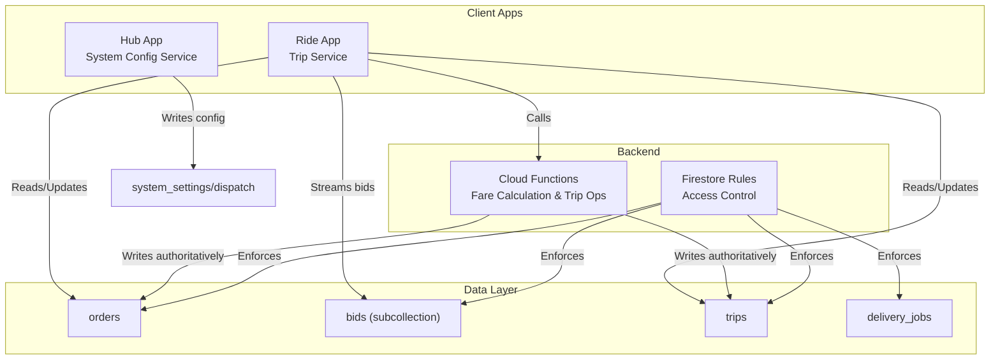
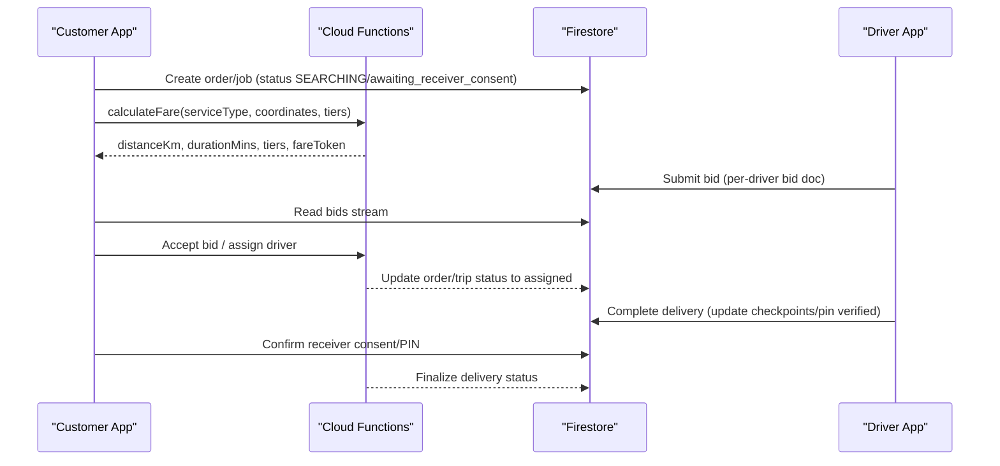
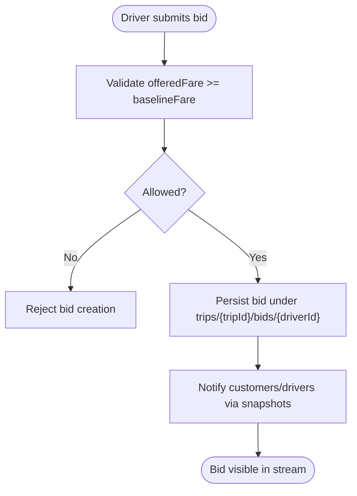
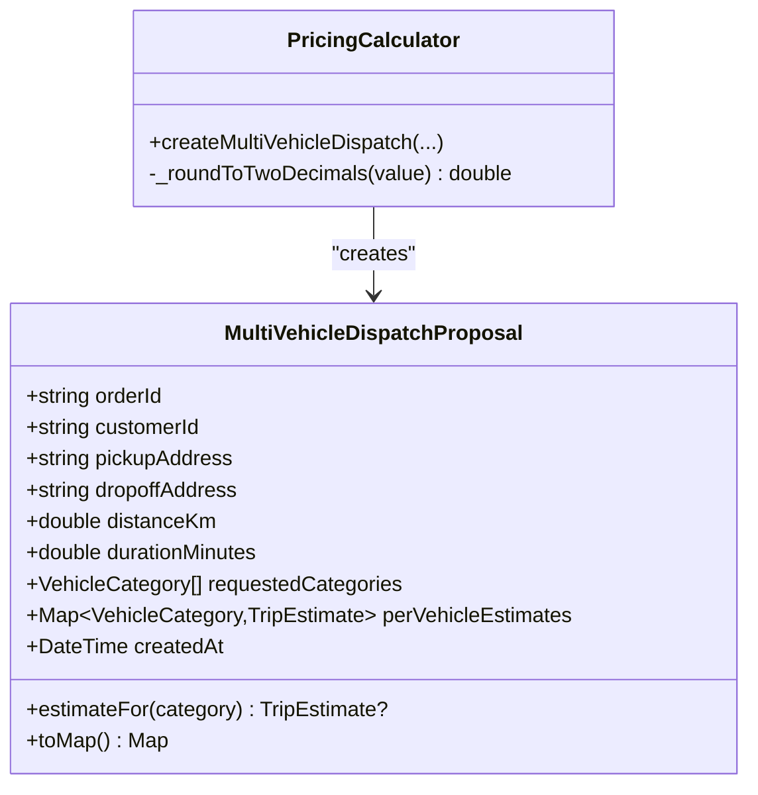
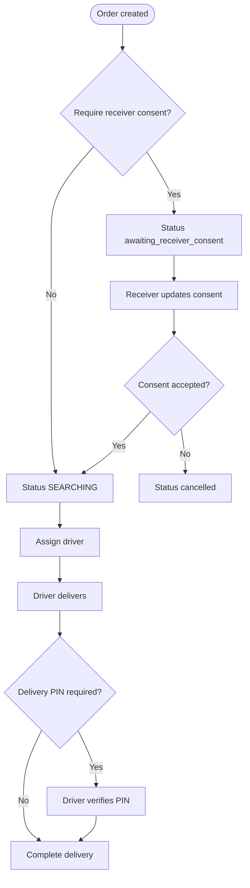
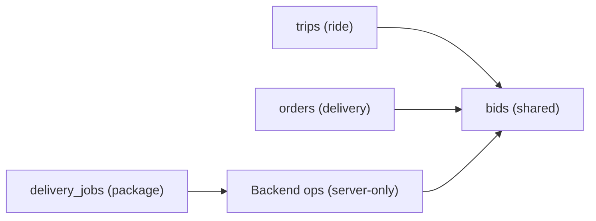
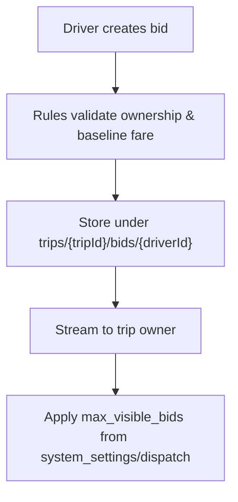
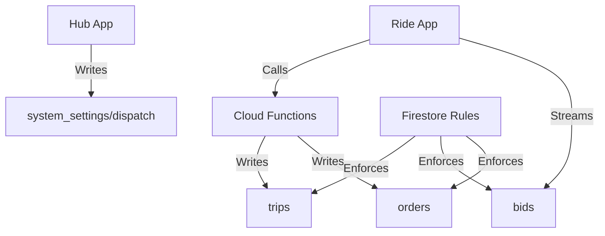

# Delivery Services

<cite>
**Referenced Files in This Document**
- [firestore.rules](file://firestore.rules)
- [index.ts](file://functions/src/index.ts)
- [trip_service.dart](file://sese_ride/lib/features/trips/services/trip_service.dart)
- [trip_estimate.dart](file://sese_core/lib/models/trip_estimate.dart)
- [pricing_calculator.dart](file://sese_core/lib/services/pricing_calculator.dart)
- [system_config_service.dart](file://sese_hub/lib/features/config/services/system_config_service.dart)
</cite>

## Table of Contents
1. [Introduction](#introduction)
2. [Project Structure](#project-structure)
3. [Core Components](#core-components)
4. [Architecture Overview](#architecture-overview)
5. [Detailed Component Analysis](#detailed-component-analysis)
6. [Dependency Analysis](#dependency-analysis)
7. [Performance Considerations](#performance-considerations)
8. [Troubleshooting Guide](#troubleshooting-guide)
9. [Conclusion](#conclusion)

## Introduction
This document explains the package delivery service with a focus on:
- Bid-based dispatch for ride and delivery trips
- Receiver confirmation workflow and proof-of-delivery controls
- Multi-vehicle coordination via per-category pricing guarantees
- Integration between ride and delivery systems through shared trip models
- Security, error handling, and performance considerations

The system uses Firestore rules to enforce secure access, Cloud Functions for authoritative state transitions, and client services for real-time bid streaming and UI updates.

## Project Structure
At a high level:
- Client apps (ride/hub) interact with Firestore collections such as orders, bids, trips, and delivery_jobs.
- Backend Cloud Functions provide server-authoritative operations like fare calculation and trip lifecycle management.
- Shared core models define trip estimates and multi-vehicle dispatch proposals used across both ride and delivery flows.

**Diagram sources**
- [trip_service.dart:189-200](file://sese_ride/lib/features/trips/services/trip_service.dart#L189-L200)
- [index.ts:81-198](file://functions/src/index.ts#L81-L198)
- [firestore.rules:237-366](file://firestore.rules#L237-L366)
- [firestore.rules:1034-1056](file://firestore.rules#L1034-L1056)
- [system_config_service.dart:166-180](file://sese_hub/lib/features/config/services/system_config_service.dart#L166-L180)

**Section sources**
- [trip_service.dart:189-200](file://sese_ride/lib/features/trips/services/trip_service.dart#L189-L200)
- [index.ts:81-198](file://functions/src/index.ts#L81-L198)
- [firestore.rules:237-366](file://firestore.rules#L237-L366)
- [firestore.rules:1034-1056](file://firestore.rules#L1034-L1056)
- [system_config_service.dart:166-180](file://sese_hub/lib/features/config/services/system_config_service.dart#L166-L180)

## Core Components
- Bid-based dispatch: Drivers submit offers against an order/trip; the customer or backend can accept or decline. Real-time bid streams are exposed to clients.
- Multi-vehicle dispatch proposal: A single order can be dispatched across multiple vehicle categories with per-category fare guarantees.
- Fare calculation: Server-side function computes distance/duration, applies region pricing, and returns signed fare tokens.
- Delivery jobs: Separate collection for package delivery with strict create-by-creator and driver-read-only access until acceptance.
- Receiver consent and proof-of-delivery: Order-level fields control receiver consent and pin verification, enforced by rules.

Key responsibilities:
- Client services: Stream bids, surface offers, and update UI.
- Backend functions: Authoritative state transitions and secure fare computation.
- Firestore rules: Enforce who can read/write what at all times.

**Section sources**
- [trip_service.dart:189-200](file://sese_ride/lib/features/trips/services/trip_service.dart#L189-L200)
- [trip_estimate.dart:75-122](file://sese_core/lib/models/trip_estimate.dart#L75-L122)
- [pricing_calculator.dart:105-146](file://sese_core/lib/services/pricing_calculator.dart#L105-L146)
- [index.ts:81-198](file://functions/src/index.ts#L81-L198)
- [firestore.rules:237-366](file://firestore.rules#L237-L366)
- [firestore.rules:1034-1056](file://firestore.rules#L1034-L1056)

## Architecture Overview
The delivery service integrates with the ride system using shared trip and bid structures. The flow is:
1. Customer creates an order or delivery job.
2. Backend calculates fares and publishes per-category estimates.
3. Drivers submit bids/offers.
4. Customer or backend accepts a bid; order/trip transitions to assigned state.
5. Driver completes delivery; receiver confirms via PIN if required.

**Diagram sources**
- [index.ts:81-198](file://functions/src/index.ts#L81-L198)
- [firestore.rules:237-366](file://firestore.rules#L237-L366)
- [firestore.rules:1034-1056](file://firestore.rules#L1034-L1056)
- [trip_service.dart:189-200](file://sese_ride/lib/features/trips/services/trip_service.dart#L189-L200)

## Detailed Component Analysis

### Bid-Based Dispatch System
- Bidding model: Each driver submits a pending bid with an offered fare that must meet or exceed a baseline fare. Only the driver can write their own bid; the trip owner can read all bids.
- Acceptance: Backend functions handle accepting/rejecting bids to ensure integrity. Clients cannot directly transition bid states except limited updates allowed by rules.
- Real-time visibility: Clients subscribe to bid streams to display live offers.

**Diagram sources**
- [firestore.rules:344-366](file://firestore.rules#L344-L366)
- [trip_service.dart:189-200](file://sese_ride/lib/features/trips/services/trip_service.dart#L189-L200)

**Section sources**
- [firestore.rules:344-366](file://firestore.rules#L344-L366)
- [trip_service.dart:189-200](file://sese_ride/lib/features/trips/services/trip_service.dart#L189-L200)

### Multi-Vehicle Coordination and Pricing
- Multi-vehicle dispatch proposal: For package delivery, the system generates per-category estimates so each selected vehicle category has a guaranteed dynamic fare.
- Pricing calculator: Computes estimates per category using region configuration and optional surge override.
- Fare token: Backend returns a signed fare token to prevent tampering.

**Diagram sources**
- [trip_estimate.dart:75-122](file://sese_core/lib/models/trip_estimate.dart#L75-L122)
- [pricing_calculator.dart:105-146](file://sese_core/lib/services/pricing_calculator.dart#L105-L146)

**Section sources**
- [trip_estimate.dart:75-122](file://sese_core/lib/models/trip_estimate.dart#L75-L122)
- [pricing_calculator.dart:105-146](file://sese_core/lib/services/pricing_calculator.dart#L105-L146)
- [index.ts:81-198](file://functions/src/index.ts#L81-L198)

### Receiver Confirmation Workflow and Proof of Delivery
- Receiver consent: Orders include receiver consent fields; only the receiver can update consent and related timestamps. Consent accepted transitions order status to searching; declined cancels.
- Proof of delivery: Driver can update cash checkpoints and deliveryPinVerified; order-level rules restrict these writes to the assigned driver.
- Delivery jobs: Separate collection enforces create-by-creator and driver-read-only until acceptance; writes are server-only.

**Diagram sources**
- [firestore.rules:61-83](file://firestore.rules#L61-L83)
- [firestore.rules:237-280](file://firestore.rules#L237-L280)
- [firestore.rules:1034-1056](file://firestore.rules#L1034-L1056)

**Section sources**
- [firestore.rules:61-83](file://firestore.rules#L61-L83)
- [firestore.rules:237-280](file://firestore.rules#L237-L280)
- [firestore.rules:1034-1056](file://firestore.rules#L1034-L1056)

### Integration Between Ride and Delivery Systems
- Shared trip model: Live trips and bids are modeled consistently for both ride and delivery, enabling unified dispatch logic and UI.
- Order model: Supports both ride and delivery scenarios with fields for receiver consent and delivery pin requirements.
- Delivery jobs: Provide a dedicated path for package delivery while reusing common concepts like bidding and assignment.

**Diagram sources**
- [firestore.rules:237-366](file://firestore.rules#L237-L366)
- [firestore.rules:1034-1056](file://firestore.rules#L1034-L1056)

**Section sources**
- [firestore.rules:237-366](file://firestore.rules#L237-L366)
- [firestore.rules:1034-1056](file://firestore.rules#L1034-L1056)

### Offer Management and Visibility Controls
- Per-driver bid documents: Drivers can only create/update their own pending bid; the trip owner reads all bids.
- Max visible bids: System settings allow configuring maximum visible bids for dispatch UI.

**Diagram sources**
- [firestore.rules:344-366](file://firestore.rules#L344-L366)
- [system_config_service.dart:166-180](file://sese_hub/lib/features/config/services/system_config_service.dart#L166-L180)

**Section sources**
- [firestore.rules:344-366](file://firestore.rules#L344-L366)
- [system_config_service.dart:166-180](file://sese_hub/lib/features/config/services/system_config_service.dart#L166-L180)

## Dependency Analysis
- Client-to-backend:
  - Ride app streams bids from Firestore and calls backend for fare calculations.
  - Hub app writes system settings controlling dispatch behavior.
- Backend-to-data:
  - Cloud Functions perform server-authoritative updates to orders/trips and compute fares securely.
- Data security:
  - Firestore rules enforce role-based access, preventing unauthorized bid creation, order updates, and delivery job mutations.

**Diagram sources**
- [trip_service.dart:189-200](file://sese_ride/lib/features/trips/services/trip_service.dart#L189-L200)
- [index.ts:81-198](file://functions/src/index.ts#L81-L198)
- [firestore.rules:237-366](file://firestore.rules#L237-L366)
- [system_config_service.dart:166-180](file://sese_hub/lib/features/config/services/system_config_service.dart#L166-L180)

**Section sources**
- [trip_service.dart:189-200](file://sese_ride/lib/features/trips/services/trip_service.dart#L189-L200)
- [index.ts:81-198](file://functions/src/index.ts#L81-L198)
- [firestore.rules:237-366](file://firestore.rules#L237-L366)
- [system_config_service.dart:166-180](file://sese_hub/lib/features/config/services/system_config_service.dart#L166-L180)

## Performance Considerations
- Real-time bid streams: Use ordered queries to minimize payload size and improve rendering performance.
- Multi-vehicle estimates: Precompute per-category estimates server-side to avoid repeated client calculations.
- Fallback routing: If external routing API fails, backend falls back to approximate distances to keep dispatch responsive.
- Config-driven limits: Adjust max visible bids to balance UI responsiveness and data volume.

[No sources needed since this section provides general guidance]

## Troubleshooting Guide
Common issues and resolutions:
- Unauthenticated errors: Ensure user session is active before calling fare calculation or submitting bids.
- Invalid arguments: Validate coordinates, service type, and tier arrays when invoking fare calculation.
- Not found: Check whether the trip/order still exists; it may have been cancelled or completed.
- Failed precondition: The order/trip may no longer be mutable due to state transitions.

Operational checks:
- Verify Firestore rules for orders/trips/bids/delivery_jobs to ensure correct permissions.
- Confirm system settings for max visible bids are correctly saved.

**Section sources**
- [trip_service.dart:202-216](file://sese_ride/lib/features/trips/services/trip_service.dart#L202-L216)
- [index.ts:81-198](file://functions/src/index.ts#L81-L198)
- [firestore.rules:237-366](file://firestore.rules#L237-L366)
- [firestore.rules:1034-1056](file://firestore.rules#L1034-L1056)
- [system_config_service.dart:166-180](file://sese_hub/lib/features/config/services/system_config_service.dart#L166-L180)

## Conclusion
The delivery service leverages a robust bid-based dispatch model integrated with ride operations, secure receiver confirmation workflows, and multi-vehicle coordination through per-category pricing guarantees. Firestore rules and Cloud Functions enforce security and integrity, while client services provide real-time visibility and user interactions. Proper configuration and monitoring of bids, consent, and proof-of-delivery steps ensure reliable package delivery experiences.

[No sources needed since this section summarizes without analyzing specific files]