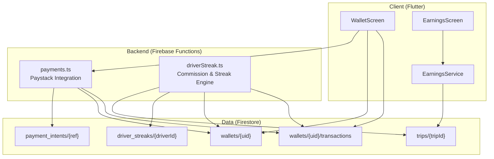
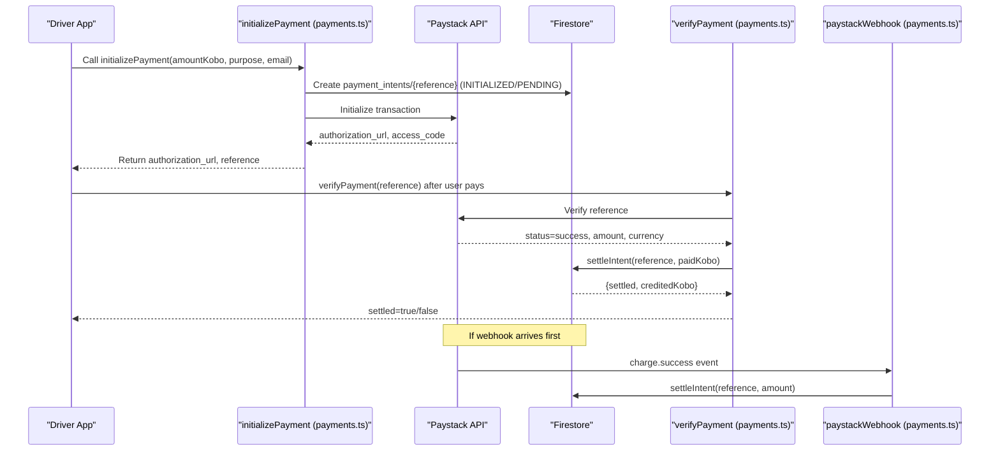
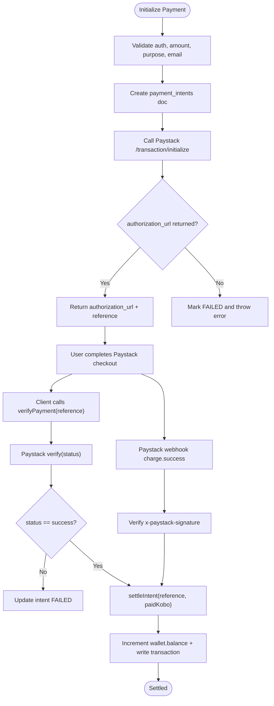
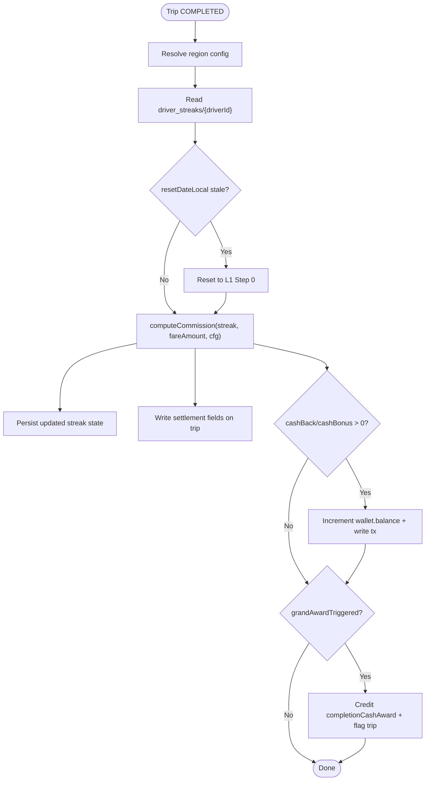
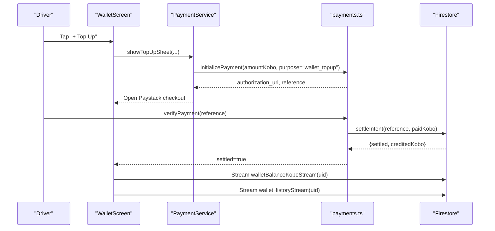
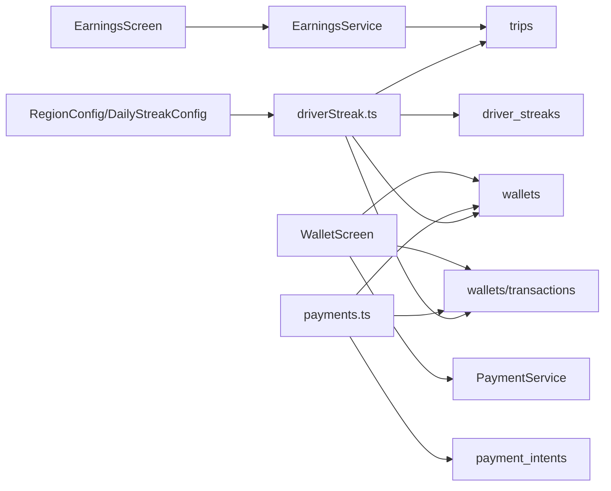

# Driver Earnings Tracking

<cite>
**Referenced Files in This Document**
- [payments.ts](file://functions/src/payments.ts)
- [driverStreak.ts](file://functions/src/driverStreak.ts)
- [pricing_config.dart](file://sese_core/lib/models/pricing_config.dart)
- [driver_streak_state.dart](file://sese_core/lib/models/driver_streak_state.dart)
- [earnings_screen.dart](file://sese_ride/lib/features/wallet/earnings_screen.dart)
- [earnings_service.dart](file://sese_ride/lib/features/wallet/earnings_service.dart)
- [wallet_screen.dart](file://sese_ride/lib/features/wallet/wallet_screen.dart)
- [deleteAccount.ts](file://functions/src/deleteAccount.ts)
</cite>

## Table of Contents
1. [Introduction](#introduction)
2. [Project Structure](#project-structure)
3. [Core Components](#core-components)
4. [Architecture Overview](#architecture-overview)
5. [Detailed Component Analysis](#detailed-component-analysis)
6. [Dependency Analysis](#dependency-analysis)
7. [Performance Considerations](#performance-considerations)
8. [Troubleshooting Guide](#troubleshooting-guide)
9. [Conclusion](#conclusion)

## Introduction
This document explains the driver earnings tracking system, covering income calculation, payout processing, and financial reporting. It documents the earnings data model, commission calculations, payment gateway integration, wallet system, transaction history, balance management, currency handling, international considerations, and compliance safeguards. The system combines server-side Cloud Functions for secure money movement and streak-based commission logic with a Flutter client that streams live balances, earnings breakdowns, and recent payouts.

## Project Structure
The earnings system spans three layers:
- Backend (Cloud Functions): Secure payment settlement and streak-driven commission engine.
- Core models: Region pricing and streak configuration used across platforms.
- Client (Flutter): Wallet UI, earnings dashboards, and streaming services.



**Diagram sources**
- [payments.ts:108-197](file://functions/src/payments.ts#L108-L197)
- [payments.ts:206-271](file://functions/src/payments.ts#L206-L271)
- [driverStreak.ts:375-524](file://functions/src/driverStreak.ts#L375-L524)
- [earnings_screen.dart:69-91](file://sese_ride/lib/features/wallet/earnings_screen.dart#L69-L91)
- [earnings_service.dart:80-101](file://sese_ride/lib/features/wallet/earnings_service.dart#L80-L101)
- [wallet_screen.dart:74-124](file://sese_ride/lib/features/wallet/wallet_screen.dart#L74-L124)

**Section sources**
- [payments.ts:1-371](file://functions/src/payments.ts#L1-L371)
- [driverStreak.ts:1-708](file://functions/src/driverStreak.ts#L1-L708)
- [earnings_screen.dart:1-456](file://sese_ride/lib/features/wallet/earnings_screen.dart#L1-L456)
- [earnings_service.dart:1-184](file://sese_ride/lib/features/wallet/earnings_service.dart#L1-L184)
- [wallet_screen.dart:1-329](file://sese_ride/lib/features/wallet/wallet_screen.dart#L1-L329)

## Core Components
- Payment Gateway Integration: Secure Paystack collection flow with idempotent settlement to wallets and transactions.
- Commission Engine: Three-level daily streak mechanics that adjust commission rates, cash-back refunds, and cash bonuses per trip.
- Earnings Reporting: Daily, weekly, and monthly summaries derived from completed trips and incentive credits.
- Wallet System: Live kobo-denominated balance, top-up via Paystack, and withdrawal/payout requests through support.

Key responsibilities:
- payments.ts: Validates amounts, initializes Paystack checkout, verifies payments, and settles funds into wallets and transactions.
- driverStreak.ts: Computes streak-aware commissions, updates streak state, annotates trips, and credits wallet incentives.
- earnings_service.dart: Streams completed trips and aggregates earnings by day/week/month.
- earnings_screen.dart: Presents earnings breakdowns and charts.
- wallet_screen.dart: Displays balance, recent payouts, and ledger entries; initiates top-ups and withdrawals.

**Section sources**
- [payments.ts:108-197](file://functions/src/payments.ts#L108-L197)
- [payments.ts:206-271](file://functions/src/payments.ts#L206-L271)
- [driverStreak.ts:239-335](file://functions/src/driverStreak.ts#L239-L335)
- [earnings_service.dart:67-184](file://sese_ride/lib/features/wallet/earnings_service.dart#L67-L184)
- [earnings_screen.dart:19-98](file://sese_ride/lib/features/wallet/earnings_screen.dart#L19-L98)
- [wallet_screen.dart:14-72](file://sese_ride/lib/features/wallet/wallet_screen.dart#L14-L72)

## Architecture Overview
The system enforces zero-trust amount handling on the client and performs all monetary operations server-side.



**Diagram sources**
- [payments.ts:108-197](file://functions/src/payments.ts#L108-L197)
- [payments.ts:206-271](file://functions/src/payments.ts#L206-L271)
- [payments.ts:283-326](file://functions/src/payments.ts#L283-L326)
- [payments.ts:333-370](file://functions/src/payments.ts#L333-L370)

## Detailed Component Analysis

### Payment Gateway Integration (Paystack)
- Purpose: Accept customer payments (wallet top-ups or trip payments) securely and credit the driver’s wallet exactly once.
- Key flows:
  - initializePayment: Validates caller identity, amount bounds, purpose, and email; creates a payment intent; calls Paystack; returns checkout URL.
  - verifyPayment: Server-side verification against Paystack; validates currency and amount; idempotently settles to wallet and transactions.
  - paystackWebhook: HMAC signature verification; processes charge.success events; uses same settleIntent to ensure idempotency.
- Idempotency: Firestore transaction checks intent status; only PENDING/INITIALIZED intents are settled; SUCCEEDED is no-op.
- Currency: Hardcoded NGN throughout initialization, verification, and settlement.



**Diagram sources**
- [payments.ts:108-197](file://functions/src/payments.ts#L108-L197)
- [payments.ts:206-271](file://functions/src/payments.ts#L206-L271)
- [payments.ts:283-326](file://functions/src/payments.ts#L283-L326)
- [payments.ts:333-370](file://functions/src/payments.ts#L333-L370)

**Section sources**
- [payments.ts:108-197](file://functions/src/payments.ts#L108-L197)
- [payments.ts:206-271](file://functions/src/payments.ts#L206-L271)
- [payments.ts:283-326](file://functions/src/payments.ts#L283-L326)
- [payments.ts:333-370](file://functions/src/payments.ts#L333-L370)

### Commission Calculation and Streak Engine
- Levels and steps:
  - Level 1: Step-down commission discount (15% → 0%).
  - Level 2: 0% fee + refund of previously paid L1 commissions in reverse order.
  - Level 3: 0% fee + cash bonus % of current fare; completing step 6 triggers grand award.
- Break rules: Declines or cancellations before arrival drop back to earlier levels or off-streak; customer cancels or no-show protected.
- Local midnight reset: Per-driver timezone-aware reset using stored resetDateLocal; cron sweeper backs up lazy resets.
- Configuration: Region-scoped DailyStreakConfig controls base rate, no-show wait, completion award, and disabled regions.



**Diagram sources**
- [driverStreak.ts:239-335](file://functions/src/driverStreak.ts#L239-L335)
- [driverStreak.ts:375-524](file://functions/src/driverStreak.ts#L375-L524)
- [driverStreak.ts:623-707](file://functions/src/driverStreak.ts#L623-L707)

**Section sources**
- [driverStreak.ts:1-708](file://functions/src/driverStreak.ts#L1-L708)
- [pricing_config.dart:151-249](file://sese_core/lib/models/pricing_config.dart#L151-L249)
- [driver_streak_state.dart:1-217](file://sese_core/lib/models/driver_streak_state.dart#L1-L217)

### Earnings Data Model and Reporting
- TripEarning: Represents one completed trip’s gross fare, commission, net, service label, addresses, and completion time.
- Aggregation:
  - summarizeDay: Filters trips by calendar day and computes totals.
  - summarizeWeek: Monday-to-Sunday buckets.
  - summarizeMonth: Monthly totals for gross, commission, and net.
  - summarizeMonthIncentives: Adds referral/incentive wallet credits to monthly net.
- UI: EarningsScreen renders daily cards, weekly bar chart, and monthly summary including incentive earnings.

```mermaid
classDiagram
class TripEarning {
+string tripId
+double grossNaira
+double commissionNaira
+string serviceLabel
+string pickupAddress
+string dropoffAddress
+DateTime completedAt
+netNaira() double
}
class DayEarnings {
+DateTime date
+double gross
+double commission
+double net
+int tripCount
}
class EarningsService {
+completedTripEarningsStream(driverId) Stream<List<TripEarning>>
+summarizeDay(earnings, day) ({DayEarnings, List<TripEarning>})
+summarizeWeek(earnings, anchor) List<DayEarnings>
+summarizeMonth(earnings, year, month) DayEarnings
+summarizeMonthIncentives(transactions, year, month) double
}
EarningsService --> TripEarning : "creates"
EarningsService --> DayEarnings : "aggregates"
```

**Diagram sources**
- [earnings_service.dart:6-42](file://sese_ride/lib/features/wallet/earnings_service.dart#L6-L42)
- [earnings_service.dart:44-59](file://sese_ride/lib/features/wallet/earnings_service.dart#L44-L59)
- [earnings_service.dart:67-184](file://sese_ride/lib/features/wallet/earnings_service.dart#L67-L184)

**Section sources**
- [earnings_service.dart:1-184](file://sese_ride/lib/features/wallet/earnings_service.dart#L1-L184)
- [earnings_screen.dart:19-98](file://sese_ride/lib/features/wallet/earnings_screen.dart#L19-L98)
- [earnings_screen.dart:132-197](file://sese_ride/lib/features/wallet/earnings_screen.dart#L132-L197)
- [earnings_screen.dart:238-321](file://sese_ride/lib/features/wallet/earnings_screen.dart#L238-L321)
- [earnings_screen.dart:372-418](file://sese_ride/lib/features/wallet/earnings_screen.dart#L372-L418)

### Wallet System, Transaction History, and Balance Management
- Balance unit: Kobo (integer-exact). Displayed in Naira on the client.
- Top-up: Driven by Paystack; client opens hosted checkout; backend credits wallet and writes transaction records.
- Withdrawals/Payouts: Requested via support; processed hub-side; recent payouts streamed to the wallet screen.
- Ledger: Chronological list of wallet transactions with signed amounts and labels.



**Diagram sources**
- [wallet_screen.dart:31-49](file://sese_ride/lib/features/wallet/wallet_screen.dart#L31-L49)
- [wallet_screen.dart:74-124](file://sese_ride/lib/features/wallet/wallet_screen.dart#L74-L124)
- [wallet_screen.dart:194-220](file://sese_ride/lib/features/wallet/wallet_screen.dart#L194-L220)
- [payments.ts:108-197](file://functions/src/payments.ts#L108-L197)
- [payments.ts:206-271](file://functions/src/payments.ts#L206-L271)

**Section sources**
- [wallet_screen.dart:1-329](file://sese_ride/lib/features/wallet/wallet_screen.dart#L1-L329)
- [payments.ts:108-197](file://functions/src/payments.ts#L108-L197)
- [payments.ts:206-271](file://functions/src/payments.ts#L206-L271)

### Examples: Earnings Breakdowns, Payout Schedules, and Tax Withholding
- Earnings breakdown example (daily view):
  - Today’s fare income: sum of gross fares for completed trips today.
  - Commission paid: sum of fare × commissionRate for each trip.
  - Net profit: gross − commission.
  - Trips completed: count of completed trips today.
- Weekly view:
  - Bars represent daily gross fares; totals aggregate commission and net across the week.
- Monthly view:
  - Gross revenue minus platform commissions plus referral/incentive earnings equals final net earnings.
- Payout schedule:
  - Withdrawals are initiated via support; payouts appear under Recent payouts once processed hub-side.
- Tax withholding:
  - No explicit tax withholding logic is present in the analyzed files. Commissions are platform fees; any tax obligations would need to be implemented separately.

**Section sources**
- [earnings_screen.dart:132-197](file://sese_ride/lib/features/wallet/earnings_screen.dart#L132-L197)
- [earnings_screen.dart:238-321](file://sese_ride/lib/features/wallet/earnings_screen.dart#L238-L321)
- [earnings_screen.dart:372-418](file://sese_ride/lib/features/wallet/earnings_screen.dart#L372-L418)
- [wallet_screen.dart:127-191](file://sese_ride/lib/features/wallet/wallet_screen.dart#L127-L191)

## Dependency Analysis
- Client dependencies:
  - WalletScreen depends on PaymentService for balance, history, and payouts streams.
  - EarningsScreen depends on EarningsService for completed trip streams and aggregation.
- Backend dependencies:
  - payments.ts depends on Paystack API and Firestore collections: payment_intents, wallets, wallets/transactions.
  - driverStreak.ts depends on Firestore collections: trips, drivers, driver_streaks, wallets, wallets/transactions, and system_configs.
- Cross-cutting:
  - RegionConfig and DailyStreakConfig define regional behavior and commission defaults.
  - DriverStreakState mirrors backend streak state for client rendering.



**Diagram sources**
- [earnings_screen.dart:69-91](file://sese_ride/lib/features/wallet/earnings_screen.dart#L69-L91)
- [earnings_service.dart:80-101](file://sese_ride/lib/features/wallet/earnings_service.dart#L80-L101)
- [wallet_screen.dart:74-124](file://sese_ride/lib/features/wallet/wallet_screen.dart#L74-L124)
- [payments.ts:108-197](file://functions/src/payments.ts#L108-L197)
- [driverStreak.ts:375-524](file://functions/src/driverStreak.ts#L375-L524)
- [pricing_config.dart:251-330](file://sese_core/lib/models/pricing_config.dart#L251-L330)

**Section sources**
- [earnings_screen.dart:1-456](file://sese_ride/lib/features/wallet/earnings_screen.dart#L1-L456)
- [earnings_service.dart:1-184](file://sese_ride/lib/features/wallet/earnings_service.dart#L1-L184)
- [wallet_screen.dart:1-329](file://sese_ride/lib/features/wallet/wallet_screen.dart#L1-L329)
- [payments.ts:1-371](file://functions/src/payments.ts#L1-L371)
- [driverStreak.ts:1-708](file://functions/src/driverStreak.ts#L1-L708)
- [pricing_config.dart:1-499](file://sese_core/lib/models/pricing_config.dart#L1-L499)

## Performance Considerations
- Idempotent settlement: Using Firestore transactions prevents duplicate wallet credits when both verifyPayment and webhook settle simultaneously.
- Streaming UI: Real-time streams minimize polling overhead and keep balances and ledgers fresh.
- Batch writes: Streak engine batches streak state, trip annotations, and wallet credits to reduce round-trips.
- Pagination: Scheduled streak reset sweeps pages of 500 to avoid timeouts.

[No sources needed since this section provides general guidance]

## Troubleshooting Guide
- Payment not settling:
  - Ensure verifyPayment is called after successful Paystack checkout.
  - Confirm currency is NGN and amount matches the initialized intent.
  - Check payment_intents status; if FAILED, review failureReason.
- Duplicate credits:
  - Should not occur due to idempotent settleIntent; investigate if manual writes bypassed the function.
- Streak not progressing:
  - Verify driver timezone and resetDateLocal; check if streak was broken by decline/cancel.
  - Confirm region config enables streaks and baseCommissionRate is set.
- Account deletion blocked:
  - Non-zero wallet balance or pending payouts will block deletion until resolved.

**Section sources**
- [payments.ts:283-326](file://functions/src/payments.ts#L283-L326)
- [payments.ts:333-370](file://functions/src/payments.ts#L333-L370)
- [driverStreak.ts:337-373](file://functions/src/driverStreak.ts#L337-L373)
- [driverStreak.ts:535-557](file://functions/src/driverStreak.ts#L535-L557)
- [deleteAccount.ts:38-71](file://functions/src/deleteAccount.ts#L38-L71)

## Conclusion
The driver earnings tracking system secures all monetary operations server-side, integrates Paystack for wallet top-ups, and applies a gamified, region-configurable commission engine that rewards consistent performance. Clients stream live balances, detailed earnings breakdowns, and recent payouts. While tax withholding is not implemented in the analyzed code, the architecture supports future extensions for regulatory compliance and multi-currency expansion.

[No sources needed since this section summarizes without analyzing specific files]