# Driver Management

<cite>
**Referenced Files in This Document**
- [driverStatus.ts](file://functions/src/driverStatus.ts)
- [driverStreak.ts](file://functions/src/driverStreak.ts)
- [verification.ts](file://functions/src/verification.ts)
- [driver_status_service.dart](file://sese_ride/lib/features/driver/services/driver_status_service.dart)
- [driver_dashboard_screen.dart](file://sese_ride/lib/features/driver/presentation/driver_dashboard_screen.dart)
- [vehicle_model.dart](file://sese_core/lib/models/vehicle_model.dart)
- [fleet_repository.dart](file://sese_hub/lib/features/verification/services/fleet_repository.dart)
- [vehicle_approvals_screen.dart](file://sese_hub/lib/features/verification/presentation/vehicle_approvals_screen.dart)
- [earnings_screen.dart](file://sese_ride/lib/features/wallet/earnings_screen.dart)
- [driver_onboarding_screen.dart](file://sese_ride/lib/features/driver/presentation/driver_onboarding_screen.dart)
</cite>

## Table of Contents
1. [Introduction](#introduction)
2. [Project Structure](#project-structure)
3. [Core Components](#core-components)
4. [Architecture Overview](#architecture-overview)
5. [Detailed Component Analysis](#detailed-component-analysis)
6. [Dependency Analysis](#dependency-analysis)
7. [Performance Considerations](#performance-considerations)
8. [Troubleshooting Guide](#troubleshooting-guide)
9. [Conclusion](#conclusion)

## Introduction
This document explains the driver management system across onboarding, vehicle registration, verification, fleet management, online/offline status control, streak-based engagement, earnings tracking, and support/compliance workflows. It maps client-side screens and services to backend Cloud Functions and Hub admin tools, focusing on zero-trust security, auditability, and clear operational flows for drivers and staff.

## Project Structure
The system spans three main areas:
- Driver app (sese_ride): onboarding, dashboard, fleet management, streak UI, earnings screen.
- Backend (functions): callable endpoints for status, streak engine, and verification review.
- Hub admin (sese_hub): fleet approvals, driver/customer verification desk, and audit logs.

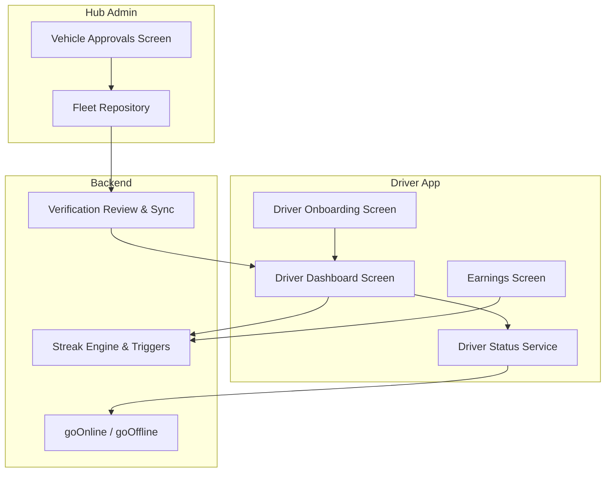

**Diagram sources**
- [driver_onboarding_screen.dart:18-36](file://sese_ride/lib/features/driver/presentation/driver_onboarding_screen.dart#L18-L36)
- [driver_dashboard_screen.dart:22-50](file://sese_ride/lib/features/driver/presentation/driver_dashboard_screen.dart#L22-L50)
- [driver_status_service.dart:147-158](file://sese_ride/lib/features/driver/services/driver_status_service.dart#L147-L158)
- [driverStatus.ts:32-163](file://functions/src/driverStatus.ts#L32-L163)
- [driverStreak.ts:375-524](file://functions/src/driverStreak.ts#L375-L524)
- [verification.ts:133-241](file://functions/src/verification.ts#L133-L241)
- [vehicle_approvals_screen.dart:41-64](file://sese_hub/lib/features/verification/presentation/vehicle_approvals_screen.dart#L41-L64)
- [fleet_repository.dart:21-34](file://sese_hub/lib/features/verification/services/fleet_repository.dart#L21-L34)

**Section sources**
- [driver_onboarding_screen.dart:18-36](file://sese_ride/lib/features/driver/presentation/driver_onboarding_screen.dart#L18-L36)
- [driver_dashboard_screen.dart:22-50](file://sese_ride/lib/features/driver/presentation/driver_dashboard_screen.dart#L22-L50)
- [driver_status_service.dart:147-158](file://sese_ride/lib/features/driver/services/driver_status_service.dart#L147-L158)
- [driverStatus.ts:32-163](file://functions/src/driverStatus.ts#L32-L163)
- [driverStreak.ts:375-524](file://functions/src/driverStreak.ts#L375-L524)
- [verification.ts:133-241](file://functions/src/verification.ts#L133-L241)
- [vehicle_approvals_screen.dart:41-64](file://sese_hub/lib/features/verification/presentation/vehicle_approvals_screen.dart#L41-L64)
- [fleet_repository.dart:21-34](file://sese_hub/lib/features/verification/services/fleet_repository.dart#L21-L34)

## Core Components
- Driver onboarding: collects personal info, address, government ID, selfie, emergency contact; writes pending profile with verification flags false and routes to home with a pending banner.
- Vehicle registration and fleet management: vehicles are stored per driver with documents and verification lifecycle; only approved vehicles allow going online.
- Verification pipeline: Hub admins approve/reject driver profiles and vehicles; backend syncs custom claims and sends push notifications.
- Online/offline status: zero-trust handshake validates JWT, suspension, profile/vehicle verification, GPS spoof/accuracy, and active trips before granting state changes.
- Streak system: daily commission tiering with Level 1 discount steps, Level 2 cash-back refunds, Level 3 cash bonuses, grand award, break rules, and local-midnight resets.
- Earnings tracking: daily/weekly/monthly breakdowns using completed trip settlements and wallet incentive credits.

**Section sources**
- [driver_onboarding_screen.dart:18-36](file://sese_ride/lib/features/driver/presentation/driver_onboarding_screen.dart#L18-L36)
- [vehicle_model.dart:3-45](file://sese_core/lib/models/vehicle_model.dart#L3-L45)
- [verification.ts:133-241](file://functions/src/verification.ts#L133-L241)
- [driverStatus.ts:32-163](file://functions/src/driverStatus.ts#L32-L163)
- [driverStreak.ts:5-38](file://functions/src/driverStreak.ts#L5-L38)
- [earnings_screen.dart:1-18](file://sese_ride/lib/features/wallet/earnings_screen.dart#L1-L18)

## Architecture Overview
The driver flow is strictly server-enforced:
- The driver app never flips online/offline locally without a backend grant.
- The backend enforces policy checks and persists authoritative state.
- Hub admin actions update Firestore and trigger claim sync and notifications.
- Streak engine reacts to trip events to compute commissions, credits, and awards.

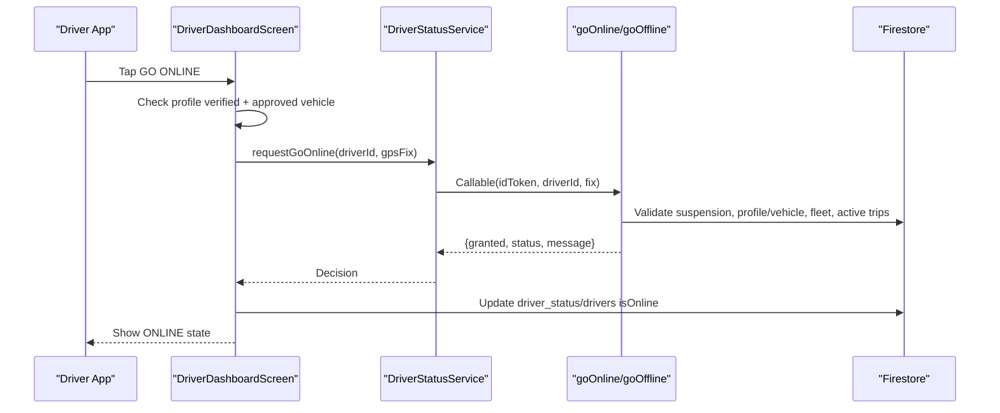

**Diagram sources**
- [driver_dashboard_screen.dart:258-317](file://sese_ride/lib/features/driver/presentation/driver_dashboard_screen.dart#L258-L317)
- [driver_status_service.dart:147-158](file://sese_ride/lib/features/driver/services/driver_status_service.dart#L147-L158)
- [driverStatus.ts:32-163](file://functions/src/driverStatus.ts#L32-L163)

## Detailed Component Analysis

### Driver Onboarding and Profile Submission
- Purpose: Collect identity, address, government ID, selfie, and emergency contact; submit to create a pending driver profile.
- Behavior: Writes `drivers/{driverId}` with pending verification flags and routes to driver home with a persistent pending banner.
- Validation: Enforces minimum age and requires a live camera selfie.

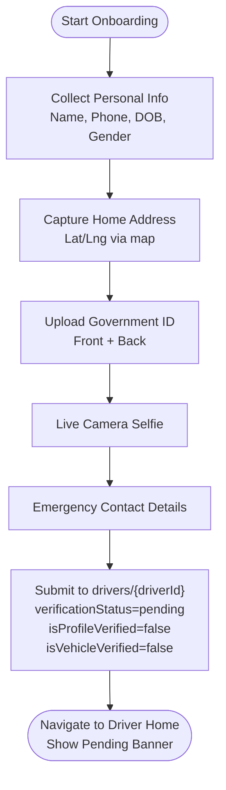

**Diagram sources**
- [driver_onboarding_screen.dart:18-36](file://sese_ride/lib/features/driver/presentation/driver_onboarding_screen.dart#L18-L36)
- [driver_onboarding_screen.dart:941-1058](file://sese_ride/lib/features/driver/presentation/driver_onboarding_screen.dart#L941-L1058)

**Section sources**
- [driver_onboarding_screen.dart:18-36](file://sese_ride/lib/features/driver/presentation/driver_onboarding_screen.dart#L18-L36)
- [driver_onboarding_screen.dart:941-1058](file://sese_ride/lib/features/driver/presentation/driver_onboarding_screen.dart#L941-L1058)

### Vehicle Registration and Fleet Management
- Data model: Vehicles are stored under `/drivers/{driverId}/vehicles/{vehicleId}` with category, tier, documents, verification/lifecycle statuses, and selection state.
- Approval guard: Only vehicles with approved/verified status can be selected to go online or receive orders.
- Legacy alias handling: Reads both canonical and legacy fields to ensure compatibility.

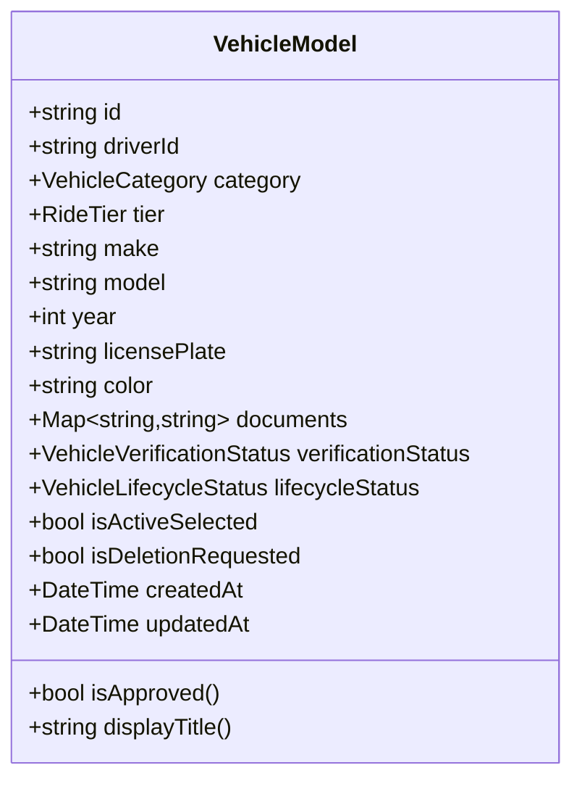

**Diagram sources**
- [vehicle_model.dart:3-45](file://sese_core/lib/models/vehicle_model.dart#L3-L45)
- [vehicle_model.dart:72-112](file://sese_core/lib/models/vehicle_model.dart#L72-L112)

**Section sources**
- [vehicle_model.dart:3-45](file://sese_core/lib/models/vehicle_model.dart#L3-L45)
- [vehicle_model.dart:72-112](file://sese_core/lib/models/vehicle_model.dart#L72-L112)

### Verification Pipeline (Document Upload, Admin Review, Approval)
- Driver profile review: Hub admins approve/reject driver profiles; backend sets custom claims and sends FCM notifications.
- Customer KYC review: Similar approval/rejection flow for customers.
- Direct updates: Firestore triggers keep custom claims and notifications in sync when status fields change.

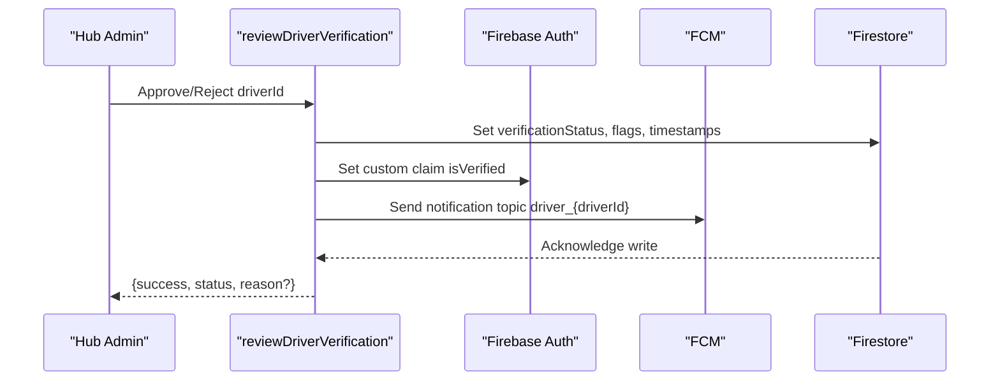

**Diagram sources**
- [verification.ts:133-241](file://functions/src/verification.ts#L133-L241)

**Section sources**
- [verification.ts:133-241](file://functions/src/verification.ts#L133-L241)
- [verification.ts:243-351](file://functions/src/verification.ts#L243-L351)

### Fleet Approvals Desk
- Pending queue: Merges multiple Firestore queries to surface pending vehicles tolerant of legacy aliases and missing indexes.
- Actions: Approve sets canonical and legacy fields, marks driver’s vehicle verified, recomputes canGoOnline; Reject stores reason and sets legacy fields.
- Audit logs: Displays pre-online verification capture records.

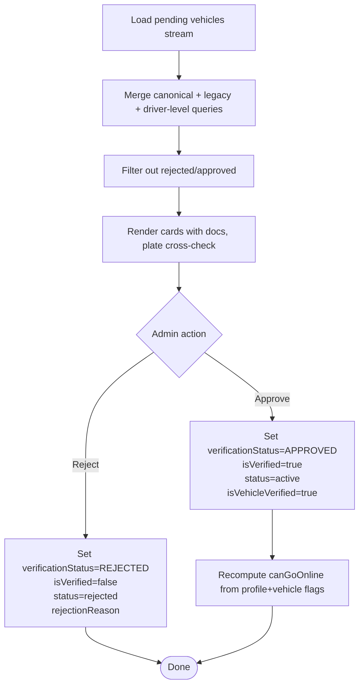

**Diagram sources**
- [fleet_repository.dart:21-34](file://sese_hub/lib/features/verification/services/fleet_repository.dart#L21-L34)
- [fleet_repository.dart:54-171](file://sese_hub/lib/features/verification/services/fleet_repository.dart#L54-L171)
- [vehicle_approvals_screen.dart:41-64](file://sese_hub/lib/features/verification/presentation/vehicle_approvals_screen.dart#L41-L64)
- [vehicle_approvals_screen.dart:84-144](file://sese_hub/lib/features/verification/presentation/vehicle_approvals_screen.dart#L84-L144)

**Section sources**
- [fleet_repository.dart:21-34](file://sese_hub/lib/features/verification/services/fleet_repository.dart#L21-L34)
- [fleet_repository.dart:54-171](file://sese_hub/lib/features/verification/services/fleet_repository.dart#L54-L171)
- [vehicle_approvals_screen.dart:41-64](file://sese_hub/lib/features/verification/presentation/vehicle_approvals_screen.dart#L41-L64)
- [vehicle_approvals_screen.dart:84-144](file://sese_hub/lib/features/verification/presentation/vehicle_approvals_screen.dart#L84-L144)

### Driver Status Service and Zero-Trust Online Handshake
- Client service: Validates GPS fix locally (mock/inaccurate), obtains ID token, calls callable endpoints, and returns structured decisions.
- Backend enforcement: Verifies authentication, suspension, profile/vehicle verification, fleet approval, GPS spoof/accuracy, and active trips; writes authoritative online mirror and driver last seen.

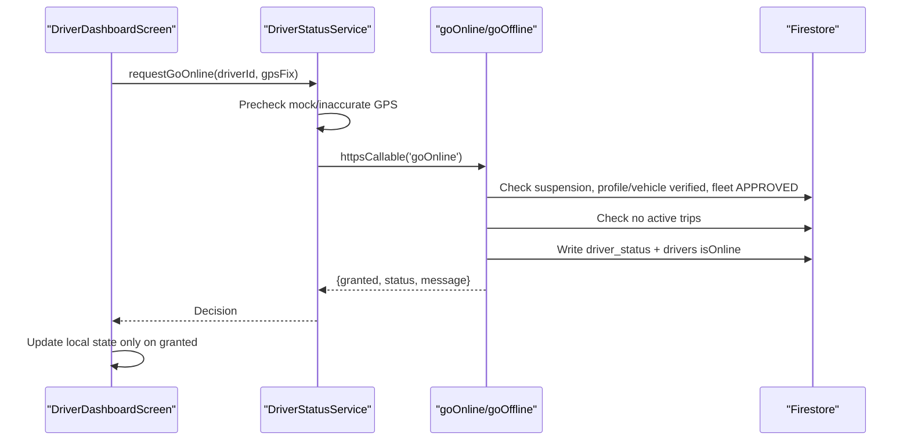

**Diagram sources**
- [driver_status_service.dart:147-158](file://sese_ride/lib/features/driver/services/driver_status_service.dart#L147-L158)
- [driver_status_service.dart:189-231](file://sese_ride/lib/features/driver/services/driver_status_service.dart#L189-L231)
- [driverStatus.ts:32-163](file://functions/src/driverStatus.ts#L32-L163)

**Section sources**
- [driver_status_service.dart:147-158](file://sese_ride/lib/features/driver/services/driver_status_service.dart#L147-L158)
- [driver_status_service.dart:189-231](file://sese_ride/lib/features/driver/services/driver_status_service.dart#L189-L231)
- [driverStatus.ts:32-163](file://functions/src/driverStatus.ts#L32-L163)

### Driver Dashboard: Online/Offline Controls and Engagement
- Online toggle: One-tap GO ONLINE with verification shield and server grant; OFFLINE via slide confirmation and server confirmation.
- Active trip slot: Shows assigned trip actions when present; otherwise shows order feed with streak tag.
- Bottom streak banner: Displays current streak level/step and progress toward rewards.

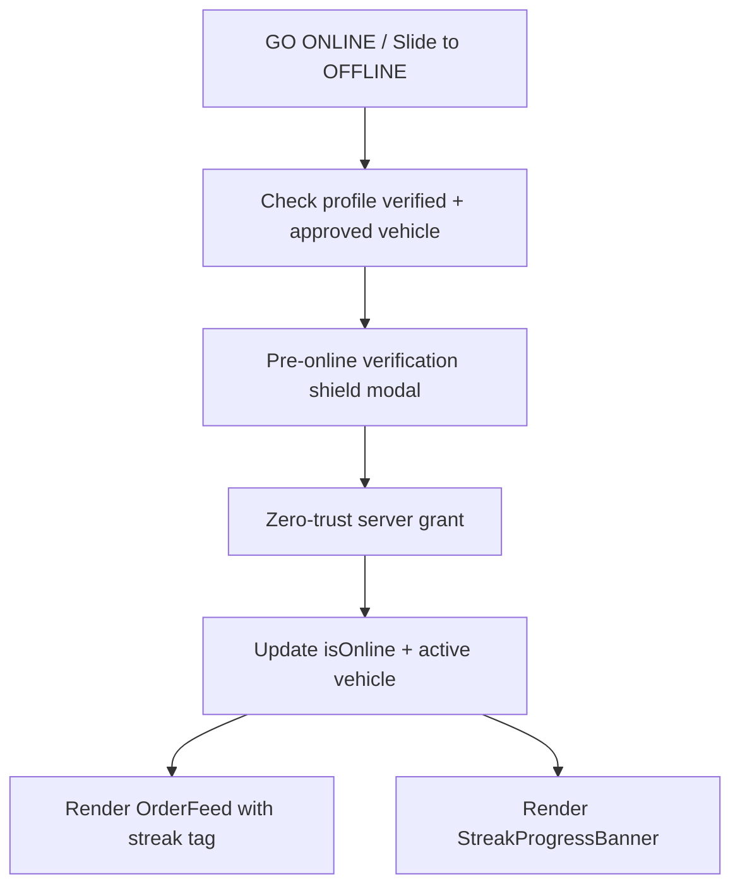

**Diagram sources**
- [driver_dashboard_screen.dart:258-317](file://sese_ride/lib/features/driver/presentation/driver_dashboard_screen.dart#L258-L317)
- [driver_dashboard_screen.dart:376-416](file://sese_ride/lib/features/driver/presentation/driver_dashboard_screen.dart#L376-L416)
- [driver_dashboard_screen.dart:549-641](file://sese_ride/lib/features/driver/presentation/driver_dashboard_screen.dart#L549-L641)

**Section sources**
- [driver_dashboard_screen.dart:258-317](file://sese_ride/lib/features/driver/presentation/driver_dashboard_screen.dart#L258-L317)
- [driver_dashboard_screen.dart:376-416](file://sese_ride/lib/features/driver/presentation/driver_dashboard_screen.dart#L376-L416)
- [driver_dashboard_screen.dart:549-641](file://sese_ride/lib/features/driver/presentation/driver_dashboard_screen.dart#L549-L641)

### Streak System: Commission Tiering, Break Rules, and Resets
- Levels:
  - Level 1: Step-down commission discounts over steps; reaching step 6 advances to Level 2.
  - Level 2: 0% fee with cash-back refunds from Level 1 history; completing all refunds advances to Level 3.
  - Level 3: 0% fee plus cash bonus percentage; completing step 6 triggers grand award and completes the day.
- Break rules: Declines or cancellations (except protected cases) drop back according to level/step.
- Resets: Local-midnight reset per driver timezone; cron sweep ensures idle drivers reset correctly.

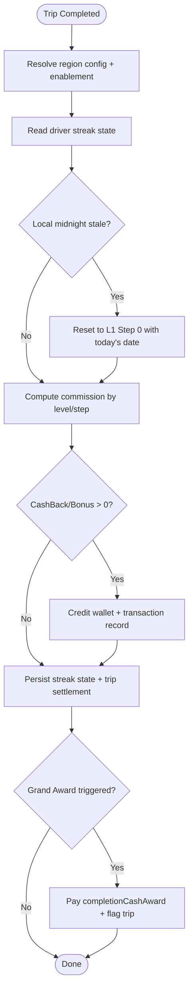

**Diagram sources**
- [driverStreak.ts:5-38](file://functions/src/driverStreak.ts#L5-L38)
- [driverStreak.ts:239-335](file://functions/src/driverStreak.ts#L239-L335)
- [driverStreak.ts:375-524](file://functions/src/driverStreak.ts#L375-L524)
- [driverStreak.ts:526-557](file://functions/src/driverStreak.ts#L526-L557)
- [driverStreak.ts:623-707](file://functions/src/driverStreak.ts#L623-L707)

**Section sources**
- [driverStreak.ts:5-38](file://functions/src/driverStreak.ts#L5-L38)
- [driverStreak.ts:239-335](file://functions/src/driverStreak.ts#L239-L335)
- [driverStreak.ts:375-524](file://functions/src/driverStreak.ts#L375-L524)
- [driverStreak.ts:526-557](file://functions/src/driverStreak.ts#L526-L557)
- [driverStreak.ts:623-707](file://functions/src/driverStreak.ts#L623-L707)

### Earnings Tracking and Analytics
- Dashboard: Daily/Weekly/Monthly views showing fare income, commission paid, net profit, and trip breakdowns.
- Data sources: Completed trip settlement snapshots and wallet incentive credits (streak cash-back/bonuses).

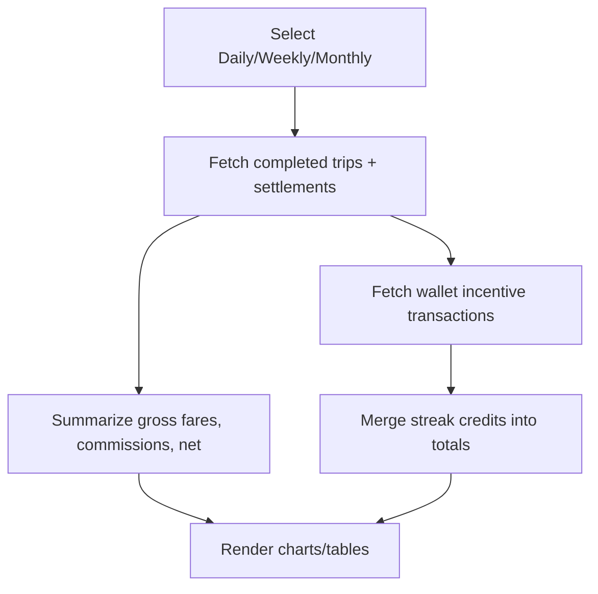

**Diagram sources**
- [earnings_screen.dart:1-18](file://sese_ride/lib/features/wallet/earnings_screen.dart#L1-L18)

**Section sources**
- [earnings_screen.dart:1-18](file://sese_ride/lib/features/wallet/earnings_screen.dart#L1-L18)

### Driver Support Features, Ratings, and Compliance
- Support: Hub includes support chat capabilities; streak and earnings data provide context for driver assistance.
- Ratings: Not explicitly implemented in the referenced files; consider adding rating collection and display in trip completion flows.
- Compliance: Verification pipeline enforces profile and vehicle approvals; background check and insurance verification integration points should extend the verification functions and Hub desk to include third-party results and compliance flags.

[No sources needed since this section provides general guidance]

## Dependency Analysis
Key dependencies and relationships:
- Driver dashboard depends on DriverStatusService and DriverStreakService for availability and engagement.
- DriverStatusService depends on Firebase Callable Functions for secure status transitions.
- FleetRepository merges multiple Firestore streams to present pending vehicles to Hub admins.
- VehicleApprovalsScreen performs admin actions that update Firestore and recompute canGoOnline.
- Verification functions synchronize custom claims and send notifications on status changes.

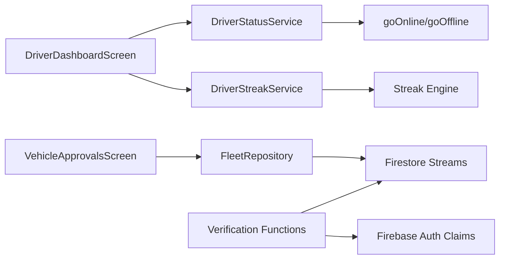

**Diagram sources**
- [driver_dashboard_screen.dart:22-50](file://sese_ride/lib/features/driver/presentation/driver_dashboard_screen.dart#L22-L50)
- [driver_status_service.dart:147-158](file://sese_ride/lib/features/driver/services/driver_status_service.dart#L147-L158)
- [fleet_repository.dart:54-171](file://sese_hub/lib/features/verification/services/fleet_repository.dart#L54-L171)
- [vehicle_approvals_screen.dart:41-64](file://sese_hub/lib/features/verification/presentation/vehicle_approvals_screen.dart#L41-L64)
- [verification.ts:133-241](file://functions/src/verification.ts#L133-L241)

**Section sources**
- [driver_dashboard_screen.dart:22-50](file://sese_ride/lib/features/driver/presentation/driver_dashboard_screen.dart#L22-L50)
- [driver_status_service.dart:147-158](file://sese_ride/lib/features/driver/services/driver_status_service.dart#L147-L158)
- [fleet_repository.dart:54-171](file://sese_hub/lib/features/verification/services/fleet_repository.dart#L54-L171)
- [vehicle_approvals_screen.dart:41-64](file://sese_hub/lib/features/verification/presentation/vehicle_approvals_screen.dart#L41-L64)
- [verification.ts:133-241](file://functions/src/verification.ts#L133-L241)

## Performance Considerations
- Use server-authoritative state changes to avoid client drift and reduce reconciliation overhead.
- Batch Firestore writes during streak settlement to minimize round trips.
- Stream pending vehicles with tolerant merging to avoid composite index requirements while keeping UI responsive.
- Cache driver timezones within streak reset sweeps to reduce repeated reads.

[No sources needed since this section provides general guidance]

## Troubleshooting Guide
Common issues and resolutions:
- Cannot go online due to mock location or low accuracy: Ensure device location permissions are enabled and disable mock locations; retry with better GPS signal.
- Account pending verification: Complete driver profile submission and wait for Hub approval; register vehicles to expedite.
- No verified vehicle: Add and upload required vehicle documents; await admin approval in the Fleet Verification desk.
- Active trip prevents offline: Complete the current trip before switching offline.
- Streak not resetting at midnight: Verify driver timezone configuration; rely on lazy reset and hourly cron sweep.

**Section sources**
- [driverStatus.ts:45-57](file://functions/src/driverStatus.ts#L45-L57)
- [driverStatus.ts:70-121](file://functions/src/driverStatus.ts#L70-L121)
- [driverStatus.ts:123-138](file://functions/src/driverStatus.ts#L123-L138)
- [driverStreak.ts:623-707](file://functions/src/driverStreak.ts#L623-L707)

## Conclusion
The driver management system enforces strict security and operational controls through zero-trust status handshakes, comprehensive verification pipelines, and a gamified streak engine. Hub admin tools provide robust fleet approvals and audit trails, while the driver dashboard offers intuitive controls and real-time engagement signals. Extending the system with background checks and insurance verification will further strengthen compliance and safety.

[No sources needed since this section summarizes without analyzing specific files]