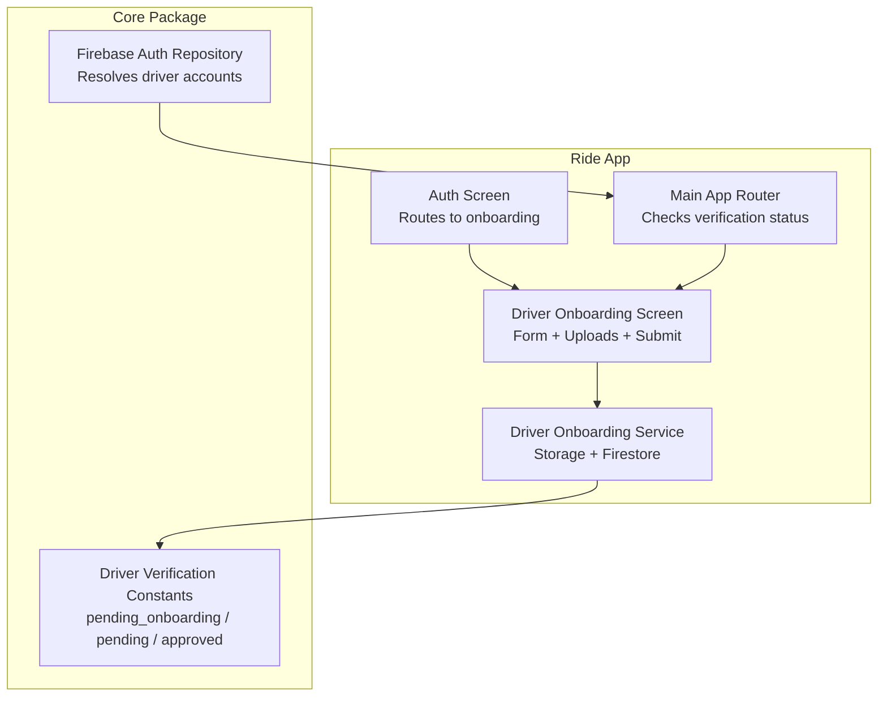
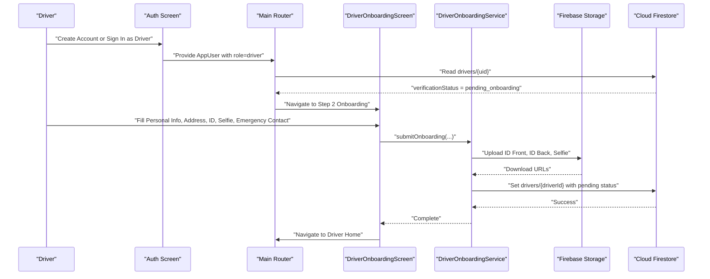
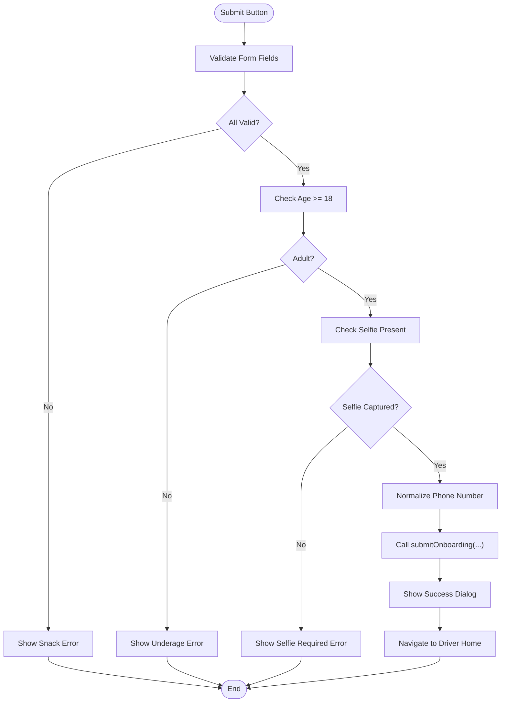
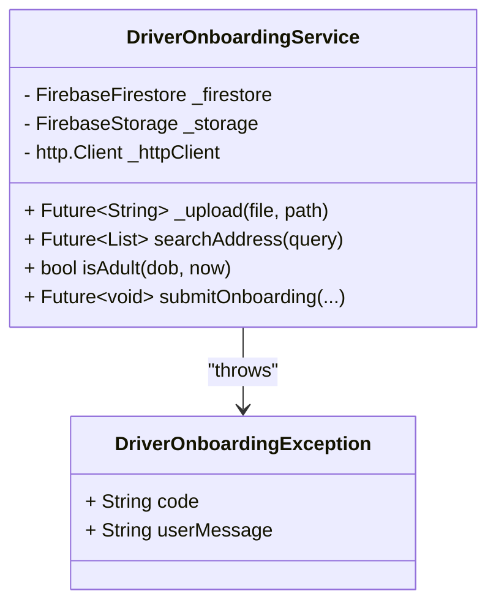
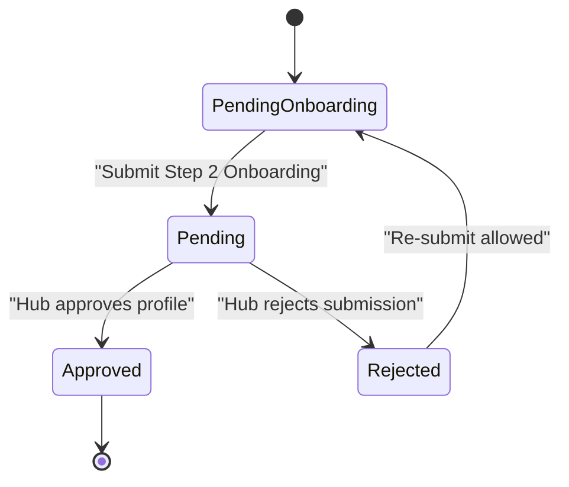
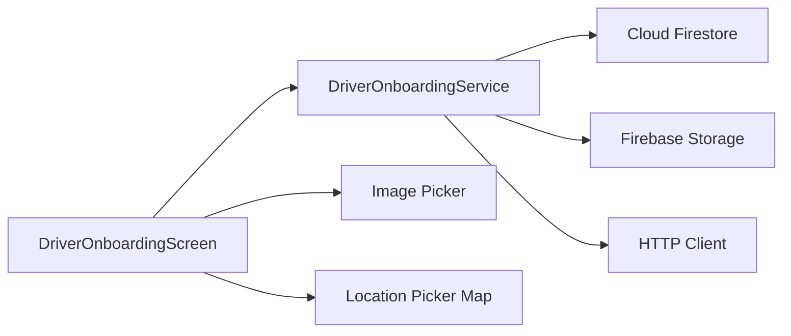

# Driver Onboarding

<cite>
**Referenced Files in This Document**
- [driver_onboarding_screen.dart](file://sese_ride/lib/features/driver/presentation/driver_onboarding_screen.dart)
- [driver_verification.dart](file://sese_core/lib/models/driver_verification.dart)
- [firebase_auth_repository.dart](file://sese_core/lib/auth/firebase_auth_repository.dart)
- [driver_onboarding_test.dart](file://sese_ride/test/driver_onboarding_test.dart)
- [auth_screen.dart](file://sese_ride/lib/features/auth/auth_screen.dart)
- [main.dart](file://sese_ride/lib/main.dart)
</cite>

## Table of Contents
1. [Introduction](#introduction)
2. [Project Structure](#project-structure)
3. [Core Components](#core-components)
4. [Architecture Overview](#architecture-overview)
5. [Detailed Component Analysis](#detailed-component-analysis)
6. [Dependency Analysis](#dependency-analysis)
7. [Performance Considerations](#performance-considerations)
8. [Troubleshooting Guide](#troubleshooting-guide)
9. [Conclusion](#conclusion)

## Introduction
This document explains the driver onboarding system used by the ride application. It covers the multi-step registration flow, personal information collection, government ID and selfie capture, address selection, form validation, state management, verification status transitions from `pending_onboarding` to `pending`, file upload handling for ID documents and selfies, integration with Firebase Storage, error handling, progress tracking, and user experience considerations during the onboarding process.

The onboarding screen is reached after a driver account is created and the driver’s Firestore profile has `verificationStatus == 'pending_onboarding'`. The final submission writes the driver’s personal data, KYC documents, and emergency contact details into Firestore and sets the verification status to `pending`, which routes the driver to the Driver Home with a persistent pending-verification banner.

## Project Structure
The driver onboarding feature lives primarily in the ride application under the driver presentation layer, while shared verification constants are defined in the core package.

**Diagram sources**
- [auth_screen.dart:140-160](file://sese_ride/lib/features/auth/auth_screen.dart#L140-L160)
- [auth_screen.dart:400-460](file://sese_ride/lib/features/auth/auth_screen.dart#L400-L460)
- [main.dart:120-140](file://sese_ride/lib/main.dart#L120-L140)
- [driver_onboarding_screen.dart:18-36](file://sese_ride/lib/features/driver/presentation/driver_onboarding_screen.dart#L18-L36)
- [driver_verification.dart:1-24](file://sese_core/lib/models/driver_verification.dart#L1-L24)
- [firebase_auth_repository.dart:507-518](file://sese_core/lib/auth/firebase_auth_repository.dart#L507-L518)

**Section sources**
- [driver_onboarding_screen.dart:18-36](file://sese_ride/lib/features/driver/presentation/driver_onboarding_screen.dart#L18-L36)
- [driver_verification.dart:1-24](file://sese_core/lib/models/driver_verification.dart#L1-L24)
- [firebase_auth_repository.dart:507-518](file://sese_core/lib/auth/firebase_auth_repository.dart#L507-L518)
- [auth_screen.dart:140-160](file://sese_ride/lib/features/auth/auth_screen.dart#L140-L160)
- [auth_screen.dart:400-460](file://sese_ride/lib/features/auth/auth_screen.dart#L400-L460)
- [main.dart:120-140](file://sese_ride/lib/main.dart#L120-L140)

## Core Components
- **DriverOnboardingScreen**: Flutter UI for Step 2 of driver registration. It collects personal information, home address, government ID details, ID document images, a live selfie, and next-of-kin details. It validates inputs, manages local state, and calls the onboarding service.
- **DriverOnboardingService**: Business logic for address search, image uploads to Firebase Storage, and writing the onboarding payload to Firestore. It also defines the minimum age rule and throws domain-specific exceptions.
- **DriverVerification**: Shared constants defining the driver verification lifecycle states and Firestore field names.
- **Firebase Auth Repository**: Resolves the authenticated user to an `AppUser`, including driver accounts and their verification status.
- **Auth Screen and Main Router**: Route drivers with `pending_onboarding` to the onboarding screen and otherwise route them to the appropriate dashboard.

Key responsibilities:
- Form validation rules for name, phone, date of birth, gender, address, ID type/number/expiry, and emergency contact fields.
- Country-aware ID options and non-expiring ID types.
- Camera-only selfie policy.
- Nominatim-based address autocomplete with debounced network requests.
- Progress feedback via loading indicator and snack messages.
- Transitioning verification status from `pending_onboarding` to `pending`.

**Section sources**
- [driver_onboarding_screen.dart:37-123](file://sese_ride/lib/features/driver/presentation/driver_onboarding_screen.dart#L37-L123)
- [driver_onboarding_screen.dart:931-1136](file://sese_ride/lib/features/driver/presentation/driver_onboarding_screen.dart#L931-L1136)
- [driver_verification.dart:1-24](file://sese_core/lib/models/driver_verification.dart#L1-L24)
- [firebase_auth_repository.dart:507-518](file://sese_core/lib/auth/firebase_auth_repository.dart#L507-L518)

## Architecture Overview
The onboarding architecture separates UI concerns from data persistence and storage operations.

**Diagram sources**
- [auth_screen.dart:140-160](file://sese_ride/lib/features/auth/auth_screen.dart#L140-L160)
- [auth_screen.dart:400-460](file://sese_ride/lib/features/auth/auth_screen.dart#L400-L460)
- [main.dart:120-140](file://sese_ride/lib/main.dart#L120-L140)
- [driver_onboarding_screen.dart:281-371](file://sese_ride/lib/features/driver/presentation/driver_onboarding_screen.dart#L281-L371)
- [driver_onboarding_screen.dart:1020-1136](file://sese_ride/lib/features/driver/presentation/driver_onboarding_screen.dart#L1020-L1136)

## Detailed Component Analysis

### DriverOnboardingScreen
The onboarding screen implements a single-page multi-section form:
- Personal information: first name, last name, phone number, date of birth (with 18+ enforcement), gender.
- Home address: text input with Nominatim autocomplete, plus an interactive map where users can tap to pin exact coordinates.
- Government ID: country-aware dropdown (Nigeria vs other countries), ID number, optional expiry date for expiring IDs, front/back image uploads, and camera-only selfie capture.
- Emergency contact: next-of-kin name, relationship (with “Other” free-text option), phone number, and residential address.
- Submission: validates all fields, normalizes phone numbers, uploads images, writes Firestore, shows success dialog, and navigates to Driver Home.

State management highlights:
- Text editing controllers for all inputs.
- Local variables for date of birth, selected gender, country, state/region, ID type, map pin, suggestions list, debounce timer, uploaded files, and submitting flag.
- Validation uses Flutter form validators and explicit checks before calling the service.

**Diagram sources**
- [driver_onboarding_screen.dart:281-371](file://sese_ride/lib/features/driver/presentation/driver_onboarding_screen.dart#L281-L371)

Validation rules summary:
- First name and last name: required.
- Phone number: required; validated as international E.164 format using the phone sanitizer.
- Date of birth: required; must be at least 18 years old.
- Gender: required selection.
- Home address: required; supports autocomplete and manual map pinning.
- Country and ID type: required; Nigeria has specific ID types; other countries have generic options.
- ID number: required.
- ID expiry date: required only for expiring ID types.
- ID front/back: optional uploads.
- Live selfie: required; camera-only.
- Next-of-kin name, relationship, phone, and residential address: required; relationship allows “Other” with free text.

User experience considerations:
- Debounced address search prevents excessive network calls.
- Loading indicator disables the submit button during submission.
- Clear snack messages for validation errors and backend failures.
- Exit controls allow switching to customer mode or signing out without losing entered data.

**Section sources**
- [driver_onboarding_screen.dart:57-123](file://sese_ride/lib/features/driver/presentation/driver_onboarding_screen.dart#L57-L123)
- [driver_onboarding_screen.dart:172-277](file://sese_ride/lib/features/driver/presentation/driver_onboarding_screen.dart#L172-L277)
- [driver_onboarding_screen.dart:281-371](file://sese_ride/lib/features/driver/presentation/driver_onboarding_screen.dart#L281-L371)
- [driver_onboarding_screen.dart:447-888](file://sese_ride/lib/features/driver/presentation/driver_onboarding_screen.dart#L447-L888)

### DriverOnboardingService
The service encapsulates:
- Minimum age check (`isAdult`).
- Nominatim address search with timeout and safe parsing.
- Image upload to Firebase Storage with test override support.
- Firestore write of the complete onboarding payload.

Data structure written to Firestore:
- Personal details: full name, first name, last name, phone number, ISO 8601 date of birth, gender.
- Location: country, state/region, home address, latitude, longitude.
- ID details: ID type, ID number, optional expiry date.
- Document URLs: ID front URL, ID back URL, selfie URL.
- Emergency contact: nested object with name, relationship, phone, and address.
- Verification flags: profile status, verification status set to `pending`, pending review flag, profile verified false, vehicle verified false, can go online false, active false.
- Timestamps: onboarding completion time and update time.

**Diagram sources**
- [driver_onboarding_screen.dart:931-1136](file://sese_ride/lib/features/driver/presentation/driver_onboarding_screen.dart#L931-L1136)

File upload handling:
- ID front and back are optional; selfie is mandatory.
- Each upload generates a timestamped filename under `driver_onboarding/{driverId}/...`.
- Upload failures throw a sanitized exception with a user-safe message.
- Test seam `uploadOverride` allows deterministic URL returns without real network calls.

Integration with Firebase Storage:
- Uses `FirebaseStorage.instance` when available.
- Reads file bytes and uploads via `putData`.
- Returns download URL after successful upload.

Firestore integration:
- Writes merged payload to `drivers/{driverId}`.
- Attempts to mirror payload to `users/{driverId}` if accessible.
- Sets verification status to `pending` using shared constants.

**Section sources**
- [driver_onboarding_screen.dart:941-1136](file://sese_ride/lib/features/driver/presentation/driver_onboarding_screen.dart#L941-L1136)

### Verification Status Transitions
The driver verification lifecycle is defined centrally:
- `pending_onboarding`: account created; Step 2 not yet submitted.
- `pending`: Step 2 submitted; awaiting hub manual audit.
- `approved`: hub approved profile.
- `rejected`: hub rejected submission.

Transition behavior:
- When a driver account exists with `verificationStatus == 'pending_onboarding'`, routing logic directs the user to the onboarding screen.
- After successful submission, the service writes `verificationStatus: 'pending'`, along with related flags indicating that the driver is not yet verified and cannot go online.

**Diagram sources**
- [driver_verification.dart:1-24](file://sese_core/lib/models/driver_verification.dart#L1-L24)
- [driver_onboarding_screen.dart:1020-1136](file://sese_ride/lib/features/driver/presentation/driver_onboarding_screen.dart#L1020-L1136)
- [firebase_auth_repository.dart:507-518](file://sese_core/lib/auth/firebase_auth_repository.dart#L507-L518)

**Section sources**
- [driver_verification.dart:1-24](file://sese_core/lib/models/driver_verification.dart#L1-L24)
- [firebase_auth_repository.dart:507-518](file://sese_core/lib/auth/firebase_auth_repository.dart#L507-L518)
- [driver_onboarding_screen.dart:1020-1136](file://sese_ride/lib/features/driver/presentation/driver_onboarding_screen.dart#L1020-L1136)

### Routing and Entry Points
Drivers reach the onboarding screen through:
- Auth screen navigation after creating or signing in as a driver.
- Main app router checking the driver’s verification status.

Routing conditions:
- If the driver account exists and has `verificationStatus == 'pending_onboarding'`, the app navigates to `DriverOnboardingScreen`.
- Otherwise, the driver is routed to the appropriate dashboard based on stored role and verification state.

**Section sources**
- [auth_screen.dart:140-160](file://sese_ride/lib/features/auth/auth_screen.dart#L140-L160)
- [auth_screen.dart:400-460](file://sese_ride/lib/features/auth/auth_screen.dart#L400-L460)
- [main.dart:120-140](file://sese_ride/lib/main.dart#L120-L140)

## Dependency Analysis
The onboarding system depends on several external services and packages:
- Cloud Firestore for persisting driver profiles and verification state.
- Firebase Storage for uploading ID documents and selfies.
- HTTP client for Nominatim address autocomplete.
- Image picker for capturing or selecting images.
- Map components for location selection.

**Diagram sources**
- [driver_onboarding_screen.dart:1-16](file://sese_ride/lib/features/driver/presentation/driver_onboarding_screen.dart#L1-L16)
- [driver_onboarding_screen.dart:941-1136](file://sese_ride/lib/features/driver/presentation/driver_onboarding_screen.dart#L941-L1136)

Coupling and cohesion:
- The UI component is cohesive around collecting and validating onboarding data.
- The service isolates persistence and storage logic, improving testability.
- Shared verification constants reduce coupling between UI and backend state semantics.

Potential circular dependencies:
- None observed; the service does not import UI components.

External integration points:
- Nominatim API for address suggestions.
- Firebase Authentication and Firestore for user resolution and data persistence.
- Firebase Storage for secure document storage.

**Section sources**
- [driver_onboarding_screen.dart:1-16](file://sese_ride/lib/features/driver/presentation/driver_onboarding_screen.dart#L1-L16)
- [driver_onboarding_screen.dart:941-1136](file://sese_ride/lib/features/driver/presentation/driver_onboarding_screen.dart#L941-L1136)

## Performance Considerations
- Debounce address search to limit network requests during typing.
- Use image quality compression (e.g., 80%) to reduce upload size.
- Avoid unnecessary re-renders by minimizing `setState` usage and separating business logic into the service layer.
- Handle timeouts for external APIs (Nominatim) to prevent long-running requests.
- Prefer merge writes to avoid overwriting unrelated fields.

[No sources needed since this section provides general guidance]

## Troubleshooting Guide
Common issues and resolutions:
- Underage driver: ensure date of birth indicates the user is at least 18 years old.
- Missing selfie: require a live camera selfie; gallery uploads are intentionally blocked.
- Invalid phone number: normalize and validate using E.164 rules.
- Upload failures: check network connectivity and permissions; use sanitized error messages.
- Firestore permission denied: verify security rules and authentication state.
- Navigation issues: confirm routing logic checks `verificationStatus` correctly.

Test coverage highlights:
- Age validation enforces minimum age.
- Submission validation rejects underage drivers and missing required fields.
- Nominatim parsing handles valid responses and server errors gracefully.

**Section sources**
- [driver_onboarding_screen.dart:281-371](file://sese_ride/lib/features/driver/presentation/driver_onboarding_screen.dart#L281-L371)
- [driver_onboarding_screen.dart:964-1018](file://sese_ride/lib/features/driver/presentation/driver_onboarding_screen.dart#L964-L1018)
- [driver_onboarding_test.dart:12-109](file://sese_ride/test/driver_onboarding_test.dart#L12-L109)

## Conclusion
The driver onboarding system provides a robust, user-friendly flow for collecting personal information, verifying identity through government ID and selfie capture, and transitioning driver accounts from `pending_onboarding` to `pending`. The separation of UI and service logic improves maintainability and testability, while shared verification constants ensure consistent state semantics across the application. Proper error handling, progress feedback, and clear validation rules contribute to a positive user experience during the critical onboarding phase.

[No sources needed since this section summarizes without analyzing specific files]