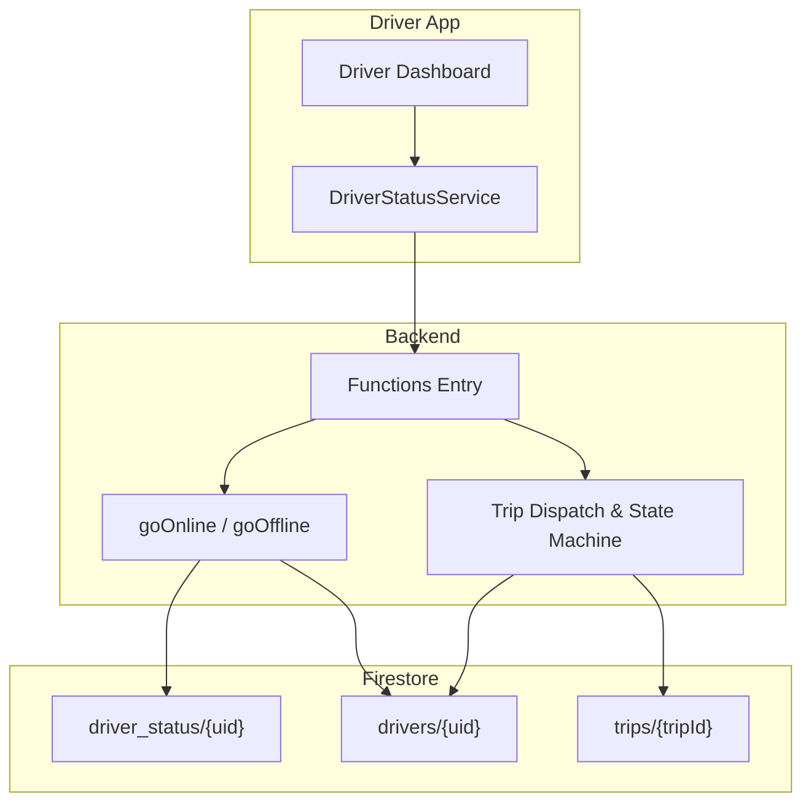
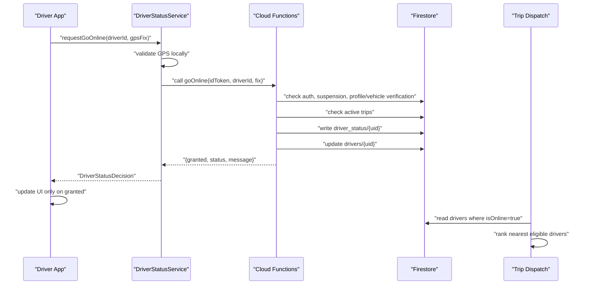
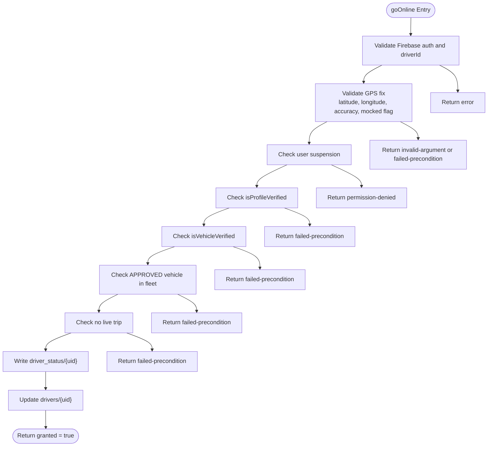
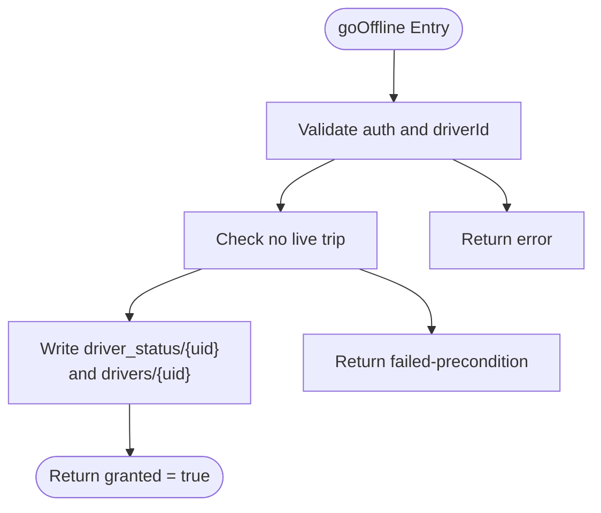
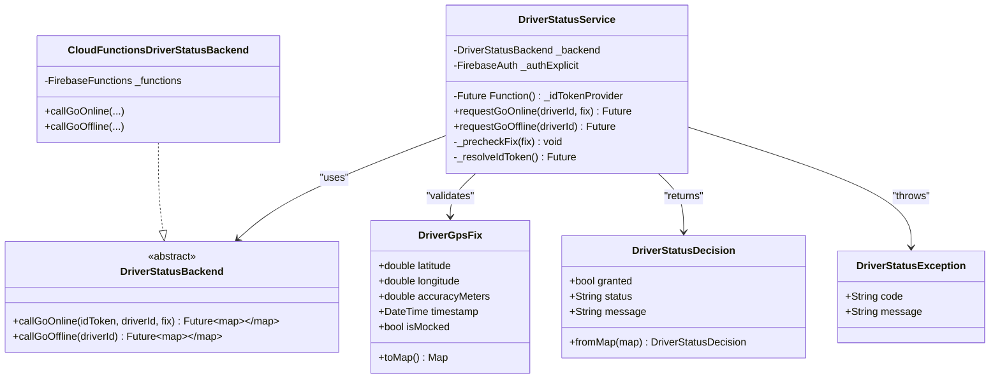
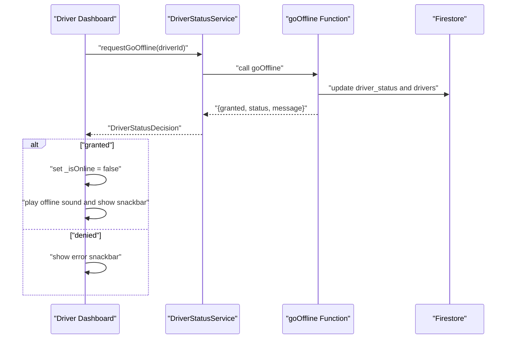
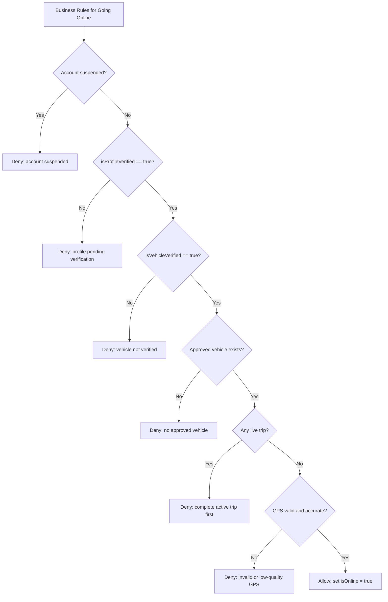
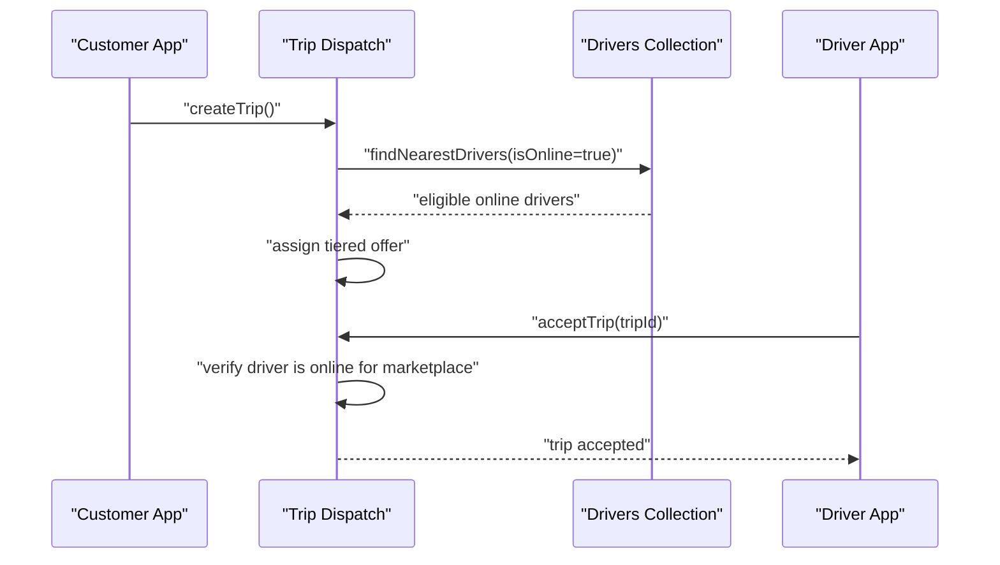
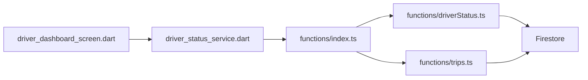

# Driver Status Management

<cite>
**Referenced Files in This Document**
- [driverStatus.ts](file://functions/src/driverStatus.ts)
- [index.ts](file://functions/src/index.ts)
- [trips.ts](file://functions/src/trips.ts)
- [driver_status_service.dart](file://sese_ride/lib/features/driver/services/driver_status_service.dart)
- [driver_dashboard_screen.dart](file://sese_ride/lib/features/driver/presentation/driver_dashboard_screen.dart)
- [verification_banner.dart](file://sese_ride/lib/features/driver/presentation/widgets/verification_banner.dart)
- [driver_verification.dart](file://sese_core/lib/models/driver_verification.dart)
- [driver_status_service_test.dart](file://sese_ride/test/driver_status_service_test.dart)
</cite>

## Table of Contents
1. [Introduction](#introduction)
2. [Project Structure](#project-structure)
3. [Core Components](#core-components)
4. [Architecture Overview](#architecture-overview)
5. [Detailed Component Analysis](#detailed-component-analysis)
6. [Dependency Analysis](#dependency-analysis)
7. [Performance Considerations](#performance-considerations)
8. [Troubleshooting Guide](#troubleshooting-guide)
9. [Conclusion](#conclusion)

## Introduction
This document explains the driver status management system that controls when a driver can go online or offline, how availability is tracked, and how status changes interact with trip dispatching. The system follows a zero-trust model: the mobile app never flips the authoritative online state by itself. Instead, it requests a server-side transition through Cloud Functions, which validate authentication, GPS integrity, suspension state, profile and vehicle verification, and active trip constraints before updating Firestore.

The key concepts are:
- Authoritative online mirror: `driver_status/{driverId}` stores `isOnline`, `status`, `lastFix`, and `updatedAt`.
- Driver presence index: `drivers/{driverId}` stores `isOnline`, `lastSeen`, and `lastLocation`.
- Dispatch eligibility: only drivers with `isOnline == true` are considered for nearby-driver ranking.
- Verification gates: both profile and vehicle verification must be approved before going online.
- Trip integration: live trips prevent changing to offline; accepted marketplace offers require being online.

## Project Structure
The driver status system spans three layers:

| Layer | Responsibility | Relevant files |
|---|---|---|
| Backend (Cloud Functions) | Validates and writes authoritative status, enforces business rules, integrates with trips and verification | [driverStatus.ts](file://functions/src/driverStatus.ts), [index.ts](file://functions/src/index.ts), [trips.ts](file://functions/src/trips.ts) |
| Driver app (Flutter) | Presents online/offline UI, collects GPS fix, calls backend, reacts to server decisions | [driver_status_service.dart](file://sese_ride/lib/features/driver/services/driver_status_service.dart), [driver_dashboard_screen.dart](file://sese_ride/lib/features/driver/presentation/driver_dashboard_screen.dart) |
| Shared models | Defines verification lifecycle constants used across apps | [driver_verification.dart](file://sese_core/lib/models/driver_verification.dart) |

**Diagram sources**
- [index.ts:26-41](file://functions/src/index.ts#L26-L41)
- [driverStatus.ts:32-164](file://functions/src/driverStatus.ts#L32-L164)
- [trips.ts:252-287](file://functions/src/trips.ts#L252-L287)

**Section sources**
- [index.ts:26-41](file://functions/src/index.ts#L26-L41)
- [driverStatus.ts:1-220](file://functions/src/driverStatus.ts#L1-L220)
- [driver_status_service.dart:1-232](file://sese_ride/lib/features/driver/services/driver_status_service.dart#L1-L232)

## Core Components
- **Callable functions**: `goOnline` and `goOffline` are exported from the functions entry point and implement the authoritative status handshake.
- **Driver status service**: Flutter-side abstraction that resolves an ID token, validates GPS locally, and delegates transitions to the backend.
- **Dashboard integration**: The driver dashboard updates local UI state only after backend confirmation.
- **Dispatch integration**: Trip matchmaking reads `drivers.isOnline` and `drivers.lastLocation` to rank eligible drivers.
- **Verification model**: Shared constants define the driver verification lifecycle and required fields.

**Section sources**
- [index.ts:26-41](file://functions/src/index.ts#L26-L41)
- [driver_status_service.dart:36-80](file://sese_ride/lib/features/driver/services/driver_status_service.dart#L36-L80)
- [driver_dashboard_screen.dart:160-202](file://sese_ride/lib/features/driver/presentation/driver_dashboard_screen.dart#L160-L202)
- [trips.ts:252-287](file://functions/src/trips.ts#L252-L287)
- [driver_verification.dart:1-24](file://sese_core/lib/models/driver_verification.dart#L1-L24)

## Architecture Overview
The system uses callable Cloud Functions as the single source of truth for driver availability. The client sends a request with identity and location data; the server validates every assumption and writes authoritative documents. Real-time clients observe Firestore collections such as `driver_status` and `drivers` to update maps, order feeds, and dispatch logic.

**Diagram sources**
- [driver_status_service.dart:206-232](file://sese_ride/lib/features/driver/services/driver_status_service.dart#L206-L232)
- [driverStatus.ts:32-164](file://functions/src/driverStatus.ts#L32-L164)
- [trips.ts:252-287](file://functions/src/trips.ts#L252-L287)

## Detailed Component Analysis

### Callable Function: `goOnline`
The `goOnline` function implements a strict preflight before allowing a driver to become available. It rejects unauthenticated callers, prevents acting on another driver’s account, validates GPS coordinates, accuracy, mock-location flags, and geographic bounds. It then checks suspension, profile verification, vehicle verification, and active trips. Only after all checks pass does it write the authoritative online mirror and driver presence index.

Key validation steps:
- Authentication and ownership check.
- GPS fix validation including mock detection and accuracy threshold.
- Suspension gate.
- Profile verification gate requiring `isProfileVerified == true`.
- Vehicle verification gate requiring `isVehicleVerified == true`.
- Fleet guard ensuring at least one approved vehicle exists.
- Active trip guard preventing online while in a live trip.
- Authoritative writes to `driver_status` and `drivers`.

**Diagram sources**
- [driverStatus.ts:32-164](file://functions/src/driverStatus.ts#L32-L164)

**Section sources**
- [driverStatus.ts:32-164](file://functions/src/driverStatus.ts#L32-L164)

### Callable Function: `goOffline`
The `goOffline` function ensures a driver cannot go offline while in a live trip. If allowed, it writes `isOnline: false` and `status: "offline"` to the authoritative mirror and clears the driver’s online presence.

Important behaviors:
- Requires authentication and ownership.
- Refuses if any live trip exists.
- Writes `driver_status/{uid}` and `drivers/{uid}` atomically via separate writes.
- Returns a confirmation that the UI should use to flip local state.

**Diagram sources**
- [driverStatus.ts:170-219](file://functions/src/driverStatus.ts#L170-L219)

**Section sources**
- [driverStatus.ts:170-219](file://functions/src/driverStatus.ts#L170-L219)

### Driver App: `DriverStatusService`
The Flutter service encapsulates the zero-trust handshake:
- Local GPS prechecks reject spoofed or inaccurate fixes early.
- ID token resolution ensures the backend call carries verified identity.
- Backend calls are wrapped so errors surface as typed exceptions.
- The decision object exposes `granted`, `status`, and `message`.

**Diagram sources**
- [driver_status_service.dart:9-67](file://sese_ride/lib/features/driver/services/driver_status_service.dart#L9-L67)
- [driver_status_service.dart:82-145](file://sese_ride/lib/features/driver/services/driver_status_service.dart#L82-L145)
- [driver_status_service.dart:158-232](file://sese_ride/lib/features/driver/services/driver_status_service.dart#L158-L232)

**Section sources**
- [driver_status_service.dart:9-67](file://sese_ride/lib/features/driver/services/driver_status_service.dart#L9-L67)
- [driver_status_service.dart:158-232](file://sese_ride/lib/features/driver/services/driver_status_service.dart#L158-L232)

### Dashboard Integration and Availability Tracking
The driver dashboard:
- Calls `requestGoOffline` and updates `_isOnline` only when the backend confirms.
- Shows feedback for success or denial.
- Prevents concurrent sync operations during transitions.
- Uses the server grant as the final authority rather than optimistic UI.

**Diagram sources**
- [driver_dashboard_screen.dart:160-202](file://sese_ride/lib/features/driver/presentation/driver_dashboard_screen.dart#L160-L202)
- [driver_status_service.dart:226-232](file://sese_ride/lib/features/driver/services/driver_status_service.dart#L226-L232)

**Section sources**
- [driver_dashboard_screen.dart:160-202](file://sese_ride/lib/features/driver/presentation/driver_dashboard_screen.dart#L160-L202)

### Verification Requirements and Business Rules
A driver may only go online when:
- Their account is not suspended.
- `isProfileVerified == true`.
- `isVehicleVerified == true`.
- At least one vehicle has an approved verification status.
- They have no active live trip.
- Their GPS fix is valid, accurate, and not mocked.

The shared verification model defines the lifecycle tokens and field names used by both the driver app and backend:
- Driver verification statuses: pending onboarding, pending, approved, rejected.
- Fields: `verificationStatus`, `isProfileVerified`, `isVehicleVerified`, `canGoOnline`.

**Diagram sources**
- [driverStatus.ts:59-138](file://functions/src/driverStatus.ts#L59-L138)
- [driver_verification.dart:1-24](file://sese_core/lib/models/driver_verification.dart#L1-L24)

**Section sources**
- [driverStatus.ts:59-138](file://functions/src/driverStatus.ts#L59-L138)
- [driver_verification.dart:1-24](file://sese_core/lib/models/driver_verification.dart#L1-L24)

### Relationship Between Driver Status and Trip Dispatching
Trip dispatching depends on driver availability:
- Nearest-driver ranking queries `drivers` where `isOnline == true`.
- Ranking uses `lastSeen` and `lastLocation` to compute distance.
- Marketplace offers require the caller to be online.
- Live trips prevent offline transitions.

**Diagram sources**
- [trips.ts:252-287](file://functions/src/trips.ts#L252-L287)
- [trips.ts:591-653](file://functions/src/trips.ts#L591-L653)

**Section sources**
- [trips.ts:252-287](file://functions/src/trips.ts#L252-L287)
- [trips.ts:591-653](file://functions/src/trips.ts#L591-L653)

## Dependency Analysis
The driver status system has clear boundaries:
- The driver app depends on `DriverStatusService` for transport and UX.
- `DriverStatusService` depends on Firebase Functions and FirebaseAuth.
- Cloud Functions depend on Firestore and Firebase Admin SDK.
- Trip dispatch depends on driver presence and location data.

**Diagram sources**
- [driver_dashboard_screen.dart:160-202](file://sese_ride/lib/features/driver/presentation/driver_dashboard_screen.dart#L160-L202)
- [driver_status_service.dart:82-145](file://sese_ride/lib/features/driver/services/driver_status_service.dart#L82-L145)
- [index.ts:26-41](file://functions/src/index.ts#L26-L41)
- [driverStatus.ts:32-164](file://functions/src/driverStatus.ts#L32-L164)
- [trips.ts:252-287](file://functions/src/trips.ts#L252-L287)

**Section sources**
- [index.ts:26-41](file://functions/src/index.ts#L26-L41)
- [driver_status_service.dart:82-145](file://sese_ride/lib/features/driver/services/driver_status_service.dart#L82-L145)
- [driverStatus.ts:32-164](file://functions/src/driverStatus.ts#L32-L164)
- [trips.ts:252-287](file://functions/src/trips.ts#L252-L287)

## Performance Considerations
- **Server-authoritative writes**: Using Admin SDK writes avoids Firestore security rule overhead and prevents client tampering.
- **Limited trip scans**: Active trip checks use `.limit(5)` to avoid scanning large result sets.
- **Nearest-driver query limits**: Candidate limit caps driver scans for dispatch ranking.
- **Best-effort location mirroring**: Location updates to the driver doc are best-effort; trip tracking remains authoritative even if the mirror fails.
- **Local GPS prechecks**: Early rejection of spoofed or inaccurate GPS reduces unnecessary backend calls.

[No sources needed since this section provides general guidance]

## Troubleshooting Guide
Common issues and their likely causes:

| Symptom | Likely cause | Resolution |
|---|---|---|
| Go online denied with “mock location detected” | Client reported `isMocked == true` or backend detected spoofing | Disable mock locations and retry |
| Go online denied with “GPS accuracy too low” | Accuracy exceeds acceptable threshold | Move to open sky and retry |
| Go online denied with “account pending verification” | `isProfileVerified == false` | Complete hub verification |
| Go online denied with “no verified vehicle found” | `isVehicleVerified == false` or no approved vehicle | Register and approve a vehicle |
| Go online denied with “active trip” | Driver has a live trip | Complete the trip before changing status |
| Go offline denied with “active trip” | Driver is mid-ride | Finish the trip before going offline |
| UI stays offline after calling go offline | Backend returned `granted == false` | Show error message and keep previous state |
| Marketplace offer cannot be accepted | Driver is not online | Go online first |

Relevant tests confirm:
- Server denial does not grant online state.
- Unauthenticated requests throw a typed exception.
- Offline confirmation requires backend acknowledgement.
- Offline is refused while a trip is in progress.

**Section sources**
- [driver_status_service_test.dart:100-146](file://sese_ride/test/driver_status_service_test.dart#L100-L146)
- [driverStatus.ts:32-164](file://functions/src/driverStatus.ts#L32-L164)
- [driverStatus.ts:170-219](file://functions/src/driverStatus.ts#L170-L219)

## Conclusion
The driver status management system centralizes availability control in Cloud Functions, enforcing strict validation for authentication, GPS integrity, suspension, profile verification, vehicle verification, and active trips. The driver app remains presentation-only, updating its UI only after backend confirmation. Dispatch logic consumes the authoritative driver presence index to rank and assign trips. This design ensures consistency, security, and predictable behavior across real-time status broadcasting and trip dispatching.

[No sources needed since this section summarizes without analyzing specific files]