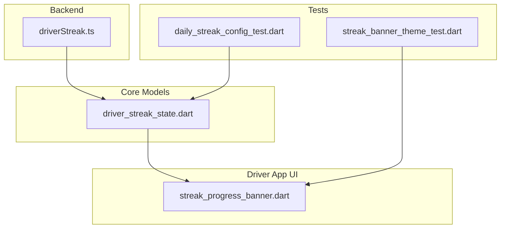
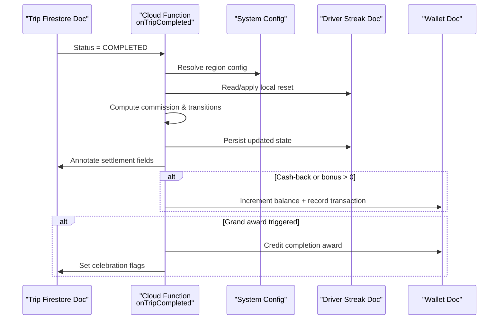
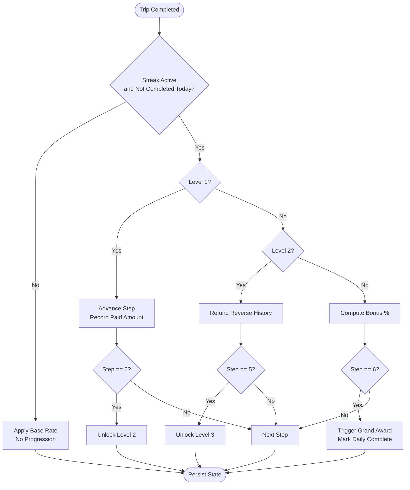
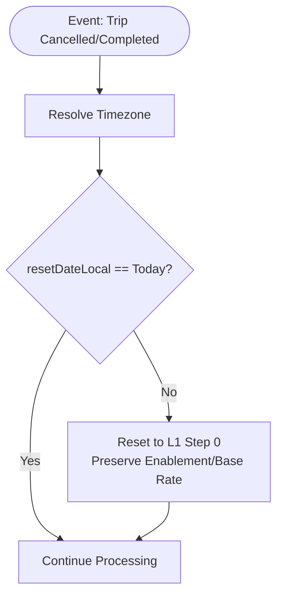
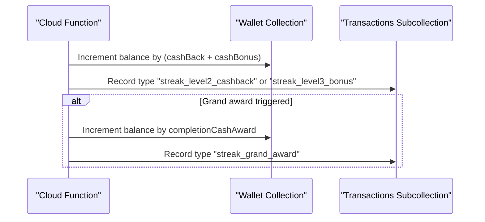
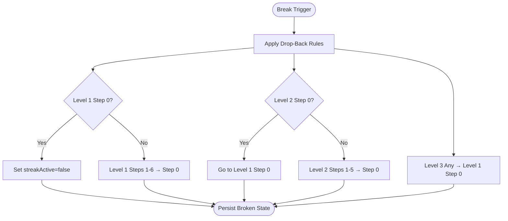
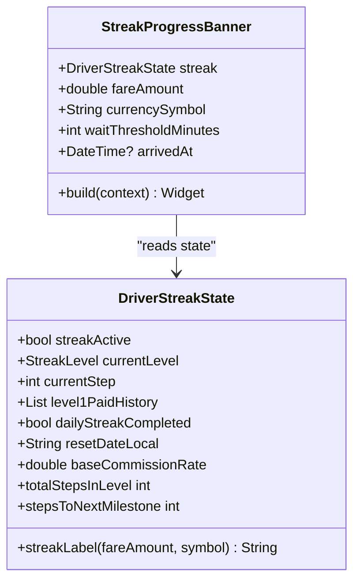
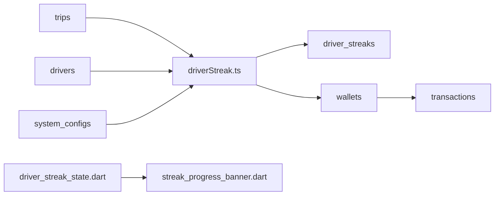

# Driver Streak System

<cite>
**Referenced Files in This Document**
- [driverStreak.ts](file://functions/src/driverStreak.ts)
- [driver_streak_state.dart](file://sese_core/lib/models/driver_streak_state.dart)
- [streak_progress_banner.dart](file://sese_ride/lib/features/driver/presentation/widgets/streak_progress_banner.dart)
- [daily_streak_config_test.dart](file://sese_core/test/daily_streak_config_test.dart)
- [streak_banner_theme_test.dart](file://sese_ride/test/streak_banner_theme_test.dart)
- [pricing_config.dart](file://sese_core/lib/models/pricing_config.dart)
</cite>

## Table of Contents
1. [Introduction](#introduction)
2. [Project Structure](#project-structure)
3. [Core Components](#core-components)
4. [Architecture Overview](#architecture-overview)
5. [Detailed Component Analysis](#detailed-component-analysis)
6. [Dependency Analysis](#dependency-analysis)
7. [Performance Considerations](#performance-considerations)
8. [Troubleshooting Guide](#troubleshooting-guide)
9. [Conclusion](#conclusion)

## Introduction
The Driver Streak System is a gamified daily commission engine that improves driver engagement and retention by rewarding consistent trip completion. It uses a three-level progression with step-based incentives:
- Level 1: Step-down commission discount (15% down to 0%).
- Level 2: 0% fee plus cash-back refunds from Level 1 payments.
- Level 3: 0% fee plus escalating cash bonuses, culminating in a grand award.

The system integrates with trip settlement, wallet crediting, and UI banners to provide real-time feedback and motivation. It also includes reset mechanics, break rules, and protection against certain cancellations.

## Project Structure
The streak system spans backend Cloud Functions and frontend Flutter components:
- Backend: TypeScript Cloud Functions compute streak state, apply breaks, and credit wallets.
- Core models: Dart classes define the per-driver streak state and labels.
- UI: A Flutter banner shows progress, milestones, and no-show protection status.
- Tests: Validate configuration behavior and banner theming.

**Diagram sources**
- [driverStreak.ts:1-708](file://functions/src/driverStreak.ts#L1-L708)
- [driver_streak_state.dart:1-217](file://sese_core/lib/models/driver_streak_state.dart#L1-L217)
- [streak_progress_banner.dart:1-235](file://sese_ride/lib/features/driver/presentation/widgets/streak_progress_banner.dart#L1-L235)
- [daily_streak_config_test.dart:1-154](file://sese_core/test/daily_streak_config_test.dart#L1-L154)
- [streak_banner_theme_test.dart:1-77](file://sese_ride/test/streak_banner_theme_test.dart#L1-L77)

**Section sources**
- [driverStreak.ts:1-708](file://functions/src/driverStreak.ts#L1-L708)
- [driver_streak_state.dart:1-217](file://sese_core/lib/models/driver_streak_state.dart#L1-L217)
- [streak_progress_banner.dart:1-235](file://sese_ride/lib/features/driver/presentation/widgets/streak_progress_banner.dart#L1-L235)
- [daily_streak_config_test.dart:1-154](file://sese_core/test/daily_streak_config_test.dart#L1-L154)
- [streak_banner_theme_test.dart:1-77](file://sese_ride/test/streak_banner_theme_test.dart#L1-L77)

## Core Components
- Streak State Model: Immutable snapshot of a driver’s daily streak, including level, step, history, completion flag, timezone-aware reset date, and base rate.
- Commission Engine: Computes fees, cash-back, bonuses, and transitions across levels; persists state and annotates trips.
- Break Logic: Applies drop-back rules when trips are declined or cancelled before arrival.
- Wallet Integration: Credits cash-back/bonuses and records transactions.
- UI Banner: Displays current level, step progress, next milestone, and no-show protection timer.
- Configuration: Region-scoped toggles and parameters for enabling/disabling streaks and setting base rates and awards.

Key responsibilities:
- Backend computes and persists streak state and financial adjustments.
- Frontend renders progress and communicates protection status to drivers.
- Tests ensure config resolution and UI theme correctness.

**Section sources**
- [driver_streak_state.dart:20-60](file://sese_core/lib/models/driver_streak_state.dart#L20-L60)
- [driverStreak.ts:89-143](file://functions/src/driverStreak.ts#L89-L143)
- [driverStreak.ts:239-335](file://functions/src/driverStreak.ts#L239-L335)
- [driverStreak.ts:350-373](file://functions/src/driverStreak.ts#L350-L373)
- [driverStreak.ts:468-512](file://functions/src/driverStreak.ts#L468-L512)
- [streak_progress_banner.dart:11-33](file://sese_ride/lib/features/driver/presentation/widgets/streak_progress_banner.dart#L11-L33)

## Architecture Overview
The streak system is event-driven:
- Trip completion triggers commission computation, state updates, and wallet credits.
- Trip cancellation applies break logic based on source.
- A scheduled job resets stale streaks at local midnight per driver.

**Diagram sources**
- [driverStreak.ts:375-524](file://functions/src/driverStreak.ts#L375-L524)
- [driverStreak.ts:98-143](file://functions/src/driverStreak.ts#L98-L143)

**Section sources**
- [driverStreak.ts:375-524](file://functions/src/driverStreak.ts#L375-L524)

## Detailed Component Analysis

### Streak Calculation Algorithms
- Level 1: Each completed trip advances steps 0→6, reducing commission from 15% to 0%. Step 6 unlocks Level 2.
- Level 2: Zero commission; refunds Level 1 paid amounts in reverse order across steps 0→5. Step 5 unlocks Level 3.
- Level 3: Zero commission; escalating cash bonus percentages across steps 0→6. Step 6 triggers the grand award and marks the day complete.

**Diagram sources**
- [driverStreak.ts:239-335](file://functions/src/driverStreak.ts#L239-L335)

**Section sources**
- [driverStreak.ts:239-335](file://functions/src/driverStreak.ts#L239-L335)

### Daily Activity Tracking and Reset Mechanics
- Local-midnight reset: If the stored reset date differs from today in the driver’s timezone, the streak restarts at Level 1 Step 0 while preserving enablement and base rate.
- Scheduled sweeper: Hourly job scans all driver streak documents and resets those whose resetDateLocal is stale.
- Lazy reset: On trip events, the function applies the same local reset logic before processing.

**Diagram sources**
- [driverStreak.ts:211-226](file://functions/src/driverStreak.ts#L211-L226)
- [driverStreak.ts:623-707](file://functions/src/driverStreak.ts#L623-L707)

**Section sources**
- [driverStreak.ts:211-226](file://functions/src/driverStreak.ts#L211-L226)
- [driverStreak.ts:623-707](file://functions/src/driverStreak.ts#L623-L707)

### Reward Mechanisms and Wallet Integration
- Cash-back (Level 2): Refunds previously paid commissions in reverse order.
- Cash bonus (Level 3): Adds a percentage of the fare to the driver’s wallet.
- Grand award: When Level 3 Step 6 completes, a configured cash award is credited and the trip is flagged for celebration.

**Diagram sources**
- [driverStreak.ts:468-512](file://functions/src/driverStreak.ts#L468-L512)

**Section sources**
- [driverStreak.ts:468-512](file://functions/src/driverStreak.ts#L468-L512)

### Streak Break Conditions and Penalties
- Break triggers: Declining a trip or cancelling before reaching DRIVER_ARRIVED.
- Drop-back rules:
  - Level 1 Step 0 → off-streak (flat base rate).
  - Level 1 Steps 1–6 → Level 1 Step 0.
  - Level 2 Step 0 → Level 1 Step 0.
  - Level 2 Steps 1–5 → Level 2 Step 0.
  - Level 3 any step → Level 1 Step 0 (guard).
- Protection: Customer cancellations and driver no-show after waiting threshold do not break the streak.

**Diagram sources**
- [driverStreak.ts:350-373](file://functions/src/driverStreak.ts#L350-L373)

**Section sources**
- [driverStreak.ts:350-373](file://functions/src/driverStreak.ts#L350-L373)

### UI Banner and Motivational Aspects
- The banner displays:
  - Current level badge.
  - Human-readable label (fee %, refund amount, or bonus %).
  - Step segments showing progress within the current level.
  - Next milestone text guiding the driver toward the next reward.
  - No-show protection timer once the driver taps “Arrived.”

**Diagram sources**
- [streak_progress_banner.dart:11-33](file://sese_ride/lib/features/driver/presentation/widgets/streak_progress_banner.dart#L11-L33)
- [driver_streak_state.dart:20-60](file://sese_core/lib/models/driver_streak_state.dart#L20-L60)

**Section sources**
- [streak_progress_banner.dart:71-100](file://sese_ride/lib/features/driver/presentation/widgets/streak_progress_banner.dart#L71-L100)
- [streak_progress_banner.dart:105-235](file://sese_ride/lib/features/driver/presentation/widgets/streak_progress_banner.dart#L105-L235)
- [driver_streak_state.dart:122-171](file://sese_core/lib/models/driver_streak_state.dart#L122-L171)

### Data Structures and Examples
- Driver streak document fields:
  - streakActive: boolean indicating whether the streak is active for the region.
  - currentLevel: integer 1–3.
  - currentStep: integer 0-based index within the level.
  - level1PaidHistory: array of monetary amounts paid at each Level 1 step.
  - dailyStreakCompleted: boolean marking completion of the full cycle for the day.
  - resetDateLocal: YYYY-MM-DD string of last local reset.
  - baseCommissionRate: flat rate applied when streak is inactive or completed.

- Example usage paths:
  - Client reads DriverStreakState to render banner labels and progress.
  - Backend writes both canonical and alias history keys for compatibility.

**Section sources**
- [driver_streak_state.dart:75-118](file://sese_core/lib/models/driver_streak_state.dart#L75-L118)
- [driverStreak.ts:147-170](file://functions/src/driverStreak.ts#L147-L170)

### Integration with Driver Earnings Calculations
- Settlement annotations:
  - commissionRate and commissionAmount reflect the settled fee for the trip.
  - cashBackAmount and cashBonusAmount indicate additional wallet credits.
  - streakLevel and streakStep capture the state at settlement time.
- These fields allow earnings reports and dashboards to attribute income changes to streak mechanics.

**Section sources**
- [driverStreak.ts:456-466](file://functions/src/driverStreak.ts#L456-L466)

### Configuration and Regional Controls
- DailyStreakConfig fields:
  - streakEnabled: master toggle.
  - baseCommissionRate: default flat rate when streak is inactive/completed.
  - noShowWaitMinutes: threshold for no-show protection.
  - completionCashAward: grand award amount.
  - disabledCountries/disabledStates: region exclusions.
- Resolution hierarchy: state → country → global_default.

**Section sources**
- [driverStreak.ts:89-143](file://functions/src/driverStreak.ts#L89-L143)
- [daily_streak_config_test.dart:5-49](file://sese_core/test/daily_streak_config_test.dart#L5-L49)

### Additional Gamification Rewards
- Separate tiered rewards can be configured for multi-trip streaks (e.g., 5/10/20 trips), distinct from the daily streak engine.
- Grand completion targets and payouts are configurable.

**Section sources**
- [pricing_config.dart:98-134](file://sese_core/lib/models/pricing_config.dart#L98-L134)

## Dependency Analysis
- Backend depends on:
  - Firestore collections: trips, driver_streaks, wallets, transactions, drivers, system_configs.
  - Scheduler for midnight sweeps.
- Frontend depends on:
  - Core model DriverStreakState for rendering and UX copy.
  - Theme utilities for color contrast and accessibility.

**Diagram sources**
- [driverStreak.ts:375-524](file://functions/src/driverStreak.ts#L375-L524)
- [driver_streak_state.dart:1-217](file://sese_core/lib/models/driver_streak_state.dart#L1-L217)
- [streak_progress_banner.dart:1-235](file://sese_ride/lib/features/driver/presentation/widgets/streak_progress_banner.dart#L1-L235)

**Section sources**
- [driverStreak.ts:375-524](file://functions/src/driverStreak.ts#L375-L524)

## Performance Considerations
- Batched writes: Commission computation, state persistence, trip annotation, and wallet credits are grouped into a single Firestore batch to reduce latency and ensure consistency.
- Lazy resets: Avoid unnecessary resets by checking resetDateLocal on every event; only reset when the local date has changed.
- Pagination: The scheduled sweeper processes streak documents in pages of 500 to handle large fleets efficiently.
- Caching: Timezone lookups are cached within a single sweep run to minimize repeated driver doc reads.

[No sources needed since this section provides general guidance]

## Troubleshooting Guide
Common issues and resolutions:
- Streak not progressing:
  - Verify streakEnabled and region disable lists.
  - Ensure the trip transitioned to COMPLETED and fareAmount > 0.
  - Confirm resetDateLocal matches the driver’s local date.
- Unexpected break:
  - Check cancellationSource; customer and driver_no_show are protected.
  - Review decline/expired ping flows that call breakDriverStreak directly.
- Missing wallet credits:
  - Inspect settlement fields for cashBackAmount/cashBonusAmount.
  - Confirm transaction records exist under wallets/{driverId}/transactions.
- UI inconsistencies:
  - Validate banner theme tests pass and colors resolve from theme rather than hard-coded values.

**Section sources**
- [driverStreak.ts:559-621](file://functions/src/driverStreak.ts#L559-L621)
- [streak_banner_theme_test.dart:43-75](file://sese_ride/test/streak_banner_theme_test.dart#L43-L75)

## Conclusion
The Driver Streak System combines clear progression, tangible financial rewards, and protective safeguards to motivate consistent performance. Its server-side computation ensures fairness and accuracy, while the client-side banner provides immediate feedback. With configurable regional controls and robust reset/break logic, the system scales across markets and supports long-term driver engagement through gamification.

[No sources needed since this section summarizes without analyzing specific files]