# Vehicle Registration

<cite>
**Referenced Files in This Document**
- [vehicle_model.dart](file://sese_core/lib/models/vehicle_model.dart)
- [vehicle_category.dart](file://sese_core/lib/models/vehicle_category.dart)
- [vehicle_documents.dart](file://sese_core/lib/models/vehicle_documents.dart)
- [vehicle_verification_model.dart](file://sese_core/lib/models/vehicle_verification_model.dart)
- [driver_fleet_service.dart](file://sese_ride/lib/features/driver/services/driver_fleet_service.dart)
- [vehicle_registration_form.dart](file://sese_ride/lib/features/driver/presentation/widgets/vehicle_registration_form.dart)
- [driver_fleet_screen.dart](file://sese_ride/lib/features/driver/presentation/driver_fleet_screen.dart)
- [fleet_repository.dart](file://sese_hub/lib/features/verification/services/fleet_repository.dart)
- [vehicle_approvals_screen.dart](file://sese_hub/lib/features/verification/presentation/vehicle_approvals_screen.dart)
- [driverStatus.ts](file://functions/src/driverStatus.ts)
- [driver_dashboard_screen.dart](file://sese_ride/lib/features/driver/presentation/driver_dashboard_screen.dart)
</cite>

## Table of Contents
1. [Introduction](#introduction)
2. [Project Structure](#project-structure)
3. [Core Components](#core-components)
4. [Architecture Overview](#architecture-overview)
5. [Detailed Component Analysis](#detailed-component-analysis)
6. [Dependency Analysis](#dependency-analysis)
7. [Performance Considerations](#performance-considerations)
8. [Troubleshooting Guide](#troubleshooting-guide)
9. [Conclusion](#conclusion)

## Introduction
This document explains the vehicle registration system across driver and admin surfaces, including fleet management, required documents, validation rules, approval workflows, and integration with the admin review system. It also covers compliance requirements by vehicle category, the relationship between vehicle verification and driver online status, and examples of forms, uploads, and status tracking.

The system enforces a strict verification policy: drivers cannot go online or receive orders until at least one vehicle is approved by an admin reviewer.

## Project Structure
The vehicle registration feature spans three main areas:
- Core data model and validation contracts (shared library).
- Driver app UI and service for registering vehicles and uploading documents.
- Hub admin UI and repository for reviewing pending vehicles and approving/rejecting them.
- Cloud Function guard that enforces approval before allowing a driver to go online.

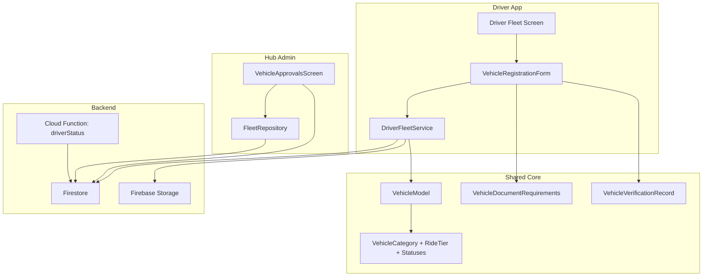

**Diagram sources**
- [vehicle_registration_form.dart:1-649](file://sese_ride/lib/features/driver/presentation/widgets/vehicle_registration_form.dart#L1-L649)
- [driver_fleet_service.dart:1-324](file://sese_ride/lib/features/driver/services/driver_fleet_service.dart#L1-L324)
- [vehicle_model.dart:1-164](file://sese_core/lib/models/vehicle_model.dart#L1-L164)
- [vehicle_category.dart:1-142](file://sese_core/lib/models/vehicle_category.dart#L1-L142)
- [vehicle_documents.dart:1-170](file://sese_core/lib/models/vehicle_documents.dart#L1-L170)
- [vehicle_verification_model.dart:1-68](file://sese_core/lib/models/vehicle_verification_model.dart#L1-L68)
- [fleet_repository.dart:1-233](file://sese_hub/lib/features/verification/services/fleet_repository.dart#L1-L233)
- [vehicle_approvals_screen.dart:1-716](file://sese_hub/lib/features/verification/presentation/vehicle_approvals_screen.dart#L1-L716)
- [driverStatus.ts:95-121](file://functions/src/driverStatus.ts#L95-L121)

**Section sources**
- [vehicle_model.dart:1-164](file://sese_core/lib/models/vehicle_model.dart#L1-L164)
- [vehicle_category.dart:1-142](file://sese_core/lib/models/vehicle_category.dart#L1-L142)
- [vehicle_documents.dart:1-170](file://sese_core/lib/models/vehicle_documents.dart#L1-L170)
- [vehicle_verification_model.dart:1-68](file://sese_core/lib/models/vehicle_verification_model.dart#L1-L68)
- [driver_fleet_service.dart:1-324](file://sese_ride/lib/features/driver/services/driver_fleet_service.dart#L1-L324)
- [vehicle_registration_form.dart:1-649](file://sese_ride/lib/features/driver/presentation/widgets/vehicle_registration_form.dart#L1-L649)
- [fleet_repository.dart:1-233](file://sese_hub/lib/features/verification/services/fleet_repository.dart#L1-L233)
- [vehicle_approvals_screen.dart:1-716](file://sese_hub/lib/features/verification/presentation/vehicle_approvals_screen.dart#L1-L716)
- [driverStatus.ts:95-121](file://functions/src/driverStatus.ts#L95-L121)

## Core Components
- VehicleModel: Central entity representing a registered vehicle, including category, optional ride tier, make/model/year/plate/color, documents map, verification and lifecycle statuses, selection flags, and timestamps.
- VehicleCategory and RideTier: Enumerations defining supported vehicle scopes and passenger car tiers.
- VehicleDocumentRequirements: Category-specific contract for required documents and inspection photos.
- VehicleVerificationRecord: Audit record for live camera verification snapshots.
- DriverFleetService: Service for registering vehicles, uploading documents/photos, and submitting live verification records.
- VehicleRegistrationForm: Driver UI for collecting vehicle details and required uploads.
- FleetRepository: Hub-side stream merging multiple Firestore queries into a tolerant pending queue.
- VehicleApprovalsScreen: Hub UI for reviewing documents, approving/rejecting vehicles, and recomputing driver online eligibility.

Key behaviors:
- New vehicles are always created with PENDING verification status.
- Required uploads vary by category; the form validates completeness before submission.
- Admin approval updates canonical and legacy fields so all clients agree on status.
- Drivers can only go online when both profile and vehicle verification pass.

**Section sources**
- [vehicle_model.dart:1-164](file://sese_core/lib/models/vehicle_model.dart#L1-L164)
- [vehicle_category.dart:1-142](file://sese_core/lib/models/vehicle_category.dart#L1-L142)
- [vehicle_documents.dart:1-170](file://sese_core/lib/models/vehicle_documents.dart#L1-L170)
- [vehicle_verification_model.dart:1-68](file://sese_core/lib/models/vehicle_verification_model.dart#L1-L68)
- [driver_fleet_service.dart:1-324](file://sese_ride/lib/features/driver/services/driver_fleet_service.dart#L1-L324)
- [vehicle_registration_form.dart:1-649](file://sese_ride/lib/features/driver/presentation/widgets/vehicle_registration_form.dart#L1-L649)
- [fleet_repository.dart:1-233](file://sese_hub/lib/features/verification/services/fleet_repository.dart#L1-L233)
- [vehicle_approvals_screen.dart:1-716](file://sese_hub/lib/features/verification/presentation/vehicle_approvals_screen.dart#L1-L716)

## Architecture Overview
The registration flow connects driver UI, shared models, storage, and admin review. The approval pipeline ensures compliance before enabling online operations.

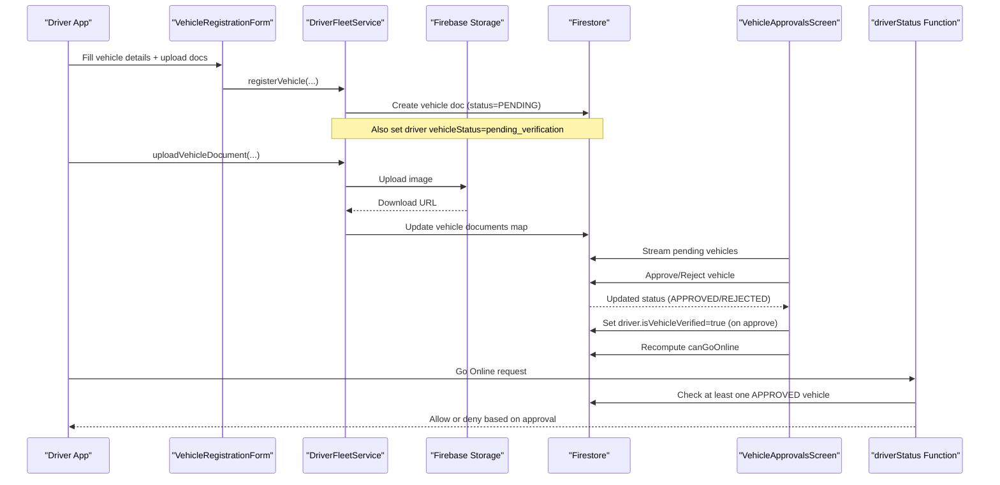

**Diagram sources**
- [vehicle_registration_form.dart:230-254](file://sese_ride/lib/features/driver/presentation/widgets/vehicle_registration_form.dart#L230-L254)
- [driver_fleet_service.dart:156-205](file://sese_ride/lib/features/driver/services/driver_fleet_service.dart#L156-L205)
- [driver_fleet_service.dart:264-286](file://sese_ride/lib/features/driver/services/driver_fleet_service.dart#L264-L286)
- [vehicle_approvals_screen.dart:41-82](file://sese_hub/lib/features/verification/presentation/vehicle_approvals_screen.dart#L41-L82)
- [vehicle_approvals_screen.dart:129-144](file://sese_hub/lib/features/verification/presentation/vehicle_approvals_screen.dart#L129-L144)
- [driverStatus.ts:95-121](file://functions/src/driverStatus.ts#L95-L121)

## Detailed Component Analysis

### Vehicle Data Model and Categories
- VehicleModel stores core attributes and maps to/from Firestore, including a documents map keyed by human-readable slot labels.
- VehicleCategory enumerates supported vehicle types and ride-hailing eligibility.
- RideTier classifies cars by manufacture year for passenger services.
- Verification and lifecycle statuses provide canonical strings for persistence and display.

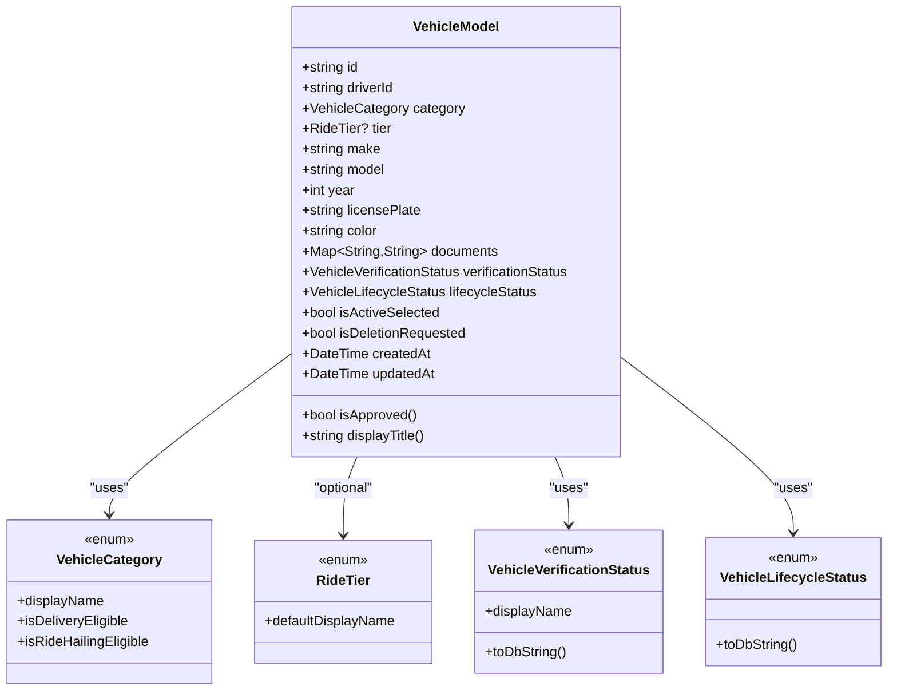

**Diagram sources**
- [vehicle_model.dart:1-164](file://sese_core/lib/models/vehicle_model.dart#L1-L164)
- [vehicle_category.dart:1-142](file://sese_core/lib/models/vehicle_category.dart#L1-L142)

**Section sources**
- [vehicle_model.dart:1-164](file://sese_core/lib/models/vehicle_model.dart#L1-L164)
- [vehicle_category.dart:1-142](file://sese_core/lib/models/vehicle_category.dart#L1-L142)

### Required Documents and Validation Rules
- Bicycles: proof of ownership + government ID + one side-profile photo; no plate/license/insurance.
- Motorcycles/tricycles: vehicle license + insurance/roadworthiness + two plate-visible photos.
- Cars/vans/trucks: vehicle license + insurance certificate + five angle photos (front, rear, driver side, passenger side, interior/dashboard).
- The form validates all required slots and disables submit until complete.

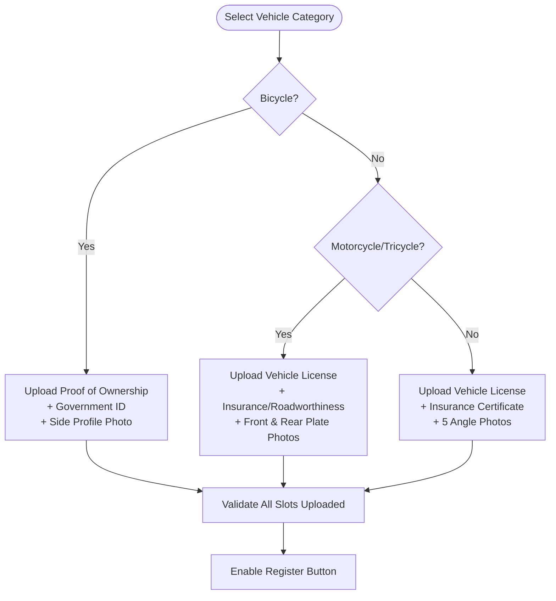

**Diagram sources**
- [vehicle_documents.dart:58-169](file://sese_core/lib/models/vehicle_documents.dart#L58-L169)
- [vehicle_registration_form.dart:113-132](file://sese_ride/lib/features/driver/presentation/widgets/vehicle_registration_form.dart#L113-L132)

**Section sources**
- [vehicle_documents.dart:1-170](file://sese_core/lib/models/vehicle_documents.dart#L1-L170)
- [vehicle_registration_form.dart:113-132](file://sese_ride/lib/features/driver/presentation/widgets/vehicle_registration_form.dart#L113-L132)

### Driver Fleet Management and Registration Flow
- The driver fleet screen lists vehicles and embeds the registration form.
- The registration form collects vehicle details, shows category-specific required uploads, and calls the fleet service to persist the vehicle with PENDING verification.
- On successful registration, the driver’s vehicle status is marked pending for admin review.

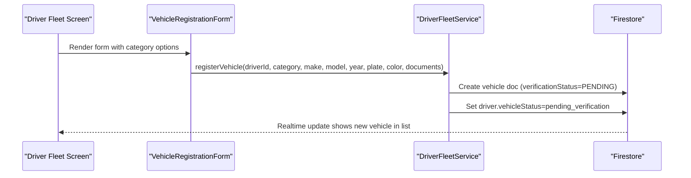

**Diagram sources**
- [driver_fleet_screen.dart:97-139](file://sese_ride/lib/features/driver/presentation/driver_fleet_screen.dart#L97-L139)
- [vehicle_registration_form.dart:230-254](file://sese_ride/lib/features/driver/presentation/widgets/vehicle_registration_form.dart#L230-L254)
- [driver_fleet_service.dart:156-205](file://sese_ride/lib/features/driver/services/driver_fleet_service.dart#L156-L205)

**Section sources**
- [driver_fleet_screen.dart:97-139](file://sese_ride/lib/features/driver/presentation/driver_fleet_screen.dart#L97-L139)
- [vehicle_registration_form.dart:230-254](file://sese_ride/lib/features/driver/presentation/widgets/vehicle_registration_form.dart#L230-L254)
- [driver_fleet_service.dart:156-205](file://sese_ride/lib/features/driver/services/driver_fleet_service.dart#L156-L205)

### Document Upload Handling
- Each required slot is presented as a chip; users pick from Camera or Gallery.
- Uploads go through the fleet service to Firebase Storage under a structured path and return a download URL stored in the vehicle documents map.
- Errors are sanitized for user display.

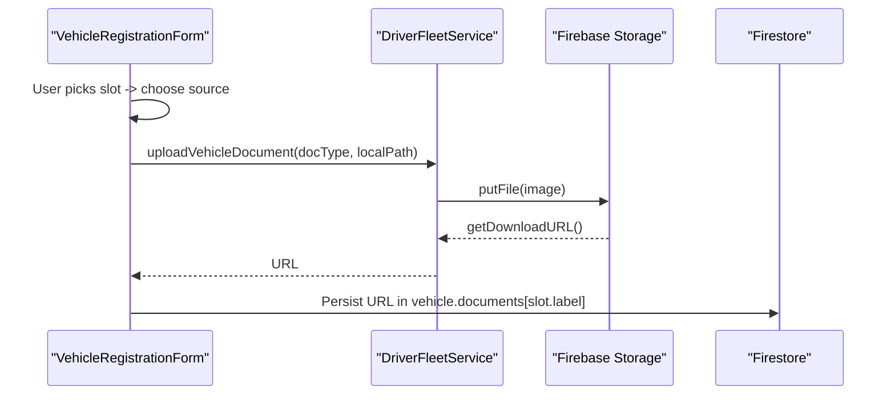

**Diagram sources**
- [vehicle_registration_form.dart:168-228](file://sese_ride/lib/features/driver/presentation/widgets/vehicle_registration_form.dart#L168-L228)
- [driver_fleet_service.dart:264-286](file://sese_ride/lib/features/driver/services/driver_fleet_service.dart#L264-L286)

**Section sources**
- [vehicle_registration_form.dart:168-228](file://sese_ride/lib/features/driver/presentation/widgets/vehicle_registration_form.dart#L168-L228)
- [driver_fleet_service.dart:264-286](file://sese_ride/lib/features/driver/services/driver_fleet_service.dart#L264-L286)

### Admin Review and Approval Pipeline
- The hub repository streams pending vehicles using tolerant logic across canonical and legacy fields.
- The approvals screen displays category-aware documents, plate cross-check hints, and allows approve/reject actions.
- Approving sets canonical and legacy fields and marks the driver’s vehicle verified; it recomputes whether the driver can go online.

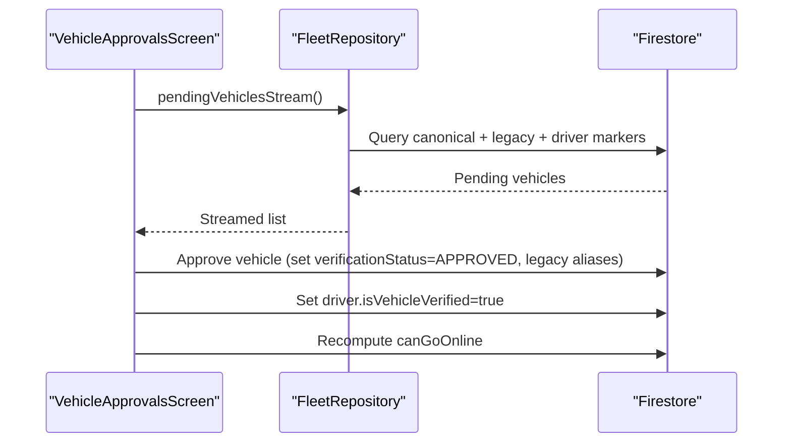

**Diagram sources**
- [fleet_repository.dart:54-171](file://sese_hub/lib/features/verification/services/fleet_repository.dart#L54-L171)
- [vehicle_approvals_screen.dart:41-82](file://sese_hub/lib/features/verification/presentation/vehicle_approvals_screen.dart#L41-L82)
- [vehicle_approvals_screen.dart:129-144](file://sese_hub/lib/features/verification/presentation/vehicle_approvals_screen.dart#L129-L144)

**Section sources**
- [fleet_repository.dart:1-233](file://sese_hub/lib/features/verification/services/fleet_repository.dart#L1-L233)
- [vehicle_approvals_screen.dart:1-716](file://sese_hub/lib/features/verification/presentation/vehicle_approvals_screen.dart#L1-L716)

### Live Camera Verification and Audit Logs
- Drivers can submit a live camera snapshot tied to a vehicle; the audit record is stored with captureMode=camera_only and status=pending.
- The hub displays recent audit logs for security review.

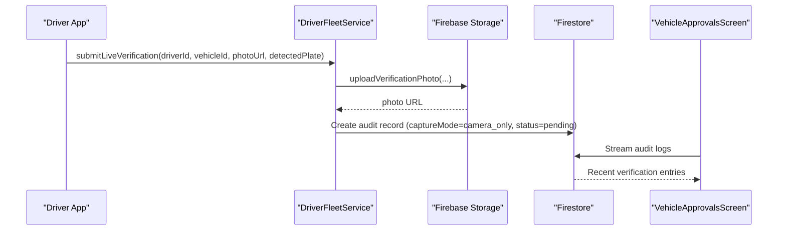

**Diagram sources**
- [driver_fleet_service.dart:235-322](file://sese_ride/lib/features/driver/services/driver_fleet_service.dart#L235-L322)
- [vehicle_verification_model.dart:1-68](file://sese_core/lib/models/vehicle_verification_model.dart#L1-L68)
- [vehicle_approvals_screen.dart:564-643](file://sese_hub/lib/features/verification/presentation/vehicle_approvals_screen.dart#L564-L643)

**Section sources**
- [driver_fleet_service.dart:235-322](file://sese_ride/lib/features/driver/services/driver_fleet_service.dart#L235-L322)
- [vehicle_verification_model.dart:1-68](file://sese_core/lib/models/vehicle_verification_model.dart#L1-L68)
- [vehicle_approvals_screen.dart:564-643](file://sese_hub/lib/features/verification/presentation/vehicle_approvals_screen.dart#L564-L643)

### Compliance Requirements and Vehicle Category Management
- Delivery eligibility applies to all categories; passenger ride-hailing is restricted to cars.
- Tier classification for cars influences ride-hailing tier assignment.
- Document requirements differ per category to satisfy compliance.

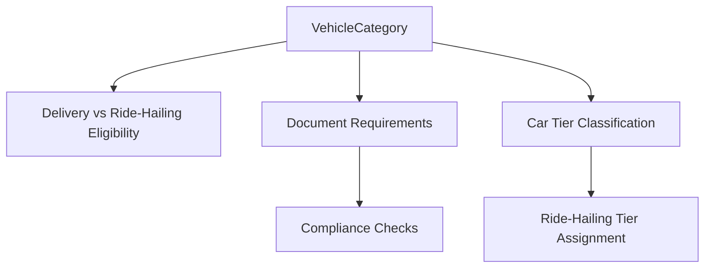

**Diagram sources**
- [vehicle_category.dart:1-69](file://sese_core/lib/models/vehicle_category.dart#L1-L69)
- [vehicle_documents.dart:58-169](file://sese_core/lib/models/vehicle_documents.dart#L58-L169)

**Section sources**
- [vehicle_category.dart:1-69](file://sese_core/lib/models/vehicle_category.dart#L1-L69)
- [vehicle_documents.dart:58-169](file://sese_core/lib/models/vehicle_documents.dart#L58-L169)

### Relationship Between Vehicle Verification and Driver Online Status
- A driver can only go online if both profile and vehicle verification pass.
- The cloud function enforces this by checking for at least one APPROVED vehicle.

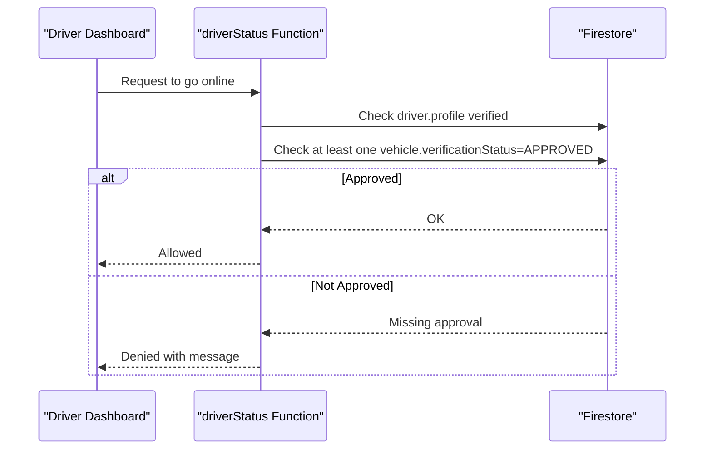

**Diagram sources**
- [driver_dashboard_screen.dart:307-357](file://sese_ride/lib/features/driver/presentation/driver_dashboard_screen.dart#L307-L357)
- [driverStatus.ts:95-121](file://functions/src/driverStatus.ts#L95-L121)

**Section sources**
- [driver_dashboard_screen.dart:307-357](file://sese_ride/lib/features/driver/presentation/driver_dashboard_screen.dart#L307-L357)
- [driverStatus.ts:95-121](file://functions/src/driverStatus.ts#L95-L121)

## Dependency Analysis
- Driver UI depends on shared core models and the fleet service.
- Fleet service depends on Firestore and Storage; it writes canonical statuses and driver-level markers.
- Hub repository depends on Firestore streams and merges results into a single pending queue.
- Hub approvals depend on fleet repository and directly update Firestore.
- Cloud function depends on Firestore to enforce approval before allowing online mode.

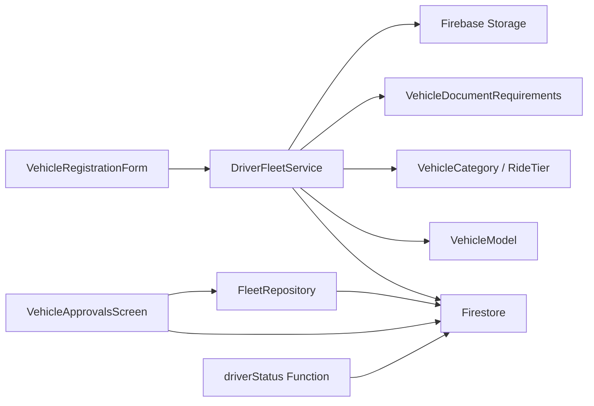

**Diagram sources**
- [vehicle_registration_form.dart:1-649](file://sese_ride/lib/features/driver/presentation/widgets/vehicle_registration_form.dart#L1-L649)
- [driver_fleet_service.dart:1-324](file://sese_ride/lib/features/driver/services/driver_fleet_service.dart#L1-L324)
- [vehicle_model.dart:1-164](file://sese_core/lib/models/vehicle_model.dart#L1-L164)
- [vehicle_category.dart:1-142](file://sese_core/lib/models/vehicle_category.dart#L1-L142)
- [vehicle_documents.dart:1-170](file://sese_core/lib/models/vehicle_documents.dart#L1-L170)
- [fleet_repository.dart:1-233](file://sese_hub/lib/features/verification/services/fleet_repository.dart#L1-L233)
- [vehicle_approvals_screen.dart:1-716](file://sese_hub/lib/features/verification/presentation/vehicle_approvals_screen.dart#L1-L716)
- [driverStatus.ts:95-121](file://functions/src/driverStatus.ts#L95-L121)

**Section sources**
- [vehicle_registration_form.dart:1-649](file://sese_ride/lib/features/driver/presentation/widgets/vehicle_registration_form.dart#L1-L649)
- [driver_fleet_service.dart:1-324](file://sese_ride/lib/features/driver/services/driver_fleet_service.dart#L1-L324)
- [fleet_repository.dart:1-233](file://sese_hub/lib/features/verification/services/fleet_repository.dart#L1-L233)
- [vehicle_approvals_screen.dart:1-716](file://sese_hub/lib/features/verification/presentation/vehicle_approvals_screen.dart#L1-L716)
- [driverStatus.ts:95-121](file://functions/src/driverStatus.ts#L95-L121)

## Performance Considerations
- Use real-time streams judiciously; the hub repository merges multiple queries but de-duplicates client-side to avoid redundant renders.
- Prefer batch writes when updating multiple vehicles (e.g., selecting active vehicle).
- Keep uploaded images compressed and sized appropriately to reduce storage bandwidth.
- Avoid unnecessary re-renders by separating state for each upload slot.

[No sources needed since this section provides general guidance]

## Troubleshooting Guide
Common issues and resolutions:
- Upload failures: The service sanitizes backend errors and returns user-friendly messages for authentication or network problems.
- Stale credentials in hub: Ensure fresh ID tokens before opening watch streams.
- Pending queue not showing vehicles: Verify canonical and legacy fields; the repository includes tolerant logic for legacy aliases.
- Cannot go online: Confirm both profile and vehicle verification are approved; the cloud function will deny otherwise.

**Section sources**
- [driver_fleet_service.dart:21-58](file://sese_ride/lib/features/driver/services/driver_fleet_service.dart#L21-L58)
- [vehicle_approvals_screen.dart:33-39](file://sese_hub/lib/features/verification/presentation/vehicle_approvals_screen.dart#L33-L39)
- [fleet_repository.dart:189-231](file://sese_hub/lib/features/verification/services/fleet_repository.dart#L189-L231)
- [driverStatus.ts:95-121](file://functions/src/driverStatus.ts#L95-L121)

## Conclusion
The vehicle registration system enforces strong compliance through category-specific document requirements, strict verification states, and an admin approval pipeline. Drivers cannot go online without an approved vehicle, and the hub provides tools to review documents, manage approvals, and track audit logs. The architecture cleanly separates concerns across driver UI, shared models, storage, and admin review, with server-side guards ensuring policy enforcement.

[No sources needed since this section summarizes without analyzing specific files]