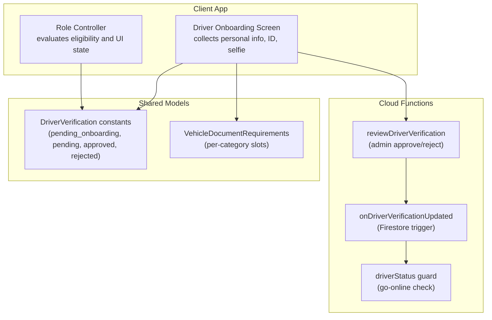
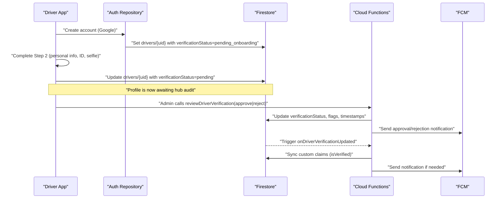
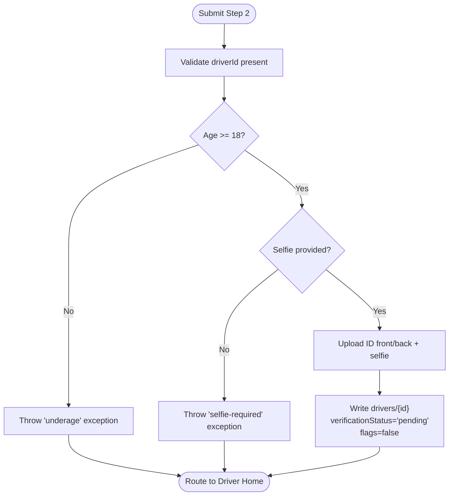
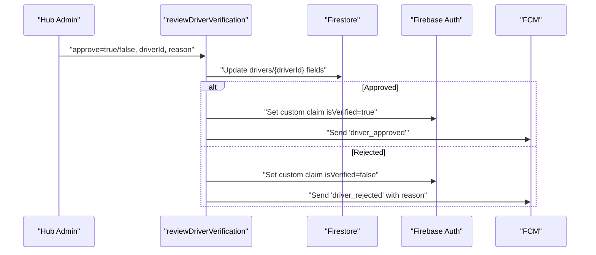
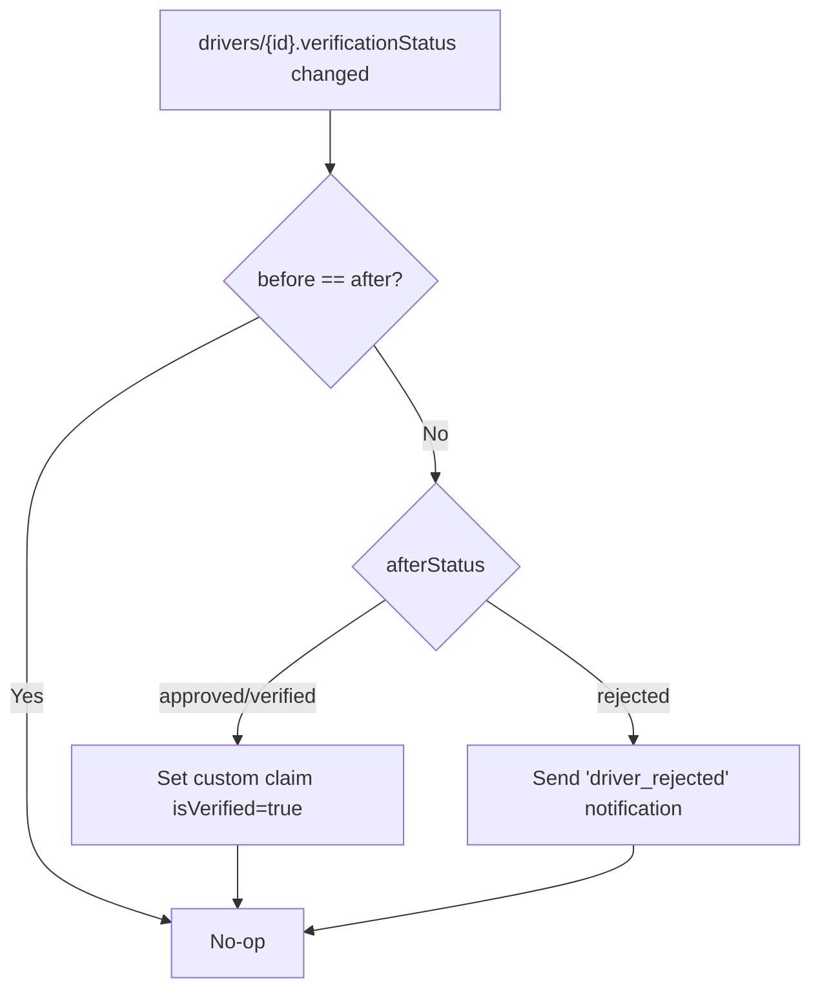
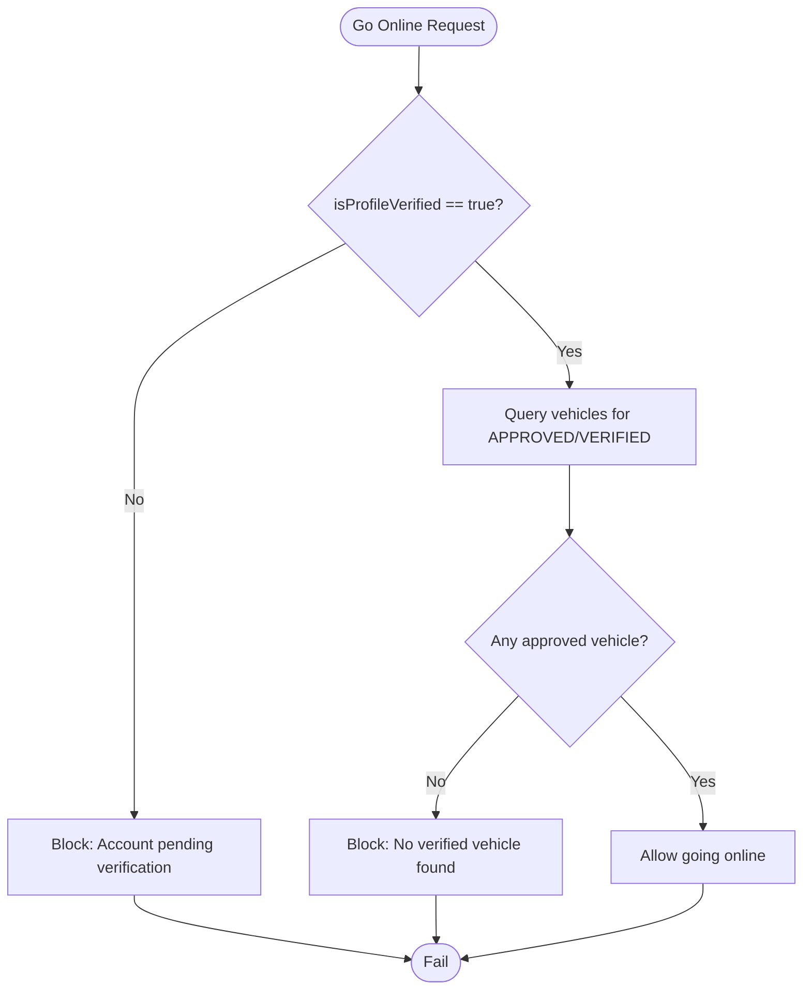
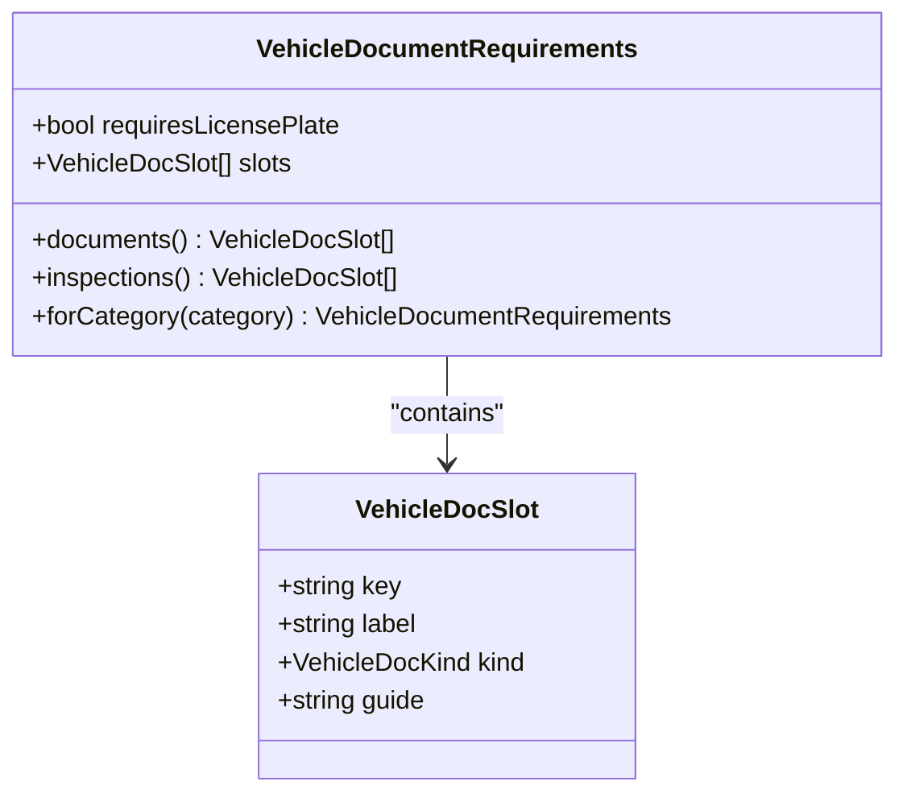
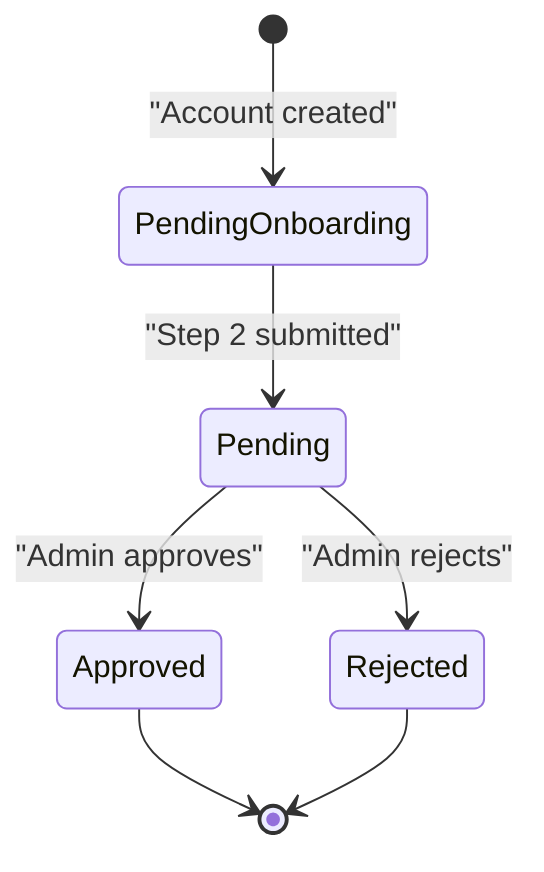
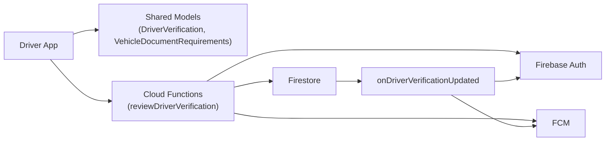

# Automated Verification Checks

<cite>
**Referenced Files in This Document**
- [verification.ts](file://functions/src/verification.ts)
- [driverStatus.ts](file://functions/src/driverStatus.ts)
- [driver_verification.dart](file://sese_core/lib/models/driver_verification.dart)
- [vehicle_documents.dart](file://sese_core/lib/models/vehicle_documents.dart)
- [driver_onboarding_screen.dart](file://sese_ride/lib/features/driver/presentation/driver_onboarding_screen.dart)
- [firebase_auth_repository.dart](file://sese_core/lib/auth/firebase_auth_repository.dart)
- [role_controller.dart](file://sese_ride/lib/features/settings/role_controller.dart)
</cite>

## Table of Contents
1. [Introduction](#introduction)
2. [Project Structure](#project-structure)
3. [Core Components](#core-components)
4. [Architecture Overview](#architecture-overview)
5. [Detailed Component Analysis](#detailed-component-analysis)
6. [Dependency Analysis](#dependency-analysis)
7. [Performance Considerations](#performance-considerations)
8. [Troubleshooting Guide](#troubleshooting-guide)
9. [Conclusion](#conclusion)

## Introduction
This document explains the automated verification checks system for driver onboarding and document review. It covers:
- Initial validation when users submit verification documents (format, identity, and basic fraud signals).
- How driver licenses, insurance documents, and background checks are validated.
- Validation rules, error handling for invalid submissions, and integration with external APIs.
- State transitions from pending_onboarding to pending and criteria for automatic rejection.

The system combines client-side validation, server-side callable functions, Firestore triggers, and guardrails that enforce policy before allowing drivers to go online.

## Project Structure
The verification pipeline spans three layers:
- Client app (Flutter): collects and validates user inputs and images; submits Step 2 personal info and ID/selfie captures.
- Cloud Functions (Node.js): admin callable endpoints for manual review and Firestore triggers for claim synchronization and notifications.
- Shared core models: constants and contracts for driver/customer verification states and vehicle document requirements.

**Diagram sources**
- [driver_onboarding_screen.dart:18-36](file://sese_ride/lib/features/driver/presentation/driver_onboarding_screen.dart#L18-L36)
- [driver_verification.dart:1-24](file://sese_core/lib/models/driver_verification.dart#L1-L24)
- [vehicle_documents.dart:34-48](file://sese_core/lib/models/vehicle_documents.dart#L34-L48)
- [verification.ts:133-240](file://functions/src/verification.ts#L133-L240)
- [verification.ts:299-350](file://functions/src/verification.ts#L299-L350)
- [driverStatus.ts:95-121](file://functions/src/driverStatus.ts#L95-L121)

**Section sources**
- [driver_onboarding_screen.dart:18-36](file://sese_ride/lib/features/driver/presentation/driver_onboarding_screen.dart#L18-L36)
- [driver_verification.dart:1-24](file://sese_core/lib/models/driver_verification.dart#L1-L24)
- [vehicle_documents.dart:34-48](file://sese_core/lib/models/vehicle_documents.dart#L34-L48)
- [verification.ts:133-240](file://functions/src/verification.ts#L133-L240)
- [verification.ts:299-350](file://functions/src/verification.ts#L299-L350)
- [driverStatus.ts:95-121](file://functions/src/driverStatus.ts#L95-L121)

## Core Components
- Driver onboarding submission: Validates age, selfie presence, and required fields; uploads ID/selfie; writes driver profile with pending status.
- Admin review endpoints: Approve or reject driver profiles; update Firestore fields and Auth custom claims; send push notifications.
- Firestore triggers: Sync custom claims and notify clients on status changes.
- Go-online guard: Enforces both profile and vehicle verification before allowing a driver to go online.
- Vehicle document requirements: Category-specific slot definitions for license, insurance, and inspection photos.

Key responsibilities:
- Client-side validation ensures data quality before submission.
- Server-side review endpoints centralize policy decisions and side effects.
- Triggers keep client state consistent and reduce race conditions.
- Guards prevent unauthorized access to sensitive operations.

**Section sources**
- [driver_onboarding_screen.dart:1020-1058](file://sese_ride/lib/features/driver/presentation/driver_onboarding_screen.dart#L1020-L1058)
- [verification.ts:133-240](file://functions/src/verification.ts#L133-L240)
- [verification.ts:299-350](file://functions/src/verification.ts#L299-L350)
- [driverStatus.ts:95-121](file://functions/src/driverStatus.ts#L95-L121)
- [vehicle_documents.dart:34-48](file://sese_core/lib/models/vehicle_documents.dart#L34-L48)

## Architecture Overview
The verification flow consists of:
1. Account creation sets driver state to pending_onboarding.
2. Driver completes Step 2 (personal info, ID, selfie), which updates state to pending.
3. Hub admins call reviewDriverVerification to approve or reject.
4. Firestore triggers sync custom claims and send notifications.
5. The go-online guard enforces both profile and vehicle verification.

**Diagram sources**
- [firebase_auth_repository.dart:168-186](file://sese_core/lib/auth/firebase_auth_repository.dart#L168-L186)
- [driver_onboarding_screen.dart:1020-1058](file://sese_ride/lib/features/driver/presentation/driver_onboarding_screen.dart#L1020-L1058)
- [verification.ts:133-240](file://functions/src/verification.ts#L133-L240)
- [verification.ts:299-350](file://functions/src/verification.ts#L299-L350)

## Detailed Component Analysis

### Driver Onboarding Submission and Initial Validation
When a driver submits Step 2:
- Validates driver reference exists.
- Enforces minimum age (adult check).
- Requires a live selfie capture.
- Uploads ID front/back and selfie when provided.
- Writes driver profile with:
  - verificationStatus = pending
  - isProfileVerified = false
  - isVehicleVerified = false
  - canGoOnline = false

Error handling:
- Throws structured exceptions for missing driver reference, underage, and missing selfie.

State transition:
- From pending_onboarding (account created) to pending (Step 2 submitted).

**Diagram sources**
- [driver_onboarding_screen.dart:1020-1058](file://sese_ride/lib/features/driver/presentation/driver_onboarding_screen.dart#L1020-L1058)

**Section sources**
- [driver_onboarding_screen.dart:1020-1058](file://sese_ride/lib/features/driver/presentation/driver_onboarding_screen.dart#L1020-L1058)
- [driver_verification.dart:1-24](file://sese_core/lib/models/driver_verification.dart#L1-L24)

### Admin Review Endpoints (Approve/Reject)
Admins call reviewDriverVerification to:
- Approve: set verificationStatus=approved, isProfileVerified=true, isActive=true, clear rejection reason, set timestamp, update custom claim isVerified=true, send approval notification.
- Reject: set verificationStatus=rejected, isProfileVerified=false, isActive=false, store rejection reason, set timestamp, update custom claim isVerified=false, send rejection notification.

**Diagram sources**
- [verification.ts:133-240](file://functions/src/verification.ts#L133-L240)

**Section sources**
- [verification.ts:133-240](file://functions/src/verification.ts#L133-L240)

### Firestore Triggers for Status Changes
Triggers react to direct Firestore updates:
- onUserVerificationUpdated: syncs custom claims and sends notifications for customer KYC status changes.
- onDriverVerificationUpdated: syncs custom claims and sends notifications for driver profile status changes.

**Diagram sources**
- [verification.ts:299-350](file://functions/src/verification.ts#L299-L350)

**Section sources**
- [verification.ts:299-350](file://functions/src/verification.ts#L299-L350)

### Go-Online Guard and Automatic Rejection Criteria
Before allowing a driver to go online:
- Profile must be verified (isProfileVerified=true).
- At least one vehicle must be approved (verificationStatus APPROVED or VERIFIED).
- If either condition fails, the operation throws a failed-precondition error.

Automatic rejection criteria:
- Directly via admin review endpoint (rejection reason stored).
- Via triggers that propagate rejections and update custom claims.

**Diagram sources**
- [driverStatus.ts:95-121](file://functions/src/driverStatus.ts#L95-L121)

**Section sources**
- [driverStatus.ts:95-121](file://functions/src/driverStatus.ts#L95-L121)

### Vehicle Document Requirements and Validation Rules
Vehicle document requirements are category-specific:
- Bicycle: proof of ownership, government ID, one side-profile photo.
- Motorcycle/tricycle: vehicle license, insurance/roadworthiness, two plate-visible photos.
- Car/van/truck: vehicle license, insurance certificate, five inspection photos (front, rear, driver side, passenger side, interior/dashboard).

These slots define what the registration form expects and what the verification desk reviews.

**Diagram sources**
- [vehicle_documents.dart:12-32](file://sese_core/lib/models/vehicle_documents.dart#L12-L32)
- [vehicle_documents.dart:34-48](file://sese_core/lib/models/vehicle_documents.dart#L34-L48)
- [vehicle_documents.dart:58-167](file://sese_core/lib/models/vehicle_documents.dart#L58-L167)

**Section sources**
- [vehicle_documents.dart:12-32](file://sese_core/lib/models/vehicle_documents.dart#L12-L32)
- [vehicle_documents.dart:34-48](file://sese_core/lib/models/vehicle_documents.dart#L34-L48)
- [vehicle_documents.dart:58-167](file://sese_core/lib/models/vehicle_documents.dart#L58-L167)

### State Transitions: pending_onboarding to pending
- Account creation initializes drivers/{uid} with verificationStatus=pending_onboarding.
- After Step 2 submission, the client updates the driver profile to verificationStatus=pending.
- Role controller evaluates eligibility based on these statuses and related flags.

**Diagram sources**
- [firebase_auth_repository.dart:168-186](file://sese_core/lib/auth/firebase_auth_repository.dart#L168-L186)
- [driver_onboarding_screen.dart:1020-1058](file://sese_ride/lib/features/driver/presentation/driver_onboarding_screen.dart#L1020-L1058)
- [driver_verification.dart:1-24](file://sese_core/lib/models/driver_verification.dart#L1-L24)
- [role_controller.dart:72-114](file://sese_ride/lib/features/settings/role_controller.dart#L72-L114)

**Section sources**
- [firebase_auth_repository.dart:168-186](file://sese_core/lib/auth/firebase_auth_repository.dart#L168-L186)
- [driver_onboarding_screen.dart:1020-1058](file://sese_ride/lib/features/driver/presentation/driver_onboarding_screen.dart#L1020-L1058)
- [driver_verification.dart:1-24](file://sese_core/lib/models/driver_verification.dart#L1-L24)
- [role_controller.dart:72-114](file://sese_ride/lib/features/settings/role_controller.dart#L72-L114)

## Dependency Analysis
- Client depends on shared models for status constants and document requirements.
- Cloud Functions depend on Firebase Admin SDK for Firestore, Auth, and Messaging.
- Triggers depend on Firestore document updates to perform side effects.
- Go-online guard depends on both driver profile and fleet queries.

**Diagram sources**
- [driver_verification.dart:1-24](file://sese_core/lib/models/driver_verification.dart#L1-L24)
- [vehicle_documents.dart:34-48](file://sese_core/lib/models/vehicle_documents.dart#L34-L48)
- [verification.ts:133-240](file://functions/src/verification.ts#L133-L240)
- [verification.ts:299-350](file://functions/src/verification.ts#L299-L350)

**Section sources**
- [driver_verification.dart:1-24](file://sese_core/lib/models/driver_verification.dart#L1-L24)
- [vehicle_documents.dart:34-48](file://sese_core/lib/models/vehicle_documents.dart#L34-L48)
- [verification.ts:133-240](file://functions/src/verification.ts#L133-L240)
- [verification.ts:299-350](file://functions/src/verification.ts#L299-L350)

## Performance Considerations
- Batch updates: Prefer merging minimal fields to reduce write amplification.
- Query optimization: Use indexed fields (e.g., verificationStatus) for fleet queries.
- Idempotency: Ensure triggers do not duplicate notifications or claim updates.
- Client-side validation: Reduces unnecessary network calls and server load.

[No sources needed since this section provides general guidance]

## Troubleshooting Guide
Common issues and resolutions:
- Underage submission: Ensure date of birth indicates at least 18 years old.
- Missing selfie: Require a live camera selfie during Step 2.
- Pending profile: Drivers cannot go online until profile is approved.
- No approved vehicle: Register and get at least one vehicle approved.
- Rejection reasons: Check kycRejectionReason/profileRejectionReason fields and inform users to edit and resubmit.

Operational checks:
- Verify custom claims are synced after approval/rejection.
- Confirm FCM topics match user/driver IDs.
- Validate that triggers fire on expected status changes.

**Section sources**
- [driver_onboarding_screen.dart:1020-1058](file://sese_ride/lib/features/driver/presentation/driver_onboarding_screen.dart#L1020-L1058)
- [verification.ts:133-240](file://functions/src/verification.ts#L133-L240)
- [verification.ts:299-350](file://functions/src/verification.ts#L299-L350)
- [driverStatus.ts:95-121](file://functions/src/driverStatus.ts#L95-L121)

## Conclusion
The automated verification checks system enforces robust validation at each stage:
- Client-side checks ensure data completeness and compliance.
- Admin review endpoints centralize policy decisions and side effects.
- Firestore triggers maintain consistency across claims and notifications.
- Go-online guards protect platform integrity by requiring both profile and vehicle verification.

By adhering to the documented rules and flows, teams can reliably onboard drivers while minimizing risk and ensuring a smooth user experience.