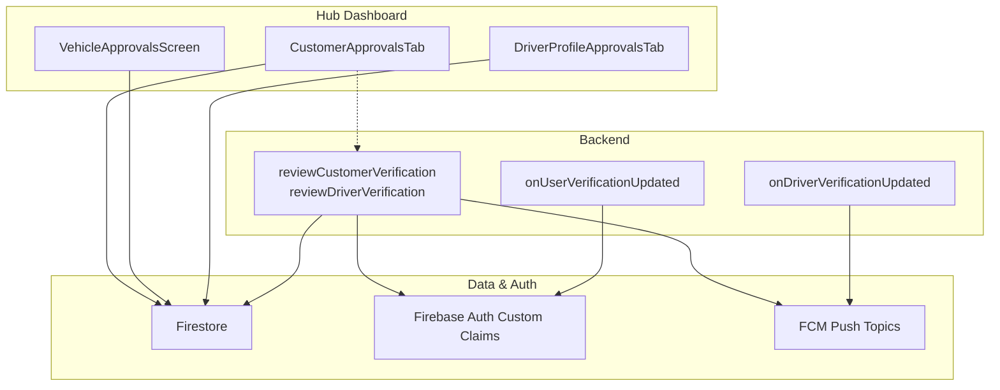
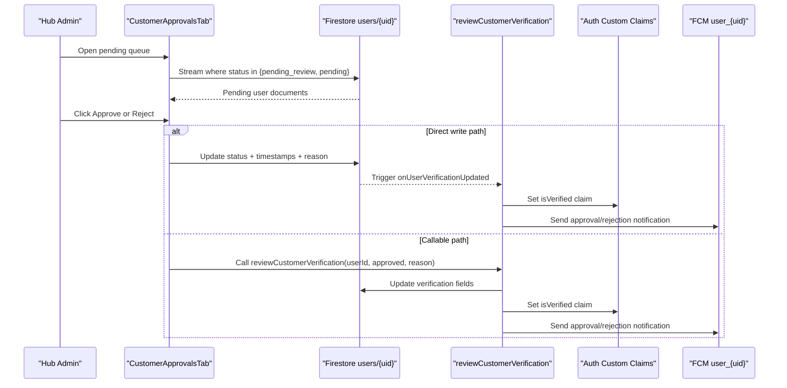
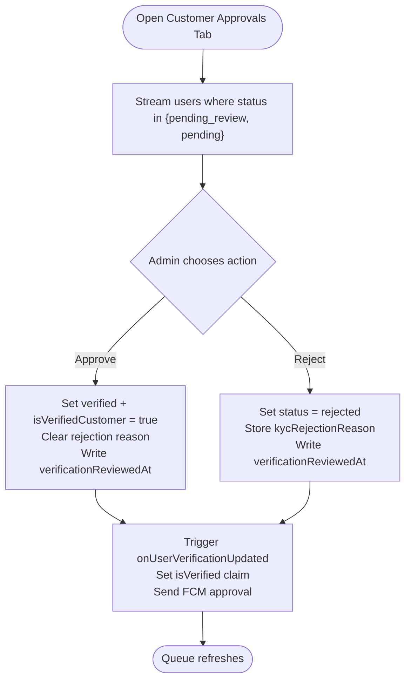
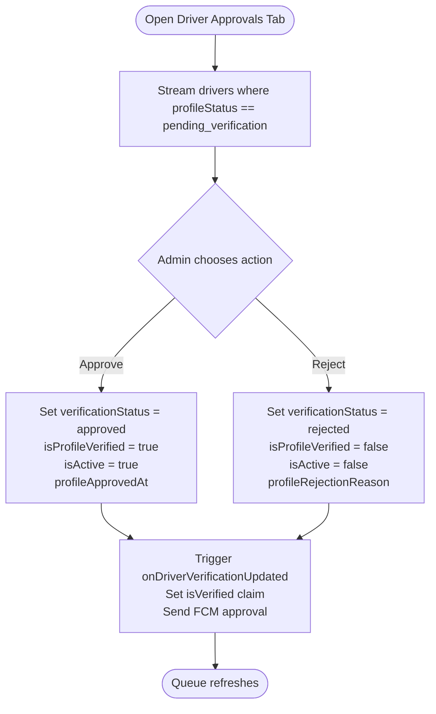
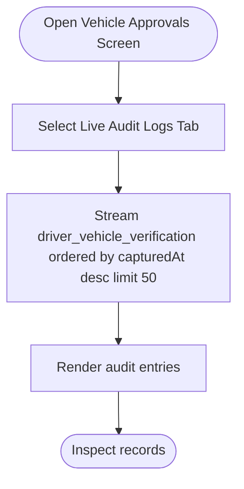
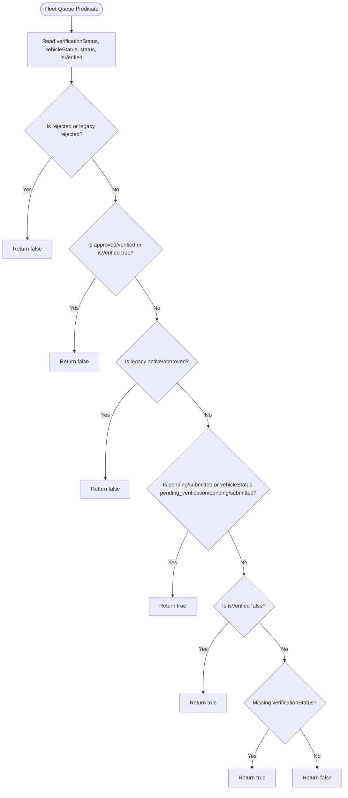
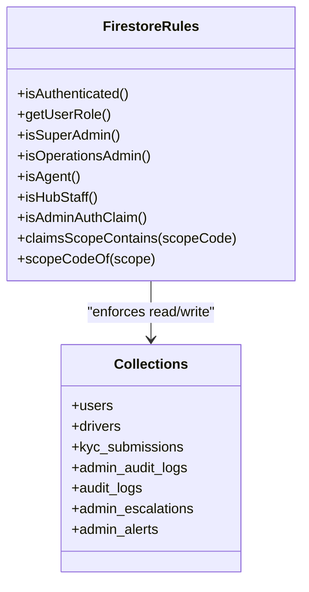
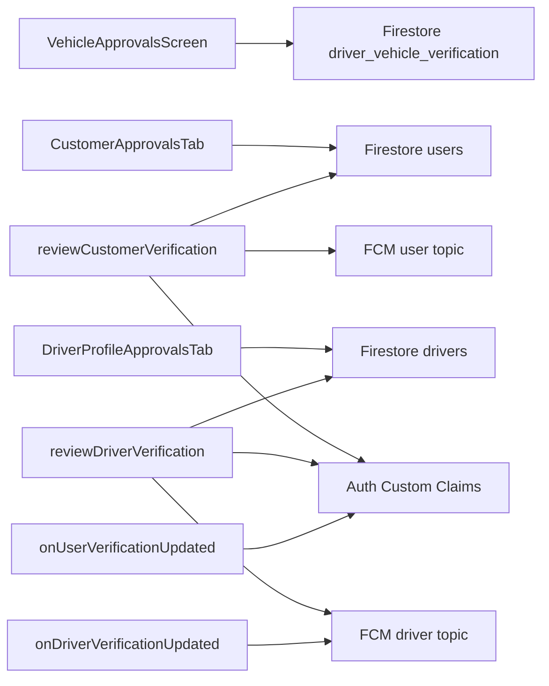

# Manual Admin Review

<cite>
**Referenced Files in This Document**   
- [verification.ts](file://functions/src/verification.ts)
- [firestore.rules](file://firestore.rules)
- [customer_approvals_tab.dart](file://sese_hub/lib/features/verification/presentation/customer_approvals_tab.dart)
- [fleet_repository.dart](file://sese_hub/lib/features/verification/services/fleet_repository.dart)
- [vehicle_approvals_screen.dart](file://sese_hub/lib/features/verification/presentation/vehicle_approvals_screen.dart)
- [driver_profile_approvals_tab.dart](file://sese_hub/lib/features/verification/presentation/driver_profile_approvals_tab.dart)
- [customer_verification_screen.dart](file://sese_ride/lib/features/customer/presentation/customer_verification_screen.dart)
</cite>

## Table of Contents
1. [Introduction](#introduction)
2. [Project Structure](#project-structure)
3. [Core Components](#core-components)
4. [Architecture Overview](#architecture-overview)
5. [Detailed Component Analysis](#detailed-component-analysis)
6. [Dependency Analysis](#dependency-analysis)
7. [Performance Considerations](#performance-considerations)
8. [Troubleshooting Guide](#troubleshooting-guide)
9. [Conclusion](#conclusion)

## Introduction
This document describes the manual admin review workflow for pending verifications across customers and drivers. It explains how administrators inspect submissions, make approval or rejection decisions, record reasons, receive notifications, and operate within role-based access controls. It also covers audit trails, escalation surfaces, and compliance-oriented data handling visible in the codebase.

The system supports:
- Customer KYC verification review.
- Driver profile verification review.
- Vehicle pre-online verification inspection.
- Real-time queues for pending items.
- Server-side state transitions with custom claims and push notifications.
- Firestore security rules that enforce who can read or update verification-related documents.

## Project Structure
The manual review capability spans three layers:

- **Admin dashboard (Flutter Hub)**: Streams pending customer and driver records, renders submission details, and updates status fields directly through Firestore.
- **Cloud Functions**: Provide callable endpoints for server-authoritative review operations, synchronize authentication custom claims, and send push notifications.
- **Firestore Security Rules**: Define role-based permissions for reading and updating verification documents, audit logs, and escalation collections.

**Diagram sources**
- [customer_approvals_tab.dart:37-77](file://sese_hub/lib/features/verification/presentation/customer_approvals_tab.dart#L37-L77)
- [vehicle_approvals_screen.dart:564-606](file://sese_hub/lib/features/verification/presentation/vehicle_approvals_screen.dart#L564-L606)
- [driver_profile_approvals_tab.dart:12-76](file://sese_hub/lib/features/verification/presentation/driver_profile_approvals_tab.dart#L12-L76)
- [verification.ts:26-130](file://functions/src/verification.ts#L26-L130)
- [verification.ts:138-240](file://functions/src/verification.ts#L138-L240)
- [verification.ts:249-296](file://functions/src/verification.ts#L249-L296)
- [verification.ts:304-349](file://functions/src/verification.ts#L304-L349)

**Section sources**
- [customer_approvals_tab.dart:8-17](file://sese_hub/lib/features/verification/presentation/customer_approvals_tab.dart#L8-L17)
- [fleet_repository.dart:189-210](file://sese_hub/lib/features/verification/services/fleet_repository.dart#L189-L210)
- [verification.ts:26-130](file://functions/src/verification.ts#L26-L130)
- [verification.ts:138-240](file://functions/src/verification.ts#L138-L240)
- [firestore.rules:116-157](file://firestore.rules#L116-L157)

## Core Components
- **Customer KYC review queue**: Streams users whose verification status is pending review or legacy pending. The dashboard displays personal information, employment details, government ID, and document photos. Approving sets verified flags and timestamps; rejecting stores a structured reason and marks the account rejected.
- **Driver profile review queue**: Streams driver profiles with pending verification states and allows approval or rejection. Approved drivers become active and verified; rejected drivers are marked inactive with a stored rejection reason.
- **Vehicle pre-online verification audit**: Streams recent vehicle verification captures for inspection by admins.
- **Server callables**: `reviewCustomerVerification` and `reviewDriverVerification` perform authoritative state changes, set custom claims, and send push notifications.
- **Document triggers**: `onUserVerificationUpdated` and `onDriverVerificationUpdated` synchronize custom claims and notify users when direct Firestore updates change verification status.
- **Security rules**: Enforce admin roles, hub staff access, scope-based permissions, and immutable audit collections.

**Section sources**
- [customer_approvals_tab.dart:37-77](file://sese_hub/lib/features/verification/presentation/customer_approvals_tab.dart#L37-L77)
- [driver_profile_approvals_tab.dart:12-76](file://sese_hub/lib/features/verification/presentation/driver_profile_approvals_tab.dart#L12-L76)
- [vehicle_approvals_screen.dart:564-606](file://sese_hub/lib/features/verification/presentation/vehicle_approvals_screen.dart#L564-L606)
- [verification.ts:26-130](file://functions/src/verification.ts#L26-L130)
- [verification.ts:138-240](file://functions/src/verification.ts#L138-L240)
- [verification.ts:249-296](file://functions/src/verification.ts#L249-L296)
- [verification.ts:304-349](file://functions/src/verification.ts#L304-L349)
- [firestore.rules:368-375](file://firestore.rules#L368-L375)
- [firestore.rules:471-485](file://firestore.rules#L471-L485)

## Architecture Overview
The manual review architecture combines client-side dashboards with server-side enforcement:

- **Queues**: Pending items are discovered via Firestore queries filtering on verification statuses.
- **Decisions**: Admins approve or reject via either direct Firestore writes from the Hub dashboard or through Cloud Function callables.
- **State synchronization**: Triggers ensure custom claims reflect verification outcomes.
- **Notifications**: FCM topics deliver user-facing messages about approval or rejection.
- **Access control**: Firestore rules restrict reads/writes based on roles, scopes, and hub staff membership.

**Diagram sources**
- [customer_approvals_tab.dart:37-77](file://sese_hub/lib/features/verification/presentation/customer_approvals_tab.dart#L37-L77)
- [verification.ts:26-130](file://functions/src/verification.ts#L26-L130)
- [verification.ts:249-296](file://functions/src/verification.ts#L249-L296)

## Detailed Component Analysis

### Customer KYC Verification Review
The customer approvals tab streams users with pending review status and provides approve/reject actions. Approval clears rejection reasons and sets verification timestamps; rejection stores a reason and marks the account rejected.

Key behaviors:
- Streams both new `pending_review` and legacy `pending` statuses.
- Updates `verificationStatus`, `isVerifiedCustomer`, and `verificationReviewedAt`.
- Stores structured rejection reasons under `kycRejectionReason`.
- Displays success/error feedback to the admin.

**Diagram sources**
- [customer_approvals_tab.dart:37-77](file://sese_hub/lib/features/verification/presentation/customer_approvals_tab.dart#L37-L77)
- [verification.ts:249-296](file://functions/src/verification.ts#L249-L296)

**Section sources**
- [customer_approvals_tab.dart:8-17](file://sese_hub/lib/features/verification/presentation/customer_approvals_tab.dart#L8-L17)
- [customer_approvals_tab.dart:37-77](file://sese_hub/lib/features/verification/presentation/customer_approvals_tab.dart#L37-L77)
- [verification.ts:26-130](file://functions/src/verification.ts#L26-L130)
- [verification.ts:249-296](file://functions/src/verification.ts#L249-L296)

### Driver Profile Verification Review
Driver profile approvals stream profiles with pending verification states. Approving sets `verificationStatus` to approved, enables the profile, and sets custom claims. Rejecting sets status to rejected, deactivates the profile, and stores a rejection reason.

Key behaviors:
- Streams driver profiles with pending verification.
- Updates driver verification fields and timestamps.
- Sets `isProfileVerified` and `isActive` accordingly.
- Sends FCM notifications for approval or rejection.

**Diagram sources**
- [driver_profile_approvals_tab.dart:12-76](file://sese_hub/lib/features/verification/presentation/driver_profile_approvals_tab.dart#L12-L76)
- [verification.ts:138-240](file://functions/src/verification.ts#L138-L240)
- [verification.ts:304-349](file://functions/src/verification.ts#L304-L349)

**Section sources**
- [driver_profile_approvals_tab.dart:12-76](file://sese_hub/lib/features/verification/presentation/driver_profile_approvals_tab.dart#L12-L76)
- [verification.ts:138-240](file://functions/src/verification.ts#L138-L240)
- [verification.ts:304-349](file://functions/src/verification.ts#L304-L349)

### Vehicle Pre-Online Verification Audit
The vehicle approvals screen includes a live audit log tab that streams recent vehicle verification captures ordered by capture time. This allows admins to inspect camera-only verification records and their metadata.

Key behaviors:
- Streams `driver_vehicle_verification` collection.
- Orders by capture timestamp descending.
- Renders audit entries for inspection.

**Diagram sources**
- [vehicle_approvals_screen.dart:564-606](file://sese_hub/lib/features/verification/presentation/vehicle_approvals_screen.dart#L564-L606)

**Section sources**
- [vehicle_approvals_screen.dart:564-606](file://sese_hub/lib/features/verification/presentation/vehicle_approvals_screen.dart#L564-L606)

### Fleet Queue Predicate
The fleet repository defines a pure predicate used to determine whether a vehicle belongs in the pending queue. It handles canonical statuses, legacy statuses, and fallback logic for older documents.

Key behaviors:
- Excludes rejected or already verified vehicles.
- Includes pending, submitted, or explicitly unverified vehicles.
- Treats legacy docs without canonical status as pending to avoid disappearing from the queue.

**Diagram sources**
- [fleet_repository.dart:189-210](file://sese_hub/lib/features/verification/services/fleet_repository.dart#L189-L210)

**Section sources**
- [fleet_repository.dart:189-210](file://sese_hub/lib/features/verification/services/fleet_repository.dart#L189-L210)

### Role-Based Access Control for Admin Reviewers
Firestore rules define multiple mechanisms for granting admin access:

- **Role helpers**: `isSuperAdmin`, `isOperationsAdmin`, `isAgent`, `isAdminAuthClaim`, and `claimsScopeContains`.
- **Hub staff bridge**: `isHubStaff` grants verification-desk access based on provisioned staff records even if custom claims are absent.
- **Scope codes**: Compact scope codes map verbose permissions like `approveKyc` to short codes such as `kyc`.
- **Audit visibility**: Audit logs require admin auth claims and the `viewAuditLogs` scope.

Relevant rule areas:
- Users and drivers allow hub admins/staff to read and update all records.
- KYC submissions allow operations admins to read all and update specific fields.
- Escalation and alert collections are readable by admin-authenticated users.

**Diagram sources**
- [firestore.rules:10-55](file://firestore.rules#L10-L55)
- [firestore.rules:116-157](file://firestore.rules#L116-L157)
- [firestore.rules:368-375](file://firestore.rules#L368-L375)
- [firestore.rules:471-485](file://firestore.rules#L471-L485)
- [firestore.rules:722-735](file://firestore.rules#L722-L735)
- [firestore.rules:182-189](file://firestore.rules#L182-L189)
- [firestore.rules:1119-1132](file://firestore.rules#L1119-L1132)

**Section sources**
- [firestore.rules:10-55](file://firestore.rules#L10-L55)
- [firestore.rules:116-157](file://firestore.rules#L116-L157)
- [firestore.rules:368-375](file://firestore.rules#L368-L375)
- [firestore.rules:471-485](file://firestore.rules#L471-L485)
- [firestore.rules:722-735](file://firestore.rules#L722-L735)
- [firestore.rules:182-189](file://firestore.rules#L182-L189)
- [firestore.rules:1119-1132](file://firestore.rules#L1119-L1132)

### Reason Coding Systems
Reason coding is implemented as structured text fields rather than enumerated codes:

- **Customer KYC rejection reason**: Stored in `kycRejectionReason`.
- **Driver profile rejection reason**: Stored in `profileRejectionReason`.
- **KYC submission rejection reason**: Allowed field in `kyc_submissions` updates.

These fields are written during rejection flows and surfaced to clients for display.

**Section sources**
- [verification.ts:85-93](file://functions/src/verification.ts#L85-L93)
- [verification.ts:197-205](file://functions/src/verification.ts#L197-L205)
- [firestore.rules:731-733](file://firestore.rules#L731-L733)

### Notification Triggers
Both approval and rejection paths trigger FCM notifications:

- **Customer approval**: Topic `user_{userId}` with type `kyc_approved`.
- **Customer rejection**: Topic `user_{userId}` with type `kyc_rejected` and reason payload.
- **Driver approval**: Topic `driver_{driverId}` with type `driver_approved`.
- **Driver rejection**: Topic `driver_{driverId}` with type `driver_rejected` and reason payload.

Triggers also handle direct Firestore updates to keep claims and notifications consistent.

**Section sources**
- [verification.ts:66-81](file://functions/src/verification.ts#L66-L81)
- [verification.ts:109-126](file://functions/src/verification.ts#L109-L126)
- [verification.ts:178-193](file://functions/src/verification.ts#L178-L193)
- [verification.ts:220-236](file://functions/src/verification.ts#L220-L236)
- [verification.ts:277-295](file://functions/src/verification.ts#L277-L295)
- [verification.ts:330-347](file://functions/src/verification.ts#L330-L347)

### Escalation Procedures for Complex Cases
Escalation surfaces exist for safety and operational issues:

- **Admin escalations**: Collection `admin_escalations` holds server-created tickets for unresponsive drivers or SOS cases. Admins can read them; writes are server-authoritative.
- **Admin alerts**: Collection `admin_alerts` is readable by admin-authenticated users and writable only by server functions.

These provide a foundation for complex case handling beyond standard approval/rejection workflows.

**Section sources**
- [firestore.rules:1119-1132](file://firestore.rules#L1119-L1132)

### Compliance Reporting Requirements
Compliance-related structures include:

- **Audit logs**: Immutable append-only logs accessible to admins with the `viewAuditLogs` scope.
- **Region-tagged data**: Data region routing for GDPR/PIPL/NDPR compliance.
- **KYC rules**: Public system configuration document `kyc_rules` readable by authenticated clients and writable by admins with system-settings scope.

These support auditability and regional compliance requirements.

**Section sources**
- [firestore.rules:182-189](file://firestore.rules#L182-L189)
- [firestore.rules:513-520](file://firestore.rules#L513-L520)
- [firestore.rules:997-1007](file://firestore.rules#L997-L1007)

## Dependency Analysis
The manual review workflow depends on:

- **Hub dashboard components** for UI and streaming.
- **Cloud Functions** for authoritative state changes and notifications.
- **Firestore rules** for access control and immutability guarantees.
- **Authentication custom claims** for enforcing verified status across the app.

**Diagram sources**
- [customer_approvals_tab.dart:37-77](file://sese_hub/lib/features/verification/presentation/customer_approvals_tab.dart#L37-L77)
- [driver_profile_approvals_tab.dart:12-76](file://sese_hub/lib/features/verification/presentation/driver_profile_approvals_tab.dart#L12-L76)
- [vehicle_approvals_screen.dart:564-606](file://sese_hub/lib/features/verification/presentation/vehicle_approvals_screen.dart#L564-L606)
- [verification.ts:26-130](file://functions/src/verification.ts#L26-L130)
- [verification.ts:138-240](file://functions/src/verification.ts#L138-L240)
- [verification.ts:249-296](file://functions/src/verification.ts#L249-L296)
- [verification.ts:304-349](file://functions/src/verification.ts#L304-L349)

**Section sources**
- [verification.ts:26-130](file://functions/src/verification.ts#L26-L130)
- [verification.ts:138-240](file://functions/src/verification.ts#L138-L240)
- [verification.ts:249-296](file://functions/src/verification.ts#L249-L296)
- [verification.ts:304-349](file://functions/src/verification.ts#L304-L349)

## Performance Considerations
- **Streaming queues**: Use targeted Firestore queries to minimize payload size and reduce bandwidth.
- **Limit audit logs**: Cap audit log streams (e.g., limit 50) to prevent large payloads.
- **Batch operations**: Prefer server-side transactions for multi-document updates to maintain consistency.
- **Claim updates**: Avoid frequent custom claim updates; batch or debounce where possible.
- **Notification volume**: Ensure FCM topics are scoped correctly to avoid unnecessary fan-out.

[No sources needed since this section provides general guidance]

## Troubleshooting Guide
Common issues and resolutions:

- **Hub session expired errors**: The dashboard detects session expiration and shows a dedicated view. Refresh the ID token before opening streams.
- **Permission denied on verification updates**: Verify the admin has appropriate role or hub staff provisioning. Check Firestore rules for `users`, `drivers`, and `kyc_submissions`.
- **Missing rejection reason**: Ensure the admin supplies a reason when rejecting; defaults are applied server-side but structured reasons improve clarity.
- **Notifications not received**: Confirm FCM topic names match user/driver IDs and that messaging is configured. Check function logs for send failures.
- **Custom claims not updated**: Inspect trigger execution logs for `onUserVerificationUpdated` and `onDriverVerificationUpdated`. Validate that the user document exists and status changed.

**Section sources**
- [customer_approvals_tab.dart:146-176](file://sese_hub/lib/features/verification/presentation/customer_approvals_tab.dart#L146-L176)
- [vehicle_approvals_screen.dart:574-595](file://sese_hub/lib/features/verification/presentation/vehicle_approvals_screen.dart#L574-L595)
- [verification.ts:28-35](file://functions/src/verification.ts#L28-L35)
- [verification.ts:140-147](file://functions/src/verification.ts#L140-L147)
- [verification.ts:62-64](file://functions/src/verification.ts#L62-L64)
- [verification.ts:105-107](file://functions/src/verification.ts#L105-L107)
- [verification.ts:174-176](file://functions/src/verification.ts#L174-L176)
- [verification.ts:216-218](file://functions/src/verification.ts#L216-L218)

## Conclusion
The manual admin review workflow integrates a clear administrative interface, robust server-side enforcement, and comprehensive auditability. Administrators can inspect pending verifications, make informed decisions, record structured reasons, and rely on automated notifications and claim synchronization. Role-based access controls and compliance-oriented structures ensure secure and auditable operations. For complex cases, escalation collections provide additional surfaces for safety and operational oversight.

[No sources needed since this section summarizes without analyzing specific files]