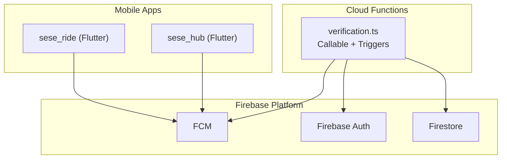
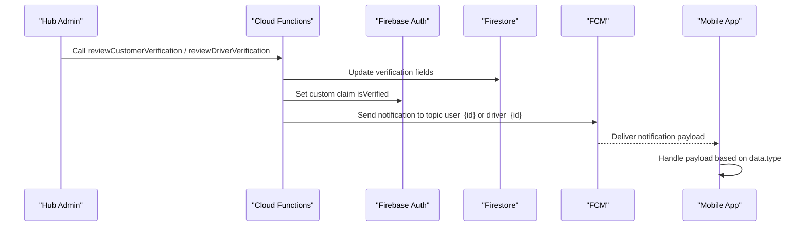
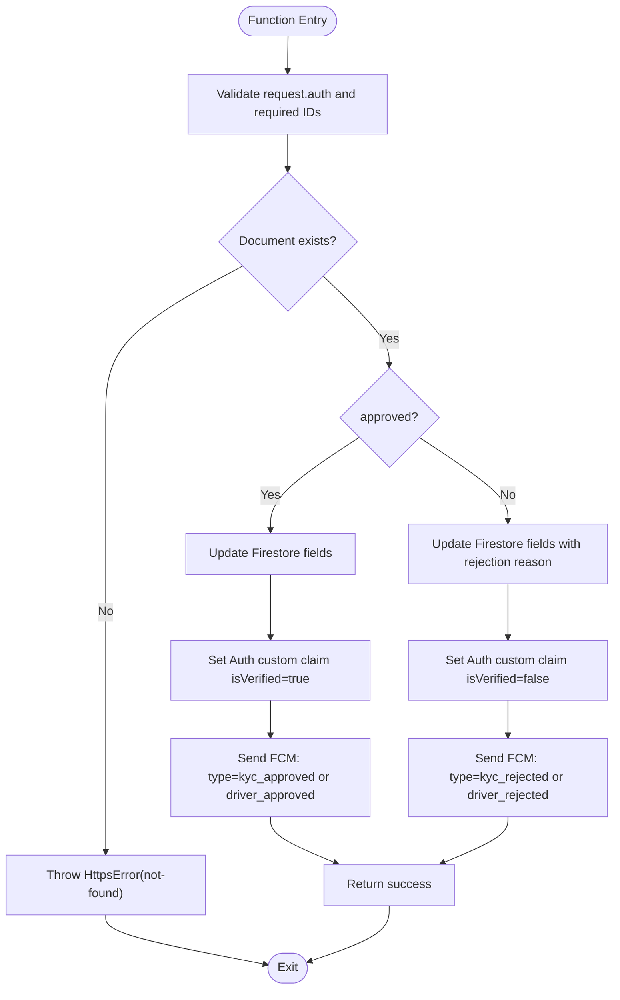
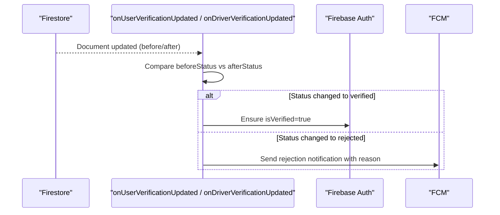
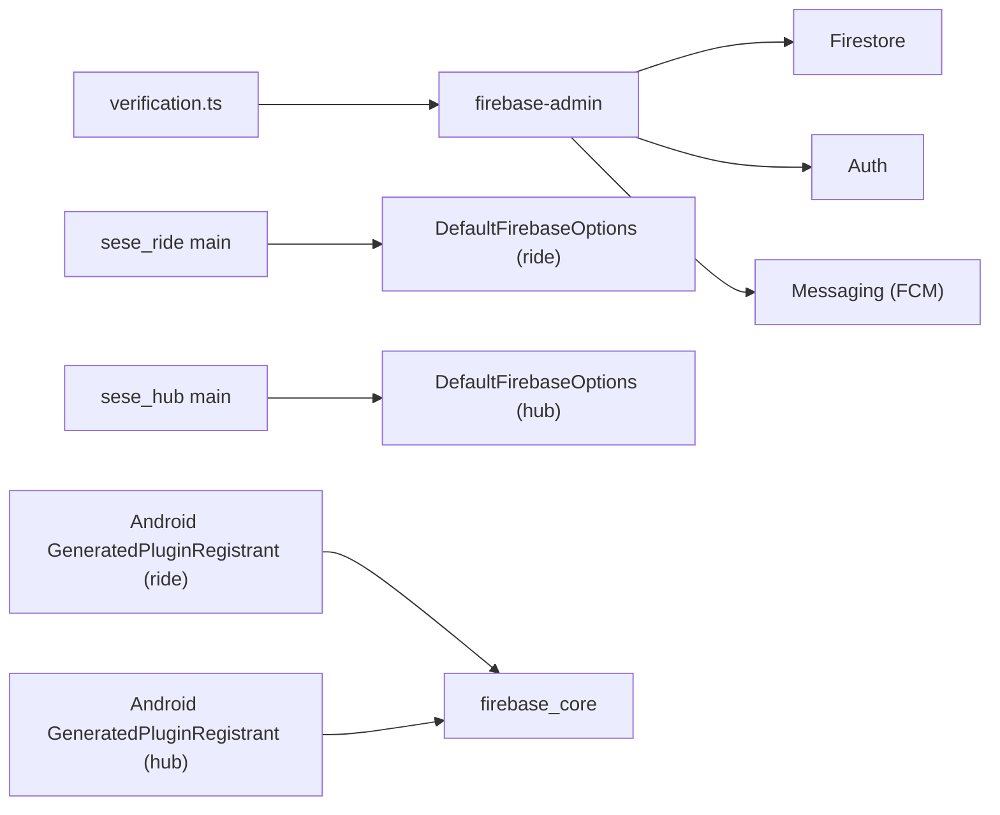

# Notification System

<cite>
**Referenced Files in This Document**
- [verification.ts](file://functions/src/verification.ts)
- [verification.js](file://functions/lib/verification.js)
- [driver_verification.dart](file://sese_core/lib/models/driver_verification.dart)
- [main.dart (sese_ride)](file://sese_ride/lib/main.dart)
- [firebase_options.dart (sese_ride)](file://sese_ride/lib/firebase_options.dart)
- [main.dart (sese_hub)](file://sese_hub/lib/main.dart)
- [firebase_options.dart (sese_hub)](file://sese_hub/lib/firebase_options.dart)
- [GeneratedPluginRegistrant.java (sese_ride Android)](file://sese_ride/android/app/src/main/java/io/flutter/plugins/GeneratedPluginRegistrant.java)
- [GeneratedPluginRegistrant.java (sese_hub Android)](file://sese_hub/android/app/src/main/java/io/flutter/plugins/GeneratedPluginRegistrant.java)
- [app_sound_service.dart](file://sese_core/lib/services/app_sound_service.dart)
- [support_chat_screen.dart](file://sese_ride/lib/features/support/support_chat_screen.dart)
</cite>

## Table of Contents
1. [Introduction](#introduction)
2. [Project Structure](#project-structure)
3. [Core Components](#core-components)
4. [Architecture Overview](#architecture-overview)
5. [Detailed Component Analysis](#detailed-component-analysis)
6. [Dependency Analysis](#dependency-analysis)
7. [Performance Considerations](#performance-considerations)
8. [Troubleshooting Guide](#troubleshooting-guide)
9. [Conclusion](#conclusion)

## Introduction
This document explains the verification notification system that uses Firebase Cloud Messaging (FCM) to deliver real-time updates about user and driver verification status changes. It covers:
- The FCM integration for sending notifications when KYC or driver profile reviews are approved or rejected.
- Notification types, message templates, and payload structures.
- How mobile apps can handle these notifications.
- Retry strategies for failed deliveries.
- User preference management for notification channels.
- Localization support and scheduling considerations for time-sensitive updates.

## Project Structure
The notification system spans server-side Cloud Functions and client-side Flutter apps:
- Server side: Cloud Functions implement callable review endpoints and Firestore triggers that update Firestore documents, set custom Auth claims, and send FCM messages.
- Client side: Flutter apps initialize Firebase, register plugins, and can subscribe to FCM topics to receive verification notifications.

**Diagram sources**
- [verification.ts:1-351](file://functions/src/verification.ts#L1-L351)
- [main.dart (sese_ride):13-40](file://sese_ride/lib/main.dart#L13-L40)
- [main.dart (sese_hub):13-38](file://sese_hub/lib/main.dart#L13-L38)

**Section sources**
- [verification.ts:1-351](file://functions/src/verification.ts#L1-L351)
- [main.dart (sese_ride):13-40](file://sese_ride/lib/main.dart#L13-L40)
- [main.dart (sese_hub):13-38](file://sese_hub/lib/main.dart#L13-L38)

## Core Components
- Callable review endpoints:
  - Customer KYC approval/rejection: sets customer verification fields, updates Auth claims, and sends an FCM notification with type kyc_approved or kyc_rejected.
  - Driver profile approval/rejection: sets driver verification fields, updates Auth claims, and sends an FCM notification with type driver_approved or driver_rejected.
- Firestore triggers:
  - onUserVerificationUpdated: reacts to direct updates on users/{userId}, syncs Auth claims, and sends a rejection notification if needed.
  - onDriverVerificationUpdated: reacts to direct updates on drivers/{driverId}, syncs Auth claims, and sends a rejection notification if needed.
- Mobile app integration:
  - Both apps initialize Firebase and App Check at startup.
  - Android plugin registration includes firebase_core and firebase_auth; FCM is provided by the Firebase platform.

Key responsibilities:
- Data consistency: Firestore fields reflect verification state.
- Security: Custom Auth claims mirror verification status.
- Real-time feedback: FCM pushes lightweight notifications to topic-based subscribers.

**Section sources**
- [verification.ts:26-131](file://functions/src/verification.ts#L26-L131)
- [verification.ts:138-241](file://functions/src/verification.ts#L138-L241)
- [verification.ts:249-297](file://functions/src/verification.ts#L249-L297)
- [verification.ts:304-350](file://functions/src/verification.ts#L304-L350)
- [GeneratedPluginRegistrant.java (sese_ride Android):33-57](file://sese_ride/android/app/src/main/java/io/flutter/plugins/GeneratedPluginRegistrant.java#L33-L57)
- [GeneratedPluginRegistrant.java (sese_hub Android):36-64](file://sese_hub/android/app/src/main/java/io/flutter/plugins/GeneratedPluginRegistrant.java#L36-L64)

## Architecture Overview
End-to-end flow for verification notifications:

**Diagram sources**
- [verification.ts:26-131](file://functions/src/verification.ts#L26-L131)
- [verification.ts:138-241](file://functions/src/verification.ts#L138-L241)

## Detailed Component Analysis

### Verification Cloud Functions
Responsibilities:
- Validate inputs and authenticate callers.
- Update Firestore documents for customers and drivers.
- Synchronize custom Auth claims.
- Send FCM notifications with typed payloads.

Notification types and payloads:
- kyc_approved: Sent to topic user_{userId}. Payload includes type and userId.
- kyc_rejected: Sent to topic user_{userId}. Payload includes type, userId, and reason.
- driver_approved: Sent to topic driver_{driverId}. Payload includes type and driverId.
- driver_rejected: Sent to topic driver_{driverId}. Payload includes type, driverId, and reason.

Message templates:
- Approval title/body indicates account verified.
- Rejection title/body directs users to check their profile for details; the detailed reason is stored in Firestore and included in the payload.

Error handling:
- FCM send failures are logged but do not abort the overall operation.
- Custom claim updates are wrapped in try/catch to avoid blocking Firestore writes.

**Diagram sources**
- [verification.ts:26-131](file://functions/src/verification.ts#L26-L131)
- [verification.ts:138-241](file://functions/src/verification.ts#L138-L241)

**Section sources**
- [verification.ts:26-131](file://functions/src/verification.ts#L26-L131)
- [verification.ts:138-241](file://functions/src/verification.ts#L138-L241)
- [verification.js:48-134](file://functions/lib/verification.js#L48-L134)
- [verification.js:141-225](file://functions/lib/verification.js#L141-L225)

### Firestore Triggers for Direct Updates
Triggers ensure that any direct updates to verification statuses also synchronize Auth claims and notify users when rejected.

- onUserVerificationUpdated:
  - Watches users/{userId}.
  - If status becomes rejected, sends kyc_rejected notification.
  - If status becomes verified, ensures isVerified claim is set.

- onDriverVerificationUpdated:
  - Watches drivers/{driverId}.
  - If status becomes rejected, sends driver_rejected notification.
  - If status becomes approved/verified, ensures isVerified claim is set.

**Diagram sources**
- [verification.ts:249-297](file://functions/src/verification.ts#L249-L297)
- [verification.ts:304-350](file://functions/src/verification.ts#L304-L350)

**Section sources**
- [verification.ts:249-297](file://functions/src/verification.ts#L249-L297)
- [verification.ts:304-350](file://functions/src/verification.ts#L304-L350)

### Mobile App Integration and Handling
Initialization and environment:
- Both apps initialize Firebase and enable App Check at startup.
- Android plugin registration includes firebase_core and firebase_auth; FCM is part of the Firebase platform.

Handling verification notifications:
- Subscribe to FCM topics user_{userId} and driver_{driverId} after login.
- On receiving a notification, inspect data.type:
  - kyc_approved: Show success UI, refresh user state.
  - kyc_rejected: Navigate to KYC details, display reason from payload or Firestore field.
  - driver_approved: Show success UI, refresh driver state.
  - driver_rejected: Navigate to driver profile details, display reason from payload or Firestore field.

Localization and sounds:
- Use localization resources to render titles and bodies consistently across languages.
- Optionally play a short sound using the app’s sound service when a relevant notification arrives.

Scheduling and time-sensitive updates:
- For time-sensitive updates, consider using scheduled functions to batch or delay notifications during off-hours.
- Respect user preferences for quiet hours and channel permissions.

**Section sources**
- [main.dart (sese_ride):13-40](file://sese_ride/lib/main.dart#L13-L40)
- [main.dart (sese_hub):13-38](file://sese_hub/lib/main.dart#L13-L38)
- [GeneratedPluginRegistrant.java (sese_ride Android):33-57](file://sese_ride/android/app/src/main/java/io/flutter/plugins/GeneratedPluginRegistrant.java#L33-L57)
- [GeneratedPluginRegistrant.java (sese_hub Android):36-64](file://sese_hub/android/app/src/main/java/io/flutter/plugins/GeneratedPluginRegistrant.java#L36-L64)
- [app_sound_service.dart:62-129](file://sese_core/lib/services/app_sound_service.dart#L62-L129)

### Data Models and Lifecycle
Shared constants define verification lifecycles and fields used by both apps and functions:
- DriverVerification: pending_onboarding, pending, approved, rejected; fields include verificationStatus, isProfileVerified, isVehicleVerified, canGoOnline.
- CustomerVerification: unverified, pending_review, verified, rejected; fields include customerVerificationStatus, isVerifiedCustomer, kycRejectionReason, kycData.

These models guide how the app interprets backend states and what UI to show while waiting for verification outcomes.

**Section sources**
- [driver_verification.dart:1-54](file://sese_core/lib/models/driver_verification.dart#L1-L54)

## Dependency Analysis
High-level dependencies:
- Cloud Functions depend on firebase-admin for Firestore, Auth, and Messaging.
- Mobile apps depend on Firebase SDKs initialized via DefaultFirebaseOptions.
- Android builds register core Firebase plugins through GeneratedPluginRegistrant.

**Diagram sources**
- [verification.ts:1-5](file://functions/src/verification.ts#L1-L5)
- [firebase_options.dart (sese_ride):17-41](file://sese_ride/lib/firebase_options.dart#L17-L41)
- [firebase_options.dart (sese_hub):17-41](file://sese_hub/lib/firebase_options.dart#L17-L41)
- [GeneratedPluginRegistrant.java (sese_ride Android):33-57](file://sese_ride/android/app/src/main/java/io/flutter/plugins/GeneratedPluginRegistrant.java#L33-L57)
- [GeneratedPluginRegistrant.java (sese_hub Android):36-64](file://sese_hub/android/app/src/main/java/io/flutter/plugins/GeneratedPluginRegistrant.java#L36-L64)

**Section sources**
- [verification.ts:1-5](file://functions/src/verification.ts#L1-L5)
- [firebase_options.dart (sese_ride):17-41](file://sese_ride/lib/firebase_options.dart#L17-L41)
- [firebase_options.dart (sese_hub):17-41](file://sese_hub/lib/firebase_options.dart#L17-L41)
- [GeneratedPluginRegistrant.java (sese_ride Android):33-57](file://sese_ride/android/app/src/main/java/io/flutter/plugins/GeneratedPluginRegistrant.java#L33-L57)
- [GeneratedPluginRegistrant.java (sese_hub Android):36-64](file://sese_hub/android/app/src/main/java/io/flutter/plugins/GeneratedPluginRegistrant.java#L36-L64)

## Performance Considerations
- Keep notification payloads small: include only type and identifiers; store detailed reasons in Firestore.
- Avoid heavy work in FCM callbacks; delegate UI updates and data fetching to the app layer.
- Batch operations where possible; use Firestore transactions for multi-field updates.
- Monitor FCM delivery metrics and logs to detect failures early.

[No sources needed since this section provides general guidance]

## Troubleshooting Guide
Common issues and resolutions:
- FCM send failures:
  - Symptoms: Logs indicate “FCM send failed” or “Trigger FCM failed”.
  - Actions: Verify device token subscription to the correct topic; check network connectivity; retry with exponential backoff.
- Missing custom claims:
  - Symptoms: App still shows unverified despite Firestore being updated.
  - Actions: Ensure triggers or callables set isVerified; re-login to refresh tokens.
- Incorrect topics:
  - Symptoms: Notifications not received.
  - Actions: Confirm topics user_{userId} and driver_{driverId} match the authenticated user ID.
- App initialization errors:
  - Symptoms: PERMISSION_DENIED on Firestore due to missing App Check provider.
  - Actions: Ensure FirebaseAppCheck is activated per platform; verify DebugProvider in debug builds.

Operational tips:
- Add structured logging around FCM calls to capture error codes and targets.
- Implement client-side retry with jitter for transient failures.
- Provide in-app fallbacks to fetch latest status from Firestore when notifications are missed.

**Section sources**
- [verification.ts:66-81](file://functions/src/verification.ts#L66-L81)
- [verification.ts:178-193](file://functions/src/verification.ts#L178-L193)
- [verification.ts:277-294](file://functions/src/verification.ts#L277-L294)
- [verification.ts:330-347](file://functions/src/verification.ts#L330-L347)

## Conclusion
The verification notification system leverages Cloud Functions to keep Firestore, Auth claims, and FCM in sync. It delivers concise, typed notifications for KYC and driver verification outcomes, enabling mobile apps to present timely and localized user experiences. By following the recommended patterns for payload design, error handling, retries, and user preferences, teams can maintain reliability and clarity across all platforms.