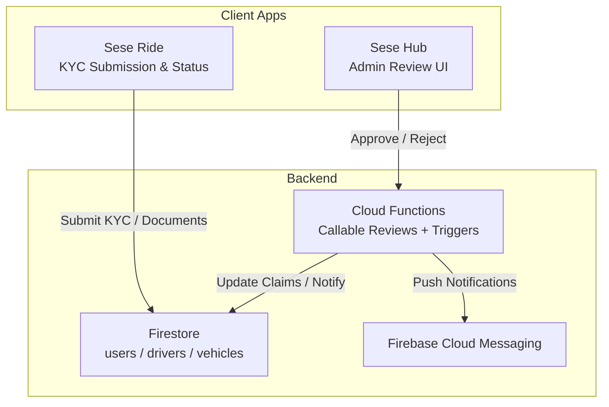
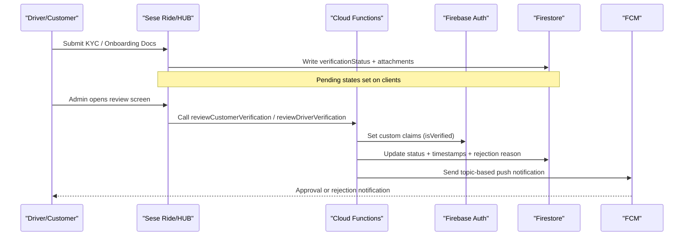
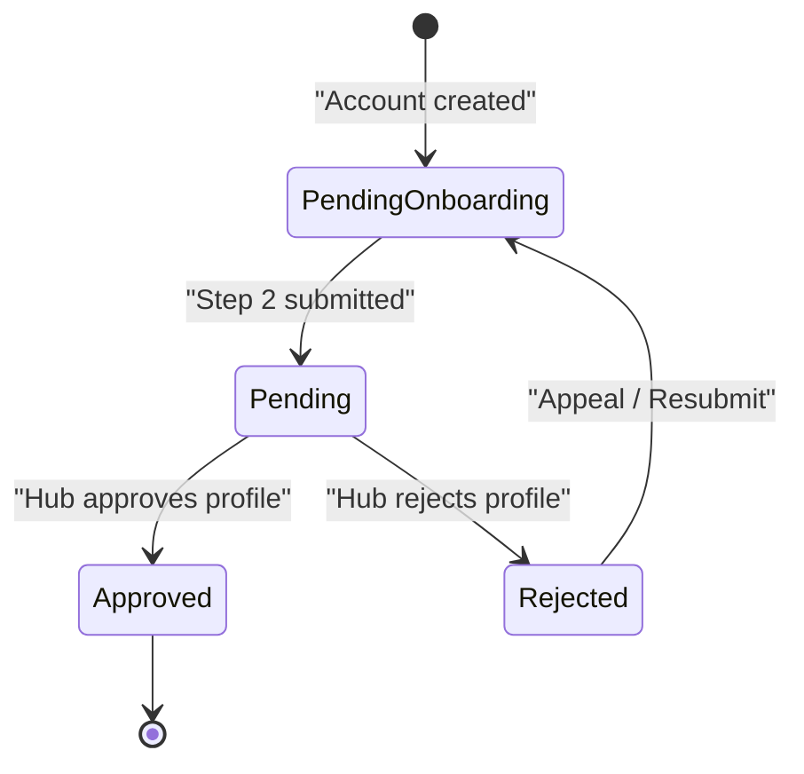
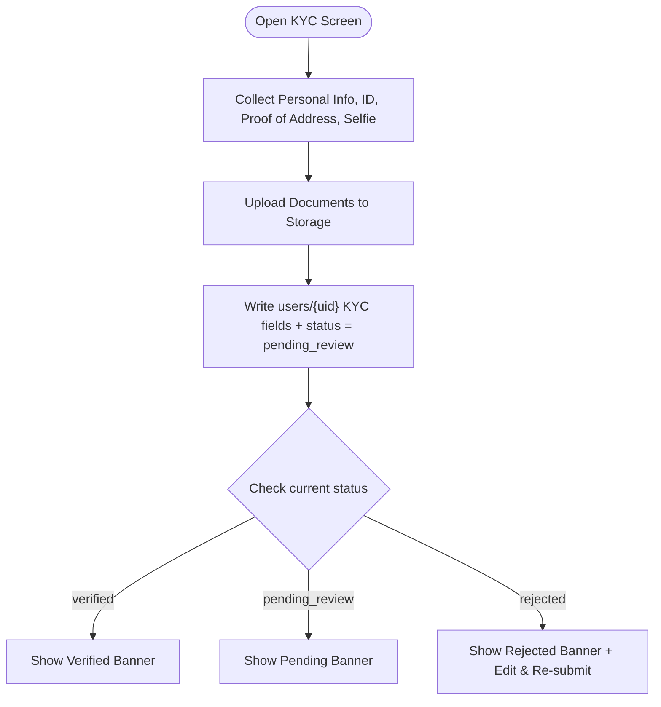
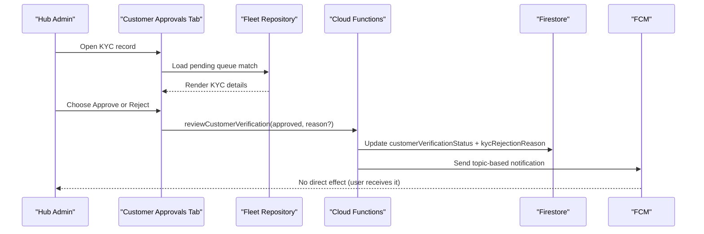
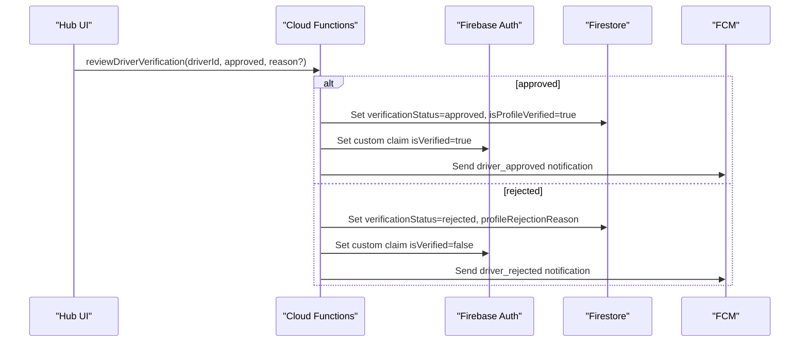
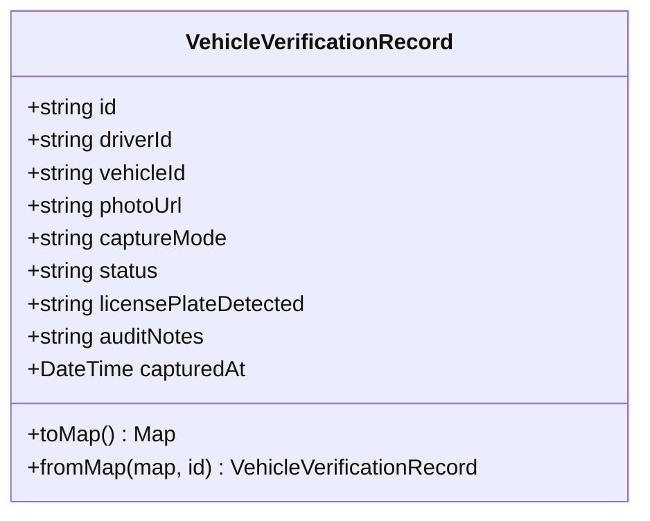
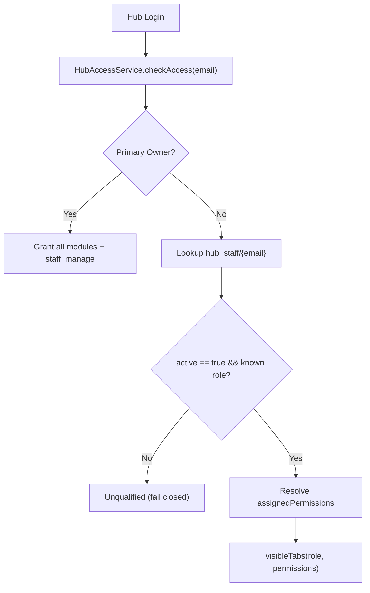
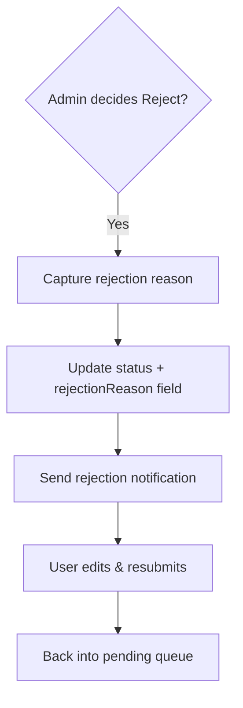
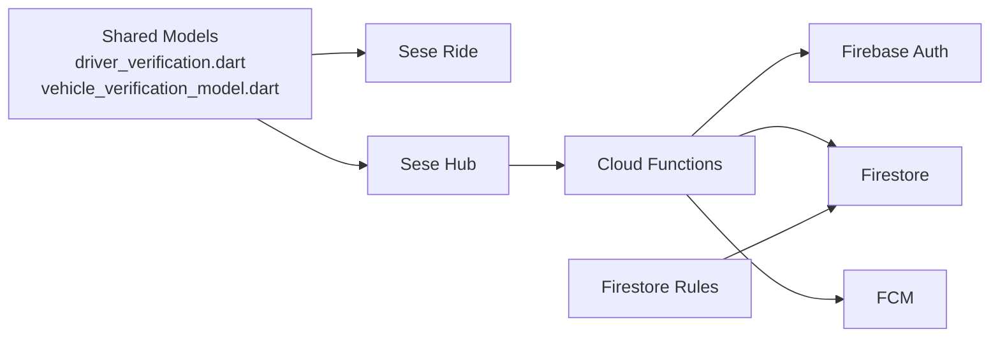

# Verification Pipeline

<cite>
**Referenced Files in This Document**
- [functions/src/verification.ts](file://functions/src/verification.ts)
- [sese_core/lib/models/driver_verification.dart](file://sese_core/lib/models/driver_verification.dart)
- [sese_core/lib/models/vehicle_verification_model.dart](file://sese_core/lib/models/vehicle_verification_model.dart)
- [sese_hub/lib/features/verification/services/fleet_repository.dart](file://sese_hub/lib/features/verification/services/fleet_repository.dart)
- [sese_hub/lib/features/verification/presentation/customer_approvals_tab.dart](file://sese_hub/lib/features/verification/presentation/customer_approvals_tab.dart)
- [sese_hub/lib/features/verification/presentation/vehicle_approvals_screen.dart](file://sese_hub/lib/features/verification/presentation/vehicle_approvals_screen.dart)
- [sese_hub/lib/features/staff/services/hub_access_service.dart](file://sese_hub/lib/features/staff/services/hub_access_service.dart)
- [firestore.rules](file://firestore.rules)
- [sese_ride/lib/features/customer/presentation/customer_verification_screen.dart](file://sese_ride/lib/features/customer/presentation/customer_verification_screen.dart)
- [sese_ride/lib/features/driver/presentation/widgets/verification_banner.dart](file://sese_ride/lib/features/driver/presentation/widgets/verification_banner.dart)
</cite>

## Table of Contents
1. [Introduction](#introduction)
2. [Project Structure](#project-structure)
3. [Core Components](#core-components)
4. [Architecture Overview](#architecture-overview)
5. [Detailed Component Analysis](#detailed-component-analysis)
6. [Dependency Analysis](#dependency-analysis)
7. [Performance Considerations](#performance-considerations)
8. [Troubleshooting Guide](#troubleshooting-guide)
9. [Conclusion](#conclusion)

## Introduction
This document explains the end-to-end driver and customer verification pipeline, from initial submission to final approval or rejection. It covers:
- Verification states for drivers and customers
- Admin review workflows in Sese Hub
- Automated background checks via Cloud Functions
- Notifications through Firebase Cloud Messaging (FCM)
- Data models for KYC and vehicle verification records
- Role-based access control (RBAC) for admin reviewers
- Rejection handling, appeal flows, and compliance considerations

The system is implemented across:
- Client apps (Sese Ride and Sese Hub)
- Cloud Functions for backend orchestration
- Firestore for persistence and real-time state
- Security rules for RBAC enforcement

## Project Structure
The verification pipeline spans multiple modules:
- Core models define shared constants and data structures used by both client apps and backend logic.
- Sese Ride handles user-facing submission and status display.
- Sese Hub provides admin interfaces for reviewing and approving/rejecting submissions.
- Cloud Functions implement callable review endpoints and event-driven synchronization.
- Firestore Rules enforce RBAC and secure access to sensitive documents.

**Diagram sources**
- [functions/src/verification.ts:26-130](file://functions/src/verification.ts#L26-L130)
- [functions/src/verification.ts:138-240](file://functions/src/verification.ts#L138-L240)
- [sese_ride/lib/features/customer/presentation/customer_verification_screen.dart:630-670](file://sese_ride/lib/features/customer/presentation/customer_verification_screen.dart#L630-L670)
- [sese_hub/lib/features/verification/presentation/customer_approvals_tab.dart:239-263](file://sese_hub/lib/features/verification/presentation/customer_approvals_tab.dart#L239-L263)

**Section sources**
- [sese_core/lib/models/driver_verification.dart:1-24](file://sese_core/lib/models/driver_verification.dart#L1-L24)
- [sese_core/lib/models/vehicle_verification_model.dart:1-68](file://sese_core/lib/models/vehicle_verification_model.dart#L1-L68)
- [functions/src/verification.ts:1-351](file://functions/src/verification.ts#L1-L351)

## Core Components
- Driver verification lifecycle and fields are defined as shared constants and documented with their intended semantics.
- Customer verification lifecycle includes unverified, pending_review, verified, and rejected states, with explicit fields for KYC data and rejection reasons.
- Vehicle verification records capture pre-online selfie/plate verification with strict capture mode and audit notes.

Key responsibilities:
- DriverVerification: defines driver states and flags that gate online capability.
- CustomerVerification: defines customer KYC states and helper methods for pending/verified checks.
- VehicleVerificationRecord: models a per-vehicle verification audit entry.

**Section sources**
- [sese_core/lib/models/driver_verification.dart:1-24](file://sese_core/lib/models/driver_verification.dart#L1-L24)
- [sese_core/lib/models/driver_verification.dart:26-68](file://sese_core/lib/models/driver_verification.dart#L26-L68)
- [sese_core/lib/models/vehicle_verification_model.dart:1-68](file://sese_core/lib/models/vehicle_verification_model.dart#L1-L68)

## Architecture Overview
The verification architecture combines client submissions, admin reviews, server-side updates, and notifications:

**Diagram sources**
- [functions/src/verification.ts:26-130](file://functions/src/verification.ts#L26-L130)
- [functions/src/verification.ts:138-240](file://functions/src/verification.ts#L138-L240)
- [functions/src/verification.ts:249-350](file://functions/src/verification.ts#L249-L350)

## Detailed Component Analysis

### Driver Verification States and Online Gate
Drivers progress through:
- pending_onboarding: account created, personal info not yet submitted; routed to onboarding.
- pending: personal info submitted; awaiting manual audit; persistent banner shown; vehicle registration allowed but non-blocking.
- approved: profile approved; isProfileVerified true.
- rejected: profile rejected; profileRejectionReason stored.

Online gating requires both profile and vehicle verification.

**Diagram sources**
- [sese_core/lib/models/driver_verification.dart:1-24](file://sese_core/lib/models/driver_verification.dart#L1-L24)
- [sese_ride/lib/features/driver/presentation/widgets/verification_banner.dart:24-56](file://sese_ride/lib/features/driver/presentation/widgets/verification_banner.dart#L24-L56)

**Section sources**
- [sese_core/lib/models/driver_verification.dart:1-24](file://sese_core/lib/models/driver_verification.dart#L1-L24)
- [sese_ride/lib/features/driver/presentation/widgets/verification_banner.dart:24-56](file://sese_ride/lib/features/driver/presentation/widgets/verification_banner.dart#L24-L56)

### Customer KYC Submission and Status Display
Customers submit KYC including personal details, government ID, proof of address, and selfie. The app uploads files and sets the customer verification status to pending_review. Status banners show verified, pending, or rejected states with an option to edit and resubmit when rejected.

**Diagram sources**
- [sese_ride/lib/features/customer/presentation/customer_verification_screen.dart:256-286](file://sese_ride/lib/features/customer/presentation/customer_verification_screen.dart#L256-L286)
- [sese_ride/lib/features/customer/presentation/customer_verification_screen.dart:630-670](file://sese_ride/lib/features/customer/presentation/customer_verification_screen.dart#L630-L670)

**Section sources**
- [sese_ride/lib/features/customer/presentation/customer_verification_screen.dart:256-286](file://sese_ride/lib/features/customer/presentation/customer_verification_screen.dart#L256-L286)
- [sese_ride/lib/features/customer/presentation/customer_verification_screen.dart:630-670](file://sese_ride/lib/features/customer/presentation/customer_verification_screen.dart#L630-L670)

### Admin Review Workflows (Hub)
Hub admins review and approve or reject:
- Customer KYC via the Customer Approvals tab, which displays personal information, employment/org details, and government ID.
- Vehicle approvals via the Vehicle Approvals screen, which prompts for a required rejection reason.

**Diagram sources**
- [sese_hub/lib/features/verification/presentation/customer_approvals_tab.dart:239-263](file://sese_hub/lib/features/verification/presentation/customer_approvals_tab.dart#L239-L263)
- [sese_hub/lib/features/verification/services/fleet_repository.dart:189-210](file://sese_hub/lib/features/verification/services/fleet_repository.dart#L189-L210)
- [functions/src/verification.ts:26-130](file://functions/src/verification.ts#L26-L130)

**Section sources**
- [sese_hub/lib/features/verification/presentation/customer_approvals_tab.dart:239-263](file://sese_hub/lib/features/verification/presentation/customer_approvals_tab.dart#L239-L263)
- [sese_hub/lib/features/verification/services/fleet_repository.dart:189-210](file://sese_hub/lib/features/verification/services/fleet_repository.dart#L189-L210)

### Automated Background Checks and Sync Triggers
Cloud Functions provide:
- Callable endpoints for admin actions: reviewCustomerVerification and reviewDriverVerification.
- Document update triggers that synchronize custom claims and send notifications when statuses change.

**Diagram sources**
- [functions/src/verification.ts:138-240](file://functions/src/verification.ts#L138-L240)
- [functions/src/verification.ts:304-350](file://functions/src/verification.ts#L304-L350)

**Section sources**
- [functions/src/verification.ts:26-130](file://functions/src/verification.ts#L26-L130)
- [functions/src/verification.ts:138-240](file://functions/src/verification.ts#L138-L240)
- [functions/src/verification.ts:249-350](file://functions/src/verification.ts#L249-L350)

### Vehicle Verification Records
Vehicle verification captures a photo with strict camera-only mode and stores audit metadata. This supports pre-online checks where a driver must have both profile and vehicle verification to go online.

**Diagram sources**
- [sese_core/lib/models/vehicle_verification_model.dart:1-68](file://sese_core/lib/models/vehicle_verification_model.dart#L1-L68)

**Section sources**
- [sese_core/lib/models/vehicle_verification_model.dart:1-68](file://sese_core/lib/models/vehicle_verification_model.dart#L1-L68)

### Role-Based Access Control for Admin Reviewers
Access to Hub modules is governed by:
- A primary owner email that bootstraps full Super authority.
- Staff records under hub_staff with role and assignedPermissions.
- Firestore Rules enforcing adminAuth claims and scopes for sensitive operations.

**Diagram sources**
- [sese_hub/lib/features/staff/services/hub_access_service.dart:6-32](file://sese_hub/lib/features/staff/services/hub_access_service.dart#L6-L32)
- [sese_hub/lib/features/staff/services/hub_access_service.dart:57-83](file://sese_hub/lib/features/staff/services/hub_access_service.dart#L57-L83)
- [sese_hub/lib/features/staff/services/hub_access_service.dart:214-284](file://sese_hub/lib/features/staff/services/hub_access_service.dart#L214-L284)
- [firestore.rules:116-157](file://firestore.rules#L116-L157)

**Section sources**
- [sese_hub/lib/features/staff/services/hub_access_service.dart:6-32](file://sese_hub/lib/features/staff/services/hub_access_service.dart#L6-L32)
- [sese_hub/lib/features/staff/services/hub_access_service.dart:57-83](file://sese_hub/lib/features/staff/services/hub_access_service.dart#L57-L83)
- [sese_hub/lib/features/staff/services/hub_access_service.dart:214-284](file://sese_hub/lib/features/staff/services/hub_access_service.dart#L214-L284)
- [firestore.rules:116-157](file://firestore.rules#L116-L157)

### Rejection Handling and Appeals
- Customer KYC rejections store a structured reason and notify the user; the UI offers “Edit & Re-submit.”
- Driver profile rejections store a reason and disable the profile; the user can resubmit after corrections.
- Vehicle rejections require a mandatory reason from the admin UI.

**Diagram sources**
- [sese_hub/lib/features/verification/presentation/customer_approvals_tab.dart:369-449](file://sese_hub/lib/features/verification/presentation/customer_approvals_tab.dart#L369-L449)
- [sese_hub/lib/features/verification/presentation/vehicle_approvals_screen.dart:646-715](file://sese_hub/lib/features/verification/presentation/vehicle_approvals_screen.dart#L646-L715)
- [functions/src/verification.ts:84-129](file://functions/src/verification.ts#L84-L129)
- [functions/src/verification.ts:196-239](file://functions/src/verification.ts#L196-L239)

**Section sources**
- [sese_hub/lib/features/verification/presentation/customer_approvals_tab.dart:369-449](file://sese_hub/lib/features/verification/presentation/customer_approvals_tab.dart#L369-L449)
- [sese_hub/lib/features/verification/presentation/vehicle_approvals_screen.dart:646-715](file://sese_hub/lib/features/verification/presentation/vehicle_approvals_screen.dart#L646-L715)
- [functions/src/verification.ts:84-129](file://functions/src/verification.ts#L84-L129)
- [functions/src/verification.ts:196-239](file://functions/src/verification.ts#L196-L239)

## Dependency Analysis
The verification pipeline depends on:
- Shared models for consistent state definitions across apps.
- Cloud Functions for secure admin actions and automated sync.
- Firestore Rules for RBAC and data protection.
- FCM for timely user notifications.

**Diagram sources**
- [sese_core/lib/models/driver_verification.dart:1-24](file://sese_core/lib/models/driver_verification.dart#L1-L24)
- [sese_core/lib/models/vehicle_verification_model.dart:1-68](file://sese_core/lib/models/vehicle_verification_model.dart#L1-L68)
- [functions/src/verification.ts:1-351](file://functions/src/verification.ts#L1-L351)
- [firestore.rules:116-157](file://firestore.rules#L116-L157)

**Section sources**
- [sese_core/lib/models/driver_verification.dart:1-24](file://sese_core/lib/models/driver_verification.dart#L1-L24)
- [sese_core/lib/models/vehicle_verification_model.dart:1-68](file://sese_core/lib/models/vehicle_verification_model.dart#L1-L68)
- [functions/src/verification.ts:1-351](file://functions/src/verification.ts#L1-L351)
- [firestore.rules:116-157](file://firestore.rules#L116-L157)

## Performance Considerations
- Use stream listeners sparingly; prefer lightweight status checks for banners to reduce Firestore reads.
- Batch updates in Cloud Functions to minimize round trips when updating Firestore and Auth claims.
- Avoid sending large payloads in FCM notifications; keep bodies concise and pass detailed reasons via data fields.
- Ensure indexes exist for frequently queried fields like verificationStatus and vehicleStatus to optimize Hub queues.

[No sources needed since this section provides general guidance]

## Troubleshooting Guide
Common issues and resolutions:
- Custom claims not updated: verify that Cloud Functions successfully call setCustomUserClaims and check logs for errors.
- Notifications not received: confirm FCM topics are correct (e.g., user_{userId}, driver_{driverId}) and device tokens are active.
- Hub access denied: ensure the user’s email exists in hub_staff with active=true and a known role; verify Firestore Rules allow reads/writes for the reviewer’s scope.
- Pending queue empty: validate fleet_repository.isPendingQueueMatch logic and ensure legacy vs canonical status values are handled correctly.

**Section sources**
- [functions/src/verification.ts:55-64](file://functions/src/verification.ts#L55-L64)
- [functions/src/verification.ts:98-107](file://functions/src/verification.ts#L98-L107)
- [functions/src/verification.ts:167-176](file://functions/src/verification.ts#L167-L176)
- [functions/src/verification.ts:210-218](file://functions/src/verification.ts#L210-L218)
- [sese_hub/lib/features/verification/services/fleet_repository.dart:189-210](file://sese_hub/lib/features/verification/services/fleet_repository.dart#L189-L210)
- [sese_hub/lib/features/staff/services/hub_access_service.dart:214-284](file://sese_hub/lib/features/staff/services/hub_access_service.dart#L214-L284)

## Conclusion
The verification pipeline integrates client submissions, admin reviews, server-side automation, and notifications to ensure secure and auditable onboarding for drivers and customers. Shared models standardize states and fields, while Cloud Functions enforce business logic and maintain consistency between Firestore and Auth claims. Hub RBAC ensures only authorized personnel can perform verification actions. Rejection handling and appeal flows provide clear paths for users to correct and resubmit documentation. Compliance is supported through structured rejection reasons, immutable audit fields, and strict security rules.

[No sources needed since this section summarizes without analyzing specific files]