# Feature Documentation

<cite>
**Referenced Files in This Document**
- [functions/src/index.ts](file://functions/src/index.ts)
- [functions/src/trips.ts](file://functions/src/trips.ts)
- [functions/src/driverStatus.ts](file://functions/src/driverStatus.ts)
- [functions/src/payments.ts](file://functions/src/payments.ts)
- [functions/src/supportBot.ts](file://functions/src/supportBot.ts)
- [sese_core/lib/sese_core.dart](file://sese_core/lib/sese_core.dart)
- [sese_core/lib/models/driver_verification.dart](file://sese_core/lib/models/driver_verification.dart)
- [sese_core/lib/models/trip_estimate.dart](file://sese_core/lib/models/trip_estimate.dart)
- [sese_core/lib/services/pricing_calculator.dart](file://sese_core/lib/services/pricing_calculator.dart)
- [sese_ride/lib/main.dart](file://sese_ride/lib/main.dart)
- [sese_hub/lib/main.dart](file://sese_hub/lib/main.dart)
- [sese_hub/lib/features/dashboard/presentation/hub_dashboard_screen.dart](file://sese_hub/lib/features/dashboard/presentation/hub_dashboard_screen.dart)
- [sese_hub/lib/features/verification/services/fleet_repository.dart](file://sese_hub/lib/features/verification/services/fleet_repository.dart)
- [sese_ride/lib/features/customer/presentation/customer_dispatch_screen.dart](file://sese_ride/lib/features/customer/presentation/customer_dispatch_screen.dart)
- [sese_ride/lib/features/trips/services/trip_service.dart](file://sese_ride/lib/features/trips/services/trip_service.dart)
- [sese_ride/lib/features/support/support_chat_service.dart](file://sese_ride/lib/features/support/support_chat_service.dart)
</cite>

## Table of Contents
1. Introduction
2. Project Structure
3. Core Components
4. Architecture Overview
5. Detailed Component Analysis
6. Dependency Analysis
7. Performance Considerations
8. Troubleshooting Guide
9. Conclusion

## Introduction
This document describes the SeSe App platform’s major features: user management, ride booking and dispatch, delivery services, driver management, administrative operations, and support systems. It explains end-to-end data flows, server-side business logic, state transitions, integration points with external services (Google Routes API, Paystack, Gemini), and user experience considerations including accessibility and localization.

## Project Structure
The repository is a multi-app Flutter project backed by Firebase Cloud Functions and Firestore:
- sese_ride: Customer and Driver apps for ride-hailing and package delivery.
- sese_hub: Staff/admin console for verification, configuration, and support escalation handling.
- functions: Serverless backend implementing zero-trust callable endpoints, scheduled jobs, and event triggers.
- sese_core: Shared Dart library providing models, UI widgets, theme, pricing utilities, and country detection.

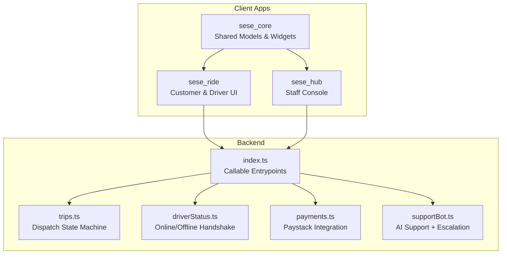

**Diagram sources**
- [functions/src/index.ts:21-53](file://functions/src/index.ts#L21-L53)
- [sese_ride/lib/main.dart:13-40](file://sese_ride/lib/main.dart#L13-L40)
- [sese_hub/lib/main.dart:13-38](file://sese_hub/lib/main.dart#L13-L38)
- [sese_core/lib/sese_core.dart:1-34](file://sese_core/lib/sese_core.dart#L1-L34)

**Section sources**
- [sese_ride/lib/main.dart:13-40](file://sese_ride/lib/main.dart#L13-L40)
- [sese_hub/lib/main.dart:13-38](file://sese_hub/lib/main.dart#L13-L38)
- [functions/src/index.ts:21-53](file://functions/src/index.ts#L21-L53)
- [sese_core/lib/sese_core.dart:1-34](file://sese_core/lib/sese_core.dart#L1-L34)

## Core Components
- Zero-trust callable entrypoints: authentication checks, input validation, and signed fare tokens prevent client tampering.
- Dispatch state machine: server-authoritative trip lifecycle with cascading tiers and scheduled promotions.
- Driver availability handshake: GPS integrity checks, suspension gates, and fleet verification before going online/offline.
- Payments: Paystack-backed wallet top-ups and trip payments with idempotent settlement via callable and webhook.
- AI support chat: Gemini-powered assistant with keyword-based and model-driven escalation to human agents.
- Shared core: models for pricing, vehicle categories, driver verification states, and reusable UI components.

**Section sources**
- [functions/src/index.ts:71-198](file://functions/src/index.ts#L71-L198)
- [functions/src/trips.ts:12-53](file://functions/src/trips.ts#L12-L53)
- [functions/src/driverStatus.ts:6-10](file://functions/src/driverStatus.ts#L6-L10)
- [functions/src/payments.ts:5-26](file://functions/src/payments.ts#L5-L26)
- [functions/src/supportBot.ts:4-19](file://functions/src/supportBot.ts#L4-L19)
- [sese_core/lib/models/driver_verification.dart:1-24](file://sese_core/lib/models/driver_verification.dart#L1-L24)

## Architecture Overview
The platform enforces zero-trust at every boundary:
- Clients never compute or submit authoritative fares; they receive signed fare tokens from the server.
- Trip state transitions are enforced server-side; clients only trigger allowed actions.
- Driver online/offline requires validated GPS and verified vehicles.
- Payments are settled only after server-side verification against Paystack.
- Support escalations are handled automatically when safety-sensitive or policy-boundary issues arise.

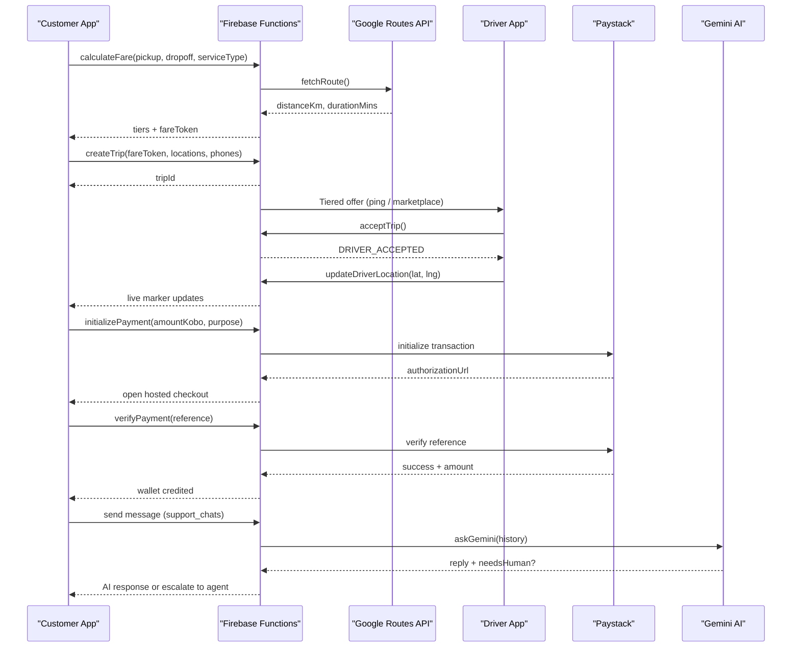

**Diagram sources**
- [functions/src/index.ts:81-198](file://functions/src/index.ts#L81-L198)
- [functions/src/trips.ts:129-225](file://functions/src/trips.ts#L129-L225)
- [functions/src/trips.ts:591-653](file://functions/src/trips.ts#L591-L653)
- [functions/src/driverStatus.ts:32-164](file://functions/src/driverStatus.ts#L32-L164)
- [functions/src/payments.ts:108-197](file://functions/src/payments.ts#L108-L197)
- [functions/src/payments.ts:283-326](file://functions/src/payments.ts#L283-L326)
- [functions/src/supportBot.ts:183-254](file://functions/src/supportBot.ts#L183-L254)

## Detailed Component Analysis

### User Management and Role-Based Routing
- Authentication gate in each app listens to auth state and routes users to the correct shell based on role.
- Driver onboarding flow: drivers in pending_onboarding are routed to onboarding; otherwise they land on Driver Home with persistent status banners.
- Hub staff access: silent hub_staff check determines qualification; unqualified users are signed out and shown a generic denial screen.

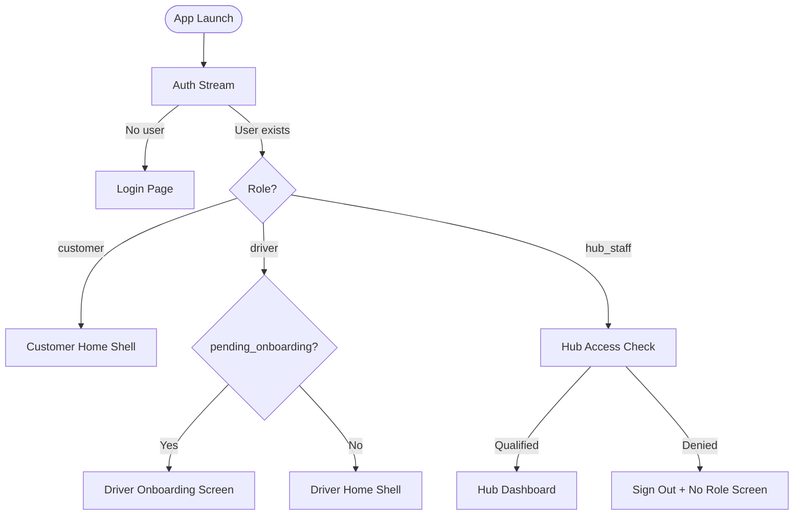

**Diagram sources**
- [sese_ride/lib/main.dart:89-145](file://sese_ride/lib/main.dart#L89-L145)
- [sese_hub/lib/main.dart:87-197](file://sese_hub/lib/main.dart#L87-L197)

**Section sources**
- [sese_ride/lib/main.dart:89-145](file://sese_ride/lib/main.dart#L89-L145)
- [sese_hub/lib/main.dart:87-197](file://sese_hub/lib/main.dart#L87-L197)

### Fare Calculation and Zero-Trust Pricing
- The calculateFare callable validates coordinates, service type, and tier selection, then calls Google Routes API for road distance and duration.
- Server computes per-tier fares using region-scoped pricing and returns a signed fare token that binds user identity, route metrics, and fares.
- Client must include the fare token when creating a trip; server verifies it and rejects tampered requests.

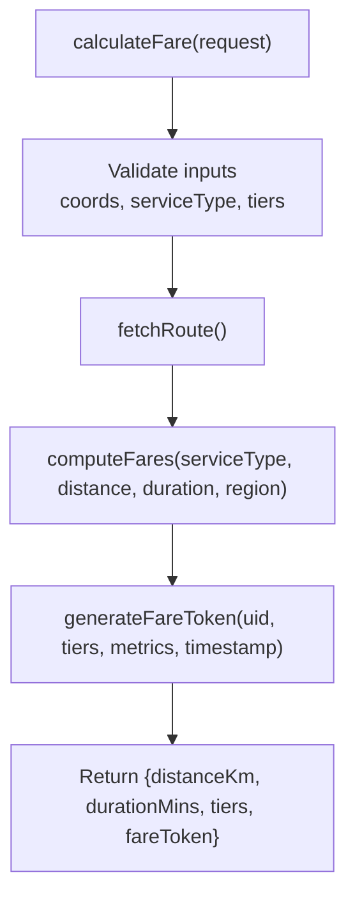

**Diagram sources**
- [functions/src/index.ts:81-198](file://functions/src/index.ts#L81-L198)

**Section sources**
- [functions/src/index.ts:81-198](file://functions/src/index.ts#L81-L198)

### Ride Booking and Delivery Dispatch
- Customer submits pickup/dropoff locations and contact phones; server validates phone formats and coordinates, verifies fare token, and creates a trip in SEARCHING_DRIVER.
- Cascading matchmaking:
  - Tier 1: exclusive ping to nearest eligible driver (15s).
  - Tier 2: simultaneous ping to next two nearest drivers (15s).
  - Tier 3: marketplace broadcast to all nearby online drivers.
- Scheduled sweep promotes offers, expires ignored pings, re-dispatches long-waiting searches, and prompts idle marketplace price increases.

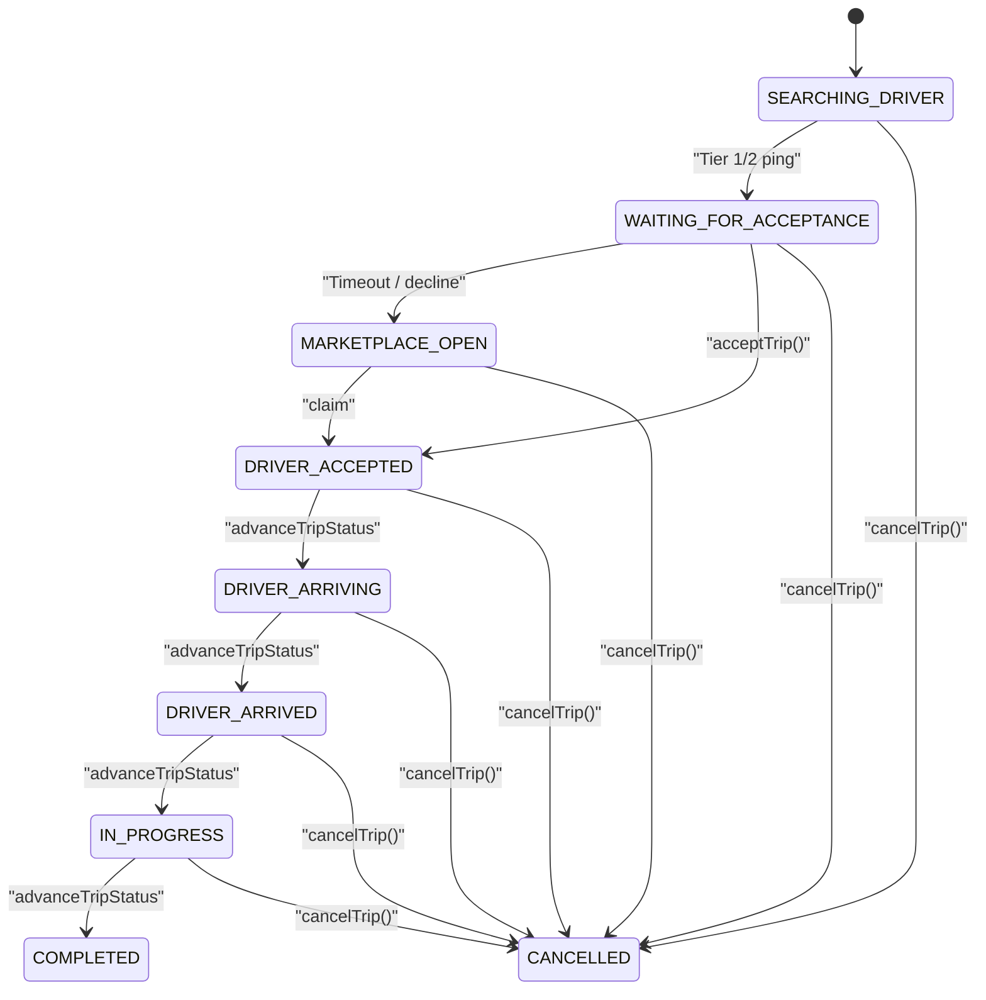

**Diagram sources**
- [functions/src/trips.ts:12-53](file://functions/src/trips.ts#L12-L53)
- [functions/src/trips.ts:129-225](file://functions/src/trips.ts#L129-L225)
- [functions/src/trips.ts:372-512](file://functions/src/trips.ts#L372-L512)
- [functions/src/trips.ts:591-653](file://functions/src/trips.ts#L591-L653)

**Section sources**
- [functions/src/trips.ts:129-225](file://functions/src/trips.ts#L129-L225)
- [functions/src/trips.ts:372-512](file://functions/src/trips.ts#L372-L512)
- [functions/src/trips.ts:591-653](file://functions/src/trips.ts#L591-L653)

### Driver Management and Online/Offline Handshake
- goOnline validates:
  - JWT ownership and no mock location.
  - Account not suspended.
  - Profile and vehicle verification flags set by hub.
  - At least one approved vehicle in fleet.
  - No active live trips.
- Updates authoritative driver_status and drivers documents with last location and timestamps.
- goOffline refuses while in a live trip and clears online mirrors.

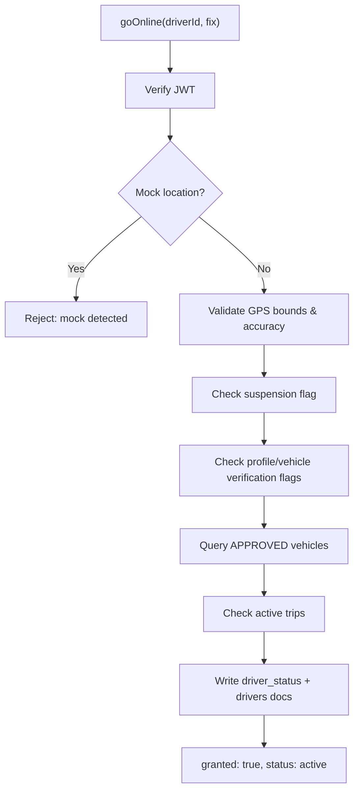

**Diagram sources**
- [functions/src/driverStatus.ts:32-164](file://functions/src/driverStatus.ts#L32-L164)

**Section sources**
- [functions/src/driverStatus.ts:32-164](file://functions/src/driverStatus.ts#L32-L164)

### Payments and Wallet Settlement
- initializePayment validates amount ranges, purpose, email, creates a payment_intents doc, initializes Paystack, and returns authorizationUrl.
- verifyPayment verifies reference server-side, ensures currency and amount match, then settles once via transaction: credits wallets/{uid}, records transaction, marks intent SUCCEEDED.
- paystackWebhook verifies HMAC signature and settles charge.success events idempotently.

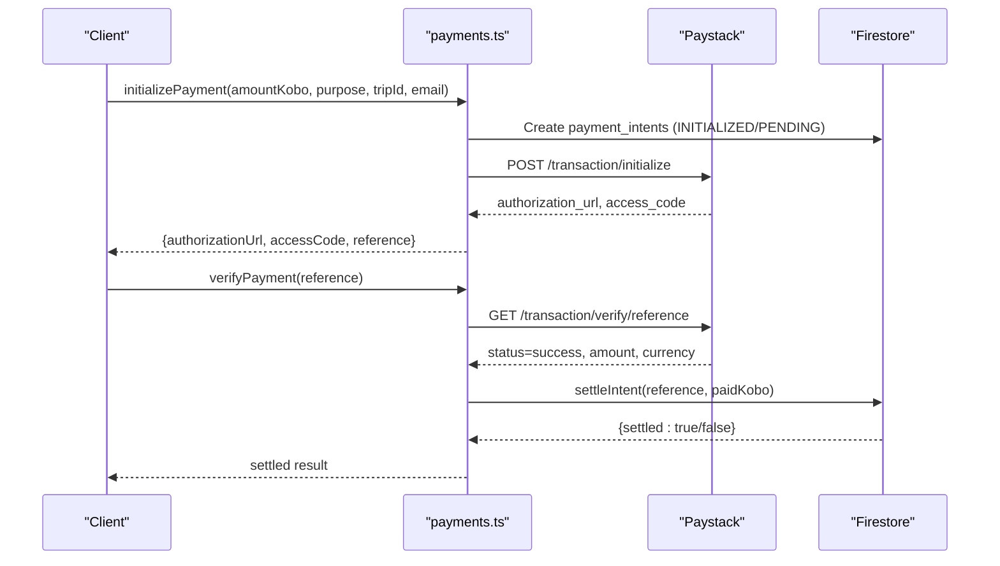

**Diagram sources**
- [functions/src/payments.ts:108-197](file://functions/src/payments.ts#L108-L197)
- [functions/src/payments.ts:283-326](file://functions/src/payments.ts#L283-L326)
- [functions/src/payments.ts:333-370](file://functions/src/payments.ts#L333-L370)

**Section sources**
- [functions/src/payments.ts:108-197](file://functions/src/payments.ts#L108-L197)
- [functions/src/payments.ts:283-326](file://functions/src/payments.ts#L283-L326)
- [functions/src/payments.ts:333-370](file://functions/src/payments.ts#L333-L370)

### Support Systems and AI Escalation
- SupportChatService manages sessions in support_chats with messages subcollection, supports opening/resuming sessions, sending messages, and escalating to human agents.
- onSupportMessageCreated triggers when a user writes a message in an ai_active session:
  - Keyword heuristic can force escalation immediately.
  - Otherwise, asks Gemini for a reply and a human-escalation verdict.
  - Posts AI responses or flips chat to pending_agent and sends FCM alert to admin_support_alerts.

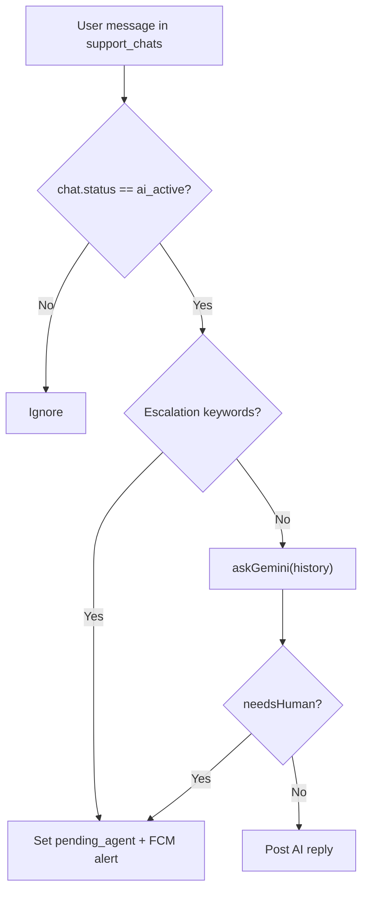

**Diagram sources**
- [functions/src/supportBot.ts:183-254](file://functions/src/supportBot.ts#L183-L254)
- [sese_ride/lib/features/support/support_chat_service.dart:123-288](file://sese_ride/lib/features/support/support_chat_service.dart#L123-L288)

**Section sources**
- [functions/src/supportBot.ts:183-254](file://functions/src/supportBot.ts#L183-L254)
- [sese_ride/lib/features/support/support_chat_service.dart:123-288](file://sese_ride/lib/features/support/support_chat_service.dart#L123-L288)

### Administrative Features (Hub)
- Hub dashboard visibility is gated by staff role and assigned permissions; tabs are filtered consistently across layouts.
- Fleet repository merges canonical vehicle docs, legacy docs, driver vehicle collections, and driver verification streams into a unified view for approvals.
- Global configuration screens expose regional scoping, vehicle category pricing, and publish actions.

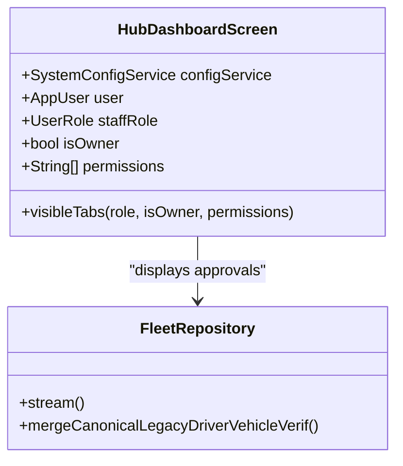

**Diagram sources**
- [sese_hub/lib/features/dashboard/presentation/hub_dashboard_screen.dart:10-75](file://sese_hub/lib/features/dashboard/presentation/hub_dashboard_screen.dart#L10-L75)
- [sese_hub/lib/features/verification/services/fleet_repository.dart:137-187](file://sese_hub/lib/features/verification/services/fleet_repository.dart#L137-L187)

**Section sources**
- [sese_hub/lib/features/dashboard/presentation/hub_dashboard_screen.dart:10-75](file://sese_hub/lib/features/dashboard/presentation/hub_dashboard_screen.dart#L10-L75)
- [sese_hub/lib/features/verification/services/fleet_repository.dart:137-187](file://sese_hub/lib/features/verification/services/fleet_repository.dart#L137-L187)

### Data Flows and Business Logic Highlights
- Multi-vehicle dispatch proposals for package delivery compute per-category estimates and serialize them for broadcasting.
- Driver verification constants define lifecycle tokens used across apps to control routing and gating.
- Pricing calculator generates per-vehicle estimates and guarantees dynamic rate computation for selected categories.

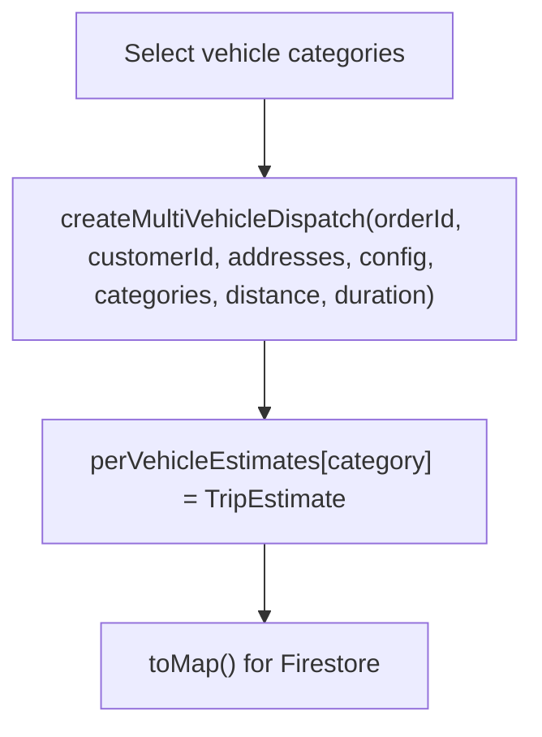

**Diagram sources**
- [sese_core/lib/services/pricing_calculator.dart:105-146](file://sese_core/lib/services/pricing_calculator.dart#L105-L146)
- [sese_core/lib/models/trip_estimate.dart:75-122](file://sese_core/lib/models/trip_estimate.dart#L75-L122)

**Section sources**
- [sese_core/lib/services/pricing_calculator.dart:105-146](file://sese_core/lib/services/pricing_calculator.dart#L105-L146)
- [sese_core/lib/models/trip_estimate.dart:75-122](file://sese_core/lib/models/trip_estimate.dart#L75-L122)
- [sese_core/lib/models/driver_verification.dart:1-24](file://sese_core/lib/models/driver_verification.dart#L1-L24)

## Dependency Analysis
- Client apps depend on shared core for models, theme, and country detection.
- Callable entrypoints aggregate domain modules (trips, driverStatus, payments, supportBot).
- External integrations:
  - Google Routes API for accurate distance/duration.
  - Paystack for payments and webhooks.
  - Gemini for AI support replies.
  - Firebase App Check for Firestore protection.

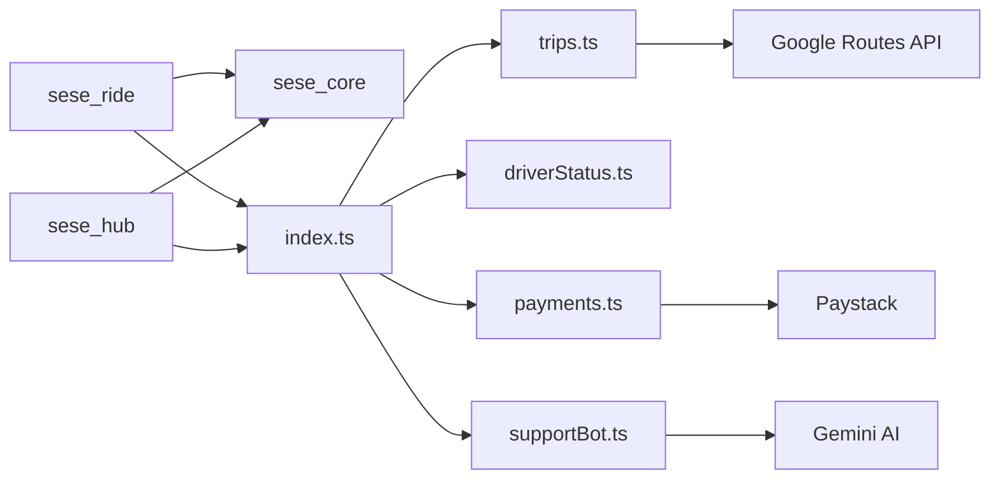

**Diagram sources**
- [sese_core/lib/sese_core.dart:1-34](file://sese_core/lib/sese_core.dart#L1-L34)
- [functions/src/index.ts:21-53](file://functions/src/index.ts#L21-L53)
- [functions/src/index.ts:81-198](file://functions/src/index.ts#L81-L198)
- [functions/src/payments.ts:5-26](file://functions/src/payments.ts#L5-L26)
- [functions/src/supportBot.ts:4-19](file://functions/src/supportBot.ts#L4-L19)

**Section sources**
- [sese_core/lib/sese_core.dart:1-34](file://sese_core/lib/sese_core.dart#L1-L34)
- [functions/src/index.ts:21-53](file://functions/src/index.ts#L21-L53)

## Performance Considerations
- Use server-side routing and pricing to avoid expensive client computations and reduce network chatter.
- Leverage scheduled sweeps for batched dispatch promotions and cleanup rather than polling.
- Cache country detection and theme preferences locally to minimize cold-start latency.
- Prefer Firestore streams for real-time updates (trip status, bids, driver location) to keep UI responsive.

## Troubleshooting Guide
- Unauthenticated errors: ensure Firebase App Check is activated and user is signed in before calling callables.
- Invalid arguments: validate pickup/dropoff coordinates, phone numbers, and fare tokens before submission.
- Permission denied: confirm driver is online only for their own account and has approved vehicles; hub staff must be qualified.
- Payment failures: verify reference ownership, amount/currency matching, and webhook signature validity.
- Support chat unavailable: check Firestore connectivity and fallback messaging; escalate if AI is down.

**Section sources**
- [functions/src/index.ts:81-124](file://functions/src/index.ts#L81-L124)
- [functions/src/trips.ts:129-167](file://functions/src/trips.ts#L129-L167)
- [functions/src/driverStatus.ts:32-57](file://functions/src/driverStatus.ts#L32-L57)
- [functions/src/payments.ts:283-326](file://functions/src/payments.ts#L283-L326)
- [sese_ride/lib/features/trips/services/trip_service.dart:189-216](file://sese_ride/lib/features/trips/services/trip_service.dart#L189-L216)

## Conclusion
SeSe App implements a secure, scalable platform with strong zero-trust boundaries, robust dispatch logic, and integrated payments and support workflows. The architecture separates concerns across apps, shared core, and serverless functions, enabling clear state management, extensible feature growth, and reliable operations.