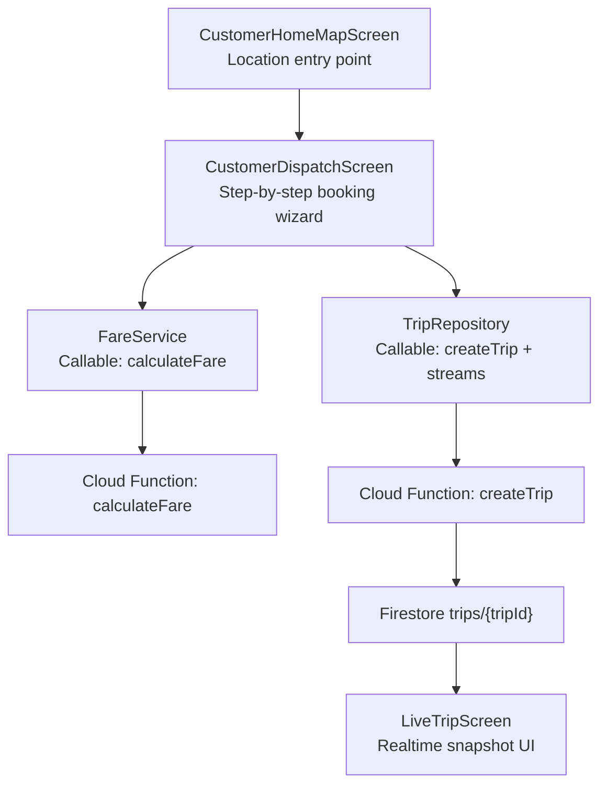
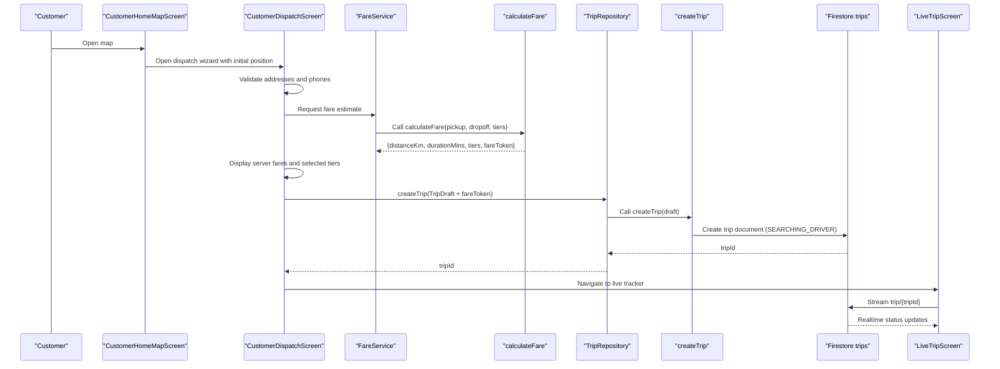
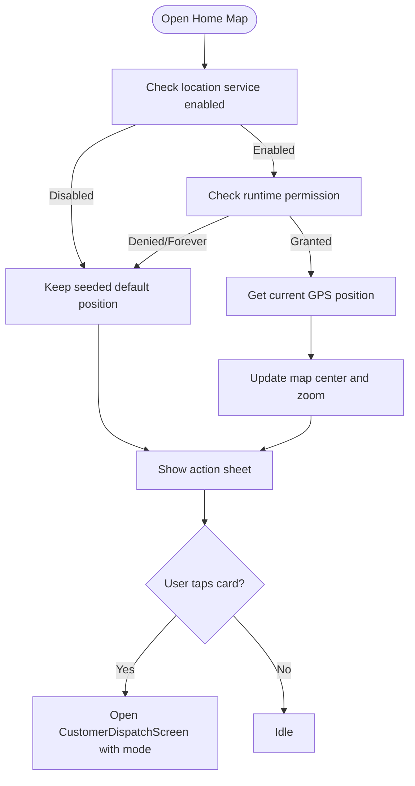
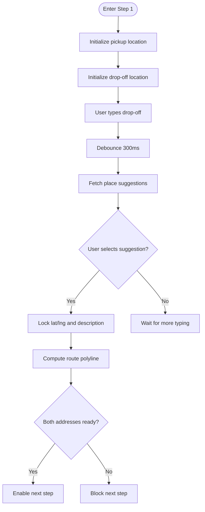
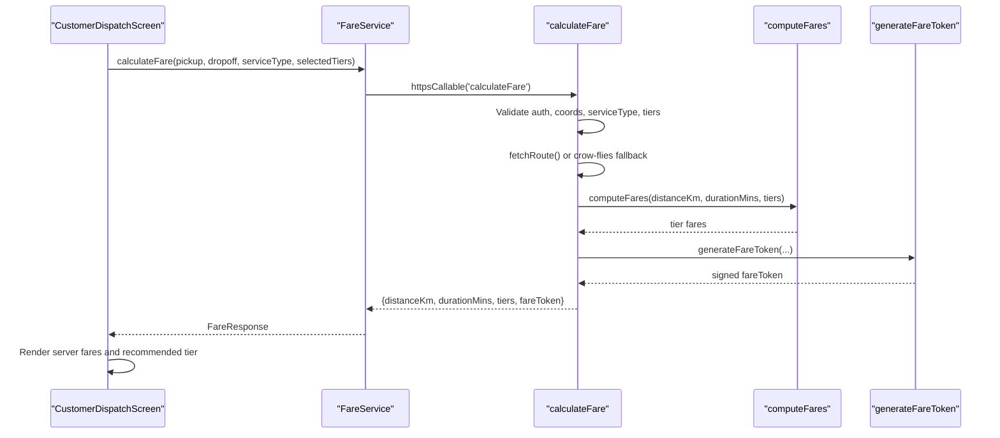
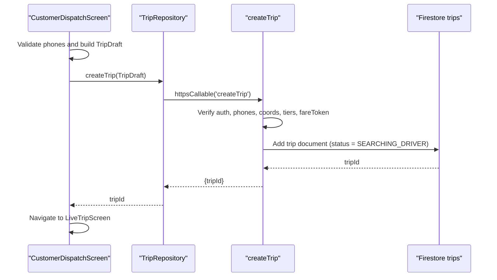
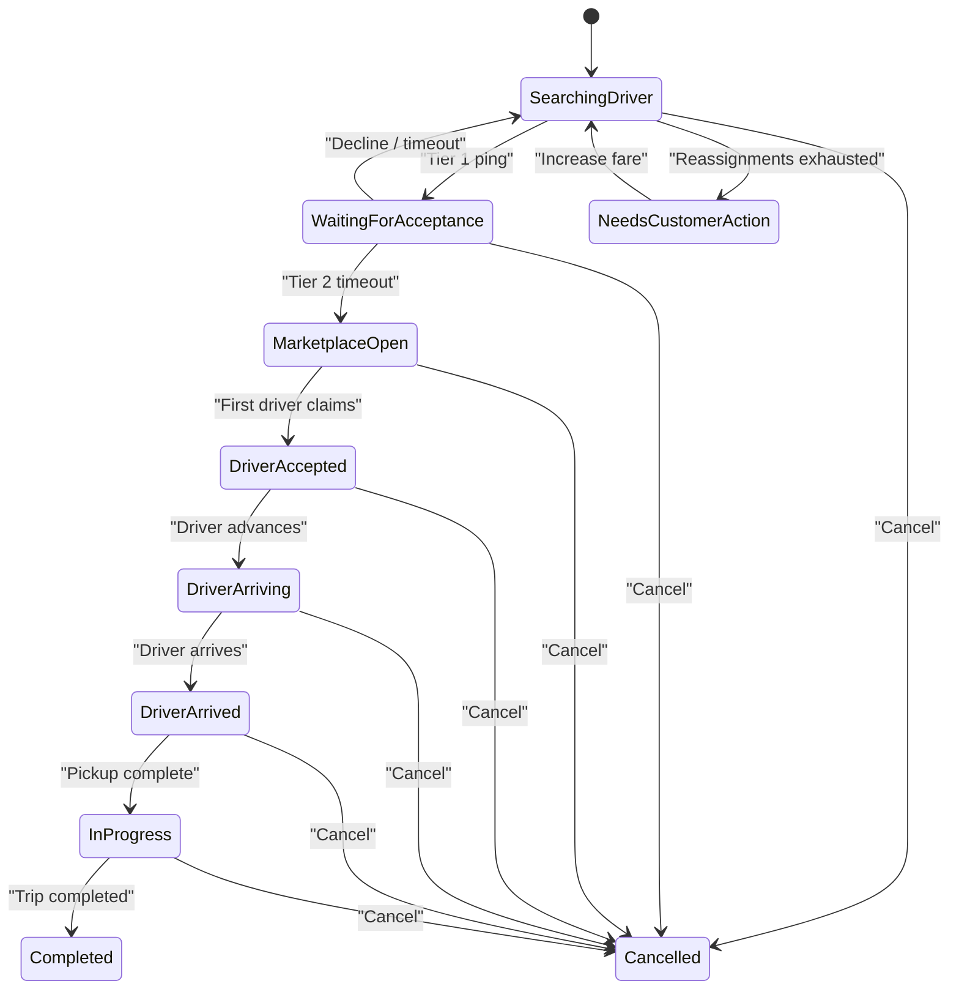
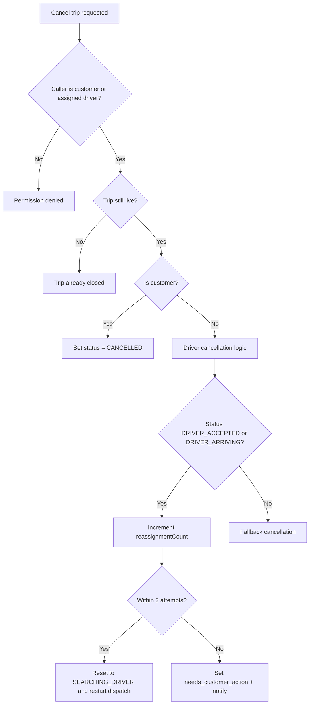
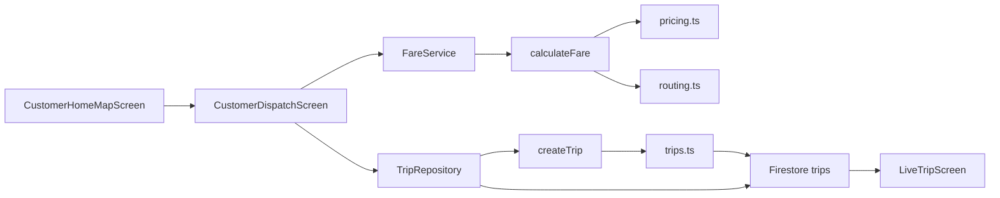

# Booking Workflow

<cite>
**Referenced Files in This Document**
- [customer_home_map_screen.dart](file://sese_ride/lib/features/customer/presentation/customer_home_map_screen.dart)
- [customer_dispatch_screen.dart](file://sese_ride/lib/features/customer/presentation/customer_dispatch_screen.dart)
- [fare_service.dart](file://sese_ride/lib/features/customer/services/fare_service.dart)
- [trip_service.dart](file://sese_ride/lib/features/trips/services/trip_service.dart)
- [trip_models.dart](file://sese_ride/lib/features/trips/models/trip_models.dart)
- [index.ts](file://functions/src/index.ts)
- [trips.ts](file://functions/src/trips.ts)
</cite>

## Table of Contents
1. [Introduction](#introduction)
2. [Project Structure](#project-structure)
3. [Core Components](#core-components)
4. [Architecture Overview](#architecture-overview)
5. [Detailed Component Analysis](#detailed-component-analysis)
6. [Dependency Analysis](#dependency-analysis)
7. [Performance Considerations](#performance-considerations)
8. [Troubleshooting Guide](#troubleshooting-guide)
9. [Conclusion](#conclusion)

## Introduction
This document explains the end-to-end ride booking workflow for customers, from selecting pickup and drop-off locations to trip confirmation and live dispatch. It covers:

- Location selection, address validation, destination search, and route preview.
- Fare estimation through a zero-trust backend callable.
- Price display logic, tier selection, and booking request submission.
- Trip creation, initial state management, and real-time updates via Firestore snapshots.
- Error handling for failed bookings, network issues, and service unavailability.
- Integration with mapping services, geocoding APIs, and location permissions.
- Cancellation policies, reassignment behavior, and user notifications during the booking lifecycle.

The system is split between a Flutter customer app (`sese_ride`) and server-side Cloud Functions (`functions`). The client owns the user interface and input validation; the server owns authoritative fare computation, trip state transitions, matchmaking, and dispatch orchestration.

## Project Structure
At a high level, the booking flow spans these layers:

- Customer UI layer: home map screen and step-by-step dispatch wizard.
- Client services: fare calculation transport and trip repository.
- Server functions: fare calculation, trip creation, dispatch cascade, cancellation, bidding, and status advancement.
- Realtime data: Firestore `trips` collection drives live tracking and status updates.

**Diagram sources**
- [customer_home_map_screen.dart:15-86](file://sese_ride/lib/features/customer/presentation/customer_home_map_screen.dart#L15-L86)
- [customer_dispatch_screen.dart:34-87](file://sese_ride/lib/features/customer/presentation/customer_dispatch_screen.dart#L34-L87)
- [fare_service.dart:18-39](file://sese_ride/lib/features/customer/services/fare_service.dart#L18-L39)
- [trip_service.dart:26-64](file://sese_ride/lib/features/trips/services/trip_service.dart#L26-L64)
- [index.ts:81-198](file://functions/src/index.ts#L81-L198)
- [trips.ts:129-224](file://functions/src/trips.ts#L129-L224)

**Section sources**
- [customer_home_map_screen.dart:15-86](file://sese_ride/lib/features/customer/presentation/customer_home_map_screen.dart#L15-L86)
- [customer_dispatch_screen.dart:34-87](file://sese_ride/lib/features/customer/presentation/customer_dispatch_screen.dart#L34-L87)
- [fare_service.dart:18-39](file://sese_ride/lib/features/customer/services/fare_service.dart#L18-L39)
- [trip_service.dart:26-64](file://sese_ride/lib/features/trips/services/trip_service.dart#L26-L64)
- [index.ts:81-198](file://functions/src/index.ts#L81-L198)
- [trips.ts:129-224](file://functions/src/trips.ts#L129-L224)

## Core Components
- Customer home map screen: obtains device location, shows an OpenStreetMap view, and opens the dispatch wizard with the current position.
- Dispatch wizard: three-step flow (locations → choose option → review & confirm), including address validation, destination autocomplete, route preview, fare loading, phone validation, and trip submission.
- Fare service: zero-trust client wrapper around the `calculateFare` callable that returns distance, duration, tiers, and a signed fare token.
- Trip repository: callable-based trip creation plus Firestore streams for live trip state and bids.
- Server trip functions: authoritative trip state machine, cascading driver dispatch, cancellation, bidding, and status transitions.

**Section sources**
- [customer_home_map_screen.dart:15-86](file://sese_ride/lib/features/customer/presentation/customer_home_map_screen.dart#L15-L86)
- [customer_dispatch_screen.dart:25-87](file://sese_ride/lib/features/customer/presentation/customer_dispatch_screen.dart#L25-L87)
- [fare_service.dart:7-39](file://sese_ride/lib/features/customer/services/fare_service.dart#L7-L39)
- [trip_service.dart:8-64](file://sese_ride/lib/features/trips/services/trip_service.dart#L8-L64)
- [trips.ts:12-26](file://functions/src/trips.ts#L12-L26)

## Architecture Overview
The booking architecture follows a zero-trust model:

- The client never computes fares or decides dispatch outcomes.
- All pricing and trip state transitions are enforced by Cloud Functions.
- The client renders only what the server authorizes and persists.

**Diagram sources**
- [customer_home_map_screen.dart:72-86](file://sese_ride/lib/features/customer/presentation/customer_home_map_screen.dart#L72-L86)
- [customer_dispatch_screen.dart:446-540](file://sese_ride/lib/features/customer/presentation/customer_dispatch_screen.dart#L446-L540)
- [customer_dispatch_screen.dart:660-787](file://sese_ride/lib/features/customer/presentation/customer_dispatch_screen.dart#L660-L787)
- [fare_service.dart:44-89](file://sese_ride/lib/features/customer/services/fare_service.dart#L44-L89)
- [index.ts:81-198](file://functions/src/index.ts#L81-L198)
- [trip_service.dart:74-99](file://sese_ride/lib/features/trips/services/trip_service.dart#L74-L99)
- [trips.ts:129-224](file://functions/src/trips.ts#L129-L224)

## Detailed Component Analysis

### Customer Home Map Screen
Responsibilities:
- Resolve device location using platform location services.
- Handle location permission checks and fallbacks.
- Render a full-screen map with a blue-dot marker and a recenter button.
- Launch the dispatch wizard with the resolved position and mode-specific titles.

Key behaviors:
- If location services are disabled or permissions are denied, the widget keeps a seeded default position rather than throwing.
- Tapping “Book Ride,” “Send Item,” or “Receive Item” navigates to `CustomerDispatchScreen` with the appropriate mode index and focused title.

**Diagram sources**
- [customer_home_map_screen.dart:49-70](file://sese_ride/lib/features/customer/presentation/customer_home_map_screen.dart#L49-L70)
- [customer_home_map_screen.dart:72-86](file://sese_ride/lib/features/customer/presentation/customer_home_map_screen.dart#L72-L86)

**Section sources**
- [customer_home_map_screen.dart:15-86](file://sese_ride/lib/features/customer/presentation/customer_home_map_screen.dart#L15-L86)

### Dispatch Wizard: Location Selection and Address Validation
Responsibilities:
- Auto-detect pickup or drop-off depending on mode (Send Item vs Receive Item).
- Reverse-geocode GPS into readable addresses.
- Provide debounced destination autocomplete suggestions.
- Compute and display a route polyline preview.
- Prevent proceeding until both addresses are resolved and not still geocoding.

Validation rules:
- Both pickup and drop-off coordinates must be present before Step 1 completion.
- Geocoding flags block navigation while GPS or reverse-geocoding is in progress.
- Autocomplete changes invalidate previously resolved coordinates unless the text matches the already-resolved query.

**Diagram sources**
- [customer_dispatch_screen.dart:268-342](file://sese_ride/lib/features/customer/presentation/customer_dispatch_screen.dart#L268-L342)
- [customer_dispatch_screen.dart:346-410](file://sese_ride/lib/features/customer/presentation/customer_dispatch_screen.dart#L346-L410)
- [customer_dispatch_screen.dart:424-442](file://sese_ride/lib/features/customer/presentation/customer_dispatch_screen.dart#L424-L442)
- [customer_dispatch_screen.dart:570-601](file://sese_ride/lib/features/customer/presentation/customer_dispatch_screen.dart#L570-L601)

**Section sources**
- [customer_dispatch_screen.dart:268-342](file://sese_ride/lib/features/customer/presentation/customer_dispatch_screen.dart#L268-L342)
- [customer_dispatch_screen.dart:346-410](file://sese_ride/lib/features/customer/presentation/customer_dispatch_screen.dart#L346-L410)
- [customer_dispatch_screen.dart:424-442](file://sese_ride/lib/features/customer/presentation/customer_dispatch_screen.dart#L424-L442)
- [customer_dispatch_screen.dart:570-601](file://sese_ride/lib/features/customer/presentation/customer_dispatch_screen.dart#L570-L601)

### Destination Search and Route Estimation
- Destination search uses a debounced autocomplete service to fetch place suggestions without mutating the text field directly.
- Route geometry is fetched when both pickup and drop-off coordinates change.
- If the routing service is unreachable, the preview falls back to a straight line between the two points so the UI remains usable.

Integration notes:
- The comment in the code indicates direct OSRM usage as a zero-key dev fallback, while production should prefer an authorized backend endpoint.
- Coordinates remain in memory and are not persisted unencrypted.

**Section sources**
- [customer_dispatch_screen.dart:346-410](file://sese_ride/lib/features/customer/presentation/customer_dispatch_screen.dart#L346-L410)
- [customer_dispatch_screen.dart:424-442](file://sese_ride/lib/features/customer/presentation/customer_dispatch_screen.dart#L424-L442)

### Fare Estimation Process and Price Display Logic
The fare estimation process is intentionally offloaded to the server:

1. The dispatch wizard calls `FareService.calculateFare` with pickup, drop-off, service type, and selected vehicle tiers.
2. `FareService` wraps a `FirebaseFunctions` callable named `calculateFare`.
3. The server function validates authentication, coordinates, bounds, service type, and tier list.
4. It computes road-network distance and duration, falling back to crow-flies approximation if the external routing engine is unavailable.
5. It evaluates region-scoped pricing rates and generates a signed fare token.
6. The client displays the returned tiers and recommended tier, then locks the fare token for booking.

Price display logic:
- Delivery mode pre-selects the recommended vehicle category when available.
- Ride mode retains the user’s multi-selected tiers; if none match the server response, it falls back to the recommended or first tier.
- The UI shows distance, duration, and per-tier fares provided by the server.

**Diagram sources**
- [customer_dispatch_screen.dart:446-540](file://sese_ride/lib/features/customer/presentation/customer_dispatch_screen.dart#L446-L540)
- [fare_service.dart:44-89](file://sese_ride/lib/features/customer/services/fare_service.dart#L44-L89)
- [index.ts:81-198](file://functions/src/index.ts#L81-L198)

**Section sources**
- [customer_dispatch_screen.dart:446-540](file://sese_ride/lib/features/customer/presentation/customer_dispatch_screen.dart#L446-L540)
- [fare_service.dart:7-39](file://sese_ride/lib/features/customer/services/fare_service.dart#L7-L39)
- [fare_service.dart:44-107](file://sese_ride/lib/features/customer/services/fare_service.dart#L44-L107)
- [index.ts:81-198](file://functions/src/index.ts#L81-L198)

### Booking Request Flow and Trip Creation
After addresses, fares, and contact phones are validated, the dispatch wizard submits a booking:

- Phone numbers are normalized and validated against E.164 format.
- A `TripDraft` is constructed with pickup/drop-off coordinates, addresses, phones, service type, selected tiers, fare token, and distance/duration.
- The repository calls `createTrip`, which verifies the fare token and creates a `trips/{tripId}` document with initial status `SEARCHING_DRIVER`.
- The client navigates directly to the live tracker screen.

Server-side creation includes:
- Authentication check.
- Phone number normalization and validation.
- Coordinate validation.
- Tier list validation.
- Zero-trust fare token verification.
- Baseline fare extraction and optional proposed fare handling.
- Writing the trip document with server timestamps and dispatch fields.

**Diagram sources**
- [customer_dispatch_screen.dart:660-787](file://sese_ride/lib/features/customer/presentation/customer_dispatch_screen.dart#L660-L787)
- [trip_service.dart:74-99](file://sese_ride/lib/features/trips/services/trip_service.dart#L74-L99)
- [trips.ts:129-224](file://functions/src/trips.ts#L129-L224)

**Section sources**
- [customer_dispatch_screen.dart:660-787](file://sese_ride/lib/features/customer/presentation/customer_dispatch_screen.dart#L660-L787)
- [trip_service.dart:74-99](file://sese_ride/lib/features/trips/services/trip_service.dart#L74-L99)
- [trips.ts:129-224](file://functions/src/trips.ts#L129-L224)

### Trip Creation State Management and Real-Time Updates
Once created, the trip enters a server-authoritative state machine:

- Initial state: `SEARCHING_DRIVER`.
- Cascading dispatch:
  - Tier 1: exclusive offer to the nearest online driver.
  - Tier 2: simultaneous offer to the next two nearest drivers.
  - Tier 3: marketplace broadcast to all nearby online drivers.
- Driver actions: accept, decline, update location, advance status.
- Customer actions: cancel, raise fare, accept/reject bids.
- Real-time updates: the client listens to Firestore snapshots for the trip document and bid subcollection.

Client models:
- `ActiveTrip` maps Firestore documents to a typed snapshot used by the UI.
- `TripStatus` enumerates wire values such as `SEARCHING_DRIVER`, `WAITING_FOR_ACCEPTANCE`, `MARKETPLACE_OPEN`, `DRIVER_ACCEPTED`, `DRIVER_ARRIVING`, `DRIVER_ARRIVED`, `IN_PROGRESS`, `COMPLETED`, `CANCELLED`, `needs_customer_action`, and `bidding`.

**Diagram sources**
- [trips.ts:12-26](file://functions/src/trips.ts#L12-L26)
- [trips.ts:295-370](file://functions/src/trips.ts#L295-L370)
- [trips.ts:401-512](file://functions/src/trips.ts#L401-L512)
- [trip_models.dart:11-53](file://sese_ride/lib/features/trips/models/trip_models.dart#L11-L53)

**Section sources**
- [trips.ts:12-26](file://functions/src/trips.ts#L12-L26)
- [trips.ts:295-370](file://functions/src/trips.ts#L295-L370)
- [trips.ts:401-512](file://functions/src/trips.ts#L401-L512)
- [trip_models.dart:11-53](file://sese_ride/lib/features/trips/models/trip_models.dart#L11-L53)
- [trip_models.dart:116-340](file://sese_ride/lib/features/trips/models/trip_models.dart#L116-L340)

### Error Handling for Failed Bookings, Network Issues, and Service Unavailability
Client-side error handling:

- `FareService`:
  - Maps Firebase callable errors to user-friendly messages.
  - Handles `unauthenticated`, `invalid-argument`, `not-found`, `unavailable`, and `resource-exhausted`.
  - Wraps unexpected failures as a generic network error.
- `TripRepository`:
  - Wraps `createTrip` and other callable calls in `TripException` with safe user messages.
  - Maps callable codes like `unauthenticated`, `invalid-argument`, `not-found`, and `failed-precondition`.
- Dispatch wizard:
  - Shows snackbars for fare errors and booking errors.
  - Disables Confirm until addresses, fares, and phone numbers are valid.

Server-side safeguards:
- `calculateFare` rejects unauthenticated callers and invalid inputs.
- `createTrip` enforces phone formats, coordinate bounds, tier selection, and fare token verification.
- Cancellation and bidding endpoints enforce ownership, permissions, and trip state constraints.

**Section sources**
- [fare_service.dart:44-107](file://sese_ride/lib/features/customer/services/fare_service.dart#L44-L107)
- [trip_service.dart:8-18](file://sese_ride/lib/features/trips/services/trip_service.dart#L8-L18)
- [trip_service.dart:74-99](file://sese_ride/lib/features/trips/services/trip_service.dart#L74-L99)
- [trip_service.dart:202-215](file://sese_ride/lib/features/trips/services/trip_service.dart#L202-L215)
- [customer_dispatch_screen.dart:520-540](file://sese_ride/lib/features/customer/presentation/customer_dispatch_screen.dart#L520-L540)
- [customer_dispatch_screen.dart:732-745](file://sese_ride/lib/features/customer/presentation/customer_dispatch_screen.dart#L732-L745)
- [index.ts:81-142](file://functions/src/index.ts#L81-L142)
- [trips.ts:129-167](file://functions/src/trips.ts#L129-L167)

### Integration with Mapping Services, Geocoding APIs, and Location Permissions
- Location permissions:
  - The home map screen checks whether location services are enabled and requests runtime permission when needed.
  - If denied or forever denied, it does not crash and keeps a seeded default position.
- Geocoding:
  - Pickup and drop-off addresses are reverse-geocoded from GPS coordinates.
  - Destination search uses a debounced autocomplete service.
- Routing:
  - Route polyline preview is fetched when coordinates change.
  - Direct OSRM usage is noted as a zero-key dev fallback; production should use an authorized backend.

Best practices reflected in the code:
- Raw GPS coordinates are kept in memory and not persisted unencrypted.
- Fallbacks prevent blocking the UI when location or routing services fail.

**Section sources**
- [customer_home_map_screen.dart:49-70](file://sese_ride/lib/features/customer/presentation/customer_home_map_screen.dart#L49-L70)
- [customer_dispatch_screen.dart:268-342](file://sese_ride/lib/features/customer/presentation/customer_dispatch_screen.dart#L268-L342)
- [customer_dispatch_screen.dart:346-410](file://sese_ride/lib/features/customer/presentation/customer_dispatch_screen.dart#L346-L410)
- [customer_dispatch_screen.dart:424-442](file://sese_ride/lib/features/customer/presentation/customer_dispatch_screen.dart#L424-L442)

### Cancellation Policies, Reassignment Behavior, and User Notifications
Cancellation policy:
- Customers can cancel a live trip; the server sets status to `CANCELLED` and records `cancellationSource`.
- Drivers can cancel accepted or arriving trips:
  - Up to three reassignment attempts are made automatically.
  - After three cancellations, the trip moves to `needs_customer_action`, prompting the customer to increase the fare or take another action.
  - No-show logic applies when a driver cancels after arrival based on a configured wait time.

Notifications:
- When idle marketplace trips exceed a threshold, the server writes a notification suggesting the customer increase the price.
- When reassignment limits are reached, the server writes a notification asking the customer to act.

**Diagram sources**
- [trips.ts:800-927](file://functions/src/trips.ts#L800-L927)

**Section sources**
- [trips.ts:800-927](file://functions/src/trips.ts#L800-L927)

## Dependency Analysis
The booking workflow depends on several layers:

- UI components depend on services for fare and trip operations.
- Services depend on Firebase Functions and Firestore.
- Server functions depend on Firestore, authentication context, and optional routing services.
- Realtime UI depends on Firestore streams.

**Diagram sources**
- [customer_home_map_screen.dart:15-86](file://sese_ride/lib/features/customer/presentation/customer_home_map_screen.dart#L15-L86)
- [customer_dispatch_screen.dart:34-87](file://sese_ride/lib/features/customer/presentation/customer_dispatch_screen.dart#L34-L87)
- [fare_service.dart:18-39](file://sese_ride/lib/features/customer/services/fare_service.dart#L18-L39)
- [trip_service.dart:26-64](file://sese_ride/lib/features/trips/services/trip_service.dart#L26-L64)
- [index.ts:21-25](file://functions/src/index.ts#L21-L25)
- [index.ts:81-198](file://functions/src/index.ts#L81-L198)
- [trips.ts:129-224](file://functions/src/trips.ts#L129-L224)

**Section sources**
- [customer_home_map_screen.dart:15-86](file://sese_ride/lib/features/customer/presentation/customer_home_map_screen.dart#L15-L86)
- [customer_dispatch_screen.dart:34-87](file://sese_ride/lib/features/customer/presentation/customer_dispatch_screen.dart#L34-L87)
- [fare_service.dart:18-39](file://sese_ride/lib/features/customer/services/fare_service.dart#L18-L39)
- [trip_service.dart:26-64](file://sese_ride/lib/features/trips/services/trip_service.dart#L26-L64)
- [index.ts:21-25](file://functions/src/index.ts#L21-L25)
- [index.ts:81-198](file://functions/src/index.ts#L81-L198)
- [trips.ts:129-224](file://functions/src/trips.ts#L129-L224)

## Performance Considerations
- Debounced destination search reduces unnecessary API calls while the user types.
- Route polyline fetching is triggered only when both coordinates change.
- Fare calculation is centralized on the server to avoid client-side tampering and repeated local computations.
- Firestore streams provide efficient realtime updates without polling.
- The server’s crow-flies fallback ensures fare estimation remains available even when the external routing service is temporarily unreachable.

[No sources needed since this section provides general guidance]

## Troubleshooting Guide
Common issues and how the system handles them:

- Location unavailable:
  - The home map screen falls back to a seeded default position.
  - The dispatch wizard shows hints when GPS cannot resolve an address.
- Destination autocomplete fails:
  - Suggestions may remain empty; the user can still proceed if coordinates are otherwise valid.
- Fare calculation fails:
  - The UI shows a snackbar with a mapped message and a retry action.
  - Errors include authentication, invalid arguments, service unavailable, and rate limiting.
- Booking creation fails:
  - The UI shows a snackbar with a safe user message and allows retrying.
  - Callable errors are mapped to meaningful messages.
- Trip cancellation fails:
  - Server enforces ownership and trip state; clients receive mapped error messages.

Recommended debugging steps:
- Verify that location services and permissions are enabled.
- Confirm that both pickup and drop-off addresses resolve to coordinates.
- Check that phone numbers are valid Nigerian E.164-formatted numbers.
- Inspect fare response logs for distance, duration, and tier counts.
- Monitor Firestore trip snapshots for status transitions.

**Section sources**
- [customer_home_map_screen.dart:49-70](file://sese_ride/lib/features/customer/presentation/customer_home_map_screen.dart#L49-L70)
- [customer_dispatch_screen.dart:520-540](file://sese_ride/lib/features/customer/presentation/customer_dispatch_screen.dart#L520-L540)
- [customer_dispatch_screen.dart:732-745](file://sese_ride/lib/features/customer/presentation/customer_dispatch_screen.dart#L732-L745)
- [fare_service.dart:76-107](file://sese_ride/lib/features/customer/services/fare_service.dart#L76-L107)
- [trip_service.dart:88-99](file://sese_ride/lib/features/trips/services/trip_service.dart#L88-L99)
- [trip_service.dart:202-215](file://sese_ride/lib/features/trips/services/trip_service.dart#L202-L215)

## Conclusion
The booking workflow is designed around zero-trust pricing and server-authoritative trip state management. The customer app focuses on input validation, UX, and realtime rendering, while Cloud Functions enforce security, pricing integrity, dispatch logic, and lifecycle transitions. This separation improves reliability, prevents client-side tampering, and enables robust recovery paths for network and service failures. For future enhancements, consider centralizing routing and geocoding behind authenticated backend endpoints, adding richer telemetry for dispatch performance, and expanding notification channels for critical booking events.

[No sources needed since this section summarizes without analyzing specific files]