# Dispatch System

<cite>
**Referenced Files in This Document**   
- [trips.ts](file://functions/src/trips.ts)
- [driverStatus.ts](file://functions/src/driverStatus.ts)
- [driver_status_service.dart](file://sese_ride/lib/features/driver/services/driver_status_service.dart)
- [pricing_calculator.dart](file://sese_core/lib/services/pricing_calculator.dart)
- [trip_estimate.dart](file://sese_core/lib/models/trip_estimate.dart)
</cite>

## Table of Contents
1. [Introduction](#introduction)
2. [Project Structure](#project-structure)
3. [Core Components](#core-components)
4. [Architecture Overview](#architecture-overview)
5. [Detailed Component Analysis](#detailed-component-analysis)
6. [Dependency Analysis](#dependency-analysis)
7. [Performance Considerations](#performance-considerations)
8. [Troubleshooting Guide](#troubleshooting-guide)
9. [Conclusion](#conclusion)

## Introduction
This document explains the real-time dispatch system that matches drivers with customers. It covers driver availability tracking, proximity-based matching, tiered dispatch strategies, trip assignment, driver notifications, acceptance/rejection workflows, fallback mechanisms, queue management, priority handling, real-time coordination, location sharing, status synchronization, dispatch optimization, load balancing, and performance metrics collection.

The system is server-authoritative: clients request actions through HTTPS callables, while Firestore documents represent live state. A scheduled sweep keeps dispatch progressing even when apps are closed.

## Project Structure
The dispatch logic lives primarily in backend Cloud Functions, with client-side support for driver online/offline handshakes and pricing proposals.

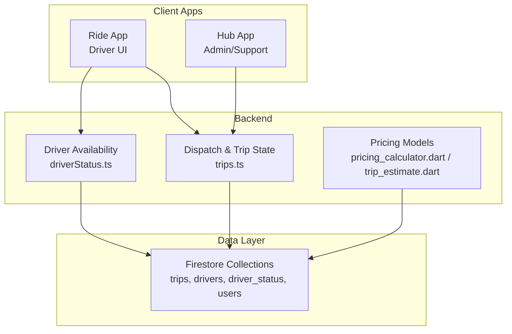

**Diagram sources**
- [trips.ts:12-26](file://functions/src/trips.ts#L12-L26)
- [driverStatus.ts:6-10](file://functions/src/driverStatus.ts#L6-L10)
- [pricing_calculator.dart:105-141](file://sese_core/lib/services/pricing_calculator.dart#L105-L141)

**Section sources**
- [trips.ts:12-26](file://functions/src/trips.ts#L12-L26)
- [driverStatus.ts:6-10](file://functions/src/driverStatus.ts#L6-L10)
- [pricing_calculator.dart:105-141](file://sese_core/lib/services/pricing_calculator.dart#L105-L141)

## Core Components
- Trip lifecycle and dispatch engine: creates trips, runs cascading tiers, handles accept/decline, cancellation, bidding, and fare increases.
- Driver availability service: validates GPS, profile/vehicle verification, suspension checks, and active-trip guards before allowing a driver to go online or offline.
- Pricing models: generate per-vehicle dispatch proposals and fare estimates used during booking and bidding.

Key responsibilities:
- Maintain authoritative trip state machine.
- Rank nearby drivers using last known locations.
- Promote offers across tiers on timeouts.
- Enforce atomic first-wins acceptance.
- Track driver streaks and penalties for declines/expired pings.
- Provide real-time location updates for assigned drivers.

**Section sources**
- [trips.ts:12-26](file://functions/src/trips.ts#L12-L26)
- [trips.ts:252-287](file://functions/src/trips.ts#L252-L287)
- [driverStatus.ts:32-164](file://functions/src/driverStatus.ts#L32-L164)
- [pricing_calculator.dart:105-141](file://sese_core/lib/services/pricing_calculator.dart#L105-L141)

## Architecture Overview
The dispatch system uses a server-driven state machine with three primary phases:
- Tier 1: exclusive ping to the nearest eligible driver.
- Tier 2: simultaneous ping to the next two nearest eligible drivers.
- Tier 3: marketplace broadcast where any eligible driver can claim.

A cron job promotes offers, expires ignored pings, restarts searches, and prompts idle trips to increase fares.

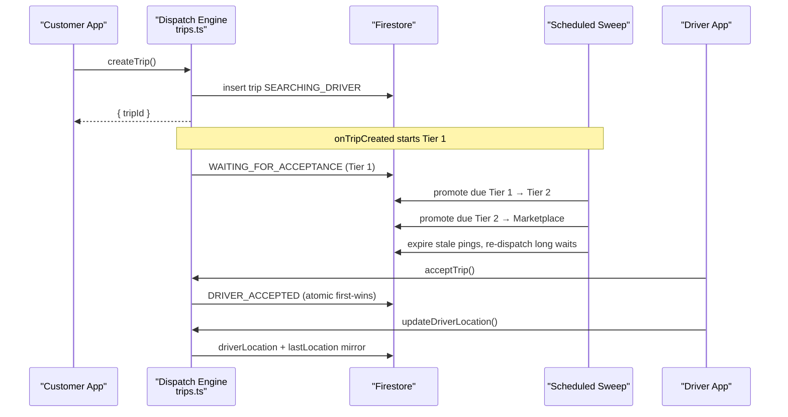

**Diagram sources**
- [trips.ts:129-225](file://functions/src/trips.ts#L129-L225)
- [trips.ts:372-384](file://functions/src/trips.ts#L372-L384)
- [trips.ts:401-512](file://functions/src/trips.ts#L401-L512)
- [trips.ts:591-653](file://functions/src/trips.ts#L591-L653)
- [trips.ts:716-754](file://functions/src/trips.ts#L716-L754)

## Detailed Component Analysis

### Driver Availability Tracking
Drivers must pass a zero-trust handshake before being considered available:
- JWT validation and identity binding.
- Mock-location detection and accuracy threshold enforcement.
- Suspension and profile/vehicle verification checks.
- Active-trip guard prevents going online/offline mid-ride.
- On success, writes authoritative `isOnline`, `lastSeen`, and `lastLocation` into both `driver_status` and `drivers` collections.

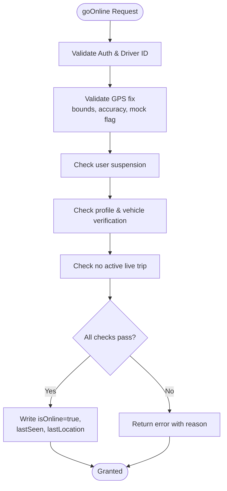

**Diagram sources**
- [driverStatus.ts:32-164](file://functions/src/driverStatus.ts#L32-L164)

**Section sources**
- [driverStatus.ts:32-164](file://functions/src/driverStatus.ts#L32-L164)
- [driver_status_service.dart:147-157](file://sese_ride/lib/features/driver/services/driver_status_service.dart#L147-L157)

### Proximity-Based Matching Algorithm
Matching ranks eligible online drivers by distance from pickup:
- Filters drivers by `isOnline`, excludes already attempted drivers.
- Applies service-type eligibility (e.g., ride vs send-item).
- Computes great-circle distance using haversine formula.
- Caps candidates within a coverage radius and sorts nearest-first.

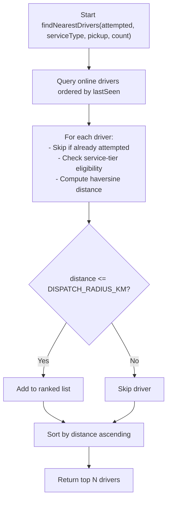

**Diagram sources**
- [trips.ts:252-287](file://functions/src/trips.ts#L252-L287)
- [trips.ts:65-79](file://functions/src/trips.ts#L65-L79)

**Section sources**
- [trips.ts:252-287](file://functions/src/trips.ts#L252-L287)
- [trips.ts:65-79](file://functions/src/trips.ts#L65-L79)

### Tiered Dispatch Strategies
Three cascading tiers balance speed and fairness:
- Tier 1: exclusive offer to the single nearest driver for 15 seconds.
- Tier 2: simultaneous offer to the next two nearest drivers for 15 seconds.
- Tier 3: marketplace broadcast open to all nearby drivers.

Promotions are driven by deadlines stored on the trip document and enforced by the scheduled sweep.

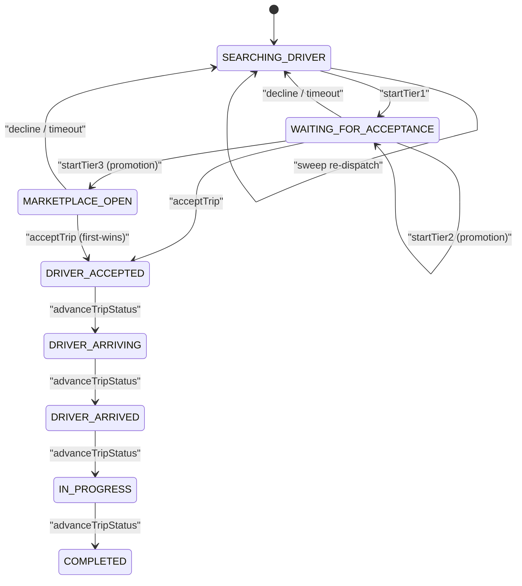

**Diagram sources**
- [trips.ts:31-42](file://functions/src/trips.ts#L31-L42)
- [trips.ts:295-370](file://functions/src/trips.ts#L295-L370)
- [trips.ts:401-512](file://functions/src/trips.ts#L401-L512)

**Section sources**
- [trips.ts:31-42](file://functions/src/trips.ts#L31-L42)
- [trips.ts:295-370](file://functions/src/trips.ts#L295-L370)
- [trips.ts:401-512](file://functions/src/trips.ts#L401-L512)

### Trip Assignment Process
Assignment is atomic and safe against race conditions:
- For Tier 1/2, only current ping targets may accept.
- For Tier 3, any online driver may claim; the transaction aborts losers once `driver` is set.
- Acceptance sets trip to `DRIVER_ACCEPTED`, clears pending pings, and attaches driver snapshot.

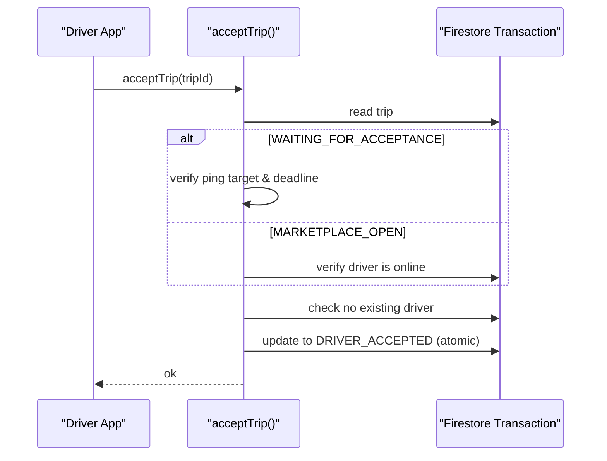

**Diagram sources**
- [trips.ts:591-653](file://functions/src/trips.ts#L591-L653)

**Section sources**
- [trips.ts:591-653](file://functions/src/trips.ts#L591-L653)

### Driver Notification System
Notifications are best-effort Firestore records used by clients to surface alerts:
- Idle marketplace prompt after 30 minutes encourages price increases.
- Reassignment failure notifies customer to adjust fare.
- These notifications are appended under `users/{customerId}/notifications`.

**Section sources**
- [trips.ts:476-512](file://functions/src/trips.ts#L476-L512)
- [trips.ts:897-914](file://functions/src/trips.ts#L897-L914)

### Acceptance and Rejection Workflows
- Accept: transitions to `DRIVER_ACCEPTED`, clears pings, attaches driver info.
- Decline: breaks driver streak, advances dispatch immediately:
  - Tier 1 decline → jump to Tier 2.
  - Tier 2 decline → remove decliner; if none remain, jump to Tier 3.
- Advance: driver moves through allowed states (`DRIVER_ARRIVING`, `DRIVER_ARRIVED`, `IN_PROGRESS`, `COMPLETED`).

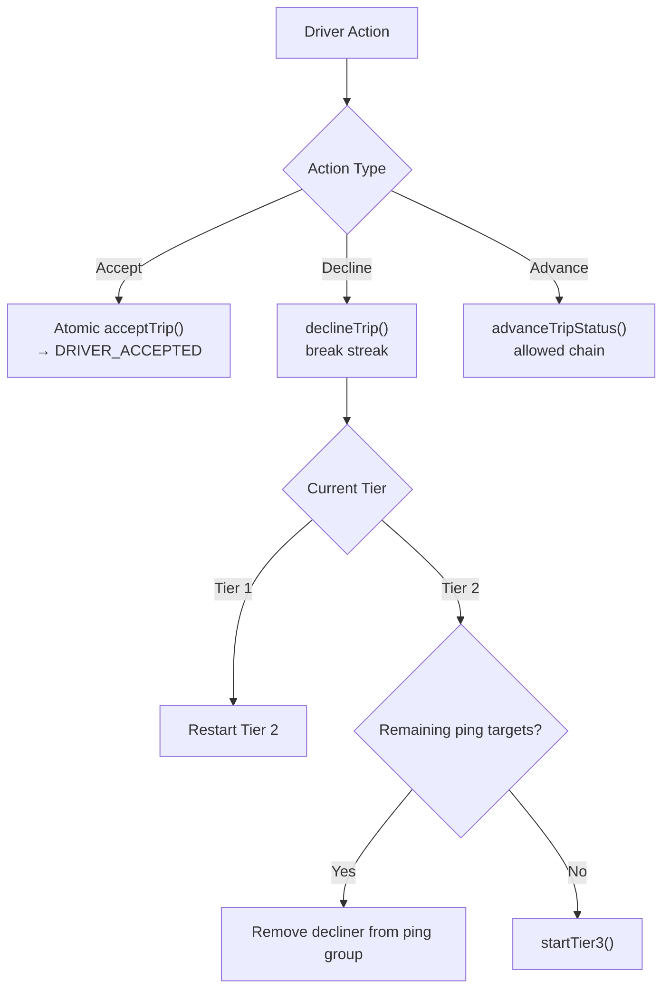

**Diagram sources**
- [trips.ts:662-714](file://functions/src/trips.ts#L662-L714)
- [trips.ts:756-796](file://functions/src/trips.ts#L756-L796)

**Section sources**
- [trips.ts:662-714](file://functions/src/trips.ts#L662-L714)
- [trips.ts:756-796](file://functions/src/trips.ts#L756-L796)

### Fallback Mechanisms, Queue Management, and Priority Handling
- No drivers at creation: sweep retries every 30 seconds until a driver becomes available.
- Ignored pings break driver streaks (treated like declines).
- Long-waiting searches are re-dispatched automatically.
- After 30 minutes in marketplace without action, a price-prompt notification is sent.
- If multiple drivers cancel after acceptance, up to three auto-reassignments occur; beyond that, the trip enters `needs_customer_action` prompting fare adjustment.

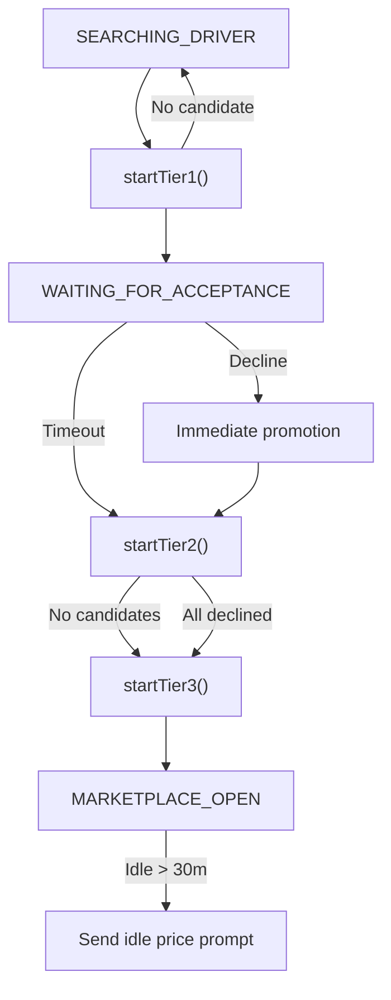

**Diagram sources**
- [trips.ts:401-512](file://functions/src/trips.ts#L401-L512)
- [trips.ts:847-915](file://functions/src/trips.ts#L847-L915)

**Section sources**
- [trips.ts:401-512](file://functions/src/trips.ts#L401-L512)
- [trips.ts:847-915](file://functions/src/trips.ts#L847-L915)

### Real-Time Coordination, Location Sharing, and Status Synchronization
- Drivers send GPS heartbeats for assigned trips; the server updates `driverLocation` on the trip and mirrors `lastLocation` on the driver doc for ranking.
- Only the assigned driver can update location; live statuses are enforced.
- Status synchronization is centralized via `advanceTripStatus`, which enforces allowed transitions and records arrival timestamps for no-show handling.

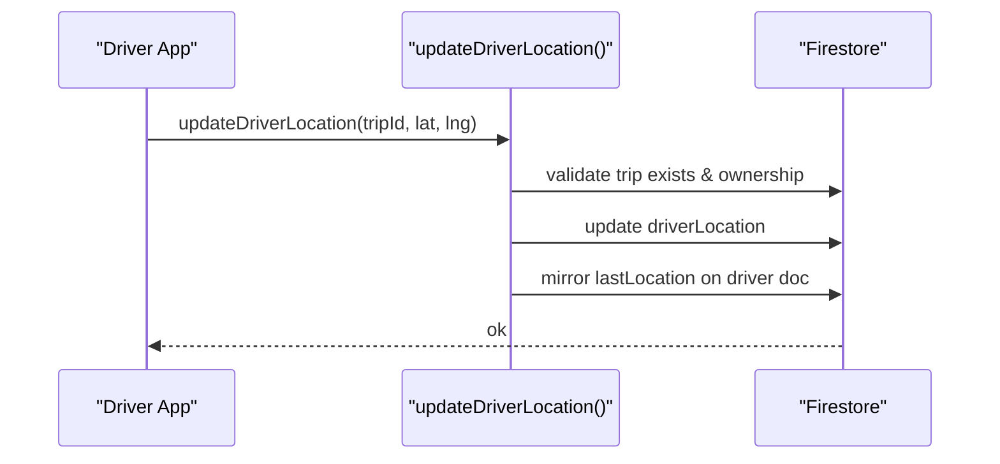

**Diagram sources**
- [trips.ts:716-754](file://functions/src/trips.ts#L716-L754)
- [trips.ts:756-796](file://functions/src/trips.ts#L756-L796)

**Section sources**
- [trips.ts:716-754](file://functions/src/trips.ts#L716-L754)
- [trips.ts:756-796](file://functions/src/trips.ts#L756-L796)

### Multi-Driver Bidding and Fare Adjustment
- Drivers can submit bids on open trips; bids include offered fare and ETA.
- Customers can reject or accept bids atomically; accepted bid finalizes fare and assigns driver.
- Customers can raise fares to attract drivers faster; this restarts search or broadcasts to marketplace.

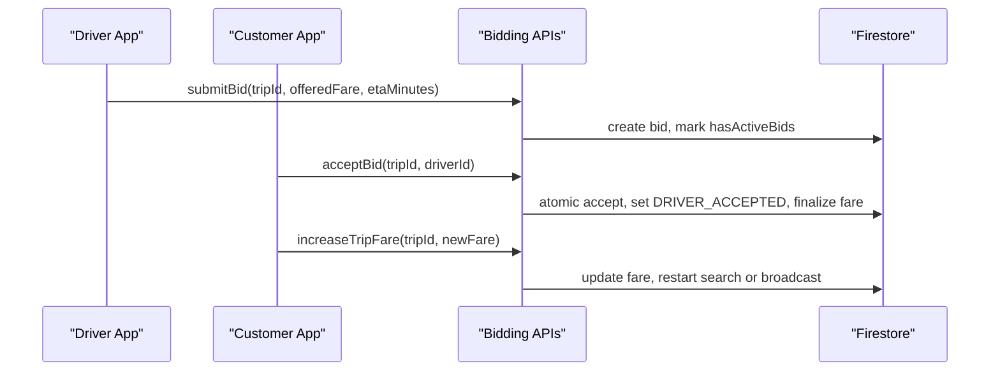

**Diagram sources**
- [trips.ts:931-1034](file://functions/src/trips.ts#L931-L1034)
- [trips.ts:1072-1170](file://functions/src/trips.ts#L1072-L1170)
- [trips.ts:1172-1224](file://functions/src/trips.ts#L1172-L1224)

**Section sources**
- [trips.ts:931-1034](file://functions/src/trips.ts#L931-L1034)
- [trips.ts:1072-1170](file://functions/src/trips.ts#L1072-L1170)
- [trips.ts:1172-1224](file://functions/src/trips.ts#L1172-L1224)

### Dispatch Optimization Algorithms and Load Balancing
Optimization levers:
- Proximity ranking via haversine distance ensures shortest pick-up time.
- Tiered escalation balances exclusivity and market breadth.
- Candidate cap limits query size and processing overhead.
- Service-tier filtering avoids mismatched vehicles.
- Streak penalties discourage repeated declines/expired pings, improving reliability.
- Auto-reassignment loop distributes workload among nearby drivers after cancellations.

Load balancing considerations:
- Excluding already-attempted drivers reduces duplicate offers.
- Tier 2 simultaneous offers spread risk across two drivers.
- Marketplace broadcast opens demand to all eligible drivers.
- Reassignment history tracks attempts and reasons for analytics.

**Section sources**
- [trips.ts:252-287](file://functions/src/trips.ts#L252-L287)
- [trips.ts:324-370](file://functions/src/trips.ts#L324-L370)
- [trips.ts:847-915](file://functions/src/trips.ts#L847-L915)

### Performance Metrics Collection
Built-in observability fields:
- `declineCount`: number of declines/expired pings.
- `reassignmentCount` and `reassignmentHistory`: track driver cancellations and reattempts.
- `attemptedDriverIds`: deduplicates offers.
- `idlePromptSent` and `idlePromptAt`: measure marketplace idleness.
- Timestamps (`createdAt`, `updatedAt`, `tierExpiresAt`, `pingExpiresAt`) enable SLA analysis.

These fields support dashboards for match latency, acceptance rates, reassignment frequency, and idle marketplace behavior.

**Section sources**
- [trips.ts:180-225](file://functions/src/trips.ts#L180-L225)
- [trips.ts:401-512](file://functions/src/trips.ts#L401-L512)
- [trips.ts:847-915](file://functions/src/trips.ts#L847-L915)

## Dependency Analysis
The dispatch system depends on:
- Firestore for state persistence and event triggers.
- Firebase Authentication for identity and authorization.
- Scheduled functions for sweep operations.
- Client services for driver status handshakes and pricing model generation.

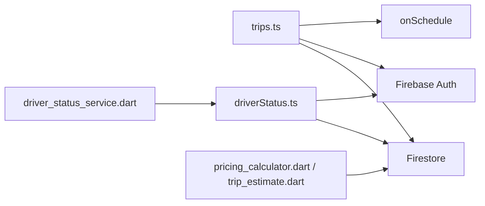

**Diagram sources**
- [trips.ts:1-10](file://functions/src/trips.ts#L1-L10)
- [driverStatus.ts:1-5](file://functions/src/driverStatus.ts#L1-L5)
- [driver_status_service.dart:1-5](file://sese_ride/lib/features/driver/services/driver_status_service.dart#L1-L5)
- [pricing_calculator.dart:105-141](file://sese_core/lib/services/pricing_calculator.dart#L105-L141)

**Section sources**
- [trips.ts:1-10](file://functions/src/trips.ts#L1-L10)
- [driverStatus.ts:1-5](file://functions/src/driverStatus.ts#L1-L5)
- [driver_status_service.dart:1-5](file://sese_ride/lib/features/driver/services/driver_status_service.dart#L1-L5)
- [pricing_calculator.dart:105-141](file://sese_core/lib/services/pricing_calculator.dart#L105-L141)

## Performance Considerations
- Keep `DISPATCH_CANDIDATE_LIMIT` and `DISPATCH_RADIUS_KM` tuned to region density to balance match quality and query cost.
- Use server timestamps consistently to avoid clock skew.
- Batch updates where possible; avoid excessive writes from frequent heartbeats.
- Monitor sweep throughput and limit batch sizes to prevent function throttling.
- Cache driver snapshots on the client side to reduce redundant reads.

[No sources needed since this section provides general guidance]

## Troubleshooting Guide
Common issues and resolutions:
- Unauthenticated requests: ensure valid Firebase ID token is attached.
- Invalid arguments: verify required fields such as tripId, coordinates, and phone numbers.
- Permission denied: confirm caller owns the trip or is the assigned driver.
- Failed precondition: check trip status transitions and driver eligibility (online, verified, not in active trip).
- Deadline exceeded: ping expired; driver must act before timeout.
- Not found: trip or bid does not exist.

Operational tips:
- Inspect `cancellationSource` and `statusMessage` to understand why a trip stalled.
- Review `reassignmentHistory` to diagnose repeated driver cancellations.
- Use `idlePromptSent` to detect marketplace stagnation and prompt fare adjustments.

**Section sources**
- [trips.ts:591-653](file://functions/src/trips.ts#L591-L653)
- [trips.ts:662-714](file://functions/src/trips.ts#L662-L714)
- [trips.ts:716-754](file://functions/src/trips.ts#L716-L754)
- [trips.ts:800-927](file://functions/src/trips.ts#L800-L927)

## Conclusion
The dispatch system combines strict server-side validation, proximity-based matching, and a tiered escalation strategy to reliably connect drivers and customers. It maintains robust fallbacks, clear status synchronization, and actionable metrics. By tuning thresholds and monitoring key fields, operators can optimize match times, improve driver utilization, and enhance customer experience.

[No sources needed since this section summarizes without analyzing specific files]